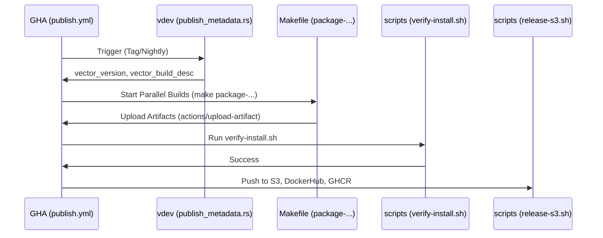
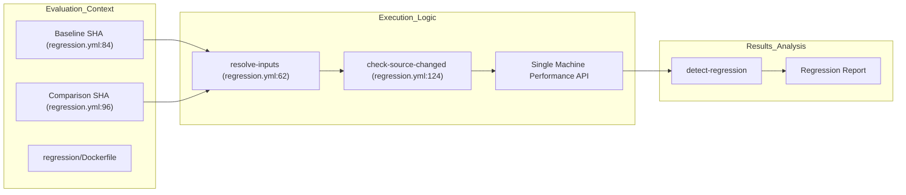

<!-- source: DeepWiki mcp.deepwiki.com · repo vectordotdev/vector · page 8.4 Build and Release · fetched 2026-10-29 -->

# Build and Release

<details>
<summary>Relevant source files</summary>

The following files were used as context for generating this wiki page:

- [.github/ISSUE_TEMPLATE/minor-release.md](.github/ISSUE_TEMPLATE/minor-release.md)
- [.github/ISSUE_TEMPLATE/patch-release.md](.github/ISSUE_TEMPLATE/patch-release.md)
- [.github/workflows/changes.yml](.github/workflows/changes.yml)
- [.github/workflows/ci-integration-review.yml](.github/workflows/ci-integration-review.yml)
- [.github/workflows/component_features.yml](.github/workflows/component_features.yml)
- [.github/workflows/cross.yml](.github/workflows/cross.yml)
- [.github/workflows/install-sh.yml](.github/workflows/install-sh.yml)
- [.github/workflows/integration-test.yml](.github/workflows/integration-test.yml)
- [.github/workflows/integration.yml](.github/workflows/integration.yml)
- [.github/workflows/k8s_e2e.yml](.github/workflows/k8s_e2e.yml)
- [.github/workflows/msrv.yml](.github/workflows/msrv.yml)
- [.github/workflows/nightly.yml](.github/workflows/nightly.yml)
- [.github/workflows/publish.yml](.github/workflows/publish.yml)
- [.github/workflows/regression.yml](.github/workflows/regression.yml)
- [.github/workflows/release.yml](.github/workflows/release.yml)
- [.github/workflows/test.yml](.github/workflows/test.yml)
- [.github/workflows/unit_mac.yml](.github/workflows/unit_mac.yml)
- [.github/workflows/unit_windows.yml](.github/workflows/unit_windows.yml)
- [Makefile](Makefile)
- [distribution/docker/alpine/Dockerfile](distribution/docker/alpine/Dockerfile)
- [distribution/docker/debian/Dockerfile](distribution/docker/debian/Dockerfile)
- [distribution/docker/distroless-libc/Dockerfile](distribution/docker/distroless-libc/Dockerfile)
- [distribution/docker/distroless-static/Dockerfile](distribution/docker/distroless-static/Dockerfile)
- [lib/k8s-test-framework/src/interface.rs](lib/k8s-test-framework/src/interface.rs)
- [regression/Dockerfile](regression/Dockerfile)
- [scripts/build-docker.sh](scripts/build-docker.sh)
- [scripts/cross/Dockerfile](scripts/cross/Dockerfile)
- [scripts/cross/bootstrap-ubuntu.sh](scripts/cross/bootstrap-ubuntu.sh)
- [scripts/environment/install-debian-build-deps.sh](scripts/environment/install-debian-build-deps.sh)
- [scripts/package-msi.sh](scripts/package-msi.sh)
- [scripts/package-rpm.sh](scripts/package-rpm.sh)
- [scripts/release-s3.sh](scripts/release-s3.sh)
- [scripts/test-e2e-kubernetes.sh](scripts/test-e2e-kubernetes.sh)
- [tilt/Dockerfile](tilt/Dockerfile)
- [vdev/src/commands/build/publish_metadata.rs](vdev/src/commands/build/publish_metadata.rs)
- [vdev/src/commands/check/markdown.rs](vdev/src/commands/check/markdown.rs)
- [vdev/src/commands/features.rs](vdev/src/commands/features.rs)
- [vdev/src/commands/info.rs](vdev/src/commands/info.rs)
- [vdev/src/commands/release/channel.rs](vdev/src/commands/release/channel.rs)
- [vdev/src/commands/release/github.rs](vdev/src/commands/release/github.rs)
- [vdev/src/commands/release/homebrew.rs](vdev/src/commands/release/homebrew.rs)
- [vdev/src/commands/run.rs](vdev/src/commands/run.rs)
- [vdev/src/testing/build.rs](vdev/src/testing/build.rs)
- [vdev/src/testing/mod.rs](vdev/src/testing/mod.rs)

</details>


This document describes Vector's build and release infrastructure, including cross-compilation for 10+ platforms, package generation (DEB, RPM, MSI), Docker image publishing, and release orchestration.

## Overview

Vector's release system is designed to produce optimized binaries and packages for a wide variety of operating systems and architectures. The process is primarily orchestrated via GitHub Actions and a custom `Makefile` interface that abstracts complex cross-compilation logic. Releases are triggered by Git tags (e.g., `v0.*`, `v1.*`) or a nightly schedule [.github/workflows/release.yml:7-10](), [.github/workflows/nightly.yml:8-9]().

Sources: [.github/workflows/publish.yml:1-35](), [.github/workflows/release.yml:1-21](), [.github/workflows/nightly.yml:1-21]()

## Build System Architecture

Vector utilizes a layered build architecture to manage complexity across 93+ crates and multiple target triples.

Title: Build System Orchestration and Artifact Flow
```mermaid
graph TD
    subgraph "Orchestration_Layer"
        ["Makefile"]
        VDEV["vdev CLI (cargo vdev)"]
        GHA["GitHub Actions (publish.yml)"]
    end

    subgraph "Execution_Layer"
        CROSS["cross-rs (Makefile:140)"]
        DOCKER["Docker (build-docker.sh)"]
        NATIVE["Native Runners (publish.yml:66)"]
    end

    subgraph "Output_Artifacts"
        ARCHIVE[".tar.gz / .zip"]
        DEB[".deb (cargo-deb)"]
        RPM[".rpm (package-rpm.sh)"]
        MSI[".msi (package-msi.sh)"]
        IMG["Docker Images"]
    end

    GHA --> ["Makefile"]
    ["Makefile"] --> VDEV
    ["Makefile"] --> CROSS
    CROSS --> DOCKER
    ["Makefile"] --> NATIVE
    
    VDEV --> ARCHIVE
    ["Makefile"] --> DEB
    ["Makefile"] --> RPM
    NATIVE --> MSI
    DOCKER --> IMG
```

### Build Tools and Environment
*   **Makefile**: The central entry point for all build commands. It handles OS detection and sets critical environment variables like `RUST_TARGET` and `FEATURES` [Makefile:12-22](). It defines targets for specific triples like `build-x86_64-unknown-linux-gnu` [Makefile:94-96]().
*   **vdev CLI**: A specialized tool (`cargo vdev`) used for versioning, metadata generation, and release preparation [Makefile:52-54]().
*   **Cross**: Vector uses `cross` for Docker-based cross-compilation to ensure consistent build environments. Specific digests are pinned for each target [Makefile:140-148]().
*   **Build Profiles**: Release builds use optimized flags. The `build` target in the Makefile explicitly sets `CFLAGS += -g0 -O3` and uses `cargo build --release` [Makefile:95-97]().

Sources: [Makefile:1-125](), [.github/workflows/publish.yml:36-43](), [.github/ISSUE_TEMPLATE/minor-release.md:36-37]()

## Cross-Compilation Infrastructure

Vector supports 10+ platform targets, ranging from standard Linux distributions to ARM-based IoT devices and Windows/macOS.

| Target Triple | Format | Runner Type |
| :--- | :--- | :--- |
| `x86_64-unknown-linux-gnu` | .tar.gz, .deb, .rpm | ubuntu-24.04-8core |
| `aarch64-unknown-linux-musl`| .tar.gz | release-builder-linux |
| `armv7-unknown-linux-gnueabihf` | .tar.gz, .deb, .rpm | release-builder-linux |
| `aarch64-apple-darwin` | .tar.gz | macos-14-xlarge |
| `x86_64-pc-windows-msvc` | .zip, .msi | windows-2025-8core |

### Linux Cross-Compilation
Linux builds are performed on specialized `release-builder-linux` runners for non-native architectures [.github/workflows/publish.yml:138-139](). The environment is bootstrapped using `.github/actions/setup`, which installs `rustup`, `cross`, and `cargo-deb` [.github/workflows/publish.yml:160-165]().

### Native Builds (macOS & Windows)
*   **macOS**: Performed on `macos-14-xlarge` and `macos-14` runners. It produces ARM64 and x86_64 Darwin binaries [.github/workflows/publish.yml:180-195]().
*   **Windows**: Uses `windows-2025-8core` runners. It requires the WiX Toolset to generate MSI installers [.github/workflows/publish.yml:211-235]().

Sources: [.github/workflows/publish.yml:66-240](), [Makefile:94-124](), [.github/workflows/cross.yml:15-32]()

## Release Workflow and Metadata

The release process follows a strict sequence to ensure all artifacts are consistent.

Title: Release Workflow Data Flow


### Metadata Generation
The `generate-publish-metadata` job executes `make ci-generate-publish-metadata` [.github/workflows/publish.yml:62-64](). This job outputs:
1.  `vector_version`: Extracted from the workspace metadata via `vdev` [.github/workflows/publish.yml:50]().
2.  `vector_build_desc`: A description of the build [.github/workflows/publish.yml:51]().
3.  `vector_release_channel`: Usually `release`, `nightly`, or `custom` [.github/workflows/publish.yml:52]().

### Verification
Before publishing, artifacts are staged as GitHub Action artifacts [.github/workflows/publish.yml:131-135](). The workflow includes validation steps like `verify-install.sh` to ensure the generated packages are viable before they are pushed to public repositories.

Sources: [.github/workflows/publish.yml:45-136](), [vdev/src/commands/build/publish_metadata.rs:1-20]()

## Artifact Distribution

### Docker Image Publishing
Vector publishes multi-arch images to DockerHub and GHCR. 
*   **Variants**: Alpine, Debian, and Distroless variants are maintained via specific Dockerfiles in `distribution/docker/` [.github/ISSUE_TEMPLATE/minor-release.md:46-47]().
*   **Multi-arch**: Support includes `amd64` and `arm64` [.github/workflows/publish.yml:85-88]().

### S3 and Release Assets
Release artifacts are uploaded to AWS S3 using `scripts/release-s3.sh`. This includes the `.tar.gz` archives, checksums, and the `install.sh` script used for binary installations [.github/ISSUE_TEMPLATE/minor-release.md:52]().

### Release Preparation (vdev)
The `cargo vdev release prepare` command handles the automation of release tasks, including:
*   Updating versions in `Cargo.toml` and pinning VRL [.github/ISSUE_TEMPLATE/minor-release.md:45]().
*   Updating `Dockerfile` base versions for Alpine and Debian [.github/ISSUE_TEMPLATE/minor-release.md:46-47]().
*   Generating release notes and CUE documentation [.github/ISSUE_TEMPLATE/minor-release.md:48-50]().

Sources: [.github/ISSUE_TEMPLATE/minor-release.md:9-105](), [vdev/src/commands/release/homebrew.rs:1-20](), [vdev/src/commands/release/github.rs:1-20]()

## Regression Benchmarking

Vector maintains a performance regression suite that runs weekly or on-demand to detect throughput or latency regressions [.github/workflows/regression.yml:1-30]().

Title: Regression Detection Logic


### Workflow Details
1.  **SHA Resolution**: The `resolve-inputs` job determines the baseline (default: 7 days ago) and comparison (HEAD) SHAs [.github/workflows/regression.yml:62-115]().
2.  **Change Detection**: The `check-source-changed` job uses `dorny/paths-filter` to skip benchmarking if no relevant code changes occurred (ignoring docs, website, etc.) [.github/workflows/regression.yml:124-159]().
3.  **SMP Execution**: The workflow interacts with the `SINGLE_MACHINE_PERFORMANCE_API` [.github/workflows/regression.yml:57](). It uses a `SMP_WARMUP_SECONDS` of 70 and `SMP_REPLICAS` of 100 to ensure statistically significant results [.github/workflows/regression.yml:58-59]().

Sources: [.github/workflows/regression.yml:1-160]()

---

