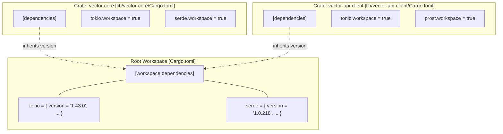
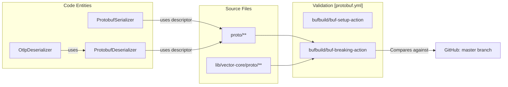

<!-- source: DeepWiki mcp.deepwiki.com · repo vectordotdev/vector · page 8.5 Dependency Management · fetched 2026-10-29 -->

# Dependency Management

Relevant source files

The following files were used as context for generating this wiki page:

- [.github/dependabot.yml](.github/dependabot.yml)
- [.github/workflows/protobuf.yml](.github/workflows/protobuf.yml)
- [.github/workflows/semantic.yml](.github/workflows/semantic.yml)
- [lib/codecs/src/decoding/format/mod.rs](lib/codecs/src/decoding/format/mod.rs)
- [lib/codecs/src/decoding/format/otlp.rs](lib/codecs/src/decoding/format/otlp.rs)
- [lib/codecs/src/decoding/format/protobuf.rs](lib/codecs/src/decoding/format/protobuf.rs)
- [lib/codecs/src/encoding/format/protobuf.rs](lib/codecs/src/encoding/format/protobuf.rs)
- [website/content/en/highlights/2025-08-12-0-49-0-upgrade-guide.md](website/content/en/highlights/2025-08-12-0-49-0-upgrade-guide.md)
- [website/cue/reference/releases/0.49.0.cue](website/cue/reference/releases/0.49.0.cue)
- [website/cue/reference/releases/0.51.0.cue](website/cue/reference/releases/0.51.0.cue)

This document covers how Vector manages its extensive external dependencies, including automated updates, version management, license compliance, security scanning, and protobuf schema coordination. Vector uses a Cargo workspace with over 93 crates and relies on hundreds of external dependencies that must be coordinated, updated, and audited.

## Overview

Vector's dependency management strategy balances stability, security, and compliance. The system ensures that all workspace members use consistent versions of libraries while maintaining a rigorous audit trail for licenses and security vulnerabilities.

## Workspace Dependency Management

Vector uses Cargo's workspace inheritance to centralize dependency versions in the root `Cargo.toml`. This prevents "version skew" where different components might accidentally pull in multiple versions of the same library.

### Centralized Dependency Definitions

The root `Cargo.toml` defines shared dependencies under the `[workspace.dependencies]` table. Individual crates then reference these shared definitions using the `.workspace = true` syntax.

**Entity Mapping: Workspace Dependency Resolution**

**Implementation Details:**
- **Workspace Members**: The workspace includes core libraries like `vector-core`, `vector-lib`, and specialized crates like `codecs` or `file-source`.
- **Workspace Lints**: Common lint configurations are shared across the workspace to maintain code quality, including `clippy` and `rust` lints. Individual crates inherit these via `[lints] workspace = true`.
- **Conditional Dependencies**: Crates often specify additional features on top of workspace dependencies, such as `vector-core` adding the `net` feature to the workspace `tokio` definition.

## License Compliance

Vector enforces strict license compliance through automated checks and manual auditing to protect its codebase.

### cargo-deny License Compliance
Vector uses `cargo-deny` (configured via `deny.toml`) to ensure all dependencies adhere to an allowed list of licenses.

| Policy | Configuration |
|--------|---------------|
| **Allowed Licenses** | 0BSD, Apache-2.0, BSD-2-Clause, BSD-3-Clause, BSL-1.0, CC0-1.0, CDLA-Permissive-2.0, ISC, MIT, MIT-0, BlueOak-1.0.0, OpenSSL, Unicode-3.0, Unicode-DFS-2016, Zlib |
| **MPL-2.0 Exceptions** | Allowed on a case-by-case basis for `colored`, `webpki-roots`, `vrl`, and internal macros to ensure compliance without modifying source files |
| **Clarifications** | The `ring` crate is clarified as `MIT AND ISC AND OpenSSL` based on its license file hash `0xbd0eed23` |

### License Verification Workflow
The project generates a comprehensive 3rd party license CSV (`LICENSE-3rdparty.csv`) which lists the origin, license, and copyright for every dependency. This file is included in binary distributions like DEB packages.

## Security Scanning

### OSSF Scorecard
Vector integrates the OpenSSF Scorecard to evaluate the security posture of the repository. This scanning provides automated assessment of supply chain security risks.

### Advisory Auditing
The `deny.toml` file includes an `[advisories]` section used to track and occasionally ignore specific security advisories (RUSTSEC) when they are determined to be non-applicable or unpatched upstream.

| Advisory ID | Reason for Ignoring |
|-------------|--------------------|
| `RUSTSEC-2023-0071` | RSA Marvin attack - unpatched upstream |
| `RUSTSEC-2024-0388` | `derivative` crate is unmaintained |
| `RUSTSEC-2025-0134` | `rustls-pemfile` unmaintained; requires tonic/reqwest upgrade |
| `RUSTSEC-2024-0436` | `paste` crate unmaintained; transitive via `parquet` |
| `RUSTSEC-2026-0194` | `quick-xml` 0.39.2 quadratic-time check - transitive dep via `azure_core` |

## Automated Dependency Updates

### Dependabot Configuration
Vector uses GitHub Dependabot with a monthly update cycle and sophisticated grouping to minimize PR volume [.github/dependabot.yml:5-6]().

**Grouping Logic:**
- **patches**: All patch-level updates across all ecosystems are combined [.github/dependabot.yml:15-20]().
- **Cloud SDKs**: Crates for `aws-*` [.github/dependabot.yml:28-33]() and `azure_*` [.github/dependabot.yml:34-39]() are grouped to maintain provider consistency.
- **Core Runtime**: `tokio-*` [.github/dependabot.yml:99-105](), `tonic-*` [.github/dependabot.yml:106-112](), `tower-*` [.github/dependabot.yml:113-119](), and `tracing-*` [.github/dependabot.yml:120-126]() are grouped to ensure the async runtime remains synchronized.
- **Serialization**: `serde` [.github/dependabot.yml:92-98]() and `prost` [.github/dependabot.yml:85-91]() (Protobuf) updates are grouped.
- **Docker**: Base images for Alpine, Debian, and Distroless variants are checked monthly [.github/dependabot.yml:159-167]().
- **Ecosystems**: Updates are also tracked for `github-actions` [.github/dependabot.yml:178-182]() and `npm` (for the website and environment tools) [.github/dependabot.yml:192-212]().

**Sources:** [.github/dependabot.yml:1-224]()

## Protobuf Schema Management

Vector utilizes Protocol Buffers for high-performance serialization in sinks and internal communication.

### Workflow and Compatibility
Vector uses the `buf` CLI to manage Protobuf files and ensure backward compatibility.

**Entity Mapping: Protobuf Validation Flow**

**Implementation Details:**
- **Breaking Change Detection**: CI runs `buf-breaking-action` on every PR that modifies `.proto` files in `proto/**` or `lib/vector-core/proto/**`, comparing them against the `master` branch [.github/workflows/protobuf.yml:7-12](), [.github/workflows/protobuf.yml:31-33]().
- **Runtime Deserialization**: The `ProtobufDeserializer` [lib/codecs/src/decoding/format/protobuf.rs:98-101]() uses `prost-reflect` to decode bytes based on a descriptor set file (`.desc`) generated by `protoc` [lib/codecs/src/decoding/format/protobuf.rs:73-79]().
- **Runtime Serialization**: The `ProtobufSerializer` [lib/codecs/src/encoding/format/protobuf.rs:82-86]() converts `Event` objects to bytes using `MessageDescriptor` [lib/codecs/src/encoding/format/protobuf.rs:119-131]().
- **OTLP Integration**: The `OtlpDeserializer` [lib/codecs/src/decoding/format/otlp.rs:104-110]() composes multiple `ProtobufDeserializer` instances for Logs, Metrics, and Traces [lib/codecs/src/decoding/format/otlp.rs:121-153]().

**Sources:** [.github/workflows/protobuf.yml:1-34](), [lib/codecs/src/decoding/format/protobuf.rs:1-124](), [lib/codecs/src/encoding/format/protobuf.rs:1-133](), [lib/codecs/src/decoding/format/otlp.rs:104-154]()

## Conventional Commits and Changelogs
Dependency updates are integrated into Vector's release process via automated labeling and PR title checks.
- **PR Titles**: Validated against conventional commit patterns via the `PR Title Check` workflow [.github/workflows/semantic.yml:4-15](). Valid types include `feat`, `fix`, `docs`, `chore`, `revert`, `enhancement`, `perf`, and `security` [.github/workflows/semantic.yml:22-26]().
- **No-Changelog Label**: Dependabot PRs are automatically tagged with `no-changelog` [.github/dependabot.yml:10-10](), [.github/dependabot.yml:170-170](), which bypasses the changelog fragment requirement in CI.
- **Commit Prefixes**: Dependabot is configured to use `chore(deps)` [.github/dependabot.yml:11-12]() or `chore(ci)` [.github/dependabot.yml:185-186]() as commit message prefixes.

**Sources:** [.github/workflows/semantic.yml:1-31](), [.github/dependabot.yml:8-12](), [.github/dependabot.yml:168-172](), [.github/dependabot.yml:182-186]()

---

