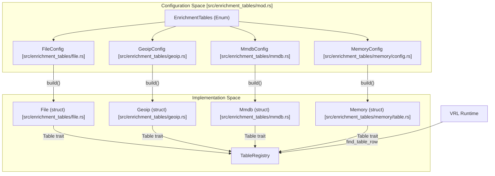
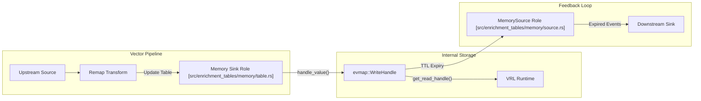

<!-- source: DeepWiki mcp.deepwiki.com · repo vectordotdev/vector · page 9.1 Enrichment Tables · fetched 2026-10-29 -->

# Enrichment Tables

Relevant source files

The following files were used as context for generating this wiki page:

- [changelog.d/25143_enrichment_table_memory_cuckoo_filter.feature.md](changelog.d/25143_enrichment_table_memory_cuckoo_filter.feature.md)
- [changelog.d/25154_enrichment_table_memory_bloom_filter.feature.md](changelog.d/25154_enrichment_table_memory_bloom_filter.feature.md)
- [lib/vector-common/src/internal_event/metric_name.rs](lib/vector-common/src/internal_event/metric_name.rs)
- [src/enrichment_tables/file.rs](src/enrichment_tables/file.rs)
- [src/enrichment_tables/geoip.rs](src/enrichment_tables/geoip.rs)
- [src/enrichment_tables/memory/bloom_table.rs](src/enrichment_tables/memory/bloom_table.rs)
- [src/enrichment_tables/memory/config.rs](src/enrichment_tables/memory/config.rs)
- [src/enrichment_tables/memory/cuckoo_table.rs](src/enrichment_tables/memory/cuckoo_table.rs)
- [src/enrichment_tables/memory/internal_events.rs](src/enrichment_tables/memory/internal_events.rs)
- [src/enrichment_tables/memory/mod.rs](src/enrichment_tables/memory/mod.rs)
- [src/enrichment_tables/memory/table.rs](src/enrichment_tables/memory/table.rs)
- [src/enrichment_tables/mmdb.rs](src/enrichment_tables/mmdb.rs)
- [src/enrichment_tables/mod.rs](src/enrichment_tables/mod.rs)
- [website/cue/reference/generated/configuration.cue](website/cue/reference/generated/configuration.cue)
- [website/cue/reference/remap/functions.cue](website/cue/reference/remap/functions.cue)

Enrichment tables provide a mechanism for VRL (Vector Remap Language) to perform lookups against external or internal data sets during event processing. These tables allow for data augmentation, such as geolocating IP addresses or mapping internal IDs to human-readable names, without the overhead of external network calls for every event.

## Architecture and Table Registry

The enrichment table system is centered around the `Table` trait and the `TableRegistry`. The `TableRegistry` acts as a central repository where all configured tables are loaded and indexed, allowing VRL functions to access them by name.

### Data Flow and Registry Access

When Vector starts, the configuration for enrichment tables is parsed into `EnrichmentTables` enum variants [src/enrichment_tables/mod.rs:48-69](). Each variant implements the `EnrichmentTableConfig` trait, which defines how to `build` the actual `Table` implementation.

The `TableRegistry` manages the lifecycle of these tables in two stages:
1.  **Writing Stage**: Tables are loaded and indexed. During this phase, transforms can call `add_index` to notify tables of which fields will be used for lookups.
2.  **Reading Stage**: Once the registry is finalized, tables are moved into an `ArcSwap`, providing lock-free, read-only access for the VRL runtime.

**Component Construction Flow**

Sources: [src/enrichment_tables/mod.rs:48-69](), [src/enrichment_tables/geoip.rs:100-108](), [src/enrichment_tables/mmdb.rs:35-43]()

### Key Interfaces

*   **`Table` Trait**: Defines the interface for searching data, including `find_table_row` (exact match) and `find_table_rows` (multiple matches). It also handles indexing via `add_index` and change detection via `needs_reload` [src/enrichment_tables/mod.rs:6-6]().
*   **`EnrichmentTables` Enum**: The top-level configuration container that uses `enum_dispatch` to route calls to specific table implementations [src/enrichment_tables/mod.rs:39-69]().

Sources: [src/enrichment_tables/mod.rs:4-48](), [src/enrichment_tables/mmdb.rs:98-173]()

## Table Types

### 1. File-based (CSV) Tables
The `file` type exposes data from static files. Currently, only CSV encoding is supported [src/enrichment_tables/file.rs:51-64](). It supports custom delimiters and schema coercion to ensure data types (like integers or timestamps) are correctly interpreted by VRL.

*   **Implementation**: `File` struct in `src/enrichment_tables/file.rs`.
*   **Features**:
    *   Supports headers or numerical indexing [src/enrichment_tables/file.rs:25-33]().
    *   Automatic type coercion for `bool`, `float`, `integer`, `date`, and `timestamp` via the `schema` map [src/enrichment_tables/file.rs:138-160]().
    *   Reloading: Monitors the file's `mtime` to trigger reloads when the source file changes [src/enrichment_tables/mod.rs:101-111]().

Sources: [src/enrichment_tables/file.rs:17-39](), [src/enrichment_tables/file.rs:67-122](), [src/enrichment_tables/mod.rs:101-111]()

### 2. GeoIP (MaxMind) Tables
Specialized for MaxMind GeoIP2 and GeoLite2 databases. It provides optimized lookups for IP-related metadata.

*   **Implementation**: `Geoip` struct in `src/enrichment_tables/geoip.rs`.
*   **Database Types**: Supports City, ISP, ASN, Connection Type, and Anonymous IP databases [src/enrichment_tables/geoip.rs:25-33]().
*   **Locale Support**: Allows specifying localized field names (e.g., "en", "de", "zh-CN") [src/enrichment_tables/geoip.rs:74-88]().
*   **Lookup Logic**: Uses `maxminddb::Reader` to perform lookups and maps results to VRL `Value` types [src/enrichment_tables/geoip.rs:119-131]().

Sources: [src/enrichment_tables/geoip.rs:51-76](), [src/enrichment_tables/geoip.rs:112-117](), [src/enrichment_tables/geoip.rs:165-182]()

### 3. MMDB Tables
A generic implementation for any database following the MaxMind DB format that isn't specifically a GeoIP product.

*   **Implementation**: `Mmdb` struct in `src/enrichment_tables/mmdb.rs`.
*   **Behavior**: Unlike the `geoip` table which maps specific fields to a known schema, the `mmdb` table returns the raw `ObjectMap` found at the IP address [src/enrichment_tables/mmdb.rs:72-95](). It only supports equality conditions on IP addresses [src/enrichment_tables/mmdb.rs:134-146]().

Sources: [src/enrichment_tables/mmdb.rs:17-24](), [src/enrichment_tables/mmdb.rs:47-51](), [src/enrichment_tables/mmdb.rs:72-95]()

### 4. In-Memory Tables
In-memory tables are dynamic caches that can be updated in real-time. They are unique because they can act as both a **Sink** (to receive updates from the pipeline) and a **Source** (to emit expired or periodically exported data).

*   **Implementation**: `Memory` struct in `src/enrichment_tables/memory/table.rs`.
*   **Concurrency**: Uses `evmap`, a lock-free, eventually consistent concurrent hash map [src/enrichment_tables/memory/table.rs:119-127]().
*   **Probabilistic Filtering**: Supports acting as a `Cuckoo` filter [src/enrichment_tables/memory/cuckoo_table.rs]() or `Bloom` filter [src/enrichment_tables/memory/bloom_table.rs]() instead of a full key-value store to save memory [src/enrichment_tables/memory/config.rs:84-88]().
*   **TTL Management**: Each entry can have a Time-To-Live (TTL). A background scan interval removes expired items [src/enrichment_tables/memory/config.rs:35-44](). TTL can be overridden per-entry via a `ttl_field` [src/enrichment_tables/memory/config.rs:75-78]().
*   **State Persistence**: Supports `reload_behavior: preserve-state` to keep data across configuration reloads by downcasting previous state [src/enrichment_tables/memory/table.rs:151-167]().

**Memory Table Integration**

Sources: [src/enrichment_tables/memory/table.rs:119-127](), [src/enrichment_tables/memory/config.rs:110-137](), [src/enrichment_tables/memory/table.rs:178-203]()

## VRL Access and Metrics

VRL accesses these tables via functions in the `Enrichment` category [website/cue/reference/remap/functions.cue:37-37]().

### Internal Metrics
The memory enrichment table system emits several internal metrics to track performance and health:
*   **`memory_enrichment_table_reads_total`**: Count of lookup operations [src/enrichment_tables/memory/internal_events.rs:31-37]().
*   **`memory_enrichment_table_insertions_total`**: Count of new entries added [src/enrichment_tables/memory/internal_events.rs:51-57]().
*   **`memory_enrichment_table_ttl_expirations`**: Count of items removed due to TTL [src/enrichment_tables/memory/internal_events.rs:104-110]().
*   **`memory_enrichment_table_byte_size`**: Current memory usage of the table [src/enrichment_tables/memory/internal_events.rs:91-91]().

Sources: [src/enrichment_tables/memory/internal_events.rs:21-164](), [lib/vector-common/src/internal_event/metric_name.rs:96-102]()

---

