# Page: Vector Overview

# Vector Overview

<details>
<summary>Relevant source files</summary>

The following files were used as context for generating this wiki page:

- [.gitignore](.gitignore)
- [Cargo.lock](Cargo.lock)
- [Cargo.toml](Cargo.toml)
- [LICENSE-3rdparty.csv](LICENSE-3rdparty.csv)
- [README.md](README.md)
- [Tiltfile](Tiltfile)
- [agents/skills/vector-components-maturity-eval/SKILL.md](agents/skills/vector-components-maturity-eval/SKILL.md)
- [deny.toml](deny.toml)
- [docs/REVIEWING.md](docs/REVIEWING.md)
- [docs/USER_EXPERIENCE_DESIGN.md](docs/USER_EXPERIENCE_DESIGN.md)
- [docs/specs/buffer.md](docs/specs/buffer.md)
- [docs/specs/component.md](docs/specs/component.md)
- [docs/specs/configuration.md](docs/specs/configuration.md)
- [docs/specs/instrumentation.md](docs/specs/instrumentation.md)
- [docs/specs/target.md](docs/specs/target.md)
- [lib/codecs/Cargo.toml](lib/codecs/Cargo.toml)
- [lib/docs-renderer/Cargo.toml](lib/docs-renderer/Cargo.toml)
- [lib/file-source/Cargo.toml](lib/file-source/Cargo.toml)
- [lib/k8s-e2e-tests/Cargo.toml](lib/k8s-e2e-tests/Cargo.toml)
- [lib/k8s-test-framework/Cargo.toml](lib/k8s-test-framework/Cargo.toml)
- [lib/loki-logproto/Cargo.toml](lib/loki-logproto/Cargo.toml)
- [lib/opentelemetry-proto/Cargo.toml](lib/opentelemetry-proto/Cargo.toml)
- [lib/prometheus-parser/Cargo.toml](lib/prometheus-parser/Cargo.toml)
- [lib/vector-api-client/Cargo.toml](lib/vector-api-client/Cargo.toml)
- [lib/vector-buffers/Cargo.toml](lib/vector-buffers/Cargo.toml)
- [lib/vector-buffers/src/variants/disk_v2/tests/model/action.rs](lib/vector-buffers/src/variants/disk_v2/tests/model/action.rs)
- [lib/vector-buffers/src/variants/disk_v2/tests/model/sequencer.rs](lib/vector-buffers/src/variants/disk_v2/tests/model/sequencer.rs)
- [lib/vector-common/Cargo.toml](lib/vector-common/Cargo.toml)
- [lib/vector-config-common/Cargo.toml](lib/vector-config-common/Cargo.toml)
- [lib/vector-config-macros/Cargo.toml](lib/vector-config-macros/Cargo.toml)
- [lib/vector-config/Cargo.toml](lib/vector-config/Cargo.toml)
- [lib/vector-core/Cargo.toml](lib/vector-core/Cargo.toml)
- [lib/vector-core/src/config/global_options.rs](lib/vector-core/src/config/global_options.rs)
- [lib/vector-lookup/Cargo.toml](lib/vector-lookup/Cargo.toml)
- [lib/vector-stream/Cargo.toml](lib/vector-stream/Cargo.toml)
- [lib/vector-tap/Cargo.toml](lib/vector-tap/Cargo.toml)
- [license-tool.toml](license-tool.toml)
- [rust-toolchain.toml](rust-toolchain.toml)
- [src/config/vars.rs](src/config/vars.rs)
- [src/internal_events/mod.rs](src/internal_events/mod.rs)
- [src/kubernetes/meta_cache.rs](src/kubernetes/meta_cache.rs)
- [src/kubernetes/mod.rs](src/kubernetes/mod.rs)
- [src/kubernetes/pod_manager_logic.rs](src/kubernetes/pod_manager_logic.rs)
- [src/kubernetes/reflector.rs](src/kubernetes/reflector.rs)
- [src/sinks/mod.rs](src/sinks/mod.rs)
- [src/sources/host_metrics/tcp.rs](src/sources/host_metrics/tcp.rs)
- [src/sources/kubernetes_logs/k8s_paths_provider.rs](src/sources/kubernetes_logs/k8s_paths_provider.rs)
- [src/sources/mod.rs](src/sources/mod.rs)
- [src/sources/prometheus/mod.rs](src/sources/prometheus/mod.rs)
- [src/transforms/mod.rs](src/transforms/mod.rs)
- [vdev/Cargo.toml](vdev/Cargo.toml)
- [website/content/en/docs/reference/configuration/_index.md](website/content/en/docs/reference/configuration/_index.md)
- [website/content/en/docs/reference/configuration/sources/prometheus_pushgateway.md](website/content/en/docs/reference/configuration/sources/prometheus_pushgateway.md)
- [website/content/en/docs/setup/installation/platforms/docker.md](website/content/en/docs/setup/installation/platforms/docker.md)
- [website/cue/reference/configuration.cue](website/cue/reference/configuration.cue)
- [website/cue/reference/urls.cue](website/cue/reference/urls.cue)
- [website/data/redirects.yaml](website/data/redirects.yaml)

</details>


## Purpose and Scope

This document provides a high-level technical overview of the Vector observability data pipeline, explaining its architecture, core subsystems, and how they integrate. Vector is a Rust-based tool for collecting, transforming, and routing logs, metrics, and traces at scale.

This page covers the overall system structure, workspace organization, and the three-component pipeline architecture. For detailed information about specific subsystems, see:

- Workspace organization and internal libraries: [Workspace Structure](#1.1)  
- Detailed library architecture: [Core Libraries](#1.2)  
- Component types and pipeline patterns: [Component Architecture](#1.3)  

---

## What is Vector

Vector is defined in [Cargo.toml:1-16]() as "a lightweight and ultra-fast tool for building observability pipelines". It is implemented as a Rust workspace containing 93+ crates organized into a monorepo structure.

**Key Characteristics:**

- **Language**: Rust (minimum version 1.95 as specified in [Cargo.toml:15]())  
- **License**: MPL-2.0 ([Cargo.toml:8]())  
- **Current Version**: 0.58.0 ([Cargo.toml:3]())  
- **Architecture**: Modular workspace with extensive feature flags for conditional compilation.

Vector processes observability data through a directed acyclic graph (DAG) of components: **sources** (data ingestion), **transforms** (data processing), and **sinks** (data output).

Sources, transforms, and sinks consume and emit events of various types: logs, metrics, and traces.

Sources: [Cargo.toml:1-16]()

---

## Cargo Workspace Structure

Vector uses a Cargo workspace defined in [Cargo.toml:98-137]() to organize its codebase into modular, reusable crates.

### Workspace Members Overview

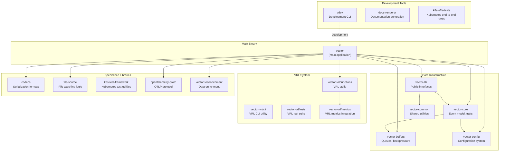

**Diagram: Cargo Workspace Dependency Structure**

This diagram demonstrates Vector's modular workspace architecture with a focus on the main binary, core infrastructure crates, VRL submodules, specialized libraries, and development tools.

Sources: [Cargo.toml:98-137](), [lib/vector-core/Cargo.toml:1-115](), [lib/vector-buffers/Cargo.toml:1-60](), [vdev/Cargo.toml:1-51]()

### Key Workspace Crates

| Crate                  | Location           | Purpose                                             |
|------------------------|--------------------|-----------------------------------------------------|
| `vector`               | `.` (root)         | Main binary and application logic                   |
| `vector-core`          | `lib/vector-core`  | Event data model, core traits, buffering mechanisms |
| `vector-buffers`       | `lib/vector-buffers` | In-memory and disk-based buffering, backpressure   |
| `vector-config`        | `lib/vector-config` | Configuration parsing, validation, schema support   |
| `vector-lib`           | `lib/vector-lib`   | Public API surface for embedding Vector as a library|
| `vector-vrl-functions` | `lib/vector-vrl/functions` | VRL standard library functions (200+ functions)    |
| `codecs`               | `lib/codecs`       | Event encoding/decoding (JSON, Avro, CSV, etc.)     |
| `file-source`          | `lib/file-source`  | File watching and tailing infrastructure             |
| `vdev`                 | `vdev`             | Development CLI tool for Vector build and testing    |

Sources: [Cargo.toml:98-137](), [lib/vector-core/Cargo.toml:1-7](), [lib/vector-buffers/Cargo.toml:1-7](), [lib/vector-config/Cargo.toml:1-8](), [vdev/Cargo.toml:1-51]()

---

## Component-Based Architecture

Vector's runtime is composed of three tightly integrated component types that form a data processing pipeline:

- **Sources**: Ingest observability data (logs, metrics, traces) from external systems.  
- **Transforms**: Process, enrich, and convert data.  
- **Sinks**: Export processed data to destinations like storage or observability services.

Each component type is implemented as configurable Rust structs with standard interfaces.

### Component Type System and Event Flow

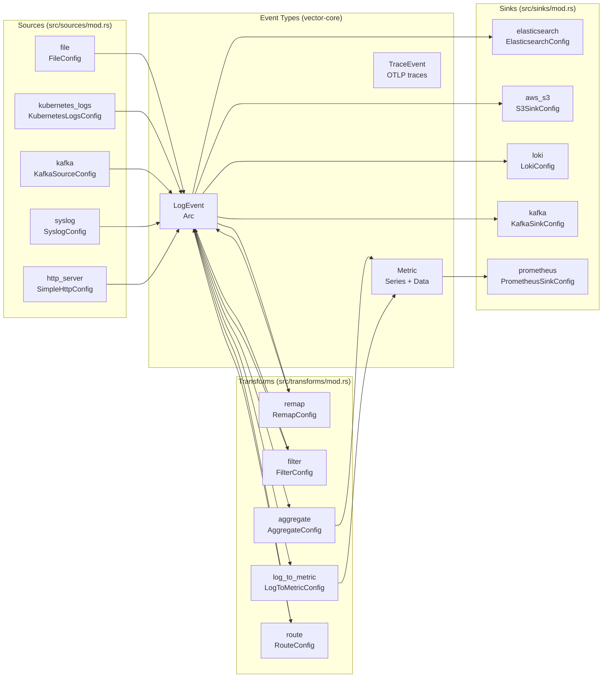

**Diagram: Component Types and Event Flow**

This diagram maps key source, transform, and sink components to the event types they consume and produce, highlighting the flow of logs, metrics, and traces through the pipeline.

Sources: [src/sources/mod.rs](), [src/transforms/mod.rs](), [src/sinks/mod.rs](), [lib/vector-core/src/event/mod.rs]()

---

## Core Runtime Architecture

### Application Lifecycle and Topology

Vector's application lifecycle and topology management involve several subsystems responsible for parsing configuration, instantiating components, and managing the running data pipeline.

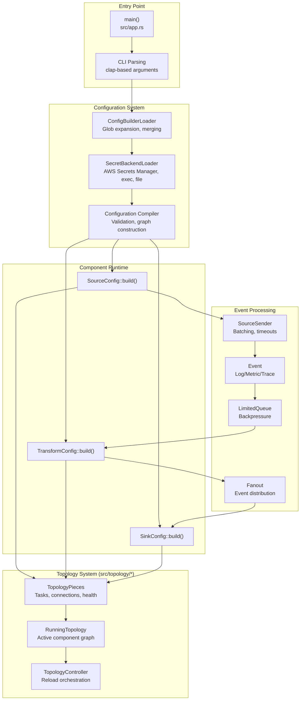

**Diagram: Vector Runtime Architecture with Code Entities**

This diagram aligns core runtime concepts to code entities, illustrating how configuration is loaded, compiled, and used to build the pipeline topology composed of sources, transforms, and sinks. Events are batched and buffered, then flow through transforms and finally fan out to sinks.

Sources: [Cargo.toml:1-16](), [src/sources/mod.rs](), [src/sinks/mod.rs](), [src/app.rs:main()]()

### Feature Flag System

Vector employs a flexible feature flag system to enable or disable component groups and platform integrations at compile time, allowing tailored builds.

Relevant feature flags are defined in [Cargo.toml:504-685]() such as:

```toml
[features]
default = ["api", "api-client", "enrichment-tables", "sinks", "sources", "transforms", "unix"]
sinks = ["sinks-logs", "sinks-metrics"]
sources = ["sources-logs", "sources-metrics"]
transforms = ["transforms-logs", "transforms-metrics"]
```

This modular design supports selective enabling of sources, transforms, sinks, and integrations with cloud providers.

Sources: [Cargo.toml:504-685]()

---

## Internal Events and Observability

Vector incorporates "internal events" to monitor the health and performance of its own components. These events are emitted from specialized modules under `src/internal_events/mod.rs`.

### Internal Event Categories

| Module                | Purpose                           |
|-----------------------|---------------------------------|
| `adaptive_concurrency` | Telemetry for adaptive concurrency |
| `aws`                  | Metrics related to AWS SDK usage  |
| `remap`                | VRL transform execution metrics   |
| `batch`                | Batching statistics and performance|

These internal events integrate with the `internal_metrics` source, enabling self-observability of Vector.

Sources: [lib/vector-core/Cargo.toml:31-33](), [src/internal_events/mod.rs]()

---

## VRL (Vector Remap Language) Integration

Vector features a domain-specific language (DSL) called VRL for custom data transformation logic, realized by the `remap` transform component.

### VRL Architecture and Components

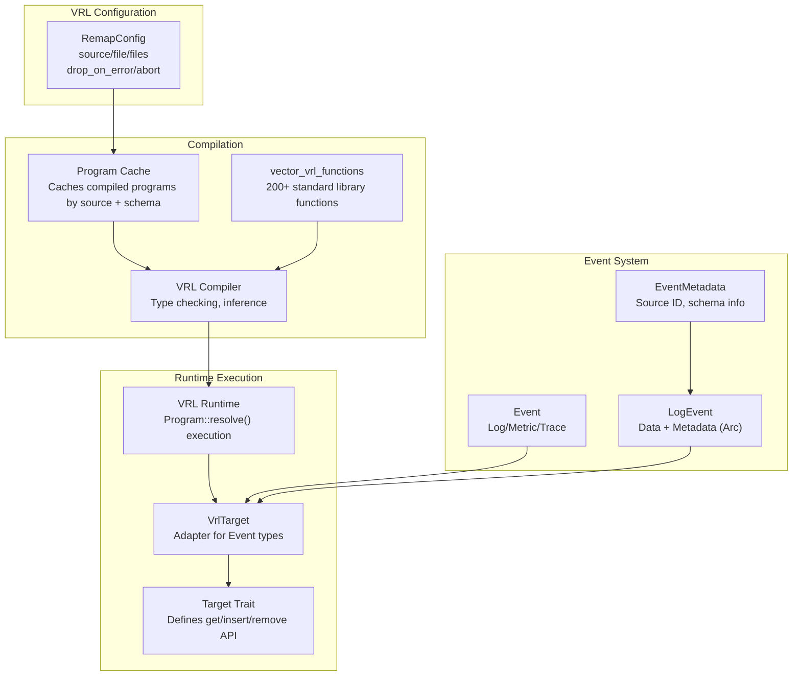

**Diagram: VRL Transform Integration Architecture**

This diagram captures the flow from VRL configuration through compilation and runtime execution, adapted for Vector's event types. The remap transform supports features like inline sources, external files, and configurable error handling such as `drop_on_error` or `abort`.

Sources: [lib/vector-vrl/functions/Cargo.toml:1-10](), [lib/vector-core/Cargo.toml:66-103]()

---

## Deployment Models

Vector supports flexible deployment options to fit different environments and scales:

| Deployment Type        | Description                                                             |
|-----------------------|-------------------------------------------------------------------------|
| Binary (Linux/macOS)   | Platform-specific archives for manual or scripted installation.          |
| Docker Images          | Variants: Alpine, Debian, Distroless for containerized environments.     |
| Kubernetes Agent       | DaemonSet role for node-level data collection in K8s clusters.          |
| Kubernetes Aggregator  | StatefulSet or deployment for centralized data processing in K8s.       |
| System Packages        | DEB/RPM packages including systemd service units for Linux distros.     |

Systemd units and package metadata are defined in [Cargo.toml:54-77]().

Sources: [Cargo.toml:54-77](), [lib/k8s-e2e-tests/Cargo.toml:1-44]()

---

## Third-Party Dependencies

Vector builds on a large ecosystem of open-source Rust libraries to provide performant and safe functionality.

Some key categories include:

- **Async Runtime**: `tokio`, `futures`, `async-trait` ([Cargo.toml:153-155]())  
- **Serialization**: `serde`, `serde_json`, `toml`, `prost` ([Cargo.toml:194-200]())  
- **Networking and RPC**: `hyper`, `tonic` ([lib/vector-core/Cargo.toml:25-57]())  
- **Observability**: `metrics`, `tracing` ([lib/vector-core/Cargo.toml:31-58]())

The full list and licensing info is provided in [LICENSE-3rdparty.csv:1-500]().

Sources: [LICENSE-3rdparty.csv:1-200](), [Cargo.lock:1-100](), [Cargo.toml:148-200]()

---

## Development Infrastructure

### Development CLI Tool

The `vdev` crate provides command-line utilities to support development workflows including build, test, release, and CI automation.

```toml
[package]
name = "vdev"
description = "CLI utilities for Vector development and CI workflows"
```

Configured in [vdev/Cargo.toml:1-51]().

### Testing Framework

Vector employs a comprehensive testing strategy covering:

- **Unit Tests**: Component-level tests within libraries and source modules.  
- **Integration Tests**: Included in `tests/integration/` ([Cargo.toml:30-31]()).  
- **End-to-End Tests**: Located in `tests/e2e/` ([Cargo.toml:34-35]()).  
- **Kubernetes E2E Tests**: Specialized tests in `lib/k8s-e2e-tests/` ([lib/k8s-e2e-tests/Cargo.toml:1-41]()).

This infrastructure supports robust validation of system behavior across releases.

Sources: [Cargo.toml:30-35](), [lib/k8s-e2e-tests/Cargo.toml:1-41]()

---

This concludes the high-level overview of Vector, its workspace structure, component architecture, core runtime, and development environment. For detailed technical information, please navigate to the child pages:

- [Workspace Structure](#1.1)  
- [Core Libraries](#1.2)  
- [Component Architecture](#1.3)  

Sources: Entire document with references as noted above.

---

# Page: Workspace Structure

# Workspace Structure

<details>
<summary>Relevant source files</summary>

The following files were used as context for generating this wiki page:

- [.github/workflows/custom_builds.yml](.github/workflows/custom_builds.yml)
- [Cargo.lock](Cargo.lock)
- [Cargo.toml](Cargo.toml)
- [LICENSE-3rdparty.csv](LICENSE-3rdparty.csv)
- [build.rs](build.rs)
- [deny.toml](deny.toml)
- [distribution/msi/build.sh](distribution/msi/build.sh)
- [lib/codecs/Cargo.toml](lib/codecs/Cargo.toml)
- [lib/docs-renderer/Cargo.toml](lib/docs-renderer/Cargo.toml)
- [lib/file-source/Cargo.toml](lib/file-source/Cargo.toml)
- [lib/k8s-e2e-tests/Cargo.toml](lib/k8s-e2e-tests/Cargo.toml)
- [lib/k8s-test-framework/Cargo.toml](lib/k8s-test-framework/Cargo.toml)
- [lib/loki-logproto/Cargo.toml](lib/loki-logproto/Cargo.toml)
- [lib/opentelemetry-proto/Cargo.toml](lib/opentelemetry-proto/Cargo.toml)
- [lib/prometheus-parser/Cargo.toml](lib/prometheus-parser/Cargo.toml)
- [lib/vector-api-client/Cargo.toml](lib/vector-api-client/Cargo.toml)
- [lib/vector-buffers/Cargo.toml](lib/vector-buffers/Cargo.toml)
- [lib/vector-common/Cargo.toml](lib/vector-common/Cargo.toml)
- [lib/vector-config-common/Cargo.toml](lib/vector-config-common/Cargo.toml)
- [lib/vector-config-macros/Cargo.toml](lib/vector-config-macros/Cargo.toml)
- [lib/vector-config/Cargo.toml](lib/vector-config/Cargo.toml)
- [lib/vector-core/Cargo.toml](lib/vector-core/Cargo.toml)
- [lib/vector-lookup/Cargo.toml](lib/vector-lookup/Cargo.toml)
- [lib/vector-stream/Cargo.toml](lib/vector-stream/Cargo.toml)
- [lib/vector-tap/Cargo.toml](lib/vector-tap/Cargo.toml)
- [license-tool.toml](license-tool.toml)
- [src/config/watcher.rs](src/config/watcher.rs)
- [src/internal_events/heartbeat.rs](src/internal_events/heartbeat.rs)
- [src/internal_events/process.rs](src/internal_events/process.rs)
- [src/internal_telemetry/allocations/allocator/mod.rs](src/internal_telemetry/allocations/allocator/mod.rs)
- [src/internal_telemetry/allocations/allocator/stack.rs](src/internal_telemetry/allocations/allocator/stack.rs)
- [src/internal_telemetry/allocations/allocator/token.rs](src/internal_telemetry/allocations/allocator/token.rs)
- [src/internal_telemetry/allocations/allocator/tracing_allocator.rs](src/internal_telemetry/allocations/allocator/tracing_allocator.rs)
- [src/internal_telemetry/allocations/mod.rs](src/internal_telemetry/allocations/mod.rs)
- [src/lib.rs](src/lib.rs)
- [src/main.rs](src/main.rs)
- [src/signal.rs](src/signal.rs)
- [src/sources/host_metrics/tcp.rs](src/sources/host_metrics/tcp.rs)
- [src/vector_windows.rs](src/vector_windows.rs)
- [vdev/Cargo.toml](vdev/Cargo.toml)

</details>


## Purpose and Scope

This document describes the organization of Vector's Cargo workspace, covering the monorepo structure with 93+ crates, dependency management, and how internal libraries are organized. For information about the runtime component architecture (sources, transforms, sinks), see [Component Architecture](#1.3). For details about the core libraries’ APIs and functionality, see [Core Libraries](#1.2).

---

## Workspace Organization

Vector uses a **Cargo workspace** to manage its monorepo structure, defined in [Cargo.toml:98-137](). The workspace includes the main `vector` binary crate located at the repository root and 36 library crates primarily under the `lib/` directory.

The workspace members cover a wide range of functionality including core logic, configuration, protocol parsing, data encoding, tooling, and testing infrastructure.

### System Entity Mapping

The diagram below connects the conceptual system components with their respective Cargo crates and codebase locations, bridging the "Natural Language Space" to "Code Entity Space". This enables developers to quickly locate the code responsible for each subsystem.

```mermaid
graph TB
    %% Root binary
    root["vector (binary)<br/>Cargo.toml"]

    %% Core infrastructure
    vcore["vector-core<br/>lib/vector-core"]
    vbuffers["vector-buffers<br/>lib/vector-buffers"]
    vconfig["vector-config<br/>lib/vector-config"]
    vcommon["vector-common<br/>lib/vector-common"]
    vlib["vector-lib<br/>lib/vector-lib"]

    %% Configuration schema helpers
    vconfigcommon["vector-config-common<br/>lib/vector-config-common"]
    vconfigmacros["vector-config-macros<br/>lib/vector-config-macros"]

    %% VRL (Vector Remap Language)
    vrlcategory["vector-vrl/category<br/>lib/vector-vrl/category"]
    vrlcli["vector-vrl/cli<br/>lib/vector-vrl/cli"]
    vrldnstap["vector-vrl/dnstap-parser<br/>lib/vector-vrl/dnstap-parser"]
    vrldocbuilder["vector-vrl/doc-builder<br/>lib/vector-vrl/doc-builder"]
    vrlenrichment["vector-vrl/enrichment<br/>lib/vector-vrl/enrichment"]
    vrlfunctions["vector-vrl/functions<br/>lib/vector-vrl/functions"]
    vrlmetrics["vector-vrl/metrics<br/>lib/vector-vrl/metrics"]
    vrltests["vector-vrl/tests<br/>lib/vector-vrl/tests"]
    vrlplayground["vector-vrl/web-playground<br/>lib/vector-vrl/web-playground"]

    %% Data processing crates
    codecs["codecs<br/>lib/codecs"]
    lookup["vector-lookup<br/>lib/vector-lookup"]
    stream["vector-stream<br/>lib/vector-stream"]

    %% Protocol parser crates
    dnsmsg["dnsmsg-parser<br/>lib/dnsmsg-parser"]
    loki["loki-logproto<br/>lib/loki-logproto"]
    prometheus["prometheus-parser<br/>lib/prometheus-parser"]
    otel["opentelemetry-proto<br/>lib/opentelemetry-proto"]

    %% File source processing
    filesource["file-source<br/>lib/file-source"]
    filesourcecommon["file-source-common<br/>lib/file-source-common"]

    %% Utilities & tooling
    fakedata["fakedata<br/>lib/fakedata"]
    apiclient["vector-api-client<br/>lib/vector-api-client"]
    tap["vector-tap<br/>lib/vector-tap"]
    top["vector-top<br/>lib/vector-top"]
    tracinglimit["tracing-limit<br/>lib/tracing-limit"]
    vdev["vdev<br/>vdev"]

    %% Testing infrastructure
    k8sframework["k8s-test-framework<br/>lib/k8s-test-framework"]
    k8se2e["k8s-e2e-tests<br/>lib/k8s-e2e-tests"]

    %% Documentation
    docsrenderer["docs-renderer<br/>lib/docs-renderer"]

    %% Relations
    root --> vcore
    root --> vbuffers
    root --> vconfig
    root --> codecs
    root --> filesource

    vcore --> vcommon
    vcore --> vbuffers
    vcore --> vconfig
    vcore --> lookup

    vconfig --> vconfigcommon
    vconfig --> vconfigmacros

    codecs --> lookup
    codecs --> vcore
```

**Sources:** [Cargo.toml:98-137](), [lib/vector-core/Cargo.toml:62-65](), [lib/codecs/Cargo.toml:59-63]()

---

## Workspace Member Categories

Vector's workspace is logically categorized to separate fundamental system components, domain-specific protocols, and developer support tools:

| Category             | Crates                                                                                  | Purpose                                                                                              |
|----------------------|-----------------------------------------------------------------------------------------|----------------------------------------------------------------------------------------------------|
| **Core Infrastructure** | `vector-core`, `vector-buffers`, `vector-config`, `vector-common`, `vector-lib`          | Core event model, buffering system, configuration management, and shared utilities.                 |
| **VRL Integration**     | `vector-vrl/category`, `vector-vrl/cli`, `vector-vrl/functions`, etc.                   | Implementation of Vector Remap Language (VRL) runtime, standard library, parsers, and playground.  |
| **Data Processing**     | `codecs`, `vector-lookup`, `vector-stream`                                             | Encoding, decoding (Avro, Protobuf, JSON, etc.) and field path/value lookup mechanisms.            |
| **Protocol Parsing**    | `dnsmsg-parser`, `loki-logproto`, `prometheus-parser`, `opentelemetry-proto`            | Specialized protocol parsers for different observability formats.                                  |
| **File Processing**     | `file-source`, `file-source-common`                                                    | Core logic and utilities for file tailing, rotation, and checkpointing.                            |
| **Configuration**      | `vector-config-common`, `vector-config-macros`                                         | Procedural macros and common config utilities supporting the configuration system.                  |
| **Utilities**          | `fakedata`, `tracing-limit`                                                           | Test data generation and tracing rate limiting utilities.                                          |
| **API & Tooling**      | `vector-api-client`, `vector-tap`, `vector-top`, `vdev`                                | Internal API clients, CLI tools for debugging, monitoring, and development workflows.              |
| **Testing**            | `k8s-test-framework`, `k8s-e2e-tests`                                                  | Infrastructure and end-to-end testing tools for Kubernetes environments.                            |
| **Documentation**      | `docs-renderer`                                                                        | Documentation generation and rendering utilities.                                                  |

**Sources:** [Cargo.toml:98-137](), [vdev/Cargo.toml:1-12](), [lib/k8s-e2e-tests/Cargo.toml:1-6]()

---

## Workspace Dependency Management

Dependency versioning and feature flags are centrally managed for consistent builds across all workspace members. This is primarily defined in the workspace-level dependencies section at [Cargo.toml:148-194]().

Key shared dependencies include:

```toml
[workspace.dependencies]
# Async runtime and utilities
tokio = { version = "1.45.1", default-features = false }
futures = { version = "0.3.32", default-features = false, features = ["std"] }
async-trait = { version = "0.1.89", default-features = false }

# Serialization libraries
serde = { version = "1.0.219", default-features = false, features = ["derive", "rc"] }
serde_json = { version = "1.0.143", default-features = false, features = ["raw_value"] }
toml = { version = "0.9.8", default-features = false, features = ["parse", "display"] }

# Vector internal libraries via path deps
vector-config = { path = "lib/vector-config" }
vector-core = { path = "lib/vector-core" }
vector-common = { path = "lib/vector-common" }
```

Individual workspace members then refer to these dependencies via `.workspace = true` to ensure coherent versions across the build. For instance, `vector-core` depends on `tokio` and `serde` from the workspace, visible in [lib/vector-core/Cargo.toml:12-67]().

**Sources:** [Cargo.toml:148-194](), [lib/vector-core/Cargo.toml:12-67]()

---

## Core Library Dependency Graph

Vector’s core libraries are designed with a layered dependency pattern to reduce coupling and facilitate clear separation of responsibilities.

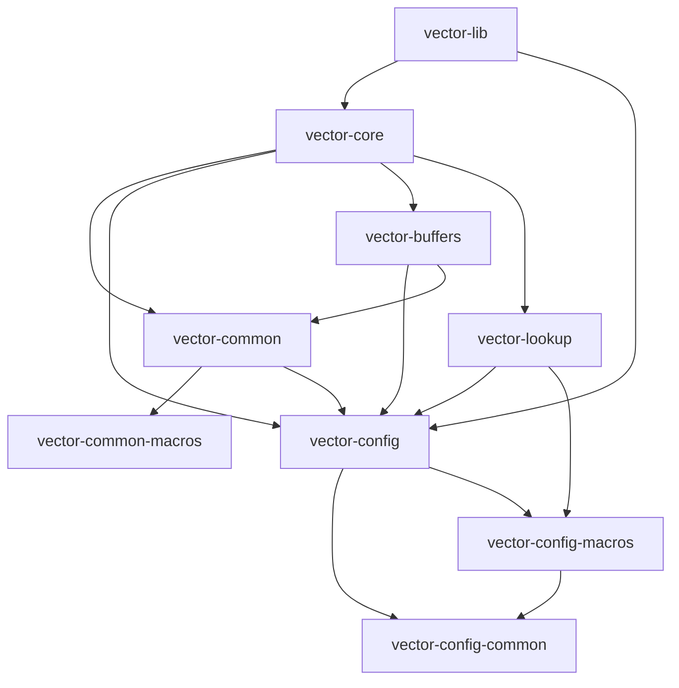

### Dependency Flow Explanation

1. **Foundation Layer**:  
   - `vector-common-macros` provides procedural macro utilities.  
   - `vector-config-common` offers shared config utilities and base traits.  

2. **Configuration Layer**:  
   - `vector-config` is the configuration core, managing parsing, validation, and schema.

3. **Infrastructure Layer**:  
   - `vector-buffers` provides buffering and queue mechanisms for event flow.

4. **Core Logic**:  
   - `vector-core` centralizes event types, processing abstractions, and core logic integrating config, buffering, and other common utilities.

5. **High-level Utilities**:  
   - `vector-lib` builds upon the core to offer higher-level application abstractions.

**Sources:** [lib/vector-core/Cargo.toml:62-65](), [lib/vector-buffers/Cargo.toml:33-34](), [lib/vector-config/Cargo.toml:33-34]()

---

## Binary Targets

The workspace declares multiple binary targets, each serving a distinct role in the Vector ecosystem:

| Binary                   | Path                                      | Purpose                                                  | Required Features           |
|--------------------------|-------------------------------------------|----------------------------------------------------------|-----------------------------|
| `vector`                 | `src/main.rs`                             | Primary vector observability pipeline executable          | None                        |
| `secret-backend-example` | `src/config/loading/secret_backend_example.rs` | Example backend for secret management integration          | `secret-backend-example`    |
| `vdev`                   | `vdev/src/main.rs`                        | Developer workflow CLI for tasks like build, test, check  | None                        |
| `generate-fixtures`      | `lib/vector-core/src/bin/generate_fixtures.rs` | Generate event fixture data for testing                    | `generate-fixtures`         |
| `generate-avro-fixtures` | `lib/codecs/tests/bin/generate-avro-fixtures.rs` | Generate example Avro-encoded data for test suites         | None                        |

This modular approach allows separation of concerns, facilitating development and testing workflows.

**Sources:** [Cargo.toml:17-27](), [vdev/Cargo.toml:1-12](), [lib/vector-core/Cargo.toml:107-110](), [lib/codecs/Cargo.toml:11-13]()

---

## Feature Flag Architecture

Vector employs a comprehensive feature flag system rooted in Cargo features to manage optionality of components and integrations. This enables building minimal binaries tailored to specific use cases or enabling full functionality with all sources, transforms, and sinks.

Key structures in the feature flag organization:

- Top-level feature flags for major groups: `sources`, `sinks`, and `transforms`.
- Sub-features for more granular control: e.g. `sources-logs`, `sources-metrics`.
- Examples include: `sources-file`, `sources-http_server`, and feature flags for VRL and Lua support.

The following diagram illustrates the hierarchical structure of feature flags related to sources:

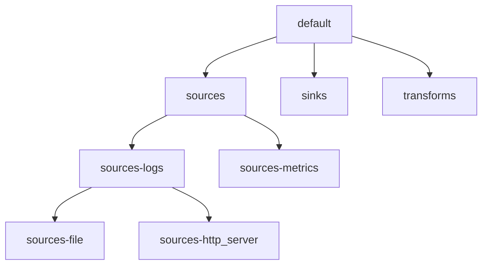

This setup provides precise control over enabled capabilities, reducing build size and dependencies when components are not needed.

**Sources:** [Cargo.toml:504-1182]()

---

## Build Profiles and Minimum Supported Rust Version (MSRV)

### Build Profiles

Vector defines optimized build profiles in the root `[profile]` section at [Cargo.toml:42-49]().

- **Release Profile**:  
  - No debug symbols (`debug = false`)  
  - Single codegen unit for better optimization (`codegen-units = 1`)  
  - Link Time Optimization enabled (`lto = "fat"`)  

- **Bench Profile**:  
  - Includes debug symbols for benchmarking and formatting analysis (`debug = true`).

These profiles are chosen to balance runtime performance and developer usability.

### Minimum Supported Rust Version (MSRV)

Vector requires Rust **1.95** as the minimum compiler version, ensuring use of modern Rust language features and ecosystem compatibility [Cargo.toml:15]().

**Sources:** [Cargo.toml:15-49]()

---

## External Dependency Management and Patching

Vector sometimes patches external crates in the `[patch.crates-io]` section of [Cargo.toml:496-502]() to fix bugs or add enhancements not yet upstreamed.

Patches include:

| Crate      | Patch Source                                          | Purpose                                       |
|------------|------------------------------------------------------|-----------------------------------------------|
| `tokio-util` | `vectordotdev/tokio` fork                           | Bugfix for framed read error handling          |
| `nix`       | `vectordotdev/nix` fork                             | Adds support for `memfd` on musl targets       |
| `ntapi`     | Maintained at `MSxDOS/ntapi`                        | Fixes unaligned access bug on Windows platforms|

This approach enables fast iteration and fixes in dependent crates as needed by Vector development.

**Sources:** [Cargo.toml:496-502]()

---

## License Compliance

The workspace maintains a detailed third-party license catalog in [LICENSE-3rdparty.csv]() tracking licenses of 1000+ transitive dependencies. This file is critical during release automation to ensure legal and compliance verification for the distributed binary.

The file includes components, sources, licenses, and copyright information.

**Sources:** [LICENSE-3rdparty.csv:1-70]()

---

# Summary

This page provides a comprehensive overview of the Vector Cargo workspace architecture, including member organization, dependency management, build profiles, licensing, and tooling. The workspace is architected for modularity, scalability, and maintainability of the 93+ crates comprising the observability pipeline system.

- The system entities align closely with workspace crates aligned for clarity.
- Core libraries are layered for clear responsibility separation.
- Feature flags enable configurable builds tailored to diverse deployment needs.
- Dependency versions and patches are centrally managed for uniformity.
- Multiple binaries serve core runtime, tooling, and test data generation roles.
- Testing and Kubernetes infrastructure are isolated into dedicated workspace crates.

For deeper dives into Vector's internals, developers should explore documentation pages related to [Core Libraries](#1.2), [Component Architecture](#1.3), and subsequent subsystem pages.

---

**Sources Summary:**  
- Cargo.toml:15-137,148-194,496-502  
- lib/vector-core/Cargo.toml:12-67  
- lib/vector-buffers/Cargo.toml:33-34  
- lib/vector-config/Cargo.toml:33-34  
- lib/codecs/Cargo.toml:59-63  
- vdev/Cargo.toml:1-12  
- lib/k8s-e2e-tests/Cargo.toml:1-6  
- LICENSE-3rdparty.csv:1-70

---

# Page: Core Libraries

# Core Libraries

<details>
<summary>Relevant source files</summary>

The following files were used as context for generating this wiki page:

- [Cargo.lock](Cargo.lock)
- [Cargo.toml](Cargo.toml)
- [LICENSE-3rdparty.csv](LICENSE-3rdparty.csv)
- [deny.toml](deny.toml)
- [lib/codecs/Cargo.toml](lib/codecs/Cargo.toml)
- [lib/docs-renderer/Cargo.toml](lib/docs-renderer/Cargo.toml)
- [lib/file-source/Cargo.toml](lib/file-source/Cargo.toml)
- [lib/k8s-e2e-tests/Cargo.toml](lib/k8s-e2e-tests/Cargo.toml)
- [lib/k8s-test-framework/Cargo.toml](lib/k8s-test-framework/Cargo.toml)
- [lib/loki-logproto/Cargo.toml](lib/loki-logproto/Cargo.toml)
- [lib/opentelemetry-proto/Cargo.toml](lib/opentelemetry-proto/Cargo.toml)
- [lib/prometheus-parser/Cargo.toml](lib/prometheus-parser/Cargo.toml)
- [lib/vector-api-client/Cargo.toml](lib/vector-api-client/Cargo.toml)
- [lib/vector-buffers/Cargo.toml](lib/vector-buffers/Cargo.toml)
- [lib/vector-common/Cargo.toml](lib/vector-common/Cargo.toml)
- [lib/vector-config-common/Cargo.toml](lib/vector-config-common/Cargo.toml)
- [lib/vector-config-macros/Cargo.toml](lib/vector-config-macros/Cargo.toml)
- [lib/vector-config-macros/src/configurable.rs](lib/vector-config-macros/src/configurable.rs)
- [lib/vector-config/Cargo.toml](lib/vector-config/Cargo.toml)
- [lib/vector-config/src/configurable.rs](lib/vector-config/src/configurable.rs)
- [lib/vector-config/src/external/chrono.rs](lib/vector-config/src/external/chrono.rs)
- [lib/vector-config/src/external/encoding_rs.rs](lib/vector-config/src/external/encoding_rs.rs)
- [lib/vector-config/src/external/indexmap.rs](lib/vector-config/src/external/indexmap.rs)
- [lib/vector-config/src/external/no_proxy.rs](lib/vector-config/src/external/no_proxy.rs)
- [lib/vector-config/src/external/serde_with.rs](lib/vector-config/src/external/serde_with.rs)
- [lib/vector-config/src/external/tz.rs](lib/vector-config/src/external/tz.rs)
- [lib/vector-config/src/external/url.rs](lib/vector-config/src/external/url.rs)
- [lib/vector-config/src/lib.rs](lib/vector-config/src/lib.rs)
- [lib/vector-config/src/metadata.rs](lib/vector-config/src/metadata.rs)
- [lib/vector-config/src/ser.rs](lib/vector-config/src/ser.rs)
- [lib/vector-config/src/stdlib.rs](lib/vector-config/src/stdlib.rs)
- [lib/vector-core/Cargo.toml](lib/vector-core/Cargo.toml)
- [lib/vector-core/src/config/log_schema.rs](lib/vector-core/src/config/log_schema.rs)
- [lib/vector-core/src/event/array.rs](lib/vector-core/src/event/array.rs)
- [lib/vector-core/src/event/log_event.rs](lib/vector-core/src/event/log_event.rs)
- [lib/vector-core/src/event/metadata.rs](lib/vector-core/src/event/metadata.rs)
- [lib/vector-core/src/event/metric/mod.rs](lib/vector-core/src/event/metric/mod.rs)
- [lib/vector-core/src/event/metric/value.rs](lib/vector-core/src/event/metric/value.rs)
- [lib/vector-core/src/event/mod.rs](lib/vector-core/src/event/mod.rs)
- [lib/vector-core/src/event/proto.rs](lib/vector-core/src/event/proto.rs)
- [lib/vector-core/src/event/trace.rs](lib/vector-core/src/event/trace.rs)
- [lib/vector-core/src/event/vrl_target.rs](lib/vector-core/src/event/vrl_target.rs)
- [lib/vector-core/src/lib.rs](lib/vector-core/src/lib.rs)
- [lib/vector-core/src/metrics/ddsketch.rs](lib/vector-core/src/metrics/ddsketch.rs)
- [lib/vector-core/src/metrics/mod.rs](lib/vector-core/src/metrics/mod.rs)
- [lib/vector-core/src/metrics/recency.rs](lib/vector-core/src/metrics/recency.rs)
- [lib/vector-core/src/metrics/recorder.rs](lib/vector-core/src/metrics/recorder.rs)
- [lib/vector-core/src/metrics/storage.rs](lib/vector-core/src/metrics/storage.rs)
- [lib/vector-lib/Cargo.toml](lib/vector-lib/Cargo.toml)
- [lib/vector-lib/src/lib.rs](lib/vector-lib/src/lib.rs)
- [lib/vector-lookup/Cargo.toml](lib/vector-lookup/Cargo.toml)
- [lib/vector-stream/Cargo.toml](lib/vector-stream/Cargo.toml)
- [lib/vector-tap/Cargo.toml](lib/vector-tap/Cargo.toml)
- [lib/vector-vrl/metrics/Cargo.toml](lib/vector-vrl/metrics/Cargo.toml)
- [license-tool.toml](license-tool.toml)
- [src/sinks/gcp_chronicle/compression.rs](src/sinks/gcp_chronicle/compression.rs)
- [src/sinks/util/buffer/compression.rs](src/sinks/util/buffer/compression.rs)
- [src/sinks/util/service/concurrency.rs](src/sinks/util/service/concurrency.rs)
- [src/sources/host_metrics/tcp.rs](src/sources/host_metrics/tcp.rs)
- [src/test_util/mod.rs](src/test_util/mod.rs)
- [vdev/Cargo.toml](vdev/Cargo.toml)

</details>


## Purpose and Scope

This document details the foundational Rust libraries that comprise Vector's core functionality. These libraries provide the building blocks for event processing, configuration management, buffering, and internal communication. The workspace contains 90+ crates, with the core libraries forming the base layer upon which sources, transforms, and sinks are built.

For information about the component architecture built on top of these libraries, see [Component Architecture (1.3)](). For application-level integration and topology construction, see [Application System (2)]().

---

## Library Dependency Structure

The core libraries are organized in a layered architecture where higher-level libraries depend on lower-level primitives:

**Diagram: Library Dependency Hierarchy**
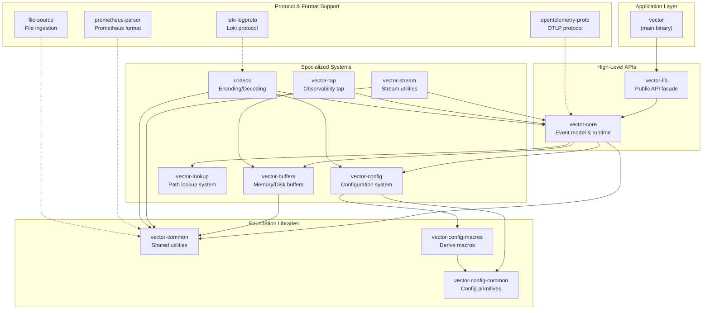

Sources: [Cargo.toml:98-137](), [lib/vector-core/Cargo.toml:1-69](), [lib/vector-common/Cargo.toml:1-62](), [lib/vector-buffers/Cargo.toml:1-39](), [lib/vector-config/Cargo.toml:1-35]()

---

## vector-core

`vector-core` is the foundational library containing Vector's event data model, runtime primitives, and core processing abstractions.

### Event Data Model

The library defines three primary event types:

**Diagram: Event Model Entities**
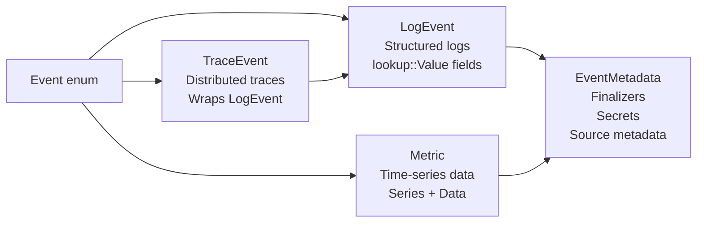

**Key Components:**

| Component | Purpose | Location |
|-----------|---------|----------|
| `Event` | Top-level enum discriminating event types | [lib/vector-core/src/event/mod.rs]() |
| `LogEvent` | Structured log with `lookup::Value` fields | [lib/vector-core/src/event/log_event.rs]() |
| `Metric` | Time-series metric with series metadata | [lib/vector-core/src/event/metric/mod.rs]() |
| `TraceEvent` | Distributed trace wrapping `LogEvent` | [lib/vector-core/src/event/trace.rs]() |
| `EventMetadata` | Shared metadata across event types | [lib/vector-core/src/event/metadata.rs]() |

Sources: [lib/vector-core/src/event/mod.rs]()

### Runtime Abstractions

`vector-core` provides fundamental runtime abstractions for event buffering, acknowledgements, and metrics integration.

**Diagram: Core Runtime Traits and Types**
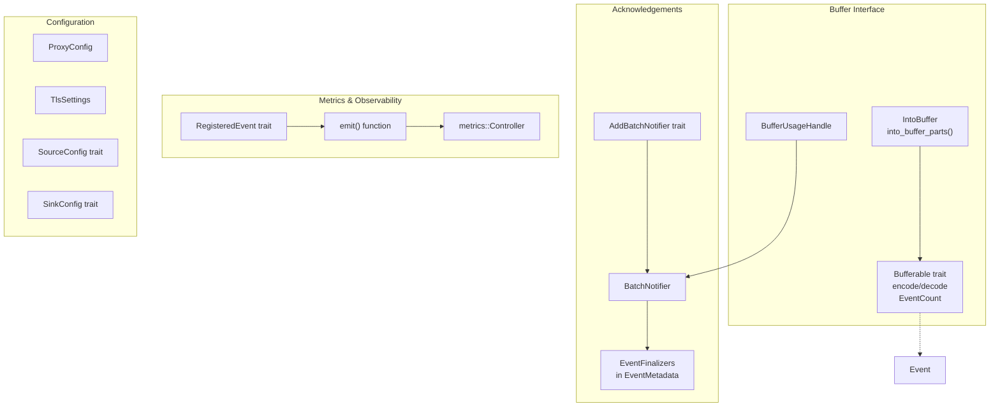

**Key abstractions:**

- `Bufferable`: Defines types that can be encoded/decoded for buffering, with associated `EventCount`.
- `IntoBuffer<T>`: Trait to convert a type into buffer components (such as buffer writer parts).
- `BatchNotifier`: Coordinates batched acknowledgements for event processing.
- `AddBatchNotifier`: Trait to add batch notifiers to event finalizers.
- `EventFinalizers`: Manages callbacks for finalizing event processing lifecycle.
- `RegisteredEvent`: Trait for emitting internal events for observability.
- Configuration traits such as `SourceConfig` and `SinkConfig` define construction and validation of sources and sinks.
- `TlsSettings` and `ProxyConfig` abstractions help standardize TLS and proxy network configuration.

**Dependencies:**

- VRL Integration (`vrl` workspace) is tightly coupled providing transformation support.  
- Networking uses `tonic` (gRPC) and `hyper-proxy` for HTTP proxy support.  
- Metrics are integrated with the `metrics` ecosystem (`metrics`, `metrics-tracing-context`, and `metrics-util`).  
- Async runtime powered by `tokio` with networking features enabled.

Sources: [lib/vector-core/Cargo.toml:11-68](), [lib/vector-core/src/lib.rs]()

---

## vector-buffers

Provides both in-memory and disk-based buffering abstractions with end-to-end acknowledgements for reliable event delivery.

### Buffer Architecture

**Diagram: Buffer Implementation Hierarchy**
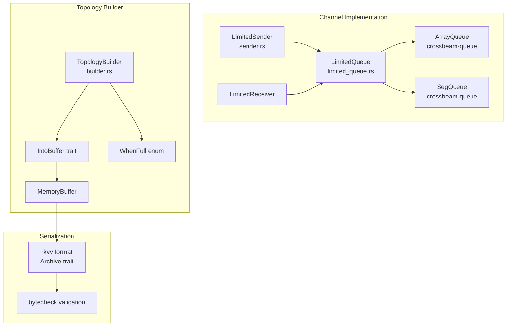

### Channel Implementation Details

- `LimitedQueue` is a bounded multi-producer multi-consumer (MPMC) queue used as the core channel for event buffering. It is implemented in `limited_queue.rs`.
- `LimitedSender<T>` exposes an API to send events with backpressure support. It provides both blocking (`send()`) and non-blocking (`try_send()`) methods.
- `LimitedReceiver<T>` implements the `Stream` trait, allowing asynchronous consumption of buffered events.
- Internally, `LimitedQueue` uses `ArrayQueue` from `crossbeam-queue` for bounded capacity and `SegQueue` for unbounded segments when needed.

### Topology Builder

`TopologyBuilder<T>` facilitates construction of complex buffering topologies with controlled overflow policies.

- The `.stage()` method adds buffering stages with a defined `WhenFull` policy such as `Block`, `Drop`, or `Fail`.
- `.build()` consumes the builder producing a sender/receiver pair with full instrumentation and backpressure support.

This abstraction enables building adaptable buffering pipelines for sources, sinks, or intermediate transforms to control flow and buffering behavior reliably.

Sources: [lib/vector-buffers/Cargo.toml:1-39](), [lib/vector-buffers/src/topology/channel/limited_queue.rs:1-348](), [lib/vector-buffers/src/topology/builder.rs:1-187]()

---

## vector-lookup

`vector-lookup` implements the path-based event field querying system using efficient zero-copy path segments, crucial for querying and transforming event data.

### Core Types

| Type | Description |
|-------|-------------|
| `PathPrefix` | Enum defining path root types: event data (`.`) or event metadata (`%`). This is key for VRL path semantics distinguishing between data and metadata fields. |
| `OwnedValuePath` | An owned representation of a full lookup path, combining a prefix and a sequence of path segments as owned strings. Useful for configuration and caching scenarios. |
| `BorrowedSegment` | A zero-copy, borrowed segment type for efficient on-the-fly path traversal without allocation overhead. |

This library underpins Vector's dynamic field access and manipulation system, supporting serialization/deserialization for config and runtime performance.

### Integration

- Implements `serde::Serialize` and `Deserialize` traits to enable JSON and YAML configuration interoperability.
- Fully integrated with the configuration system to enable schema-based validation and component composition.

Sources: [lib/vector-lookup/Cargo.toml:1-22]()

---

## vector-lib

`vector-lib` is the stable public API facade of Vector’s core functionality. It selectively re-exports key types, traits, and modules from `vector-core` and related crates to provide a concise, stable interface for downstream users and extensions.

```toml
# Cargo.toml example usage
vector-lib = { path = "lib/vector-lib", default-features = false, features = ["vrl"] }
```

This crate abstracts internal engine details while exposing the necessary interfaces for event construction, runtime integration, and configuration.

Sources: [Cargo.toml:121](), [lib/vector-lib/Cargo.toml:1-20]()

---

## vector-common

`vector-common` houses shared types, utilities, and traits used across multiple Vector crates.

### Feature Gates and Modules

**Diagram: vector-common Feature Structure**
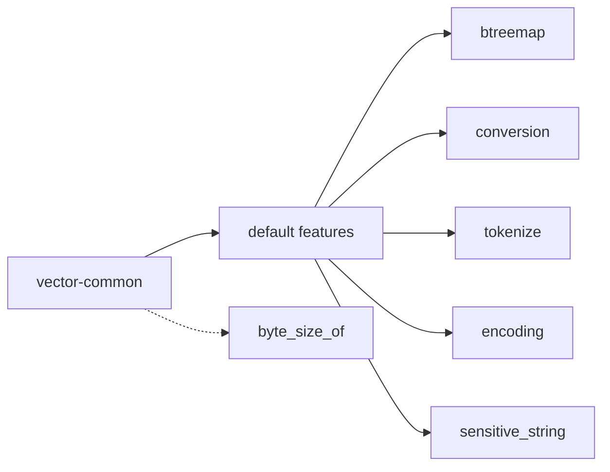

- The default feature set includes `btreemap`, `conversion`, `tokenize`, `encoding`, and `sensitive_string`.
- Provides utilities such as measuring deep byte size of types (`byte_size_of` feature), data encoding helpers, token parsing utilities, and sensitive string wrappers for safe data handling in logs.
- These utilities facilitate uniform implementations and optimizations shared across the Vector ecosystem.

Sources: [lib/vector-common/Cargo.toml:12-38]()

---

## vector-config

The `vector-config` crate provides robust configuration management, supporting configuration validation, schema generation, and type-safe abstractions for Vector's entire config ecosystem.

### Key Components

| Component | Purpose | Location |
|-----------|---------|----------|
| `Configurable` trait | A generic trait that marks types as configurable, enabling validation and value extraction | [lib/vector-config-common/src/configurable.rs]() |
| `#[configurable_component]` derive macro | Generates configuration traits and builders for components automatically | [lib/vector-config-macros/src/lib.rs]() |

### Supported Types

- `HumanDuration` wraps `chrono::Duration` for user-friendly duration specification in configuration.
- `url::Url` for validated URL fields.
- `no-proxy::NoProxy` type for defining proxy exclusion lists.
- `encoding_rs::Encoding` for specifying encoding schemes.

This crate efficiently uses `serde`, `indexmap`, and `snafu` for serialization, mapping, and error handling during config loading and validation.

Sources: [lib/vector-config/Cargo.toml:1-35](), [lib/vector-config-macros/Cargo.toml:1-21](), [lib/vector-config-common/Cargo.toml:1-16]()

---

## codecs

`codecs` provides serialization and deserialization support for many data formats used in log and metric processing.

### Format Support

- **Text-based:** JSON, NDJSON, CSV, logfmt, raw text logs.
- **Binary:** Protocol Buffers (via `prost`), Apache Avro.
- **Syslog:** RFC 3164 and 5424, powered by the `syslog_loose` crate.

### Feature Flags

- `arrow` feature enables Apache Arrow IPC format encoding/decoding.
- `opentelemetry` feature supports OTLP encoding formats.

The codecs library is essential for data ingestion, parsing, and data sink encoding.

Sources: [lib/codecs/Cargo.toml:1-85]()

---

## Protocol Libraries

Several specialized protocol libraries support Vector's interoperability with observability protocols:

- **loki-logproto:** Protobuf definitions and client/server bindings for Grafana Loki's streaming protocol, generated by `prost-build`.
- **opentelemetry-proto:** Protobuf messages and gRPC services implementing OTLP logs, metrics, and trace protocol, generated by `tonic-build`.
- **prometheus-parser:** A parser library using `nom` combinators for Prometheus exposition format (text-based metrics).

These libraries ensure Vector can send and receive telemetry data using widely-adopted open standards.

Sources: [lib/loki-logproto/Cargo.toml:1-19](), [lib/opentelemetry-proto/Cargo.toml:1-23](), [lib/prometheus-parser/Cargo.toml:1-21]()

---

## Workspace Organization

The core libraries follow a consistent organizational pattern within the workspace:

```
lib/
├── vector-core/          # Event model and runtime primitives
├── vector-lib/           # Public API facade over vector-core and related libraries
├── vector-common/        # Shared utilities and data structures
├── vector-config/        # Configuration system with validation and schema generation
├── vector-buffers/       # Buffer implementations for memory and disk
├── vector-lookup/        # Path querying system for event fields
├── vector-stream/        # Stream handling utilities
├── codecs/               # Encoding and decoding implementations
└── ...                   # Additional libraries like protocol formats, tap, top, etc.
```

All core libraries:

- Use Rust edition 2024.
- Marked as `publish = false` to prevent external publishing.
- Licensed under MPL-2.0.

Sources: [Cargo.toml:1-137]()

---

# Mapping Natural Language Names to Code Entities

To bridge between conceptual terminology and code entities, here is a diagram associating main core libraries and key structs or traits identified by their Rust module or crate names.

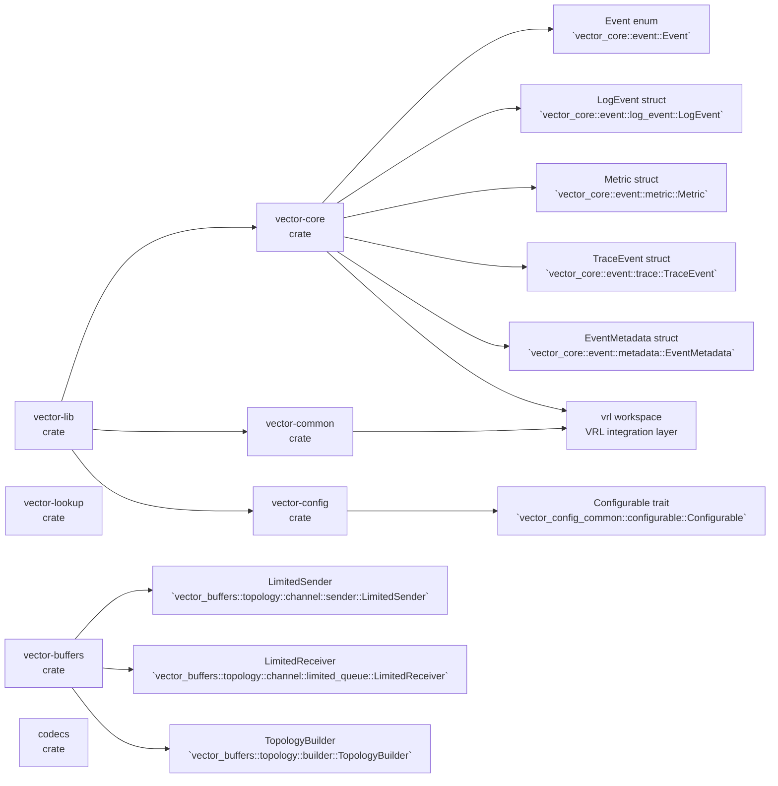

Sources: Multiple files in `lib/vector-core/src`, `lib/vector-buffers/src`, `lib/vector-config-common/src`, [lib/vector-core/Cargo.toml:11-68](), [lib/vector-buffers/Cargo.toml:1-39](), [lib/vector-config/Cargo.toml:1-35]()

---

# Summary

The core libraries form a robust foundation enabling high-performance, extensible, and reliable observability data pipeline components. `vector-core` establishes the event model and critical runtime abstractions. `vector-buffers` delivers flexible, efficient buffering and flow control. `vector-config` enables comprehensive configuration management with schema and validation support. `vector-common` hosts shared utilities widely leveraged across Vector.

Supplementary protocol and codec libraries ensure compatibility with a variety of telemetry formats and standards.

Together, these foundational crates support Vector’s entire observability pipeline from low-level event processing, through configuration-driven component composition, to live user interaction.

Sources: Aggregated from all cited files above.

---

# Page: Component Architecture

# Component Architecture

<details>
<summary>Relevant source files</summary>

The following files were used as context for generating this wiki page:

- [docs/REVIEWING.md](docs/REVIEWING.md)
- [docs/USER_EXPERIENCE_DESIGN.md](docs/USER_EXPERIENCE_DESIGN.md)
- [docs/specs/buffer.md](docs/specs/buffer.md)
- [docs/specs/component.md](docs/specs/component.md)
- [docs/specs/configuration.md](docs/specs/configuration.md)
- [docs/specs/instrumentation.md](docs/specs/instrumentation.md)
- [docs/specs/target.md](docs/specs/target.md)
- [lib/vector-core/src/config/global_options.rs](lib/vector-core/src/config/global_options.rs)
- [src/config/vars.rs](src/config/vars.rs)
- [src/internal_events/mod.rs](src/internal_events/mod.rs)
- [src/sinks/mod.rs](src/sinks/mod.rs)
- [src/sources/mod.rs](src/sources/mod.rs)
- [src/sources/prometheus/mod.rs](src/sources/prometheus/mod.rs)
- [src/test_util/components.rs](src/test_util/components.rs)
- [src/transforms/mod.rs](src/transforms/mod.rs)
- [website/content/en/docs/reference/configuration/_index.md](website/content/en/docs/reference/configuration/_index.md)
- [website/content/en/docs/reference/configuration/sources/prometheus_pushgateway.md](website/content/en/docs/reference/configuration/sources/prometheus_pushgateway.md)
- [website/cue/reference.cue](website/cue/reference.cue)
- [website/cue/reference/components.cue](website/cue/reference/components.cue)
- [website/cue/reference/components/sinks.cue](website/cue/reference/components/sinks.cue)
- [website/cue/reference/components/sources.cue](website/cue/reference/components/sources.cue)
- [website/cue/reference/components/sources/internal_metrics.cue](website/cue/reference/components/sources/internal_metrics.cue)
- [website/cue/reference/components/transforms.cue](website/cue/reference/components/transforms.cue)
- [website/cue/reference/components/transforms/remap.cue](website/cue/reference/components/transforms/remap.cue)
- [website/cue/reference/configuration.cue](website/cue/reference/configuration.cue)
- [website/cue/reference/remap.cue](website/cue/reference/remap.cue)
- [website/cue/reference/remap/concepts/metrics.cue](website/cue/reference/remap/concepts/metrics.cue)
- [website/cue/reference/remap/expressions.cue](website/cue/reference/remap/expressions.cue)
- [website/cue/reference/remap/expressions/function_call.cue](website/cue/reference/remap/expressions/function_call.cue)
- [website/cue/reference/urls.cue](website/cue/reference/urls.cue)
- [website/data/redirects.yaml](website/data/redirects.yaml)
- [website/layouts/partials/badge.html](website/layouts/partials/badge.html)
- [website/layouts/partials/data.html](website/layouts/partials/data.html)

</details>


Vector's codebase is architected around three fundamental component types — **sources**, **transforms**, and **sinks** — which together form the data processing pipeline. Each component type implements a distinct configuration trait used by the topology system to instantiate and connect runtime components. This page documents the modular organization of these components, the feature flag system enabling selective compilation, and the component specification rules ensuring consistent behavior and observability.

---

## Module Organization

The three component types live in separate top-level modules within `src/`, each containing numerous component implementations. These modules leverage Rust's **conditional compilation** with feature flags to include only the needed components.

- `src/sources/` contains all source components (data inputs).
- `src/transforms/` contains all transform components (data processing).
- `src/sinks/` contains all sink components (data outputs).

Each module’s `mod.rs` declares submodules guarded by feature flags.

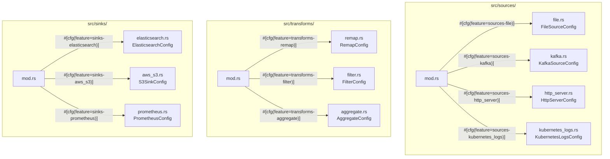

| Module            | File       | Key Exports                                    |
|-------------------|------------|------------------------------------------------|
| `src/sources/`    | `mod.rs`   | `pub use vector_lib::source::Source`          |
| `src/transforms/` | `mod.rs`   | Transform traits such as `FunctionTransform`, `TaskTransform`, `SyncTransform` |
| `src/sinks/`      | `mod.rs`   | `pub use vector_lib::sink::VectorSink`, `Healthcheck`        |

Sources: [src/sources/mod.rs:1-113](), [src/transforms/mod.rs:1-109](), [src/sinks/mod.rs:1-149]()

---

## Feature Flag System and Conditional Compilation

Vector supports selective compilation of components using Cargo feature flags. Feature flags follow a prefix convention enabling granular builds tailored to specific integrations:

| Component Type | Feature Prefix   | Example                | Aggregate Feature |
|----------------|------------------|------------------------|-------------------|
| Source         | `sources-`       | `sources-file`          | `sources`         |
| Transform      | `transforms-`    | `transforms-remap`      | `transforms`      |
| Sink           | `sinks-`         | `sinks-elasticsearch`   | `sinks`           |

These flags conditionally compile only the components enabled, reducing binary size and dependencies.

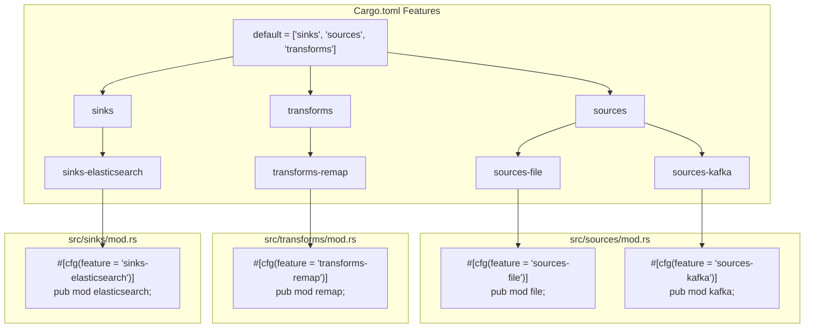

Sources: [src/sources/mod.rs:4-99](), [src/transforms/mod.rs:10-39](), [src/sinks/mod.rs:8-122]()

---

## Component Specification

The **Component Specification** (documented in [docs/specs/component.md]) prescribes behavior and naming rules to guarantee uniformity and observability of sources, transforms, and sinks.

### Naming Conventions

- **Sources and Sinks:**
  - Contain only ASCII lowercase alphanumeric characters and underscores.
  - Named as nouns after integrated protocols or services.
  - May have event type suffixes (`logs`, `metrics`, `traces`) if event-type specific, e.g., `kubernetes_logs`.
  
- **Transforms:**
  - Contain only ASCII lowercase alphanumeric characters and underscores.
  - Named as verbs describing their purpose, e.g., `remap`, `filter`.

### Configuration Rules

- Components connecting downstream SHOULD expose either:
  - An `endpoint` string option for a single destination.
  - Or an `endpoints` array of strings for multiple destinations.

- Components listening for incoming connections SHOULD expose a `listen` option formatted as `<protocol>:<address>`, with possible protocols:

  - `unix+stream`, `unix+datagram`, or `unix` (alias for `unix+stream`)
  - `tcp`
  - `udp`

These patterns promote consistent address configuration.

### Instrumentation and Observability Events

Components MUST emit internal telemetry events providing lifecycle insights:

| Event                 | Description                                             | Metric Impact                       |
|-----------------------|---------------------------------------------------------|------------------------------------|
| `ComponentEventsReceived`  | Emitted immediately after receiving Vector events.     | Increments `component_received_events_total` counter. |
| `ComponentEventsSent`      | Emitted immediately before sending events downstream.  | Increments `component_sent_events_total` counter.     |
| `ComponentError`           | Emitted on component errors.                            | Increments `component_errors_total` counter.          |
| `ComponentEventsDropped`   | Emitted when events are dropped (e.g., filtered out).  | Increments `component_discarded_events_total` counter.|

Event emission can include component-specific context and may batch events for performance, ensuring metrics reflect actual counts.

Instrumentation events and their code exist under feature gates corresponding to each component.

Sources: [docs/specs/component.md:51-241](), [src/internal_events/mod.rs:1-157]()

---

## Sources: Data Ingestion Components

Sources ingest external data and convert them into Vector's internal `Event` structure. They implement the `Source` trait from `vector_lib::source` and provide configuration via `SourceConfig`.

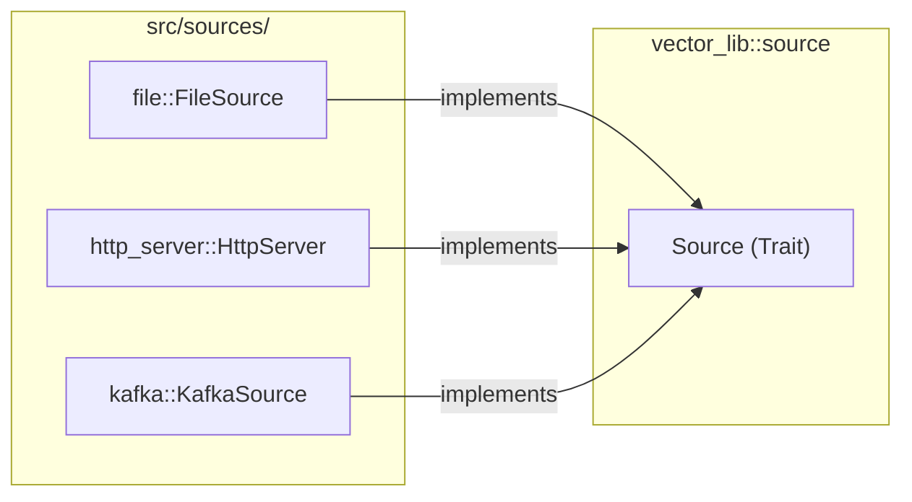

Sources commonly rely on utility submodules (found in `src/sources/util/`) providing shared infrastructure like multiline log handling, handshake, framing, or HTTP parsing.

Sources: [src/sources/mod.rs:1-113]()

---

## Transforms: Event Processing Components

Transforms modify, filter, enrich, and route streams of events. They are implemented using one or more concurrency models defined via traits:

| Trait                  | Characteristics                                 | Example Transforms                   |
|------------------------|-----------------------------------------------|-----------------------------------|
| `FunctionTransform`     | Sync; process one event: emit zero or more events | `remap`, `filter`                 |
| `SyncTransform`        | Synchronous batch processing                   | `dedupe`                          |
| `TaskTransform`        | Async, spawn tasks, can involve await points  | `aggregate`, `reduce`             |

Transforms provide `TransformConfig` implementations to instantiate and compose runtime transforms in the topology.

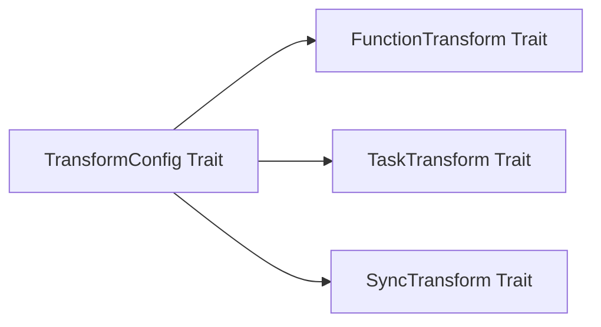

Sources: [src/transforms/mod.rs:41-44](), [src/transforms/mod.rs:76-81]()

---

## Sinks: Data Output Components

Sinks deliver processed events to external systems such as HTTP endpoints, databases, or messaging queues. They implement the `VectorSink` trait from `vector_lib::sink`.

Sinks usually provide advanced features including:

- Batching and compression
- Event encoding formats (JSON, Avro, Protobuf, Arrow, etc.)
- Adaptive concurrency control and retries with `tower::Service` integration
- Healthcheck futures to verify external service availability on start

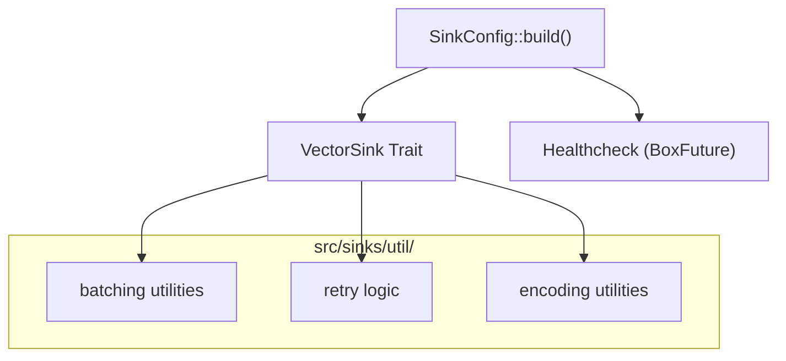

Sources: [src/sinks/mod.rs:1-149](), [website/cue/reference/components/sinks.cue:3-50]()

---

# Summary

Vector's component architecture centralizes sources, transforms, and sinks as independent modular units forming directed acyclic graphs for observability data pipelines. This architecture, combined with feature flags and conditional compilation, allows creating custom, optimized Vector binaries including only needed functionality. The formal component specification enforces consistent naming, configuration, and instrumentation across well over 100 components, enabling production-grade reliability and monitoring.

---

# References

- Component Specification: [docs/specs/component.md]()
- Source Module: [src/sources/mod.rs]()
- Transform Module: [src/transforms/mod.rs]()
- Sink Module: [src/sinks/mod.rs]()
- Internal Events and Instrumentation: [src/internal_events/mod.rs]()
- Feature Flags and Conditional Compilation: [src/sources/mod.rs:4-99](), [src/transforms/mod.rs:10-39](), [src/sinks/mod.rs:8-122]()

---

# Page: Application System

# Application System

<details>
<summary>Relevant source files</summary>

The following files were used as context for generating this wiki page:

- [changelog.d/19963_config_null.fix.md](changelog.d/19963_config_null.fix.md)
- [changelog.d/config_error_paths.fix.md](changelog.d/config_error_paths.fix.md)
- [src/app.rs](src/app.rs)
- [src/cli.rs](src/cli.rs)
- [src/config/builder.rs](src/config/builder.rs)
- [src/config/compiler.rs](src/config/compiler.rs)
- [src/config/diff.rs](src/config/diff.rs)
- [src/config/enrichment_table.rs](src/config/enrichment_table.rs)
- [src/config/loading/config_builder.rs](src/config/loading/config_builder.rs)
- [src/config/loading/loader.rs](src/config/loading/loader.rs)
- [src/config/loading/mod.rs](src/config/loading/mod.rs)
- [src/config/loading/representation.rs](src/config/loading/representation.rs)
- [src/config/loading/secret.rs](src/config/loading/secret.rs)
- [src/config/loading/source.rs](src/config/loading/source.rs)
- [src/config/mod.rs](src/config/mod.rs)
- [src/config/sink_validated.rs](src/config/sink_validated.rs)
- [src/config/unit_test/mod.rs](src/config/unit_test/mod.rs)
- [src/graph.rs](src/graph.rs)
- [src/service.rs](src/service.rs)
- [src/topology/builder.rs](src/topology/builder.rs)
- [src/topology/controller.rs](src/topology/controller.rs)
- [src/topology/mod.rs](src/topology/mod.rs)
- [src/topology/running.rs](src/topology/running.rs)
- [src/topology/test/backpressure.rs](src/topology/test/backpressure.rs)
- [src/topology/test/doesnt_reload.rs](src/topology/test/doesnt_reload.rs)
- [src/topology/test/mod.rs](src/topology/test/mod.rs)
- [src/topology/test/reload.rs](src/topology/test/reload.rs)
- [src/topology/test/transient_state.rs](src/topology/test/transient_state.rs)
- [src/unit_test.rs](src/unit_test.rs)
- [src/validate.rs](src/validate.rs)
- [tests/integration/cli.rs](tests/integration/cli.rs)
- [tests/integration/shutdown.rs](tests/integration/shutdown.rs)
- [website/cue/reference/cli.cue](website/cue/reference/cli.cue)

</details>


The Application System governs the entire runtime lifecycle of Vector, encompassing stages from initial CLI argument parsing, through configuration loading and compilation, to topology construction and runtime orchestration including graceful shutdown and hot-reloading. It acts as the core engine managing how Vector starts, runs, adapts to configuration changes, and stops safely.

This page offers a high-level overview of the system and how its major subcomponents interrelate. For detailed technical information, refer to the child pages:
- [Application Lifecycle and CLI](#2.1)
- [Configuration Loading and Compilation](#2.2)
- [Topology Construction](#2.3)
- [Runtime Management and Hot Reloading](#2.4)

---

## Application Lifecycle Overview

Vector’s application runtime proceeds through well-defined stages:

1. **Command-Line Interface (CLI) Parsing**  
   The application begins by parsing CLI arguments and subcommands, configuring global options, and setting up logging.

2. **Configuration Loading and Compilation**  
   Vector merges configurations from multiple sources/formats (YAML/TOML/JSON, environment variables, CLI overrides), resolves secrets, and compiles a validated configuration with enriched metadata.

3. **Topology Construction**  
   Based on the compiled config, Vector builds the data pipeline topology, instantiating sources, transforms, sinks, and enrichment tables, wiring dependencies, and preparing concurrent tasks.

4. **Runtime Execution and Signal Handling**  
   The application runs the constructed topology asynchronously, handling signals for reload or shutdown, supporting graceful termination and dynamic reconfiguration via hot reloads.

### Initialization Sequence

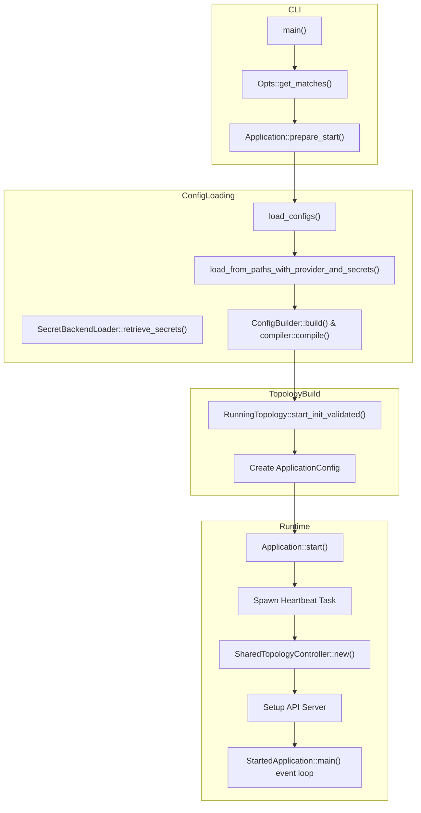

This starting sequence encapsulates how Vector transitions from command-line invocation to a live, running topology capable of processing observability data streams.

**Sources:**  
[src/app.rs:177-511](), [src/cli.rs:22-63]()

---

## CLI Argument Parsing and Application Lifecycle

Vector uses the `clap` crate to parse command-line arguments, structuring them into root options and numerous subcommands:

- **Root Options (`RootOpts`)** govern global runtime settings such as:
  - Config file and directory paths (multiple formats supported).
  - Thread count and concurrency tuning.
  - Logging format, verbosity, and colors.
  - Hot reload/watch configuration flags.
  - Secret environment interpolation.

- **Subcommands** include utilities like `validate`, `test`, `graph`, `top`, and `tap` for different lifecycle-related workflows.

The CLI parser produces an `Opts` struct (with `RootOpts` and an optional `SubCommand`). Initialization uses these options to configure logging, concurrency, and environment before application runtime begins.

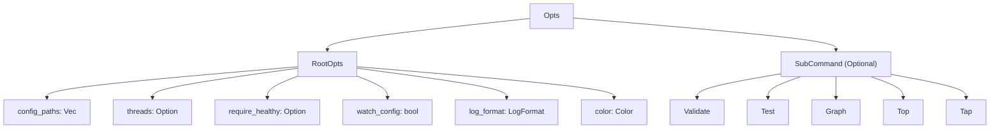

This CLI layer defines initial runtime parameters and subsequent command execution strategies.

For comprehensive details of CLI parsing and application startup procedures, see [Application Lifecycle and CLI](#2.1).

**Sources:** [src/cli.rs:22-263](), [website/cue/reference/cli.cue:84-215]()

---

## Configuration Loading and Compilation

Vector’s configuration system supports multiple input sources, formats, and dynamic resolution mechanisms:

- **Inputs**: Reads configuration from paths specified as files, directories, or globs in YAML, TOML, JSON formats. Environment variable interpolation is optionally enabled.

- **Secret Resolution**: Secret backends (exec commands, files, cloud providers) are instantiated to replace sensitive config placeholders securely.

- **Provider Integration**: Configuration providers allow fetching or overlaying configuration from remote or dynamic sources during startup.

- **Compilation**: The raw config builder converts to a fully compiled `Config` struct with:
  - Component name validations.
  - Shape, resource type, and output correctness checks.
  - Graph validation for cycles and type correctness.
  - Acknowledgement propagation through sinks and upstream nodes.
  - Sink validation and enrichment table handling.

```mermaid
graph TB
    subgraph File Loading
        LP["load_from_paths_with_provider_and_secrets()"]
        LP --> SL["SecretBackendLoader::load_from_paths()"]
        SL --> RS["retrieve_secrets()"]
        LP --> CL["ConfigBuilderLoader::load_from_paths()"]
    end
    
    subgraph Secret Injection
        RS --> SB["SecretBackends instantiated"]
        SB --> RSCP["Secret placeholders replaced in config"]
    end
    
    subgraph Compilation
        CL --> FC["finalize_config()"]
        FC --> COM["compiler::compile()"]
        COM --> VAL["Validation checks (names, shape, cycles)"]
        VAL --> ACK["propagate_acknowledgements()"]
    end
```

Upon success, this pipeline outputs a validated runtime configuration object ready for topology construction.

For detailed mechanics of configuration file parsing, secret backends, and compilation validation, see [Configuration Loading and Compilation](#2.2).

**Sources:**  
[src/config/loading/mod.rs:56-185](), [src/config/compiler.rs:9-152](), [src/config/builder.rs:139-151](), [src/config/mod.rs:79-232]()

---

## Topology Construction

Topology construction instantiates and wires the configured data pipeline components at runtime:

- **TopologyPiecesBuilder** asynchronously builds pieces of the topology for sources, transforms, sinks, and enrichment tables.

- **Component Contexts** provide global options, enrichment tables, buffer channels, and shutdown coordination needed to instantiate each component's task:

  - `SourceContext` — keys, global config, enrichment table registry, source sender, and signal for shutdown.
  - `TransformContext` — global config, enrichment tables, and metrics storage.
  - `SinkContext` — healthcheck options, global config, and enrichment tables.

- **Dependency Graph** is wired with buffers and fanout channels connecting components according to input/output links.

- **Task Spawning** creates async tasks for each component to process events concurrently.

- **Validation** applies type checks, cycle detection, and acknowledgement propagation across the graph.

- The built `TopologyPieces` group holds all running buffer channels, tasks, and related component handles.

### Component Build Context Overview

```mermaid
classDiagram
    class SourceContext {
        +component_key: ComponentKey
        +global_options: GlobalOptions
        +enrichment_tables: TableRegistry
        +source_sender: SourceSender
        +shutdown_signal: ShutdownSignal
    }

    class TransformContext {
        +component_key: Option<ComponentKey>
        +global_options: GlobalOptions
        +enrichment_tables: TableRegistry
        +metrics_storage: MetricsStorage
    }

    class SinkContext {
        +healthcheck_options: SinkHealthcheckOptions
        +global_options: GlobalOptions
        +enrichment_tables: TableRegistry
    }

    SourceOuter <|-- SourceContext : builds with
    TransformOuter <|-- TransformContext : builds with
    SinkOuter <|-- SinkContext : builds with
```

This modular context usage enables clean component instantiation while managing complexity of cross-cutting concerns.

For an in-depth explanation of topology building logic, task management, and graph linking, see [Topology Construction](#2.3).

**Sources:**  
[src/topology/builder.rs:120-178](), [src/config/source.rs:63-64](), [src/config/transform.rs:65-67](), [src/config/sink.rs:63-64]()

---

## Runtime Management and Hot Reloading

Vector’s runtime manages lifecycle of topology execution dynamically:

- **RunningTopology** maintains live data structures holding:
  - Component task handles for sources, transforms, and sinks.
  - Channel senders/receivers for buffered event flow.
  - Shutdown coordination signals.
  - Utilization tracking and metrics task handles.
  - Pending reload sets and abort/error channels.
  - Topology configuration snapshot.

- **TopologyController** mediates configuration hot reloads via a multi-phase approach:
  - Compute diffs and validate the new topology.
  - Spawn new tasks and buffers safely.
  - Swap running topologies without data loss.
  - Gracefully shut down old topology components.
  
- **Signal Handling** listens for OS signals to initiate shutdown or reload cycles.

- **Graceful Shutdown** waits up to a configured timeout for sources and tasks to finish cleanly before forceful termination.

### RunningTopology Architecture and Manager Flow

| Field                       | Type                                          | Description                          |
|-----------------------------|-----------------------------------------------|------------------------------------|
| `tasks`                     | `HashMap<ComponentKey, TaskHandle>`           | Active component task handles       |
| `config`                    | `Config`                                       | The current active configuration    |
| `abort_tx`                  | `mpsc::UnboundedSender<ShutdownError>`        | Channel for fatal error signaling   |
| `shutdown_coordinator`      | `SourceShutdownCoordinator`                    | Coordinates source shutdown signals |
| `utilization_registry`      | `Option<UtilizationRegistry>`                  | Tracks component utilization        |
| `watch`                     | `(WatchTx, WatchRx)`                           | For topology change subscriptions   |
| `pending_reload`            | `Option<HashSet<ComponentKey>>`                | Tracks components pending reload    |

```mermaid
flowchart TD
    StartRT["RunningTopology::new()"] --> RunTasks["Spawn Component Tasks"]
    RunTasks --> WatchChanges["Watch Topology Changes (Tap API)"]
    WatchChanges --> SignalLoop["Main Event Loop"]

    SignalLoop -.-> Reload["Config Reload Request"]
    Reload --> ReloadPrepare["Prepare topology diff and build"]
    ReloadPrepare --> ReloadApply["Apply reload and swap topologies"]
    ReloadApply --> SignalLoop

    SignalLoop -- Shutdown --> Shutdown["Graceful Shutdown"]
    Shutdown --> StopTasks["Stop all tasks and clean up"]
```

This lifecycle enables live updates and robust shutdown behavior without dropping event data or leaving tasks hanging.

For comprehensive details about runtime orchestration, signal integration, and reload algorithms, see [Runtime Management and Hot Reloading](#2.4).

**Sources:**  
[src/topology/running.rs:1-160](), [src/topology/controller.rs:1-115]()

---

# Summary

Vector’s Application System is a multi-layered architecture coordinating how the system parses CLI input, loads and compiles configurations, constructs the data processing pipeline topology, and manages runtime execution with observability, hot reload capability, and graceful shutdown.

Its primary components and responsibilities are:

| Subsystem                          | Responsibility                                                    | Child Page Link                     |
|-----------------------------------|-----------------------------------------------------------------|-----------------------------------|
| Application Lifecycle & CLI       | Parsing CLI arguments, executing subcommands, launching runtime   | [Application Lifecycle and CLI](#2.1)           |
| Configuration Loading & Compilation| Loading multi-format config files, secret resolution, compilation, and validation | [Configuration Loading and Compilation](#2.2)  |
| Topology Construction              | Building component instances, wiring data pipeline tasks, buffering, and validation | [Topology Construction](#2.3)                 |
| Runtime Management & Hot Reloading | Running topology components, signal handling, graceful shutdown, reload phases | [Runtime Management and Hot Reloading](#2.4)   |

Understanding the Application System provides essential context for navigating how Vector becomes operational, adapts to user changes, and maintains stable observability data pipelines.

---

**Document Sources:**  
[src/app.rs:1-453](), [src/cli.rs:1-263](), [src/config/mod.rs:1-232](), [src/config/builder.rs:1-151](), [src/config/compiler.rs:1-152](), [src/topology/builder.rs:120-178](), [src/topology/running.rs:1-160](), [src/topology/controller.rs:1-115]()

---

# Page: Application Lifecycle and CLI

# Application Lifecycle and CLI

<details>
<summary>Relevant source files</summary>

The following files were used as context for generating this wiki page:

- [.github/workflows/custom_builds.yml](.github/workflows/custom_builds.yml)
- [build.rs](build.rs)
- [changelog.d/19963_config_null.fix.md](changelog.d/19963_config_null.fix.md)
- [changelog.d/config_error_paths.fix.md](changelog.d/config_error_paths.fix.md)
- [distribution/msi/build.sh](distribution/msi/build.sh)
- [src/app.rs](src/app.rs)
- [src/cli.rs](src/cli.rs)
- [src/config/builder.rs](src/config/builder.rs)
- [src/config/compiler.rs](src/config/compiler.rs)
- [src/config/loading/config_builder.rs](src/config/loading/config_builder.rs)
- [src/config/loading/loader.rs](src/config/loading/loader.rs)
- [src/config/loading/mod.rs](src/config/loading/mod.rs)
- [src/config/loading/representation.rs](src/config/loading/representation.rs)
- [src/config/loading/secret.rs](src/config/loading/secret.rs)
- [src/config/loading/source.rs](src/config/loading/source.rs)
- [src/config/mod.rs](src/config/mod.rs)
- [src/config/unit_test/mod.rs](src/config/unit_test/mod.rs)
- [src/config/watcher.rs](src/config/watcher.rs)
- [src/graph.rs](src/graph.rs)
- [src/internal_events/heartbeat.rs](src/internal_events/heartbeat.rs)
- [src/internal_events/process.rs](src/internal_events/process.rs)
- [src/internal_telemetry/allocations/allocator/mod.rs](src/internal_telemetry/allocations/allocator/mod.rs)
- [src/internal_telemetry/allocations/allocator/stack.rs](src/internal_telemetry/allocations/allocator/stack.rs)
- [src/internal_telemetry/allocations/allocator/token.rs](src/internal_telemetry/allocations/allocator/token.rs)
- [src/internal_telemetry/allocations/allocator/tracing_allocator.rs](src/internal_telemetry/allocations/allocator/tracing_allocator.rs)
- [src/internal_telemetry/allocations/mod.rs](src/internal_telemetry/allocations/mod.rs)
- [src/lib.rs](src/lib.rs)
- [src/main.rs](src/main.rs)
- [src/service.rs](src/service.rs)
- [src/signal.rs](src/signal.rs)
- [src/unit_test.rs](src/unit_test.rs)
- [src/validate.rs](src/validate.rs)
- [src/vector_windows.rs](src/vector_windows.rs)
- [tests/integration/cli.rs](tests/integration/cli.rs)
- [tests/integration/shutdown.rs](tests/integration/shutdown.rs)
- [website/cue/reference/cli.cue](website/cue/reference/cli.cue)

</details>


## Purpose and Scope

This page documents Vector's main entrypoint, CLI argument parsing, subcommand execution, and the full lifecycle of the application from startup through graceful shutdown. It covers in detail the flow of configuration loading, topology creation, signal handling, and shutdown sequences. This complements related pages on configuration processing ([Configuration Loading and Compilation](#2.2)) and topology orchestration ([Topology Construction](#2.3)), focusing specifically on runtime and CLI behavior.

---

## CLI Architecture Overview

Vector's CLI is implemented using the `clap` crate and centralized around the `Opts` struct, which contains:

- A `RootOpts` struct holding core runtime flags, such as config paths, logging, threading, and behavior toggles.
- An optional `SubCommand` enum that represents different subcommands exposed by the CLI (e.g., `validate`, `test`, `graph`, `top`, `tap`, etc.).

This design supports flexible invocation modes—running Vector normally or executing specialized subcommands.

### CLI Option Parsing Flow

```mermaid
graph TB
    Main["main()<br/>src/main.rs"] --> GetMatches["Opts::get_matches()<br/>src/cli.rs:33-37"]
    GetMatches --> OptsStruct["Opts<br/>root: RootOpts<br/>sub_command: Option&lt;SubCommand&gt;"]
    
    OptsStruct --> RootOpts["RootOpts<br/>config_paths, require_healthy, threads, verbose/quiet, watch_config, color"]
    
    OptsStruct --> SubCommandEnum["SubCommand enum<br/>validate, test, graph, top, tap, service-windows, vrl, generate, list"]
    
    RootOpts --> ConfigPaths["config_paths_with_formats()<br/>Merges --config, --config-toml,json,yaml, --config-dir"]
    RootOpts --> InitGlobal["init_global()<br/>OpenSSL probe, global metrics init"]
    
    SubCommandEnum --> Execute["SubCommand::execute()<br/>Executes corresponding subcommand"]
```

Sources: [src/cli.rs:22-37](), [src/app.rs:185-200]()

---

## Application Entrypoint and Initialization

The application starts from `main` in `src/main.rs`, which calls `Application::run(extra_context)`. The initialization proceeds in phases in `src/app.rs`.

### Application Initialization Flow

```mermaid
stateDiagram-v2
    [*] --> ParseCLI: "main() calls Opts::get_matches()"
    ParseCLI --> GlobalInit: "opts.root.init_global()"
    GlobalInit --> InitLogging: "init_logging()"
    InitLogging --> BuildRuntime: "build_runtime()"
    BuildRuntime --> CreateSignalPair: "SignalPair::new()"
    CreateSignalPair --> SubcommandCheck: "Check if opts.sub_command is Some?"

    SubcommandCheck --> ExecuteSubcommand: "If Some(subcmd), call sub_command.execute()"
    SubcommandCheck --> LoadConfig: "If None, ApplicationConfig::from_opts()"

    LoadConfig --> CreateApp: "Create Application { root_opts, config, signals }"
    CreateApp --> StartApp: "app.start()"
    StartApp --> RunApp: "started_app.run()"
    RunApp --> Shutdown: "On completion, call finished_app.shutdown()"
    Shutdown --> [*]
```

Sources: [src/app.rs:178-183](), [src/app.rs:185-201]()

---

### Initialization Phases Explained

#### Phase 1: CLI Parsing and Global Initialization

- CLI arguments are parsed with `Opts::get_matches()` which handles all flags and subcommands.
- After parsing, the root opts are initialized globally via `opts.root.init_global()`, which performs:
  - Conditional OpenSSL certificate probing (if enabled).
  - Initial setup of global telemetry and metrics.
- Logging setup runs via `init_logging()` adapting to the chosen colorization, format, and verbosity.

Example snippet from [src/app.rs:185-211]:

```rust
let opts = Opts::get_matches()?;
opts.root.init_global();

init_logging(
  opts.root.color.use_color(),
  opts.root.log_format,
  opts.log_level(),
  opts.root.internal_log_rate_limit,
  opts.root.internal_logs_source_rate_limit,
);
```

Sources: [src/app.rs:185-211](), [src/cli.rs:283-291]()

---

#### Phase 2: Tokio Runtime Construction and Thread Pool Setup

- The Tokio runtime is built with a configurable number of worker threads:
  - `--threads` CLI option overrides thread count.
  - Defaults to number of available CPU cores.
- A special atomic variable `WORKER_THREADS` holds the configured count, accessible system-wide.
- Runtime uses:
  - Worker thread pool named `"vector-worker"`.
  - 20,000 maximum blocking threads.
  - All Tokio features enabled (I/O, timers, synchronization).

Sources: [src/app.rs:42-46](), [src/app.rs:526-543]()

---

#### Phase 3: Signal Handler Initialization

- Creates a `SignalPair` which contains both:
  - A `SignalHandler` allowing the injection of signals internally.
  - A `SignalRx` broadcast receiver to listen for signals.
- Installs OS-level signal handlers (e.g., SIGINT, SIGTERM, SIGHUP) that forward signals into `SignalHandler`.
- Allows signal-driven control of runtime events like reloads or shutdown.

```mermaid
graph LR
    Runtime["Tokio Runtime"] --> SignalPair["SignalPair::new()"]
    SignalPair --> Handler["SignalHandler (sender)"]
    SignalPair --> Receiver["SignalRx (broadcast receiver)"]
    Handler --> OSSignals["OS Signal Handlers (SIGINT, SIGTERM, SIGHUP)"]
    Receiver --> MainLoop["Application Main Loop"]
```

Sources: [src/app.rs:223](), [src/signal.rs:10-50]()

---

## Subcommand Dispatch vs Main Application Flow

Once initialization completes, Vector branches depending on presence of a subcommand.

```mermaid
graph TB
    Check{"opts.sub_command is Some?"}
    
    Check -->|Yes| ExecuteSubcommand["runtime.block_on(sub_command.execute(signals, color))"]
    Check -->|No| LoadConfig["ApplicationConfig::from_opts(...config paths...)"]
    
    ExecuteSubcommand --> SubcommandVariants["SubCommands: validate, test, generate, graph, top, tap, service (Win), vrl"]
    SubcommandVariants --> Exit["Return exit code, process exits"]

    LoadConfig --> CreateApp["Create Application struct"]
    CreateApp --> StartFlow["Proceed with Application::start()"]
```

Sources: [src/app.rs:225-227](), [src/cli.rs:355-379]()

### Subcommand Execution

Each subcommand implements a `execute()` async method that performs that subcommand's logic and returns an `ExitCode`. Supported primary subcommands include:

- `validate`: config and environment validation.
- `test`: runs configured unit tests.
- `graph`: outputs topology visualization graph.
- `top`, `tap`: interact with running topology via API.
- Windows-only: `service` manages Vector as a Windows service.
- Others: `vrl`, `generate`, `list`, `convert-config`, etc.

Subcommands bypass the main Vector runtime lifecycle.

---

## Main Application Lifecycle

This section describes the runtime lifecycle when no subcommand is specified.

### `Application` Struct — Preparation/Static Phase

```rust
pub struct Application {
    pub root_opts: RootOpts,
    pub config: ApplicationConfig,
    pub signals: SignalPair,
}
```

- Holds global root CLI options parsed.
- Contains the loaded configuration and running topology wrapped in `ApplicationConfig`.
- Holds the signal handling pair for runtime control.

`ApplicationConfig` carries:

- Config file paths loaded.
- The main running topology (`RunningTopology`).
- Graceful crash notification receiver.
- Internal topologies vector.
- API options (if enabled).
- Extra contextual metadata.

Sources: [src/app.rs:58-62](), [src/app.rs:48-118]()

---

### `StartedApplication` Struct — Running Phase

Returned by `Application::start()`, encapsulating active runtime context:

```rust
pub struct StartedApplication {
    pub config_paths: Vec<ConfigPath>,
    pub internal_topologies: Vec<RunningTopology>,
    pub graceful_crash_receiver: ShutdownErrorReceiver,
    pub signals: SignalPair,
    pub topology_controller: SharedTopologyController,
    pub allow_empty_config: bool,
    pub interpolate_env: bool,
}
```

During start:

- `RunningTopology::start_init_validated()` is called to start the data pipeline topology.
- Emits `VectorStarted` event.
- Launches heartbeat tasks for liveness observability.
- If API is enabled, starts the gRPC server.
- Wraps topology in a `SharedTopologyController` for reload and shutdown commands.

Sources: [src/app.rs:245-278](), [src/app.rs:137-174]()

---

### API Server Initialization

`ApplicationConfig::setup_api()` conditionally starts the gRPC API server if enabled:

- On success:
  - Emits `ApiStarted` internal event with server address.
  - Returns the server handle.
- On failure:
  - Logs an error.
  - Signals an immediate shutdown abort to prevent inconsistent state.
- If disabled, logs info indicating the API features (`top`, `tap`) are not available.

This API supports live CLI commands to inspect the running topology.

Sources: [src/app.rs:137-174]()

---

## Main Event Loop — `StartedApplication::run()`

The application's main loop uses `tokio::select!` to concurrently await multiple event sources:

- OS and internal signals via `SignalRx`.
- Signals from `graceful_crash_receiver` indicating topology runtime errors.
- Completion notification from all topology sources (if present).

The loop responds to signals such as reload requests or shutdown/quit commands.

```mermaid
graph TB
    Loop["tokio::select! main loop"] --> HasSources{"Topology has sources?"}
    
    HasSources -->|Yes| SelectWithSources["Wait on:<br>- signal_rx.recv()<br>- graceful_crash_receiver.next()<br>- topology.sources_finished()"]
    HasSources -->|No| SelectNoSources["Wait on:<br>- signal_rx.recv()<br>- graceful_crash_receiver.next()"]

    SelectWithSources --> HandleSignal["Dispatch signal with handle_signal()"]
    SelectNoSources --> HandleSignal

    HandleSignal --> SignalChoice{"Signal variant?"}
    
    SignalChoice -->|ReloadComponents(set)| ExtendSet["topology.extend_reload_set(set)"]
    ExtendSet --> LoadNewConfig["load_from_paths()"]
    LoadNewConfig --> ReloadTopology["topology_controller.reload(new_config, set)"]
    ReloadTopology --> Loop

    SignalChoice -->|ReloadFromDisk| ReloadDisk["load config from disk"]
    ReloadDisk --> HandleReloadResult["On success call reload, else log errors"]
    HandleReloadResult --> Loop

    SignalChoice -->|ReloadEnrichmentTables| ReloadTables["topology.reload_enrichment_tables()"]
    ReloadTables --> Loop

    SignalChoice -->|Shutdown| ExitLoop["Break main loop for graceful shutdown"]

    SignalChoice -->|Quit| ExitLoop
```

Sources: [src/app.rs:295-446]()

---

### Signal Handling in Detail

The key method `handle_signal()` branches on different signal variants:

| Signal Variant           | Purpose                         | Behavior                                                       |
|-------------------------|---------------------------------|----------------------------------------------------------------|
| `ReloadComponents(set)`  | Request reload of certain components | Extends topology reload set and performs topology reload using new config loaded from disk. |
| `ReloadFromDisk`         | Reload complete configuration from disk | Reads config, applies enrichment tables and external transforms, triggers full topology reload. |
| `ReloadEnrichmentTables` | Reload only enrichment tables    | Calls `running_topology.reload_enrichment_tables()`.           |
| `Shutdown(error)`        | Graceful application shutdown   | Exits main loop, returning appropriate exit code.              |
| `Quit`                   | Immediate forced quit            | Exits main loop immediately for rapid termination.             |

Sources: [src/app.rs:343-429]()

---

## `FinishedApplication` Struct — Shutdown Phase

After the run loop terminates, this struct manages graceful shutdown procedures:

```rust
pub struct FinishedApplication {
    pub config_paths: Vec<ConfigPath>,
    pub internal_topologies: Vec<RunningTopology>,
    pub graceful_crash_receiver: ShutdownErrorReceiver,
    pub signals: SignalPair,
    pub topology_controller: SharedTopologyController,
    pub exit_status: ExitStatus,
}
```

The `shutdown()` method:

- Commands the topology controller to stop all components.
- Waits for all sources to finish emitting events.
- Waits for any graceful shutdown timeout or further signals.
- If shutdown is interrupted (by signals), executes immediate quit with error exit code.

```mermaid
sequenceDiagram
    participant App as FinishedApplication
    participant Controller as TopologyController
    participant Topology as RunningTopology
    
    App->>Controller: topology_controller.stop()
    
    par Graceful Stop
        Controller->>Topology: Signal source to stop emitting
        Topology->>Topology: Drain buffers, flush sinks
    and Await Shutdown Signals
        App->>App: signal_rx.recv()
    end
    
    alt Completed Gracefully
        Controller-->>App: ExitStatus(OK)
    else Interrupted by Signal
        App->>App: quit() with ExitStatus(UNAVAILABLE)
    end
```

Sources: [src/app.rs:448-511]()

---

## Subcommand Reference Summary

Vector supports the following important CLI subcommands, each implemented as a variant of `SubCommand` with an async `execute()` method invoked on the main runtime:

| Subcommand | Purpose | Location |
|------------|---------|----------|
| `validate` | Validates configuration syntax, environment, and healthcheck readiness | [src/validate.rs:68-187]() |
| `test` | Runs unit tests specified in the configuration | [src/unit_test.rs:101-118]() |
| `graph` | Outputs pipeline topology graph in DOT format | [src/graph.rs]() |
| `top` | Interactively displays component stats via API | [src/top/cmd.rs]() |
| `tap` | Interactively inspects live events via API | [src/tap/cmd.rs]() |
| `service` (Windows) | Manages Vector as Windows service | [src/vector_windows.rs]() |

Sources: [src/validate.rs](), [src/unit_test.rs](), [src/graph.rs](), [src/top/cmd.rs](), [src/tap/cmd.rs](), [src/vector_windows.rs]()

---

## Runtime and Threading Configuration

### Worker Thread Pool Sizing

- Determined from CLI `--threads` option or defaults to number of available CPU cores.
- Stored in the atomic `WORKER_THREADS`.
- Worker threads govern the size of the Tokio threadpool for asynchronous task execution.

Example from [src/app.rs:42-46], [src/app.rs:526-543]:

```rust
let threads = opts.root.threads.unwrap_or_else(|| {
    std::thread::available_parallelism()
        .map_or(1, |n| n.get())
});
WORKER_THREADS.store(threads, Ordering::Relaxed);

let runtime = tokio::runtime::Builder::new_multi_thread()
    .worker_threads(threads)
    .thread_name("vector-worker")
    .max_blocking_threads(20_000)
    .enable_all()
    .build()?;
```

Sources: [src/app.rs:42-46](), [src/app.rs:526-543]()

---

### Runtime Configuration

- `new_multi_thread()` runtime with all features enabled to support timers, I/O, synchronization.
- Sets thread name prefix `"vector-worker"`.
- Allows large pool for blocking tasks (`max_blocking_threads(20_000)`).

This runtime handles all asynchronous IO, task scheduling, and drives the Vector pipeline.

---

## Logging and Observability Initialization

Vector configures tracing and metrics early via `init_logging()`:

- Supports ANSI colorization based on CLI `--color`.
- Allows log formats (text, json) via `--log-format`.
- Internal telemetry through special components `internal_logs` and `internal_metrics` sources.
- These expose Vector's internal event and metrics streams, usable via API and CLI subcommands (`top`, `tap`).

Sources: [src/app.rs:643-656](), [src/sources/internal_logs.rs](), [src/sources/internal_metrics.rs]()

---

## Exit Codes and Error Handling

Vector uses standardized exit codes from the external `exitcode` crate:

| Code | Meaning                            |
|-------|----------------------------------|
| 0     | Success                          |
| 64    | Usage error (CLI arg failure)   |
| 69    | Service unavailable (immediate quit) |
| 78    | Config error (parsing/validation) |

The method `handle_config_errors()` logs config errors and returns the appropriate code.

Sources: [src/cli.rs:420-426](), [src/app.rs:484-510]()

---

## Summary Diagram: Natural Language to Key Code Entities

```mermaid
graph TD
    CLI["CLI interface"] -->|calls| OptsParse["Opts::get_matches() (src/cli.rs)"]
    OptsParse --> RootOpts["RootOpts (src/cli.rs)"]
    OptsParse --> SubCommand["SubCommand enum variants (src/cli.rs)"]

    ApplicationMain["Application Lifecycle"] --> ApplicationStruct["Application (src/app.rs)"]
    ApplicationStruct --> startApp["Application::start()"]
    startApp --> StartedApp["StartedApplication (src/app.rs)"]
    StartedApp --> RunLoop["run() (src/app.rs)"]

    SignalHandling["Signal Handling"] --> SignalPair["SignalPair::new() (src/app.rs)"]
    SignalPair --> SignalHandler["SignalHandler (src/signal.rs)"]
    SignalPair --> SignalRx["SignalRx (broadcast receiver)"]

    RunLoop --> SignalRx
    RunLoop --> TopologyController["SharedTopologyController (src/topology.rs)"]
    RunLoop --> GracefulCrashRx["ShutdownErrorReceiver (src/topology.rs)"]

    SubCommand --> ExecuteSubcommand["execute() (src/cli.rs)"]

    subgraph External Subcommands
        Validate["Validate (src/validate.rs)"]
        Test["Test (src/unit_test.rs)"]
        Graph["Graph (src/graph.rs)"]
        Top["Top (src/top/cmd.rs)"]
        Tap["Tap (src/tap/cmd.rs)"]
    end

    ExecuteSubcommand ---|dispatch| Validate
    ExecuteSubcommand ---|dispatch| Test
    ExecuteSubcommand ---|dispatch| Graph
    ExecuteSubcommand ---|dispatch| Top
    ExecuteSubcommand ---|dispatch| Tap
```

---

## Summary Diagram: Application Lifecycle Detailed Flow

```mermaid
flowchart TD
    Start["Program start: main() (src/main.rs)"] --> ParseCLI["Parse CLI: Opts::get_matches() (src/cli.rs)"]
    ParseCLI --> GlobalInit["RootOpts::init_global() (OpenSSL probe, metrics)"]
    GlobalInit --> InitLogging["init_logging() (src/app.rs)"]
    InitLogging --> BuildRuntime["build_runtime() (tokio, threads)"]
    BuildRuntime --> CreateSignal["SignalPair::new() (src/app.rs)"]
    CreateSignal --> SubcmdCheck{"Subcommand present?"}
    
    subgraph Subcommand processing
        direction LR
        SubcmdCheck -- Yes --> ExecuteSubcmd["sub_command.execute()<br/>(src/cli.rs, src/app.rs)"]
        ExecuteSubcmd --> ExitSubcmd["Exit with code"]
    end
    
    subgraph Main application path
        direction LR
        SubcmdCheck -- No --> LoadConfig["ApplicationConfig::from_opts() (src/app.rs)"]
        LoadConfig --> AppCreate["Instantiate Application struct"]
        AppCreate --> StartApp["Application::start()"]
        StartApp --> StartedApp["StartedApplication returned"]
        StartedApp --> RunLoop["StartedApplication::run()"]
        RunLoop --> SignalWait["tokio::select! waiting for signals/events"]
        SignalWait --> SignalHandle["handle_signal()"]
        SignalHandle --> Reload["Reload config/topology if needed"]
        SignalHandle --> Shutdown["Handle shutdown/quit"]
        Shutdown --> FinishedApp["FinishedApplication struct"]
        FinishedApp --> ShutdownProc["FinishedApplication::shutdown()"]
        ShutdownProc --> ExitClean["Clean exit with ExitStatus"]
    end

    ExitSubcmd --> End["Program end"]
    ExitClean --> End
```

---

## References

- CLI parsing and options: [src/cli.rs:22-37]()
- Application lifecycle, startup, run, shutdown: [src/app.rs:42-643]()
- Signal handling system: [src/signal.rs:10-50]()
- Subcommand implementations: validate ([src/validate.rs]()), unit tests ([src/unit_test.rs]()), graph ([src/graph.rs]()), top ([src/top/cmd.rs]()), tap ([src/tap/cmd.rs]())
- Configuration loading: [src/config/loading/mod.rs]()
- Runtime and threading: [src/app.rs:526-543]()
- API server setup: [src/app.rs:137-174]()
- Exit codes and error handling: [src/cli.rs:420-426](), [src/app.rs:484-510]()

---

This technical overview thoroughly connects vector’s critical application lifecycle phases and CLI functionality to the core Rust code entities and functions managing these operations. It provides an engineering reference for understanding and evolving Vector’s startup, CLI processing, and graceful runtime management.

---

# Page: Configuration Loading and Compilation

# Configuration Loading and Compilation

<details>
<summary>Relevant source files</summary>

The following files were used as context for generating this wiki page:

- [changelog.d/19963_config_null.fix.md](changelog.d/19963_config_null.fix.md)
- [changelog.d/25143_enrichment_table_memory_cuckoo_filter.feature.md](changelog.d/25143_enrichment_table_memory_cuckoo_filter.feature.md)
- [changelog.d/25154_enrichment_table_memory_bloom_filter.feature.md](changelog.d/25154_enrichment_table_memory_bloom_filter.feature.md)
- [changelog.d/config_error_paths.fix.md](changelog.d/config_error_paths.fix.md)
- [lib/vector-common/src/internal_event/metric_name.rs](lib/vector-common/src/internal_event/metric_name.rs)
- [lib/vector-config-common/src/schema/json_schema.rs](lib/vector-config-common/src/schema/json_schema.rs)
- [lib/vector-config-common/src/schema/mod.rs](lib/vector-config-common/src/schema/mod.rs)
- [lib/vector-config-common/src/schema/visit.rs](lib/vector-config-common/src/schema/visit.rs)
- [lib/vector-config/src/component/description.rs](lib/vector-config/src/component/description.rs)
- [lib/vector-config/src/external/datetime.rs](lib/vector-config/src/external/datetime.rs)
- [lib/vector-config/src/schema/helpers.rs](lib/vector-config/src/schema/helpers.rs)
- [lib/vector-config/src/schema/visitors/inline_single.rs](lib/vector-config/src/schema/visitors/inline_single.rs)
- [lib/vector-config/src/schema/visitors/merge.rs](lib/vector-config/src/schema/visitors/merge.rs)
- [lib/vector-config/src/schema/visitors/mod.rs](lib/vector-config/src/schema/visitors/mod.rs)
- [lib/vector-config/src/schema/visitors/test.rs](lib/vector-config/src/schema/visitors/test.rs)
- [lib/vector-config/src/schema/visitors/unevaluated.rs](lib/vector-config/src/schema/visitors/unevaluated.rs)
- [src/app.rs](src/app.rs)
- [src/cli.rs](src/cli.rs)
- [src/config/builder.rs](src/config/builder.rs)
- [src/config/compiler.rs](src/config/compiler.rs)
- [src/config/format.rs](src/config/format.rs)
- [src/config/loading/config_builder.rs](src/config/loading/config_builder.rs)
- [src/config/loading/loader.rs](src/config/loading/loader.rs)
- [src/config/loading/mod.rs](src/config/loading/mod.rs)
- [src/config/loading/representation.rs](src/config/loading/representation.rs)
- [src/config/loading/secret.rs](src/config/loading/secret.rs)
- [src/config/loading/source.rs](src/config/loading/source.rs)
- [src/config/mod.rs](src/config/mod.rs)
- [src/config/provider.rs](src/config/provider.rs)
- [src/config/unit_test/mod.rs](src/config/unit_test/mod.rs)
- [src/enrichment_tables/file.rs](src/enrichment_tables/file.rs)
- [src/enrichment_tables/geoip.rs](src/enrichment_tables/geoip.rs)
- [src/enrichment_tables/memory/bloom_table.rs](src/enrichment_tables/memory/bloom_table.rs)
- [src/enrichment_tables/memory/config.rs](src/enrichment_tables/memory/config.rs)
- [src/enrichment_tables/memory/cuckoo_table.rs](src/enrichment_tables/memory/cuckoo_table.rs)
- [src/enrichment_tables/memory/internal_events.rs](src/enrichment_tables/memory/internal_events.rs)
- [src/enrichment_tables/memory/mod.rs](src/enrichment_tables/memory/mod.rs)
- [src/enrichment_tables/memory/table.rs](src/enrichment_tables/memory/table.rs)
- [src/enrichment_tables/mmdb.rs](src/enrichment_tables/mmdb.rs)
- [src/enrichment_tables/mod.rs](src/enrichment_tables/mod.rs)
- [src/generate.rs](src/generate.rs)
- [src/graph.rs](src/graph.rs)
- [src/list.rs](src/list.rs)
- [src/providers/http.rs](src/providers/http.rs)
- [src/providers/mod.rs](src/providers/mod.rs)
- [src/serde.rs](src/serde.rs)
- [src/service.rs](src/service.rs)
- [src/unit_test.rs](src/unit_test.rs)
- [src/validate.rs](src/validate.rs)
- [tests/integration/cli.rs](tests/integration/cli.rs)
- [tests/integration/shutdown.rs](tests/integration/shutdown.rs)
- [website/cue/reference/cli.cue](website/cue/reference/cli.cue)
- [website/cue/reference/generated/configuration.cue](website/cue/reference/generated/configuration.cue)
- [website/cue/reference/remap/functions.cue](website/cue/reference/remap/functions.cue)

</details>


## Purpose and Scope

This document details the entire pipeline Vector uses to load configuration from various sources and compile it into a validated, ready-to-use `Config` object. The configuration sources include multiple file formats (YAML, TOML, JSON), directories, environment variables, and CLI arguments. The pipeline extends through the handling of secret resolution, provider integration, enrichment table loading, and rigorous validation. It further covers the secrets backend subsystem supporting multiple providers such as `exec`, AWS Secrets Manager, file, and directory backends.

This page is a technical guide to how Vector’s configuration loading, secret resolution, and compilation components work together internally. For runtime usage of the compiled `Config`, see [Topology Construction](#2.3) and for hot reloading details, see [Runtime Management and Hot Reloading](#2.4).

---

## Configuration Path Processing

Vector supports flexible config file inputs, allowing users to specify individual files or directories with glob patterns. The config paths are encapsulated in the `ConfigPath` enum with variants for either a single file or a directory:

```mermaid
graph LR
    ConfigPath["ConfigPath enum"]
    File["File(PathBuf, FormatHint)"]
    Dir["Dir(PathBuf)"]
    
    ConfigPath --> File
    ConfigPath --> Dir
    
    File --> Format["Format:<br/>- Yaml<br/>- Toml<br/>- Json<br/>- None (auto-detect)"]
```

When paths are provided via CLI flags or environment variables, they are merged into a unified list with format hints using `merge_path_lists()`. The function `process_paths()` subsequently expands each path using glob patterns and filters invalid or missing files.

The process flow of path processing involves:

- Using default config paths (such as `/etc/vector/vector.yaml`) if none are specified.
- Expanding glob patterns to actual file or directory paths.
- Sorting and deduplicating the resulting list.
- Storing the result in the global mutex-protected `CONFIG_PATHS` for later reference.

```mermaid
sequenceDiagram
    participant CLI
    participant process_paths
    participant glob_matcher
    participant CONFIG_PATHS
    
    CLI->>process_paths: config_paths: &[ConfigPath]
    
    alt paths is empty
        process_paths->>process_paths: use default_config_paths()
    end
    
    loop for each ConfigPath
        process_paths->>glob_matcher: glob(pattern)
        glob_matcher-->>process_paths: matched PathBuf list
        
        alt no matches
            process_paths->>process_paths: error and exit
        end
    end
    
    process_paths->>process_paths: sort and dedup
    process_paths->>CONFIG_PATHS: store in global mutex
    process_paths-->>CLI: Vec<ConfigPath>
```

**Key functions:**

- `process_paths()` ([src/config/loading/mod.rs:91-141]())
- `merge_path_lists()` ([src/config/loading/mod.rs:81-87]())

**Sources:** [src/config/mod.rs:124-146](), [src/config/loading/mod.rs:65-141]()

---

## Loader Architecture

Vector employs a trait-based loader architecture to modularize configuration loading and processing logic:

- The **`Process` trait** manages steps like input preparation, merging config tables, recursive directory traversal, and format handling.

- The **`Loader<T>` trait** extracts a constructed object of type `T` after loading.

There are three key loader implementations involved:

```mermaid
classDiagram
    class Process {
        <<trait>>
        +prepare(input: Read) Result~String, Vec~String~~
        +merge(table: Table, hint: Option~ComponentHint~) Result
        +load(input: Read, format: Format) Result~T~
        +load_dir_into(path, table, recurse) Result
        +load_file(path, format) Result
        +load_file_recursive(path, format) Result
        +load_dir(path, recurse) Result
    }
    
    class Loader~T~ {
        <<trait>>
        +take() T
    }
    
    class ConfigBuilderLoader {
        -builder: ConfigBuilder
        -secrets: HashMap~String, String~
        -interpolate_env: bool
        +interpolate_env(bool) Self
        +secrets(HashMap) Self
        +allow_empty(bool) Self
        +load_from_paths(paths) Result
        +load_from_input(input, format) Result
    }
    
    class SecretBackendLoader {
        -backends: IndexMap
        -secret_keys: HashMap
        -interpolate_env: bool
        +interpolate_env(bool) Self
        +retrieve_secrets(signal_handler) Result
    }
    
    class SourceLoader {
        -table: Table
        +new() Self
    }
    
    Process <|.. ConfigBuilderLoader
    Process <|.. SecretBackendLoader
    Process <|.. SourceLoader
    Loader <|.. ConfigBuilderLoader
    Loader <|.. SecretBackendLoader
    Loader <|.. SourceLoader
```

### ComponentHint Namespace Scoping

When loading configuration from directories, subdirectories are mapped to distinct component namespaces via `ComponentHint`. This allows logical separation of sources, transforms, sinks, tests, and enrichment tables.

| ComponentHint     | Directory Name       | Key in Config Table         |
|-------------------|----------------------|----------------------------|
| `Source`          | `sources/`           | `sources`                  |
| `Transform`       | `transforms/`        | `transforms`               |
| `Sink`            | `sinks/`             | `sinks`                    |
| `Test`            | `tests/`             | `tests`                    |
| `EnrichmentTable` | `enrichment_tables/` | `enrichment_tables`        |

This scheme enables modular config organization and better reload efficiency.

**Sources:** [src/config/loading/loader.rs:9-38](), [src/config/loading/loader.rs:40-267](), [src/config/loading/config_builder.rs:12-66](), [src/config/loading/secret.rs:41-108](), [src/config/loading/source.rs:8-47]()

---

## Configuration Loading Pipeline

The overall configuration loading involves two primary asynchronous tracks that interleave:

1. **Secret Resolution Track**:
   - Scans all configuration files for secret placeholders (`SECRET[backend.key]`).
   - Aggregates all secret keys for configured secret backends.
   - Retrieves secret values asynchronously from backends.
   - Builds a map of secret names to secret values.

2. **Config Building Track**:
   - Loads normal configuration files, merging sections for sources, transforms, sinks, and enrichment tables.
   - Performs environment variable interpolation if enabled.
   - Substitutes secrets using the retrieved secret map.
   - If a configuration provider is configured, loads remote configuration overriding local files.

Finally, the fully merged `ConfigBuilder` is compiled into a validated `Config` struct.

```mermaid
flowchart TD
    Start["load_from_paths_with_provider_and_secrets()"]
    
    subgraph "Secret Resolution Track"
        SecretLoader["SecretBackendLoader::default()"]
        LoadSecrets["loader_from_paths(SecretBackendLoader)"]
        PrepareSecrets["prepare(): interpolate env vars"]
        CollectPlaceholders["collect_secret_keys():<br/>find SECRET[backend.key]"]
        MergeSecrets["merge(): extract 'secret' table"]
        RetrieveSecrets["retrieve_secrets():<br/>call backend APIs"]
        SecretsMap["HashMap<String, String>"]
    end
    
    subgraph "Config Building Track"
        ConfigLoader["ConfigBuilderLoader::default()"]
        SetSecrets["set secrets map"]
        LoadConfig["loader_from_paths(ConfigBuilderLoader)"]
        PrepareConfig["prepare():<br/>1. interpolate env vars<br/>2. interpolate secrets"]
        MergeConfig["merge():<br/>extend sources/transforms/sinks"]
        Builder["ConfigBuilder"]
    end
    
    subgraph "Provider Override"
        CheckProvider["validation::check_provider()"]
        ProviderBuild["provider.build(signal_handler)"]
        OverrideBuilder["Replace ConfigBuilder"]
    end
    
    subgraph "Finalization"
        BuildConfig["builder.build_with_warnings()"]
        BufferCheck["check_buffer_preconditions()"]
        FinalConfig["Config"]
    end
    
    Start --> SecretLoader
    SecretLoader --> LoadSecrets
    LoadSecrets --> PrepareSecrets
    PrepareSecrets --> CollectPlaceholders
    CollectPlaceholders --> MergeSecrets
    MergeSecrets --> RetrieveSecrets
    RetrieveSecrets --> SecretsMap
    
    Start --> ConfigLoader
    SecretsMap --> SetSecrets
    SetSecrets --> LoadConfig
    LoadConfig --> PrepareConfig
    PrepareConfig --> MergeConfig
    MergeConfig --> Builder
    
    Builder --> CheckProvider
    CheckProvider -->|has provider| ProviderBuild
    ProviderBuild --> OverrideBuilder
    OverrideBuilder --> BuildConfig
    CheckProvider -->|no provider| BuildConfig
    
    BuildConfig --> BufferCheck
    BufferCheck --> FinalConfig
```

### Details:

- The secret loader walks all configuration files to collect secret usage with `collect_secret_keys()`.
- Secret backends, such as `exec`, `aws_secrets_manager`, `file`, and `directory`, asynchronously retrieve the secrets.
- These secrets are then passed as a map to the general config loader which interpolates placeholders.
- The config loader aggregates component configurations from multiple files/directories and environment variables.
- If a `provider` is configured, it can replace the local config builder with a remote config builder after provider validation.
- Finally, the composed ConfigBuilder is compiled and validated into a `Config` struct.

**Sources:** [src/config/loading/mod.rs:146-183](), [src/config/loading/secret.rs:80-170](), [src/config/loading/config_builder.rs:67-117]()

---

## Secret Resolution

Vector supports dynamic referencing of secrets inside configuration files using the `SECRET[backend.key]` syntax. This decouples secret values from static configuration and enables integration with multiple secrets backends.

### Secret Resolution Process

```mermaid
sequenceDiagram
    participant Config as Config File
    participant Loader as SecretBackendLoader
    participant Collector as collect_secret_keys()
    participant Backend as SecretBackends
    participant Interpolate as interpolate()
    
    Config->>Loader: prepare(input)
    Loader->>Loader: interpolate env vars
    Loader->>Collector: collect_secret_keys(config_string)
    Collector->>Collector: COLLECTOR.captures_iter()
    Collector-->>Loader: secret_keys: HashMap<backend, Set<keys>>
    
    Note over Loader: All config files processed
    
    Loader->>Loader: retrieve_secrets(signal_handler)
    
    loop for each backend
        Loader->>Backend: backend.retrieve(keys, signal_rx)
        Backend-->>Loader: HashMap<key, value>
    end
    
    Loader-->>Loader: secrets: HashMap<"backend.key", value>
    
    Note over Config,Interpolate: ConfigBuilderLoader stage
    
    Config->>Interpolate: prepare(input) with secrets
    Interpolate->>Interpolate: COLLECTOR.replace_all()
    
    alt secret found
        Interpolate->>Interpolate: replace with secret value
    else secret missing
        Interpolate->>Interpolate: add error message
    end
    
    Interpolate-->>Config: interpolated config string
```

### Supported Secret Backends

1. **Exec Backend**: Runs a configured command to obtain secret value output, e.g., CLI utilities or scripts.

2. **AWS Secrets Manager Backend**: Retrieves secret values from AWS Secrets Manager using configured credentials.

3. **File Backend**: Reads secrets from individual files on disk.

4. **Directory Backend**: Reads all files from a directory, mapping file names as secret keys.

Secrets retrieved are cached locally as a `HashMap<String, String>` keyed by `"backend.key"` strings.

**Sources:** [src/config/loading/secret.rs:33-150](), [src/config/loading/config_builder.rs:67-77](), [src/secrets/mod.rs]()

---

## Configuration Compilation

After loading the raw configuration into a `ConfigBuilder`—which supports flexible types, input globs, and enriched fields—the compilation step validates and transforms it into a final typed `Config` struct.

### Compilation Pipeline

```mermaid
flowchart TD
    Builder["ConfigBuilder"]
    
    subgraph "compiler::compile()"
        CheckNames["check_names():<br/>no dots in component names"]
        ExpandGlobs["expand_globs():<br/>expand wildcard inputs"]
        CheckShape["check_shape():<br/>has sources/sinks, unique names"]
        CheckResources["check_resources():<br/>no port conflicts"]
        CheckAlpha["check_values():<br/>validate EWMA values"]
        
        BuildGraph["Graph::new():<br/>resolve input strings to OutputIds"]
        Typecheck["graph.typecheck()"]
        CheckCycles["graph.check_for_cycles()"]
        
        UpdateInputs["Update transform/sink inputs<br/>from strings to OutputIds"]
        ResolveTests["Resolve test outputs via graph"]
        
        CreateConfig["Create Config struct"]
        PropagateAcks["config.propagate_acknowledgements()"]
        GetWarnings["validation::warnings()"]
    end
    
    Builder --> CheckNames
    CheckNames --> ExpandGlobs
    ExpandGlobs --> CheckShape
    CheckShape --> CheckResources
    CheckResources --> CheckAlpha
    CheckAlpha --> BuildGraph
    BuildGraph --> Typecheck
    Typecheck --> CheckCycles
    CheckCycles --> UpdateInputs
    UpdateInputs --> ResolveTests
    ResolveTests --> CreateConfig
    CreateConfig --> PropagateAcks
    PropagateAcks --> GetWarnings
    GetWarnings --> FinalConfig["Config + warnings"]
```

### Important notes:

- Component names are validated to forbid disallowed characters like `.` which can break graph construction.
- Wildcards in transform and sink inputs (e.g. `"foo*"` or `"*"` ) are expanded into actual component identifiers through the `expand_globs()` function.
- A dependency graph (`Graph`) representing sources, transforms, sinks, and enrichment tables is constructed and fully type checked.
- Cycles in the graph are detected and returned as errors.
- The actual `Config` struct is constructed with strongly typed fields for inputs and resolved components.
- Acknowledgement propagation is performed across sinks and sources to ensure correct at-least-once delivery semantics.
- Build warnings, if any, are collected and logged.

**Sources:** [src/config/compiler.rs:9-152]()

---

## Glob Expansion

The compilation supports wildcard globs in transform and sink input lists, allowing expressions like `"foo*"` to match multiple source or transform outputs automatically.

### Expansion Concept

```mermaid
graph LR
    subgraph "Input: ConfigBuilder"
        Source1["source: foo1"]
        Source2["source: foo2"]
        Source3["source: bar"]
        Transform1["transform: processor<br/>inputs=['foo*']"]
        Sink1["sink: output<br/>inputs=['*']"]
    end
    
    subgraph "expand_globs()"
        BuildCandidates["Build candidates list:<br/>all OutputIds from<br/>sources + transforms"]
        ProcessTransforms["For each transform input:<br/>match against candidates"]
        ProcessSinks["For each sink input:<br/>match against candidates"]
    end
    
    subgraph "Output: ConfigBuilder"
        Transform2["transform: processor<br/>inputs=['foo1', 'foo2']"]
        Sink2["sink: output<br/>inputs=['foo1', 'foo2',<br/>'bar', 'processor']"]
    end
    
    Source1 --> BuildCandidates
    Source2 --> BuildCandidates
    Source3 --> BuildCandidates
    BuildCandidates --> ProcessTransforms
    ProcessTransforms --> ProcessSinks
    ProcessTransforms --> Transform2
    ProcessSinks --> Sink2
```

The `expand_globs()` function compiles all candidate output identifiers (from sources and transforms) and matches input patterns using `glob::Pattern`. Matching inputs are replaced with explicitly enumerated output IDs.

**Sources:** [src/config/compiler.rs:154-221]()

---

## Enrichment Table Loading

Enrichment tables are configuration components specialized for providing lookup tables for data enrichment during event processing. They are declared as `EnrichmentTableOuter` in configuration and are loaded during topology building.

### Loading Flow

```mermaid
sequenceDiagram
    participant Builder as TopologyPiecesBuilder
    participant TableRegistry as TableRegistry
    participant TableConfig as EnrichmentTableOuter
    
    Builder->>TableConfig: Iterate config.enrichment_tables
    loop for each table
        Builder->>TableConfig: build_table()
        TableConfig-->>Builder: Result<Table>
        Builder->>TableRegistry: insert(name, table)
    end
```

This mechanism allows enrichment tables to be referenced in VRL transforms at compile-time for validation and at runtime for fast lookup.

**Sources:** [src/config/mod.rs:54](), [src/validate.rs:21-64]() (stub enrichment table)

---

## Validation System

Vector implements a layered validation framework that checks configuration correctness, topology integrity, and environment readiness.

### Summary of Key Validators

| Validator Function               | Purpose                                  | Error Conditions                                   | Source Lines            |
|--------------------------------|------------------------------------------|--------------------------------------------------|-------------------------|
| `check_provider`               | Ensures provider and topology exclusivity| Provider config disables any local sources, transforms, or sinks | [src/config/validation.rs:61-71]() |
| `check_names`                  | Validates component names                 | Component keys must not contain '.' character    | [src/config/validation.rs:73-89]() |
| `check_shape`                  | Validates topology structure              | Requires at least one source and sink, unique keys, no missing or duplicated inputs | [src/config/validation.rs:91-170]() |
| `check_resources`              | Checks resource conflicts                  | Network ports, disk buffer paths cannot be claimed by multiple components | [src/config/validation.rs:172-194]() |
| `check_values`                 | Validates global EWMA and alpha values    | EWMA alpha or half-life values outside allowed ranges | [src/config/validation.rs:197-216]() |
| `check_buffer_preconditions`  | Async environment checks for buffer space | Disk buffer size must not exceed available disk space | [src/config/validation.rs:217-331]() |

### Resource Conflict Validation Diagram

Vector detects and reports when multiple components attempt to claim the same system resource such as a network port or disk buffer path:

```mermaid
graph TD
    subgraph "Resource Types"
        Port["Resource::Port(SocketAddr, Protocol)"]
        DiskBuffer["Resource::DiskBuffer(String)"]
    end
    
    subgraph "Conflict Detection"
        Collect["Collect resources from<br/>all sources and sinks"]
        BuildMap["Build HashMap<Resource, Set<ComponentKey>>"]
        Filter["Filter to resources<br/>claimed by 2+ components"]
        Errors["Generate error messages"]
    end
    
    Port --> Collect
    DiskBuffer --> Collect
    Collect --> BuildMap
    BuildMap --> Filter
    Filter --> Errors
```

**Sources:** [src/config/validation.rs:1-331]()

---

# Summary

- Vector accepts configuration from files (YAML/TOML/JSON), directories, and supports glob patterns.
- A modular, trait-driven loader system manages configuration loading from multiple sources with secret backend integration.
- Secret placeholders `SECRET[backend.key]` in configuration files are resolved asynchronously against multiple backends such as `exec`, AWS Secrets Manager, file, and directory.
- Loaded configurations are merged, including environment variable and secret interpolation.
- Configuration compilation validates, expands globs, constructs a topology graph, checks for cycles, and builds a typed Config struct.
- Enrichment tables are loaded and registered to allow VRL transform integration and runtime table lookups.
- A comprehensive validation pipeline checks component names, topology shapes, resource conflicts, and environment preconditions.
- The final result is a validated, complete `Config` object ready to be instantiated as a running topology.

This architecture ensures flexibly sourced, highly validated configuration that is dynamically aware of secrets and environment prerequisites.

---

# References to Key Files

- [src/app.rs:64-120]() — Application config loading entry points initializing config pipeline.
- [src/config/mod.rs:124-157]() — Core config types `ConfigPath`, `Config`, and component wrapping.
- [src/config/loading/mod.rs:30-183]() — Core config loading, secret resolution, and finalization functions.
- [src/config/loading/loader.rs:9-267]() — Loader and Process trait implementations for config and secrets.
- [src/config/loading/secret.rs:33-170]() — Secrets backend retrieval and interpolation system.
- [src/config/loading/config_builder.rs:12-135]() — ConfigBuilderLoader and compilation pipeline integration.
- [src/config/compiler.rs:9-152]() — Configuration compiler: validation, graph building, glob expansion.
- [src/config/validation.rs:1-331]() — Validation functions for topology and environment correctness.
- [src/validate.rs:12-250]() — Transform validation with VRL and environment checks.
- [src/config/cmd.rs:10-199]() — CLI argument parsing and initial config path population.

# End of page 2.2

---

# Page: Topology Construction

# Topology Construction

<details>
<summary>Relevant source files</summary>

The following files were used as context for generating this wiki page:

- [lib/codecs/src/decoding/format/bytes.rs](lib/codecs/src/decoding/format/bytes.rs)
- [lib/codecs/src/decoding/format/gelf.rs](lib/codecs/src/decoding/format/gelf.rs)
- [lib/codecs/src/decoding/format/json.rs](lib/codecs/src/decoding/format/json.rs)
- [lib/codecs/src/decoding/format/native.rs](lib/codecs/src/decoding/format/native.rs)
- [lib/codecs/src/decoding/format/native_json.rs](lib/codecs/src/decoding/format/native_json.rs)
- [lib/codecs/src/decoding/format/syslog.rs](lib/codecs/src/decoding/format/syslog.rs)
- [lib/codecs/src/decoding/mod.rs](lib/codecs/src/decoding/mod.rs)
- [lib/vector-config/src/external/vrl.rs](lib/vector-config/src/external/vrl.rs)
- [lib/vector-core/src/config/mod.rs](lib/vector-core/src/config/mod.rs)
- [lib/vector-core/src/schema/definition.rs](lib/vector-core/src/schema/definition.rs)
- [lib/vector-core/src/schema/requirement.rs](lib/vector-core/src/schema/requirement.rs)
- [src/config/diff.rs](src/config/diff.rs)
- [src/config/enrichment_table.rs](src/config/enrichment_table.rs)
- [src/config/graph.rs](src/config/graph.rs)
- [src/config/sink_validated.rs](src/config/sink_validated.rs)
- [src/config/unit_test/tests.rs](src/config/unit_test/tests.rs)
- [src/config/unit_test/unit_test_components.rs](src/config/unit_test/unit_test_components.rs)
- [src/topology/builder.rs](src/topology/builder.rs)
- [src/topology/controller.rs](src/topology/controller.rs)
- [src/topology/mod.rs](src/topology/mod.rs)
- [src/topology/running.rs](src/topology/running.rs)
- [src/topology/schema.rs](src/topology/schema.rs)
- [src/topology/test/backpressure.rs](src/topology/test/backpressure.rs)
- [src/topology/test/doesnt_reload.rs](src/topology/test/doesnt_reload.rs)
- [src/topology/test/mod.rs](src/topology/test/mod.rs)
- [src/topology/test/reload.rs](src/topology/test/reload.rs)
- [src/topology/test/transient_state.rs](src/topology/test/transient_state.rs)

</details>


## Purpose and Scope

This document details how Vector constructs its processing topology from a validated configuration. The construction process involves instantiating sources, transforms, sinks, connecting them via buffer channels, spawning their execution tasks, and building the data dependency graph. Key concerns include selective component instantiation using diffing, enrichment table loading, schema checking, acknowledgement propagation, and managing fanouts for output distribution.

This page focuses on `TopologyPiecesBuilder` and the underlying `Builder` struct, the process of task spawning, graph building and validation, and how acknowledgements flow through the topology. It complements configuration loading and runtime management described on other pages.

---

## Core Architecture

### Overview

Topology construction is managed primarily by the internal `Builder` struct, which creates and connects all pipeline components according to the current `Config` and `ConfigDiff`. It outputs a `TopologyPieces` struct, encapsulating all instantiated parts necessary to run the topology.

The process:

- Loads enrichment tables in a global singleton registry.
- Builds sources, transforms, and sinks according to the diff.
- Creates buffer channels and fanout control channels for outputs.
- Spawns async tasks to run component logic.
- Validates configuration via schema compatibility and graph correctness.
- Sets up acknowledgement propagation via `SourceShutdownCoordinator`.

The `TopologyPiecesBuilder` struct provides a fluent public API on top of the internal builder.

### Topology Construction Overview

```mermaid
graph TB
    subgraph "Input"
        Cfg["Config"]
        Diff["ConfigDiff"]
        Buf["HashMap<ComponentKey, BuiltBuffer>"]
        Extra["ExtraContext"]
        UtilReg["Option<UtilizationRegistry>"]
    end
    
    subgraph "Builder (internal)"
        B["Builder"]
        ET["ENRICHMENT_TABLES (LazyLock)"]
        Errors["errors: Vec<String>"]
    end
    
    subgraph "TopologyPieces Output"
        TP["TopologyPieces"]
        TPInputs["inputs: BufferSender & Inputs<OutputId>"]
        TPOutputs["outputs: HashMap<ComponentKey, ControlChannel>"]
        TPTasks["tasks: HashMap<ComponentKey, Task>"]
        TPSrcTasks["source_tasks: HashMap<ComponentKey, Task>"]
        TPHealth["healthchecks: HashMap<ComponentKey, Task>"]
        TPCoord["shutdown_coordinator: SourceShutdownCoordinator"]
        TPMetrics["metrics_storage: MetricsStorage"]
    end
    
    Cfg --> B
    Diff --> B
    Buf --> B
    Extra --> B
    UtilReg --> B
    
    B --> ET
    B --> Errors
    B --> TP
    
    TP --> TPInputs
    TP --> TPOutputs
    TP --> TPTasks
    TP --> TPSrcTasks
    TP --> TPHealth
    TP --> TPCoord
    TP --> TPMetrics
```

**Sources:** [src/topology/builder.rs:1-180](), [src/topology/running.rs:75-120]()

---

## TopologyPieces Structure

The `TopologyPieces` struct represents all components and infrastructure needed to run the topology:

| Field                 | Type                                                                         | Purpose                                                                                  |
|-----------------------|-------------------------------------------------------------------------------|------------------------------------------------------------------------------------------|
| `inputs`              | `HashMap<ComponentKey, (BufferSender<EventArray>, Inputs<OutputId>)>`        | Output buffers and upstream connection sets, used as inputs for transforms & sinks.     |
| `outputs`             | `HashMap<ComponentKey, HashMap<Option<String>, ControlChannel>>`              | Control channels for component output fanouts, for dynamic downstream management.        |
| `tasks`               | `HashMap<ComponentKey, Task>`                                                 | Spawnable async tasks for transforms and sinks.                                         |
| `source_tasks`        | `HashMap<ComponentKey, Task>`                                                 | Async tasks exclusively for sources (pump tasks, source runtime futures).                |
| `healthchecks`        | `HashMap<ComponentKey, Task>`                                                 | Healthcheck tasks for sinks.                                                             |
| `shutdown_coordinator`| `SourceShutdownCoordinator`                                                   | Coordinates acknowledgements and orderly shutdown of source components.                  |
| `detach_triggers`     | `HashMap<ComponentKey, Trigger>`                                              | Triggers to detach sinks during shutdown or reload.                                     |
| `metrics_storage`     | `MetricsStorage`                                                              | In-memory storage for VRL metrics associated with transforms.                            |

**Sources:** [src/topology/builder.rs:770-790]()

---

## ConfigDiff and Selective Building

`ConfigDiff` holds sets of components categorized as new, changed, or removed. The topology builder uses these to instantiate only required parts:

```rust
for (key, source) in self.config.sources()
    .filter(|(key, _)| self.diff.sources.contains_new(key))
{
    // Only build sources new or changed per diff
}
```

This selective building enables efficient hot reloads by reusing existing components when possible.

**Sources:** [src/topology/builder.rs:236-240](), [src/topology/builder.rs:443-447](), [src/topology/builder.rs:553-557]()

---

## Builder API and Topology Construction Flow

### `TopologyPiecesBuilder`

`TopologyPiecesBuilder` is the public interface for building a topology. It wraps the internal `Builder` and provides:

- Construction entry points with config and diff.
- Optional settings like existing buffers and extra context.
- Async `build` method returning `Result<TopologyPieces, Vec<String>>`.
- Methods to log errors on failures without aborting.

Typical usage:

```rust
let builder = TopologyPiecesBuilder::new(&config, &diff)
    .with_buffers(existing_buffers)
    .with_extra_context(extra_context);

let result = builder.build().await;
```

### Topology Construction Sequence

```mermaid
sequenceDiagram
    participant Caller
    participant TPB as TopologyPiecesBuilder
    participant Builder
    participant ET as ENRICHMENT_TABLES
    
    Caller->>TPB: new(config, diff)
    Caller->>TPB: build()
    
    TPB->>Builder: Builder::new(config, diff, buffers, extra_context, registry)
    TPB->>Builder: build()
    
    Builder->>ET: load_enrichment_tables()
    Note over ET: Load or reload enrichment tables and apply indexes
    
    Builder->>Builder: build_sources(enrichment_tables)
    Note over Builder: Build sources selectively with diff\nCreate pump and supervisor tasks\nFanouts per output
    
    Builder->>Builder: build_transforms(enrichment_tables)
    Note over Builder: Compute input schemas\nInvoke transform outputs\nCreate transform tasks
    
    Builder->>Builder: build_sinks(enrichment_tables)
    Note over Builder: Validate sink schemas\nCreate buffers\nSpawn sinks and healthchecks
    
    Builder->>ET: finish_load()
    
    Builder-->>TPB: Result<TopologyPieces, Vec<String>>
    TPB-->>Caller: Result
```

**Sources:** [src/topology/builder.rs:181-220](), [src/topology/builder.rs:803-872]()

---

## Enrichment Tables

Enrichment tables are loaded via a globally shared `TableRegistry` (`ENRICHMENT_TABLES` LazyLock). They provide lookup data accessible during VRL transformations and event processing.

### Loading Process

The topology builder locks the enrichment tables registry to avoid concurrent modifications.

For each table marked as changed or new in the diff:

- Extract existing indexes (from the old table).
- Instantiate a new table instance from the configuration (`build()`).
- Reapply the indexes to the new table for faster lookups.
- Register the rebuilt table in the global registry.

After loading all tables, `finish_load()` is called to finalize the registry's state.

### Diagram: Enrichment Table Loading Logic

```mermaid
graph TD
    Start["load_enrichment_tables()"]
    Check{"needs_reload(table_name)?"}
    GetIndexes["Get existing indexes from old table"]
    Build["table_outer.inner.build()"]
    Reapply["Reapply indexes onto new table"]
    Load["ENRICHMENT_TABLES.load(new tables map)"]
    Finish["ENRICHMENT_TABLES.finish_load()"]
    
    Start --> Check
    Check -->|Yes| GetIndexes
    Check -->|No| Start
    GetIndexes --> Build
    Build --> Reapply
    Reapply --> Load
    Load --> Finish
```

**Sources:** [src/topology/builder.rs:71-75](), [src/topology/builder.rs:725-768]()

---

## Building Sources

### Source Instantiation and Task Spawning

Sources produce events at the pipeline intake. For each source identified as new or changed:

- Retrieve source outputs and associated schemas.
- For every output port:
  - Create a `SourceSender` channel with buffer size based on configuration.
  - Build a `Fanout` instance to support multiple downstream consumers.
- Create one **pump task per output**, responsible for receiving batched events (`SourceSenderItem`), setting event metadata (`source_id`, `source_type`), and pushing to fanout receivers.
- Create a **pump supervisor task** monitoring all pumps’ acknowledgements, propagating backpressure and coordinating acknowledgements use.
- Spawn the source implementation itself as an async task, passing it a `SourceSender` to produce events.
- Register the component's pumps and tasks in the outputs and `tasks` collections.
- Add source keys to the `shutdown_coordinator` for coordinated shutdown and acknowledgements.

This setup ensures consistent metadata annotation for events, backpressure signals traversing the pipeline, and task lifecycle management.

### Diagram: Source Task Setup and Fanout

```mermaid
graph TD
    Source["Source Config"]
    CreateSender["Create SourceSender (buffered channel)"]
    CreateFanout["Create Fanout (multi-consumer)"]
    PumpTask["Pump Task: recv SourceSenderItem -> set metadata -> fanout.send()"]
    PumpSupervisor["Pump Supervisor Task: wait on pump acks -> propagate"]
    SourceRuntime["Source Runtime Task: run source future"]
    ShutdownCoordination["Shutdown Coordinator: track source lifecycle"]
    
    Source --> CreateSender
    CreateSender --> CreateFanout
    CreateFanout --> PumpTask
    PumpTask --> PumpSupervisor
    PumpSupervisor --> ShutdownCoordination
    Source --> SourceRuntime
    SourceRuntime --> ShutdownCoordination
```

**Sources:** [src/topology/builder.rs:221-430](), [src/topology/builder.rs:152-165](), [src/topology/builder.rs:273-307]()

---

## Building Transforms

Transforms process incoming events and produce transformed outputs. For each transform identified as new or changed:

- Collect input schemas from upstream outputs to understand expected event formats.
- Invoke the transform's `outputs()` method to determine output schemas per output port.
- Create buffer receivers and senders connecting to upstream and downstream pipelines.
- For transform implementations, two main types exist:

  1. **Synchronous transforms (`SyncTransform`)** - run a function for each event synchronously.
  2. **Async task transforms (`TaskTransform`)** - run an asynchronous task managing event batches.

- Build spawnable tasks wrapping transform processing futures.
- Create fanout control channels for transform outputs, allowing downstream reconfiguration when topology changes.

### Diagram: Transform Task and Fanout Setup

```mermaid
graph TD
    TransformCfg["Transform Config"]
    InputsSchema["Obtain Input Schemas"]
    OutputsSchema["Invoke transform.outputs() for schemas"]
    CreateBuffers["Create input/output buffers"]
    CreateFanout["Create fanout for each output port"]
    CreateTask["Create transform task (Sync or Async)"]
    Tasks["Task added to topology tasks map"]
    
    TransformCfg --> InputsSchema
    InputsSchema --> OutputsSchema
    OutputsSchema --> CreateBuffers
    CreateBuffers --> CreateFanout
    CreateFanout --> CreateTask
    CreateTask --> Tasks
```

**Sources:** [src/topology/builder.rs:432-535](), [src/topology/builder.rs:961-1095]()

---

## Building Sinks

Sinks output events from Vector to external systems. The builder handles sink instantiation as follows:

- Each sink is assigned a buffer, reused from previous topology builds if available, else freshly created.
- The buffer is encapsulated as a `BuiltBuffer`, which is `(BufferSender<EventArray>, Arc<Mutex<Option<BufferReceiverStream<EventArray>>>>)`.
- The sink's `build()` method is called with a SinkContext containing runtime handles.
- A sink task future is created which:
  - Extracts a buffer receiver from the `Arc<Mutex<Option<_>>>`.
  - Filters events by expected data types.
  - Emits metrics such as `EventsReceived`.
  - Runs the sink's main processing loop.
- The sink task future is wrapped as a `Task` struct for spawning.
- If the sink supports healthchecks, a separate healthcheck task is spawned and added to `healthchecks`.
- Output fanouts for the sink are established with control channels.
- Each sink's shutdown coordination and detachment triggers are set.

### Diagram: Sink Task Preparation

```mermaid
graph TD
    BuildSink["sink.inner.build(context)"]
    GetBuffer["Get buffer: Arc<Mutex<Option<BufferReceiverStream>>>"]
    CreateTask["Create sink task future"]
    
    subgraph "Sink Task Future"
        Extract["Extract rx from Arc<Mutex<Option<_>>>"]
        Filter["Filter events by input_type"]
        EmitMetrics["Emit EventsReceived metrics"]
        Run["sink.run(rx)"]
    end
    
    WrapInTask["Task::new(key, typetag, sink_task_future)"]
    
    BuildSink --> GetBuffer
    GetBuffer --> CreateTask
    CreateTask --> Extract
    Extract --> Filter
    Filter --> EmitMetrics
    EmitMetrics --> Run
    CreateTask --> WrapInTask
```

**Sources:** [src/topology/builder.rs:537-723](), [src/topology/task.rs:1-40](), [src/topology/mod.rs:45-58]()

---

## Schema Validation and Propagation

Vector performs thorough schema validation during topology construction to guarantee datatype correctness:

- **Sources** declare output schemas using `outputs()` returning `SourceOutput`.
- **Transforms** receive input definitions and produce multiple output schemas per port via `outputs()`.
- **Sinks** specify expected schema and validate incoming data against these expectations using `schema::validate_sink_expectations()`.
- The topology builder recursively traces input sources and transforms to propagate and validate schemas.
- Errors such as incompatible schema definitions or missing compatible outputs cause build failure, preventing invalid pipeline constructions.
- This compile-time like schema checking ensures data types and semantic meanings remain consistent across the pipeline graph.

**Sources:** [src/topology/builder.rs:450-471](), [src/topology/builder.rs:585-592]()

---

## Task Structure and Preparation

For each component runnable in a Tokio runtime, Vector wraps it in a `Task`:

- Contains the component's key and type string for logging.
- Holds a boxed Future that drives component logic.
- Tasks are stored in `tasks` or `source_tasks` maps keyed by component ID.
- The builder spawns these tasks asynchronously at topology startup.
- Tasks incorporate cancellation handling, error reporting, and instrumentation via `tracing::Instrument`.
  
This task abstraction allows unified management of lifecycle and errors across components.

**Sources:** [src/topology/builder.rs:647-685](), [src/topology/task.rs:1-40]()

---

## Healthcheck Tasks

Sinks that implement healthchecks expose async futures which the topology spawns as separate tasks:

- Healthcheck tasks are stored in `healthchecks`.
- Their purpose is to asynchronously validate sink readiness before normal operation.
- The system can run these healthchecks independently or during reloads.
- Failed healthchecks result in topology reload failures or degraded states.

**Sources:** [src/topology/builder.rs:690-723](), [src/topology/mod.rs:50-58]()

---

## Output Fanouts and Control Channels

Vector supports multiple output ports per component with potentially many downstream consumers. To manage this:

- Each output port has a `Fanout` instance that fans events out over multiple channels.
- These fanouts are controlled via `ControlChannel`s, allowing dynamic subscription changes when reloading topology.
- Control channels receive `ControlMessage`s (e.g., Add, Remove receiver).
- The topology builder creates and stores these channels in the `outputs` map keyed by the component and output port.
- Fanout internals handle backpressure and buffering for efficient event distribution.

### Diagram: Output Fanout and Control Flow

```mermaid
graph LR
    Component["Component: Source/Transform"]
    OutputPort["Output Port"]
    Fanout["Fanout (many receivers)"]
    ControlChannel["ControlChannel (ControlMessage sender)"]
    DownstreamConsumer["Downstream Tasks (transforms/sinks)"]
    
    Component --> OutputPort
    OutputPort --> Fanout
    Fanout --> DownstreamConsumer
    ControlChannel --> Fanout
    Fanout <--> ControlChannel
```

Control channels allow adding or removing downstream receivers dynamically on reload.

**Sources:** [src/topology/builder.rs:152-165](), [src/topology/builder.rs:273-307]()

---

## Integration with `RunningTopology`

After the topology pieces are constructed, `RunningTopology::start_validated()` receives them to start the runtime orchestration:

- Incorporates the `ConfigDiff` to send `ControlMessage::Add` events to updated output fanouts for downstream reconfiguration.
- Spawns all source and transform tasks asynchronously.
- Manages shutdown coordination and acknowledgement tracking via `SourceShutdownCoordinator`.
- Provides interfaces for external API, metrics, and graceful shutdown.

### Diagram: Topology Startup with RunningTopology

```mermaid
sequenceDiagram
    participant App
    participant TPB as TopologyPiecesBuilder
    participant RT as RunningTopology
    
    App->>TPB: build()
    TPB-->>App: TopologyPieces
    
    App->>RT: start_validated(config, diff, pieces)
    RT->>RT: connect_diff(&diff, &mut pieces)
    Note over RT: Send ControlMessage::Add to fanouts to enable new outputs
    
    RT->>RT: spawn_diff(&diff, pieces)
    Note over RT: Spawn source_tasks and tasks futures
    
    RT-->>App: RunningTopology instance
```

This contract links construction phase with runtime control and hot reload capabilities in Vector.

**Sources:** [src/topology/running.rs:75-120](), [src/topology/running.rs:850-911]()

---

# Summary

Vector topology construction involves:

- Building an interconnected graph of sources, transforms, and sinks by instantiating components based on config diffs.
- Loading and applying enrichment tables globally.
- Instantiating buffered channels and fanouts for output event distribution.
- Building and validating schema expectations, ensuring type correctness.
- Wrapping component execution as async Tokio tasks.
- Preparing healthcheck tasks and shutdown coordination.
- Establishing control channels for runtime reconfiguration.

This systematic approach supports efficient incremental reloads, rigorous validation, and flexible topology evolution.

---

# References and Source Files

- Topology builder implementation: [src/topology/builder.rs:1-1190]()
- Task management: [src/topology/task.rs:1-40]()
- Running topology orchestration: [src/topology/running.rs:75-120]()
- Configuration diff and graph validation: [src/config/diff.rs]()
- Enrichment tables loading and application: [src/topology/builder.rs:720-770]()
- Schema definition and validation: [lib/vector-core/src/schema/definition.rs]()

---

# Page: Runtime Management and Hot Reloading

# Runtime Management and Hot Reloading

<details>
<summary>Relevant source files</summary>

The following files were used as context for generating this wiki page:

- [src/config/diff.rs](src/config/diff.rs)
- [src/config/enrichment_table.rs](src/config/enrichment_table.rs)
- [src/config/sink_validated.rs](src/config/sink_validated.rs)
- [src/dns.rs](src/dns.rs)
- [src/internal_events/adaptive_concurrency.rs](src/internal_events/adaptive_concurrency.rs)
- [src/internal_events/open.rs](src/internal_events/open.rs)
- [src/sinks/util/adaptive_concurrency/controller.rs](src/sinks/util/adaptive_concurrency/controller.rs)
- [src/sinks/util/adaptive_concurrency/future.rs](src/sinks/util/adaptive_concurrency/future.rs)
- [src/sinks/util/adaptive_concurrency/mod.rs](src/sinks/util/adaptive_concurrency/mod.rs)
- [src/sinks/util/adaptive_concurrency/service.rs](src/sinks/util/adaptive_concurrency/service.rs)
- [src/sinks/util/buffer/partition.rs](src/sinks/util/buffer/partition.rs)
- [src/topology/builder.rs](src/topology/builder.rs)
- [src/topology/controller.rs](src/topology/controller.rs)
- [src/topology/mod.rs](src/topology/mod.rs)
- [src/topology/running.rs](src/topology/running.rs)
- [src/topology/test/backpressure.rs](src/topology/test/backpressure.rs)
- [src/topology/test/doesnt_reload.rs](src/topology/test/doesnt_reload.rs)
- [src/topology/test/mod.rs](src/topology/test/mod.rs)
- [src/topology/test/reload.rs](src/topology/test/reload.rs)
- [src/topology/test/transient_state.rs](src/topology/test/transient_state.rs)
- [src/utilization.rs](src/utilization.rs)

</details>


This document describes Vector's runtime management system, detailing how Vector runs and manages its active topology and components, supports incremental (hot) config reloads without downtime, handles graceful shutdowns, and tracks utilization metrics. It explains the core runtime entities (`RunningTopology`, `TopologyController`), the four-phase reload lifecycle, signal handling integration, and utilization tracking.

For initial topology construction details, see [Topology Construction](). For configuration loading and validation, see [Configuration Loading and Compilation]().

---

## Overview

Vector's runtime management revolves around a live, running pipeline represented by the `RunningTopology`. This structure holds the set of active component tasks and their connections. To allow for:

- **Hot Reloading**: Vector supports on-the-fly incremental config reloads via signals or API calls.
- **Differential Updates**: Only components affected by config changes are paused and restarted.
- **Buffer Recovery**: Disk-backed buffers are seamlessly reused to avoid data loss.
- **Graceful Shutdown**: Vector supports a configurable grace period to drain in-flight events cleanly.
- **Error Recovery**: Failed restarts roll back to the previous healthy config.
- **Utilization Tracking**: Component activity is periodically measured for observability.
  
The `TopologyController` manages the lifecycle of the running topology, orchestrates reloads, and exposes an API server when enabled.

Overall reload work proceeds through four incremental phases optimizing for minimal disruption and robustness.

Sources: [src/topology/running.rs:53-130](), [src/topology/controller.rs:37-151](), [src/utilization.rs:25-177]()

---

## Core Runtime Structures

### RunningTopology

The `RunningTopology` struct represents a live execution of Vector's pipeline. It owns:

- Running tasks for sources, transforms, and sinks
- Event buffers linking components
- Shutdown coordination and detach triggers for graceful termination
- The current active configuration
- Internal channels for abort signaling and topology state watching
- Optional utilization tracking registry and background tasks

```mermaid
graph TB
  subgraph "RunningTopology Fields"
    Config[config: Config]
    Inputs[inputs: HashMap<ComponentKey, BufferSender<EventArray>>]
    InputsTap[inputs_tap_metadata: HashMap<ComponentKey, Inputs[OutputId]>]
    Outputs[outputs: HashMap[OutputId, ControlChannel]]
    Tasks[tasks: HashMap<ComponentKey, TaskHandle>]
    SourceTasks[source_tasks: HashMap<ComponentKey, TaskHandle>]
    ShutdownCoord[shutdown_coordinator: SourceShutdownCoordinator]
    DetachTriggers[detach_triggers: HashMap<ComponentKey, DisabledTrigger>]
    AbortTx[abort_tx: mpsc::UnboundedSender[ShutdownError]]
    Watch[watch: (WatchTx, WatchRx)]
    UtilReg[utilization_registry: Option[UtilizationRegistry]]
    UtilTask[utilization_task: Option[TaskHandle]]
    MetricsTask[metrics_task: Option[TaskHandle]]
  end

  Config --> Inputs
  Inputs --> InputsTap
  InputsTap --> Outputs
  Outputs --> Tasks
  Tasks --> SourceTasks
  SourceTasks --> ShutdownCoord
  ShutdownCoord --> AbortTx
  Outputs --> Watch
  Watch --> UtilReg
  UtilReg --> UtilTask
  Tasks --> DetachTriggers
  UtilReg --> MetricsTask
```

| Field | Description |
|---|---|
| `config` | Current active `Config` representing the running pipeline [src/topology/running.rs:66-67]() |
| `inputs` | Senders to component input buffers keyed by component [src/topology/running.rs:57]() |
| `inputs_tap_metadata` | Metadata on inputs for tap inspection [src/topology/running.rs:58]() |
| `outputs` | Output control channels; used for plumbing outputs between components [src/topology/running.rs:59]() |
| `tasks` | Handles to running tasks for transforms and sinks [src/topology/running.rs:63]() |
| `source_tasks` | Handles to source component tasks [src/topology/running.rs:62]() |
| `shutdown_coordinator` | Coordinates source shutdown signaling [src/topology/running.rs:64]() |
| `detach_triggers` | Triggers to detach sinks during reload [src/topology/running.rs:65]() |
| `abort_tx` | Emergency abort channel to propagate fatal errors [src/topology/running.rs:67]() |
| `watch` | Channel to broadcast topology changes (used for tap API) [src/topology/running.rs:68]() |
| `utilization_registry` | Registry to track component utilization [src/topology/running.rs:70]() |
| `utilization_task` | Background task that periodically emits utilization metrics [src/topology/running.rs:71]() |
| `metrics_task` | Background task for internal metrics emission [src/topology/running.rs:72]() |

Sources: [src/topology/running.rs:55-103]()

### TopologyController

The `TopologyController` manages a `RunningTopology` and the lifecycle of configuration reloads and graceful shutdown.

- It owns the current running topology
- A list of config paths being watched
- Options such as requiring components to pass healthchecks before activating reload
- When enabled, it manages the gRPC API server lifecycle

This controller is wrapped with locking (`SharedTopologyController`) for concurrency, supporting safe reloads while servicing API or signal events.

```mermaid
graph TD
  Controller["TopologyController"]
  RunningTop["RunningTopology"]
  ConfigPaths["Vec[ConfigPath]"]
  RequireHealthy["Option[bool]"]
  ApiServer["Option[api::GrpcServer]"]
  ExtraContext["ExtraContext"]

  Controller --> RunningTop
  Controller --> ConfigPaths
  Controller --> RequireHealthy
  Controller --> ApiServer
  Controller --> ExtraContext

  SharedController["SharedTopologyController (Arc<Mutex[TopologyController>])"]
  SharedController --> Controller
```

Key responsibilities:

- Performing config reloads via `reload()` [src/topology/controller.rs:64-151]()
- Starting/stopping the API server [src/topology/controller.rs:69-102]()
- Initiating graceful shutdown sequences [src/topology/controller.rs:154-166]()

Sources: [src/topology/controller.rs:37-151]()

---

## Signal Handling and Event Loop Integration

Vector interprets various signals and commands to control the running topology lifecycle. These include:

- `ReloadComponents(HashSet<ComponentKey>)`: Reload specified components dynamically.
- `ReloadFromDisk`: Reload config from files on disk.
- `ReloadEnrichmentTables`: Refresh enrichment tables without rebuilding entire topology.
- `Shutdown(Option<ShutdownError>)`: Begin graceful shutdown.
- `Quit`: Immediate quit.

The integration between OS signals and Vector signals is platform-specific:

- **Unix**: `SIGHUP` triggers full config reload, `SIGINT`/`SIGTERM` starts graceful shutdowns.
- **Windows**: The Vector service listens for SCM stop/start commands for lifecycle events.

This modular signal handling allows reloads and shutdowns to be triggered via CLI, API, or OS signals.

Sources: [src/signal.rs:15-31](), [src/signal.rs:190-200](), [src/vector_windows.rs:129-139]()

---

## Hot Reload Process and Lifecycle

The core method for performing a hot reload is `reload_config_and_respawn` on `RunningTopology`. The reload flow proceeds as follows:

```mermaid
stateDiagram-v2
    [*] --> CalculateDiff: "Calculate ConfigDiff"
    CalculateDiff --> Phase1Shutdown: "shutdown_diff()"
    Phase1Shutdown --> BuildPieces: "TopologyPiecesBuilder::build()"
    BuildPieces --> Phase2Healthcheck: "run_healthchecks()"
    Phase2Healthcheck --> Phase3Connect: "connect_diff()"
    Phase3Connect --> Phase4Spawn: "spawn_diff()"
    Phase4Spawn --> UpdateConfig: "Update active config"
    UpdateConfig --> [*]

    Phase2Healthcheck --> RestoreOld: "If healthchecks fail"
    RestoreOld --> [*]: "ReloadError::TopologyBuildFailed"
```

Each phase operates on the differential set of components to minimize downtime and preserve state:

**Phase 1: Differential Shutdown**

- Stop only components that need replacement.
- Source components are shut down promptly via `SourceShutdownCoordinator`.
- Transforms naturally terminate once upstream channels close.
- Sink components are detached via triggers to allow safe restart.
  
**Phase 2: Build New Pieces**

- Instantiate new or changed components using `TopologyPiecesBuilder`.
- Enrichment tables are reloaded with lock guarding to avoid races.
- Validate the new topology pieces and run healthchecks if configured.

**Phase 3: Connect New Pieces**

- Connect new components to existing untouched ones.
- Setup communication channels and fanout as necessary.

**Phase 4: Spawn New Pieces**

- Spawn new tasks for sources, transforms, and sinks.
- Update internal buffers replacing old ones only when necessary.
- Start utilization and metrics tasks if needed.

The reload operation is atomic; on failure Vector attempts to restore the previous running topology to avoid data loss or inconsistent pipeline state.

Sources: [src/topology/running.rs:286-377]()

### Differential Shutdown Details

- Vector leverages the `ConfigDiff` to identify components to stop.
- Source components are shut down first (`SourceShutdownCoordinator::shutdown_source`) [src/topology/running.rs:431-464]().
- Transform components stop naturally once upstream buffers close. This avoids explicit shutdown logic.
- Sink tasks are detached forcibly via `detach_triggers` [src/topology/running.rs:570-580]() for clean restart.
- Buffers (especially disk-backed) are reused when possible by extracting `BuiltBuffer` pairs from the old topology and passing them to the new builder [src/topology/running.rs:594-619]().

Sources: [src/topology/running.rs:422-623](), [src/topology/mod.rs:45-48]()

---

## Graceful Shutdown

Vector implements a controlled shutdown process with the following behavior:

1. **Phase 1 (API disablement)**: The gRPC API server (if running) is marked as "not serving" so that external probes (e.g., Kubernetes readiness) detect the shutdown early and stop sending traffic. This is done asynchronously [src/topology/controller.rs:159-161]().

2. **Phase 2 (Source shutdown)**: All sources are sent shutdown signals via the `SourceShutdownCoordinator`. This stops ingestion and event generation [src/topology/running.rs:173-185](). 

3. **Phase 3 (Event draining)**: Vector waits for all in-flight events to propagate through transforms and sinks. This is achieved by awaiting all transform and sink task futures, which exit once input channels close.

4. **Phase 4 (Forced shutdown timeout)**: If the configured `graceful_shutdown_duration` passes before all tasks complete, remaining tasks are forcefully aborted to avoid hanging shutdowns [src/topology/running.rs:218-223]().

This shutdown sequence ensures events are flushed cleanly with a configurable timeout.

Sources: [src/topology/running.rs:145-262](), [src/topology/controller.rs:154-166]()

---

## Utilization Tracking

Vector tracks the "utilization" or busy-time of components to identify bottlenecks and monitor resource consumption.

### Utilization Stream Wrapper

The `Utilization<S>` type wraps an inner async stream representing a component's output. It intercepts the `poll_next` lifecycle to measure how long a component spends waiting for work relative to performing work:

- On `poll_next` start, a "start_wait" message is sent to a timer.
- The underlying stream is polled.
- Upon readiness, a "stop_wait" message is sent.

This pattern yields timing data indicating the component's busy vs waiting ratio [src/utilization.rs:33-89]().

```mermaid
graph LR
  poll_next["poll_next() called"] --> start_wait["timer_tx.try_send_start_wait()"]
  start_wait --> inner_poll["inner.poll_next()"]
  inner_poll --> stop_wait["timer_tx.try_send_stop_wait()"]
  stop_wait --> poll_return["Return Poll::Ready"]
```

### Utilization Timer and Metrics Emission

The `Timer` struct aggregates timing spans of waiting vs working. It:

- Maintains an EWMA (Exponentially Weighted Moving Average) of utilization.
- Periodically emits this average as a gauge metric reflecting the component’s utilization ratio.
- Resets timing counters after each emission interval.

This systematic tracking enables Vector to expose internal metrics that help diagnose throughput and latency bottlenecks [src/utilization.rs:110-177]().

Sources: [src/utilization.rs:68-89](), [src/utilization.rs:110-177]()

---

## Summary of Key Functions and Workflow

| Function | Location | Description |
|---|---|---|
| `RunningTopology::reload_config_and_respawn` | `src/topology/running.rs` | Main orchestrator for hot reload, implementing the four-phase reload approach. |
| `RunningTopology::shutdown_diff` | `src/topology/running.rs` | Stops only configured components affected by reloads during phase 1. |
| `RunningTopology::stop` | `src/topology/running.rs` | Runs the graceful shutdown sequence of the entire running topology. |
| `TopologyController::reload` | `src/topology/controller.rs` | Interface to trigger reload from API or CLI with healthcheck support. |
| `handle_errors` | `src/topology/mod.rs` | Catches panics in component futures and propagates abort signals. |
| `Utilization<S>` | `src/utilization.rs` | Wrapper tracking busy time vs waiting time for components. |
| `Timer` | `src/utilization.rs` | Maintains and emits EWMA utilization metrics for a component. |

### Bridging Diagram: Natural Language to Code Entities in Reload Process

```mermaid
graph TD
  subgraph "Reload Process - Natural Terms"
    A1[Calculate Config Diff]
    A2[Shutdown Modified Components]
    A3[Build New Topology Pieces]
    A4[Run Healthchecks]
    A5[Connect New Pieces]
    A6[Spawn New Tasks]
    A7[Update Active Config]
    A8[Restore Old If Failed]
  end
  
  subgraph "Reload Process - Methods and Structs"
    B1[ConfigDiff::new]
    B2[RunningTopology::shutdown_diff]
    B3[TopologyPiecesBuilder::build]
    B4[TopologyPiecesBuilder::run_healthchecks]
    B5[RunningTopology::connect_diff]
    B6[RunningTopology::spawn_diff]
    B7[RunningTopology::update_config]
    B8[RunningTopology::reload_config_and_respawn]
  end
  
  A1 --> B1
  A2 --> B2
  A3 --> B3
  A4 --> B4
  A5 --> B5
  A6 --> B6
  A7 --> B7
  A8 --> B8
  
  B8 --> B2
  B8 --> B3
  B8 --> B4
  B8 --> B5
  B8 --> B6
  B8 --> B7
```

Sources: [src/topology/running.rs:286-377](), [src/config/diff.rs:17-192]()

---

### Bridging Diagram: Runtime Components and Control

```mermaid
graph LR
  A[Vector Runtime Management]
  
  subgraph "Core Runtime"
    RT[RunningTopology]
    TC[TopologyController]
    SCT[SharedTopologyController]
    US[UtilizationSystem]
    APISrv[API Server (Optional)]
  end
  
  subgraph "Communication & Control"
    AB[Abort Channel: abort_tx]
    WT[Watch Channel: watch]
    UT[Utilization Registry + Tasks]
  end
  
  A --> RT
  A --> TC
  TC --> RT
  TC --> APISrv
  TC --> SCT
  SCT --> TC
  RT --> AB
  RT --> WT
  RT --> UT
```

Sources: [src/topology/running.rs:53-103](), [src/topology/controller.rs:37-151](), [src/utilization.rs:33-120]()

---

## References

- Core runtime and reload logic: [src/topology/running.rs:53-641]()
- Controller and reload management: [src/topology/controller.rs:1-181]()
- Differential config changes: [src/config/diff.rs:1-192]()
- Utilization tracking: [src/utilization.rs:1-177]()
- Hot reload tests / verification: [src/topology/test/reload.rs:1-183]()
- Graceful shutdown tests: [src/topology/test/transient_state.rs:1-105]()

---

This completes the comprehensive explanation of Vector's runtime management and hot reloading system.

---

# Page: Event Processing

# Event Processing

<details>
<summary>Relevant source files</summary>

The following files were used as context for generating this wiki page:

- [lib/vector-buffers/benches/common.rs](lib/vector-buffers/benches/common.rs)
- [lib/vector-buffers/benches/sized_records.rs](lib/vector-buffers/benches/sized_records.rs)
- [lib/vector-buffers/examples/buffer_perf.rs](lib/vector-buffers/examples/buffer_perf.rs)
- [lib/vector-buffers/src/buffer_usage_data.rs](lib/vector-buffers/src/buffer_usage_data.rs)
- [lib/vector-buffers/src/config.rs](lib/vector-buffers/src/config.rs)
- [lib/vector-buffers/src/internal_events.rs](lib/vector-buffers/src/internal_events.rs)
- [lib/vector-buffers/src/lib.rs](lib/vector-buffers/src/lib.rs)
- [lib/vector-buffers/src/topology/builder.rs](lib/vector-buffers/src/topology/builder.rs)
- [lib/vector-buffers/src/topology/channel/receiver.rs](lib/vector-buffers/src/topology/channel/receiver.rs)
- [lib/vector-buffers/src/topology/channel/sender.rs](lib/vector-buffers/src/topology/channel/sender.rs)
- [lib/vector-buffers/src/topology/channel/tests.rs](lib/vector-buffers/src/topology/channel/tests.rs)
- [lib/vector-buffers/src/topology/test_util.rs](lib/vector-buffers/src/topology/test_util.rs)
- [lib/vector-buffers/src/variants/in_memory.rs](lib/vector-buffers/src/variants/in_memory.rs)
- [lib/vector-core/src/config/log_schema.rs](lib/vector-core/src/config/log_schema.rs)
- [lib/vector-core/src/event/array.rs](lib/vector-core/src/event/array.rs)
- [lib/vector-core/src/event/log_event.rs](lib/vector-core/src/event/log_event.rs)
- [lib/vector-core/src/event/metadata.rs](lib/vector-core/src/event/metadata.rs)
- [lib/vector-core/src/event/metric/mod.rs](lib/vector-core/src/event/metric/mod.rs)
- [lib/vector-core/src/event/metric/value.rs](lib/vector-core/src/event/metric/value.rs)
- [lib/vector-core/src/event/mod.rs](lib/vector-core/src/event/mod.rs)
- [lib/vector-core/src/event/proto.rs](lib/vector-core/src/event/proto.rs)
- [lib/vector-core/src/event/trace.rs](lib/vector-core/src/event/trace.rs)
- [lib/vector-core/src/event/vrl_target.rs](lib/vector-core/src/event/vrl_target.rs)
- [lib/vector-core/src/fanout.rs](lib/vector-core/src/fanout.rs)
- [lib/vector-core/src/latency.rs](lib/vector-core/src/latency.rs)
- [lib/vector-core/src/lib.rs](lib/vector-core/src/lib.rs)
- [lib/vector-core/src/metrics/ddsketch.rs](lib/vector-core/src/metrics/ddsketch.rs)
- [lib/vector-core/src/metrics/mod.rs](lib/vector-core/src/metrics/mod.rs)
- [lib/vector-core/src/metrics/recency.rs](lib/vector-core/src/metrics/recency.rs)
- [lib/vector-core/src/metrics/recorder.rs](lib/vector-core/src/metrics/recorder.rs)
- [lib/vector-core/src/metrics/storage.rs](lib/vector-core/src/metrics/storage.rs)
- [lib/vector-core/src/transform/outputs.rs](lib/vector-core/src/transform/outputs.rs)
- [lib/vector-lib/Cargo.toml](lib/vector-lib/Cargo.toml)
- [lib/vector-lib/src/lib.rs](lib/vector-lib/src/lib.rs)
- [lib/vector-vrl/metrics/Cargo.toml](lib/vector-vrl/metrics/Cargo.toml)
- [src/test_util/mock/sources/basic.rs](src/test_util/mock/sources/basic.rs)
- [src/test_util/mod.rs](src/test_util/mod.rs)

</details>


This document describes Vector's event processing system, covering the unified event data model, buffering and flow control mechanisms, VRL integration, schema tracking, metadata management, and how events flow through the pipeline. Vector consolidates logs, metrics, and traces into a coherent architecture, ensuring reliable, flexible handling of observability data.

This is a **parent page**. Each topic below is introduced at a high level with links to respective child pages for comprehensive technical details.

---

## Core Event Types and Data Model

Vector processes three principal event types unified under the `Event` enum:

- **LogEvent**: Structured logs represented as key-value maps with Copy-on-Write semantics backed by `Arc<Inner>`.
- **Metric**: Time-series metrics with explicit kinds such as counters, gauges, histograms, sets, distributions, and aggregated summaries.
- **TraceEvent**: Distributed tracing spans implemented as a newtype wrapper around `LogEvent`.

All events carry associated **EventMetadata**, which tracks lifecycle attributes like source identification, schema definitions, acknowledgments (finalizers), secrets, and dropped fields. This metadata supports end-to-end tracking and type-aware processing.

### Code Entities Overview

```mermaid
graph TB
    EventEnum["Event enum (lib/vector-core/src/event/mod.rs)"]

    EventEnum --> LogEvent["LogEvent struct (log_event.rs)"]
    EventEnum --> Metric["Metric struct (metric/mod.rs)"]
    EventEnum --> TraceEvent["TraceEvent struct (trace.rs)"]

    LogEvent --> Inner["Inner struct (Arc-wrapped fields)"]
    Inner --> Value["vrl::value::Value (fields map)"]

    EventEnum --> Metadata["EventMetadata struct (metadata.rs)"]
    LogEvent --> Metadata
    Metric --> Metadata
    TraceEvent --> Metadata
```

Key points:
- `Event` enum unifies logs, metrics, and traces.
- `LogEvent` uses an internal `Arc<Inner>` for efficient cloning and mutation.
- `EventMetadata` stores critical event context such as component IDs, secrets, schema definitions, and finalizers for acknowledgement.
- Metrics have rich type information and tags.
- Traces are effectively log events with tracing semantics.

For the full specification of the event enum variants, event lifecycle, and event metadata structure, see [Event Data Model](#3.1).

---

## Buffering and Flow Control

Vector’s pipeline uses advanced buffering layers to ensure smooth event flow and apply backpressure for resource management:

- **LimitedQueue**: Memory-bounded queue integrating a counting semaphore to control capacity.
- **BufferSender and BufferReceiver**: Channel abstractions wrapping underlying queues.
- **SenderAdapter**: Enum adapter unifying in-memory buffers (`LimitedSender`) and persistent disk buffers (`BufferWriter`) to transparently handle buffering.
- **WhenFull Policies**: Policies controlling buffer overflow behavior:
  - **Block** (default): waits until space is available, applying backpressure upstream.
  - **DropNewest**: drops incoming events if full.
  - **Overflow**: propagates events to the next buffer in topology if full (used internally).
- **Disk Buffer (disk_v2)**: Persistent queue using a ledger, reader, and writer design to guarantee durable buffering across restarts.

### Code Entities Overview

```mermaid
graph LR
    TopologyBuilder["TopologyPiecesBuilder (lib/vector-buffers/src/topology/builder.rs)"]
    SourceSender["SourceSender (lib/vector-buffers/src/source_sender.rs)"]
    SenderAdapter["SenderAdapter enum (lib/vector-buffers/src/topology/channel/sender.rs)"]

    SenderAdapter --> LimitedSender["LimitedSender (limited_queue.rs)"]
    SenderAdapter --> BufferWriter["BufferWriter (disk_v2/mod.rs)"]

    LimitedSender --> Semaphore["tokio::sync::Semaphore (async capacity control)"]

    BufferWriter --> Ledger["Ledger (disk_v2/ledger.rs)"]
```

| Policy     | Description                                  | Default | Reference                     |
|------------|----------------------------------------------|---------|-------------------------------|
| Block      | Waits for free space, applying backpressure | Yes     | [lib/vector-buffers/src/lib.rs:46-85]() |
| DropNewest | Drops new events if buffer full              | No      | [lib/vector-buffers/src/lib.rs:59-75]() |
| Overflow   | Forwards events to next buffer stage         | No      | [lib/vector-buffers/src/lib.rs:76-90]() |

This architecture enables highly configurable and reliable flow control to adapt to varying load and topology changes.

For detailed architecture, buffer implementations, backpressure mechanisms, and metrics tracking, see [Buffering and Flow Control](#3.2).

---

## VRL Integration with Events

Vector Remap Language (VRL) is a dynamically typed language used to transform events at runtime:

- `VrlTarget` acts as the adapter between `Event` types and VRL, exposing fields for manipulation and expression evaluation.
- VRL supports complex runtime execution for logs, metrics, and traces, including array-based event expansion.
- Optimizations include **metric precomputation** of fields for fast access during VRL execution.
- Transform error handling modes include `drop_on_error` and `reroute_dropped` for resilient pipelines.
- The VRL web playground allows interactive testing of VRL scripts against example events.

### VRL to Event Adaptation Diagram

```mermaid
graph LR
    Event["Event (enum)"]
    VrlTarget["VrlTarget (enum)"]
    LogEvent["LogEvent (Value + Metadata)"]
    Metric["Metric"]
    TraceEvent["TraceEvent (LogEvent wrapper)"]
    ProgramInfo["ProgramInfo (vrl::compiler)"]

    Event -->|Into| VrlTarget
    VrlTarget -.-> LogEvent
    VrlTarget -.-> Metric
    VrlTarget -.-> TraceEvent

    VrlTarget -->|Exec with| ProgramInfo
```

For detailed coverage of VRL integration, runtime execution, error handling, and related tooling, see [VRL Integration](#3.3).

---

## Schema System and Type Tracking

Vector tracks event schema information to provide strong typing and semantic clarity during processing:

- **schema::Definition**: Describes event field types and semantic meanings for logs especially.
- **TypeState**: Captures compile-time inference information propagated during VRL compilation.
- **LogNamespace**: Differentiates **Legacy** flat log model vs the new **Vector** structured model with dedicated metadata.
- Semantic meanings link logical field concepts (e.g., timestamp, service) to actual event paths.
- Schema information flows through transforms, aiding validation and optimization.

### Schema Associations Diagram

```mermaid
graph LR
    Event["Event (lib/vector-core/src/event/mod.rs)"]
    LogEvent["LogEvent (log_event.rs)"]
    SchemaDef["schema::Definition"]
    TypeState["schema::TypeState"]
    Namespace["LogNamespace (Legacy or Vector)"]

    Event --> LogEvent
    LogEvent --> SchemaDef
    LogEvent --> Namespace
    Namespace --> SchemaDef
    SchemaDef --> TypeState
```

For comprehensive explanations on schema design, inference, and propagation through the pipeline, see [Schema System](#3.4).

---

## Acknowledgements and Event Finalization

Vector ensures **at-least-once** delivery semantics through a coordinated acknowledgement and event finalization system:

- Events carry `EventFinalizers` tracking dependencies for acknowledgment.
- There are **ordered** and **unordered** finalizers that manage acknowledgements at different granularities.
- `BatchNotifier` tracks event batches for efficient grouping and notification.
- Sources only advance offsets or checkpoints after corresponding events are confirmed by sinks.
- This guarantees proper tracking even under retries, failures, or partial pipeline reloads.

This mechanism underlies Vector's robust reliability guarantees.

For full details on acknowledgements, finalizers, batch coordination, and delivery semantics, see [Acknowledgements and Finalization](#3.5).

---

## Internal Events and Metrics

Vector emits internal observability data to monitor its own operation:

- The `emit!` macro signals internal events such as buffer usage, configuration changes, or errors.
- Metrics track buffer utilization, event counts, and errors at component boundaries.
- Internal metric and log sources (`internal_metrics` and `internal_logs`) expose this data externally.
- Rate-limited tracing avoids flooding logs during intensive internal events.
- The `tracing-limit` crate helps enforce such limits efficiently.

This feedback loop empowers diagnostics and operational insight.

See [Internal Events and Metrics](#3.6) for comprehensive coverage.

---

## Fanout and Event Distribution

Vector supports sending events to multiple downstream sinks via the **Fanout** mechanism:

- Maintains a map of sinks keyed by `ComponentKey`.
- Uses a `ControlChannel` (mpsc unbounded) to send `ControlMessage` commands like add, remove, pause, and replace sink endpoints dynamically.
- Handles backpressure from all sinks collectively, blocking if any sink is slow or paused.
- Supports dynamic pipeline reconfiguration and vector-to-vector chaining for scalable deployment.

### Fanout Control and Distribution Diagram

```mermaid
graph TB
    Fanout["Fanout struct (lib/vector-core/src/fanout.rs)"]
    ControlChannel["ControlChannel (mpsc::UnboundedSender<ControlMessage>)"]
    Sink1["Sink 1 (BufferSender<EventArray>)"]
    Sink2["Sink 2 (BufferSender<EventArray>)"]

    Fanout --> ControlChannel
    Fanout --> Sink1
    Fanout --> Sink2

    ControlChannel -.-> Fanout: ControlMessage(Add/Remove/Pause/Replace)
```

For a deep dive into fanout protocol, control messages, and dynamic management, see [Fanout and Event Distribution](#3.7).

---

# Summary

Vector’s event processing unifies logs, metrics, and traces into a consistent event data model with rich metadata and schema support. Events traverse multi-layered memory and disk buffers that regulate flow under configurable policies. VRL scripting enables powerful runtime transformations with strong type inference and error resilience. A robust acknowledgment system ensures reliable at-least-once delivery, while internal metrics and dynamic fanout provide scalability and observability.

Detailed child pages are available for deep exploration of each subsystem:
- [Event Data Model](#3.1)
- [Buffering and Flow Control](#3.2)
- [VRL Integration](#3.3)
- [Schema System](#3.4)
- [Acknowledgements and Finalization](#3.5)
- [Internal Events and Metrics](#3.6)
- [Fanout and Event Distribution](#3.7)

---

### Sources

- Event enum and variants: [lib/vector-core/src/event/mod.rs:50-57, 59-93]()  
- LogEvent structure with Arc wrapping: [lib/vector-core/src/event/log_event.rs:154-161, 183-213, 221-225]()  
- EventMetadata layout and semantics: [lib/vector-core/src/event/metadata.rs:28-90, 138-230]()  
- Buffering and flow control implementations: [lib/vector-buffers/src/topology/builder.rs:66-70](), [lib/vector-buffers/src/topology/channel/sender.rs:22-28](), [lib/vector-buffers/src/topology/channel/limited_queue.rs:30-150](), [lib/vector-buffers/src/lib.rs:46-85]()  
- Internal buffer metrics and event emission: [lib/vector-buffers/src/buffer_usage_data.rs:141-180](), [lib/vector-buffers/src/internal_events.rs:10-180]()  
- Fanout control and behavior: [lib/vector-core/src/fanout.rs:15-52, 54-153]()  
- VRL integration with events: [lib/vector-core/src/event/vrl_target.rs:60-130]()  
- Schema tracking and propagation: [lib/vector-core/src/schema/definition.rs:14-32](), [lib/vector-core/src/event/log_event.rs:206-213, 528-604]()  
- Event acknowledgements and finalization: [lib/vector-core/src/event/mod.rs:5-8, 85-93](), [lib/vector-core/src/event/log_event.rs:221-225]()

---

# Page: Event Data Model

# Event Data Model

<details>
<summary>Relevant source files</summary>

The following files were used as context for generating this wiki page:

- [changelog.d/otlp-metric-encoder.feature.md](changelog.d/otlp-metric-encoder.feature.md)
- [lib/codecs/src/encoding/format/otlp.rs](lib/codecs/src/encoding/format/otlp.rs)
- [lib/opentelemetry-proto/src/common.rs](lib/opentelemetry-proto/src/common.rs)
- [lib/opentelemetry-proto/src/lib.rs](lib/opentelemetry-proto/src/lib.rs)
- [lib/opentelemetry-proto/src/logs.rs](lib/opentelemetry-proto/src/logs.rs)
- [lib/opentelemetry-proto/src/metrics.rs](lib/opentelemetry-proto/src/metrics.rs)
- [lib/opentelemetry-proto/src/spans.rs](lib/opentelemetry-proto/src/spans.rs)
- [lib/vector-core/src/config/log_schema.rs](lib/vector-core/src/config/log_schema.rs)
- [lib/vector-core/src/event/array.rs](lib/vector-core/src/event/array.rs)
- [lib/vector-core/src/event/log_event.rs](lib/vector-core/src/event/log_event.rs)
- [lib/vector-core/src/event/metadata.rs](lib/vector-core/src/event/metadata.rs)
- [lib/vector-core/src/event/metric/mod.rs](lib/vector-core/src/event/metric/mod.rs)
- [lib/vector-core/src/event/metric/series.rs](lib/vector-core/src/event/metric/series.rs)
- [lib/vector-core/src/event/metric/tags.rs](lib/vector-core/src/event/metric/tags.rs)
- [lib/vector-core/src/event/metric/value.rs](lib/vector-core/src/event/metric/value.rs)
- [lib/vector-core/src/event/mod.rs](lib/vector-core/src/event/mod.rs)
- [lib/vector-core/src/event/proto.rs](lib/vector-core/src/event/proto.rs)
- [lib/vector-core/src/event/test/mod.rs](lib/vector-core/src/event/test/mod.rs)
- [lib/vector-core/src/event/test/serialization.rs](lib/vector-core/src/event/test/serialization.rs)
- [lib/vector-core/src/event/test/size_of.rs](lib/vector-core/src/event/test/size_of.rs)
- [lib/vector-core/src/event/trace.rs](lib/vector-core/src/event/trace.rs)
- [lib/vector-core/src/event/util/log/all_fields.rs](lib/vector-core/src/event/util/log/all_fields.rs)
- [lib/vector-core/src/event/util/log/mod.rs](lib/vector-core/src/event/util/log/mod.rs)
- [lib/vector-core/src/event/vrl_target.rs](lib/vector-core/src/event/vrl_target.rs)
- [lib/vector-core/src/lib.rs](lib/vector-core/src/lib.rs)
- [lib/vector-core/src/metrics/ddsketch.rs](lib/vector-core/src/metrics/ddsketch.rs)
- [lib/vector-core/src/metrics/mod.rs](lib/vector-core/src/metrics/mod.rs)
- [lib/vector-core/src/metrics/recency.rs](lib/vector-core/src/metrics/recency.rs)
- [lib/vector-core/src/metrics/recorder.rs](lib/vector-core/src/metrics/recorder.rs)
- [lib/vector-core/src/metrics/storage.rs](lib/vector-core/src/metrics/storage.rs)
- [lib/vector-lib/Cargo.toml](lib/vector-lib/Cargo.toml)
- [lib/vector-lib/src/lib.rs](lib/vector-lib/src/lib.rs)
- [lib/vector-vrl/metrics/Cargo.toml](lib/vector-vrl/metrics/Cargo.toml)
- [src/internal_events/reduce.rs](src/internal_events/reduce.rs)
- [src/test_util/mod.rs](src/test_util/mod.rs)
- [src/transforms/reduce/merge_strategy.rs](src/transforms/reduce/merge_strategy.rs)
- [src/transforms/reduce/transform.rs](src/transforms/reduce/transform.rs)

</details>


This document provides a detailed technical overview of Vector's core event data structures and their implementation: the `Event` enum, the `LogEvent` structure using `Arc<Inner>` for copy-on-write (CoW) semantics, the `EventMetadata` wrapper, the metric `Metric` type and its variants (Counter, Gauge, Histogram, Set, Distribution, AggregatedHistogram, AggregatedSummary), and the life cycle of events in the system.

---

## Event Type Hierarchy

Vector's event system models observability data through three primary event types unified under a single `Event` enum:

- **LogEvent** — for log data with structured fields.
- **Metric** — for numerical measurements with tags and types.
- **TraceEvent** — a wrapper over `LogEvent` specifically for tracing data.

### Event Enum and Its Variants

The `Event` enum is declared in `lib/vector-core/src/event/mod.rs` [lib/vector-core/src/event/mod.rs:52-56]() and has the following variants:

```rust
pub enum Event {
    Log(LogEvent),
    Metric(Metric),
    Trace(TraceEvent),
}
```

Each variant encapsulates its own data type:

- `LogEvent` holds structured log data [lib/vector-core/src/event/log_event.rs:155-161]().
- `Metric` captures numerical metrics with typed payloads [lib/vector-core/src/event/metric/mod.rs:56-66]().
- `TraceEvent` wraps a `LogEvent` for trace data [lib/vector-core/src/event/trace.rs:18-19]().

#### Type Coercion Methods

The enum provides safe and unsafe coercion methods to extract inner types, e.g., `as_log()` [lib/vector-core/src/event/mod.rs:120-125](), `try_into_log()` [lib/vector-core/src/event/mod.rs:154-159](), `into_log()` [lib/vector-core/src/event/mod.rs:144-149](). If the wrong variant is accessed unsafely, the code panics.

### Mermaid Diagram: Event Enum and Data Model Overview

```mermaid
graph TB
    Event["Event enum<br/>(lib/vector-core/src/event/mod.rs:52-56)"]
    
    Event --> Log["Event::Log(LogEvent)"]
    Event --> Metric["Event::Metric(Metric)"]
    Event --> Trace["Event::Trace(TraceEvent)"]
    
    Log --> LogEventStruct["LogEvent struct<br/>(lib/vector-core/src/event/log_event.rs:155-161)"]
    Metric --> MetricStruct["Metric struct<br/>(lib/vector-core/src/event/metric/mod.rs:56-66)"]
    Trace --> TraceEventStruct["TraceEvent struct<br/>(lib/vector-core/src/event/trace.rs:18-19)"]
    
    LogEventStruct --> LogInnerArc["inner: Arc<Inner><br/>fields: Value, caches<br/>(lib/vector-core/src/event/log_event.rs:157)"]
    LogEventStruct --> LogMetadata["metadata: EventMetadata<br/>(lib/vector-core/src/event/log_event.rs:160)"]
    
    TraceEventStruct --> TraceInner["Newtype wrapper over<br/>LogEvent (lib/vector-core/src/event/trace.rs:19)"]
    
    MetricStruct --> MetricSeries["series: MetricSeries (name, tags)<br/>(lib/vector-core/src/event/metric/mod.rs:58)"]
    MetricStruct --> MetricData["data: MetricData (kind, value)<br/>(lib/vector-core/src/event/metric/mod.rs:61)"]
    MetricStruct --> MetricMetadata["metadata: EventMetadata<br/>(lib/vector-core/src/event/metric/mod.rs:65)"]
```

**Sources:** [lib/vector-core/src/event/mod.rs:52-56](), [lib/vector-core/src/event/log_event.rs:155-161](), [lib/vector-core/src/event/trace.rs:18-19](), [lib/vector-core/src/event/metric/mod.rs:56-66]()

---

## LogEvent Structure

### Internal Representation with CoW via Arc<Inner>

`LogEvent` is implemented as a lightweight container holding an immutable reference-counted pointer (`Arc`) to an `Inner` struct along with associated `EventMetadata` [lib/vector-core/src/event/log_event.rs:155-161](). This allows efficient cloning with copy-on-write semantics: mutations trigger a clone of the inner data only when necessary via `Arc::make_mut` [lib/vector-core/src/event/log_event.rs:188-193]().

The core components are:

- `inner: Arc<Inner>` — shared fields data and caches.
- `metadata: EventMetadata` — additional state and routing info.

### Inner Struct Details

The `Inner` struct contains:

- `fields: Value` — the actual event data, usually a map of key-value pairs [lib/vector-core/src/event/log_event.rs:53]().
- `size_cache: AtomicCell<Option<NonZeroUsize>>` — cached byte size of this event to optimize memory accounting [lib/vector-core/src/event/log_event.rs:56]().
- `json_encoded_size_cache: AtomicCell<Option<NonZeroJsonSize>>` — cached size of estimated JSON encoding length [lib/vector-core/src/event/log_event.rs:59]().

These caches invalidate when the event is mutated [lib/vector-core/src/event/log_event.rs:63-66]().

### Mermaid Diagram: LogEvent Internals

```mermaid
graph LR
    LogEvent["LogEvent struct<br/>(lib/vector-core/src/event/log_event.rs:155-161)"]
    LogEvent --> InnerArc["inner: Arc<Inner>(shared data)"]
    LogEvent --> Metadata["metadata: EventMetadata"]
    
    InnerArc --> Fields["fields: Value (structured map)"]
    InnerArc --> SizeCache["size_cache: AtomicCell<Option<NonZeroUsize>> (byte size)"]
    InnerArc --> JsonCache["json_encoded_size_cache: AtomicCell<Option<NonZeroJsonSize>> (JSON size)"]
```

**Sources:** [lib/vector-core/src/event/log_event.rs:155-161](), [lib/vector-core/src/event/log_event.rs:51-60]()

### API Highlights

- `value()` returns immutable reference to data [lib/vector-core/src/event/log_event.rs:183-185]().
- `value_mut()` triggers `Arc::make_mut` to clone if needed, invalidating caches [lib/vector-core/src/event/log_event.rs:187-193]().
- `namespace()` detects if event uses legacy or new Vector log namespaces by checking for metadata presence [lib/vector-core/src/event/log_event.rs:206-212]().
- `from_str_legacy()` and `from_bytes_legacy()` construct events in legacy mode [lib/vector-core/src/event/log_event.rs:166-181]().

### Log Namespace Modes

Vector supports two LogEvent namespaces [lib/vector-core/src/event/log_event.rs:206-212]():

| Namespace | Detection | Behavior |
|-----------|-----------|----------|
| **Legacy** | Absence of `metadata.vector` path | Uses global schema keys for message / timestamp / host |
| **Vector** | Presence of `metadata.vector` field (read-only) | Uses schema definitions and semantic meanings |

This allows backward compatibility with older log formats and newer, semantically enriched logs.

---

## Metric Structure

Metrics represent typed numerical and statistical data with associated tags and metadata [lib/vector-core/src/event/metric/mod.rs:56-66]().

### Metric Components

A `Metric` consists of:

- `series: MetricSeries` — identifies the metric name and optional tags [lib/vector-core/src/event/metric/mod.rs:58]().
- `data: MetricData` — holds times, kind (counter/gauge), and the value [lib/vector-core/src/event/metric/mod.rs:61]().
- `metadata: EventMetadata` — routing, finalization, and schema info [lib/vector-core/src/event/metric/mod.rs:65]().

### MetricValue Types

The `MetricValue` enum supports multiple kinds with distinct data shapes [lib/vector-core/src/event/proto.rs:147-200]():

| MetricValue Variant  | Description                     | Implementation Pointer |
|---------------------|---------------------------------|------------------------|
| `Counter`           | Cumulative incrementing count  | [lib/vector-core/src/event/proto.rs:150-152]() |
| `Gauge`             | Instantaneous measurement      | [lib/vector-core/src/event/proto.rs:153]() |
| `Set`               | Unique value aggregation       | [lib/vector-core/src/event/proto.rs:154-156]() |
| `Distribution`      | Statistical distribution       | [lib/vector-core/src/event/proto.rs:157-164]() |
| `AggregatedHistogram` | Pre-aggregated histogram buckets | [lib/vector-core/src/event/proto.rs:165-182]() |
| `AggregatedSummary`  | Quantile summaries             | [lib/vector-core/src/event/proto.rs:183-197]() |
| `Sketch`             | Compact quantile sketch (DDSketch) | [lib/vector-core/src/event/proto.rs:198-200]() |

### Mermaid Diagram: Metric Type Hierarchy

```mermaid
graph TB
    Metric["Metric struct<br/>(lib/vector-core/src/event/metric/mod.rs:56-66)"]
    Metric --> Series["series: MetricSeries (name, tags)"]
    Metric --> Data["data: MetricData (kind, value, time)"]
    Metric --> Metadata["metadata: EventMetadata"]
    
    Data --> Kind["kind: MetricKind (Counter, Gauge, etc.)"]
    Data --> Value["value: MetricValue"]
    
    Value --> Counter["Counter { value: f64 }"]
    Value --> Gauge["Gauge { value: f64 }"]
    Value --> Set["Set { values: BTreeSet<String> }"]
    Value --> Distribution["Distribution { samples, statistic }"]
    Value --> AggHist["AggregatedHistogram { buckets, count, sum }"]
    Value --> AggSum["AggregatedSummary { quantiles, count, sum }"]
    Value --> Sketch["Sketch { AgentDDSketch }"]
```

**Sources:** [lib/vector-core/src/event/metric/mod.rs:56-66](), [lib/vector-core/src/event/proto.rs:147-200]()

### Metric Tags

Metrics support multi-valued tags stored in a specialized `MetricTags` structure optimized for performance and compatibility with various upstream protocols [lib/vector-core/src/event/metric/mod.rs:35]().

How tags are exposed to VRL/Lua is governed by `MetricTagMode` [lib/vector-core/src/event/vrl_target.rs:39-58]():
- `Single`: Last value wins.
- `Full`: Always arrays.
- `Auto`: Strings for single, arrays for multi-value.

---

## TraceEvent Structure

`TraceEvent` is implemented as a newtype wrapper around `LogEvent`, reusing its structure and route tracking [lib/vector-core/src/event/trace.rs:17-19]().

```rust
pub struct TraceEvent(LogEvent);
```

This design preserves type safety while leveraging common log event infrastructure, including metadata and path-based field access. `TraceEvent` delegates operations to the inner `LogEvent` transparently [lib/vector-core/src/event/trace.rs:36-50]().

**Sources:** [lib/vector-core/src/event/trace.rs:17-19](), [lib/vector-core/src/event/trace.rs:128-132]()

---

## EventMetadata Structure

Event metadata encapsulates routing, schema, secrets, and finalization information attached to each event.

### Internal Representation

`EventMetadata` wraps an `Arc<Inner>` for efficient sharing and CoW behavior [lib/vector-core/src/event/metadata.rs:26-36]():

- `value: Value` — arbitrary metadata key-value map [lib/vector-core/src/event/metadata.rs:45]().
- `secrets: Secrets` — container for sensitive values like API keys [lib/vector-core/src/event/metadata.rs:49]().
- `finalizers: EventFinalizers` — a list of deferred callbacks for event acknowledgement [lib/vector-core/src/event/metadata.rs:52]().
- `source_id: Option<Arc<ComponentKey>>` — originating component ID [lib/vector-core/src/event/metadata.rs:55]().
- `source_type: Option<Cow<'static, str>>` — source type string [lib/vector-core/src/event/metadata.rs:58]().
- `upstream_id: Option<Arc<OutputId>>` — previous component output ID [lib/vector-core/src/event/metadata.rs:64]().
- `schema_definition: Arc<schema::Definition>` — attached schema info for structuring [lib/vector-core/src/event/metadata.rs:72]().
- `dropped_fields: ObjectMap` — fields dropped during encoding but preserved for later uses [lib/vector-core/src/event/metadata.rs:80]().
- `datadog_origin_metadata` — specific metadata used for Datadog integration [lib/vector-core/src/event/metadata.rs:85]().
- `source_event_id: Option<Uuid>` — internal unique event identifier [lib/vector-core/src/event/metadata.rs:89]().

### Mermaid Diagram: EventMetadata Internals

```mermaid
graph TB
    EventMetadata["EventMetadata<br/>(lib/vector-core/src/event/metadata.rs:28-36)"]
    EventMetadata --> InnerArc["inner: Arc<Inner>"]
    
    Inner --> Value["value: Value (metadata map)"]
    Inner --> Secrets["secrets: Secrets (API keys, tokens)"]
    Inner --> Finalizers["finalizers: EventFinalizers (deferred callbacks)"]
    Inner --> SourceId["source_id: Option<Arc<ComponentKey>>"]
    Inner --> SourceType["source_type: Option<Cow<'static, str>>"]
    Inner --> UpstreamId["upstream_id: Option<Arc<OutputId>>"]
    Inner --> Schema["schema_definition: Arc<schema::Definition>"]
    Inner --> DroppedFields["dropped_fields: ObjectMap (fields kept for metrics)"]
    Inner --> DatadogMetadata["datadog_origin_metadata: Option<DatadogMetricOriginMetadata>"]
    Inner --> SourceEventId["source_event_id: Option<Uuid>"]
```

**Sources:** [lib/vector-core/src/event/metadata.rs:28-90]()

---

## Event Lifecycle and Finalization

### Finalizable Trait

All event types implement the `Finalizable` trait which enables event acknowledgements and callbacks to be attached to events [lib/vector-core/src/event/mod.rs:84-92]():

```rust
pub trait Finalizable {
    fn take_finalizers(&mut self) -> EventFinalizers;
}
```

This allows Vector to track when an event is fully processed and to trigger acknowledgements towards the source.

### Use in Event Acknowledgements

- Event sinks call `take_finalizers()` after successful processing [lib/vector-core/src/event/mod.rs:85-92]().
- Finalizers include closures that notify sources about completion (e.g., offset commits in Kafka, file checkpoint updates).
- `BatchNotifier` wraps acknowledgements for batches of events for efficiency [lib/vector-core/src/event/mod.rs:5-8]().

This mechanism ensures **at-least-once delivery semantics** throughout the pipeline, linking source position with successful sink processing.

---

# Summary Mermaid Diagram: Natural Language to Code Entity Mapping

```mermaid
graph TD
    subgraph NaturalLanguageSpace ["Natural Language Space"]
        NL_Vector["Vector"]
        NL_Event["Event (Logs/Metrics/Traces)"]
        NL_Metadata["Event Metadata"]
        NL_Metrics["Metrics (Counter, Gauge, etc.)"]
        NL_CoW["Copy-On-Write (CoW) Pattern"]
        NL_Lifecycle["Event Lifecycle with Finalizers"]
    end

    subgraph CodeEntitySpace ["Code Entity Space"]
        Code_Event["enum Event<br/>(lib/vector-core/src/event/mod.rs:52)"]
        Code_LogEvent["struct LogEvent<br/>(lib/vector-core/src/event/log_event.rs:155)"]
        Code_Inner["struct Inner<br/>(Arc data)<br/>(lib/vector-core/src/event/log_event.rs:51)"]
        Code_Metadata["struct EventMetadata<br/>(lib/vector-core/src/event/metadata.rs:28)"]
        Code_Metric["struct Metric<br/>(lib/vector-core/src/event/metric/mod.rs:56)"]
        Code_MetricValue["enum MetricValue variants<br/>(lib/vector-core/src/event/proto.rs:147)"]
        Code_TraceEvent["struct TraceEvent (wrapper)<br/>(lib/vector-core/src/event/trace.rs:19)"]
        Code_Finalizable["trait Finalizable<br/>(lib/vector-core/src/event/mod.rs:84)"]
        Code_BatchNotifier["struct BatchNotifier (finalizers)<br/>(lib/vector-core/src/event/mod.rs:5)"]
    end

    NL_Vector --> Code_Event
    NL_Event --> Code_Event
    NL_Event --> Code_LogEvent
    NL_Event --> Code_Metric
    NL_Event --> Code_TraceEvent
    NL_Metadata --> Code_Metadata
    NL_Metrics --> Code_MetricValue
    NL_CoW --> Code_Inner
    NL_Lifecycle --> Code_Finalizable
    NL_Lifecycle --> Code_BatchNotifier
```

---

# Detailed Event Lifecycle Flow Diagram

```mermaid
flowchart TD
    Source["Source Component"]
    Source --> EmitEvent["Emit Event (Event enum)"]
    EmitEvent --> Pipeline["Pipeline: Transform(s)"]
    Pipeline --> Buffer["Buffer with BatchNotifier"]
    Buffer --> Sink["Sink Component"]
    Sink --> Finalize["Finalize Event Callbacks (Finalizable)"]
    Finalize --> Acknowledge["Source Acknowledgement (EventFinalizers)"]
    Acknowledge --> Source
```

- Events are created by Sources encapsulated in the `Event` enum.
- They travel through the pipeline, optionally transformed and buffered.
- Sinks process events and call finalizers to mark them complete via `take_finalizers()` [lib/vector-core/src/event/mod.rs:84-92]().
- Finalizers trigger acknowledgements back to sources.

**Sources:** [lib/vector-core/src/event/mod.rs:5-8](), [lib/vector-core/src/event/log_event.rs:31](), [lib/vector-core/src/event/metadata.rs:52]()

---

# References

- `Event` enum and methods: [lib/vector-core/src/event/mod.rs:52-92]()
- `LogEvent` and `Arc<Inner>`: [lib/vector-core/src/event/log_event.rs:51-161]()
- `EventMetadata` with `Arc<Inner>`: [lib/vector-core/src/event/metadata.rs:26-90]()
- `Metric` and MetricValue variants: [lib/vector-core/src/event/metric/mod.rs:56-66]() and [lib/vector-core/src/event/proto.rs:147-200]()
- `TraceEvent` wrapper: [lib/vector-core/src/event/trace.rs:17-119]()
- Finalizable trait and event lifecycle: [lib/vector-core/src/event/mod.rs:84-92](), [lib/vector-core/src/event/log_event.rs:221-225]()

---

# Page: Buffering and Flow Control

# Buffering and Flow Control

<details>
<summary>Relevant source files</summary>

The following files were used as context for generating this wiki page:

- [changelog.d/disk_v2_buffer_size_recompute_on_restart.fix.md](changelog.d/disk_v2_buffer_size_recompute_on_restart.fix.md)
- [lib/vector-buffers/benches/common.rs](lib/vector-buffers/benches/common.rs)
- [lib/vector-buffers/benches/sized_records.rs](lib/vector-buffers/benches/sized_records.rs)
- [lib/vector-buffers/examples/buffer_perf.rs](lib/vector-buffers/examples/buffer_perf.rs)
- [lib/vector-buffers/src/buffer_usage_data.rs](lib/vector-buffers/src/buffer_usage_data.rs)
- [lib/vector-buffers/src/config.rs](lib/vector-buffers/src/config.rs)
- [lib/vector-buffers/src/internal_events.rs](lib/vector-buffers/src/internal_events.rs)
- [lib/vector-buffers/src/lib.rs](lib/vector-buffers/src/lib.rs)
- [lib/vector-buffers/src/topology/builder.rs](lib/vector-buffers/src/topology/builder.rs)
- [lib/vector-buffers/src/topology/channel/limited_queue.rs](lib/vector-buffers/src/topology/channel/limited_queue.rs)
- [lib/vector-buffers/src/topology/channel/mod.rs](lib/vector-buffers/src/topology/channel/mod.rs)
- [lib/vector-buffers/src/topology/channel/receiver.rs](lib/vector-buffers/src/topology/channel/receiver.rs)
- [lib/vector-buffers/src/topology/channel/sender.rs](lib/vector-buffers/src/topology/channel/sender.rs)
- [lib/vector-buffers/src/topology/channel/tests.rs](lib/vector-buffers/src/topology/channel/tests.rs)
- [lib/vector-buffers/src/topology/test_util.rs](lib/vector-buffers/src/topology/test_util.rs)
- [lib/vector-buffers/src/variants/disk_v2/checkpoint_recovery.rs](lib/vector-buffers/src/variants/disk_v2/checkpoint_recovery.rs)
- [lib/vector-buffers/src/variants/disk_v2/common.rs](lib/vector-buffers/src/variants/disk_v2/common.rs)
- [lib/vector-buffers/src/variants/disk_v2/io.rs](lib/vector-buffers/src/variants/disk_v2/io.rs)
- [lib/vector-buffers/src/variants/disk_v2/ledger.rs](lib/vector-buffers/src/variants/disk_v2/ledger.rs)
- [lib/vector-buffers/src/variants/disk_v2/mod.rs](lib/vector-buffers/src/variants/disk_v2/mod.rs)
- [lib/vector-buffers/src/variants/disk_v2/reader.rs](lib/vector-buffers/src/variants/disk_v2/reader.rs)
- [lib/vector-buffers/src/variants/disk_v2/tests/initialization.rs](lib/vector-buffers/src/variants/disk_v2/tests/initialization.rs)
- [lib/vector-buffers/src/variants/disk_v2/tests/invariants.rs](lib/vector-buffers/src/variants/disk_v2/tests/invariants.rs)
- [lib/vector-buffers/src/variants/disk_v2/tests/known_errors.rs](lib/vector-buffers/src/variants/disk_v2/tests/known_errors.rs)
- [lib/vector-buffers/src/variants/disk_v2/tests/mod.rs](lib/vector-buffers/src/variants/disk_v2/tests/mod.rs)
- [lib/vector-buffers/src/variants/disk_v2/tests/model/filesystem.rs](lib/vector-buffers/src/variants/disk_v2/tests/model/filesystem.rs)
- [lib/vector-buffers/src/variants/disk_v2/tests/model/mod.rs](lib/vector-buffers/src/variants/disk_v2/tests/model/mod.rs)
- [lib/vector-buffers/src/variants/disk_v2/tests/model/record.rs](lib/vector-buffers/src/variants/disk_v2/tests/model/record.rs)
- [lib/vector-buffers/src/variants/disk_v2/tests/record.rs](lib/vector-buffers/src/variants/disk_v2/tests/record.rs)
- [lib/vector-buffers/src/variants/disk_v2/tests/size_limits.rs](lib/vector-buffers/src/variants/disk_v2/tests/size_limits.rs)
- [lib/vector-buffers/src/variants/disk_v2/writer.rs](lib/vector-buffers/src/variants/disk_v2/writer.rs)
- [lib/vector-buffers/src/variants/in_memory.rs](lib/vector-buffers/src/variants/in_memory.rs)
- [lib/vector-common/src/stats/ewma_gauge.rs](lib/vector-common/src/stats/ewma_gauge.rs)
- [lib/vector-common/src/stats/mod.rs](lib/vector-common/src/stats/mod.rs)
- [lib/vector-core/src/fanout.rs](lib/vector-core/src/fanout.rs)
- [lib/vector-core/src/latency.rs](lib/vector-core/src/latency.rs)
- [lib/vector-core/src/source_sender/builder.rs](lib/vector-core/src/source_sender/builder.rs)
- [lib/vector-core/src/source_sender/errors.rs](lib/vector-core/src/source_sender/errors.rs)
- [lib/vector-core/src/source_sender/mod.rs](lib/vector-core/src/source_sender/mod.rs)
- [lib/vector-core/src/source_sender/output.rs](lib/vector-core/src/source_sender/output.rs)
- [lib/vector-core/src/source_sender/sender.rs](lib/vector-core/src/source_sender/sender.rs)
- [lib/vector-core/src/source_sender/tests.rs](lib/vector-core/src/source_sender/tests.rs)
- [lib/vector-core/src/transform/outputs.rs](lib/vector-core/src/transform/outputs.rs)
- [src/test_util/mock/mod.rs](src/test_util/mock/mod.rs)
- [src/test_util/mock/sources/basic.rs](src/test_util/mock/sources/basic.rs)

</details>


## Purpose and Scope

This document describes Vector's buffering and flow control mechanisms that manage event throughput between pipeline components. It covers the `LimitedQueue` architecture, `SourceSender` implementation, backpressure strategies, `WhenFull` policies, and the `disk_v2` persistent buffer implementation.

For information about how events flow through the complete topology, see [Topology Construction](#2.3). For event acknowledgement handling, see [Acknowledgements and Finalization](#3.5).

## Overview

Vector implements a sophisticated buffering system to handle backpressure and prevent memory exhaustion when downstream components cannot keep up with upstream data rates. The system uses bounded channels with configurable overflow behaviors and comprehensive metrics tracking.

```mermaid
graph TB
    Source["Source Component"]
    SourceBuffer["Source Buffer<br/>(LimitedQueue)"]
    Transform["Transform Component"]
    TransformBuffer["Transform Buffer<br/>(LimitedQueue)"]
    Sink["Sink Component"]
    
    Source -->|"send()"| SourceBuffer
    SourceBuffer -->|"next()"| Transform
    Transform -->|"send()"| TransformBuffer
    TransformBuffer -->|"next()"| Sink
    
    SourceBuffer -.->|"source_buffer_utilization<br/>source_buffer_utilization_level"| Metrics["Internal Metrics"]
    TransformBuffer -.->|"transform_buffer_utilization<br/>transform_buffer_utilization_level"| Metrics
    
    SourceBuffer -->|"Semaphore Permits"| Backpressure["Backpressure Control"]
    TransformBuffer -->|"Semaphore Permits"| Backpressure
```
*Diagram: High-Level Buffer Architecture*  
Sources: [lib/vector-buffers/src/topology/channel/limited_queue.rs:31-34](), [lib/vector-core/src/source_sender/output.rs:143-161]()

## Core Buffer Components

### LimitedQueue

The `LimitedQueue` is Vector's primary bounded channel implementation, providing flow control through semaphore-based permits. It supports both in-memory and disk-backed variants.

```mermaid
graph TB
    subgraph "LimitedQueue Architecture"
        LimitedSender["LimitedSender&lt;T&gt;<br/>lib/vector-buffers/src/topology/channel/limited_queue.rs:261"]
        LimitedReceiver["LimitedReceiver&lt;T&gt;<br/>lib/vector-buffers/src/topology/channel/limited_queue.rs:366"]
        Inner["Inner&lt;T&gt;<br/>lib/vector-buffers/src/topology/channel/limited_queue.rs:203"]
    end
    
    subgraph "Internal State"
        QueueImpl["QueueImpl&lt;T&gt;<br/>ArrayQueue or SegQueue"]
        Limiter["Semaphore<br/>tokio::sync::Semaphore"]
        Notify["Notify<br/>tokio::sync::Notify"]
        Metrics["Metrics<br/>lib/vector-buffers/src/topology/channel/limited_queue.rs:122"]
    end
    
    LimitedSender -->|"shares"| Inner
    LimitedReceiver -->|"shares"| Inner
    Inner -->|"contains"| QueueImpl
    Inner -->|"contains"| Limiter
    Inner -->|"contains"| Notify
    Inner -->|"contains"| Metrics
    
    LimitedSender -->|"acquire_many_owned()"| Limiter
    LimitedReceiver -->|"pop() + release permits"| QueueImpl
```
*Diagram: LimitedQueue Internal Structure*  
Sources: [lib/vector-buffers/src/topology/channel/limited_queue.rs:203-211](), [lib/vector-buffers/src/topology/channel/limited_queue.rs:261-264](), [lib/vector-buffers/src/topology/channel/limited_queue.rs:366-368]()

**Implementation Details:**
- The `Inner<T>` struct encapsulates the queue (`QueueImpl<T>`), a semaphore (`tokio::sync::Semaphore`) for managing capacity permits, a notifier (`tokio::sync::Notify`) for waking tasks when capacity is freed, and `Metrics` for buffering utilization reporting [lib/vector-buffers/src/topology/channel/limited_queue.rs:203-211]().
- Depending on capacity type, the actual queue implementation is either `ArrayQueue` (fixed capacity for event count limits) or `SegQueue` (lock-free unbounded for byte-size limits controlled by semaphore permits) [lib/vector-buffers/src/topology/channel/limited_queue.rs:225-240]().
- `LimitedSender` asynchronously acquires semaphore permits for the item it wants to send; after successful acquisition, the item plus permits is pushed to the queue [lib/vector-buffers/src/topology/channel/limited_queue.rs:291-313]().
- `LimitedReceiver` pops items from the queue, releasing the semaphore permits in the process to free capacity [lib/vector-buffers/src/topology/channel/limited_queue.rs:366-380]().
- Each queued item is stored as a tuple `(OwnedSemaphorePermit, T)`, ensuring permits are released correctly in all execution paths [lib/vector-buffers/src/topology/channel/limited_queue.rs:378-380]().

### Buffer Capacity Types

Buffer capacity can be expressed in terms of event counts or memory byte usage via the `MemoryBufferSize` enum:

```mermaid
graph LR
    MemoryBufferSize["MemoryBufferSize<br/>lib/vector-buffers/src/config.rs:202"]
    MaxEvents["MaxEvents(NonZeroUsize)"]
    MaxSize["MaxSize(NonZeroUsize)"]
    
    MemoryBufferSize -->|"variant"| MaxEvents
    MemoryBufferSize -->|"variant"| MaxSize
    
    MaxEvents -->|"limit by"| EventCount["Event Count"]
    MaxSize -->|"limit by"| ByteSize["Allocated Bytes"]
```
*Diagram: MemoryBufferSize Variants*  
Sources: [lib/vector-buffers/src/config.rs:202-210]()

- `MaxEvents` limits the buffer by the number of events; each event requires 1 permit.
- `MaxSize` limits the buffer by the total byte size (using `ByteSizeOf` trait); permits requested correspond to the allocated byte size.
- If an item exceeds the permit limit (i.e. an oversized event), it is allowed through rather than blocked indefinitely — this avoids deadlocks on items larger than buffer capacity [lib/vector-buffers/src/topology/channel/limited_queue.rs:268-278]().

## Flow Control Policies

Vector supports strategies for handling full buffers via the `WhenFull` enum:

| Policy       | Behavior                                              | Use Case                                                        |
|--------------|-------------------------------------------------------|-----------------------------------------------------------------|
| `Block`      | Sender blocks until capacity is available             | Default, applies backpressure to prevent data loss.             |
| `DropNewest` | Incoming event is dropped instead of blocking          | Prefer dropping events over slowdown; prioritizes throughput.   |
| `Overflow`   | Sends the event to the next buffer stage (multi-stage) | For multi-tiered buffers like memory then disk overflow buffers. |

Sources: [lib/vector-buffers/src/lib.rs:50-79]()

### Blocking Behavior

The `LimitedSender::send` function waits asynchronously for semaphore permits before enqueuing data, effectively throttling upstream components if the buffer is full [lib/vector-buffers/src/topology/channel/limited_queue.rs:291-309]().

### Non-Blocking Try Send

`LimitedSender::try_send` attempts to immediately acquire permits without awaiting. If permits are not available, it returns an error indicating insufficient capacity (`TrySendError::InsufficientCapacity`). If the receiver is dropped, it returns `TrySendError::Disconnected` [lib/vector-buffers/src/topology/channel/limited_queue.rs:323-341]().

## Disk Buffer (`disk_v2`) Implementation

The `disk_v2` variant provides persistent buffering backed by the filesystem, focusing on minimal reader/writer coordination and reliable recovery [lib/vector-buffers/src/variants/disk_v2/mod.rs:3-6]().

```mermaid
graph TB
    subgraph "Disk Buffer Components"
        Ledger["Ledger<br/>lib/vector-buffers/src/variants/disk_v2/ledger.rs"]
        Writer["BufferWriter<br/>lib/vector-buffers/src/variants/disk_v2/writer.rs"]
        Reader["BufferReader<br/>lib/vector-buffers/src/variants/disk_v2/reader.rs"]
    end
    
    Writer -->|"writes records"| DataFiles["Data Files (.v2)"]
    Reader -->|"reads records"| DataFiles
    Ledger -->|"tracks state"| LedgerFile["buffer.db"]
    
    Writer -.->|"updates"| Ledger
    Reader -.->|"updates"| Ledger
```
*Diagram: Disk V2 Architecture*  
Sources: [lib/vector-buffers/src/variants/disk_v2/mod.rs:88](), [lib/vector-buffers/src/variants/disk_v2/ledger.rs](), [lib/vector-buffers/src/variants/disk_v2/writer.rs](), [lib/vector-buffers/src/variants/disk_v2/reader.rs]()

### Components Overview

- **Ledger**: Tracks persistent buffer state including `writer_next_record`, `writer_current_data_file`, `reader_current_data_file`, and `reader_last_record` [lib/vector-buffers/src/variants/disk_v2/ledger.rs:101-114](). It is managed via a memory-mapped file for atomic updates [lib/vector-buffers/src/variants/disk_v2/mod.rs:79-81]().
  
- **BufferWriter**: Encodes bufferable items into records and writes them sequentially to data files. It manages file rotation when the configured data file size limit is exceeded [lib/vector-buffers/src/variants/disk_v2/mod.rs:107-108]().

- **BufferReader**: Reads records from data files, performs CRC32C checksum validation, and deserializes records [lib/vector-buffers/src/variants/disk_v2/mod.rs:119-123](). It collects acknowledgements and triggers the deletion of fully processed data files [lib/vector-buffers/src/variants/disk_v2/mod.rs:125-132]().

### Data File Constraints
- Data files do not exceed 128MB [lib/vector-buffers/src/variants/disk_v2/mod.rs:13]().
- No more than 65,536 data files can exist (16-bit ID) [lib/vector-buffers/src/variants/disk_v2/mod.rs:14]().
- Records are written sequentially and do not span multiple files [lib/vector-buffers/src/variants/disk_v2/mod.rs:17]().

## Source and Transform Buffers

Vector distinguishes buffer metrics and flow control between sources and transforms, providing detailed operational insight.

### SourceSender Architecture

The `SourceSender` wraps a `LimitedSender` specialized for source event sending, adding batching, optional timeouts, and event post-processing.

```mermaid
graph TB
    subgraph "SourceSender"
        Output["Output<br/>lib/vector-core/src/source_sender/output.rs"]
        Unsent["UnsentEventCount<br/>lib/vector-core/src/source_sender/output.rs:42"]
        PostProc["PostProcessor Trait<br/>lib/vector-core/src/source_sender/mod.rs"]
    end
    
    Output -->|"send()"| LimitedSender["LimitedSender&lt;SourceSenderItem&gt;"]
    Output -->|"calls"| PostProc
    Unsent -.->|"tracks dropped events"| ComponentEventsDropped["ComponentEventsDropped InternalEvent"]
```
*Diagram: SourceSender Components*  
Sources: [lib/vector-core/src/source_sender/output.rs:42-83](), [lib/vector-core/src/source_sender/output.rs:86-98](), [lib/vector-core/src/source_sender/output.rs:169-203]()

- **UnsentEventCount**: Tracks events that were not sent due to dropped futures or interruptions. On drop, it emits a `ComponentEventsDropped` internal event [lib/vector-core/src/source_sender/output.rs:73-83]().
- **PostProcessor**: Optional synchronous event transformation hook invoked before events are placed on the buffer channel [lib/vector-core/src/source_sender/output.rs:195-203]().

## Buffer Metrics and Utilization

### Instantaneous Utilization Monitoring

Within the `LimitedQueue` implementation, buffer utilization is tracked via:

- **Histogram**: Samples of instantaneous occupancy.
- **Gauge**: Current buffer fill level.
- **TimeEwmaGauge**: Exponentially Weighted Moving Average to smooth utilization level metrics [lib/vector-buffers/src/topology/channel/limited_queue.rs:122-135]().

### Buffer Usage Tracking

Separately, `BufferUsageHandle` provides aggregated metrics on event count and byte size over buffer lifetime:

```mermaid
graph LR
    UsageHandle["BufferUsageHandle<br/>lib/vector-buffers/src/buffer_usage_data.rs:142"]
    UsageData["BufferUsageData<br/>lib/vector-buffers/src/buffer_usage_data.rs"]
    
    UsageHandle -->|"increment_received"| UsageData
    UsageHandle -->|"increment_sent"| UsageData
    UsageHandle -->|"increment_dropped"| UsageData
```
*Diagram: Buffer Usage Tracking*  
Sources: [lib/vector-buffers/src/buffer_usage_data.rs:142-190]()

- Counters use `AtomicU64` with relaxed atomic ordering [lib/vector-buffers/src/buffer_usage_data.rs:20](), [lib/vector-buffers/src/buffer_usage_data.rs:48-51]().
- Usage data snapshots are taken for periodic internal event emission reporting buffer states such as `BufferEventsReceived`, `BufferEventsSent`, and `BufferEventsDropped` [lib/vector-buffers/src/internal_events.rs:56-210]().

---

Sources:
- [lib/vector-buffers/src/topology/channel/limited_queue.rs:1-378]()
- [lib/vector-core/src/source_sender/output.rs:1-203]()
- [lib/vector-buffers/src/config.rs:199-210]()
- [lib/vector-buffers/src/lib.rs:46-90]()
- [lib/vector-buffers/src/variants/disk_v2/ledger.rs:1-191]()
- [lib/vector-buffers/src/variants/disk_v2/writer.rs:1-134]()
- [lib/vector-buffers/src/variants/disk_v2/reader.rs:1-152]()
- [lib/vector-buffers/src/buffer_usage_data.rs:1-190]()
- [lib/vector-buffers/src/internal_events.rs:1-210]()
- [lib/vector-buffers/src/variants/disk_v2/mod.rs:1-135]()

---

# Page: VRL Integration

# VRL Integration

<details>
<summary>Relevant source files</summary>

The following files were used as context for generating this wiki page:

- [lib/vector-core/src/config/log_schema.rs](lib/vector-core/src/config/log_schema.rs)
- [lib/vector-core/src/event/array.rs](lib/vector-core/src/event/array.rs)
- [lib/vector-core/src/event/log_event.rs](lib/vector-core/src/event/log_event.rs)
- [lib/vector-core/src/event/metadata.rs](lib/vector-core/src/event/metadata.rs)
- [lib/vector-core/src/event/metric/mod.rs](lib/vector-core/src/event/metric/mod.rs)
- [lib/vector-core/src/event/metric/value.rs](lib/vector-core/src/event/metric/value.rs)
- [lib/vector-core/src/event/mod.rs](lib/vector-core/src/event/mod.rs)
- [lib/vector-core/src/event/proto.rs](lib/vector-core/src/event/proto.rs)
- [lib/vector-core/src/event/trace.rs](lib/vector-core/src/event/trace.rs)
- [lib/vector-core/src/event/vrl_target.rs](lib/vector-core/src/event/vrl_target.rs)
- [lib/vector-core/src/lib.rs](lib/vector-core/src/lib.rs)
- [lib/vector-core/src/metrics/ddsketch.rs](lib/vector-core/src/metrics/ddsketch.rs)
- [lib/vector-core/src/metrics/mod.rs](lib/vector-core/src/metrics/mod.rs)
- [lib/vector-core/src/metrics/recency.rs](lib/vector-core/src/metrics/recency.rs)
- [lib/vector-core/src/metrics/recorder.rs](lib/vector-core/src/metrics/recorder.rs)
- [lib/vector-core/src/metrics/storage.rs](lib/vector-core/src/metrics/storage.rs)
- [lib/vector-lib/Cargo.toml](lib/vector-lib/Cargo.toml)
- [lib/vector-lib/src/lib.rs](lib/vector-lib/src/lib.rs)
- [lib/vector-vrl/cli/Cargo.toml](lib/vector-vrl/cli/Cargo.toml)
- [lib/vector-vrl/functions/Cargo.toml](lib/vector-vrl/functions/Cargo.toml)
- [lib/vector-vrl/metrics/Cargo.toml](lib/vector-vrl/metrics/Cargo.toml)
- [lib/vector-vrl/tests/Cargo.toml](lib/vector-vrl/tests/Cargo.toml)
- [lib/vector-vrl/web-playground/Cargo.toml](lib/vector-vrl/web-playground/Cargo.toml)
- [lib/vector-vrl/web-playground/build.rs](lib/vector-vrl/web-playground/build.rs)
- [lib/vector-vrl/web-playground/public/assets/dd_icon_rgb.svg](lib/vector-vrl/web-playground/public/assets/dd_icon_rgb.svg)
- [lib/vector-vrl/web-playground/public/index.css](lib/vector-vrl/web-playground/public/index.css)
- [lib/vector-vrl/web-playground/public/index.html](lib/vector-vrl/web-playground/public/index.html)
- [lib/vector-vrl/web-playground/public/index.js](lib/vector-vrl/web-playground/public/index.js)
- [lib/vector-vrl/web-playground/src/lib.rs](lib/vector-vrl/web-playground/src/lib.rs)
- [src/test_util/mod.rs](src/test_util/mod.rs)

</details>


This page documents how the Vector Remap Language (VRL) integrates with Vector's event processing system. VRL is Vector's domain-specific language for transforming observability data, and this integration layer enables VRL programs to safely and efficiently manipulate Vector events.

For details about the VRL language itself, see [VRL Language](#5.2). For the VRL standard library functions, see [VRL Standard Library](#5.3). For the remap transform that uses VRL by default, see [Remap Transform](#5.1).

---

## Purpose and Architecture

The VRL integration provides a bridge between Vector's event system and the VRL runtime. The core complexity arises because Vector events have rich and varied structures—logs, metrics, and traces—with associated metadata, while VRL operates on a unified, generic value model. The integration layer reconciles these differences using an adapter pattern centered on the `VrlTarget` enum.

### System Architecture Overview

```mermaid
graph TB
    Event["Event<br/>(Log/Metric/Trace)"]
    VrlTarget["VrlTarget<br/>Adapter"]
    TargetTrait["Target Trait<br/>(target_get/insert/remove)"]
    VrlRuntime["VRL Runtime<br/>Program Execution"]
    TargetEvents["TargetEvents<br/>(One/Logs/Traces)"]

    Event -->|"new(event, info, tag_mode)"| VrlTarget
    VrlTarget -->|implements| TargetTrait
    TargetTrait -->|used by| VrlRuntime
    VrlRuntime -->|"resolve(target, program, timezone)"| TargetEvents

    subgraph "Event Types"
      LogEvent["LogEvent<br/>Value + Metadata"]
      Metric["Metric<br/>with Precomputed Values"]
      TraceEvent["TraceEvent<br/>Wraps LogEvent"]
    end

    Event -.contains.- LogEvent
    Event -.contains.- Metric
    Event -.contains.- TraceEvent
    VrlTarget -.internal.- LogEvent
    VrlTarget -.internal.- Metric
    VrlTarget -.internal.- TraceEvent
```

*Diagram 1: VRL Integration Architecture*

The `VrlTarget` enum encapsulates these different event types, implementing the VRL `Target` trait. It accepts an `Event` instance, adapts it to a VRL-accessible structure, allows VRL programs to modify it, and then reconstructs one or more `Event` instances from the result.

**Sources:** [lib/vector-core/src/event/vrl_target.rs:60-73](), [lib/vector-core/src/event/vrl_target.rs:128-151](), [lib/vector-core/src/event/vrl_target.rs:279-468]()

---

## VrlTarget Adapter

The `VrlTarget` enum serves as the core interoperability point. It deals distinctly with each event kind:

```mermaid
graph LR
    subgraph "VrlTarget Variants"
        LogVariant["LogEvent(Value, EventMetadata)"]
        MetricVariant["Metric { metric, value, tag_mode }"]
        TraceVariant["Trace(Value, EventMetadata)"]
    end

    subgraph "VRL Target Trait Operations"
        Get["target_get(path)"]
        Insert["target_insert(path, value)"]
        Remove["target_remove(path, compact)"]
    end

    LogVariant -->|Direct read/write| Get
    MetricVariant -->|Precomputed read/write| Get
    TraceVariant -->|Direct read/write| Get
    Get -.implements.- Insert
    Insert -.implements.- Remove
```

*Diagram 2: VrlTarget Variants and VRL Trait Operations*

### Log and Trace Events

- Both wrap a `Value` (VRL data representation) and associated `EventMetadata`.
- Reads and writes operate directly on the VRL `Value`, mutating the event fields.
- Supports fairly straightforward `target_get`, `target_insert`, and `target_remove` semantics.

### Metric Events

Metrics are more complex. VRL programs only access a subset of metric fields but expect them to behave like an event object.

- **Precomputation:** When constructing a metric `VrlTarget`, the system uses VRL `ProgramInfo` to determine which metric fields (e.g., `.name`, `.namespace`, `.timestamp`, `.tags`) are accessed.
- It creates a stripped-down `Value` cache using `precompute_metric_value`.
- Reads return from this cached value.
- Writes are applied both to the cache and the underlying `Metric` structure, ensuring consistency.
- This includes special handling for fields like `.tags` via `MetricTagMode` (Single, Full, or Auto).

```mermaid
graph TB
    Metric["Metric (Original)"]
    ProgramInfo["ProgramInfo (Field Access)"]
    PrecomputeFunc["precompute_metric_value()"]
    ValueCache["Cached VRL Value for Metric Fields"]

    Metric -->|Keys accessed| ProgramInfo
    Metric & ProgramInfo -->|Input data| PrecomputeFunc
    PrecomputeFunc -->|Builds| ValueCache

    subgraph "VRL Access"
        VrlRead["VRL reads metric fields"]
        VrlWrite["VRL writes metric fields"]
    end

    VrlRead -->|From| ValueCache
    VrlWrite -->|Update cache and metric| ValueCache & Metric
```

*Diagram 3: Metric Precomputation and Field Access Strategy*

This strategy avoids repeated conversions while providing fast field access and the ability to perform in-place mutations.

**Sources:** [lib/vector-core/src/event/vrl_target.rs:39-58](), [lib/vector-core/src/event/vrl_target.rs:134-145](), [lib/vector-core/src/event/vrl_target.rs:288-367]()

---

## Event Conversion Flow

### Converting Events into VrlTarget

The constructor `VrlTarget::new(event, info, tag_mode)` handles different `Event` variants differently:

```mermaid
graph TD
    Event["Event"]
    EventLog["Log variant"]
    EventMetric["Metric variant"]
    EventTrace["Trace variant"]

    Event -->|match| EventLog
    Event -->|match| EventMetric
    Event -->|match| EventTrace

    EventLog -->|into Value + Metadata| LogValueMetadata
    EventMetric -->|precompute fields| MetricValues
    EventTrace -->|into Value + Metadata| TraceValueMetadata

    LogValueMetadata -->|wrap as VrlTarget::LogEvent| VrlTargetLog
    MetricValues -->|wrap as VrlTarget::Metric| VrlTargetMetric
    TraceValueMetadata -->|wrap as VrlTarget::Trace| VrlTargetTrace
```

*Diagram 4: Event to VrlTarget Conversion*

This separation stabilizes VRL program access and isolates event types.

**Sources:** [lib/vector-core/src/event/vrl_target.rs:128-151]()

### Converting VrlTarget Back to Events

After VRL execution, `into_events()` converts the target's VRL `Value` back into Vector `Event`(s). VRL allows a program to replace the entire event with an array of events by assigning an array to `.`.

```mermaid
graph TD
    VrlTarget["VrlTarget After VRL Execution"]
    CheckValueType["Check underlying Value type"]

    VrlTarget --> CheckValueType

    CheckValueType -->|Value::Object| OneEvent["TargetEvents::One(single Event)"]
    CheckValueType -->|Value::Array| MultipleEvents["TargetEvents::Logs or Traces(iterator)"]
    CheckValueType -->|Other| HandleNonObject

    HandleNonObject -->|For Vector namespace| OneLogEvent
    HandleNonObject -->|For Legacy namespace| OneLogWithMessageField

    MultipleEvents -->|Iterate with TargetIter| IterEvents
```

*Diagram 5: VrlTarget to Event(s) Conversion*

Different log namespaces (`Legacy` vs `Vector`) alter the reconstruction. In `Legacy` mode, non-object values are moved into a message field using `create_log_event`.

In the case of arrays, `TargetIter` iterates over each `Value` and wraps them into `Event` instances.

**Sources:** [lib/vector-core/src/event/vrl_target.rs:88-92](), [lib/vector-core/src/event/vrl_target.rs:94-125](), [lib/vector-core/src/event/vrl_target.rs:170-216]()

---

## Runtime Execution

### Remap Transform Integration

The remap transform uses VRL integration as its core transformation mechanism. It compiles VRL programs and executes them on incoming events.

```mermaid
graph TB
    RemapConfig["RemapConfig"]
    CompileStep["compile_vrl_program()"]
    ProgramStored["Program + Warnings"]
    RemapTransform["Remap Transform Instance"]
    VrlRuntime["VRL Runtime"]
    Event["Incoming Event"]

    RemapConfig -->|builds| CompileStep
    CompileStep -->|stores| ProgramStored
    ProgramStored -->|stored in| RemapTransform
    VrlRuntime -->|stored in| RemapTransform
    Event -->|VrlTarget::new()| VRLEntryPoint

    subgraph "Per-Event Execution"
      VRLEntryPoint["VrlTarget constructed"]
      RunVRL["Runtime::resolve()"]
      VRLEntryPoint --> RunVRL
    end
```

*Diagram 6: Remap Transform VRL Execution Flow*

### VRL Conditions

VRL is also used for boolean conditions applied to events (e.g., for filtering or routing). The integration layer ensures that VRL expressions used in conditions are evaluated and their results interpreted as booleans.

---

## Error Handling

VRL executions can terminate in one of several ways:

- **Success:** Program completes normally.
- **Error:** Runtime error during fallible operation.
- **Abort:** Explicit program abort via `abort`.

The remap transform provides options like `drop_on_error` and `drop_on_abort` to control how these failures impact the event pipeline.

```mermaid
graph TD
    ExecuteVRL["Execute VRL Program"]
    Result["Execution Result"]

    ExecuteVRL --> Result
    Result -->|Ok(value)| SuccessPath["Process event normally"]
    Result -->|Err(Error)| ErrorHandling["Check drop_on_error"]
    Result -->|Err(Abort)| AbortHandling["Check drop_on_abort"]

    ErrorHandling -->|true| DropEvent["Drop event"]
    ErrorHandling -->|false| PassThrough["Pass original event downstream"]

    AbortHandling -->|true| DropEvent
    AbortHandling -->|false| PassThrough
```

*Diagram 7: VRL Execution Error Handling Logic*

---

## VRL Web Playground

The `vector-vrl-web-playground` crate provides an interactive, browser-based environment for experimenting with VRL programs.

### Architecture

- Compiled to WebAssembly (Wasm) using `wasm-bindgen`.
- Exports a `run_vrl` function that accepts VRL source code and input events.
- Uses the VRL runtime internally to compile and execute programs.
- The UI (implemented in `index.js`) uses the Monaco editor for code editing.
- Supports sharing state via URL parameters (base64 encoded JSON).

```mermaid
graph TD
    User["User (Browser UI)"]
    WasmModule["vector-vrl-web-playground (Wasm)"]
    RunVRL["run_vrl() (Rust/Wasm)"]
    Monaco["Monaco Editor (JS)"]
    OutputDisplay["Output Editor (JS)"]

    User -->|Inputs VRL + JSON| Monaco
    Monaco -->|calls| RunVRL
    RunVRL -->|executes VRL| OutputDisplay
```

*Diagram 8: VRL Web Playground Architecture*

**Sources:** [lib/vector-vrl/web-playground/Cargo.toml:1-32](), [lib/vector-vrl/web-playground/public/index.js:58-82](), [lib/vector-vrl/web-playground/public/index.js:147-175]()

---

# Summary

The VRL integration layer is a critical piece in Vector's data transformation pipeline:

- It adapts rich Vector events into a uniform VRL `Target` interface via `VrlTarget`.
- Special logic enables efficient reading and mutating of metric events.
- The remap transform wraps VRL programs and exposes fine-grained error handling options.
- The VRL web playground offers an accessible interface for VRL experimentation.

This integration enables powerful, user-defined transformations on observability data with safe error boundaries and fast execution.

---

## Sources

- lib/vector-core/src/event/vrl_target.rs:39-58, 60-73, 88-92, 94-125, 128-151, 170-216, 288-367, 279-468
- lib/vector-vrl/web-playground/Cargo.toml:1-32
- lib/vector-vrl/web-playground/public/index.js:1-2, 58-82, 147-175
- lib/vector-core/src/event/log_event.rs:154-161, 183-193
- lib/vector-core/src/event/mod.rs:49-56, 114-150

---

# Page: Schema System

# Schema System

<details>
<summary>Relevant source files</summary>

The following files were used as context for generating this wiki page:

- [lib/codecs/src/decoding/format/bytes.rs](lib/codecs/src/decoding/format/bytes.rs)
- [lib/codecs/src/decoding/format/gelf.rs](lib/codecs/src/decoding/format/gelf.rs)
- [lib/codecs/src/decoding/format/json.rs](lib/codecs/src/decoding/format/json.rs)
- [lib/codecs/src/decoding/format/native.rs](lib/codecs/src/decoding/format/native.rs)
- [lib/codecs/src/decoding/format/native_json.rs](lib/codecs/src/decoding/format/native_json.rs)
- [lib/codecs/src/decoding/format/syslog.rs](lib/codecs/src/decoding/format/syslog.rs)
- [lib/codecs/src/decoding/mod.rs](lib/codecs/src/decoding/mod.rs)
- [lib/vector-config-macros/src/configurable.rs](lib/vector-config-macros/src/configurable.rs)
- [lib/vector-config/src/configurable.rs](lib/vector-config/src/configurable.rs)
- [lib/vector-config/src/external/chrono.rs](lib/vector-config/src/external/chrono.rs)
- [lib/vector-config/src/external/encoding_rs.rs](lib/vector-config/src/external/encoding_rs.rs)
- [lib/vector-config/src/external/indexmap.rs](lib/vector-config/src/external/indexmap.rs)
- [lib/vector-config/src/external/no_proxy.rs](lib/vector-config/src/external/no_proxy.rs)
- [lib/vector-config/src/external/serde_with.rs](lib/vector-config/src/external/serde_with.rs)
- [lib/vector-config/src/external/tz.rs](lib/vector-config/src/external/tz.rs)
- [lib/vector-config/src/external/url.rs](lib/vector-config/src/external/url.rs)
- [lib/vector-config/src/external/vrl.rs](lib/vector-config/src/external/vrl.rs)
- [lib/vector-config/src/lib.rs](lib/vector-config/src/lib.rs)
- [lib/vector-config/src/metadata.rs](lib/vector-config/src/metadata.rs)
- [lib/vector-config/src/ser.rs](lib/vector-config/src/ser.rs)
- [lib/vector-config/src/stdlib.rs](lib/vector-config/src/stdlib.rs)
- [lib/vector-core/src/config/mod.rs](lib/vector-core/src/config/mod.rs)
- [lib/vector-core/src/schema/definition.rs](lib/vector-core/src/schema/definition.rs)
- [lib/vector-core/src/schema/requirement.rs](lib/vector-core/src/schema/requirement.rs)
- [src/config/graph.rs](src/config/graph.rs)
- [src/config/unit_test/tests.rs](src/config/unit_test/tests.rs)
- [src/config/unit_test/unit_test_components.rs](src/config/unit_test/unit_test_components.rs)
- [src/sinks/gcp_chronicle/compression.rs](src/sinks/gcp_chronicle/compression.rs)
- [src/sinks/util/buffer/compression.rs](src/sinks/util/buffer/compression.rs)
- [src/sinks/util/service/concurrency.rs](src/sinks/util/service/concurrency.rs)
- [src/topology/schema.rs](src/topology/schema.rs)

</details>


The schema system provides compile-time and runtime awareness of event structure and semantics as data flows through Vector. It tracks event types and metadata via `Definition`, bridges the legacy and Vector log namespaces, associates semantic meanings to fields, and ensures type-safe VRL program compilation and schema propagation through the pipeline topology.

---

## Purpose and Scope

The schema system enables precise static type tracking and semantic annotations for observability events. Its goals are to:

- **Type Tracking:** Maintain detailed type information for event payload and metadata as `Kind` instances in a `Definition` [lib/vector-core/src/schema/definition.rs:15-21]().
- **Semantic Meanings:** Map logical meanings (like `"message"`, `"timestamp"`, `"host"`) to concrete event field paths [lib/vector-core/src/schema/definition.rs:22-26]().
- **Compile-time VRL Type Inference:** Provide input type information when compiling VRL programs for validity and correctness checks.
- **Schema Propagation:** Propagate and merge schema definitions through sources, transforms, and sinks, reflecting how event shapes evolve [src/topology/schema.rs:21-95]().

Sources:
- [lib/vector-core/src/schema/definition.rs:10-32]()
- [lib/vector-core/src/config/mod.rs:115-116]()

---

## Schema Definition Structure

The core schema representation is the `Definition` struct. It tracks the event data kind (`event_kind`), metadata kind (`metadata_kind`), the set of active `log_namespaces`, and a map of semantic meanings.

```mermaid
graph TB
    subgraph "Definition [lib/vector-core/src/schema/definition.rs]"
        EventKind["event_kind: Kind"]
        MetaKind["metadata_kind: Kind"]
        LogNamespaces["log_namespaces: BTreeSet<LogNamespace>"]
        Meanings["meaning: BTreeMap<String, MeaningPointer>"]
    end
    
    subgraph "vrl::value::Kind"
        KindObj["Kind::object(Collection)"]
        KindAny["Kind::any()"]
    end
    
    subgraph "MeaningPointer [lib/vector-core/src/schema/definition.rs]"
        Valid["Valid(OwnedTargetPath)"]
        Invalid["Invalid(BTreeSet<OwnedTargetPath>)"]
    end
    
    EventKind --> KindObj
    MetaKind --> KindObj
    Meanings --> MeaningPointer
    MeaningPointer --> Valid
    MeaningPointer --> Invalid
```

- `event_kind`: The VRL `Kind` describing the payload structure (e.g., object, bytes) [lib/vector-core/src/schema/definition.rs:17]().
- `metadata_kind`: The VRL `Kind` for the metadata portion of the event [lib/vector-core/src/schema/definition.rs:20]().
- `log_namespaces`: Which log namespaces (Legacy, Vector) this definition supports [lib/vector-core/src/schema/definition.rs:31]().
- `meaning`: A map from semantic meaning keys to `MeaningPointer`s. A `MeaningPointer` can be `Valid` (single path) or `Invalid` (conflicting paths resulting from a merge) [lib/vector-core/src/schema/definition.rs:43-47]().

Sources:
- [lib/vector-core/src/schema/definition.rs:15-32]()
- [lib/vector-core/src/schema/definition.rs:43-47]()

---

## Schema Propagation Through Topology

Schema information flows and evolves through the topology starting from sources to transforms and finally sinks.

```mermaid
graph LR
    SourceOutput["SourceOutput (lib/vector-core/src/config/mod.rs)"] --> |"schema_definition()"| PossibleDefs["possible_definitions (src/topology/schema.rs)"]
    PossibleDefs --> |"Vec<(OutputId, Definition)>"| TransformComp["Transform (e.g. Remap)"]
    
    subgraph "Topology Build Phase"
        TransformComp --> |"TypeState Inference"| CompileVrl["VRL Compiler"]
    end
    
    CompileVrl --> |"Updated Schema"| NextComponent["Next Component"]
```

### Build Phase

- **Source Output Definitions:** Each source declares its output schema as a `SourceOutput` containing an optional `Definition` [lib/vector-core/src/config/mod.rs:108-116]().
- **Topology Traversal:** The `possible_definitions` function recursively traverses the pipeline graph [src/topology/schema.rs:21-95]() to collect all schema definitions feeding into a component's inputs. It uses a `Cache` to optimize lookups [src/topology/schema.rs:19-25]().
- **Transform Processing:** Transforms use these definitions to provide a contextual environment for VRL compilation. If `schema_enabled` is false, components return a simplified `Definition` containing only basic namespace defaults and meanings [lib/vector-core/src/config/mod.rs:169-183]().

### Runtime Phase

- While the schema system is primarily a build-time validation tool, it informs the `VrlTarget` adapter which mediates between `Event` instances and VRL-compatible values.
- Codecs like `SyslogDeserializerConfig` or `GelfDeserializerConfig` provide explicit schema definitions based on the selected `LogNamespace` [lib/codecs/src/decoding/format/syslog.rs:62-113]() [lib/codecs/src/decoding/format/gelf.rs:75-93]().

Sources:
- [src/topology/schema.rs:21-95]()
- [lib/vector-core/src/config/mod.rs:108-116]()
- [lib/vector-core/src/config/mod.rs:169-183]()
- [lib/codecs/src/decoding/format/syslog.rs:62-113]()

---

## Log Namespace: Legacy vs Vector

Vector supports two primary namespaces that dictate how events are structured and how metadata is handled.

| Namespace | Description | Field Mapping |
| :--- | :--- | :--- |
| **Legacy** | Traditional Vector structure. | Uses global `log_schema()` for standard keys like `message` and `timestamp` [lib/vector-core/src/config/mod.rs:15](). |
| **Vector** | New namespaced structure. | Encapsulates fields and metadata more strictly; metadata is often prefixed or nested [lib/vector-core/src/schema/definition.rs:147-160](). |

The `Definition::default_for_namespace` method generates suitable default schemas when no custom schema is supplied [lib/vector-core/src/schema/definition.rs:128-137]().

Sources:
- [lib/vector-core/src/schema/definition.rs:128-137]()
- [lib/vector-core/src/config/mod.rs:8-15]()
- [lib/vector-core/src/schema/definition.rs:147-160]()

---

## Configurable Schema Generation

The `Configurable` trait and its derive macro enable the generation of JSON schemas for Vector's own configuration types. This is distinct from the event schema but uses similar terminology.

- **`Configurable` Trait:** Defines how a Rust type generates its `SchemaObject` [lib/vector-config/src/lib.rs:21]().
- **Derive Macro:** The `configurable_component` and `Configurable` macros automate the implementation of `generate_schema`, handling structs, enums, and complex types like `Compression` or `Concurrency` [lib/vector-config-macros/src/configurable.rs:12-107]() [src/sinks/util/buffer/compression.rs:20-44]() [src/sinks/util/service/concurrency.rs:114-160]().

Sources:
- [lib/vector-config/src/lib.rs:21]()
- [lib/vector-config-macros/src/configurable.rs:12-107]()
- [src/sinks/util/buffer/compression.rs:20-44]()
- [src/sinks/util/service/concurrency.rs:114-160]()

---

## Natural Language to Code Entity Space Mapping

```mermaid
graph LR
    NL_SchemaSystem["Schema System (Concept)"]
    NL_Definition["Event Schema Definition"]
    NL_ConfigSchema["Configuration Schema"]
    NL_Propagation["Topology Propagation"]
    NL_Namespace["Log Namespacing"]

    Code_Definition["Definition struct [lib/vector-core/src/schema/definition.rs:15]"]
    Code_Configurable["Configurable trait [lib/vector-config/src/lib.rs:21]"]
    Code_PossibleDefs["possible_definitions() [src/topology/schema.rs:21]"]
    Code_LogNamespace["LogNamespace enum [lib/vector-core/src/config/mod.rs:8]"]
    Code_SourceOutput["SourceOutput struct [lib/vector-core/src/config/mod.rs:108]"]

    NL_SchemaSystem --> NL_Definition --> Code_Definition
    NL_SchemaSystem --> NL_ConfigSchema --> Code_Configurable
    NL_SchemaSystem --> NL_Propagation --> Code_PossibleDefs
    NL_SchemaSystem --> NL_Namespace --> Code_LogNamespace
    Code_SourceOutput --> Code_Definition
    Code_PossibleDefs --> Code_SourceOutput
```

---

## Topology Schema Flow Detailed

```mermaid
graph TD
    subgraph "Source Configuration"
        S_Config["SourceConfig::outputs()"]
        S_Out["SourceOutput"]
    end

    subgraph "Topology Construction [src/topology/schema.rs]"
        T_PD["possible_definitions()"]
        T_ED["expanded_definitions()"]
        T_Cache["Cache (HashMap)"]
    end

    subgraph "Transform Logic"
        Tr_Config["TransformOutput"]
        Tr_Def["Transform schema_definitions()"]
    end

    S_Config --> S_Out
    S_Out --> T_PD
    T_PD --> T_ED
    T_ED --> T_Cache
    T_PD --> Tr_Config
    Tr_Config --> Tr_Def
    Tr_Def --> T_PD
```

This diagram illustrates how `possible_definitions` acts as the central orchestrator, querying sources and transforms to build a complete view of data types as they flow through the pipeline.

Sources:
- [src/topology/schema.rs:21-95]()
- [lib/vector-core/src/config/mod.rs:108-183]()
- [lib/vector-core/src/schema/definition.rs:72-137]()

---

# Page: Acknowledgements and Finalization

# Acknowledgements and Finalization

<details>
<summary>Relevant source files</summary>

The following files were used as context for generating this wiki page:

- [lib/vector-buffers/benches/common.rs](lib/vector-buffers/benches/common.rs)
- [lib/vector-buffers/benches/sized_records.rs](lib/vector-buffers/benches/sized_records.rs)
- [lib/vector-buffers/examples/buffer_perf.rs](lib/vector-buffers/examples/buffer_perf.rs)
- [lib/vector-buffers/src/buffer_usage_data.rs](lib/vector-buffers/src/buffer_usage_data.rs)
- [lib/vector-buffers/src/config.rs](lib/vector-buffers/src/config.rs)
- [lib/vector-buffers/src/internal_events.rs](lib/vector-buffers/src/internal_events.rs)
- [lib/vector-buffers/src/lib.rs](lib/vector-buffers/src/lib.rs)
- [lib/vector-buffers/src/topology/builder.rs](lib/vector-buffers/src/topology/builder.rs)
- [lib/vector-buffers/src/topology/channel/receiver.rs](lib/vector-buffers/src/topology/channel/receiver.rs)
- [lib/vector-buffers/src/topology/channel/sender.rs](lib/vector-buffers/src/topology/channel/sender.rs)
- [lib/vector-buffers/src/topology/channel/tests.rs](lib/vector-buffers/src/topology/channel/tests.rs)
- [lib/vector-buffers/src/topology/test_util.rs](lib/vector-buffers/src/topology/test_util.rs)
- [lib/vector-buffers/src/variants/in_memory.rs](lib/vector-buffers/src/variants/in_memory.rs)
- [lib/vector-core/src/config/log_schema.rs](lib/vector-core/src/config/log_schema.rs)
- [lib/vector-core/src/event/array.rs](lib/vector-core/src/event/array.rs)
- [lib/vector-core/src/event/log_event.rs](lib/vector-core/src/event/log_event.rs)
- [lib/vector-core/src/event/metadata.rs](lib/vector-core/src/event/metadata.rs)
- [lib/vector-core/src/event/metric/mod.rs](lib/vector-core/src/event/metric/mod.rs)
- [lib/vector-core/src/event/metric/value.rs](lib/vector-core/src/event/metric/value.rs)
- [lib/vector-core/src/event/mod.rs](lib/vector-core/src/event/mod.rs)
- [lib/vector-core/src/event/proto.rs](lib/vector-core/src/event/proto.rs)
- [lib/vector-core/src/event/trace.rs](lib/vector-core/src/event/trace.rs)
- [lib/vector-core/src/event/vrl_target.rs](lib/vector-core/src/event/vrl_target.rs)
- [lib/vector-core/src/fanout.rs](lib/vector-core/src/fanout.rs)
- [lib/vector-core/src/latency.rs](lib/vector-core/src/latency.rs)
- [lib/vector-core/src/lib.rs](lib/vector-core/src/lib.rs)
- [lib/vector-core/src/metrics/ddsketch.rs](lib/vector-core/src/metrics/ddsketch.rs)
- [lib/vector-core/src/metrics/mod.rs](lib/vector-core/src/metrics/mod.rs)
- [lib/vector-core/src/metrics/recency.rs](lib/vector-core/src/metrics/recency.rs)
- [lib/vector-core/src/metrics/recorder.rs](lib/vector-core/src/metrics/recorder.rs)
- [lib/vector-core/src/metrics/storage.rs](lib/vector-core/src/metrics/storage.rs)
- [lib/vector-core/src/transform/outputs.rs](lib/vector-core/src/transform/outputs.rs)
- [lib/vector-lib/Cargo.toml](lib/vector-lib/Cargo.toml)
- [lib/vector-lib/src/lib.rs](lib/vector-lib/src/lib.rs)
- [lib/vector-vrl/metrics/Cargo.toml](lib/vector-vrl/metrics/Cargo.toml)
- [src/test_util/mock/sources/basic.rs](src/test_util/mock/sources/basic.rs)
- [src/test_util/mod.rs](src/test_util/mod.rs)

</details>


## Purpose and Scope

This document explains Vector's acknowledgement and finalization system, which provides at-least-once delivery guarantees by tracking event processing from source through sink. The system uses `BatchNotifier`, `EventFinalizers`, `OrderedFinalizer`, and `UnorderedFinalizer` to coordinate acknowledgements and update persistent checkpoints. This mechanism ensures that if Vector crashes or a downstream sink fails, the source can resume from the last successfully delivered event.

For event data structures, see [Event Data Model](3.1). For buffer flow control, see [Buffering and Flow Control](3.2).

---

## Core Components

The acknowledgement system consists of several interconnected types that work together to track event lifecycle and enable delivery guarantees.

### EventFinalizers and EventMetadata

Every event carries `EventFinalizers` within its `EventMetadata`. The `EventMetadata` structure uses an `Arc` wrapper around the actual metadata (`Inner`) to avoid cloning until a mutable copy is required [lib/vector-core/src/event/metadata.rs:24-30]().

```mermaid
graph TB
    Event["Event (Log/Metric/Trace)"]
    Metadata["EventMetadata (Arc&lt;Inner&gt;)"]
    Inner["Inner struct"]
    Finalizers["EventFinalizers (Vec&lt;EventFinalizer&gt;)"]
    
    Event -->|contains| Metadata
    Metadata -->|wraps| Inner
    Inner -->|contains| Finalizers
    
    Finalizers -->|holds| Finalizer1["EventFinalizer (BatchNotifier)"]
    Finalizers -->|holds| Finalizer2["EventFinalizer (BatchNotifier)"]
```

**EventFinalizers Structure**

| Component | Type | Purpose |
|-----------|------|---------|
| `EventFinalizers` | `Vec<EventFinalizer>` | Container for all finalization callbacks [lib/vector-core/src/event/mod.rs:5-8](). |
| `EventFinalizer` | Wrapper around `BatchNotifier` | Individual finalization callback [lib/vector-core/src/event/mod.rs:5-8](). |
| `Finalizable` trait | Trait with `take_finalizers()` | Enables extraction of finalizers from events for processing [lib/vector-core/src/event/mod.rs:84-92](). |

Sources: [lib/vector-core/src/event/metadata.rs:24-53](), [lib/vector-core/src/event/mod.rs:5-92](), [lib/vector-core/src/event/log_event.rs:221-225]()

### BatchNotifier and BatchStatusReceiver

The `BatchNotifier` and `BatchStatusReceiver` pair enables asynchronous acknowledgement of event batches. Sources attach notifiers to events; sinks send status back through them.

```mermaid
graph LR
    Source["Source"]
    BatchNotifier["BatchNotifier"]
    Receiver["BatchStatusReceiver"]
    Event["Event"]
    Sink["Sink"]
    Status["BatchStatus (Delivered/Errored/Rejected)"]
    
    Source -->|creates| BatchNotifier
    BatchNotifier -->|returns| Receiver
    Source -->|attaches to event| Event
    Event -->|flows to| Sink
    Sink -->|sends status| Status
    Status -->|received by| Receiver
```

**BatchStatus Values**

| Status | Meaning | Checkpoint Action |
|--------|---------|-------------------|
| `Delivered` | Successfully processed and delivered to the final destination. | Update checkpoint to new position. |
| `Errored` | Failed during processing or network delivery. | Do not update checkpoint (retry expected). |
| `Rejected` | Rejected by downstream system (e.g., 400 Bad Request). | Do not update checkpoint. |

Sources: [lib/vector-core/src/event/mod.rs:5-8](), [src/test_util/mod.rs:38-44]()

### Finalizer Traits

The event system implements specific traits to handle the movement and merging of finalizers as events are processed or transformed.

*   `Finalizable`: Provides `take_finalizers` to extract the list of finalizers from an event, usually leaving the event with an empty list [lib/vector-core/src/event/log_event.rs:221-225]().
*   `MergeFinalizable`: Provides `merge_finalizers` to add a list of finalizers to an existing event, used when merging multiple events or adding new notifications [lib/vector-core/src/event/log_event.rs:227-231]().

Sources: [lib/vector-core/src/event/log_event.rs:221-231](), [lib/vector-core/src/event/mod.rs:84-102](), [lib/vector-core/src/event/metric/mod.rs:133-150]()

---

## Acknowledgement Flow

The acknowledgement flow spans from source to sink and back, coordinating event delivery and checkpoint updates.

### Fanout and Propagation

When an event is distributed to multiple sinks via the `Fanout` mechanism, each sink receives its own reference to the event. The `Fanout` component manages these outputs using `ControlMessage` variants like `Add`, `Remove`, `Pause`, and `Replace` [lib/vector-core/src/fanout.rs:15-30]().

If a fanout has any paused sinks, subsequent sends cannot proceed until all paused sinks have been replaced, ensuring consistency across multiple outputs [lib/vector-core/src/fanout.rs:22-26]().

Sources: [lib/vector-core/src/fanout.rs:15-142]()

### VRL Integration and Finalization

When events pass through the `remap` transform or other VRL-based components, they are converted to a `VrlTarget`. The `VrlTarget` holds the `EventMetadata` (and thus the finalizers) separately from the event values [lib/vector-core/src/event/vrl_target.rs:63-73]().

When VRL finishes processing and `into_events` is called to turn the target back into events, the metadata (including finalizers) is cloned and re-attached to the resulting events [lib/vector-core/src/event/vrl_target.rs:101-104]().

Sources: [lib/vector-core/src/event/vrl_target.rs:63-125]()

---

## Delivery Guarantees

Vector's acknowledgement system provides **at-least-once delivery** guarantees through backpressure and finalization.

### Sink Implementation

Sinks are responsible for ensuring that `EventFinalizers` are triggered only after data is durably written. This is typically done by:
1.  Extracting finalizers from events using `take_finalizers()` before batching [lib/vector-core/src/event/mod.rs:85]().
2.  Storing these finalizers until the batch request completes.
3.  Calling the finalizers with the appropriate `BatchStatus` [lib/vector-core/src/event/mod.rs:6]().

### Scenario Matrix

| Scenario | Checkpoint Behavior | Result |
|----------|---------------------|--------|
| Successful Delivery | Finalizer triggers `BatchStatus::Delivered`; checkpoint advances. | No redelivery. |
| Sink Failure | Finalizer triggers `BatchStatus::Errored`; checkpoint stays. | Event redelivered on restart. |
| Vector Crash | Finalizers are not triggered; checkpoints are not updated. | Events redelivered from last persistent checkpoint. |
| Buffer Full (Block) | Source is paused via backpressure. | Delivery delayed, but guarantee maintained. |
| Buffer Full (Drop) | Event dropped; finalizer not triggered. | Data lost; guarantee broken for dropped events. |

Sources: [lib/vector-core/src/event/metadata.rs:51-53](), [lib/vector-core/src/event/mod.rs:5-8](), [lib/vector-core/src/event/log_event.rs:221-231]()

---

# Page: Internal Events and Metrics

# Internal Events and Metrics

<details>
<summary>Relevant source files</summary>

The following files were used as context for generating this wiki page:

- [lib/dnsmsg-parser/Cargo.toml](lib/dnsmsg-parser/Cargo.toml)
- [lib/dnsmsg-parser/benches/benches.rs](lib/dnsmsg-parser/benches/benches.rs)
- [lib/dnsmsg-parser/src/dns_message.rs](lib/dnsmsg-parser/src/dns_message.rs)
- [lib/dnsmsg-parser/src/dns_message_parser.rs](lib/dnsmsg-parser/src/dns_message_parser.rs)
- [lib/dnsmsg-parser/src/ede.rs](lib/dnsmsg-parser/src/ede.rs)
- [lib/dnsmsg-parser/src/lib.rs](lib/dnsmsg-parser/src/lib.rs)
- [lib/tracing-limit/Cargo.toml](lib/tracing-limit/Cargo.toml)
- [lib/tracing-limit/benches/limit.rs](lib/tracing-limit/benches/limit.rs)
- [lib/tracing-limit/examples/basic.rs](lib/tracing-limit/examples/basic.rs)
- [lib/tracing-limit/examples/by_span.rs](lib/tracing-limit/examples/by_span.rs)
- [lib/tracing-limit/src/lib.rs](lib/tracing-limit/src/lib.rs)
- [lib/vector-common/src/internal_event/prelude.rs](lib/vector-common/src/internal_event/prelude.rs)
- [src/internal_events/aws_kinesis_firehose.rs](src/internal_events/aws_kinesis_firehose.rs)
- [src/internal_events/batch.rs](src/internal_events/batch.rs)
- [src/internal_events/common.rs](src/internal_events/common.rs)
- [src/internal_events/conditions.rs](src/internal_events/conditions.rs)
- [src/internal_events/datadog_metrics.rs](src/internal_events/datadog_metrics.rs)
- [src/internal_events/datadog_traces.rs](src/internal_events/datadog_traces.rs)
- [src/internal_events/fluent.rs](src/internal_events/fluent.rs)
- [src/internal_events/http.rs](src/internal_events/http.rs)
- [src/internal_events/journald.rs](src/internal_events/journald.rs)
- [src/internal_events/logplex.rs](src/internal_events/logplex.rs)
- [src/internal_events/lua.rs](src/internal_events/lua.rs)
- [src/internal_events/remap.rs](src/internal_events/remap.rs)
- [src/internal_events/socket.rs](src/internal_events/socket.rs)
- [src/internal_events/splunk_hec.rs](src/internal_events/splunk_hec.rs)
- [src/internal_events/tcp.rs](src/internal_events/tcp.rs)
- [src/internal_events/template.rs](src/internal_events/template.rs)
- [src/internal_events/udp.rs](src/internal_events/udp.rs)
- [src/net.rs](src/net.rs)
- [src/sources/internal_logs.rs](src/sources/internal_logs.rs)
- [src/sources/internal_metrics.rs](src/sources/internal_metrics.rs)
- [src/test_util/components.rs](src/test_util/components.rs)
- [src/trace.rs](src/trace.rs)
- [website/cue/reference.cue](website/cue/reference.cue)
- [website/cue/reference/components.cue](website/cue/reference/components.cue)
- [website/cue/reference/components/sinks.cue](website/cue/reference/components/sinks.cue)
- [website/cue/reference/components/sources.cue](website/cue/reference/components/sources.cue)
- [website/cue/reference/components/sources/internal_metrics.cue](website/cue/reference/components/sources/internal_metrics.cue)
- [website/cue/reference/components/transforms.cue](website/cue/reference/components/transforms.cue)
- [website/cue/reference/components/transforms/remap.cue](website/cue/reference/components/transforms/remap.cue)
- [website/cue/reference/remap.cue](website/cue/reference/remap.cue)
- [website/cue/reference/remap/concepts/metrics.cue](website/cue/reference/remap/concepts/metrics.cue)
- [website/cue/reference/remap/expressions.cue](website/cue/reference/remap/expressions.cue)
- [website/cue/reference/remap/expressions/function_call.cue](website/cue/reference/remap/expressions/function_call.cue)
- [website/layouts/partials/badge.html](website/layouts/partials/badge.html)
- [website/layouts/partials/data.html](website/layouts/partials/data.html)

</details>


## Purpose and Scope

The Internal Events and Metrics system provides standardized instrumentation for all Vector components through the `emit!()` macro and `InternalEvent` trait. Every source, transform, and sink uses this system to automatically generate Prometheus-compatible metrics and structured logs for operations like events received/sent, errors, bytes transferred, and component-specific metrics. The system makes Vector fully observable without requiring manual metric registration or log statements in component code.

Unlike the primary event processing pipeline that handles external data (see page 3.1), this system tracks Vector's own operational metrics, providing insights into throughput, latency, error rates, and resource utilization. The `emit!()` macro serves as the primary API, wrapping calls to the `metrics` and `tracing` crates.

## Overview

Vector's internal events system implements a trait-based instrumentation framework using the `emit!()` macro as the primary API. Each component module defines event types that implement the `InternalEvent` trait. Components call `emit!(EventStruct { fields })` to automatically register metrics with the `metrics` crate and emit structured logs via the `tracing` crate.

**High-Level Event Flow**

```mermaid
flowchart TD
    subgraph "Component Layer"
        InternalLogsSource["internal_logs::Source\nsrc/sources/internal_logs.rs"]
        InternalMetricsSource["internal_metrics::Source\nsrc/sources/internal_metrics.rs"]
        RemapTransform["remap::Transform\nsrc/transforms/remap.rs"]
    end

    subgraph "Internal Events Layer"
        LogEvents["InternalLogsBytesReceived\nInternalLogsEventsReceived\nsrc/sources/internal_logs.rs"]
        MetricEvents["EventsReceived\nStreamClosedError\nsrc/sources/internal_metrics.rs"]
        CommonEvents["EndpointBytesReceived\nCollectionCompleted\nsrc/internal_events/common.rs"]
    end

    subgraph "Observability Layer"
        MetricsCrate["metrics::counter!\nmetrics::histogram!\nmetrics::gauge!"]
        TracingCrate["tracing::error!\ntracing::info!\ntracing::debug!"]
    end

    subgraph "Output Systems"
        PrometheusMetrics["component_received_events_total\ncomponent_sent_events_total\ncomponent_errors_total"]
        StructuredLogs["Structured JSON logs\nwith span context"]
    end

    InternalLogsSource -->|"emit!(InternalLogsEventsReceived)"| LogEvents
    InternalMetricsSource -->|"emit!(EventsReceived)"| MetricEvents
    RemapTransform -->|"emit!(EndpointBytesReceived)"| CommonEvents
    
    LogEvents -->|"impl InternalEvent::emit()"| MetricsCrate
    MetricEvents -->|"impl InternalEvent::emit()"| MetricsCrate
    CommonEvents -->|"impl InternalEvent::emit()"| MetricsCrate
    
    LogEvents -->|"impl InternalEvent::emit()"| TracingCrate
    MetricEvents -->|"impl InternalEvent::emit()"| TracingCrate
    CommonEvents -->|"impl InternalEvent::emit()"| TracingCrate
    
    MetricsCrate --> PrometheusMetrics
    TracingCrate --> StructuredLogs
```

Sources: [src/sources/internal_logs.rs:16-18](), [src/sources/internal_metrics.rs:18-19](), [src/internal_events/common.rs:11-158]()

## Architecture

The Internal Events System follows a trait-based architecture where components emit strongly-typed event structs that implement the `InternalEvent` trait. The trait's `emit()` method automatically registers metrics with the `metrics` crate and emits structured logs via the `tracing` crate.

**InternalEvent Trait Pattern**

```mermaid
classDiagram
    class InternalEvent {
        <<trait from vector_lib>>
        +emit(self)
    }
    
    class InternalLogsBytesReceived {
        +byte_size: usize
        +emit()
    }
    
    class InternalLogsEventsReceived {
        +count: usize
        +byte_size: EstimatedJsonEncodedSizeOf
        +emit()
    }
    
    class StreamClosedError {
        +count: usize
        +emit()
    }
    
    InternalEvent <|.. InternalLogsBytesReceived
    InternalEvent <|.. InternalLogsEventsReceived
    InternalEvent <|.. StreamClosedError
    
    note for InternalLogsBytesReceived "Emits:\ninternal_logs_bytes_received_total\nDEBUG log"
    note for StreamClosedError "Emits:\ncomponent_errors_total\nERROR log"
```

**Event Implementation Pattern**

Each internal event struct implements the `InternalEvent` trait from `vector_lib::internal_event` and:

1.  **Registers Metrics**: Uses `counter!()`, `histogram!()`, or `gauge!()` to update metric values.
2.  **Emits Logs**: Uses `error!()`, `warn!()`, `info!()`, or `debug!()` for structured logging.
3.  **Includes Context**: Captures component name, operation type, error details, and other relevant metadata.

The `emit!()` macro expands to call the event's `emit()` method, making instrumentation concise and consistent across the codebase.

Sources: [src/internal_events/common.rs:120-144](), [src/sources/internal_logs.rs:162-172](), [lib/vector-common/src/internal_event/prelude.rs:1-10]()

### Core Components

| Component | Location | Purpose |
|-----------|----------|---------|
| **InternalEvent Trait** | `vector_lib::internal_event` | Core trait defining `emit()` method for all events. |
| **emit! Macro** | `vector_lib::internal_event` | Primary API for emitting events, expands to `.emit()` call. |
| **Common Events** | [src/internal_events/common.rs]() | Shared event types like `EndpointBytesReceived`, `StreamClosedError`. |
| **Component Modules** | `src/internal_events/*.rs` | Component-specific events (e.g., `remap.rs`, `tcp.rs`, `http.rs`). |
| **Metric Names** | `vector_lib::internal_event` | Enums like `CounterName` and `HistogramName` for standard names. |

Sources: [src/internal_events/common.rs:1-184](), [src/sources/internal_metrics.rs:11-13]()

## The internal_metrics and internal_logs Sources

Vector provides two specialized sources for self-observability: `internal_metrics` and `internal_logs`.

### internal_metrics Source
The `internal_metrics` source scrapes the internal metrics controller at a configurable interval (default 1s) and injects those metrics back into the Vector pipeline.

- **Implementation**: The `InternalMetrics` struct [src/sources/internal_metrics.rs:139-147]() uses a `Controller` [src/sources/internal_metrics.rs:143-143]() to capture current metric snapshots.
- **Scrape Interval**: Configured via `scrape_interval_secs` [src/sources/internal_metrics.rs:36-36]().
- **Metadata**: Automatically adds `host` and `pid` tags if configured [src/sources/internal_metrics.rs:174-182]().

### internal_logs Source
The `internal_logs` source exposes internal log messages emitted by the running Vector instance [src/sources/internal_logs.rs:22-25](). It works by creating a `TraceSubscription` which captures internal `tracing` events [src/sources/internal_logs.rs:112-112]().

**Internal Logs Data Flow**

```mermaid
flowchart LR
    subgraph "Vector Core"
        Trace["tracing::event!"]
    end
    
    subgraph "internal_logs Source"
        Sub["TraceSubscription\nsrc/trace.rs"]
        Run["run() loop\nsrc/sources/internal_logs.rs"]
        Meta["Add host/pid metadata"]
    end
    
    subgraph "Topology"
        Out["SourceSender"]
    end
    
    Trace --> Sub
    Sub --> Run
    Run --> Meta
    Meta --> Out
```

The source adds standard metadata like `host` and `pid` to each log event before sending it into the pipeline [src/sources/internal_logs.rs:173-191]().

Sources: [src/sources/internal_logs.rs:22-148](), [src/sources/internal_metrics.rs:1-193]()

## Rate-Limited Tracing and the tracing-limit Crate

To prevent log flooding, Vector implements a rate-limiting layer for internal logs using the `tracing-limit` crate [lib/tracing-limit/Cargo.toml:2-2]().

### The tracing-limit Crate
This crate provides a `tracing::Subscriber` layer that limits the rate of events. It is implemented using a `DashMap` to track event counts and timestamps [lib/tracing-limit/Cargo.toml:15-15](). The core logic resides in `RateLimitedLayer` which intercepts events before they reach the formatter.

### Configuration
The rate limit is initialized in `src/trace.rs`.
- `internal_log_rate_limit`: Sets the global limit for the standard formatter [src/trace.rs:64-64]().
- `broadcast_rate_limit`: Optionally sets a limit specifically for the broadcast layer that feeds `internal_logs` [src/trace.rs:65-65]().

### Implementation in Tracing System
The `init` function in `src/trace.rs` sets up the subscriber registry with `RateLimitedLayer` wrapped around both the standard console formatter and the internal broadcast layer [src/trace.rs:82-141]().

**Tracing Limit Logic**

```mermaid
flowchart TD
    Event["tracing::event!"] --> Layer["RateLimitedLayer\nlib/tracing-limit/src/lib.rs"]
    Layer --> Window{"In Rate Limit\nWindow?"}
    Window -- No --> Emit["Emit Log"]
    Window -- Yes --> Count{"Count?"}
    Count -- 1 --> Emit
    Count -- 2 --> Warn["Emit Suppression Warning"]
    Count -- "3+" --> Silent["Drop Log"]
```

Sources: [lib/tracing-limit/src/lib.rs:1-26](), [src/trace.rs:60-142]()

## Tracing Subscriptions and Buffering

Vector uses a broadcast system to distribute internal logs to the `internal_logs` source.

1.  **Early Buffering**: Before the topology is fully initialized, internal logs are stored in a static `BUFFER` [src/trace.rs:41-41]().
2.  **TraceSubscription**: Components (like the `internal_logs` source) use `TraceSubscription::subscribe()` [src/trace.rs:112-112]() to receive both buffered events and a live stream of future events via a broadcast channel `SENDER` [src/trace.rs:54-54]().
3.  **Broadcast Rate Limiting**: The broadcast layer itself can be rate-limited independently of the console output [src/trace.rs:82-86]().

Sources: [src/trace.rs:35-218](), [src/sources/internal_logs.rs:112-112]()

## Metric Naming and Component Compliance

Vector enforces a strict metric naming convention to ensure consistency across the 100+ components.

### Metric Suffixes and Requirements
Common metric families include:
- `component_received_events_total`: Counter for incoming events.
- `component_sent_events_total`: Counter for outgoing events.
- `component_errors_total`: Counter for processing or connection errors.
- `source_buffer_utilization`: Gauge for buffer state [src/test_util/components.rs:69-77]().

### Component Compliance Testing
The `src/test_util/components.rs` file provides a framework for asserting that components emit the required internal events and metrics. For example, `SOURCE_TESTS` requires `BytesReceived`, `EventsReceived`, and `EventsSent` internal events [src/test_util/components.rs:112-122]().

| Test Suite | Required Events | Required Counters |
|------------|-----------------|-------------------|
| `SOURCE_TESTS` | `BytesReceived`, `EventsReceived`, `EventsSent` | `component_received_bytes_total`, `component_sent_events_total` |
| `SINK_TESTS` | `BytesSent`, `EventsSent` | `component_sent_bytes_total`, `component_sent_events_total` |
| `TRANSFORM_TESTS` | `EventsReceived`, `EventsSent` | `component_received_events_total`, `component_sent_events_total` |

Sources: [src/test_util/components.rs:112-170](), [website/cue/reference/components/sources/internal_metrics.cue:56-145]()

---

# Page: Fanout and Event Distribution

# Fanout and Event Distribution

<details>
<summary>Relevant source files</summary>

The following files were used as context for generating this wiki page:

- [lib/vector-buffers/benches/common.rs](lib/vector-buffers/benches/common.rs)
- [lib/vector-buffers/benches/sized_records.rs](lib/vector-buffers/benches/sized_records.rs)
- [lib/vector-buffers/examples/buffer_perf.rs](lib/vector-buffers/examples/buffer_perf.rs)
- [lib/vector-buffers/src/buffer_usage_data.rs](lib/vector-buffers/src/buffer_usage_data.rs)
- [lib/vector-buffers/src/config.rs](lib/vector-buffers/src/config.rs)
- [lib/vector-buffers/src/internal_events.rs](lib/vector-buffers/src/internal_events.rs)
- [lib/vector-buffers/src/lib.rs](lib/vector-buffers/src/lib.rs)
- [lib/vector-buffers/src/topology/builder.rs](lib/vector-buffers/src/topology/builder.rs)
- [lib/vector-buffers/src/topology/channel/receiver.rs](lib/vector-buffers/src/topology/channel/receiver.rs)
- [lib/vector-buffers/src/topology/channel/sender.rs](lib/vector-buffers/src/topology/channel/sender.rs)
- [lib/vector-buffers/src/topology/channel/tests.rs](lib/vector-buffers/src/topology/channel/tests.rs)
- [lib/vector-buffers/src/topology/test_util.rs](lib/vector-buffers/src/topology/test_util.rs)
- [lib/vector-buffers/src/variants/in_memory.rs](lib/vector-buffers/src/variants/in_memory.rs)
- [lib/vector-core/src/fanout.rs](lib/vector-core/src/fanout.rs)
- [lib/vector-core/src/latency.rs](lib/vector-core/src/latency.rs)
- [lib/vector-core/src/transform/outputs.rs](lib/vector-core/src/transform/outputs.rs)
- [src/sinks/util/metadata.rs](src/sinks/util/metadata.rs)
- [src/sinks/vector/config.rs](src/sinks/vector/config.rs)
- [src/sinks/vector/mod.rs](src/sinks/vector/mod.rs)
- [src/sinks/vector/service.rs](src/sinks/vector/service.rs)
- [src/sinks/vector/sink.rs](src/sinks/vector/sink.rs)
- [src/sources/vector/mod.rs](src/sources/vector/mod.rs)
- [src/test_util/mock/sources/basic.rs](src/test_util/mock/sources/basic.rs)
- [tests/antithesis/scenarios/vector_to_vector_e2e_disk/head.yaml](tests/antithesis/scenarios/vector_to_vector_e2e_disk/head.yaml)
- [website/cue/reference/components/sinks/generated/vector.cue](website/cue/reference/components/sinks/generated/vector.cue)

</details>


## Purpose and Scope

This document describes Vector's fanout mechanism, which enables event distribution from a single source or transform to multiple downstream components (sinks or transforms). Fanout handles dynamic topology changes, concurrent event delivery, and backpressure management to ensure reliable event routing throughout the pipeline.

For information about buffering between components, see [Buffering and Flow Control](3.2). For details on how the topology is constructed and managed, see [Topology Construction](2.3) and [Runtime Management and Hot Reloading](2.4).

## Overview

Fanout is Vector's event distribution mechanism that allows a single upstream component to send events to multiple downstream components concurrently. Each source and transform output has an associated `Fanout` instance that manages the set of connected sinks or transforms.

Key responsibilities:
- **Concurrent delivery**: Send events to all connected outputs simultaneously.
- **Dynamic reconfiguration**: Add, remove, pause, or replace outputs without disrupting event flow.
- **Backpressure handling**: Coordinate flow control across multiple downstream components.
- **Graceful degradation**: Handle individual sink failures without affecting others.

**Natural Language to Code Entity Space: Fanout Component Interaction**

Title: Fanout Component Data Flow
```mermaid
graph TB
    Source["Source/Transform Task<br/>(lib/vector-buffers/src/topology/builder.rs)"]
    Fanout["Fanout Instance<br/>(lib/vector-core/src/fanout.rs)"]
    Sink1["Sink A<br/>(BufferSender)"]
    Sink2["Sink B<br/>(BufferSender)"]
    Sink3["Sink C<br/>(BufferSender)"]
    Control["ControlChannel<br/>(mpsc::UnboundedSender)"]
    
    Source -->|"EventArray"| Fanout
    Control -->|"ControlMessage"| Fanout
    Fanout -->|"concurrent send"| Sink1
    Fanout -->|"concurrent send"| Sink2
    Fanout -->|"concurrent send"| Sink3
```

**Sources**: [lib/vector-core/src/fanout.rs:10-65](), [lib/vector-buffers/src/topology/builder.rs:1-30]()

## Fanout Architecture

### Core Types

The fanout system consists of three primary types:

| Type | Description | Location |
|------|-------------|----------|
| `Fanout` | Main struct managing event distribution | [lib/vector-core/src/fanout.rs:48-52]() |
| `ControlMessage` | Protocol for dynamic topology changes | [lib/vector-core/src/fanout.rs:15-30]() |
| `ControlChannel` | Alias for `mpsc::UnboundedSender<ControlMessage>` | [lib/vector-core/src/fanout.rs:46]() |

**Code Entity Space: Fanout Internal Structure**

Title: Fanout and Control Protocol
```mermaid
classDiagram
    class Fanout {
        -IndexMap~ComponentKey, Option~Sender~~ senders
        -mpsc::UnboundedReceiver~ControlMessage~ control_channel
        -ComponentKey upstream_component
        +new(ComponentKey) (Fanout, ControlChannel)
        +add(ComponentKey, BufferSender)
        +remove(ComponentKey)
        +pause(ComponentKey)
        +replace(ComponentKey, BufferSender)
        +send(EventArray)
    }
    
    class ControlMessage {
        <<enumeration>>
        Add(ComponentKey, BufferSender)
        Remove(ComponentKey)
        Pause(ComponentKey)
        Replace(ComponentKey, BufferSender)
    }
    
    class Sender {
        -ReusableBoxFuture~TaskResult~ future
        -BufferSender~EventArray~ buffer
        +new(BufferSender) Sender
    }
    
    Fanout o-- Sender : contains
    Fanout ..> ControlMessage : processes
```

**Sources**: [lib/vector-core/src/fanout.rs:15-65](), [lib/vector-core/src/fanout.rs:454-460]()

### Fanout Struct Details

The `Fanout` struct maintains an `IndexMap` of sinks where each entry can be `Some(Sender)` or `None` [lib/vector-core/src/fanout.rs:49](). This design allows for graceful component replacement during configuration reloads without dropping events. When a sink is "Paused", its entry becomes `None` [lib/vector-core/src/fanout.rs:102-114](), and the fanout will block subsequent sends until it is "Replaced" with a new `BufferSender` via `wait_for_replacements` [lib/vector-core/src/fanout.rs:148-172]().

**Sources**: [lib/vector-core/src/fanout.rs:48-52](), [lib/vector-core/src/fanout.rs:148-172](), [lib/vector-core/src/fanout.rs:102-114]()

## Control Message Protocol

The `ControlMessage` enum defines operations for managing fanout topology dynamically [lib/vector-core/src/fanout.rs:15-30]().

### Control Operations

| Operation | Purpose | Typical Usage |
|-----------|---------|---------------|
| `Add` | Register new sink output | Initial topology build |
| `Remove` | Unregister sink completely | Component removed from config |
| `Pause` | Mark sink for replacement | Config reload starting |
| `Replace` | Swap in new `BufferSender` | Config reload completing |

**Sources**: [lib/vector-core/src/fanout.rs:15-30](), [lib/vector-core/src/fanout.rs:133-142]()

### Processing Logic

Control messages are processed via `apply_control_message` [lib/vector-core/src/fanout.rs:133](). If a `Fanout` is in the middle of a `send` operation, it uses a `SendGroup` to manage the concurrent distribution [lib/vector-core/src/fanout.rs:260-264](). The `SendGroup` captures the current state of senders and processes any control messages that arrive during the asynchronous send operation via `poll_control_channel` [lib/vector-core/src/fanout.rs:418-452]().

**Sources**: [lib/vector-core/src/fanout.rs:133-142](), [lib/vector-core/src/fanout.rs:260-264](), [lib/vector-core/src/fanout.rs:418-452]()

## Event Distribution and Backpressure

### Concurrent Send Mechanism

The `Fanout::send` method creates a `SendGroup` [lib/vector-core/src/fanout.rs:188](). The `SendGroup` iterates through all registered `Sender` instances and triggers their asynchronous send futures.

1. **Cloning**: For $N$ sinks, the `EventArray` is cloned $N-1$ times; the last sink receives the original array to minimize allocations [lib/vector-core/src/fanout.rs:275-285]().
2. **Concurrency**: All sends happen concurrently as the `SendGroup` polls multiple futures [lib/vector-core/src/fanout.rs:322-342]().
3. **Wait for Completion**: The `SendGroup` resolves only when all sinks have acknowledged receipt or the operation is cancelled [lib/vector-core/src/fanout.rs:336]().

**Sources**: [lib/vector-core/src/fanout.rs:188](), [lib/vector-core/src/fanout.rs:275-285](), [lib/vector-core/src/fanout.rs:322-342]()

### Backpressure and Slow Sinks

Backpressure is handled at the `BufferSender` level. If a sink's buffer is full (based on its `WhenFull` policy), the `Sender`'s future will not resolve until space is available [lib/vector-buffers/src/lib.rs:50-79](). Because `Fanout` waits for all sinks in the `SendGroup` to complete, a single slow sink will eventually apply backpressure to the upstream component.

`BufferSender` supports three modes for handling full buffers: `Block`, `DropNewest`, and `Overflow` [lib/vector-buffers/src/lib.rs:53-79](). The `BufferUsageHandle` tracks utilization and dropped events [lib/vector-buffers/src/buffer_usage_data.rs:142-190]().

**Sources**: [lib/vector-buffers/src/lib.rs:53-79](), [lib/vector-buffers/src/buffer_usage_data.rs:142-190](), [lib/vector-buffers/src/topology/channel/sender.rs:143-176]()

## Vector-to-Vector Source and Sink

Vector provides a specialized pair of components for pipeline chaining: the `vector` source and `vector` sink. These use a custom gRPC protocol for high-performance event transfer between Vector instances.

### `vector` Source

The `vector` source acts as a gRPC server listening for `PushEvents` requests [src/sources/vector/mod.rs:54-57]().

- **Implementation**: Defined in `src/sources/vector/mod.rs`.
- **Service**: The `Service` struct implements the `proto::Service` trait [src/sources/vector/mod.rs:53]().
- **Acknowledgements**: Supports end-to-end acknowledgements via `BatchNotifier` [src/sources/vector/mod.rs:81](). If enabled, the source will not respond to the gRPC request until the events have been successfully processed or buffered downstream via `handle_batch_status` [src/sources/vector/mod.rs:110-121]().

**Sources**: [src/sources/vector/mod.rs:46-50](), [src/sources/vector/mod.rs:53-95](), [src/sources/vector/mod.rs:110-121](), [src/sources/vector/mod.rs:185-213]()

### `vector` Sink

The `vector` sink acts as a gRPC client that connects to a remote `vector` source [src/sinks/vector/config.rs:49]().

- **Implementation**: Defined in `src/sinks/vector/mod.rs` and configured in `src/sinks/vector/config.rs`.
- **Compression**: Supports `none`, `gzip`, and `zstd` compression via `VectorCompression` [src/sinks/vector/config.rs:83-95]().
- **Healthcheck**: Load-balanced sinks healthcheck all configured endpoints on startup using the gRPC health protocol [src/sinks/vector/config.rs:160-186]().

**Sources**: [src/sinks/vector/config.rs:49-126](), [src/sinks/vector/config.rs:83-95](), [src/sinks/vector/config.rs:160-186]()

### Pipeline Chaining Diagram

Title: Vector-to-Vector Chaining
```mermaid
sequenceDiagram
    participant Upstream as Vector Instance A (Sink)
    participant Downstream as Vector Instance B (Source)
    participant Pipeline as Vector Instance B (Topology)

    Upstream->>Downstream: gRPC PushEventsRequest (Batch)
    Downstream->>Pipeline: send_batch(events)
    Note over Pipeline: Events flow through transforms/sinks
    Pipeline-->>Downstream: BatchStatus (Delivered)
    Downstream-->>Upstream: gRPC PushEventsResponse (ACK)
```

**Sources**: [src/sources/vector/mod.rs:54-95](), [src/sinks/vector/config.rs:49-126](), [src/sources/vector/mod.rs:110-121]()

---

# Page: Sources

# Sources

<details>
<summary>Relevant source files</summary>

The following files were used as context for generating this wiki page:

- [lib/vector-core/src/config/global_options.rs](lib/vector-core/src/config/global_options.rs)
- [src/config/vars.rs](src/config/vars.rs)
- [src/internal_events/mod.rs](src/internal_events/mod.rs)
- [src/sinks/mod.rs](src/sinks/mod.rs)
- [src/sources/fluent/mod.rs](src/sources/fluent/mod.rs)
- [src/sources/logstash.rs](src/sources/logstash.rs)
- [src/sources/mod.rs](src/sources/mod.rs)
- [src/sources/prometheus/mod.rs](src/sources/prometheus/mod.rs)
- [src/sources/socket/mod.rs](src/sources/socket/mod.rs)
- [src/sources/socket/tcp.rs](src/sources/socket/tcp.rs)
- [src/sources/socket/udp.rs](src/sources/socket/udp.rs)
- [src/sources/socket/unix.rs](src/sources/socket/unix.rs)
- [src/sources/statsd/mod.rs](src/sources/statsd/mod.rs)
- [src/sources/statsd/unix.rs](src/sources/statsd/unix.rs)
- [src/sources/syslog.rs](src/sources/syslog.rs)
- [src/sources/util/net/tcp/mod.rs](src/sources/util/net/tcp/mod.rs)
- [src/sources/util/unix_datagram.rs](src/sources/util/unix_datagram.rs)
- [src/sources/util/unix_stream.rs](src/sources/util/unix_stream.rs)
- [src/transforms/mod.rs](src/transforms/mod.rs)
- [website/content/en/docs/reference/configuration/_index.md](website/content/en/docs/reference/configuration/_index.md)
- [website/content/en/docs/reference/configuration/sources/prometheus_pushgateway.md](website/content/en/docs/reference/configuration/sources/prometheus_pushgateway.md)
- [website/cue/reference/configuration.cue](website/cue/reference/configuration.cue)
- [website/cue/reference/urls.cue](website/cue/reference/urls.cue)
- [website/data/redirects.yaml](website/data/redirects.yaml)

</details>


## Purpose and Scope

Sources are Vector's data ingestion components that collect observability events from external systems and convert them into Vector's internal event model. This page covers the architecture of sources, common implementation patterns, and the major source categories available in Vector.

For information about how events flow through transforms after ingestion, see [Transforms](#5). For details on how events are sent to destinations, see [Sinks](#6).

Sources: [src/sources/mod.rs:1-113]()

---

## Source Architecture

### SourceConfig Trait

All sources implement the `SourceConfig` trait, which establishes the contract for building and configuring source components. This trait is foundational for the [Topology Construction](#2.3) process. The `build` method receives a `SourceContext` containing the `SourceSender` for downstream event propagation and a `ShutdownSignal` for lifecycle management.

**Trait Definition: SourceConfig**

```mermaid
classDiagram
    class SourceConfig {
        <<trait>>
        +async build(SourceContext) Result~Source~
        +outputs(LogNamespace) Vec~SourceOutput~
        +can_acknowledge() bool
    }
    
    class SocketConfig {
        +mode: Mode
        +decoding() DeserializerConfig
        +log_namespace() LogNamespace
    }
    
    class SyslogConfig {
        +mode: Mode
        +max_length: usize
        +host_key: Option~OptionalValuePath~
    }
    
    class StatsdConfig {
        <<enum>>
        Tcp(TcpConfig)
        Udp(UdpConfig)
        Unix(UnixConfig)
    }
    
    class LogstashConfig {
        +address: SocketListenAddr
        +keepalive: Option~TcpKeepaliveConfig~
        +acknowledgements: SourceAcknowledgementsConfig
    }
    
    SourceConfig <|.. SocketConfig
    SourceConfig <|.. SyslogConfig
    SourceConfig <|.. StatsdConfig
    SourceConfig <|.. LogstashConfig
```

Sources: [src/sources/mod.rs:102-102](), [src/sources/socket/mod.rs:112-200](), [src/sources/syslog.rs:174-210](), [src/sources/statsd/mod.rs:198-223](), [src/sources/logstash.rs:144-177]()

### Source Output and Schema

Sources define their output schema through the `outputs` method, specifying whether they produce logs, metrics, or traces, and what metadata fields are attached. This is often driven by a `Definition` object that incorporates `LogNamespace` settings.

```mermaid
graph TB
    SourceConfig["SourceConfig::outputs()"]
    SourceOutput["SourceOutput"]
    Definition["schema::Definition"]
    
    SourceConfig --> SourceOutput
    SourceOutput --> DataType["DataType::Log/Metric/Trace"]
    SourceOutput --> Definition
    
    Definition --> StandardMetadata["with_standard_vector_source_metadata()"]
    Definition --> SourceMetadata["with_source_metadata()"]
    
    StandardMetadata --> SourceType["source_type"]
    StandardMetadata --> IngestTimestamp["ingest_timestamp"]
    
    SourceMetadata --> HostKey["host (syslog/logstash)"]
    SourceMetadata --> TLSMetadata["tls_client_metadata (socket)"]
```

Sources: [src/sources/logstash.rs:179-186](), [src/sources/socket/mod.rs:202-210](), [src/sources/fluent/mod.rs:10-17]()

---

## Source Categories

Vector provides sources organized into major categories. Detailed documentation for each is available in the child pages.

| Category | Description | Details |
|----------|-------------|---------|
| **File-Based** | Tailing files, globbing, and rotation handling. | [File-Based Sources](#4.2) |
| **System Logs** | Journald, Windows Event Logs, and subprocess execution. | [System Log Sources](#4.3) |
| **Message Queues** | Kafka, AMQP, NATS, and Pub/Sub systems. | [Message Queue Sources](#4.4) |
| **Network Protocols** | HTTP, Syslog, StatsD, and raw Socket ingestion. | [Network Protocol Sources](#4.5) |
| **Metrics & Monitoring** | Host metrics, DB metrics, and scrape targets. | [Metrics and Monitoring Sources](#4.6) |

Sources: [src/sources/mod.rs:1-113](), [website/data/redirects.yaml:48-71]()

### Network Protocol Sources

These sources handle incoming network traffic. Vector provides extensive utilities for `tcp`, `udp`, and `unix` socket management, often abstracted behind a `TcpSource` or `UdpFramed` implementation.

**Socket and Protocol Implementation:**

| Source | Modes Supported | Framing/Decoding |
|---------|-----------------|------------------|
| `socket` | TCP, UDP, UDS | Configurable via `DecodingConfig` |
| `syslog` | TCP, UDP, UDS | `SyslogDeserializerConfig` |
| `statsd` | TCP, UDP, UDS | `NewlineDelimitedDecoder` + `Parser` |
| `fluent` | TCP, UDS | MessagePack via `rmp_serde` |

Sources: [src/sources/socket/mod.rs:35-50](), [src/sources/syslog.rs:80-134](), [src/sources/statsd/mod.rs:55-65](), [src/sources/fluent/mod.rs:56-63]()

### Metrics and Monitoring Sources

Metrics sources like `host_metrics` or `apache_metrics` typically poll external endpoints or system APIs to produce `Metric` events. These sources often use specialized internal events for tracking scrape success.

Sources: [src/internal_events/mod.rs:9-20](), [src/sources/mod.rs:41-50]()

---

## Common Implementation Patterns

### Acknowledgements and Finalization

To achieve at-least-once delivery, Vector uses a finalization system where events are acknowledged by sinks back to the source. Sources like `logstash` and `fluent` implement `TcpSource` which integrates with `TcpSourceAcker`.

```mermaid
sequenceDiagram
    participant S as Source (e.g., LogstashSource)
    participant A as Acker (e.g., LogstashAcker)
    participant E as Event
    participant SN as Sink
    
    S->>E: Create Event with Finalizer
    S->>SN: Send Event
    SN->>E: Process and Drop
    E->>A: Notify on Finalization
    A->>S: Send ACK to Peer (TCP)
```

Sources: [src/sources/logstash.rs:204-212](), [src/sources/fluent/mod.rs:21-32](), [src/sources/socket/mod.rs:192-194]()

### Internal Events and Metrics

Sources emit internal events to track their performance. The `internal_events` module defines standard events like `SocketEventsReceived`, `BytesReceived`, and `StreamClosedError`.

**Standard Source Metrics:**
- `BytesReceived`: Track raw data volume.
- `EventsReceived`: Track event counts.
- `SocketBindError`: Track failures to open listening ports.

Sources: [src/internal_events/mod.rs:1-158](), [src/sources/syslog.rs:34-36](), [src/sources/statsd/mod.rs:30-33]()

### Shutdown Handling

Sources must implement graceful shutdown, ensuring in-flight events are flushed. This typically involves a `ShutdownSignal` and a `shutdown_timeout_secs` configuration to forcefully close connections if they persist beyond the grace period.

Sources: [src/sources/statsd/mod.rs:172-174](), [src/sources/logstash.rs:152-152](), [src/sources/syslog.rs:197-197]()

---

# Page: Source Architecture and Patterns

# Source Architecture and Patterns

<details>
<summary>Relevant source files</summary>

The following files were used as context for generating this wiki page:

- [changelog.d/tls_server_name_openssl_verify.fix.md](changelog.d/tls_server_name_openssl_verify.fix.md)
- [lib/vector-core/src/tls/incoming.rs](lib/vector-core/src/tls/incoming.rs)
- [lib/vector-core/src/tls/mod.rs](lib/vector-core/src/tls/mod.rs)
- [lib/vector-core/src/tls/reload.rs](lib/vector-core/src/tls/reload.rs)
- [lib/vector-core/src/tls/settings.rs](lib/vector-core/src/tls/settings.rs)
- [src/http.rs](src/http.rs)
- [src/sinks/prometheus/exporter.rs](src/sinks/prometheus/exporter.rs)
- [src/sources/apache_metrics/mod.rs](src/sources/apache_metrics/mod.rs)
- [src/sources/aws_ecs_metrics/mod.rs](src/sources/aws_ecs_metrics/mod.rs)
- [src/sources/fluent/mod.rs](src/sources/fluent/mod.rs)
- [src/sources/heroku_logs.rs](src/sources/heroku_logs.rs)
- [src/sources/http_server.rs](src/sources/http_server.rs)
- [src/sources/logstash.rs](src/sources/logstash.rs)
- [src/sources/prometheus/remote_write.rs](src/sources/prometheus/remote_write.rs)
- [src/sources/prometheus/scrape.rs](src/sources/prometheus/scrape.rs)
- [src/sources/socket/mod.rs](src/sources/socket/mod.rs)
- [src/sources/socket/tcp.rs](src/sources/socket/tcp.rs)
- [src/sources/socket/udp.rs](src/sources/socket/udp.rs)
- [src/sources/socket/unix.rs](src/sources/socket/unix.rs)
- [src/sources/statsd/mod.rs](src/sources/statsd/mod.rs)
- [src/sources/statsd/unix.rs](src/sources/statsd/unix.rs)
- [src/sources/syslog.rs](src/sources/syslog.rs)
- [src/sources/util/body_decoding.rs](src/sources/util/body_decoding.rs)
- [src/sources/util/decompression.rs](src/sources/util/decompression.rs)
- [src/sources/util/http/encoding.rs](src/sources/util/http/encoding.rs)
- [src/sources/util/http/mod.rs](src/sources/util/http/mod.rs)
- [src/sources/util/http/prelude.rs](src/sources/util/http/prelude.rs)
- [src/sources/util/http/query.rs](src/sources/util/http/query.rs)
- [src/sources/util/mod.rs](src/sources/util/mod.rs)
- [src/sources/util/net/tcp/mod.rs](src/sources/util/net/tcp/mod.rs)
- [src/sources/util/unix_datagram.rs](src/sources/util/unix_datagram.rs)
- [src/sources/util/unix_stream.rs](src/sources/util/unix_stream.rs)
- [website/cue/reference/components/sources/apache_metrics.cue](website/cue/reference/components/sources/apache_metrics.cue)
- [website/cue/reference/components/sources/aws_ecs_metrics.cue](website/cue/reference/components/sources/aws_ecs_metrics.cue)

</details>


This document describes the architecture and common patterns used by Vector sources. It covers the core abstractions (`SourceConfig`, `SourceContext`, `SourceSender`), the buffering mechanism between sources and transforms, batching strategies, and the internal events/metrics that sources must emit. It also details TLS configuration and the utility infrastructure for TCP, UDP, HTTP, and Unix sockets.

For specific source implementations, see [File-Based Sources](#4.2), [System Log Sources](#4.3), [Message Queue Sources](#4.4), and [Network Protocol Sources](#4.5).

## Source Configuration and Initialization

Sources in Vector are built using a two-phase initialization process: configuration validation and runtime instantiation.

### SourceConfig Trait

Every source implements the `SourceConfig` trait, which defines the contract for source configuration:

```rust
#[async_trait::async_trait]
pub trait SourceConfig: Send + Sync + 'static {
    /// Builds the source.
    async fn build(&self, cx: SourceContext) -> crate::Result<super::Source>;

    /// Returns the outputs that this source produces.
    fn outputs(&self, global_log_namespace: LogNamespace) -> Vec<SourceOutput>;

    /// Returns the resources that this source uses.
    fn resources(&self) -> Vec<Resource>;

    /// Returns whether this source can acknowledge events.
    fn can_acknowledge(&self) -> bool {
        false
    }
}
```
[src/sources/socket/mod.rs:112-113](), [src/sources/syslog.rs:174-175](), [src/sources/logstash.rs:142-143]()

The `build()` method receives a `SourceContext` and returns a `Source`, which is a boxed future (`Pin<Box<dyn Future<Output = Result<(), ()>> + Send>>`) that runs the source's event collection logic.

**Key Responsibilities:**
- **Configuration Validation**: Type checking and resource conflict detection occur during config parsing.
- **Output Definition**: The `outputs()` method declares what event types (logs, metrics, traces) and output names the source produces [src/sources/socket/mod.rs:201-205](), [src/sources/logstash.rs:176-183](), [src/sources/prometheus/remote_write.rs:147-149]().
- **Resource Declaration**: The `resources()` method declares resources like network addresses to enable Vector to detect conflicts [src/sources/logstash.rs:185-187](), [src/sources/http_server.rs:62-64]().

Sources: [src/sources/socket/mod.rs:112-205](), [src/sources/logstash.rs:142-192](), [src/sources/prometheus/remote_write.rs:126-154]()

### SourceContext

The `SourceContext` provides sources with access to runtime services. It is passed to the `build` method of a `SourceConfig`.

| Field | Purpose |
|-------|---------|
| `shutdown` | `ShutdownSignal` used to notify the source of graceful shutdown [src/sources/socket/mod.rs:164](). |
| `out` | `SourceSender` channel for sending events into the pipeline [src/sources/socket/mod.rs:165](). |
| `globals` | Global configuration options like `timezone` [src/sources/logstash.rs:146](). |
| `enrichment_tables` | Access to enrichment data for components like HTTP auth [src/sources/util/http/prelude.rs:131](). |

Sources: [src/sources/socket/mod.rs:113-165](), [src/sources/logstash.rs:143-146](), [src/sources/util/http/prelude.rs:124-132]()

## SourceSender Architecture

The `SourceSender` is the primary mechanism for sources to emit events into the Vector pipeline. It provides batching, timeout handling, and buffer management.

### Data Flow Pattern

```mermaid
graph TB
    subgraph "Source Implementation"
        SourceLogic["Source Implementation<br/>(e.g., RawTcpSource)"]
    end
    
    subgraph "SourceSender API"
        Sender["SourceSender<br/>send_batch() / send_event()"]
    end
    
    subgraph "Downstream"
        Pipeline["Vector Pipeline<br/>(Transforms/Sinks)"]
    end
    
    SourceLogic -->|"events: Vec&lt;Event&gt;"| Sender
    Sender --> Pipeline
```

Sources: [src/sources/socket/tcp.rs:210-230](), [src/sources/util/unix_stream.rs:130-132]()

### Batching and Transmission

Sources typically process data into a `SmallVec<[Event; 1]>` or `Vec<Event>` and then dispatch them via the `SourceSender`. For example, in the `unix_stream` utility, events are sent using `out.send_batch(events).await` [src/sources/util/unix_stream.rs:130]().

If the downstream buffer is full and a timeout is configured, the send operation may fail, leading to a `StreamClosedError` internal event [src/sources/util/unix_stream.rs:131-132]().

Sources: [src/sources/util/unix_stream.rs:116-133](), [src/sources/socket/tcp.rs:210-220]()

## Network Protocol Patterns

Vector provides a robust utility layer for building socket-based sources, primarily found in `src/sources/util/net/`.

### TCP Source Pattern

The `TcpSource` trait [src/sources/util/net/tcp/mod.rs:96]() simplifies building TCP-based sources. It defines the `decoder` to use and how to `handle_events`.

```mermaid
classDiagram
    class TcpSource {
        <<trait>>
        +type Error
        +type Item
        +type Decoder
        +type Acker
        +decoder() Decoder
        +handle_events(events, host)
        +run(addr, keepalive, ...)
    }
    class RawTcpSource {
        -config TcpConfig
        -decoder Decoder
        -log_namespace LogNamespace
    }
    class SyslogTcpSource {
        -max_length usize
        -host_key Option
        -log_namespace LogNamespace
    }
    class LogstashSource {
        -timestamp_converter Conversion
        -log_namespace LogNamespace
    }
    TcpSource <|.. RawTcpSource
    TcpSource <|.. SyslogTcpSource
    TcpSource <|.. LogstashSource
```

The `TcpSource::run` method handles the boilerplate of binding listeners, managing connection limits via `RequestLimiter`, and spawning tasks for each connection [src/sources/util/net/tcp/mod.rs:119-182]().

Sources: [src/sources/socket/tcp.rs:194-230](), [src/sources/syslog.rs:192-196](), [src/sources/logstash.rs:201-210](), [src/sources/util/net/tcp/mod.rs:96-182]()

### HTTP Source Pattern

The `HttpSource` trait [src/sources/util/http/prelude.rs:38]() provides a standardized way to host HTTP endpoints. It handles decompression, authentication, and event enrichment.

```mermaid
graph TD
    subgraph "HttpSource Trait Implementation"
        HTTP_S["HttpSource::run()"]
        DECODE["decode() - Decompression"]
        BUILD["build_events() - Parsing"]
        ENRICH["enrich_events() - Metadata"]
        AUTH["inject_auth_enrichment()"]
    end

    subgraph "Code Entities"
        SimpleHttpConfig["SimpleHttpConfig"]
        RemoteWriteSource["RemoteWriteSource"]
        LogplexSource["LogplexSource"]
    end

    SimpleHttpConfig -- "builds" --> HTTP_S
    RemoteWriteSource -- "implements" --> HTTP_S
    LogplexSource -- "implements" --> HTTP_S
    HTTP_S --> DECODE
    DECODE --> BUILD
    BUILD --> ENRICH
    ENRICH --> AUTH
```

Sources: [src/sources/util/http/prelude.rs:38-127](), [src/sources/http_server.rs:188-190](), [src/sources/prometheus/remote_write.rs:188-212](), [src/sources/heroku_logs.rs:195-201]()

### UDP and Unix Socket Patterns

*   **UDP**: Uses `try_bind_udp_socket` [src/sources/socket/udp.rs:181]() and can join IPv4 multicast groups [src/sources/socket/udp.rs:190-200]().
*   **Unix Domain Sockets**: Supported in both datagram and stream modes via `build_unix_datagram_source` and `build_unix_stream_source` [src/sources/socket/unix.rs:138-168]().
*   **Permissions**: Unix socket file permissions are managed via `socket_file_mode` and the `change_socket_permissions` utility [src/sources/util/unix_stream.rs:62-63]().

Sources: [src/sources/socket/udp.rs:172-200](), [src/sources/socket/unix.rs:121-168](), [src/sources/util/unix_stream.rs:39-63]()

## TLS Configuration

TLS is a first-class citizen in Vector's network sources. The `TlsSourceConfig` struct [lib/vector-core/src/tls/settings.rs:76]() combines general TLS options with source-specific features like `client_metadata_key`.

### Identity and Verification
Sources use `MaybeTlsSettings::from_config()` [src/sources/socket/mod.rs:136]() to initialize the security layer. This configuration supports:
*   **Server Identity**: `crt_file` and `key_file` [lib/vector-core/src/tls/settings.rs:131-142]().
*   **Client Verification**: `verify_certificate` [lib/vector-core/src/tls/settings.rs:88-98]().
*   **Certificate Metadata**: Extracting client certificate info into events via `client_metadata_key` [lib/vector-core/src/tls/settings.rs:78]().

Sources: [lib/vector-core/src/tls/settings.rs:40-159](), [src/sources/socket/mod.rs:130-142]()

## Internal Events and Metrics

Sources must emit internal events for observability. These are often emitted through the `emit!` macro.

### Common Socket and HTTP Events

| Event | Meaning | File |
|-------|---------|------|
| `SocketBindError` | Failed to bind to a port/path | [src/sources/socket/udp.rs:184]() |
| `SocketEventsReceived` | Events successfully parsed from socket | [src/sources/util/unix_stream.rs:121]() |
| `HttpBadRequest` | Client sent malformed HTTP request | [src/sources/util/http/prelude.rs:32]() |
| `HttpInternalError` | Server-side error during HTTP processing | [src/sources/util/http/prelude.rs:32]() |
| `StreamClosedError` | Downstream channel closed (backpressure/shutdown) | [src/sources/util/unix_stream.rs:131]() |

### Metric Emission
Network utilities automatically handle some metrics. For instance, `unix_stream` uses `BytesReceived` to track raw data volume [src/sources/util/unix_stream.rs:65](). HTTP sources track `HttpBytesReceived` and `HttpEventsReceived` [src/sources/util/http/prelude.rs:32]().

Sources: [src/sources/util/unix_stream.rs:65-132](), [src/sources/socket/udp.rs:184-205](), [src/sources/util/http/prelude.rs:31-33]()

## Log Namespace and Schema

Vector supports multiple log namespaces (Legacy vs. Vector). Sources use the `LogNamespace` provided in the `SourceContext` to determine where to insert metadata [src/sources/socket/mod.rs:116]().

### Metadata Insertion
Standard metadata like `source_type` and `timestamp` are inserted using `insert_standard_vector_source_metadata` [src/sources/socket/tcp.rs:225-229](). Host information is inserted via `insert_source_metadata` [src/sources/socket/unix.rs:109-115](). HTTP sources inject auth enrichment into metadata (Vector namespace) or body (Legacy namespace) [src/sources/util/http/prelude.rs:71-108]().

Sources: [src/sources/socket/mod.rs:116-125](), [src/sources/socket/tcp.rs:225-235](), [src/sources/socket/unix.rs:100-117](), [src/sources/util/http/prelude.rs:71-109]()

---

# Page: File-Based Sources

# File-Based Sources

<details>
<summary>Relevant source files</summary>

The following files were used as context for generating this wiki page:

- [distribution/kubernetes/vector-agent/kustomization.yaml](distribution/kubernetes/vector-agent/kustomization.yaml)
- [distribution/kubernetes/vector-aggregator/kustomization.yaml](distribution/kubernetes/vector-aggregator/kustomization.yaml)
- [lib/file-source/src/file_server.rs](lib/file-source/src/file_server.rs)
- [lib/file-source/src/file_watcher/mod.rs](lib/file-source/src/file_watcher/mod.rs)
- [lib/file-source/src/file_watcher/tests/experiment.rs](lib/file-source/src/file_watcher/tests/experiment.rs)
- [lib/file-source/src/file_watcher/tests/experiment_no_truncations.rs](lib/file-source/src/file_watcher/tests/experiment_no_truncations.rs)
- [lib/file-source/src/file_watcher/tests/mod.rs](lib/file-source/src/file_watcher/tests/mod.rs)
- [lib/file-source/src/lib.rs](lib/file-source/src/lib.rs)
- [src/gcp.rs](src/gcp.rs)
- [src/internal_events/gcp_pubsub.rs](src/internal_events/gcp_pubsub.rs)
- [src/sources/aws_sqs/source.rs](src/sources/aws_sqs/source.rs)
- [src/sources/file.rs](src/sources/file.rs)
- [src/sources/gcp_pubsub.rs](src/sources/gcp_pubsub.rs)
- [src/sources/journald.rs](src/sources/journald.rs)
- [src/sources/kafka.rs](src/sources/kafka.rs)
- [src/sources/kubernetes_logs/mod.rs](src/sources/kubernetes_logs/mod.rs)
- [src/sources/kubernetes_logs/namespace_metadata_annotator.rs](src/sources/kubernetes_logs/namespace_metadata_annotator.rs)
- [src/sources/kubernetes_logs/node_metadata_annotator.rs](src/sources/kubernetes_logs/node_metadata_annotator.rs)
- [src/sources/kubernetes_logs/pod_metadata_annotator.rs](src/sources/kubernetes_logs/pod_metadata_annotator.rs)
- [src/sources/splunk_hec/acknowledgements.rs](src/sources/splunk_hec/acknowledgements.rs)
- [website/.hugo_build.lock](website/.hugo_build.lock)
- [website/content/en/blog/kubernetes-integration.md](website/content/en/blog/kubernetes-integration.md)
- [website/content/en/docs/administration/management.md](website/content/en/docs/administration/management.md)
- [website/content/en/docs/administration/monitoring.md](website/content/en/docs/administration/monitoring.md)
- [website/content/en/docs/setup/deployment/roles.md](website/content/en/docs/setup/deployment/roles.md)
- [website/content/en/docs/setup/installation/package-managers/helm.md](website/content/en/docs/setup/installation/package-managers/helm.md)
- [website/content/en/docs/setup/installation/platforms/kubernetes.md](website/content/en/docs/setup/installation/platforms/kubernetes.md)
- [website/cue/reference/administration/interfaces/helm3.cue](website/cue/reference/administration/interfaces/helm3.cue)
- [website/cue/reference/administration/roles/aggregator.cue](website/cue/reference/administration/roles/aggregator.cue)
- [website/cue/reference/components/sources/file.cue](website/cue/reference/components/sources/file.cue)
- [website/cue/reference/components/sources/gcp_pubsub.cue](website/cue/reference/components/sources/gcp_pubsub.cue)
- [website/cue/reference/components/sources/journald.cue](website/cue/reference/components/sources/journald.cue)
- [website/cue/reference/components/sources/kubernetes_logs.cue](website/cue/reference/components/sources/kubernetes_logs.cue)
- [website/cue/reference/services/kubernetes.cue](website/cue/reference/services/kubernetes.cue)

</details>


## Purpose and Scope

File-based sources in Vector collect log data by reading files from the filesystem. This document covers the `file` source and the `kubernetes_logs` source, both of which use a common file-reading infrastructure. These sources monitor files matching glob patterns, handle file rotation, track read positions via checkpoints, and support features like multiline aggregation and end-to-end acknowledgements.

For network-based sources (syslog, HTTP, etc.), see [Network Protocol Sources](#4.5). For the `journald` source which uses a cursor-based approach via `journalctl`, see [System Log Sources](#4.3).

## Architecture Overview

File-based sources are built on a cooperative scheduling architecture where a `FileServer` coordinates multiple `FileWatcher` instances, each responsible for reading from a single file. The system uses fingerprinting to track files across rotation and checkpointing to enable resumption after restarts.

### Component Relationship Diagram
This diagram bridges the Natural Language Space of "File Sources" to the Code Entity Space.

```mermaid
graph TB
    subgraph "File Source Configuration"
        FileConfig["FileConfig<br/>(src/sources/file.rs)"]
        K8sConfig["Config<br/>(src/sources/kubernetes_logs/mod.rs)"]
    end
    
    subgraph "File Server Infrastructure"
        FileServer["FileServer<br/>(lib/file-source/src/file_server.rs)<br/>Cooperative scheduler"]
        PathsProvider["PathsProvider<br/>(lib/file-source/src/paths_provider.rs)"]
        Fingerprinter["Fingerprinter<br/>(lib/file-source-common/src/fingerprinter.rs)"]
        Checkpointer["Checkpointer<br/>(lib/file-source-common/src/checkpointer.rs)"]
    end
    
    subgraph "File Watching"
        FileWatcher1["FileWatcher<br/>(lib/file-source/src/file_watcher/mod.rs)"]
        FileWatcher2["FileWatcher"]
        FileWatcherN["FileWatcher"]
    end
    
    subgraph "Output Processing"
        LineAgg["LineAgg<br/>(src/line_agg.rs)"]
        LogEvent["LogEvent<br/>(src/event/mod.rs)"]
        OrderedFinalizer["OrderedFinalizer<br/>(vector-lib/src/finalizer.rs)"]
        SourceSender["SourceSender<br/>(src/sources/util.rs)"]
    end
    
    FileConfig --> FileServer
    K8sConfig --> FileServer
    
    FileServer --> PathsProvider
    FileServer --> Fingerprinter
    FileServer --> Checkpointer
    
    FileServer --> FileWatcher1
    FileServer --> FileWatcher2
    FileServer --> FileWatcherN
    
    FileWatcher1 --> LineAgg
    FileWatcher2 --> LineAgg
    FileWatcherN --> LineAgg
    
    LineAgg --> LogEvent
    LogEvent --> OrderedFinalizer
    OrderedFinalizer --> SourceSender
```
Sources: [src/sources/file.rs:59-64](), [src/sources/kubernetes_logs/mod.rs:81-86](), [lib/file-source/src/file_server.rs:43-61](), [lib/file-source/src/file_watcher/mod.rs:30-40]()

## Core Components

### FileConfig

The `FileConfig` struct defines configuration for the `file` source. Key configuration options include:

| Field | Type | Purpose |
|-------|------|---------|
| `include` | `Vec<PathBuf>` | Array of file patterns to include [src/sources/file.rs:67-67]() |
| `exclude` | `Vec<PathBuf>` | Array of file patterns to exclude [src/sources/file.rs:76-76]() |
| `fingerprint` | `FingerprintConfig` | Strategy for identifying files (Checksum/DevInode) [src/sources/file.rs:167-167]() |
| `data_dir` | `Option<PathBuf>` | Directory for persisting checkpoint positions [src/sources/file.rs:140-140]() |
| `read_from` | `ReadFromConfig` | Where to start reading (Beginning/End) [src/sources/file.rs:103-103]() |
| `ignore_checkpoints` | `Option<bool>` | Whether to ignore existing checkpoints [src/sources/file.rs:99-99]() |
| `ignore_older_secs` | `Option<u64>` | Ignore files older than specified seconds [src/sources/file.rs:110-110]() |
| `max_line_bytes` | `usize` | Maximum size of a line before discard [src/sources/file.rs:117-117]() |
| `glob_minimum_cooldown_ms` | `Duration` | Delay between file discovery calls [src/sources/file.rs:163-163]() |

Sources: [src/sources/file.rs:64-246]()

### FileServer

The `FileServer` is the central coordinator that:

1. **Discovers files** by periodically globbing for paths matching configured patterns [lib/file-source/src/file_server.rs:188-210]().
2. **Schedules reads** fairly across all watched files using cooperative multitasking [lib/file-source/src/file_server.rs:282-310]().
3. **Manages FileWatcher instances** in an `IndexMap<FileFingerprint, FileWatcher>` [lib/file-source/src/file_server.rs:99-99]().
4. **Handles file lifecycle** including creation, rotation, and deletion [lib/file-source/src/file_server.rs:183-245]().
5. **Writes checkpoints** periodically via a background `checkpoint_writer` task [lib/file-source/src/file_server.rs:151-156]().

```mermaid
stateDiagram-v2
    [*] --> Discovery: Startup
    Discovery --> CreateWatcher: New file found
    CreateWatcher --> Reading: FileWatcher created
    Reading --> Reading: Read lines
    Reading --> Discovery: Periodic rescan (glob_minimum_cooldown)
    Discovery --> Reading: File still exists
    Discovery --> Dead: File disappeared
    Dead --> Cleanup: Remove FileWatcher
    Cleanup --> Discovery: Continue monitoring
    Reading --> Dead: File deleted (EOF + not findable)
```
Sources: [lib/file-source/src/file_server.rs:86-173](), [lib/file-source/src/file_server.rs:282-431]()

### FileWatcher

Each `FileWatcher` manages a single file handle and maintains state for that specific stream.

- **File handle**: Async buffered reader with support for transparent Gzip decompression [lib/file-source/src/file_watcher/mod.rs:42-65]().
- **Position tracking**: Current byte offset (`file_position`) in the file.
- **Identity**: Device number and inode for rotation detection.
- **State flags**: `findable` (tracked during glob), `is_dead` (marked for removal), `reached_eof`.

Sources: [lib/file-source/src/file_watcher/mod.rs:42-120]()

### Fingerprinter

The `Fingerprinter` uniquely identifies files to track them across renames and rotations using one of two strategies:

#### Checksum Strategy
Computes a hash of the first N lines of the file.
- **Configuration**: `ignored_header_bytes` (skip common headers), `lines` (number of lines to hash).
- **Advantages**: Works across filesystems and container restarts where inodes might change.

#### Device and Inode Strategy (DevInode)
Uses filesystem metadata (device number + inode).
- **Advantages**: Extremely fast, no file I/O required.
- **Disadvantages**: Does not work across filesystem boundaries or in some containerized environments where device numbers are volatile.

Sources: [src/sources/file.rs:167-167](), [lib/file-source/src/file_server.rs:109-117]()

### Checkpointer

The `Checkpointer` persists file read positions to enable resumption after restarts.

- **Storage**: Checkpoints are stored in the `data_dir` [src/sources/file.rs:129-140]().
- **Integration**: Works with `OrderedFinalizer` to ensure checkpoints only advance after events are successfully acknowledged by the sink [src/sources/file.rs:11-23]().
- **Resumption**: On startup, `FileServer` calls `checkpointer.read_checkpoints()` to populate initial offsets [lib/file-source/src/file_server.rs:104-104]().

Sources: [lib/file-source/src/file_server.rs:151-156](), [src/sources/file.rs:11-23]()

## Kubernetes Logs Source

The `kubernetes_logs` source is a specialized implementation that uses the `FileServer` infrastructure but dynamically discovers log paths by watching the Kubernetes API.

### Path Discovery and Metadata
The `K8sPathsProvider` generates log paths following the standard Kubernetes convention: `/var/log/pods/<namespace>_<pod>_<uid>/<container>/*.log` [src/sources/kubernetes_logs/mod.rs:2-4]().

### Metadata Annotation Architecture
Events are enriched with Kubernetes context through a series of annotators:

```mermaid
graph LR
    subgraph "Annotation Pipeline"
        PodAnn["PodMetadataAnnotator<br/>(pod_metadata_annotator.rs)"]
        NSAnn["NamespaceMetadataAnnotator<br/>(namespace_metadata_annotator.rs)"]
        NodeAnn["NodeMetadataAnnotator<br/>(node_metadata_annotator.rs)"]
    end
    
    LogEvent["LogEvent"] --> PodAnn
    PodAnn --> NSAnn
    NSAnn --> NodeAnn
    NodeAnn --> FinalEvent["Enriched Event"]
```

**Annotation Fields**:
- **Pod**: `container_name`, `pod_labels`, `pod_annotations`, `pod_ip`, etc. [website/cue/reference/components/sources/kubernetes_logs.cue:73-198]().
- **Namespace**: `namespace_labels` [src/sources/kubernetes_logs/mod.rs:109-118]().
- **Node**: `node_labels` [src/sources/kubernetes_logs/mod.rs:166-168]().

Sources: [src/sources/kubernetes_logs/mod.rs:72-76](), [website/cue/reference/components/sources/kubernetes_logs.cue:63-224]()

## File Rotation and Handling

Vector handles file rotation through the combination of `PathsProvider` and `Fingerprinter`.

1. **Detection**: During the glob cycle, `FileServer` fingerprints discovered paths. If a path points to a known fingerprint, it updates the `FileWatcher`'s path [lib/file-source/src/file_server.rs:184-239]().
2. **Persistence**: If a file is rotated (renamed), Vector continues reading from the open file handle until EOF is reached.
3. **Copy-Truncate**: If `copytruncate` is used, Vector detects the truncation (file size smaller than last read position) and resets the reader to the beginning of the file [website/cue/reference/components/sources/file.cue:190-207]().

Sources: [lib/file-source/src/file_server.rs:184-239](), [website/cue/reference/components/sources/file.cue:190-207]()

## Data Flow and Line Processing

### Read Loop Logic
The `FileServer` read loop implements fair scheduling to prevent a single busy file from starving others.

```mermaid
sequenceDiagram
    participant FS as FileServer
    participant FW as FileWatcher
    participant LA as LineAgg (Multiline)
    participant SS as SourceSender
    
    loop Every Iteration
        FS->>FW: read_line() (up to max_read_bytes)
        FW-->>FS: RawLineResult
        FS->>LA: Process line
        LA->>LA: Buffer until multiline condition met
        LA->>SS: Send Batch of LogEvents
    end
```

### Multiline Aggregation
Multiline handling is performed by `LineAgg` [src/sources/file.rs:41-41](). It buffers lines until a `message_start_indicator` (regex) matches the start of a new message or a timeout is reached.

Sources: [lib/file-source/src/file_server.rs:282-430](), [src/sources/file.rs:41-41]()

---

# Page: System Log Sources

# System Log Sources

<details>
<summary>Relevant source files</summary>

The following files were used as context for generating this wiki page:

- [lib/file-source/src/file_server.rs](lib/file-source/src/file_server.rs)
- [lib/file-source/src/file_watcher/mod.rs](lib/file-source/src/file_watcher/mod.rs)
- [lib/file-source/src/file_watcher/tests/experiment.rs](lib/file-source/src/file_watcher/tests/experiment.rs)
- [lib/file-source/src/file_watcher/tests/experiment_no_truncations.rs](lib/file-source/src/file_watcher/tests/experiment_no_truncations.rs)
- [lib/file-source/src/file_watcher/tests/mod.rs](lib/file-source/src/file_watcher/tests/mod.rs)
- [lib/file-source/src/lib.rs](lib/file-source/src/lib.rs)
- [src/gcp.rs](src/gcp.rs)
- [src/internal_events/apache_metrics.rs](src/internal_events/apache_metrics.rs)
- [src/internal_events/aws_ecs_metrics.rs](src/internal_events/aws_ecs_metrics.rs)
- [src/internal_events/dnstap.rs](src/internal_events/dnstap.rs)
- [src/internal_events/docker_logs.rs](src/internal_events/docker_logs.rs)
- [src/internal_events/eventstoredb_metrics.rs](src/internal_events/eventstoredb_metrics.rs)
- [src/internal_events/exec.rs](src/internal_events/exec.rs)
- [src/internal_events/file.rs](src/internal_events/file.rs)
- [src/internal_events/gcp_pubsub.rs](src/internal_events/gcp_pubsub.rs)
- [src/internal_events/kafka.rs](src/internal_events/kafka.rs)
- [src/internal_events/kubernetes_logs.rs](src/internal_events/kubernetes_logs.rs)
- [src/internal_events/mongodb_metrics.rs](src/internal_events/mongodb_metrics.rs)
- [src/internal_events/nginx_metrics.rs](src/internal_events/nginx_metrics.rs)
- [src/internal_events/postgresql_metrics.rs](src/internal_events/postgresql_metrics.rs)
- [src/internal_events/prometheus.rs](src/internal_events/prometheus.rs)
- [src/sources/aws_sqs/source.rs](src/sources/aws_sqs/source.rs)
- [src/sources/demo_logs.rs](src/sources/demo_logs.rs)
- [src/sources/eventstoredb_metrics/mod.rs](src/sources/eventstoredb_metrics/mod.rs)
- [src/sources/exec/mod.rs](src/sources/exec/mod.rs)
- [src/sources/file.rs](src/sources/file.rs)
- [src/sources/gcp_pubsub.rs](src/sources/gcp_pubsub.rs)
- [src/sources/journald.rs](src/sources/journald.rs)
- [src/sources/kafka.rs](src/sources/kafka.rs)
- [src/sources/kubernetes_logs/mod.rs](src/sources/kubernetes_logs/mod.rs)
- [src/sources/splunk_hec/acknowledgements.rs](src/sources/splunk_hec/acknowledgements.rs)
- [website/cue/reference/components/sources/eventstoredb_metrics.cue](website/cue/reference/components/sources/eventstoredb_metrics.cue)
- [website/cue/reference/components/sources/gcp_pubsub.cue](website/cue/reference/components/sources/gcp_pubsub.cue)
- [website/cue/reference/components/sources/journald.cue](website/cue/reference/components/sources/journald.cue)

</details>


## Purpose and Scope

This page documents Vector's system log sources that collect logs directly from operating system logging facilities. It covers the `journald` source, the `windows_event_log` source, and the `exec` source. 

- The `journald` source integrates with systemd's journal on Linux using a `journalctl` subprocess approach, leveraging cursor-based checkpoints for resumption [src/sources/journald.rs:63-74]().
- The `windows_event_log` source consumes Windows Event Log data with bookmark checkpointing and subscription handling.
- The `exec` source supports subprocess-based ingestion by running arbitrary commands and collecting their output [src/sources/exec/mod.rs:42-43]().

For file-based sources, including Kubernetes logs, see [File-Based Sources](4.2). For message queue sources like Kafka, see [Message Queue Sources](4.4).

---

## Overview

### journald Source

The `journald` source reads systemd journal entries by spawning a `journalctl` subprocess configured with filters and output in JSON format [src/sources/journald.rs:102-105](). It tracks reading position with journal cursors, persisting checkpoints to disk under Vector's data directory [src/sources/journald.rs:158-169](). It supports filtering by units and arbitrary fields, batching, and acknowledgements to ensure at-least-once event delivery [src/sources/journald.rs:102-183]().

### windows_event_log Source

The Windows Event Log source subscribes to Windows Event Log streams, storing progress via bookmarks and checkpoint files. It processes event batches asynchronously and manages subscriptions to provide reliable log ingestion with acknowledgment.

### exec Source

The `exec` source runs configured commands as subprocesses to ingest their output as log events [src/sources/exec/mod.rs:42-43](). It supports both `Scheduled` execution and `Streaming` modes [src/sources/exec/mod.rs:96-105](), handles environment variables, working directories, buffer sizes, decoding, and framing options [src/sources/exec/mod.rs:46-93](). It manages subprocess life cycle including respawning, timeouts, and shutdown [src/sources/exec/mod.rs:108-132]().

---

## Component Architecture

The following diagram bridges the natural language concepts to the specific Rust entities and modules used in the implementation.

### Code Entity Space: System Sources

```mermaid
graph TB
  subgraph "journald_Source [src/sources/journald.rs]"
    JConfig["JournaldConfig (struct)"]
    JSource["journald_source (async fn)"]
    JCheckpoint["CHECKPOINT_FILENAME (const)"]
    OrderedFinalizer["OrderedFinalizer (trait)"]
    JOURNALCTL["JOURNALCTL (LazyLock)"]
    ChildProc["tokio::process::Child"]
    StdoutStream["FramedRead<ChildStdout, CharacterDelimitedDecoder>"]
    CreateEvent["LogEvent::from (record)"]
  end

  subgraph "exec_Source [src/sources/exec/mod.rs]"
    ExecConfig["ExecConfig (struct)"]
    ExecSource["exec_source (async fn)"]
    ChildExecProc["tokio::process::Command"]
    FramedReader["DecoderFramedRead"]
    EventDecoder["Decoder"]
    Mode["Mode (Enum: Scheduled | Streaming)"]
  end

  %% Relationships
  JConfig --> JSource
  JSource --> JOURNALCTL
  JOURNALCTL --> ChildProc
  ChildProc --> StdoutStream
  StdoutStream --> CreateEvent
  JSource --> JCheckpoint
  JSource --> OrderedFinalizer

  ExecConfig --> ExecSource
  ExecSource --> ChildExecProc
  ChildExecProc --> FramedReader
  FramedReader --> EventDecoder
  ExecConfig --> Mode
```

**Sources:** [src/sources/journald.rs:63-189](), [src/sources/exec/mod.rs:42-105]()

---

## journald Source: Implementation Details

### 1. Subprocess Management with `journalctl`

The source spawns `journalctl` as a subprocess [src/sources/journald.rs:73-74](). It utilizes `tokio::process::Command` to manage the lifecycle of the `journalctl` binary [src/sources/journald.rs:23](). 

- **Arguments:** The command is typically invoked with `--follow` for streaming, `--output=json` for structured parsing, and `--show-cursor` to enable resumption [src/sources/journald.rs:64]().
- **Version Compatibility:** Vector checks `journalctl --version` to handle specific bugs in systemd versions 250 through 257 regarding `current_boot_only` [src/sources/journald.rs:92-96]().

### 2. Data Ingestion Flow

- **Decoding:** The stdout is wrapped in a `FramedRead` using `CharacterDelimitedDecoder` [src/sources/journald.rs:27-30]().
- **Parsing:** Each line is parsed from JSON into a record map. Key fields extracted include `__CURSOR` [src/sources/journald.rs:64](), `_HOSTNAME` [src/sources/journald.rs:65](), and `MESSAGE` [src/sources/journald.rs:66]().
- **Filtering:** Filtering is performed based on `include_matches` and `exclude_matches` configuration [src/sources/journald.rs:145-156]().

### 3. Checkpointing and Acknowledgements

- **Persistence:** Checkpoints are stored in `checkpoint.txt` within the data directory [src/sources/journald.rs:63]().
- **Finalization:** Vector uses `OrderedFinalizer` to ensure that the checkpoint is only updated once the corresponding events have been successfully acknowledged by the downstream sinks [src/sources/journald.rs:33-51]().

---

## exec Source: Subprocess-based Ingestion

### Architecture

The `exec` source runs arbitrary commands on the host and ingests their output.

- **Modes:** 
  - `Scheduled`: The command is run on a fixed interval (`exec_interval_secs`) [src/sources/exec/mod.rs:101-117]().
  - `Streaming`: The command runs continuously and can be configured to `respawn_on_exit` [src/sources/exec/mod.rs:103-132]().
- **Environment:** Supports clearing the environment or setting custom variables via the `environment` and `clear_environment` fields [src/sources/exec/mod.rs:60-69]().
- **Output:** Captures `stdout` and optionally `stderr` [src/sources/exec/mod.rs:75-76]().

### Execution Data Flow

```mermaid
graph LR
  Command["tokio::process::Command [src/sources/exec/mod.rs:9]"]
  Output["Stdout / Stderr"]
  Framing["FramingConfig [src/sources/exec/mod.rs:83]"]
  Decoding["DeserializerConfig [src/sources/exec/mod.rs:87]"]
  LogEvent["Event [src/sources/exec/mod.rs:30]"]
  SourceSender["SourceSender [src/sources/exec/mod.rs:28]"]

  Command --> Output
  Output --> Framing
  Framing --> Decoding
  Decoding --> LogEvent
  LogEvent --> SourceSender
```

**Sources:** [src/sources/exec/mod.rs:42-132]()

---

## Summary Table: System Log Sources

| Source              | Input Mechanism         | Checkpointing      | Filtering                 | Subprocess Required |
|---------------------|------------------------|--------------------|---------------------------|---------------------|
| `journald`          | `journalctl` subprocess | Cursor-based file  | Unit and field matching   | Yes                 |
| `windows_event_log` | Native Windows API     | XML Bookmarks      | Channel/Query filtering   | No                  |
| `exec`              | Arbitrary command      | N/A (stateless)    | N/A (uses decoders)       | Yes                 |

---

## References to Source Files

| Component | File and Line Range |
| :--- | :--- |
| `JournaldConfig` | [src/sources/journald.rs:102-190]() |
| `Journald` Internal Events | [src/sources/journald.rs:52-56]() |
| `ExecConfig` | [src/sources/exec/mod.rs:43-93]() |
| `Exec` Mode Enum | [src/sources/exec/mod.rs:96-105]() |

Sources:  
[src/sources/journald.rs:1-190](), [src/sources/exec/mod.rs:1-132]()

---

# Page: Message Queue Sources

# Message Queue Sources

<details>
<summary>Relevant source files</summary>

The following files were used as context for generating this wiki page:

- [lib/file-source/src/file_server.rs](lib/file-source/src/file_server.rs)
- [lib/file-source/src/file_watcher/mod.rs](lib/file-source/src/file_watcher/mod.rs)
- [lib/file-source/src/file_watcher/tests/experiment.rs](lib/file-source/src/file_watcher/tests/experiment.rs)
- [lib/file-source/src/file_watcher/tests/experiment_no_truncations.rs](lib/file-source/src/file_watcher/tests/experiment_no_truncations.rs)
- [lib/file-source/src/file_watcher/tests/mod.rs](lib/file-source/src/file_watcher/tests/mod.rs)
- [lib/file-source/src/lib.rs](lib/file-source/src/lib.rs)
- [src/gcp.rs](src/gcp.rs)
- [src/internal_events/gcp_pubsub.rs](src/internal_events/gcp_pubsub.rs)
- [src/sources/amqp.rs](src/sources/amqp.rs)
- [src/sources/aws_kinesis_firehose/errors.rs](src/sources/aws_kinesis_firehose/errors.rs)
- [src/sources/aws_kinesis_firehose/filters.rs](src/sources/aws_kinesis_firehose/filters.rs)
- [src/sources/aws_kinesis_firehose/handlers.rs](src/sources/aws_kinesis_firehose/handlers.rs)
- [src/sources/aws_kinesis_firehose/mod.rs](src/sources/aws_kinesis_firehose/mod.rs)
- [src/sources/aws_kinesis_firehose/models.rs](src/sources/aws_kinesis_firehose/models.rs)
- [src/sources/aws_s3/mod.rs](src/sources/aws_s3/mod.rs)
- [src/sources/aws_s3/sqs.rs](src/sources/aws_s3/sqs.rs)
- [src/sources/aws_sqs/config.rs](src/sources/aws_sqs/config.rs)
- [src/sources/aws_sqs/source.rs](src/sources/aws_sqs/source.rs)
- [src/sources/file.rs](src/sources/file.rs)
- [src/sources/gcp_pubsub.rs](src/sources/gcp_pubsub.rs)
- [src/sources/journald.rs](src/sources/journald.rs)
- [src/sources/kafka.rs](src/sources/kafka.rs)
- [src/sources/kubernetes_logs/mod.rs](src/sources/kubernetes_logs/mod.rs)
- [src/sources/splunk_hec/acknowledgements.rs](src/sources/splunk_hec/acknowledgements.rs)
- [website/cue/reference/components/sources/gcp_pubsub.cue](website/cue/reference/components/sources/gcp_pubsub.cue)
- [website/cue/reference/components/sources/journald.cue](website/cue/reference/components/sources/journald.cue)

</details>


## Purpose and Scope

This document covers Vector's message queue source implementations, which enable consumption of events from distributed messaging systems. Message queue sources provide reliable, ordered event ingestion from systems like Kafka, AMQP, NATS, AWS SQS, and GCP Pub/Sub.

For file-based event collection, see [File-Based Sources](#4.2). For system logs via journald, see [System Log Sources](#4.3). For general source architecture patterns, see [Source Architecture and Patterns](#4.1).

## Available Message Queue Sources

Vector supports the following message queue systems as sources:

| Source | Feature Flag | Primary Library | Key Capabilities |
|--------|-------------|-----------------|------------------|
| Kafka | `sources-kafka` | `rdkafka` (librdkafka) | Consumer groups, offset management, acknowledgements |
| AMQP | `sources-amqp` | `lapin` | Exchange/queue binding, message acknowledgement |
| NATS | `sources-nats` | `nats.rs` | Subject subscription, queue groups |
| AWS SQS | `sources-aws-sqs` | `aws-sdk-sqs` | Message receipt, deletion, concurrency |
| GCP Pub/Sub | `sources-gcp-pubsub` | `tonic` (gRPC) | Subscription, automatic concurrency, acknowledgement |
| AWS S3 (SQS Strategy) | `sources-aws-s3` | `aws-sdk-s3` | Consumes S3 events via SQS notification queue |
| AWS Kinesis Firehose | `sources-aws-kinesis-firehose` | `hyper` / `warp` | HTTP-based push ingestion, record decompression |

Sources: [src/sources/kafka.rs:92-180](), [src/sources/gcp_pubsub.rs:123-182](), [src/sources/aws_sqs/source.rs:33-43](), [src/sources/aws_s3/mod.rs:60-70](), [src/sources/aws_kinesis_firehose/mod.rs:35-123]()

## Common Architecture Patterns

### Message Metadata Enrichment

All message queue sources enrich events with protocol-specific metadata fields that provide context about message origin and routing. The `LogNamespace` configuration determines where this metadata is inserted (Legacy vs. Vector namespace).

```mermaid
graph TB
    subgraph "Message Queue Source"
        Consumer["Consumer/Subscriber"]
        Decoder["Decoder<br/>(FramingConfig + DeserializerConfig)"]
        Enricher["Metadata Enricher"]
    end
    
    subgraph "Metadata Fields"
        Topic["topic/subject/queue"]
        Partition["partition/shard"]
        Offset["offset/sequence"]
        Headers["headers/properties"]
        Key["message key/id"]
        Timestamp["timestamp"]
    end
    
    Queue["Message Queue<br/>(Kafka/AMQP/NATS/etc)"]
    
    Queue -->|raw messages| Consumer
    Consumer -->|raw bytes| Decoder
    Decoder -->|Event| Enricher
    Enricher -->|add metadata| Topic
    Enricher -->|add metadata| Partition
    Enricher -->|add metadata| Offset
    Enricher -->|add metadata| Headers
    Enricher -->|add metadata| Key
    Enricher -->|add metadata| Timestamp
```

Sources: [src/sources/kafka.rs:173-210](), [src/sources/gcp_pubsub.rs:26-36](), [src/sources/aws_sqs/source.rs:145-156](), [src/sources/amqp.rs:158-192](), [src/sources/aws_kinesis_firehose/handlers.rs:103-162]()

### Acknowledgement Support

Message queue sources implement end-to-end acknowledgements to ensure at-least-once delivery semantics. Vector uses `OrderedFinalizer` or `UnorderedFinalizer` to track event status.

```mermaid
graph LR
    subgraph "Source Runtime"
        Consumer["Consumer"]
        Finalizer["OrderedFinalizer / UnorderedFinalizer"]
        CommitTask["Commit Task / Delete Task"]
    end
    
    subgraph "Vector Pipeline"
        Transform["Transforms"]
        Sink["Sinks"]
    end
    
    Queue["Message Queue"]
    
    Queue -->|"1. Consume"| Consumer
    Consumer -->|"2. Event + BatchNotifier"| Transform
    Transform --> Sink
    Sink -->|"3. Acknowledgement"| Finalizer
    Finalizer -->|"4. Commit Offset / Delete Message"| CommitTask
    CommitTask -->|"5. Store Checkpoint / Delete from Queue"| Queue
```

Sources: [src/sources/kafka.rs:47-49](), [src/sources/gcp_pubsub.rs:31-31](), [src/sources/aws_sqs/source.rs:48-60](), [src/sources/amqp.rs:21-24](), [src/sources/aws_kinesis_firehose/handlers.rs:89-96]()

## Kafka Source Architecture

The Kafka source leverages `librdkafka` via the `rdkafka` crate for high-performance consumption.

### Component Overview

The `KafkaSourceConfig` [src/sources/kafka.rs:96-180]() defines configuration such as `bootstrap_servers`, `topics`, and `group_id`.

```mermaid
graph TB
    subgraph "KafkaSourceConfig"
        KSC["KafkaSourceConfig (src/sources/kafka.rs)"]
    end
    
    subgraph "Consumer Runtime"
        SC["StreamConsumer (rdkafka::consumer)"]
        KCtx["KafkaSourceContext (src/sources/kafka.rs)"]
    end
    
    subgraph "Execution"
        Coord["Coordination Task"]
        Part["Partition Tasks"]
    end
    
    KSC -->|build| SC
    SC -->|rebalance| KCtx
    KCtx -->|callback| Coord
    Coord -->|spawn| Part
```

Sources: [src/sources/kafka.rs:92-180](), [src/sources/kafka.rs:17-26]()

### Consumer Context and Callbacks

The Kafka source uses `rdkafka`'s callback system to handle consumer group rebalancing. `KafkaSourceContext` implements `ClientContext` and `ConsumerContext` traits [src/sources/kafka.rs:17-26]().

### Offset Management

- **Auto Offset Reset:** `auto_offset_reset` [src/sources/kafka.rs:125]() controls behavior when no offset exists.
- **Commit Strategy:** Periodic commits via `commit_interval_ms` [src/sources/kafka.rs:171]() (default 5000ms).
- **Drain Timeout:** `drain_timeout_ms` [src/sources/kafka.rs:148]() limits wait time for pending acknowledgements during rebalance or shutdown. Must be less than `session_timeout_ms` [src/sources/kafka.rs:133]().

Sources: [src/sources/kafka.rs:123-171](), [src/sources/kafka.rs:70-75]()

## AWS SQS and S3-SQS Ingestion

Vector interacts with SQS as a direct source and as a trigger for S3 object ingestion.

### AWS SQS Source
`SqsSource` [src/sources/aws_sqs/source.rs:33-43]() handles polling. The `run` method [src/sources/aws_sqs/source.rs:46-91]() spawns concurrent tasks calling `run_once` [src/sources/aws_sqs/source.rs:93-182]() to fetch messages using `MAX_BATCH_SIZE` (10) [src/sources/aws_sqs/source.rs:28]().

### AWS S3 SQS Strategy
The `aws_s3` source uses an SQS queue to receive bucket notifications [src/sources/aws_s3/mod.rs:60-70](). 

```mermaid
graph TD
    subgraph "AwsS3 Source Ingestion"
        S3Config["AwsS3Config (src/sources/aws_s3/mod.rs)"]
        SqsIngest["create_sqs_ingestor()"]
        SqsClient["SqsClient (aws_sdk_sqs)"]
        S3Client["S3Client (aws_sdk_s3)"]
    end
    
    Queue["SQS Notification Queue"]
    Bucket["S3 Bucket"]
    
    Queue -->|1. Notification| SqsClient
    SqsClient -->|2. Parse Object| SqsIngest
    SqsIngest -->|3. GetObject| S3Client
    S3Client -->|4. Stream Data| Bucket
    Bucket -->|5. Raw Bytes| SqsIngest
    SqsIngest -->|6. Events| Pipeline["Vector Pipeline"]
```

Sources: [src/sources/aws_s3/mod.rs:168-174](), [src/sources/aws_s3/sqs.rs:96-163](), [src/sources/aws_sqs/source.rs:46-182]()

## GCP Pub/Sub Source

The GCP Pub/Sub source uses gRPC `StreamingPull` [src/sources/gcp_pubsub.rs:123-128]().

**Concurrency Management:**
The source monitors "busyness". If responses exceed `full_response_size` [src/sources/gcp_pubsub.rs:163](), Vector opens new streams up to `max_concurrency` [src/sources/gcp_pubsub.rs:154](). Acknowledgements use `UnorderedFinalizer` [src/sources/gcp_pubsub.rs:69-70]().

Sources: [src/sources/gcp_pubsub.rs:132-193](), [src/sources/gcp_pubsub.rs:69-70]()

## AWS Kinesis Firehose Source

The `aws_kinesis_firehose` source functions as an HTTP server that accepts push-based ingestion from AWS [src/sources/aws_kinesis_firehose/mod.rs:35-41]().

### Record Processing
Incoming requests contain multiple records [src/sources/aws_kinesis_firehose/models.rs:30](). Each record is base64 decoded and optionally decompressed based on the `record_compression` setting [src/sources/aws_kinesis_firehose/handlers.rs:73-77](). Vector supports `gzip` and `auto` detection [src/sources/aws_kinesis_firehose/mod.rs:134-153]().

Sources: [src/sources/aws_kinesis_firehose/handlers.rs:60-170](), [src/sources/aws_kinesis_firehose/mod.rs:69-81]()

## Performance Considerations

### Parallelism
- **Kafka**: One task per partition.
- **AWS SQS**: Configurable `concurrency` [src/sources/aws_sqs/source.rs:40]().
- **GCP Pub/Sub**: `max_concurrency` [src/sources/gcp_pubsub.rs:154]() adjusts gRPC connections.
- **AMQP**: Supports `prefetch_count` [src/sources/amqp.rs:115]() for flow control.

### Latency Tuning
- **Kafka**: `fetch_wait_max_ms` [src/sources/kafka.rs:164]() and `commit_interval_ms` [src/sources/kafka.rs:171]().
- **AWS SQS**: `poll_secs` [src/sources/aws_sqs/source.rs:37]() and `visibility_timeout_secs` [src/sources/aws_sqs/source.rs:38]().
- **GCP Pub/Sub**: `poll_time_seconds` [src/sources/gcp_pubsub.rs:170]() and `ack_deadline_secs` [src/sources/gcp_pubsub.rs:178]().

Sources: [src/sources/kafka.rs:164-171](), [src/sources/aws_sqs/source.rs:37-38](), [src/sources/gcp_pubsub.rs:170-178](), [src/sources/amqp.rs:115]()

---

# Page: Network Protocol Sources

# Network Protocol Sources

<details>
<summary>Relevant source files</summary>

The following files were used as context for generating this wiki page:

- [lib/opentelemetry-proto/build.rs](lib/opentelemetry-proto/build.rs)
- [lib/opentelemetry-proto/src/proto.rs](lib/opentelemetry-proto/src/proto.rs)
- [src/components/validation/runner/io.rs](src/components/validation/runner/io.rs)
- [src/sinks/humio/logs.rs](src/sinks/humio/logs.rs)
- [src/sinks/humio/metrics.rs](src/sinks/humio/metrics.rs)
- [src/sinks/splunk_hec/common/acknowledgements.rs](src/sinks/splunk_hec/common/acknowledgements.rs)
- [src/sinks/splunk_hec/common/mod.rs](src/sinks/splunk_hec/common/mod.rs)
- [src/sinks/splunk_hec/common/request.rs](src/sinks/splunk_hec/common/request.rs)
- [src/sinks/splunk_hec/common/service.rs](src/sinks/splunk_hec/common/service.rs)
- [src/sinks/splunk_hec/common/util.rs](src/sinks/splunk_hec/common/util.rs)
- [src/sinks/splunk_hec/logs/config.rs](src/sinks/splunk_hec/logs/config.rs)
- [src/sinks/splunk_hec/logs/encoder.rs](src/sinks/splunk_hec/logs/encoder.rs)
- [src/sinks/splunk_hec/logs/integration_tests.rs](src/sinks/splunk_hec/logs/integration_tests.rs)
- [src/sinks/splunk_hec/logs/request_builder.rs](src/sinks/splunk_hec/logs/request_builder.rs)
- [src/sinks/splunk_hec/logs/sink.rs](src/sinks/splunk_hec/logs/sink.rs)
- [src/sinks/splunk_hec/logs/tests.rs](src/sinks/splunk_hec/logs/tests.rs)
- [src/sinks/splunk_hec/metrics/config.rs](src/sinks/splunk_hec/metrics/config.rs)
- [src/sinks/splunk_hec/metrics/encoder.rs](src/sinks/splunk_hec/metrics/encoder.rs)
- [src/sinks/splunk_hec/metrics/integration_tests.rs](src/sinks/splunk_hec/metrics/integration_tests.rs)
- [src/sinks/splunk_hec/metrics/request_builder.rs](src/sinks/splunk_hec/metrics/request_builder.rs)
- [src/sinks/splunk_hec/metrics/sink.rs](src/sinks/splunk_hec/metrics/sink.rs)
- [src/sinks/splunk_hec/metrics/tests.rs](src/sinks/splunk_hec/metrics/tests.rs)
- [src/sources/datadog_agent/logs.rs](src/sources/datadog_agent/logs.rs)
- [src/sources/datadog_agent/metrics.rs](src/sources/datadog_agent/metrics.rs)
- [src/sources/datadog_agent/mod.rs](src/sources/datadog_agent/mod.rs)
- [src/sources/datadog_agent/tests.rs](src/sources/datadog_agent/tests.rs)
- [src/sources/datadog_agent/traces.rs](src/sources/datadog_agent/traces.rs)
- [src/sources/fluent/mod.rs](src/sources/fluent/mod.rs)
- [src/sources/logstash.rs](src/sources/logstash.rs)
- [src/sources/opentelemetry/config.rs](src/sources/opentelemetry/config.rs)
- [src/sources/opentelemetry/grpc.rs](src/sources/opentelemetry/grpc.rs)
- [src/sources/opentelemetry/http.rs](src/sources/opentelemetry/http.rs)
- [src/sources/opentelemetry/integration_tests.rs](src/sources/opentelemetry/integration_tests.rs)
- [src/sources/opentelemetry/mod.rs](src/sources/opentelemetry/mod.rs)
- [src/sources/opentelemetry/tests.rs](src/sources/opentelemetry/tests.rs)
- [src/sources/socket/mod.rs](src/sources/socket/mod.rs)
- [src/sources/socket/tcp.rs](src/sources/socket/tcp.rs)
- [src/sources/socket/udp.rs](src/sources/socket/udp.rs)
- [src/sources/socket/unix.rs](src/sources/socket/unix.rs)
- [src/sources/splunk_hec/mod.rs](src/sources/splunk_hec/mod.rs)
- [src/sources/statsd/mod.rs](src/sources/statsd/mod.rs)
- [src/sources/statsd/unix.rs](src/sources/statsd/unix.rs)
- [src/sources/syslog.rs](src/sources/syslog.rs)
- [src/sources/util/grpc/mod.rs](src/sources/util/grpc/mod.rs)
- [src/sources/util/net/tcp/mod.rs](src/sources/util/net/tcp/mod.rs)
- [src/sources/util/unix_datagram.rs](src/sources/util/unix_datagram.rs)
- [src/sources/util/unix_stream.rs](src/sources/util/unix_stream.rs)
- [website/content/en/docs/reference/configuration/sources/opentelemetry.md](website/content/en/docs/reference/configuration/sources/opentelemetry.md)
- [website/cue/reference/components/sources/amqp.cue](website/cue/reference/components/sources/amqp.cue)
- [website/cue/reference/components/sources/aws_kinesis_firehose.cue](website/cue/reference/components/sources/aws_kinesis_firehose.cue)
- [website/cue/reference/components/sources/aws_s3.cue](website/cue/reference/components/sources/aws_s3.cue)
- [website/cue/reference/components/sources/aws_sqs.cue](website/cue/reference/components/sources/aws_sqs.cue)
- [website/cue/reference/components/sources/exec.cue](website/cue/reference/components/sources/exec.cue)
- [website/cue/reference/components/sources/file_descriptor.cue](website/cue/reference/components/sources/file_descriptor.cue)
- [website/cue/reference/components/sources/fluent.cue](website/cue/reference/components/sources/fluent.cue)
- [website/cue/reference/components/sources/generated/opentelemetry.cue](website/cue/reference/components/sources/generated/opentelemetry.cue)
- [website/cue/reference/components/sources/generated/vector.cue](website/cue/reference/components/sources/generated/vector.cue)
- [website/cue/reference/components/sources/kafka.cue](website/cue/reference/components/sources/kafka.cue)
- [website/cue/reference/components/sources/logstash.cue](website/cue/reference/components/sources/logstash.cue)
- [website/cue/reference/components/sources/mqtt.cue](website/cue/reference/components/sources/mqtt.cue)
- [website/cue/reference/components/sources/nats.cue](website/cue/reference/components/sources/nats.cue)
- [website/cue/reference/components/sources/opentelemetry.cue](website/cue/reference/components/sources/opentelemetry.cue)
- [website/cue/reference/components/sources/redis.cue](website/cue/reference/components/sources/redis.cue)
- [website/cue/reference/components/sources/socket.cue](website/cue/reference/components/sources/socket.cue)
- [website/cue/reference/components/sources/statsd.cue](website/cue/reference/components/sources/statsd.cue)
- [website/cue/reference/components/sources/stdin.cue](website/cue/reference/components/sources/stdin.cue)
- [website/cue/reference/components/sources/syslog.cue](website/cue/reference/components/sources/syslog.cue)

</details>


Network protocol sources accept incoming observability data over standard network protocols. Unlike pull-based sources that actively request data, these sources listen on network endpoints and process incoming connections from external systems. They implement protocol-specific parsing and decoding to convert wire formats into Vector's event model.

For file-based data collection, see [4.2 File-Based Sources](). For message queue sources, see [4.4 Message Queue Sources](). For system logs, see [4.3 System Log Sources]().

## Architecture Overview

Vector's network protocol sources are push-based servers that listen on network endpoints and accept incoming connections from external systems. Each source implements protocol-specific parsing and decoding logic while sharing common infrastructure for connection management, authentication, and TLS.

### Network Protocol Source Types

**Protocol Source Categories**

```mermaid
graph TB
    subgraph NetworkProtocolSources["Network Protocol Sources"]
        subgraph HTTPProtocols["HTTP-Based Protocols"]
            HttpServer["http_server<br/>SimpleHttpConfig"]
            SplunkHEC["splunk_hec<br/>SplunkConfig"]
            DatadogAgent["datadog_agent<br/>DatadogAgentConfig"]
            HerokuLogs["heroku_logs<br/>LogplexConfig"]
            PrometheusRW["prometheus_remote_write<br/>PrometheusRemoteWriteConfig"]
            OTLP["opentelemetry<br/>OpentelemetryConfig"]
        end
        
        subgraph SocketProtocols["Socket-Based Protocols"]
            Syslog["syslog<br/>SyslogConfig"]
            Fluent["fluent<br/>FluentConfig"]
            Logstash["logstash<br/>LogstashConfig"]
            SocketTCP["socket (TCP)<br/>TcpConfig"]
            SocketUnixStream["socket (Unix Stream)<br/>UnixConfig"]
        end
        
        subgraph UDPProtocols["UDP Protocols"]
            StatsD["statsd<br/>StatsdConfig"]
            SyslogUDP["syslog (UDP mode)"]
            SocketUDP["socket (UDP)<br/>UdpConfig"]
            SocketUnixDatagram["socket (Unix Datagram)<br/>UnixConfig"]
        end
    end
    
    subgraph SharedInfra["Shared Infrastructure"]
        HttpSourceTrait["HttpSource trait<br/>src/sources/util/http/prelude.rs"]
        SocketUtil["Socket utilities<br/>src/sources/socket/mod.rs"]
        TlsConfig["MaybeTlsSettings<br/>src/tls/mod.rs"]
        AuthStrategies["HttpServerAuthConfig<br/>src/common/http/server_auth.rs"]
        Decoders["DecodingConfig<br/>src/codecs/mod.rs"]
    end
    
    HttpServer -.uses.-> HttpSourceTrait
    SplunkHEC -.uses.-> HttpSourceTrait
    DatadogAgent -.uses.-> HttpSourceTrait
    HerokuLogs -.uses.-> HttpSourceTrait
    PrometheusRW -.uses.-> HttpSourceTrait
    
    Syslog -.uses.-> SocketUtil
    Fluent -.uses.-> SocketUtil
    Logstash -.uses.-> SocketUtil
    SocketTCP -.uses.-> SocketUtil
    SocketUDP -.uses.-> SocketUtil
    
    HttpServer -.uses.-> TlsConfig
    Syslog -.uses.-> TlsConfig
    Logstash -.uses.-> TlsConfig
    SocketTCP -.uses.-> TlsConfig
    
    HttpServer -.uses.-> AuthStrategies
    SplunkHEC -.uses.-> AuthStrategies
    DatadogAgent -.uses.-> AuthStrategies
    HerokuLogs -.uses.-> AuthStrategies
    PrometheusRW -.uses.-> AuthStrategies
```

Sources: [src/sources/socket/mod.rs:21-50](), [src/sources/syslog.rs:44-134](), [src/sources/logstash.rs:40-76](), [src/sources/splunk_hec/mod.rs:90-166](), [src/sources/opentelemetry/config.rs:16-103](), [src/sources/statsd/mod.rs:49-65]()

### Common Request Processing Flow

```mermaid
sequenceDiagram
    participant Client as "External Client"
    participant Server as "HttpSource::run"
    participant Auth as "HttpServerAuthConfig::build"
    participant Decoder as "DecodingConfig::build"
    participant Sink as "SourceSender"

    Client->>Server: "HTTP Request"
    Server->>Auth: "handle_auth(headers, path)"
    alt "Auth Failed"
        Auth-->>Server: "Rejection"
        Server-->>Client: "401 Unauthorized"
    else "Auth Success"
        Auth-->>Server: "auth_enrichment"
        Server->>Decoder: "decode(body)"
        Decoder->>Decoder: "Framing + Deserialization"
        Decoder-->>Server: "Vec<Event>"
        Server->>Server: "enrich_events(metadata)"
        Server->>Sink: "send_batch(events)"
        Sink-->>Server: "BatchStatus"
        Server-->>Client: "200 OK / 202 Accepted"
    end
```

Sources: [src/sources/socket/mod.rs:113-199](), [src/sources/splunk_hec/mod.rs:172-195]()

## Common Infrastructure

### HTTP Source Infrastructure

HTTP-based protocol sources typically implement the `HttpSource` trait. This trait provides a standardized `run` method that sets up a `hyper::Server` using `warp` filters for path handling, body size limits, and decompression.

**HTTP Source Components**

| Component | Purpose | Location |
|-----------|---------|----------|
| `HttpSource` trait | Interface for building events from HTTP bodies and headers | [src/sources/util/http/prelude.rs:38-75]() |
| `SimpleHttpConfig` | Shared configuration for the `http_server` source | [src/sources/http_server.rs:75-189]() |
| `HttpServerAuthConfig` | Configuration for Basic, Bearer, or Custom VRL auth | [src/common/http/server_auth.rs:27-27]() |
| `capped_body` | Utility to handle body size limits | [src/sources/util/http/mod.rs:10-25]() |

Sources: [src/sources/util/http/prelude.rs:38-98](), [src/sources/http_server.rs:75-189](), [src/sources/splunk_hec/mod.rs:76-76]()

### Socket Source Infrastructure

Socket-based sources leverage the `TcpSource` trait and `udp` utilities. TCP sources support TLS and connection management, while UDP sources handle datagram-based ingestion.

**Socket Source Components**

| Component | Purpose | Location |
|-----------|---------|----------|
| `TcpSource` trait | Shared logic for TCP servers (keepalive, TLS, connection limits) | [src/sources/util/net/mod.rs:33-33]() |
| `RawTcpSource` | Implementation for generic TCP sockets | [src/sources/socket/mod.rs:129-129]() |
| `udp` function | Implementation for UDP datagram sockets | [src/sources/socket/udp.rs:172-178]() |
| `unix_stream` / `unix_datagram` | Unix domain socket implementations | [src/sources/socket/mod.rs:170-197]() |

Sources: [src/sources/socket/mod.rs:113-199](), [src/sources/socket/udp.rs:172-188]()

## HTTP Server Source

The `http_server` source (formerly `http`) hosts an endpoint to receive logs. It is highly configurable via `SimpleHttpConfig`.

*   **Path Handling**: Supports `strict_path` matching or prefix matching [src/sources/http_server.rs:131-140]().
*   **Metadata Enrichment**: Can include HTTP headers and query parameters in the resulting events [src/sources/http_server.rs:92-118]().
*   **Custom Auth**: Integrates with `HttpServerAuthConfig` to allow VRL-based authentication logic [src/sources/http_server.rs:121-129]().

Sources: [src/sources/http_server.rs:75-189]()

## Splunk HEC Source

The `splunk_hec` source implements the Splunk HTTP Event Collector protocol.

*   **Endpoints**: Supports `/services/collector/event` (JSON envelope) and `/services/collector/raw` [src/sources/splunk_hec/mod.rs:141-166]().
*   **Acknowledgements**: Implements indexer acknowledgements via `HecAcknowledgementsConfig` to notify the client when data is durably stored [src/sources/splunk_hec/mod.rs:128-131]().
*   **Metadata**: Automatically extracts `splunk_channel`, `splunk_index`, `splunk_source`, and `splunk_sourcetype` [src/sources/splunk_hec/mod.rs:82-86]().

Sources: [src/sources/splunk_hec/mod.rs:90-166]()

## Datadog Agent Source

The `datadog_agent` source accepts logs, metrics, and traces as if it were a Datadog API endpoint.

*   **Multi-Output**: Can be configured to split data into `.logs`, `.metrics`, and `.traces` outputs via the `multiple_outputs` flag [src/sources/datadog_agent/mod.rs:114-122]().
*   **Trace Processing**: Decodes Datadog traces using `ddtrace_proto` generated from Protobuf [src/sources/datadog_agent/mod.rs:16-18]().
*   **Metric Processing**: Handles Datadog series (v1/v2) and sketches via `DatadogSeriesRequest` [src/sources/datadog_agent/tests.rs:52-53]().

Sources: [src/sources/datadog_agent/mod.rs:85-173](), [src/sources/datadog_agent/tests.rs:61-68]()

## Syslog Source

The `syslog` source supports RFC 3164 and RFC 5424 formats over TCP, UDP, or UDS.

*   **Framing**: Uses `OctetCountingDecoder` for RFC 5424 or `BytesDecoder` with length limits [src/sources/syslog.rs:11-16]().
*   **Modes**: Supports `Tcp`, `Udp`, and `Unix` (stream) modes [src/sources/syslog.rs:80-134]().
*   **Metadata**: Adds peer host information to events using the configured `host_key` [src/sources/syslog.rs:177-181]().

Sources: [src/sources/syslog.rs:44-134](), [src/sources/syslog.rs:172-210]()

## StatsD Source

The `statsd` source implements the StatsD protocol over TCP, UDP, or Unix sockets.

*   **Parsing**: Uses a dedicated `Parser` to handle StatsD and DogStatsD formats [src/sources/statsd/mod.rs:40-44]().
*   **Sanitization**: Optionally sanitizes incoming metric keys by replacing whitespace and special characters [src/sources/statsd/mod.rs:142-148]().
*   **Conversion**: Can convert timing values from milliseconds to seconds via `ConversionUnit` [src/sources/statsd/mod.rs:71-78]().

Sources: [src/sources/statsd/mod.rs:49-65](), [src/sources/statsd/mod.rs:113-153]()

## Logstash Source

The `logstash` source implements the Lumberjack protocol (v2).

*   **Reliability**: Supports the Lumberjack ACK protocol to ensure at-least-once delivery using `TcpSourceAck` and `LogstashAcker` [src/sources/logstash.rs:27-27](), [src/sources/logstash.rs:208-208]().
*   **Compression**: Handles Zlib-compressed frames via `CappedDecoder` [src/sources/logstash.rs:24-26]().
*   **Metadata**: Extracts `host` and `timestamp` from the Lumberjack frames into the event metadata using `schema_definition` [src/sources/logstash.rs:79-118]().

Sources: [src/sources/logstash.rs:40-76](), [src/sources/logstash.rs:143-177]()

## Fluent Source

The `fluent` source collects logs from Fluentd or Fluent Bit agents using the Forward protocol.

*   **Modes**: Supports `Tcp` and `Unix` stream sockets [src/sources/fluent/mod.rs:56-63]().
*   **Encoding**: Decodes MessagePack payloads using `rmp_serde` [src/sources/fluent/mod.rs:6-9]().
*   **Framing**: Handles `FluentMessage` variants including `Message`, `Entry`, and `Forward` types [src/sources/fluent/mod.rs:34-35]().

Sources: [src/sources/fluent/mod.rs:38-48](), [src/sources/fluent/mod.rs:162-193]()

## OpenTelemetry Source

The `opentelemetry` source provides full OTLP support for logs, metrics, and traces.

*   **Transports**: Supports gRPC via `tonic` and HTTP/1.1 or HTTP/2 using `warp` [src/sources/opentelemetry/grpc.rs:1-10](), [src/sources/opentelemetry/http.rs:54-88]().
*   **Protocols**: Implements `ExportLogsService`, `ExportMetricsService`, and `ExportTraceService` [src/sources/opentelemetry/http.rs:20-24]().
*   **Decoding**: Uses `OtlpDeserializer` to convert Protobuf payloads into Vector `Event` objects [src/sources/opentelemetry/http.rs:160-179]().

Sources: [src/sources/opentelemetry/config.rs:16-103](), [src/sources/opentelemetry/http.rs:91-134]()

## Socket Source

The `socket` source is a generic entry point for TCP, UDP, and Unix domain sockets.

*   **Dynamic Configuration**: Uses the `Mode` enum to dispatch to specific implementations for `Tcp`, `Udp`, `UnixDatagram`, and `UnixStream` [src/sources/socket/mod.rs:35-50]().
*   **Framing/Decoding**: Allows users to specify arbitrary `decoding` and `framing` configurations, which are built into a `Decoder` at runtime [src/sources/socket/mod.rs:118-127]().
*   **Multicast**: The UDP mode supports joining IPv4 multicast groups via `multicast_groups` [src/sources/socket/udp.rs:57-59]().

Sources: [src/sources/socket/mod.rs:21-50](), [src/sources/socket/mod.rs:113-200](), [src/sources/socket/udp.rs:42-120]()

---

# Page: Metrics and Monitoring Sources

# Metrics and Monitoring Sources

<details>
<summary>Relevant source files</summary>

The following files were used as context for generating this wiki page:

- [changelog.d/22615_redis_channel_reconnect.fix.md](changelog.d/22615_redis_channel_reconnect.fix.md)
- [src/internal_events/apache_metrics.rs](src/internal_events/apache_metrics.rs)
- [src/internal_events/aws_ecs_metrics.rs](src/internal_events/aws_ecs_metrics.rs)
- [src/internal_events/dnstap.rs](src/internal_events/dnstap.rs)
- [src/internal_events/docker_logs.rs](src/internal_events/docker_logs.rs)
- [src/internal_events/eventstoredb_metrics.rs](src/internal_events/eventstoredb_metrics.rs)
- [src/internal_events/exec.rs](src/internal_events/exec.rs)
- [src/internal_events/file.rs](src/internal_events/file.rs)
- [src/internal_events/kafka.rs](src/internal_events/kafka.rs)
- [src/internal_events/kubernetes_logs.rs](src/internal_events/kubernetes_logs.rs)
- [src/internal_events/mongodb_metrics.rs](src/internal_events/mongodb_metrics.rs)
- [src/internal_events/nginx_metrics.rs](src/internal_events/nginx_metrics.rs)
- [src/internal_events/postgresql_metrics.rs](src/internal_events/postgresql_metrics.rs)
- [src/internal_events/prometheus.rs](src/internal_events/prometheus.rs)
- [src/internal_events/redis.rs](src/internal_events/redis.rs)
- [src/sources/demo_logs.rs](src/sources/demo_logs.rs)
- [src/sources/eventstoredb_metrics/mod.rs](src/sources/eventstoredb_metrics/mod.rs)
- [src/sources/exec/mod.rs](src/sources/exec/mod.rs)
- [src/sources/host_metrics/cgroups.rs](src/sources/host_metrics/cgroups.rs)
- [src/sources/host_metrics/cpu.rs](src/sources/host_metrics/cpu.rs)
- [src/sources/host_metrics/disk.rs](src/sources/host_metrics/disk.rs)
- [src/sources/host_metrics/filesystem.rs](src/sources/host_metrics/filesystem.rs)
- [src/sources/host_metrics/memory.rs](src/sources/host_metrics/memory.rs)
- [src/sources/host_metrics/mod.rs](src/sources/host_metrics/mod.rs)
- [src/sources/host_metrics/network.rs](src/sources/host_metrics/network.rs)
- [src/sources/host_metrics/process.rs](src/sources/host_metrics/process.rs)
- [src/sources/host_metrics/temperature.rs](src/sources/host_metrics/temperature.rs)
- [src/sources/mongodb_metrics/mod.rs](src/sources/mongodb_metrics/mod.rs)
- [src/sources/nginx_metrics/mod.rs](src/sources/nginx_metrics/mod.rs)
- [src/sources/postgresql_metrics.rs](src/sources/postgresql_metrics.rs)
- [src/sources/redis/channel.rs](src/sources/redis/channel.rs)
- [src/sources/redis/list.rs](src/sources/redis/list.rs)
- [src/sources/redis/mod.rs](src/sources/redis/mod.rs)
- [website/cue/reference/components/sources/eventstoredb_metrics.cue](website/cue/reference/components/sources/eventstoredb_metrics.cue)
- [website/cue/reference/components/sources/generated/host_metrics.cue](website/cue/reference/components/sources/generated/host_metrics.cue)
- [website/cue/reference/components/sources/host_metrics.cue](website/cue/reference/components/sources/host_metrics.cue)
- [website/cue/reference/components/sources/postgresql_metrics.cue](website/cue/reference/components/sources/postgresql_metrics.cue)

</details>


This page details the various sources available in Vector for collecting metrics and monitoring data. It covers host-level metrics (CPU, memory, disk, network, filesystem, cgroups), database-specific metrics (PostgreSQL, MongoDB), web server metrics (Apache, Nginx), EventStoreDB metrics, AWS ECS metrics, and other pull-based metric sources. Additionally, it documents the `demo_logs` source for generating synthetic log data, the `exec` source for subprocess-based ingestion, and the `redis` source.

## Host Metrics (`host_metrics`)

The `host_metrics` source examines system data sources on the local system and generates metrics describing utilization of various system resources, such as CPU, memory, disk, and network utilization [website/cue/reference/components/sources/host_metrics.cue:6-10](). It is highly configurable, allowing users to specify which types of collectors to enable and to apply filtering rules for specific devices, filesystems, or cgroups.

The `HostMetricsConfig` struct [src/sources/host_metrics/mod.rs:102-148]() defines the configuration for this source, including the `scrape_interval_secs` [src/sources/host_metrics/mod.rs:113]() and a list of `collectors` to enable [src/sources/host_metrics/mod.rs:121]().

### Collectors

The `Collector` enum [src/sources/host_metrics/mod.rs:45-85]() specifies the types of metrics that can be gathered:

*   `CGroups`: Linux control group metrics (Linux only) [src/sources/host_metrics/mod.rs:54]().
*   `Cpu`: CPU utilization metrics [src/sources/host_metrics/mod.rs:57]().
*   `Process`: Process utilization metrics [src/sources/host_metrics/mod.rs:60]().
*   `Disk`: Disk I/O utilization metrics [src/sources/host_metrics/mod.rs:63]().
*   `Filesystem`: Filesystem space utilization metrics [src/sources/host_metrics/mod.rs:66]().
*   `Load`: System load average metrics [src/sources/host_metrics/mod.rs:69]().
*   `Host`: General host metrics (e.g., uptime, boot time) [src/sources/host_metrics/mod.rs:72]().
*   `Memory`: Memory utilization metrics [src/sources/host_metrics/mod.rs:75]().
*   `Network`: Network utilization metrics [src/sources/host_metrics/mod.rs:78]().
*   `TCP`: TCP connection metrics (Linux only) [src/sources/host_metrics/mod.rs:81]().
*   `Temperature`: Component temperature metrics [src/sources/host_metrics/mod.rs:84]().

By default, all collectors are enabled, with `CGroups` and `TCP` being conditionally enabled for Linux systems [src/sources/host_metrics/mod.rs:208-232]().

### Configuration and Filtering

Each collector type can have specific configuration options. For example:

*   **CGroups (`CGroupsConfig`)**: Configures the number of hierarchy levels to report metrics for (`levels`), the base cgroup name (`base`), and `FilterList` for including/excluding cgroup name patterns (`groups`) [src/sources/host_metrics/mod.rs:153-183]().
*   **Disk (`disk::DiskConfig`)**: Allows filtering disk devices using `includes` and `excludes` patterns [src/sources/host_metrics/mod.rs:135]().
*   **Filesystem (`filesystem::FilesystemConfig`)**: Provides filtering for devices, filesystems, and mount points [src/sources/host_metrics/mod.rs:139]().
*   **Network (`network::NetworkConfig`)**: Filters network interfaces [src/sources/host_metrics/mod.rs:143]().
*   **Process (`process::ProcessConfig`)**: Filters processes by name [src/sources/host_metrics/mod.rs:147]().

The `FilterList` struct [src/sources/host_metrics/mod.rs:88-100]() is a generic mechanism for including or excluding items based on glob patterns.

### Implementation Details

The `host_metrics` source operates by periodically scraping system information. The `build` method of `HostMetricsConfig` [src/sources/host_metrics/mod.rs:260-270]() creates an asynchronous task that uses `tokio::time::interval` [src/sources/host_metrics/mod.rs:14-15]() to trigger scrapes.

During each scrape, the collection logic iterates through enabled collectors. For example, the `cgroups` collector [src/sources/host_metrics/cgroups.rs]() reads data from the cgroup filesystem (e.g., `cpu.stat`, `memory.current`) and emits metrics like `cgroup_cpu_usage_seconds_total` [website/cue/reference/components/sources/host_metrics.cue:117]() and `cgroup_memory_current_bytes` [website/cue/reference/components/sources/host_metrics.cue:120]().

### Diagram: Host Metrics Data Flow

```mermaid
graph TD
    subgraph "Vector Application [src/sources/host_metrics/mod.rs]"
        A["HostMetricsConfig"] -- "build()" --> B["IntervalStream"]
        B -- "Next Tick" --> C["HostMetrics::collect()"]
        C --> D["cpu_metrics [cpu.rs]"]
        C --> E["memory_metrics [memory.rs]"]
        C --> F["disk_metrics [disk.rs]"]
        C --> G["network_metrics [network.rs]"]
        C --> H["filesystem_metrics [filesystem.rs]"]
        C --> I["cgroups_metrics [cgroups.rs]"]
    end

    subgraph "System Access"
        D -- "sysinfo::System" --> OS["Kernel /proc /sys"]
        E -- "sysinfo::System" --> OS
        F -- "sysinfo::System" --> OS
        G -- "sysinfo::System" --> OS
        H -- "statvfs" --> OS
        I -- "cgroupfs" --> CG["/sys/fs/cgroup"]
    end

    D & E & F & G & H & I --> J["MetricsBuffer"]
    J -- "send_batch()" --> K["SourceSender"]
```
Sources:
- [src/sources/host_metrics/mod.rs:45-148]()
- [src/sources/host_metrics/mod.rs:208-232]()
- [website/cue/reference/components/sources/host_metrics.cue:6-152]()

## PostgreSQL Metrics (`postgresql_metrics`)

The `postgresql_metrics` source connects to PostgreSQL instances and queries system views.

The `PostgresqlMetricsConfig` struct [src/sources/postgresql_metrics.rs:118-172]() defines:
*   `endpoints`: Connection URIs [src/sources/postgresql_metrics.rs:133]().
*   `include_databases` / `exclude_databases`: POSIX Regex filters [src/sources/postgresql_metrics.rs:148-158]().
*   `scrape_interval_secs`: Interval between scrapes [src/sources/postgresql_metrics.rs:164]().

### Implementation Details

The `build` method [src/sources/postgresql_metrics.rs:197-214]() initializes a `PostgresqlMetrics` instance for each endpoint. The `collect` method executes SQL queries against views such as `pg_stat_database` and `pg_stat_bgwriter` [src/sources/postgresql_metrics.rs:242-290]().

Sources:
- [src/sources/postgresql_metrics.rs:118-172]()
- [src/sources/postgresql_metrics.rs:197-214]()
- [src/sources/postgresql_metrics.rs:242-290]()

## MongoDB Metrics (`mongodb_metrics`)

The `mongodb_metrics` source uses the MongoDB driver to execute commands like `serverStatus`.

The `MongoDbMetricsConfig` struct [src/sources/mongodb_metrics/mod.rs:79-103]() defines:
*   `endpoints`: Connection string URIs [src/sources/mongodb_metrics/mod.rs:88]().
*   `scrape_interval_secs`: Scrape frequency [src/sources/mongodb_metrics/mod.rs:94]().

### Implementation Details

`MongoDbMetrics::new` [src/sources/mongodb_metrics/mod.rs:170-191]() parses endpoints and sets `direct_connection` to true. It uses `get_node_type` via the `isMaster` command [src/sources/mongodb_metrics/mod.rs:193-213]() to determine if the instance is a `Replset`, `Mongos`, or `Mongod`.

Sources:
- [src/sources/mongodb_metrics/mod.rs:79-103]()
- [src/sources/mongodb_metrics/mod.rs:170-191]()
- [src/sources/mongodb_metrics/mod.rs:193-213]()

## Apache and Nginx Metrics

These sources scrape web server status pages.

### Apache Metrics
`ApacheMetricsConfig` scrapes `mod_status` endpoints. It uses `parser::parse` to convert the text response into metrics. It also emits an `up` metric.

### Nginx Metrics
`NginxMetricsConfig` [src/sources/nginx_metrics/mod.rs:64-93]() scrapes the `stub_status` module. It uses a dedicated `parser` [src/sources/nginx_metrics/mod.rs:29]() to handle the specific Nginx status format.

Sources:
- [src/sources/nginx_metrics/mod.rs:64-93]()

## Exec Source (`exec`)

The `exec` source runs a subprocess and collects its output as logs.

`ExecConfig` [src/sources/exec/mod.rs:43-93]() defines the `command`, `mode` (Scheduled or Streaming), and `environment` [src/sources/exec/mod.rs:57-65]().
*   **Scheduled**: Runs the command at fixed intervals [src/sources/exec/mod.rs:111-117]().
*   **Streaming**: Runs the command continuously, optionally respawning on exit [src/sources/exec/mod.rs:123-132]().

It uses `DecoderFramedRead` [src/sources/exec/mod.rs:17]() to parse the subprocess's `stdout` and `stderr` [src/sources/exec/mod.rs:75]().

Sources:
- [src/sources/exec/mod.rs:43-93]()
- [src/sources/exec/mod.rs:111-132]()

## Demo Logs (`demo_logs`)

The `demo_logs` source generates synthetic logs for testing.

`DemoLogsConfig` [src/sources/demo_logs.rs:34-79]() supports multiple `OutputFormat` variants [src/sources/demo_logs.rs:97-140]():
*   `Shuffle`: Randomly picks from a list of `lines` [src/sources/demo_logs.rs:104-111]().
*   `ApacheCommon`, `ApacheError`, `Syslog`, `BsdSyslog`, `Json`.

It uses `demo_logs_source` [src/sources/demo_logs.rs:208-230]() which leverages `tokio::time::interval` [src/sources/demo_logs.rs:218]() and a `Decoder` to produce events.

Sources:
- [src/sources/demo_logs.rs:34-79]()
- [src/sources/demo_logs.rs:97-140]()
- [src/sources/demo_logs.rs:208-230]()

## Redis Source (`redis`)

The `redis` source collects observability data from Redis using either `list` or `channel` (Pub/Sub) data types [src/sources/redis/mod.rs:91-134]().

### Configuration and Modes
*   **List Mode**: Uses `LPOP` or `RPOP` to pull messages from a Redis list [src/sources/redis/mod.rs:61-71]().
*   **Channel Mode**: Subscribes to a Redis channel for real-time message streaming [src/sources/redis/mod.rs:45-48]().

The `RedisSourceConfig` [src/sources/redis/mod.rs:91-134]() handles connection details via a Redis URL [src/sources/redis/mod.rs:105]() and manages decoding via the standard `DecodingConfig` [src/sources/redis/mod.rs:166]().

Sources:
- [src/sources/redis/mod.rs:37-134]()
- [src/sources/redis/mod.rs:165-191]()

## AWS ECS Metrics (`aws_ecs_metrics`)

The `aws_ecs_metrics` source collects task-level metrics from the Amazon ECS Task Metadata Endpoint.

### Implementation Details
During processing, Vector tracks `AwsEcsMetricsEventsReceived` [src/internal_events/aws_ecs_metrics.rs:10-14]() to monitor the count and byte size of received events. If the JSON response from the metadata endpoint is malformed, an `AwsEcsMetricsParseError` is emitted [src/internal_events/aws_ecs_metrics.rs:39-43](), which increments the `CounterName::ParseErrorsTotal` and `CounterName::ComponentErrorsTotal` [src/internal_events/aws_ecs_metrics.rs:59-66]().

Sources:
- [src/internal_events/aws_ecs_metrics.rs:9-68]()

## Internal Metric Emission and Errors

Vector components use the `internal_event` system to report their own health and performance. For pull-based metrics sources:

1.  **Collection Completion**: Sources emit `CollectionCompleted` [src/sources/postgresql_metrics.rs:41]() [src/sources/mongodb_metrics/mod.rs:26]() to track scrape duration.
2.  **Network Ingress**: `EndpointBytesReceived` [src/sources/postgresql_metrics.rs:41]() tracks the raw payload size from HTTP/database endpoints.
3.  **Parsing Failures**:
    *   `PrometheusParseError` [src/internal_events/prometheus.rs:17-21]() tracks failures in the Prometheus scrape parser.
    *   `PostgresqlMetricsCollectError` [src/internal_events/postgresql_metrics.rs:41]() handles SQL execution or result set parsing errors.
    *   `MongoDbMetricsBsonParseError` [src/internal_events/mongodb_metrics/mod.rs:26]() tracks failures in decoding BSON responses.

### Diagram: Component to Internal Events Mapping

```mermaid
graph LR
    subgraph "Source Implementation"
        PG["PostgresqlMetrics [src/sources/postgresql_metrics.rs]"]
        MG["MongoDbMetrics [src/sources/mongodb_metrics/mod.rs]"]
        ECS["AwsEcsMetrics [src/internal_events/aws_ecs_metrics.rs]"]
    end

    subgraph "Internal Events System"
        EV_RCV["EventsReceived [src/internal_events/mod.rs]"]
        EV_ERR["ComponentErrorsTotal [vector_lib/internal_event]"]
        EV_COLL["CollectionCompleted [src/internal_events/mod.rs]"]
    end

    PG -- "emit!" --> EV_COLL
    MG -- "emit!" --> EV_RCV
    ECS -- "AwsEcsMetricsParseError" --> EV_ERR
```

Sources:
- [src/internal_events/prometheus.rs:1-91]()
- [src/sources/postgresql_metrics.rs:37-44]()
- [src/sources/mongodb_metrics/mod.rs:22-29]()
- [src/internal_events/aws_ecs_metrics.rs:39-68]()

---

# Page: Transforms

# Transforms

<details>
<summary>Relevant source files</summary>

The following files were used as context for generating this wiki page:

- [lib/vector-core/src/event/lua/event.rs](lib/vector-core/src/event/lua/event.rs)
- [lib/vector-core/src/event/lua/log.rs](lib/vector-core/src/event/lua/log.rs)
- [lib/vector-core/src/event/lua/metric.rs](lib/vector-core/src/event/lua/metric.rs)
- [lib/vector-core/src/event/lua/util.rs](lib/vector-core/src/event/lua/util.rs)
- [src/config/transform.rs](src/config/transform.rs)
- [src/config/validation.rs](src/config/validation.rs)
- [src/internal_events/encoding_transcode.rs](src/internal_events/encoding_transcode.rs)
- [src/internal_events/filter.rs](src/internal_events/filter.rs)
- [src/internal_events/log_to_metric.rs](src/internal_events/log_to_metric.rs)
- [src/test_util/mock/transforms/noop.rs](src/test_util/mock/transforms/noop.rs)
- [src/topology/test/cpu_metrics.rs](src/topology/test/cpu_metrics.rs)
- [src/transforms/aws_ec2_metadata.rs](src/transforms/aws_ec2_metadata.rs)
- [src/transforms/delay.rs](src/transforms/delay.rs)
- [src/transforms/exclusive_route/config.rs](src/transforms/exclusive_route/config.rs)
- [src/transforms/filter.rs](src/transforms/filter.rs)
- [src/transforms/log_to_metric.rs](src/transforms/log_to_metric.rs)
- [src/transforms/lua/mod.rs](src/transforms/lua/mod.rs)
- [src/transforms/lua/v1/mod.rs](src/transforms/lua/v1/mod.rs)
- [src/transforms/lua/v2/mod.rs](src/transforms/lua/v2/mod.rs)
- [src/transforms/metric_to_log.rs](src/transforms/metric_to_log.rs)
- [src/transforms/reduce/config.rs](src/transforms/reduce/config.rs)
- [src/transforms/reduce/mod.rs](src/transforms/reduce/mod.rs)
- [src/transforms/remap.rs](src/transforms/remap.rs)
- [src/transforms/route.rs](src/transforms/route.rs)
- [src/transforms/sample/config.rs](src/transforms/sample/config.rs)
- [src/transforms/throttle/config.rs](src/transforms/throttle/config.rs)
- [src/transforms/window/config.rs](src/transforms/window/config.rs)
- [website/cue/reference/components/transforms/aws_ec2_metadata.cue](website/cue/reference/components/transforms/aws_ec2_metadata.cue)

</details>


Transforms are the core data processing components in Vector that modify, filter, route, or convert events as they flow through the observability pipeline. This document covers the transform system architecture, the Vector Remap Language (VRL) used for data manipulation, and the various built-in transform types.

For information about sources that generate events, see [Sources](#4). For information about sinks that export processed events, see [Sinks](#6).

## Transform System Architecture

Vector's transform system processes events through a standardized interface while supporting different execution models and capabilities. Transforms are defined by their configuration and built into operational units that handle event flow.

### Transform Types and Traits

The transform system is built around several core traits that define different execution patterns:

| Trait | Description | Implementation Example |
| :--- | :--- | :--- |
| `SyncTransform` | Synchronous transformation logic. | `Route` [src/transforms/route.rs:40-40]() |
| `FunctionTransform` | A simpler function-based interface for event-in, event-out. | `Filter` [src/transforms/filter.rs:94-94]() |
| `TaskTransform` | Asynchronous stream-based transformation. | `Lua` (v1) [src/transforms/lua/v1/mod.rs:195-195]() |
| `TransformConfig` | The configuration trait used to build the transform instance. | `RemapConfig` [src/transforms/remap.rs:62-62]() |

```mermaid
graph TB
    subgraph "Code Entity Space: vector::transforms"
        TransformConfig["TransformConfig (Trait)"]
        Transform["Transform (Enum)"]
        SyncTransform["SyncTransform (Trait)"]
        TaskTransform["TaskTransform (Trait)"]
        FunctionTransform["FunctionTransform (Trait)"]
    end

    TransformConfig -- "build()" --> Transform
    Transform -- "variant" --> SyncTransform
    Transform -- "variant" --> TaskTransform
    Transform -- "variant" --> FunctionTransform

    subgraph "Natural Language Space: Implementations"
        SyncTransform --> RemapTransform["remap::Remap"]
        SyncTransform --> RouteTransform["route::Route"]
        
        FunctionTransform --> FilterTransform["filter::Filter"]
        FunctionTransform --> LogToMetric["log_to_metric::LogToMetric"]
        
        TaskTransform --> Ec2MetadataTransform["aws_ec2_metadata::Ec2MetadataTransform"]
    end
```
Sources: [src/config/transform.rs:28-28](), [src/transforms/remap.rs:47-48](), [src/transforms/route.rs:40-40](), [src/transforms/filter.rs:94-94](), [src/transforms/aws_ec2_metadata.rs:38-38]()

### Event Processing Pipeline

Transforms operate on `Event` objects that can contain logs, metrics, or traces. The transformation process involves taking an input event and pushing one or more resulting events into a `TransformOutputsBuf` [src/transforms/route.rs:41-41]() or `OutputBuffer` [src/transforms/filter.rs:95-95]().

```mermaid
graph LR
    Input["Event (Log|Metric|Trace)"]
    Config["TransformConfig::build()"]
    Context["TransformContext"]
    Instance["Transform Instance"]
    
    subgraph "Execution Methods"
        Sync["SyncTransform::transform"]
        Func["FunctionTransform::transform"]
    end

    Input --> Config
    Context --> Config
    Config --> Instance
    Instance --> Sync
    Instance --> Func
    Sync --> Output["TransformOutputsBuf"]
    Func --> Output2["OutputBuffer"]
```
Sources: [src/config/transform.rs:128-165](), [src/transforms/route.rs:41-41](), [src/transforms/filter.rs:95-95]()

## Built-in Transform Types

### Remap Transform
The `remap` transform is the primary data transformation component, using Vector Remap Language (VRL) for event processing. It allows for complex logic, field manipulation, and type conversion. It supports features like `drop_on_error`, `drop_on_abort`, and `reroute_dropped` [src/transforms/remap.rs:117-156](). For details, see [Remap Transform](#5.1).

Sources: [src/transforms/remap.rs:54-62](), [src/transforms/remap.rs:158-160]()

### VRL Language
The Vector Remap Language (VRL) is a domain-specific language designed for processing observability data. It provides a high-performance, expression-based syntax for manipulating events. VRL integrates with Vector via the `VrlTarget` adapter [src/transforms/remap.rs:43-43](). For details, see [VRL Language](#5.2).

Sources: [src/transforms/remap.rs:25-35](), [src/transforms/remap.rs:63-73]()

### VRL Standard Library
The VRL standard library offers over 200 functions for tasks including parsing (JSON, Syslog, Grok), encoding, hashing, and semantic meaning assignment via `set_semantic_meaning` [src/transforms/remap.rs:23-23](). For details, see [VRL Standard Library](#5.3).

Sources: [src/transforms/remap.rs:68-71]()

### Other Transforms
Vector includes a variety of specialized transforms for specific use cases. For details, see [Other Transforms](#5.4).

| Transform | Purpose | Configuration Struct |
| :--- | :--- | :--- |
| `filter` | Drops events that do not match a condition. | `FilterConfig` [src/transforms/filter.rs:23-23]() |
| `route` | Splits a stream into multiple named outputs based on conditions. | `RouteConfig` [src/transforms/route.rs:64-64]() |
| `log_to_metric` | Derives metrics from log fields. | `LogToMetricConfig` [src/transforms/log_to_metric.rs:45-45]() |
| `metric_to_log` | Converts metric events to log events. | `MetricToLogConfig` [src/transforms/metric_to_log.rs:33-33]() |
| `aws_ec2_metadata` | Enriches events with AWS instance metadata. | `Ec2Metadata` [src/transforms/aws_ec2_metadata.rs:98-98]() |
| `sample` | Reduces event volume by sampling traffic. | `SampleConfig` [src/transforms/sample/config.rs:58-58]() |
| `lua` (v2) | Custom processing using Lua scripts. | `LuaConfig` [src/transforms/lua/v2/mod.rs:76-76]() |

## Conditions System

Vector uses a unified `Condition` system to evaluate events. These conditions are used extensively in `filter` and `route` transforms. Conditions can be based on VRL expressions, field existence, or type checks.

```mermaid
graph TB
    subgraph "Code Entity Space: src/conditions"
        AnyCondition["AnyCondition (Enum)"]
        Condition["Condition (Trait Object)"]
        VrlConfig["VrlConfig"]
    end

    AnyCondition -- "build()" --> Condition
    VrlConfig -- "wraps" --> AnyCondition

    subgraph "Logic Implementation"
        Route["Route::conditions"]
        Filter["Filter::condition"]
    end

    Condition --> Route
    Condition --> Filter
```
Sources: [src/transforms/route.rs:21-21](), [src/transforms/filter.rs:81-81](), [src/transforms/route.rs:91-91]()

## Internal Event Monitoring

Transforms emit internal events to monitor performance and operational health. For example, the `remap` transform emits `RemapMappingError` and `RemapMappingAbort` when processing fails [src/transforms/remap.rs:45-45](), while the `filter` transform tracks `FilterEventsDropped` [src/transforms/filter.rs:82-82]().

Sources: [src/transforms/filter.rs:14-14](), [src/transforms/aws_ec2_metadata.rs:36-36](), [src/transforms/metric_to_log.rs:23-23]()

---

# Page: Remap Transform

# Remap Transform

<details>
<summary>Relevant source files</summary>

The following files were used as context for generating this wiki page:

- [src/config/transform.rs](src/config/transform.rs)
- [src/config/validation.rs](src/config/validation.rs)
- [src/transforms/delay.rs](src/transforms/delay.rs)
- [src/transforms/exclusive_route/config.rs](src/transforms/exclusive_route/config.rs)
- [src/transforms/reduce/config.rs](src/transforms/reduce/config.rs)
- [src/transforms/remap.rs](src/transforms/remap.rs)
- [src/transforms/route.rs](src/transforms/route.rs)
- [src/transforms/sample/config.rs](src/transforms/sample/config.rs)
- [src/transforms/throttle/config.rs](src/transforms/throttle/config.rs)
- [src/transforms/window/config.rs](src/transforms/window/config.rs)

</details>


## Purpose and Scope

The Remap transform is Vector's primary data transformation component that executes [Vector Remap Language](website/cue/reference/remap.cue)() (VRL) programs against observability events. It provides compile-time type checking, schema inference, and flexible error handling for modifying logs, metrics, and traces as they flow through the topology.

For information about the VRL language itself, see [VRL Language](#5.2). For other transform types, see [Other Transforms](#5.4). For VRL standard library functions, see [VRL Standard Library](#5.3).

## Configuration Structure

The `RemapConfig` structure defines all configuration options for the remap transform.

```mermaid
graph TB
    RemapConfig["RemapConfig"]
    RemapConfig --> source["source: Option&lt;String&gt;<br/>Inline VRL program"]
    RemapConfig --> file["file: Option&lt;PathBuf&gt;<br/>Single VRL file path"]
    RemapConfig --> files["files: Option&lt;Vec&lt;PathBuf&gt;&gt;<br/>Multiple VRL file paths"]
    RemapConfig --> metric_tag_values["metric_tag_values: MetricTagValues<br/>Single or Full tag exposure"]
    RemapConfig --> timezone["timezone: Option&lt;TimeZone&gt;<br/>Override global timezone"]
    RemapConfig --> drop_on_error["drop_on_error: bool<br/>Drop events on VRL errors"]
    RemapConfig --> drop_on_abort["drop_on_abort: bool<br/>Drop events on VRL abort"]
    RemapConfig --> reroute_dropped["reroute_dropped: bool<br/>Route dropped to named output"]
    RemapConfig --> runtime["runtime: VrlRuntime<br/>AST runtime type"]
    RemapConfig --> cache["cache: Mutex&lt;Vec&gt;<br/>Program compilation cache"]
```

**Configuration Validation**: Exactly one of `source`, `file`, or `files` must be provided [src/transforms/remap.rs:72-92](). Multiple files are concatenated with newlines during compilation [src/transforms/remap.rs:207-210]().

Sources: [src/transforms/remap.rs:51-164]()

### Configuration Fields

| Field | Type | Default | Description |
|-------|------|---------|-------------|
| `source` | `Option<String>` | None | Inline VRL program text [src/transforms/remap.rs:72]() |
| `file` | `Option<PathBuf>` | None | Path to single VRL file [src/transforms/remap.rs:82]() |
| `files` | `Option<Vec<PathBuf>>` | None | Paths to multiple VRL files [src/transforms/remap.rs:92]() |
| `metric_tag_values` | `MetricTagValues` | Single | Tag value exposure mode [src/transforms/remap.rs:101]() |
| `timezone` | `Option<TimeZone>` | Global | Timezone for conversions [src/transforms/remap.rs:113]() |
| `drop_on_error` | `bool` | false | Drop events on error [src/transforms/remap.rs:127]() |
| `drop_on_abort` | `bool` | true | Drop events on abort [src/transforms/remap.rs:141]() |
| `reroute_dropped` | `bool` | false | Reroute to "dropped" output [src/transforms/remap.rs:154]() |
| `runtime` | `VrlRuntime` | Ast | Runtime implementation [src/transforms/remap.rs:158]() |
| `cache` | `Mutex<Vec>` | Empty | Compilation cache [src/transforms/remap.rs:166]() |

Sources: [src/transforms/remap.rs:59-164]()

## VRL Program Compilation and Caching

The compilation process converts VRL source code into an executable `Program` with type information and semantic meanings.

```mermaid
graph TB
    Start["compile_vrl_program()"]
    Start --> CheckCache["Check cache by<br/>(TableRegistry, Definition)"]
    CheckCache -->|Hit| ReturnCached["Return cached<br/>(Program, warnings, meanings)"]
    CheckCache -->|Miss| LoadSource["Load source from<br/>source/file/files"]
    LoadSource --> BuildState["Build TypeState<br/>external: ExternalEnv<br/>event_kind + metadata_kind"]
    BuildState --> BuildConfig["Build CompileConfig<br/>+ enrichment_tables<br/>+ metrics_storage<br/>+ MeaningList"]
    BuildConfig --> Compile["compile_vrl()<br/>from vector_lib"]
    Compile -->|Success| ExtractResults["Extract:<br/>- Program<br/>- Warnings<br/>- MeaningList"]
    Compile -->|Error| FormatDiagnostics["format_vrl_diagnostics()"]
    FormatDiagnostics --> ReturnError["Return compilation error"]
    ExtractResults --> UpdateCache["Insert into cache<br/>Key: (tables, schema)<br/>Value: Result"]
    UpdateCache --> ReturnSuccess["Return (Program, warnings, meanings)"]
```

**Compilation Steps** at [src/transforms/remap.rs:184-244]():

1. **Cache Lookup**: Check if program was already compiled for this combination of enrichment tables and input schema [src/transforms/remap.rs:191-198]().
2. **Source Loading**: Load from `source`, `file`, or concatenate `files` [src/transforms/remap.rs:200-213]().
3. **Type State Creation**: Build `TypeState` with input event and metadata kinds from schema definition [src/transforms/remap.rs:215-223]().
4. **Config Setup**: Configure compiler with custom settings [src/transforms/remap.rs:225-231]():
   - Enrichment tables for lookups
   - Metrics storage for VRL metrics
   - `MeaningList` to track semantic meanings set by VRL
5. **Compilation**: Call `compile_vrl()` with vector-specific functions [src/transforms/remap.rs:232]().
6. **Result Handling**: Extract program, warnings, and meanings; cache the result [src/transforms/remap.rs:234-243]().
7. **Error Formatting**: Format diagnostics into human-readable errors [src/transforms/remap.rs:245-250]().

**Cache Key**: The cache uses `(TableRegistry, schema::Definition)` as the key to ensure programs are recompiled when input schemas or enrichment tables change [src/transforms/remap.rs:51]().

Sources: [src/transforms/remap.rs:184-244](), [src/transforms/remap.rs:48-49]()

## Runtime Execution Architecture

The remap transform uses a trait-based architecture to abstract VRL program execution.

```mermaid
graph TB
    subgraph "Transform Structure"
        Remap["Remap&lt;Runner&gt;"]
        Remap --> component_key["component_key: Option&lt;ComponentKey&gt;"]
        Remap --> program["program: Program<br/>Compiled VRL program"]
        Remap --> timezone["timezone: TimeZone"]
        Remap --> drop_on_error["drop_on_error: bool"]
        Remap --> drop_on_abort["drop_on_abort: bool"]
        Remap --> reroute_dropped["reroute_dropped: bool"]
        Remap --> runner["runner: Runner<br/>VrlRunner implementation"]
        Remap --> metric_tag_values["metric_tag_values: MetricTagValues"]
    end
    
    subgraph "VrlRunner Trait"
        VrlRunner["trait VrlRunner"]
        VrlRunner --> run["run(&mut self, target, program, timezone)<br/>→ Result&lt;Value, Terminate&gt;"]
    end
    
    subgraph "Runtime Implementations"
        AstRunner["AstRunner"]
        AstRunner --> runtime["runtime: Runtime<br/>VRL AST runtime"]
        AstRunner -.implements.-> VrlRunner
    end
    
    Remap --> VrlRunner
```

**VrlRunner Trait** at [src/transforms/remap.rs:415-422]():
- Abstracts VRL program execution.
- Single method: `run(&mut self, target: &mut VrlTarget, program: &Program, timezone: &TimeZone)`.
- Returns `Result<Value, Terminate>` where `Terminate` enum covers errors and aborts.

**AstRunner Implementation** at [src/transforms/remap.rs:424-448]():
- Uses VRL's `Runtime::resolve()` for AST interpretation [src/transforms/remap.rs:439]().
- Clears runtime state after each execution to prevent state leakage between events [src/transforms/remap.rs:441]().
- Implements `Clone` by creating fresh `Runtime` instances [src/transforms/remap.rs:426-430]().

Sources: [src/transforms/remap.rs:400-448]()

## Event Processing Flow

The `SyncTransform` implementation orchestrates event transformation with error handling and schema preservation.

```mermaid
graph TB
    Start["transform(event, output)"]
    Start --> CheckNeeds["Check if cloning needed:<br/>fallible && forward_on_error<br/>|| abortable && forward_on_abort"]
    CheckNeeds -->|Yes| CloneEvent["Clone original event<br/>for potential restoration"]
    CheckNeeds -->|No| NoClone["Skip cloning<br/>original_event = None"]
    CloneEvent --> GetNamespace["Get log_namespace<br/>from event"]
    NoClone --> GetNamespace
    GetNamespace --> CreateTarget["VrlTarget::new(event, program.info(),<br/>multi_value_metric_tags)"]
    CreateTarget --> RunVRL["run_vrl(&mut target)"]
    
    RunVRL -->|Ok(value)| ConvertBack["target.into_events(log_namespace)"]
    ConvertBack --> CheckType{"Event type?"}
    CheckType -->|One| PushOne["push_default(event, output)"]
    CheckType -->|Logs| PushLogs["Iterate and push logs"]
    CheckType -->|Traces| PushTraces["Iterate and push traces"]
    
    RunVRL -->|Err(Terminate)| CheckTerminate{"Terminate type?"}
    CheckTerminate -->|Abort| HandleAbort["drop = drop_on_abort<br/>emit RemapMappingAbort"]
    HandleAbort --> CheckDrop{"Drop event?"}
    CheckTerminate -->|Error| HandleError["drop = drop_on_error<br/>emit RemapMappingError"]
    HandleError --> CheckDrop
    CheckDrop -->|No| RestoreOriginal["Use original_event<br/>push_default()"]
    CheckDrop -->|Yes, reroute| AnnotateDropped["annotate_dropped()<br/>push_dropped()"]
    CheckDrop -->|Yes, no reroute| DiscardEvent["Discard event"]
```

**Key Decision Points**:

1. **Clone Optimization** at [src/transforms/remap.rs:579-587](): Only clone original event if program can fail/abort AND the event would be forwarded on failure.
2. **VrlTarget Creation** at [src/transforms/remap.rs:594-601](): Converts `Event` to `VrlTarget` with program metadata.
3. **Result Handling** at [src/transforms/remap.rs:604-644](): Routes based on success/error/abort.

**Event Array Handling**: When VRL assigns an array to `.`, the transform emits multiple events. The `into_events()` method handles this conversion [lib/vector-core/src/event/vrl_target.rs:145-183]().

Sources: [src/transforms/remap.rs:564-646](), [lib/vector-core/src/event/vrl_target.rs:145-183]()

### VrlTarget Event Adapter

The `VrlTarget` bridges Vector's event model with VRL's execution model.

```mermaid
graph TB
    subgraph "VrlTarget Enum"
        VrlTarget["VrlTarget"]
        VrlTarget --> LogEvent["LogEvent(Value, EventMetadata)<br/>Destructured log event"]
        VrlTarget --> Metric["Metric {<br/>  metric: Metric,<br/>  value: Value,<br/>  multi_value_tags: bool<br/>}<br/>Pre-computed metric fields"]
        VrlTarget --> Trace["Trace(Value, EventMetadata)<br/>Trace as log structure"]
    end
    
    subgraph "Metric Pre-computation"
        ProgramInfo["ProgramInfo<br/>from compiled program"]
        ProgramInfo --> AccessedPaths["Determine accessed paths:<br/>.name, .tags, .timestamp, etc."]
        AccessedPaths --> PrecomputeValue["Pre-compute Value map<br/>for accessed fields only"]
    end
    
    subgraph "Target Trait Implementation"
        TargetTrait["trait Target"]
        TargetTrait --> target_get["target_get(path)<br/>→ Option&lt;&Value&gt;"]
        TargetTrait --> target_insert["target_insert(path, value)<br/>→ Result&lt;()&gt;"]
        TargetTrait --> target_remove["target_remove(path, compact)<br/>→ Result&lt;Option&lt;Value&gt;&gt;"]
        VrlTarget -.implements.-> TargetTrait
    end
```

**Pre-computation Strategy** at [lib/vector-core/src/event/vrl_target.rs:110-119]():
- For metrics, the `precompute_metric_value()` function creates a `Value` representation.
- Uses `ProgramInfo` to determine which fields the VRL program accesses.
- Only computes accessed fields to minimize overhead.
- Supports both single-value and multi-value tag modes.

**Path Validation** at [lib/vector-core/src/event/vrl_target.rs:280-467]():
- Metrics only support specific paths: `.name`, `.namespace`, `.timestamp`, `.kind`, `.tags`, `.type` [lib/vector-core/src/event/vrl_target.rs:23-27]().
- Invalid paths return errors at runtime.
- Uses `MAX_METRIC_PATH_DEPTH` constant (3) to limit path traversal [lib/vector-core/src/event/vrl_target.rs:33]().

Sources: [lib/vector-core/src/event/vrl_target.rs:102-198](), [lib/vector-core/src/event/vrl_target.rs:279-467]()

## Error Handling and Dropped Events

The remap transform provides granular control over event fate when VRL execution fails.

```mermaid
graph TB
    VRLExecution["VRL Execution"]
    VRLExecution -->|Success| PassThrough["Pass event downstream<br/>with modifications"]
    VRLExecution -->|Terminate::Error| ErrorPath["Error Path"]
    VRLExecution -->|Terminate::Abort| AbortPath["Abort Path"]
    
    ErrorPath --> CheckDropError{"drop_on_error?"}
    CheckDropError -->|false| ForwardOriginal1["Forward original event<br/>unmodified"]
    CheckDropError -->|true| CheckReroute1{"reroute_dropped?"}
    CheckReroute1 -->|false| Drop1["Drop event completely"]
    CheckReroute1 -->|true| AnnotateError["annotate_dropped(reason='error')<br/>Add diagnostic metadata"]
    
    AbortPath --> CheckDropAbort{"drop_on_abort?"}
    CheckDropAbort -->|false| ForwardOriginal2["Forward original event<br/>unmodified"]
    CheckDropAbort -->|true| CheckReroute2{"reroute_dropped?"}
    CheckReroute2 -->|false| Drop2["Drop event completely"]
    CheckReroute2 -->|true| AnnotateAbort["annotate_dropped(reason='abort')<br/>Add diagnostic metadata"]
    
    AnnotateError --> DroppedOutput["Push to 'dropped' output"]
    AnnotateAbort --> DroppedOutput
```

**Error Annotation** at [src/transforms/remap.rs:513-557]():

The `annotate_dropped()` method adds diagnostic metadata to dropped events based on log namespace:

**Legacy Namespace**: Inserts under `metadata.dropped` (if metadata key is configured) [src/transforms/remap.rs:536-545]().

**Vector Namespace**: Inserts under `vector.dropped` metadata path [src/transforms/remap.rs:519-528]().

**Metrics**: Adds as tags under `metadata.dropped.*` prefix [src/transforms/remap.rs:548-554]().

Sources: [src/transforms/remap.rs:497-557](), [src/transforms/remap.rs:612-643]()

### Configuration Combinations

| drop_on_error | drop_on_abort | reroute_dropped | Behavior on Error | Behavior on Abort |
|---------------|---------------|-----------------|-------------------|-------------------|
| false | false | false | Forward original | Forward original |
| false | false | true | Forward original | Forward original |
| true | false | false | Drop | Forward original |
| true | false | true | Route to "dropped" | Forward original |
| false | true | false | Forward original | Drop |
| false | true | true | Forward original | Route to "dropped" |
| true | true | false | Drop | Drop |
| true | true | true | Route to "dropped" | Route to "dropped" |

**Default Configuration**: `drop_on_error = false`, `drop_on_abort = true`, `reroute_dropped = false` [src/transforms/remap.rs:125-154]().

Sources: [src/transforms/remap.rs:122-151]()

## Schema Inference and Output Definition

The remap transform performs compile-time schema inference to determine output event schemas.

```mermaid
graph TB
    OutputsMethod["outputs(context, input_definitions)"]
    OutputsMethod --> MergeInputs["Merge all input schemas:<br/>Definition::merge()"]
    MergeInputs --> CompileVRL["compile_vrl_program(<br/>  enrichment_tables,<br/>  metrics_storage,<br/>  merged_definition<br/>)"]
    CompileVRL -->|Success| ExtractTypeInfo["Extract:<br/>- program.final_type_info().state<br/>- meaning_list"]
    CompileVRL -->|Error| UseNever["Use Kind::never()<br/>for failed compilation"]
    
    ExtractTypeInfo --> BuildDefinition["Build Definition:<br/>- event_kind from state.external.target_kind<br/>- metadata_kind from state.external.metadata_kind<br/>- log_namespaces preserved"]
    
    BuildDefinition --> PreserveMeanings["Preserve input meanings:<br/>try_with_meaning() for each"]
    PreserveMeanings --> ApplyVRLMeanings["Apply VRL meanings:<br/>set_semantic_meaning() results"]
    
    ApplyVRLMeanings --> DefaultDef["default_definition<br/>for main output"]
    
    UseNever --> DefaultDef
    
    OutputsMethod --> BuildDropped["Build dropped_definition:<br/>Original + annotations"]
    BuildDropped --> AddAnnotations["Add annotation fields:<br/>reason, message, component_*"]
    
    AddAnnotations --> CombineNamespaces["Definition::combine_log_namespaces():<br/>- Legacy: under metadata_key<br/>- Vector: under metadata paths"]
    
    DefaultDef --> ModifyForArray["VrlTarget::modify_schema_definition_for_into_events()"]
    CombineNamespaces --> ModifyForArray2["VrlTarget::modify_schema_definition_for_into_events()"]
    
    ModifyForArray --> CheckReroute{"reroute_dropped?"}
    ModifyForArray2 --> CheckReroute
    
    CheckReroute -->|false| SingleOutput["Return [default_output]"]
    CheckReroute -->|true| MultiOutput["Return [default_output, dropped_output]"]
```

**Schema Inference Process** at [src/transforms/remap.rs:284-386]():

1. **Input Merging**: Combines schemas from all upstream components [src/transforms/remap.rs:287-291]().
2. **VRL Compilation**: Compiles program against merged input to determine output types [src/transforms/remap.rs:293-298]().
3. **Type Extraction**: Gets `TypeState` from `program.final_type_info()` [src/transforms/remap.rs:302-303]().
4. **Meaning Preservation**: Attempts to preserve semantic meanings from input [src/transforms/remap.rs:314-326]().
5. **Meaning Application**: Applies new meanings set via `set_semantic_meaning()` in VRL [src/transforms/remap.rs:328-331]().
6. **Array Handling**: Applies `modify_schema_definition_for_into_events()` transformation [src/transforms/remap.rs:376-379]().

**Array Schema Modification** at [lib/vector-core/src/event/vrl_target.rs:129-247]():
- When VRL assigns array to `.`, elements become separate events.
- `merge_array_definitions()`: Merges array element types with non-array types.
- `move_field_definitions_into_message()`: For Legacy namespace, moves non-object values to `message` field.

**Dropped Event Schema** at [src/transforms/remap.rs:343-373]():
- Starts with input schema.
- Adds annotation fields under appropriate namespace.
- Creates separate schema definition for "dropped" output port.

Sources: [src/transforms/remap.rs:284-386](), [lib/vector-core/src/event/vrl_target.rs:129-247]()

### Semantic Meanings

VRL programs can set semantic meanings using the `set_semantic_meaning()` function. The `MeaningList` custom config object tracks these assignments during compilation [src/transforms/remap.rs:23]():
- Stored in `CompileConfig` as custom data [src/transforms/remap.rs:226]().
- Extracted after compilation at [src/transforms/remap.rs:234]().
- Applied to output schema definition at [src/transforms/remap.rs:328-331]().

Sources: [src/transforms/remap.rs:226](), [src/transforms/remap.rs:234]()

## Integration with Transform System

The remap transform implements Vector's `TransformConfig` and `SyncTransform` traits.

```mermaid
graph TB
    subgraph "TransformConfig Implementation"
        Config["RemapConfig"]
        Config --> build["build(context) → Transform"]
        Config --> input["input() → Input::all()"]
        Config --> outputs["outputs(context, input_defs)<br/>→ Vec&lt;TransformOutput&gt;"]
        Config --> enable_concurrency["enable_concurrency() → true"]
        Config --> files_to_watch["files_to_watch()<br/>→ Vec&lt;&PathBuf&gt;"]
    end
    
    subgraph "Transform Building"
        build --> compile["compile_vrl_program()"]
        compile --> create_runner["Create AstRunner"]
        create_runner --> wrap["Transform::synchronous(remap)"]
        wrap --> warn_check["Check warnings.is_empty()"]
    end
    
    subgraph "SyncTransform Implementation"
        Transform["Remap&lt;AstRunner&gt;"]
        Transform --> transform_method["transform(event, output)"]
    end
    
    subgraph "Hot Reload Support"
        files_to_watch --> config_watch["Configuration file watcher"]
        config_watch --> rebuild["Rebuild on file change"]
    end
```

**Key Implementations**:

| Trait Method | Return Value | Purpose |
|--------------|--------------|---------|
| `build()` | `Transform` | Compiles VRL, creates runtime, wraps in `Transform::synchronous()` [src/transforms/remap.rs:258-282]() |
| `input()` | `Input::all()` | Accepts all event types (logs, metrics, traces) [src/transforms/remap.rs:255]() |
| `outputs()` | `Vec<TransformOutput>` | Returns 1-2 outputs (default + optional "dropped") [src/transforms/remap.rs:284-386]() |
| `enable_concurrency()` | `true` | Allows parallel execution of transform instances [src/transforms/remap.rs:388-390]() |
| `files_to_watch()` | `Vec<&PathBuf>` | Returns file paths for hot reload monitoring [src/transforms/remap.rs:392-397]() |
| `transform()` | `void` | Processes single event, pushes to output buffer [src/transforms/remap.rs:564-646]() |

**Concurrency**: The transform enables concurrency at [src/transforms/remap.rs:388-390]() because VRL programs are pure and each `Remap` instance has its own `Runtime`.

**Hot Reload**: The `files_to_watch()` method at [src/transforms/remap.rs:392-397]() returns all configured file paths, enabling automatic topology reload when VRL files change.

Sources: [src/transforms/remap.rs:258-398](), [src/transforms/remap.rs:564-646]()

## Program Caching Strategy

The compilation cache optimizes repeated builds with identical inputs.

**Cache Structure** at [src/transforms/remap.rs:48-49]():
```rust
type CacheKey = (TableRegistry, schema::Definition);
type CacheValue = (Program, String, MeaningList);
```

**Cache Behavior**:
- Uses `Mutex<Vec>` rather than `HashMap` to avoid deep comparison of `TableRegistry` [src/transforms/remap.rs:163-166]().
- Key includes both enrichment tables and input schema [src/transforms/remap.rs:51]().
- Value stores successful compilation or error string [src/transforms/remap.rs:52]().
- Linear search through cache entries [src/transforms/remap.rs:191-198]().

**Cache Invalidation**: Cache entries become stale when enrichment table contents or input schemas change. The `Clone` implementation creates a fresh empty cache [src/transforms/remap.rs:170-181]().

Sources: [src/transforms/remap.rs:48-52](), [src/transforms/remap.rs:163-181](), [src/transforms/remap.rs:190-198]()

---

# Page: VRL Language

# VRL Language

<details>
<summary>Relevant source files</summary>

The following files were used as context for generating this wiki page:

- [lib/vector-vrl/cli/Cargo.toml](lib/vector-vrl/cli/Cargo.toml)
- [lib/vector-vrl/functions/Cargo.toml](lib/vector-vrl/functions/Cargo.toml)
- [lib/vector-vrl/tests/Cargo.toml](lib/vector-vrl/tests/Cargo.toml)
- [lib/vector-vrl/web-playground/Cargo.toml](lib/vector-vrl/web-playground/Cargo.toml)
- [lib/vector-vrl/web-playground/build.rs](lib/vector-vrl/web-playground/build.rs)
- [lib/vector-vrl/web-playground/public/assets/dd_icon_rgb.svg](lib/vector-vrl/web-playground/public/assets/dd_icon_rgb.svg)
- [lib/vector-vrl/web-playground/public/index.css](lib/vector-vrl/web-playground/public/index.css)
- [lib/vector-vrl/web-playground/public/index.html](lib/vector-vrl/web-playground/public/index.html)
- [lib/vector-vrl/web-playground/public/index.js](lib/vector-vrl/web-playground/public/index.js)
- [lib/vector-vrl/web-playground/src/lib.rs](lib/vector-vrl/web-playground/src/lib.rs)
- [src/config/transform.rs](src/config/transform.rs)
- [src/config/validation.rs](src/config/validation.rs)
- [src/transforms/delay.rs](src/transforms/delay.rs)
- [src/transforms/exclusive_route/config.rs](src/transforms/exclusive_route/config.rs)
- [src/transforms/reduce/config.rs](src/transforms/reduce/config.rs)
- [src/transforms/remap.rs](src/transforms/remap.rs)
- [src/transforms/route.rs](src/transforms/route.rs)
- [src/transforms/sample/config.rs](src/transforms/sample/config.rs)
- [src/transforms/throttle/config.rs](src/transforms/throttle/config.rs)
- [src/transforms/window/config.rs](src/transforms/window/config.rs)

</details>


## Purpose and Scope

This page documents **Vector's integration of the VRL (Vector Remap Language) compilation and runtime system**. VRL is a domain-specific language designed specifically for observability data transformation, prioritizing safety and performance. This page covers Vector's integration layer:

- The `compile_vrl` wrapper and the compilation pipeline.
- `VrlTarget` adapter for mapping Vector `Event` types to VRL `Value` types.
- Runtime execution patterns in transforms (`remap`) and conditions (`vrl`).
- Integration with external environments like Enrichment Tables and Metrics.
- Developer tools including the VRL CLI and Web Playground.

**Scope Boundaries:**
- **VRL standard library functions**: See [VRL Standard Library](#5.3) for documentation on the 200+ built-in functions.
- **Remap transform configuration**: See [Remap Transform](#5.1) for specific component settings.

Sources: [src/transforms/remap.rs:13-35](), [src/transforms/remap.rs:62-115]()

---

## VRL Compilation Pipeline

### Compilation Flow

```mermaid
flowchart TB
    Source["VRL Source Code<br/>(String)"]
    Functions["Function Registry<br/>vector-vrl-functions"]
    State["TypeState<br/>Initial schema & vars"]
    Config["CompileConfig<br/>Runtime settings"]
    
    Source --> Compile["compile_vrl()<br/>vector_lib::compile_vrl"]
    Functions --> Compile
    State --> Compile
    Config --> Compile
    
    subgraph VRL_Compiler["vrl::compiler"]
        Parse["Parser"]
        TypeCheck["Type Checker"]
        Optimize["Bytecode Optimizer"]
    end
    
    Compile --> Parse
    Parse --> TypeCheck
    TypeCheck --> Optimize
    
    Optimize --> Success{Success?}
    
    Success -->|Yes| Result["CompilationResult<br/>- Program<br/>- Warnings"]
    Success -->|No| Diagnostics["DiagnosticList<br/>High-quality errors"]
    
    Result --> Program["Program<br/>Compiled bytecode"]
    Diagnostics --> UI["format_vrl_diagnostics"]
    
    style Compile fill:#f9f9f9
```

**Compilation Flow Diagram**: VRL source code is transformed into executable bytecode through a pipeline that enforces type handling before execution begins. Vector uses `format_vrl_diagnostics` to present compiler errors in a human-readable format.

Sources: [src/transforms/remap.rs:16-27](), [src/transforms/remap.rs:44-44](), [src/transforms/remap.rs:165-175]()

### The `compile_vrl` Integration
Vector wraps the `vrl` crate's compilation API. Components like `RemapConfig` use this to prepare scripts during the topology build phase.

- **TypeState**: Tracks the schema of the event (`.`) and metadata (`%`) at compile time [src/transforms/remap.rs:27-27]().
- **CompileConfig**: Injected with external state like the `TableRegistry` and `MetricsStorage` into the compiler environment [src/transforms/remap.rs:26-30]().
- **Program Caching**: The `remap` transform implements a caching mechanism (`CacheKey` and `CacheValue`) to avoid re-compiling scripts when schema definitions or enrichment tables haven't changed [src/transforms/remap.rs:51-53]().

Sources: [src/transforms/remap.rs:25-35](), [src/transforms/remap.rs:165-175]()

---

## Event Data Mapping: `VrlTarget`

VRL operates on `vrl::value::Value` types, while Vector uses `Event` (Log, Metric, Trace). The `VrlTarget` enum acts as the bridge.

| Vector Type | VRL Representation | Implementation Details |
| :--- | :--- | :--- |
| **LogEvent** | `Value::Object` | Direct mapping of fields to the VRL root `.` [src/transforms/remap.rs:43-43](). |
| **Metric** | Precomputed `Value` | Metric fields are precomputed into a `Value` structure for performance, respecting `MetricTagValues` settings [src/transforms/remap.rs:91-103](). |
| **TraceEvent** | `Value::Object` | Fields are wrapped in a `Value::Object` for VRL manipulation [src/transforms/remap.rs:43-43](). |

### Runtime Environment Configuration
The `RemapConfig` struct allows fine-tuning how VRL interacts with events, such as setting the default `timezone` for timestamp conversions [src/transforms/remap.rs:105-115]() and defining how metric tags are exposed (`single`, `full`, or `auto`) [src/transforms/remap.rs:91-103]().

Sources: [src/transforms/remap.rs:43-43](), [src/transforms/remap.rs:91-115]()

---

## Runtime Execution

### Execution Sequence

```mermaid
sequenceDiagram
    participant C as RemapTransform
    participant R as vrl::compiler::runtime::Runtime
    participant T as VrlTarget (Adapter)
    participant P as vrl::compiler::Program
    
    C->>T: new(Event)
    C->>R: resolve(&mut T, &P, &ExternalEnv)
    R->>P: Execute Bytecode
    
    Note over P, T: Field Access / Mutation
    
    alt Success
        P-->>R: Ok(Value)
        R-->>C: RuntimeResult::Ok
    else Abort / Error
        P-->>R: Terminate::Abort / Terminate::Error
        R-->>C: RuntimeResult::Err
        C->>C: Handle (drop_on_error / drop_on_abort)
    end
```

**Execution Flow**: The `Runtime` executes the compiled `Program` against a `VrlTarget`. In the `remap` transform, if an error or abort occurs, the component checks `drop_on_error` [src/transforms/remap.rs:117-129]() or `drop_on_abort` [src/transforms/remap.rs:131-143]() to determine if the event should be discarded or rerouted.

Sources: [src/transforms/remap.rs:25-35](), [src/transforms/remap.rs:117-156]()

---

## External Integrations

### Enrichment Tables
VRL programs access Vector's `TableRegistry` during both compilation (for type checking) and runtime (for data retrieval).
- **Registry**: `vector_lib::enrichment::TableRegistry` [src/transforms/remap.rs:19-19]().
- **Integration**: Passed into the `TransformContext` and used as part of the `CacheKey` for compiled programs [src/transforms/remap.rs:51-51](), [src/config/transform.rs:136-136]().

Sources: [src/transforms/remap.rs:19-19](), [src/transforms/remap.rs:51-51](), [src/config/transform.rs:136-136]()

### Metrics Integration
VRL can interact with Vector's internal metrics via `MetricsStorage`.
- **Storage**: `vector_vrl_metrics::MetricsStorage` [src/transforms/remap.rs:24-24]().
- **Integration**: The `TransformContext` carries `metrics_storage` to components like `remap`, `route`, and `reduce`, allowing VRL conditions and programs to access metrics state [src/config/transform.rs:138-138](), [src/transforms/route.rs:30-30](), [src/transforms/reduce/config.rs:122-122]().

Sources: [src/transforms/remap.rs:24-24](), [src/config/transform.rs:138-138](), [src/transforms/route.rs:30-30](), [src/transforms/reduce/config.rs:122-122]()

---

## Developer Tools

### VRL CLI
The `vector-vrl-cli` is a standalone tool for testing VRL expressions.
- **Crate**: `lib/vector-vrl/cli`
- **Purpose**: Provides a CLI for executing VRL scripts.
- **Stdlib**: Includes the full VRL standard library by default [lib/vector-vrl/cli/Cargo.toml:13-14]().

Sources: [lib/vector-vrl/cli/Cargo.toml:1-20]()

### VRL Web Playground
A WebAssembly-powered browser application for experimenting with VRL.
- **Implementation**: Uses `wasm-bindgen` to expose `run_vrl` and version info to JavaScript [lib/vector-vrl/web-playground/Cargo.toml:22-22](), [lib/vector-vrl/web-playground/public/index.js:77-81]().
- **Editors**: Integrated with Monaco Editor for syntax highlighting and linting [lib/vector-vrl/web-playground/public/index.js:83-112]().
- **Features**: Supports JSON input events, real-time compilation, and history tracking via `HISTORY_STORAGE_KEY` [lib/vector-vrl/web-playground/public/index.js:21-30](), [lib/vector-vrl/web-playground/public/index.js:131-145]().

Sources: [lib/vector-vrl/web-playground/Cargo.toml:1-36](), [lib/vector-vrl/web-playground/public/index.js:1-112]()

### Testing Infrastructure
VRL logic is heavily tested via the `vector-vrl-tests` crate, which integrates `vrl`, `vector-core`, and the full suite of VRL functions [lib/vector-vrl/tests/Cargo.toml:1-24]().

Sources: [lib/vector-vrl/tests/Cargo.toml:1-24]()

---

# Page: VRL Standard Library

# VRL Standard Library

<details>
<summary>Relevant source files</summary>

The following files were used as context for generating this wiki page:

- [changelog.d/25143_enrichment_table_memory_cuckoo_filter.feature.md](changelog.d/25143_enrichment_table_memory_cuckoo_filter.feature.md)
- [changelog.d/25154_enrichment_table_memory_bloom_filter.feature.md](changelog.d/25154_enrichment_table_memory_bloom_filter.feature.md)
- [lib/vector-common/src/internal_event/metric_name.rs](lib/vector-common/src/internal_event/metric_name.rs)
- [lib/vector-vrl/cli/Cargo.toml](lib/vector-vrl/cli/Cargo.toml)
- [lib/vector-vrl/functions/Cargo.toml](lib/vector-vrl/functions/Cargo.toml)
- [lib/vector-vrl/tests/Cargo.toml](lib/vector-vrl/tests/Cargo.toml)
- [lib/vector-vrl/web-playground/Cargo.toml](lib/vector-vrl/web-playground/Cargo.toml)
- [lib/vector-vrl/web-playground/build.rs](lib/vector-vrl/web-playground/build.rs)
- [lib/vector-vrl/web-playground/public/assets/dd_icon_rgb.svg](lib/vector-vrl/web-playground/public/assets/dd_icon_rgb.svg)
- [lib/vector-vrl/web-playground/public/index.css](lib/vector-vrl/web-playground/public/index.css)
- [lib/vector-vrl/web-playground/public/index.html](lib/vector-vrl/web-playground/public/index.html)
- [lib/vector-vrl/web-playground/public/index.js](lib/vector-vrl/web-playground/public/index.js)
- [lib/vector-vrl/web-playground/src/lib.rs](lib/vector-vrl/web-playground/src/lib.rs)
- [src/enrichment_tables/file.rs](src/enrichment_tables/file.rs)
- [src/enrichment_tables/geoip.rs](src/enrichment_tables/geoip.rs)
- [src/enrichment_tables/memory/bloom_table.rs](src/enrichment_tables/memory/bloom_table.rs)
- [src/enrichment_tables/memory/config.rs](src/enrichment_tables/memory/config.rs)
- [src/enrichment_tables/memory/cuckoo_table.rs](src/enrichment_tables/memory/cuckoo_table.rs)
- [src/enrichment_tables/memory/internal_events.rs](src/enrichment_tables/memory/internal_events.rs)
- [src/enrichment_tables/memory/mod.rs](src/enrichment_tables/memory/mod.rs)
- [src/enrichment_tables/memory/table.rs](src/enrichment_tables/memory/table.rs)
- [src/enrichment_tables/mmdb.rs](src/enrichment_tables/mmdb.rs)
- [src/enrichment_tables/mod.rs](src/enrichment_tables/mod.rs)
- [website/cue/reference/generated/configuration.cue](website/cue/reference/generated/configuration.cue)
- [website/cue/reference/remap/functions.cue](website/cue/reference/remap/functions.cue)

</details>


## Purpose and Scope

The Vector Remap Language (VRL) Standard Library provides over 200 built-in functions for data transformation within Vector's `remap` transform. The library is organized into categories including Type, String, Parse, Encode, Convert, IP, Array, Cryptography, and Enrichment [website/cue/reference/remap/functions.cue:31-54]().

Functions are aggregated from three primary sources during VRL program compilation:

1.  **VRL Core Standard Library**: Provided by the `vrl` crate - includes core language functions.
2.  **Vector Enrichment Functions**: Provided by `vector_lib::enrichment` - handles operations on enrichment tables (e.g., lookups in CSV or GeoIP databases) [lib/vector-vrl/functions/Cargo.toml:15]().
3.  **Vector-Specific Functions**: Provided by `vector-vrl-functions` - includes specialized functionality like `set_semantic_meaning`, metrics integration, and secret management [lib/vector-vrl/functions/Cargo.toml:1-25]().

Sources: [lib/vector-vrl/functions/Cargo.toml:1-25](), [website/cue/reference/remap/functions.cue:31-54]()

## Function Loading and Registration

The VRL stdlib is feature-gated. The `stdlib` feature in the `vrl` crate enables the full suite of functions [lib/vector-vrl/cli/Cargo.toml:12-14](). In the web playground and CLI, this feature is enabled by default to provide the complete environment [lib/vector-vrl/web-playground/Cargo.toml:17-19]().

### VRL Function Categories

Functions are grouped logically to assist discovery and documentation.

| Category | Purpose | Examples |
| :--- | :--- | :--- |
| **Type** | Type checking and validation | `is_string`, `is_boolean`, `is_array`, `is_object` |
| **Parse** | Decoding structured formats | `parse_json`, `parse_syslog`, `parse_grok`, `parse_csv` |
| **Enrichment**| External data lookups | `get_enrichment_table_record`, `find_enrichment_table_records` |
| **Secret** | Accessing sensitive data | `get_secret`, `set_secret`, `remove_secret` |
| **IP** | Network address operations | `ip_cidr_contains`, `ip_subnet`, `is_ipv4` |
| **Metrics** | Internal telemetry | `counter`, `gauge`, `increment_counter` |

Sources: [website/cue/reference/remap/functions.cue:31-54](), [lib/vector-vrl/functions/Cargo.toml:21-24]()

## Enrichment Table Integration

Enrichment functions bridge VRL with Vector's internal `Table` registry. This allows VRL scripts to perform lookups against various backend types.

### Enrichment Backend Implementations

*   **File (CSV)**: Handles enrichment data for `type = file`. Supports configurable delimiters and schema coercion to types like `bool`, `float`, `integer`, and `timestamp` [src/enrichment_tables/file.rs:1-122]().
*   **GeoIP**: Loads data from MaxMind GeoIP2 or GeoLite2 binary databases (`.mmdb`). Supports localized field lookups (e.g., `locale: "en"`) and specific database types like `City`, `ISP`, and `Asn` [src/enrichment_tables/geoip.rs:1-117]().
*   **MMDB**: A generic handler for any database in MaxMind format [src/enrichment_tables/mmdb.rs:1-51]().
*   **Memory**: A high-performance in-memory table using `evmap` for concurrent read/write access. It supports TTL (Time-To-Live) and can optionally export expired items as a source [src/enrichment_tables/memory/table.rs:114-143]().

**Enrichment Data Architecture**
```mermaid
graph TD
    subgraph "VRL_Function_Space"
        VRL_Fn["get_enrichment_table_record"]
    end

    subgraph "Code_Entity_Space"
        Table_Trait["vector_lib::enrichment::Table"]
        File_Impl["src/enrichment_tables/file.rs::FileConfig"]
        GeoIP_Impl["src/enrichment_tables/geoip.rs::Geoip"]
        Mem_Impl["src/enrichment_tables/memory/table.rs::Memory"]
    end

    VRL_Fn --> Table_Trait
    Table_Trait --> File_Impl
    Table_Trait --> GeoIP_Impl
    Table_Trait --> Mem_Impl
```
Sources: [src/enrichment_tables/file.rs:67-69](), [src/enrichment_tables/geoip.rs:112-117](), [src/enrichment_tables/memory/table.rs:114-122](), [src/enrichment_tables/mod.rs:48-69]()

## Memory Table Lifecycle and State

The `memory` enrichment table can preserve its state across configuration reloads by utilizing the `from_previous_state` constructor, which attempts to downcast the previous state into a `Memory` instance to reuse existing `evmap` handles [src/enrichment_tables/memory/table.rs:151-167]().

**Memory Table Reload Flow**
```mermaid
sequenceDiagram
    participant Controller as "TopologyController"
    participant Config as "MemoryConfig"
    participant Table as "src/enrichment_tables/memory/table.rs::Memory"

    Controller->>Config: "build(prev_state)"
    alt reload_behavior == PreserveState
        Config->>Table: "from_previous_state(prev_state)"
        Note over Table: "Reuse evmap handles"
    else reload_behavior == ClearState
        Config->>Table: "new()"
        Note over Table: "Initialize fresh evmap"
    end
    Table-->>Controller: "Box<dyn Table>"
```
Sources: [src/enrichment_tables/memory/table.rs:151-167](), [src/enrichment_tables/memory/table.rs:131-148]()

## Secret Management Functions

Vector provides specialized functions for managing secrets during event processing. These functions interact with Vector's internal secret management infrastructure to ensure sensitive data is handled securely throughout the pipeline.

*   `get_secret`: Retrieves a secret value by key.
*   `set_secret`: Stores a secret in the event metadata.
*   `remove_secret`: Removes a secret from the event metadata.

These functions are part of the `vector-vrl-functions` crate [lib/vector-vrl/functions/Cargo.toml:1-7]().

Sources: [lib/vector-vrl/functions/Cargo.toml:1-7](), [website/cue/reference/remap/functions.cue:41-41]()

## Semantic Meaning and Schema Tracking

The `set_semantic_meaning` function allows VRL scripts to annotate fields with semantic types (e.g., `timestamp`, `host`, `message`). This information is used by downstream sinks to map fields to their respective destination schemas.

**Semantic Meaning Registration**
```mermaid
graph LR
    subgraph "VRL_Execution"
        SSM["set_semantic_meaning(.field, 'timestamp')"]
    end

    subgraph "Code_Entity_Space"
        VRL_Funcs["lib/vector-vrl-functions"]
        Schema_Sys["vector_lib::schema"]
    end

    SSM --> VRL_Funcs
    VRL_Funcs --> Schema_Sys
```
Sources: [lib/vector-vrl/functions/Cargo.toml:17-18](), [website/cue/reference/remap/functions.cue:52-52]()

## VRL Web Playground

Vector includes a WASM-based web playground for testing VRL programs against sample events. The playground is implemented in the `vector-vrl-web-playground` crate [lib/vector-vrl/web-playground/Cargo.toml:1-7]().

It provides:
*   **Real-time execution**: Uses `run_vrl` exported from Rust to WASM [lib/vector-vrl/web-playground/public/index.js:77]().
*   **Full Standard Library**: Enabled via the `vrl/stdlib` feature [lib/vector-vrl/web-playground/Cargo.toml:18-19]().
*   **Monaco Editor Integration**: Features syntax highlighting and JSON linting [lib/vector-vrl/web-playground/public/index.js:84-112]().

Sources: [lib/vector-vrl/web-playground/Cargo.toml:1-33](), [lib/vector-vrl/web-playground/public/index.js:58-130]()

---

# Page: Other Transforms

# Other Transforms

<details>
<summary>Relevant source files</summary>

The following files were used as context for generating this wiki page:

- [clippy.toml](clippy.toml)
- [lib/vector-common/src/lib.rs](lib/vector-common/src/lib.rs)
- [lib/vector-common/src/sampling.rs](lib/vector-common/src/sampling.rs)
- [lib/vector-core/src/event/lua/event.rs](lib/vector-core/src/event/lua/event.rs)
- [lib/vector-core/src/event/lua/log.rs](lib/vector-core/src/event/lua/log.rs)
- [lib/vector-core/src/event/lua/metric.rs](lib/vector-core/src/event/lua/metric.rs)
- [lib/vector-core/src/event/lua/util.rs](lib/vector-core/src/event/lua/util.rs)
- [regression/cases/syslog_log2metric_tag_cardinality_limit_blackhole/data/.gitkeep](regression/cases/syslog_log2metric_tag_cardinality_limit_blackhole/data/.gitkeep)
- [regression/cases/syslog_log2metric_tag_cardinality_limit_blackhole/experiment.yaml](regression/cases/syslog_log2metric_tag_cardinality_limit_blackhole/experiment.yaml)
- [regression/cases/syslog_log2metric_tag_cardinality_limit_blackhole/vector/vector.yaml](regression/cases/syslog_log2metric_tag_cardinality_limit_blackhole/vector/vector.yaml)
- [src/config/transform.rs](src/config/transform.rs)
- [src/config/validation.rs](src/config/validation.rs)
- [src/internal_events/encoding_transcode.rs](src/internal_events/encoding_transcode.rs)
- [src/internal_events/filter.rs](src/internal_events/filter.rs)
- [src/internal_events/log_to_metric.rs](src/internal_events/log_to_metric.rs)
- [src/internal_events/tag_cardinality_limit.rs](src/internal_events/tag_cardinality_limit.rs)
- [src/test_util/mock/transforms/noop.rs](src/test_util/mock/transforms/noop.rs)
- [src/topology/test/cpu_metrics.rs](src/topology/test/cpu_metrics.rs)
- [src/transforms/aggregate.rs](src/transforms/aggregate.rs)
- [src/transforms/aws_ec2_metadata.rs](src/transforms/aws_ec2_metadata.rs)
- [src/transforms/delay.rs](src/transforms/delay.rs)
- [src/transforms/exclusive_route/config.rs](src/transforms/exclusive_route/config.rs)
- [src/transforms/filter.rs](src/transforms/filter.rs)
- [src/transforms/log_to_metric.rs](src/transforms/log_to_metric.rs)
- [src/transforms/lua/mod.rs](src/transforms/lua/mod.rs)
- [src/transforms/lua/v1/mod.rs](src/transforms/lua/v1/mod.rs)
- [src/transforms/lua/v2/mod.rs](src/transforms/lua/v2/mod.rs)
- [src/transforms/metric_to_log.rs](src/transforms/metric_to_log.rs)
- [src/transforms/reduce/config.rs](src/transforms/reduce/config.rs)
- [src/transforms/reduce/mod.rs](src/transforms/reduce/mod.rs)
- [src/transforms/remap.rs](src/transforms/remap.rs)
- [src/transforms/route.rs](src/transforms/route.rs)
- [src/transforms/sample/config.rs](src/transforms/sample/config.rs)
- [src/transforms/sample/mod.rs](src/transforms/sample/mod.rs)
- [src/transforms/sample/tests.rs](src/transforms/sample/tests.rs)
- [src/transforms/sample/transform.rs](src/transforms/sample/transform.rs)
- [src/transforms/tag_cardinality_limit/config.rs](src/transforms/tag_cardinality_limit/config.rs)
- [src/transforms/tag_cardinality_limit/mod.rs](src/transforms/tag_cardinality_limit/mod.rs)
- [src/transforms/tag_cardinality_limit/tag_value_set.rs](src/transforms/tag_cardinality_limit/tag_value_set.rs)
- [src/transforms/tag_cardinality_limit/tests.rs](src/transforms/tag_cardinality_limit/tests.rs)
- [src/transforms/throttle/config.rs](src/transforms/throttle/config.rs)
- [src/transforms/window/config.rs](src/transforms/window/config.rs)
- [website/cue/reference/components/transforms/aws_ec2_metadata.cue](website/cue/reference/components/transforms/aws_ec2_metadata.cue)
- [website/cue/reference/components/transforms/generated/tag_cardinality_limit.cue](website/cue/reference/components/transforms/generated/tag_cardinality_limit.cue)
- [website/cue/reference/components/transforms/tag_cardinality_limit.cue](website/cue/reference/components/transforms/tag_cardinality_limit.cue)

</details>


This page documents Vector's built-in transforms that process and modify events as they flow through the pipeline. These transforms provide essential data manipulation capabilities without requiring custom code. For information about the Remap transform and VRL (Vector Remap Language), see [Remap Transform](#5.1) and [VRL Language](#5.2).

## Overview

Vector's built-in transforms provide a set of common data manipulation operations that can be applied to events in a pipeline. These transforms allow you to:

- Filter events based on conditions
- Route events to different outputs
- Convert between event types (logs to metrics and vice versa)
- Enrich events with metadata
- Aggregate metrics
- Execute custom Lua code
- Deduplicate events
- Sample events
- Throttle events
- Limit tag cardinality
- Convert incremental metrics to absolute
- Convert traces to logs
- Window events

### Code Entity Mapping: Transform Architecture

The following diagram maps the logical transform names to their primary implementation structs and configuration traits.

```mermaid
graph TD
    subgraph "Vector Transform Registry"
        Filter["Filter"] --- FilterConfig["FilterConfig<br/>(src/transforms/filter.rs)"]
        Route["Route"] --- RouteConfig["RouteConfig<br/>(src/transforms/route.rs)"]
        LogToMetric["Log to Metric"] --- LogToMetricConfig["LogToMetricConfig<br/>(src/transforms/log_to_metric.rs)"]
        MetricToLog["Metric to Log"] --- MetricToLogConfig["MetricToLogConfig<br/>(src/transforms/metric_to_log.rs)"]
        AwsEc2["AWS EC2 Metadata"] --- Ec2Metadata["Ec2Metadata<br/>(src/transforms/aws_ec2_metadata.rs)"]
        TagLimit["Tag Cardinality Limit"] --- TagLimitConfig["Config<br/>(src/transforms/tag_cardinality_limit/config.rs)"]
        LuaV2["Lua v2"] --- LuaConfig["LuaConfig<br/>(src/transforms/lua/v2/mod.rs)"]
        Reduce["Reduce"] --- ReduceConfig["ReduceConfig<br/>(src/transforms/reduce/config.rs)"]
    end

    subgraph "Core Traits"
        TransformConfig["TransformConfig Trait<br/>(src/config/transform.rs)"]
        FunctionTransform["FunctionTransform Trait<br/>(src/transforms/mod.rs)"]
        TaskTransform["TaskTransform Trait<br/>(src/transforms/mod.rs)"]
        SyncTransform["SyncTransform Trait<br/>(vector_lib/src/transform/mod.rs)"]
    end

    FilterConfig -.->|implements| TransformConfig
    LogToMetricConfig -.->|implements| TransformConfig
    FilterConfig -.->|builds| FunctionTransform
    Ec2Metadata -.->|builds| TaskTransform
    RouteConfig -.->|builds| SyncTransform
```
Sources: [src/transforms/filter.rs:19-29](), [src/transforms/route.rs:57-92](), [src/transforms/log_to_metric.rs:41-77](), [src/transforms/aws_ec2_metadata.rs:90-144](), [src/transforms/tag_cardinality_limit/config.rs:17-66](), [src/transforms/lua/v2/mod.rs:72-112](), [src/transforms/reduce/mod.rs:1-9]()

## Filter Transform

The Filter transform allows you to conditionally pass or drop events based on a specified condition. Events that match the condition are forwarded, while events that don't match are dropped.

```mermaid
graph LR
    subgraph "Filter Transform Flow"
        Input[/"Input Events"/] --> FilterTransform["FilterConfig<br/>condition: AnyCondition"]
        FilterTransform --> Condition{"Condition<br/>Check"}
        Condition -->|"Match"| Output[/"Output Events"/]
        Condition -->|"No Match"| Dropped[("Dropped Events<br/>FilterEventsDropped metric")]
    end
```

### Implementation Details
The Filter transform is implemented as a `FunctionTransform` [src/transforms/filter.rs:94-103](). It uses the `Condition` system to evaluate whether an event should be passed through or dropped. When an event is dropped, the transform emits an internal metric `FilterEventsDropped` to track the number of filtered events [src/transforms/filter.rs:99-101]().

Sources: [src/transforms/filter.rs:19-103](), [src/internal_events/filter.rs:1-14]()

## Route Transform

The Route transform splits an event stream into multiple sub-streams based on user-defined conditions. Each condition is associated with a named output.

### Implementation Details
The Route transform evaluates each event against all defined conditions [src/transforms/route.rs:40-55](). It is implemented as a `SyncTransform` [src/transforms/route.rs:40](). If an event doesn't match any condition and `reroute_unmatched` is true (the default), it's sent to a special `_unmatched` output [src/transforms/route.rs:51-53](). The transform supports concurrency if enabled in config [src/transforms/route.rs:192-194]().

Sources: [src/transforms/route.rs:19-55](), [src/transforms/route.rs:57-92](), [src/transforms/route.rs:125-130]()

## Log to Metric Transform

The LogToMetric transform converts log events to metric events based on user-defined specifications.

```mermaid
graph TD
    subgraph "LogToMetric Internal Data Flow"
        LogEvent["LogEvent"] --> MetricConfig["MetricConfig<br/>(field, name, tags)"]
        MetricConfig --> MetricTypeConfig["MetricTypeConfig<br/>(Counter, Gauge, etc)"]
        MetricTypeConfig --> MetricBuilder["Metric Builder"]
        MetricBuilder --> MetricEvent["Metric Event"]
    end
```

### Metric Types
The transform supports creating different types of metrics:
- **Counter**: Incremental or absolute count [src/transforms/log_to_metric.rs:82-90]().
- **Gauge**: Point-in-time value [src/transforms/log_to_metric.rs:151]().
- **Histogram**: Distribution of values in buckets [src/transforms/log_to_metric.rs:148]().
- **Set**: Unique count of values [src/transforms/log_to_metric.rs:154]().
- **Summary**: Statistical summary [src/transforms/log_to_metric.rs:157]().

Sources: [src/transforms/log_to_metric.rs:41-158](), [src/transforms/log_to_metric.rs:199-207]()

## Metric to Log Transform

The MetricToLog transform converts metric events to log events. This is useful for debugging or storing metrics in log-based systems.

### Implementation Details
The transform converts each metric event to a log event by serializing the metric components (name, namespace, tags, kind, and values) into a structured log event [src/transforms/metric_to_log.rs:254-344](). The `metric_tag_values` option controls whether tags are exposed as single strings or full arrays [src/transforms/metric_to_log.rs:65-67]().

Sources: [src/transforms/metric_to_log.rs:29-68](), [src/transforms/metric_to_log.rs:126-252]()

## AWS EC2 Metadata Transform

The AwsEc2Metadata transform enriches events with metadata from the AWS EC2 instance metadata service (IMDS).

### Implementation Details
The transform periodically fetches metadata using the `HttpClient` [src/transforms/aws_ec2_metadata.rs:35](). It supports IMDSv2 by fetching a session token from `/latest/api/token` [src/transforms/aws_ec2_metadata.rs:86-87](). Metadata is stored in an `ArcSwap` for thread-safe, low-latency access during event processing [src/transforms/aws_ec2_metadata.rs:175]().

Sources: [src/transforms/aws_ec2_metadata.rs:56-89](), [src/transforms/aws_ec2_metadata.rs:174-200]()

## Tag Cardinality Limit Transform

The `tag_cardinality_limit` transform protects downstream systems from cardinality explosions by limiting the number of unique values for metric tags.

```mermaid
graph TD
    subgraph "Cardinality Tracking (TagCardinalityLimit)"
        Event["Metric Event"] --> GetConfig["get_config_for_metric_tag"]
        GetConfig --> TrackingScope["TrackingScope<br/>(Global vs PerMetric)"]
        TrackingScope --> AcceptedTags["AcceptedTagValueSet<br/>(Exact, Fingerprint, or Probabilistic)"]
        AcceptedTags --> Result{"AcceptResult"}
        Result -->|Tracked| Pass["Forward Event"]
        Result -->|Dropped| Action["LimitExceededAction<br/>(DropTag or DropEvent)"]
    end
```

### Implementation Details
- **Tracking Scope**: Can be `Global` (all metrics share a single tracking bucket) or `PerMetric` (isolated buckets per metric) [src/transforms/tag_cardinality_limit/config.rs:68-82]().
- **Modes**:
    - `Exact`: Tracks cardinality exactly with higher memory requirements [src/transforms/tag_cardinality_limit/config.rs:112-116]().
    - `ExactFingerprint`: Stores 64-bit hashes to save memory [src/transforms/tag_cardinality_limit/config.rs:118-123]().
    - `Probabilistic`: Uses Bloom filters for very low memory usage [src/transforms/tag_cardinality_limit/config.rs:125-132]().
- **Key Limit**: `max_tracked_keys` limits the total number of (metric, tag-key) pairs tracked across the transform [src/transforms/tag_cardinality_limit/config.rs:42-44]().

Sources: [src/transforms/tag_cardinality_limit/config.rs:17-132]()

## Lua Transform (v2)

The Lua transform allows you to execute custom Lua code to process events. Version 2 provides lifecycle hooks and timers.

### Implementation Details
The transform utilizes `RuntimeTransform` [src/transforms/lua/v2/mod.rs:8-9](). It supports three primary hooks:
- `hooks.init`: Initialization before processing [src/transforms/lua/v2/mod.rs:138-149]().
- `hooks.process`: The main per-event processing logic [src/transforms/lua/v2/mod.rs:151-163]().
- `hooks.shutdown`: Cleanup when the transform is stopped [src/transforms/lua/v2/mod.rs:165-175]().

It also supports `timers` for periodic tasks, such as emitting aggregate metrics every N seconds [src/transforms/lua/v2/mod.rs:182-189]().

Sources: [src/transforms/lua/v2/mod.rs:72-189]()

## Aggregate Transform

The Aggregate transform combines metrics with the same series data over a time interval.

### Aggregation Modes
- **Auto**: Sums incremental metrics, uses latest for absolute [src/transforms/aggregate.rs:49-50]().
- **Sum**: Sums incremental metrics; absolute metrics pass through unchanged [src/transforms/aggregate.rs:53]().
- **Mean/Stdev**: Calculates statistical averages/deviations for absolute metrics [src/transforms/aggregate.rs:70-75]().

### Implementation Details
The transform uses a `HashMap<MetricSeries, MetricEntry>` to store state [src/transforms/aggregate.rs:171](). It is implemented as a `TaskTransform` that flushes the map based on `interval_ms` [src/transforms/aggregate.rs:30-35]().

Sources: [src/transforms/aggregate.rs:26-75](), [src/transforms/aggregate.rs:169-203]()

## Sample Transform

The Sample transform allows sampling events based on a rate or ratio.

### Configuration Options
- **Rate**: Expressed as `1/N` [src/transforms/sample/config.rs:65]().
- **Ratio**: Expressed as a percentage (0.0 to 1.0) [src/transforms/sample/config.rs:72]().
- **Dynamic Sampling**: Can use `ratio_field` or `rate_field` to determine sampling per-event [src/transforms/sample/config.rs:82-90]().
- **Key-based Sampling**: `key_field` ensures all events with the same hashed value are sampled together [src/transforms/sample/config.rs:106]().

Sources: [src/transforms/sample/config.rs:52-128]()

## Reduce Transform

The Reduce transform collapses multiple events into a single event based on a set of keys and a merge strategy.

### Implementation Details
Reduce is implemented across several modules: `config` [src/transforms/reduce/mod.rs:2](), `merge_strategy` [src/transforms/reduce/mod.rs:5](), and `transform` [src/transforms/reduce/mod.rs:8](). It allows for merging events over time or until a specific condition is met.

Sources: [src/transforms/reduce/mod.rs:1-9]()

---

# Page: Sinks

# Sinks

<details>
<summary>Relevant source files</summary>

The following files were used as context for generating this wiki page:

- [src/dns.rs](src/dns.rs)
- [src/internal_events/adaptive_concurrency.rs](src/internal_events/adaptive_concurrency.rs)
- [src/internal_events/open.rs](src/internal_events/open.rs)
- [src/sinks/util/adaptive_concurrency/controller.rs](src/sinks/util/adaptive_concurrency/controller.rs)
- [src/sinks/util/adaptive_concurrency/future.rs](src/sinks/util/adaptive_concurrency/future.rs)
- [src/sinks/util/adaptive_concurrency/mod.rs](src/sinks/util/adaptive_concurrency/mod.rs)
- [src/sinks/util/adaptive_concurrency/service.rs](src/sinks/util/adaptive_concurrency/service.rs)
- [src/sinks/util/batch.rs](src/sinks/util/batch.rs)
- [src/sinks/util/buffer/json.rs](src/sinks/util/buffer/json.rs)
- [src/sinks/util/buffer/mod.rs](src/sinks/util/buffer/mod.rs)
- [src/sinks/util/buffer/partition.rs](src/sinks/util/buffer/partition.rs)
- [src/sinks/util/buffer/vec.rs](src/sinks/util/buffer/vec.rs)
- [src/sinks/util/http.rs](src/sinks/util/http.rs)
- [src/sinks/util/retries.rs](src/sinks/util/retries.rs)
- [src/sinks/util/service.rs](src/sinks/util/service.rs)
- [src/sinks/util/sink.rs](src/sinks/util/sink.rs)
- [src/utilization.rs](src/utilization.rs)

</details>


Sinks are Vector's data output components that deliver processed events to external systems. They form the final stage of Vector's data pipeline, sending logs, metrics, and traces to 60+ destination types including cloud storage services, observability platforms, message queues, and databases. Each sink implements batching, compression, healthchecks, and acknowledgement tracking to ensure reliable delivery.

For information about data ingestion, see [Sources](#4). For data transformation before output, see [Transforms](#5). For the overall sink architecture patterns and Tower service abstraction, see [Sink Architecture](#6.1).

## Overview

Sinks are defined as modules under `src/sinks/` [src/sinks/mod.rs:8-122](). Each sink implements the `SinkConfig` trait, which provides the interface for building sink instances and performing healthchecks. The sink system is organized around several key abstractions:

- **SinkConfig**: Configuration trait that builds `VectorSink` and `Healthcheck` instances [src/sinks/mod.rs:124-126]().
- **VectorSink**: Enum wrapper that can contain either event-based or stream-based sinks [src/sinks/mod.rs:124]().
- **StreamSink**: Async trait for sinks that process event streams [src/sinks/util/sink.rs:55]().
- **Service**: Tower service abstraction for request/call handling [src/sinks/util/http.rs:60]().

Sources: [src/sinks/mod.rs:1-143](), [src/sinks/util/sink.rs:1-63](), [src/sinks/util/http.rs:60-60]()

### Sink Categories

Vector's sinks are organized into functional categories based on destination type:

| Category | Sinks | Purpose |
|----------|-------|---------|
| **Cloud Storage** | `aws_s3`, `azure_blob`, `gcp` (Cloud Storage), `webhdfs` | Object storage and distributed file systems [src/sinks/mod.rs:21-28](). |
| **Observability Platforms** | `datadog`, `splunk_hec`, `elasticsearch`, `prometheus`, `loki`, `honeycomb`, `new_relic`, `appsignal`, `humio`, `sematext` | Commercial and open-source observability solutions [src/sinks/mod.rs:10-112](). |
| **Message Queues** | `kafka`, `nats`, `mqtt`, `pulsar`, `redis`, `aws_sqs`, `amqp` | Stream processing and message broker systems [src/sinks/mod.rs:9-104](). |
| **Databases** | `clickhouse`, `databend`, `postgres`, `greptimedb`, `influxdb`, `doris`, `databricks_zerobus` | Time-series and analytical databases [src/sinks/mod.rs:38-76](). |
| **Cloud Logs/Metrics** | `aws_cloudwatch_logs`, `aws_cloudwatch_metrics`, `azure_monitor_logs`, `azure_logs_ingestion`, `gcp_chronicle` | Cloud-native logging and metrics services [src/sinks/mod.rs:12-60](). |
| **Utility** | `blackhole`, `console`, `file`, `socket`, `http`, `websocket`, `websocket_server` | Testing, debugging, and generic output [src/sinks/mod.rs:35-122](). |

Sources: [src/sinks/mod.rs:8-123]()

## Sink Lifecycle and Core Traits

```mermaid
graph TB
    subgraph "Configuration Space"
        Config["SinkConfig trait<br/>(vector_lib::config::SinkConfig)"]
    end

    subgraph "Construction Space"
        Build["async fn build(&self, cx: SinkContext)<br/>Returns (VectorSink, Healthcheck)"]
        VectorSink["VectorSink enum<br/>(vector_lib::sink::VectorSink)"]
        Healthcheck["Healthcheck<br/>(BoxFuture<'static, Result<()>>)"]
    end
    
    subgraph "Execution Space"
        StreamSink["StreamSink trait<br/>(vector_lib::sink::StreamSink)"]
        BatchSink["BatchSink struct<br/>(src/sinks/util/sink.rs)"]
        Service["tower::Service trait<br/>poll_ready() + call()"]
    end
    
    Config --> Build
    Build --> VectorSink
    Build --> Healthcheck
    
    VectorSink --> StreamSink
    VectorSink --> BatchSink
    BatchSink --> Service
```

**Diagram: Sink Construction and Execution Flow**

The sink lifecycle follows this pattern:

1. **Configuration Phase**: `SinkConfig` trait implementations parse configuration [src/sinks/mod.rs:124]().
2. **Build Phase**: `build()` method constructs runtime instances [src/sinks/mod.rs:130]().
3. **Healthcheck Phase**: Async healthcheck validates connectivity before topology starts [src/sinks/mod.rs:126]().
4. **Execution Phase**: The sink processes the event stream until shutdown.

Sources: [src/sinks/mod.rs:124-143](), [src/sinks/util/sink.rs:34-55]()

### Healthcheck Pattern

Healthchecks validate connectivity before the topology starts. They are boxed futures that return `Result<()>` [src/sinks/mod.rs:126](). Common healthcheck errors include `UnexpectedStatus` when a destination returns an unexpected HTTP status code [src/sinks/mod.rs:145-148]().

Sources: [src/sinks/mod.rs:126-148]()

## Common Sink Patterns

### Batched HTTP Sink Pattern

Vector provides a `BatchedHttpSink` utility to simplify the creation of HTTP-based sinks. It handles batching, retries, and request building using Tower services.

```mermaid
graph LR
    Event["Event struct<br/>(src/event/mod.rs)"]
    Encoder["HttpEventEncoder trait<br/>(src/sinks/util/http.rs)"]
    Batch["Batch trait<br/>(src/sinks/util/batch.rs)"]
    Service["HttpBatchService<br/>(src/sinks/util/http.rs)"]
    Retry["RetryLogic trait<br/>(src/sinks/util/retries.rs)"]
    
    Event --> Encoder
    Encoder --> Batch
    Batch --> Service
    Service --> Retry
```

**Diagram: BatchedHttpSink Code Entity Flow**

The `BatchedHttpSink` [src/sinks/util/http.rs:116-137]() uses:
- **HttpEventEncoder**: Encodes individual events into the intermediate input format [src/sinks/util/http.rs:83-86]().
- **HttpSink**: Trait defining how to build requests from batched events [src/sinks/util/http.rs:88-98]().
- **HttpBatchService**: A Tower `Service` that handles the actual HTTP calls [src/sinks/util/http.rs:188]().

Sources: [src/sinks/util/http.rs:81-199](), [src/sinks/util/sink.rs:65-96]()

### Tower Service and Middleware

Sinks use the Tower `Service` trait for request execution, enabling middleware composition. The common stack is defined as `Svc<S, L>` [src/sinks/util/service.rs:40-41]().

Tower middleware adds:
- **Retry logic**: `FibonacciRetryPolicy` for backoff [src/sinks/util/service.rs:41](), [src/sinks/util/retries.rs:78-86]().
- **Adaptive Concurrency**: `AdaptiveConcurrencyLimit` (ARC) which expands and contracts limits based on RTT [src/sinks/util/service.rs:41](), [src/sinks/util/adaptive_concurrency/service.rs:19-23]().
- **Timeouts**: `Timeout` layer to abort slow requests [src/sinks/util/service.rs:41]().
- **Rate limiting**: `RateLimit` to respect destination quotas [src/sinks/util/service.rs:41]().

Sources: [src/sinks/util/service.rs:40-43](), [src/sinks/util/retries.rs:28-56](), [src/sinks/util/adaptive_concurrency/service.rs:16-23]()

## Configuration Patterns

### Standard Sink Configuration

Most sinks follow a common configuration structure, often using `TowerRequestConfig` and `BatchConfig` for behavior settings:

| Field | Type | Purpose |
|-------|------|---------|
| `batch` | `BatchConfig` | Batching behavior (max_events, max_bytes, timeout) [src/sinks/util/batch.rs:97-124](). |
| `request` | `TowerRequestConfig` | Retry, timeout, and concurrency settings [src/sinks/util/service.rs:114-170](). |
| `retry_jitter_mode` | `JitterMode` | Backoff jitter behavior (None, Full) [src/sinks/util/retries.rs:59-75](). |

Sources: [src/sinks/util/batch.rs:97-124](), [src/sinks/util/service.rs:114-170](), [src/sinks/util/retries.rs:59-75]()

## Internal Events and Observability

Sinks emit internal events for observability, specifically for monitoring throughput and failure modes:

- **EndpointBytesSent**: Bytes transmitted to an endpoint [src/sinks/util/http.rs:79]().
- **SinkRequestBuildError**: Failed to construct a request [src/sinks/util/http.rs:79]().
- **LargeEventDroppedError**: Dropped event that exceeds batch limits [src/sinks/util/batch.rs:11]().
- **Adaptive Concurrency Metrics**: Metrics like `AdaptiveConcurrencyLimit` and `AdaptiveConcurrencyObservedRtt` track ARC performance [src/internal_events/adaptive_concurrency.rs:16-66]().
- **Utilization Tracking**: The `Utilization` wrapper approximates component load from poll timing [src/utilization.rs:33-56]().

Sources: [src/sinks/util/http.rs:79](), [src/sinks/util/batch.rs:11](), [src/internal_events/adaptive_concurrency.rs:1-66](), [src/utilization.rs:27-56]()

## Error Handling

Common errors during sink construction and request execution:

- **BuildError**: Enum covering DNS failures, URI parsing, and HTTP builder errors [src/sinks/mod.rs:129-141]().
- **BatchError**: Errors for invalid batch configurations (e.g., `InvalidMaxBytes`) [src/sinks/util/batch.rs:16-30]().
- **RetryAction**: Logic determining if a response or error should trigger a retry [src/sinks/util/retries.rs:17-26]().

Sources: [src/sinks/mod.rs:129-141](), [src/sinks/util/batch.rs:16-30](), [src/sinks/util/retries.rs:17-56]()

## Related Documentation

- For details on the Tower service-based pattern and ARC, see [Sink Architecture](#6.1).
- For platform-specific sinks (Datadog, Splunk, etc.), see [Observability Platform Sinks](#6.2).
- For storage backends (S3, ClickHouse, etc.), see [Storage Sinks](#6.3).
- For messaging systems (Kafka, Pulsar, etc.), see [Streaming and Messaging Sinks](#6.4).

---

# Page: Sink Architecture

# Sink Architecture

<details>
<summary>Relevant source files</summary>

The following files were used as context for generating this wiki page:

- [lib/codecs/src/encoding/encoder.rs](lib/codecs/src/encoding/encoder.rs)
- [lib/codecs/src/encoding/format/arrow.rs](lib/codecs/src/encoding/format/arrow.rs)
- [lib/codecs/src/encoding/format/avro.rs](lib/codecs/src/encoding/format/avro.rs)
- [lib/codecs/src/encoding/format/gelf.rs](lib/codecs/src/encoding/format/gelf.rs)
- [lib/codecs/src/encoding/format/json.rs](lib/codecs/src/encoding/format/json.rs)
- [lib/codecs/src/encoding/format/logfmt.rs](lib/codecs/src/encoding/format/logfmt.rs)
- [lib/codecs/src/encoding/format/mod.rs](lib/codecs/src/encoding/format/mod.rs)
- [lib/codecs/src/encoding/format/native_json.rs](lib/codecs/src/encoding/format/native_json.rs)
- [lib/codecs/src/encoding/format/parquet.rs](lib/codecs/src/encoding/format/parquet.rs)
- [lib/codecs/src/encoding/format/text.rs](lib/codecs/src/encoding/format/text.rs)
- [lib/codecs/src/encoding/mod.rs](lib/codecs/src/encoding/mod.rs)
- [lib/codecs/src/encoding/serializer.rs](lib/codecs/src/encoding/serializer.rs)
- [lib/codecs/src/internal_events.rs](lib/codecs/src/internal_events.rs)
- [lib/codecs/src/lib.rs](lib/codecs/src/lib.rs)
- [lib/vector-config-common/src/human_friendly.rs](lib/vector-config-common/src/human_friendly.rs)
- [lib/vector-config-macros/src/configurable.rs](lib/vector-config-macros/src/configurable.rs)
- [lib/vector-config/src/configurable.rs](lib/vector-config/src/configurable.rs)
- [lib/vector-config/src/external/chrono.rs](lib/vector-config/src/external/chrono.rs)
- [lib/vector-config/src/external/encoding_rs.rs](lib/vector-config/src/external/encoding_rs.rs)
- [lib/vector-config/src/external/indexmap.rs](lib/vector-config/src/external/indexmap.rs)
- [lib/vector-config/src/external/no_proxy.rs](lib/vector-config/src/external/no_proxy.rs)
- [lib/vector-config/src/external/serde_with.rs](lib/vector-config/src/external/serde_with.rs)
- [lib/vector-config/src/external/tz.rs](lib/vector-config/src/external/tz.rs)
- [lib/vector-config/src/external/url.rs](lib/vector-config/src/external/url.rs)
- [lib/vector-config/src/lib.rs](lib/vector-config/src/lib.rs)
- [lib/vector-config/src/metadata.rs](lib/vector-config/src/metadata.rs)
- [lib/vector-config/src/ser.rs](lib/vector-config/src/ser.rs)
- [lib/vector-config/src/stdlib.rs](lib/vector-config/src/stdlib.rs)
- [src/dns.rs](src/dns.rs)
- [src/internal_events/adaptive_concurrency.rs](src/internal_events/adaptive_concurrency.rs)
- [src/internal_events/open.rs](src/internal_events/open.rs)
- [src/sinks/gcp_chronicle/compression.rs](src/sinks/gcp_chronicle/compression.rs)
- [src/sinks/util/adaptive_concurrency/controller.rs](src/sinks/util/adaptive_concurrency/controller.rs)
- [src/sinks/util/adaptive_concurrency/future.rs](src/sinks/util/adaptive_concurrency/future.rs)
- [src/sinks/util/adaptive_concurrency/mod.rs](src/sinks/util/adaptive_concurrency/mod.rs)
- [src/sinks/util/adaptive_concurrency/service.rs](src/sinks/util/adaptive_concurrency/service.rs)
- [src/sinks/util/batch.rs](src/sinks/util/batch.rs)
- [src/sinks/util/buffer/compression.rs](src/sinks/util/buffer/compression.rs)
- [src/sinks/util/buffer/json.rs](src/sinks/util/buffer/json.rs)
- [src/sinks/util/buffer/mod.rs](src/sinks/util/buffer/mod.rs)
- [src/sinks/util/buffer/partition.rs](src/sinks/util/buffer/partition.rs)
- [src/sinks/util/buffer/vec.rs](src/sinks/util/buffer/vec.rs)
- [src/sinks/util/encoding.rs](src/sinks/util/encoding.rs)
- [src/sinks/util/http.rs](src/sinks/util/http.rs)
- [src/sinks/util/retries.rs](src/sinks/util/retries.rs)
- [src/sinks/util/service.rs](src/sinks/util/service.rs)
- [src/sinks/util/service/concurrency.rs](src/sinks/util/service/concurrency.rs)
- [src/sinks/util/sink.rs](src/sinks/util/sink.rs)
- [src/utilization.rs](src/utilization.rs)

</details>


## Purpose and Scope

This document covers the architecture and implementation patterns for sinks in Vector - the output components that deliver processed events to external systems. Sinks are responsible for batching events, encoding them into appropriate formats, compressing payloads, building requests, managing concurrency, performing healthchecks, and handling retries.

Sources: [src/sinks/util/sink.rs:1-32]()

---

## Sink Component Lifecycle

```mermaid
graph TB
    ConfigLoad["Configuration Loading<br/>SinkConfig trait"]
    Build["Build Phase<br/>SinkConfig::build()"]
    Healthcheck["Healthcheck Phase<br/>Healthcheck future"]
    TopologySpawn["Topology Spawn<br/>VectorSink creation"]
    Runtime["Runtime Execution<br/>StreamSink/VectorSink"]
    Shutdown["Graceful Shutdown<br/>Event drain"]
    
    ConfigLoad --> Build
    Build --> Healthcheck
    Healthcheck --> TopologySpawn
    TopologySpawn --> Runtime
    Runtime --> Shutdown
    
    Build -.creates.-> HealthcheckFuture["Healthcheck"]
    Build -.creates.-> VectorSinkImpl["VectorSink"]
    
    Healthcheck -.validates.-> ExternalService["External Service<br/>connectivity check"]
    
    Runtime -.processes.-> EventStream["Event<br/>Stream"]
    Runtime -.emits.-> InternalEvents["Internal Events<br/>metrics & errors"]
    
    Shutdown -.waits.-> InFlightRequests["In-flight Requests"]
```

**Sink Component Lifecycle Diagram**

The lifecycle of a sink component progresses through distinct phases:

1. **Configuration Loading**: Each sink implements the `SinkConfig` trait which defines its configuration structure and validation rules. Configuration is deserialized into strongly-typed structs.
2. **Build Phase**: The `SinkConfig::build()` method constructs the runtime sink instance and returns both a `VectorSink` implementation and a healthcheck future.
3. **Healthcheck Phase**: Before the topology starts, Vector executes the healthcheck future to validate connectivity.
4. **Runtime Execution**: The sink processes incoming events through its batching, encoding, and request sending pipeline. It emits internal metrics like `EventsSent` [src/sinks/util/sink.rs:52-53]().
5. **Graceful Shutdown**: On shutdown signals, the sink stops accepting new events and drains in-flight batches [src/sinks/util/sink.rs:196-197]().

Sources: [src/sinks/util/sink.rs:1-53](), [src/sinks/util/sink.rs:196-197]()

---

## Core Traits and Types

### SinkConfig Trait
The `SinkConfig` trait is implemented by all sink configurations. It defines the `build` method, the `input` type (Logs, Metrics, or Traces), and acknowledgement settings.

### VectorSink Type
The `VectorSink` represents the runtime sink implementation. Sinks typically use one of the following utility wrappers:
- `StreamSink`: For sinks that process events as a stream [src/sinks/util/sink.rs:55-55]().
- `BatchSink`: Wraps a `tower::Service` and a `Batch` to handle buffering and dispatching [src/sinks/util/sink.rs:85-96]().
- `PartitionBatchSink`: Similar to `BatchSink` but supports partitioning events by a key [src/sinks/util/sink.rs:184-197]().
- `BatchedHttpSink`: A specialized wrapper for HTTP-based sinks [src/sinks/util/http.rs:113-135]().

### Healthcheck Type
`Healthcheck` is a boxed future: `pub type Healthcheck = BoxFuture<'static, crate::Result<()>>`. It validates connectivity via `HealthService` and `HealthLogic` [src/sinks/util/service.rs:17-21]().

Sources: [src/sinks/util/sink.rs:55-197](), [src/sinks/util/http.rs:113-135](), [src/sinks/util/service.rs:17-21]()

---

## Sink Module Organization

```mermaid
graph TB
    subgraph "Sink Organization"
        Util["src/sinks/util/<br/>Shared utilities"]
    end
    
    subgraph "Shared Components"
        Batching["Batching<br/>util/batch.rs"]
        Encoding["Encoding<br/>util/encoding.rs"]
        Compression["Compression<br/>util/buffer/compression.rs"]
        RequestBuilder["Request Building<br/>util/http.rs"]
        ServiceSink["Service Sink<br/>util/service.rs"]
        AdaptiveConcurrency["Adaptive Concurrency<br/>util/adaptive_concurrency/"]
    end
    
    Util --> Batching
    Util --> Encoding
    Util --> Compression
    Util --> ServiceSink
    Util --> AdaptiveConcurrency
```

**Sink Module Organization Diagram**

Vector shared logic for batching, encoding, and HTTP request management is centralized in `src/sinks/util/`.

Sources: [src/sinks/util/http.rs:1-100](), [src/sinks/util/service.rs:1-44](), [src/sinks/util/buffer/compression.rs:1-44]()

---

## Data Flow Architecture

Events flow through a multi-stage pipeline within sinks:

### 1. Batching Stage
The batcher accumulates events based on settings like `max_events`, `max_bytes`, and `timeout`. The `Batch` trait defines how events are added and when a batch is ready [src/sinks/util/batch.rs:1-20](). Configuration is handled via `BatchConfig` which validates parameters such as `max_bytes` and `timeout_secs` [src/sinks/util/batch.rs:94-160]().

### 2. Encoding Stage
Encoders serialize events into the wire format. The `HttpEventEncoder` trait defines the `encode_event` method [src/sinks/util/http.rs:81-84](). Vector supports a wide variety of formats:
- **JSON**: `JsonSerializer` [lib/codecs/src/encoding/mod.rs:24-24]().
- **Arrow/Parquet**: `ArrowStreamSerializer` and `ParquetSerializer` [lib/codecs/src/encoding/mod.rs:17-35]().
- **Protobuf/Native**: `ProtobufSerializer` and `NativeSerializer` [lib/codecs/src/encoding/mod.rs:26-29]().
- **Framing**: `Framer` handles event boundaries (e.g., `NewlineDelimited`, `CharacterDelimited`) [lib/codecs/src/encoding/mod.rs:38-44]().
- **GELF/Syslog**: `GelfSerializer` and `SyslogSerializer` [lib/codecs/src/encoding/mod.rs:23-37]().

The `Encoder` trait in `src/sinks/util/encoding.rs` provides the `encode_input` method used to write events to an `io::Write` target [src/sinks/util/encoding.rs:15-26](). It integrates with `Transformer` to apply field transformations before serialization [src/sinks/util/encoding.rs:44-50]().

### 3. Compression Stage
The `Compression` enum handles algorithms like `Gzip`, `Zlib`, `Zstd`, and `Snappy` [src/sinks/util/buffer/compression.rs:20-44](). It provides the `content-encoding` header value for HTTP requests [src/sinks/util/buffer/compression.rs:71-79](). Compression levels are configurable for supported algorithms [src/sinks/util/buffer/compression.rs:111-117]().

### 4. Request Stage
The `HttpSink` trait defines `build_request`, which takes encoded events and produces an `http::Request<Bytes>` [src/sinks/util/http.rs:92-96](). Request building involves setting headers like `OrderedHeaderName` [src/sinks/util/http.rs:15-26]().

### 5. Service Stage (Tower)
Vector uses `tower::Service` to manage request execution. The stack includes:
- **Retry Logic**: `FibonacciRetryPolicy` [src/sinks/util/service.rs:29-41](). This policy uses `RetryLogic` to determine if errors or specific response bodies (via `RetryAction`) warrant a retry [src/sinks/util/retries.rs:17-56]().
- **Adaptive Concurrency (ARC)**: `AdaptiveConcurrencyLimit` dynamically adjusts the number of in-flight requests based on performance [src/sinks/util/service.rs:41-55]().
- **Rate Limiting**: `RateLimit` layer [src/sinks/util/service.rs:41-51]().
- **Timeouts**: `Timeout` layer [src/sinks/util/service.rs:41-55]().

Sources: [src/sinks/util/http.rs:81-96](), [src/sinks/util/buffer/compression.rs:20-79](), [src/sinks/util/service.rs:1-55](), [lib/codecs/src/encoding/mod.rs:13-44](), [src/sinks/util/encoding.rs:15-26](), [src/sinks/util/retries.rs:17-142](), [src/sinks/util/batch.rs:94-160]()

---

## Adaptive Concurrency (ARC)

Adaptive concurrency dynamically optimizes sink throughput by adjusting the concurrency limit based on observed request latencies. It is configured via `AdaptiveConcurrencySettings` [src/sinks/util/service.rs:166-166]().

| Setting | Description |
|---------|-------------|
| `concurrency` | Can be set to `none`, `adaptive`, or `fixed(usize)` [src/sinks/util/service/concurrency.rs:22-36](). |
| `AdaptiveConcurrencyLimit` | The Tower layer that implements the adjustment logic [src/sinks/util/service.rs:41-55](). |

The `Concurrency` enum handles serialization and schema generation for these options [src/sinks/util/service/concurrency.rs:38-160](). Fixed concurrency limits require a positive integer [src/sinks/util/service/concurrency.rs:86-100]().

Sources: [src/sinks/util/service.rs:114-170](), [src/sinks/util/service/concurrency.rs:22-160]()

---

## Internal Events and Metrics

Sinks emit metrics to track their health and performance. Standard metrics include:
- `EventsSent`: Number of events successfully delivered [src/sinks/util/sink.rs:52-53]().
- `EndpointBytesSent`: Total bytes sent to the destination [src/sinks/util/http.rs:76-76]().
- `SinkRequestBuildError`: Incremented when a request fails to build [src/sinks/util/http.rs:76-76]().
- `EncoderWriteError`: Emitted when writing encoded data to the underlying transport fails [src/sinks/util/encoding.rs:180-186]().
- `Utilization`: Approximates component utilization from poll timing using `UtilizationComponentSender` [src/utilization.rs:27-38](), [src/utilization.rs:186-209](). Utilization is calculated using an Exponentially Weighted Moving Average (EWMA) [src/utilization.rs:145-167]().

Sources: [src/sinks/util/sink.rs:52-53](), [src/sinks/util/http.rs:76-76](), [src/utilization.rs:27-209](), [src/sinks/util/encoding.rs:180-186]()

---

## Implementation Example: HTTP Sink Pattern

The `BatchedHttpSink` demonstrates the standard pattern for a batched HTTP sink using Tower services.

```mermaid
graph LR
    subgraph "HttpSink Implementation"
        Encoder["HttpEventEncoder<br/>encode_event()"]
        RequestBuilder["HttpSink::build_request()"]
    end
    
    subgraph "Runtime: BatchedHttpSink"
        BatchSink["BatchSink<br/>Accumulates EncodedEvent"]
        Service["HttpBatchService<br/>Executes request"]
        TowerSvc["Svc (Tower Stack)<br/>Retry + ARC + RateLimit"]
    end
    
    Events["Event Stream"] --> Encoder
    Encoder --> BatchSink
    BatchSink --> RequestBuilder
    RequestBuilder --> TowerSvc
    TowerSvc --> Service
    Service --> Destination["Remote HTTP API"]
```

**HTTP Sink Implementation Diagram**

1. **Encoder**: The sink provides an `HttpEventEncoder` that converts `Event` into the desired `Input` type [src/sinks/util/http.rs:81-84]().
2. **Batching**: `BatchedHttpSink` uses an internal `TowerBatchedSink` to manage event accumulation into `B::Output` [src/sinks/util/http.rs:125-129]().
3. **Request**: `HttpSink::build_request` constructs the `http::Request<Bytes>` from the batched output [src/sinks/util/http.rs:92-96]().
4. **Execution**: The `HttpBatchService` uses an `HttpClient` to dispatch the request [src/sinks/util/http.rs:186-187]().

Sources: [src/sinks/util/http.rs:81-197](), [src/sinks/util/service.rs:40-43]()

---

# Page: Observability Platform Sinks

# Observability Platform Sinks

<details>
<summary>Relevant source files</summary>

The following files were used as context for generating this wiki page:

- [lib/loki-logproto/build.rs](lib/loki-logproto/build.rs)
- [lib/loki-logproto/proto/README](lib/loki-logproto/proto/README)
- [lib/loki-logproto/proto/logproto.proto](lib/loki-logproto/proto/logproto.proto)
- [lib/loki-logproto/proto/push.proto](lib/loki-logproto/proto/push.proto)
- [lib/loki-logproto/proto/stats.proto](lib/loki-logproto/proto/stats.proto)
- [lib/loki-logproto/src/lib.rs](lib/loki-logproto/src/lib.rs)
- [src/common/datadog.rs](src/common/datadog.rs)
- [src/sinks/appsignal/tests.rs](src/sinks/appsignal/tests.rs)
- [src/sinks/datadog/events/config.rs](src/sinks/datadog/events/config.rs)
- [src/sinks/datadog/events/service.rs](src/sinks/datadog/events/service.rs)
- [src/sinks/datadog/logs/config.rs](src/sinks/datadog/logs/config.rs)
- [src/sinks/datadog/logs/integration_tests.rs](src/sinks/datadog/logs/integration_tests.rs)
- [src/sinks/datadog/logs/mod.rs](src/sinks/datadog/logs/mod.rs)
- [src/sinks/datadog/logs/service.rs](src/sinks/datadog/logs/service.rs)
- [src/sinks/datadog/logs/sink.rs](src/sinks/datadog/logs/sink.rs)
- [src/sinks/datadog/logs/tests.rs](src/sinks/datadog/logs/tests.rs)
- [src/sinks/datadog/metrics/config.rs](src/sinks/datadog/metrics/config.rs)
- [src/sinks/datadog/metrics/encoder.rs](src/sinks/datadog/metrics/encoder.rs)
- [src/sinks/datadog/metrics/integration_tests.rs](src/sinks/datadog/metrics/integration_tests.rs)
- [src/sinks/datadog/metrics/mod.rs](src/sinks/datadog/metrics/mod.rs)
- [src/sinks/datadog/metrics/request_builder.rs](src/sinks/datadog/metrics/request_builder.rs)
- [src/sinks/datadog/metrics/service.rs](src/sinks/datadog/metrics/service.rs)
- [src/sinks/datadog/metrics/sink.rs](src/sinks/datadog/metrics/sink.rs)
- [src/sinks/datadog/metrics/tests.rs](src/sinks/datadog/metrics/tests.rs)
- [src/sinks/datadog/mod.rs](src/sinks/datadog/mod.rs)
- [src/sinks/datadog/test_utils.rs](src/sinks/datadog/test_utils.rs)
- [src/sinks/datadog/traces/config.rs](src/sinks/datadog/traces/config.rs)
- [src/sinks/datadog/traces/service.rs](src/sinks/datadog/traces/service.rs)
- [src/sinks/gcp/stackdriver/metrics/tests.rs](src/sinks/gcp/stackdriver/metrics/tests.rs)
- [src/sinks/honeycomb/tests.rs](src/sinks/honeycomb/tests.rs)
- [src/sinks/loki/config.rs](src/sinks/loki/config.rs)
- [src/sinks/loki/event.rs](src/sinks/loki/event.rs)
- [src/sinks/loki/service.rs](src/sinks/loki/service.rs)
- [src/sinks/loki/sink.rs](src/sinks/loki/sink.rs)
- [src/sinks/new_relic/config.rs](src/sinks/new_relic/config.rs)
- [src/sinks/new_relic/encoding.rs](src/sinks/new_relic/encoding.rs)
- [src/sinks/new_relic/healthcheck.rs](src/sinks/new_relic/healthcheck.rs)
- [src/sinks/new_relic/mod.rs](src/sinks/new_relic/mod.rs)
- [src/sinks/new_relic/model.rs](src/sinks/new_relic/model.rs)
- [src/sinks/new_relic/service.rs](src/sinks/new_relic/service.rs)
- [src/sinks/new_relic/sink.rs](src/sinks/new_relic/sink.rs)
- [src/sinks/new_relic/tests.rs](src/sinks/new_relic/tests.rs)
- [src/sinks/prometheus/remote_write/config.rs](src/sinks/prometheus/remote_write/config.rs)
- [website/content/en/docs/reference/configuration/sinks/new_relic.md](website/content/en/docs/reference/configuration/sinks/new_relic.md)
- [website/cue/reference/components/nats.cue](website/cue/reference/components/nats.cue)
- [website/cue/reference/components/sinks/loki.cue](website/cue/reference/components/sinks/loki.cue)
- [website/cue/reference/components/sinks/nats.cue](website/cue/reference/components/sinks/nats.cue)
- [website/cue/reference/components/sinks/new_relic.cue](website/cue/reference/components/sinks/new_relic.cue)
- [website/cue/reference/components/sinks/prometheus_exporter.cue](website/cue/reference/components/sinks/prometheus_exporter.cue)
- [website/cue/reference/components/sinks/prometheus_remote_write.cue](website/cue/reference/components/sinks/prometheus_remote_write.cue)
- [website/cue/reference/components/sinks/redis.cue](website/cue/reference/components/sinks/redis.cue)
- [website/cue/reference/components/sources/demo_logs.cue](website/cue/reference/components/sources/demo_logs.cue)
- [website/cue/reference/components/sources/docker_logs.cue](website/cue/reference/components/sources/docker_logs.cue)
- [website/cue/reference/components/sources/heroku_logs.cue](website/cue/reference/components/sources/heroku_logs.cue)
- [website/cue/reference/components/sources/http_server.cue](website/cue/reference/components/sources/http_server.cue)
- [website/cue/reference/components/sources/prometheus_remote_write.cue](website/cue/reference/components/sources/prometheus_remote_write.cue)
- [website/cue/reference/components/sources/prometheus_scrape.cue](website/cue/reference/components/sources/prometheus_scrape.cue)
- [website/cue/reference/components/sources/splunk_hec.cue](website/cue/reference/components/sources/splunk_hec.cue)
- [website/cue/reference/services/splunk_client.cue](website/cue/reference/services/splunk_client.cue)

</details>


This document describes Vector's sinks for observability platforms—specialized systems designed for ingesting, storing, and analyzing telemetry data (logs, metrics, and traces). These sinks enable Vector to send data to platforms like Prometheus, Loki, Datadog, Splunk, and others.

Vector provides numerous sink implementations, with observability platforms representing a major category focused on comprehensive monitoring and analytics solutions.

## Overview

Observability platform sinks send telemetry data from Vector to external monitoring and analytics systems. These platforms typically provide storage, querying, visualization, and alerting capabilities for operational data.

### Major Observability Platforms

Vector integrates with numerous observability platforms, each with specialized capabilities:

| Platform | Primary Data Types | Sink Components |
|----------|-------------------|-----------------|
| Prometheus | Metrics | `prometheus_exporter`, `prometheus_remote_write` |
| Loki | Logs | `loki` |
| Datadog | Logs, Metrics, Traces | `datadog_logs`, `datadog_metrics`, `datadog_traces`, `datadog_events` |
| Splunk | Logs, Metrics | `splunk_hec` |
| New Relic | Logs, Metrics | `new_relic`, `new_relic_logs` |
| Honeycomb | Logs, Traces | `honeycomb` |

### Data Flow Architecture

```mermaid
flowchart TB
    BUFFER["vector-buffers<br/>Disk + Memory"]
    
    subgraph "Observability Platform Sinks"
        PROM_EXP["prometheus_exporter<br/>Pull Model :9598"]
        LOKI["loki<br/>Push API"]
        DD_LOGS["datadog_logs"]
        DD_METRICS["datadog_metrics"]
        NR_LOGS["new_relic_logs"]
    end
    
    subgraph "External Platforms"
        PROM_SERVER["Prometheus Server"]
        LOKI_SERVER["Loki Server"]
        DD_API["Datadog API"]
        NR_API["New Relic API"]
    end
    
    BUFFER --> PROM_EXP
    BUFFER --> LOKI
    BUFFER --> DD_LOGS
    BUFFER --> DD_METRICS
    BUFFER --> NR_LOGS
    
    PROM_SERVER --> |"Scrape"| PROM_EXP
    LOKI --> LOKI_SERVER
    DD_LOGS --> DD_API
    DD_METRICS --> DD_API
    NR_LOGS --> NR_API
```

Sources: `[src/sinks/datadog/logs/config.rs:46-51]()`, `[src/sinks/loki/config.rs:21-25]()`, `[website/cue/reference/components/sinks/prometheus_exporter.cue:3-14]()`

## Prometheus Sinks

Vector provides implementations for both pull-based (`prometheus_exporter`) and push-based (`prometheus_remote_write`) Prometheus delivery.

### prometheus_exporter Sink

The `prometheus_exporter` sink exposes metrics on an HTTP endpoint for Prometheus servers to scrape. It supports various metric types including counters, gauges, histograms, and summaries `[website/cue/reference/components/sinks/prometheus_exporter.cue:61-72]()`.

#### Configuration
The default listening port is `9598` `[website/cue/reference/components/sinks/prometheus_exporter.cue:4]()`. It uses a "best-effort" delivery class as it is an "expose" method sink rather than a push-based batch sink `[website/cue/reference/components/sinks/prometheus_exporter.cue:8-14]()`.

### prometheus_remote_write Sink
The `prometheus_remote_write` sink pushes metrics to a remote Prometheus-compatible endpoint. It supports Snappy compression as a default `[website/cue/reference/components/sinks/prometheus_remote_write.cue:28-31]()`.

## Loki Sink

The `loki` sink sends log events to Grafana Loki using the Push API.

### Architecture

```mermaid
flowchart TD
    EVENTS["Log Events"] --> ENCODER["EventEncoder"]
    ENCODER --> LABEL_BUILDER["build_template_pair_map()"]
    LABEL_BUILDER --> STREAM_PARTITION["KeyPartitioner"]
    STREAM_PARTITION --> PUSH_REQUEST["LokiRequest"]
    PUSH_REQUEST --> SERVICE["LokiService"]
    SERVICE --> HTTP_CLIENT["HttpClient"]
    
    subgraph "Code Entities"
        LokiConfig["src/sinks/loki/config.rs"]
        LokiSink["src/sinks/loki/sink.rs"]
        LokiBatchEncoder["src/sinks/loki/event.rs"]
    end
```

Sources: `[src/sinks/loki/sink.rs:43-77]()`, `[src/sinks/loki/sink.rs:103-165]()`, `[src/sinks/loki/sink.rs:192-218]()`

### Multi-Tenancy and Partitioning
The sink supports multi-tenancy via `tenant_id` templates using `KeyPartitioner` `[src/sinks/loki/sink.rs:43-77]()`. Events are partitioned by these IDs to ensure they are sent in the correct HTTP requests with appropriate headers. The sink sorts events by timestamp before sending to avoid out-of-order rejection in older Loki versions `[website/cue/reference/components/sinks/loki.cue:93-102]()`.

## Datadog Sinks

Vector provides specialized sinks for logs, metrics, traces, and events.

### datadog_logs Sink
The `datadog_logs` sink normalizes events to the Datadog Agent standard `[src/sinks/datadog/logs/sink.rs:108-152]()`. It handles reserved attributes like `hostname`, `service`, and `ddsource` by moving them to the root of the event object using `position_reserved_attr_event_root` `[src/sinks/datadog/logs/sink.rs:184-192]()`.

The sink has a hard limit of 5MB for uncompressed payloads `[src/sinks/datadog/logs/config.rs:25-32]()`.

### datadog_metrics Sink
The `datadog_metrics` sink supports both Series V1 (JSON) and Series V2 (Protobuf) APIs `[src/sinks/datadog/metrics/config.rs:35-55]()`.

#### Metric Normalization
```mermaid
flowchart TD
    V_METRIC["Metric Event"] --> NORM["normalize_event()"]
    NORM --> MESSAGE_CHECK{"Is Object?"}
    MESSAGE_CHECK -->|"No"| WRAP["log.insert('message', ...)"]
    NORM --> ATTR_MOVE["position_reserved_attr_event_root()"]
    NORM --> TS_CONV["ts.timestamp_millis()"]
    
    subgraph "Entities"
        LogEvent["vector_lib::event::LogEvent"]
        DD_RESERVED["src/common/datadog.rs:26-33"]
    end
```
Sources: `[src/sinks/datadog/logs/sink.rs:108-152]()`, `[src/common/datadog.rs:26-33]()`

### datadog_metrics Encoder
The `DatadogMetricsEncoder` `[src/sinks/datadog/metrics/encoder.rs:152-162]()` handles the complex task of serializing metrics into either JSON (for V1) or Protobuf (for V2 and Sketches). It manages payload limits based on the endpoint:
- **V1/Sketches**: 60 MiB uncompressed, 3.2 MB compressed `[src/sinks/datadog/metrics/config.rs:92-98]()`.
- **V2**: 5 MiB uncompressed, 512 KB compressed `[src/sinks/datadog/metrics/config.rs:99-102]()`.

## New Relic Sinks

Vector supports New Relic through the `new_relic` sink (for metrics) and `new_relic_logs` sink.

### Architecture
The New Relic implementation uses a `NewRelicSink` `[src/sinks/new_relic/sink.rs:19-23]()` which wraps a `NewRelicService`. It leverages `RequestConfig` for adaptive concurrency and retry logic.

## Common Sink Utilities

Most observability sinks leverage shared infrastructure in Vector:

1.  **Healthchecks**: Datadog sinks use a common healthcheck that validates the API key against the `/api/v1/validate` endpoint `[src/sinks/datadog/mod.rs:140-149]()`.
2.  **Compression**: Sinks support multiple algorithms. Datadog logs default to `zstd` `[src/sinks/datadog/logs/config.rs:80-82]()`, while Loki defaults to `snappy` `[src/sinks/loki/config.rs:13-15]()`.
3.  **API Key Management**: Many observability sinks allow setting the API key per-event in metadata, which overrides the default configuration `[src/sinks/datadog/logs/sink.rs:25-32]()`.
4.  **Batching**: Sinks use `BatchConfig` to group events. For example, Datadog metrics default to 100,000 events per batch `[src/sinks/datadog/metrics/config.rs:27-28]()`.

Sources: `[src/sinks/datadog/mod.rs:140-180]()`, `[src/sinks/datadog/logs/config.rs:80-82]()`, `[src/sinks/loki/config.rs:13-15]()`, `[src/sinks/datadog/metrics/config.rs:24-33]()`

---

# Page: Storage Sinks

# Storage Sinks

<details>
<summary>Relevant source files</summary>

The following files were used as context for generating this wiki page:

- [changelog.d/azure_blob_shared_key_multipart.fix.md](changelog.d/azure_blob_shared_key_multipart.fix.md)
- [src/sinks/aws_cloudwatch_logs/config.rs](src/sinks/aws_cloudwatch_logs/config.rs)
- [src/sinks/aws_cloudwatch_logs/healthcheck.rs](src/sinks/aws_cloudwatch_logs/healthcheck.rs)
- [src/sinks/aws_cloudwatch_logs/integration_tests.rs](src/sinks/aws_cloudwatch_logs/integration_tests.rs)
- [src/sinks/aws_cloudwatch_logs/mod.rs](src/sinks/aws_cloudwatch_logs/mod.rs)
- [src/sinks/aws_cloudwatch_logs/request.rs](src/sinks/aws_cloudwatch_logs/request.rs)
- [src/sinks/aws_cloudwatch_logs/request_builder.rs](src/sinks/aws_cloudwatch_logs/request_builder.rs)
- [src/sinks/aws_cloudwatch_logs/retry.rs](src/sinks/aws_cloudwatch_logs/retry.rs)
- [src/sinks/aws_cloudwatch_logs/service.rs](src/sinks/aws_cloudwatch_logs/service.rs)
- [src/sinks/aws_cloudwatch_logs/sink.rs](src/sinks/aws_cloudwatch_logs/sink.rs)
- [src/sinks/aws_s3/config.rs](src/sinks/aws_s3/config.rs)
- [src/sinks/aws_s3/integration_tests.rs](src/sinks/aws_s3/integration_tests.rs)
- [src/sinks/aws_s3/mod.rs](src/sinks/aws_s3/mod.rs)
- [src/sinks/aws_s3/sink.rs](src/sinks/aws_s3/sink.rs)
- [src/sinks/azure_blob/config.rs](src/sinks/azure_blob/config.rs)
- [src/sinks/azure_blob/integration_tests.rs](src/sinks/azure_blob/integration_tests.rs)
- [src/sinks/azure_blob/mod.rs](src/sinks/azure_blob/mod.rs)
- [src/sinks/azure_blob/request_builder.rs](src/sinks/azure_blob/request_builder.rs)
- [src/sinks/azure_blob/service.rs](src/sinks/azure_blob/service.rs)
- [src/sinks/azure_blob/sink.rs](src/sinks/azure_blob/sink.rs)
- [src/sinks/azure_blob/test.rs](src/sinks/azure_blob/test.rs)
- [src/sinks/azure_common/config.rs](src/sinks/azure_common/config.rs)
- [src/sinks/azure_common/mod.rs](src/sinks/azure_common/mod.rs)
- [src/sinks/azure_common/shared_key_policy.rs](src/sinks/azure_common/shared_key_policy.rs)
- [src/sinks/clickhouse/arrow/parser.rs](src/sinks/clickhouse/arrow/parser.rs)
- [src/sinks/clickhouse/arrow/schema.rs](src/sinks/clickhouse/arrow/schema.rs)
- [src/sinks/clickhouse/config.rs](src/sinks/clickhouse/config.rs)
- [src/sinks/clickhouse/integration_tests.rs](src/sinks/clickhouse/integration_tests.rs)
- [src/sinks/clickhouse/mod.rs](src/sinks/clickhouse/mod.rs)
- [src/sinks/clickhouse/request_builder.rs](src/sinks/clickhouse/request_builder.rs)
- [src/sinks/clickhouse/service.rs](src/sinks/clickhouse/service.rs)
- [src/sinks/clickhouse/sink.rs](src/sinks/clickhouse/sink.rs)
- [src/sinks/elasticsearch/common.rs](src/sinks/elasticsearch/common.rs)
- [src/sinks/elasticsearch/config.rs](src/sinks/elasticsearch/config.rs)
- [src/sinks/elasticsearch/encoder.rs](src/sinks/elasticsearch/encoder.rs)
- [src/sinks/elasticsearch/integration_tests.rs](src/sinks/elasticsearch/integration_tests.rs)
- [src/sinks/elasticsearch/mod.rs](src/sinks/elasticsearch/mod.rs)
- [src/sinks/elasticsearch/request_builder.rs](src/sinks/elasticsearch/request_builder.rs)
- [src/sinks/elasticsearch/retry.rs](src/sinks/elasticsearch/retry.rs)
- [src/sinks/elasticsearch/service.rs](src/sinks/elasticsearch/service.rs)
- [src/sinks/elasticsearch/sink.rs](src/sinks/elasticsearch/sink.rs)
- [src/sinks/elasticsearch/tests.rs](src/sinks/elasticsearch/tests.rs)
- [src/sinks/file/mod.rs](src/sinks/file/mod.rs)
- [src/sinks/gcp/cloud_storage.rs](src/sinks/gcp/cloud_storage.rs)
- [src/sinks/gcs_common/service.rs](src/sinks/gcs_common/service.rs)
- [src/sinks/gcs_common/sink.rs](src/sinks/gcs_common/sink.rs)
- [src/sinks/papertrail.rs](src/sinks/papertrail.rs)
- [src/sinks/prelude.rs](src/sinks/prelude.rs)
- [src/sinks/s3_common/config.rs](src/sinks/s3_common/config.rs)
- [src/sinks/s3_common/mod.rs](src/sinks/s3_common/mod.rs)
- [src/sinks/s3_common/partitioner.rs](src/sinks/s3_common/partitioner.rs)
- [src/sinks/s3_common/service.rs](src/sinks/s3_common/service.rs)
- [src/sinks/s3_common/sink.rs](src/sinks/s3_common/sink.rs)
- [src/sinks/sematext/logs.rs](src/sinks/sematext/logs.rs)
- [src/sinks/util/partitioner.rs](src/sinks/util/partitioner.rs)
- [website/cue/reference/components/sinks/aws_cloudwatch_logs.cue](website/cue/reference/components/sinks/aws_cloudwatch_logs.cue)
- [website/cue/reference/components/sinks/clickhouse.cue](website/cue/reference/components/sinks/clickhouse.cue)
- [website/cue/reference/components/sinks/elasticsearch.cue](website/cue/reference/components/sinks/elasticsearch.cue)
- [website/cue/reference/components/sinks/gcp_pubsub.cue](website/cue/reference/components/sinks/gcp_pubsub.cue)

</details>


## Purpose and Scope

Storage Sinks are Vector components responsible for delivering observability data (logs, metrics, traces) to persistent storage backends. These sinks write data to object stores, databases, search engines, and distributed file systems. Storage sinks provide durable, long-term data retention and enable subsequent analysis, search, and archival operations.

For information about messaging sinks (Kafka, AMQP, etc.), see [Streaming and Messaging Sinks](#6.4). For observability platform integrations (Datadog, New Relic, etc.), see [Observability Platform Sinks](#6.2). For general sink architecture patterns, see [Sink Architecture](#6.1).

---

## Architecture Overview

Storage sinks implement the `SinkConfig` trait defined in Vector's sink system. They transform events into storage-specific formats and handle batching, compression, encoding, and delivery to backend storage services.

**Storage Sink System Architecture**

```mermaid
graph TB
    ["Event Stream<br/>(Logs, Metrics, Traces)"] --> [Config]
    
    subgraph "Storage Sink Pipeline"
        [Config] --> [Builder]
        [Builder] --> [Healthcheck]
        [Builder] --> [Processor]
        
        subgraph [Config]
            "S3SinkConfig"
            "ElasticsearchConfig"
            "ClickhouseConfig"
        end
        
        subgraph [Builder]
            "build() method"
        end
        
        subgraph [Processor]
            "Request Processor<br/>Batching + Encoding"
        end
    end
    
    subgraph "Processing Stages"
        [Processor] --> [Partition]
        [Partition] --> [Batch]
        [Batch] --> [Encode]
        [Encode] --> [Request]
        
        subgraph [Partition]
            "KeyPartitioner / S3KeyPartitioner"
        end
        
        subgraph [Batch]
            "BatchConfig settings"
        end
        
        subgraph [Encode]
            "Encoder / ElasticsearchEncoder"
        end
        
        subgraph [Request]
            "RequestBuilder"
        end
    end
    
    subgraph "Storage Backends"
        [Request] --> [ObjectStore]
        [Request] --> [SearchDB]
        [Request] --> [LogAgg]
        
        subgraph [ObjectStore]
            "S3, Azure Blob, GCS"
        end
        
        subgraph [SearchDB]
            "Elasticsearch, ClickHouse"
        end
        
        subgraph [LogAgg]
            "Loki, CloudWatch Logs"
        end
    end
```

Sources: [src/sinks/aws_s3/config.rs:62-187](), [src/sinks/elasticsearch/config.rs:71-200](), [src/sinks/clickhouse/config.rs:88-165](), [src/sinks/azure_blob/config.rs:63-160]()

---

## Storage Sink Categories

Vector provides storage sinks across several major categories:

| Category | Sinks | Primary Use Case |
|----------|-------|------------------|
| **Object Storage** | `aws_s3`, `azure_blob`, `gcp_cloud_storage` | Cost-effective long-term archival, data lake ingestion |
| **Search Engines** | `elasticsearch` | Full-text search, log analysis, dashboarding |
| **Analytical DBs** | `clickhouse`, `databend`, `doris`, `greptimedb`, `postgresql` | High-performance log/metric queries, aggregation |
| **Cloud Native** | `aws_cloudwatch_logs` | Native AWS logging integration |
| **File-based** | `file` | Local or mounted filesystem storage |

Sources: [src/sinks/elasticsearch/config.rs:68-71](), [src/sinks/aws_s3/config.rs:56-62](), [src/sinks/clickhouse/config.rs:85-88](), [src/sinks/azure_blob/config.rs:57-63](), [src/sinks/file/mod.rs:54-57]()

---

## Elasticsearch Sink

The `elasticsearch` sink writes events to Elasticsearch or OpenSearch indices using the bulk API. It supports data streams, AWS SigV4 authentication for Amazon OpenSearch, and automatic API version detection.

**Elasticsearch Code Entity Mapping**

```mermaid
graph LR
    subgraph "Configuration Space"
        ["ElasticsearchConfig"]
        ["ElasticsearchMode"]
        ["ElasticsearchAuthConfig"]
    end
    
    subgraph "Execution Space"
        ["ElasticsearchSink"]
        ["ElasticsearchService"]
        ["ElasticsearchEncoder"]
        ["ElasticsearchRequestBuilder"]
    end
    
    ["ElasticsearchConfig"] --> ["ElasticsearchSink"]
    ["ElasticsearchMode"] --> ["ElasticsearchEncoder"]
    ["ElasticsearchAuthConfig"] --> ["ElasticsearchService"]
    ["ElasticsearchEncoder"] --> ["ElasticsearchRequestBuilder"]
    ["ElasticsearchRequestBuilder"] --> ["ElasticsearchService"]
```

Key features:
- **Bulk API**: Uses the `_bulk` endpoint to batch operations [src/sinks/elasticsearch/common.rs:105-123]().
- **OpenSearch Support**: Handles `Managed` and `Serverless` OpenSearch types via `OpenSearchServiceType` [src/sinks/elasticsearch/config.rs:50-56]().
- **Versioning**: Supports `Internal`, `External`, and `ExternalGte` versioning modes via `VersionType` [src/sinks/elasticsearch/mod.rs:132-141]().
- **API Auto-detection**: Automatically determines the Elasticsearch version (v6, v7, v8) by querying the base URL if set to `Auto` [src/sinks/elasticsearch/common.rs:154-180]().

Sources: [src/sinks/elasticsearch/config.rs:71-154](), [src/sinks/elasticsearch/common.rs:28-40](), [src/sinks/elasticsearch/service.rs:72-80](), [src/sinks/elasticsearch/mod.rs:66-79]()

---

## Object Storage Sinks (S3, Azure Blob, GCS)

Object storage sinks write events to blob storage services. They utilize partitioning to organize data into a directory-like structure.

### AWS S3
The `aws_s3` sink supports standard framing-based encoding or columnar batch encoding via Parquet [src/sinks/aws_s3/config.rs:48-53](). It uses `S3KeyPartitioner` to generate object keys based on a `key_prefix` and `filename_time_format` [src/sinks/aws_s3/config.rs:69-98]().

### Azure Blob
The `azure_blob` sink uses the `AzureBlobService` to upload data as blobs [src/sinks/azure_blob/config.rs:33-33](). It supports authentication via connection strings, account keys, or Azure credentials (managed identity, service principal) via `AzureAuthentication` [src/sinks/azure_blob/config.rs:63-108]().

### GCP Cloud Storage
The `gcp_cloud_storage` sink provides integration with GCS, allowing for predefined ACLs (`GcsPredefinedAcl`) and custom storage classes (`GcsStorageClass`) [src/sinks/gcp/cloud_storage.rs:70-88](). It shares similar partitioning logic with S3, using a `key_prefix` and UUID-based collision avoidance [src/sinks/gcp/cloud_storage.rs:98-143]().

Sources: [src/sinks/aws_s3/config.rs:62-135](), [src/sinks/azure_blob/config.rs:63-160](), [src/sinks/gcp/cloud_storage.rs:70-173]()

---

## ClickHouse Sink

The `clickhouse` sink delivers data to ClickHouse tables. It supports multiple input formats and advanced query settings like asynchronous inserts.

**ClickHouse Configuration and Service**

| Component | Role | Code Entity |
|-----------|------|-------------|
| **Config** | Defines endpoint, table, and format | `ClickhouseConfig` [src/sinks/clickhouse/config.rs:88]() |
| **Format** | Controls data serialization (JSON, Arrow) | `Format` [src/sinks/clickhouse/config.rs:40]() |
| **Request Builder** | Constructs the HTTP INSERT request | `ClickhouseRequestBuilder` [src/sinks/clickhouse/service.rs:11]() |
| **Retry Logic** | Handles ClickHouse-specific error codes | `ClickhouseRetryLogic` [src/sinks/clickhouse/service.rs:18]() |

The sink can encode events using `JsonEachRow` (default) or `ArrowStream` for high-performance columnar ingestion [src/sinks/clickhouse/config.rs:40-54](). It also supports `async_insert` settings to allow ClickHouse to buffer data server-side [src/sinks/clickhouse/config.rs:181-206]().

Sources: [src/sinks/clickhouse/config.rs:88-165](), [src/sinks/clickhouse/service.rs:1-50]()

---

## File Sink

The `file` sink writes events to the local filesystem. It is highly configurable regarding path templating, rotation, and compression.

**File Sink Components**

- **Path Templating**: Uses `UnconfinedTemplate` for dynamic path generation [src/sinks/file/mod.rs:69]().
- **Confinement**: Ensures rendered paths stay within a `base_dir` for security [src/sinks/file/mod.rs:71-81]().
- **Compression**: Supports `Gzip` and `Zstd` via `OutFileInner` [src/sinks/file/mod.rs:189-193]().
- **Idle Timeout**: Automatically flushes and closes files after a period of inactivity [src/sinks/file/mod.rs:86-94]().
- **Truncation**: Supports automatic file truncation based on time or modification state [src/sinks/file/mod.rs:125-138]().

Sources: [src/sinks/file/mod.rs:57-138](), [src/sinks/file/mod.rs:184-205]()

---

## AWS CloudWatch Logs Sink

The `aws_cloudwatch_logs` sink sends log events to AWS CloudWatch. Unlike object stores, it requires managing log groups and log streams.

**CloudWatch Logs Internal Logic**

```mermaid
graph TB
    subgraph "Request Preparation"
        ["CloudWatchLogsConfig"]
        ["CloudWatchLogsRequestBuilder"]
        ["CloudWatchLogsRequest"]
    end
    
    subgraph "Service Layer"
        ["CloudWatchLogsService"]
        ["CloudWatchLogsRetryLogic"]
    end
    
    ["CloudWatchLogsConfig"] --> ["CloudWatchLogsRequestBuilder"]
    ["CloudWatchLogsRequestBuilder"] --> ["CloudWatchLogsRequest"]
    ["CloudWatchLogsRequest"] --> ["CloudWatchLogsService"]
    ["CloudWatchLogsService"] --> ["CloudWatchLogsRetryLogic"]
```

Key aspects:
- **Log Stream Partitioning**: Events are partitioned into log streams using templates [src/sinks/aws_cloudwatch_logs/config.rs:43-55]().
- **Retry Logic**: Specifically handles `ThrottlingException` and `ServiceUnavailable` errors [src/sinks/aws_cloudwatch_logs/retry.rs:13-30]().

Sources: [src/sinks/aws_cloudwatch_logs/mod.rs:1-15](), [src/sinks/aws_cloudwatch_logs/config.rs:24-60]()

---

## Request and Service Architecture

Most storage sinks utilize a common `Service` and `RequestBuilder` pattern to bridge Vector's internal events with external HTTP/SDK APIs.

### Request Metadata
Sinks track `RequestMetadata` to provide observability into batch sizes and encoded byte sizes [src/sinks/elasticsearch/service.rs:13-16]().

### Tower Service Implementation
Sinks typically wrap an `HttpClient` or an SDK client in a `tower::Service`. This allows Vector to apply standard middleware for retries, concurrency control, and timeouts [src/sinks/elasticsearch/service.rs:182-209]().

```rust
// Example from ElasticsearchService [src/sinks/elasticsearch/service.rs:193-208]
fn call(&mut self, mut req: ElasticsearchRequest) -> Self::Future {
    let mut http_service = self.batch_service.clone();
    Box::pin(async move {
        http_service.ready().await?;
        let events_byte_size =
            std::mem::take(req.metadata_mut()).into_events_estimated_json_encoded_byte_size();
        let http_response = http_service.call(req).await?;

        let event_status = get_event_status(&http_response);
        Ok(ElasticsearchResponse {
            event_status,
            http_response,
            events_byte_size,
        })
    })
}
```

Sources: [src/sinks/elasticsearch/service.rs:33-41](), [src/sinks/elasticsearch/service.rs:182-209]()

---

## Healthchecks

Healthchecks are mandatory for storage sinks to ensure the backend is reachable and authenticated correctly before the pipeline starts processing data.

| Sink | Healthcheck Implementation |
|------|---------------------------|
| **Elasticsearch** | Performs a `GET /` or queries cluster health [src/sinks/elasticsearch/health.rs:1-30]() |
| **S3** | Performs a `HeadBucket` call to verify bucket existence and permissions [src/sinks/s3_common/service.rs:1-50]() |
| **Azure Blob** | Validates the connection string and container access [src/sinks/azure_blob/config.rs:67-112]() |

Sources: [src/sinks/elasticsearch/config.rs:25](), [src/sinks/elasticsearch/common.rs:16-22](), [src/sinks/azure_blob/config.rs:31-33]()

---

# Page: Streaming and Messaging Sinks

# Streaming and Messaging Sinks

<details>
<summary>Relevant source files</summary>

The following files were used as context for generating this wiki page:

- [src/internal_events/unix.rs](src/internal_events/unix.rs)
- [src/kafka.rs](src/kafka.rs)
- [src/sinks/amqp/config.rs](src/sinks/amqp/config.rs)
- [src/sinks/console/config.rs](src/sinks/console/config.rs)
- [src/sinks/console/sink.rs](src/sinks/console/sink.rs)
- [src/sinks/gcp/pubsub.rs](src/sinks/gcp/pubsub.rs)
- [src/sinks/influxdb/logs.rs](src/sinks/influxdb/logs.rs)
- [src/sinks/influxdb/metrics.rs](src/sinks/influxdb/metrics.rs)
- [src/sinks/influxdb/mod.rs](src/sinks/influxdb/mod.rs)
- [src/sinks/kafka/config.rs](src/sinks/kafka/config.rs)
- [src/sinks/kafka/request_builder.rs](src/sinks/kafka/request_builder.rs)
- [src/sinks/kafka/service.rs](src/sinks/kafka/service.rs)
- [src/sinks/kafka/sink.rs](src/sinks/kafka/sink.rs)
- [src/sinks/kafka/tests.rs](src/sinks/kafka/tests.rs)
- [src/sinks/nats/config.rs](src/sinks/nats/config.rs)
- [src/sinks/nats/integration_tests.rs](src/sinks/nats/integration_tests.rs)
- [src/sinks/nats/mod.rs](src/sinks/nats/mod.rs)
- [src/sinks/nats/request_builder.rs](src/sinks/nats/request_builder.rs)
- [src/sinks/nats/service.rs](src/sinks/nats/service.rs)
- [src/sinks/nats/sink.rs](src/sinks/nats/sink.rs)
- [src/sinks/pulsar/config.rs](src/sinks/pulsar/config.rs)
- [src/sinks/redis/config.rs](src/sinks/redis/config.rs)
- [src/sinks/redis/integration_tests.rs](src/sinks/redis/integration_tests.rs)
- [src/sinks/redis/mod.rs](src/sinks/redis/mod.rs)
- [src/sinks/redis/request_builder.rs](src/sinks/redis/request_builder.rs)
- [src/sinks/redis/service.rs](src/sinks/redis/service.rs)
- [src/sinks/redis/sink.rs](src/sinks/redis/sink.rs)
- [src/sinks/redis/tests.rs](src/sinks/redis/tests.rs)
- [src/sinks/sematext/metrics.rs](src/sinks/sematext/metrics.rs)
- [src/sinks/socket.rs](src/sinks/socket.rs)
- [src/sinks/util/adaptive_concurrency/tests.rs](src/sinks/util/adaptive_concurrency/tests.rs)
- [src/sinks/util/datagram.rs](src/sinks/util/datagram.rs)
- [src/sinks/util/mod.rs](src/sinks/util/mod.rs)
- [src/sinks/util/service/net/mod.rs](src/sinks/util/service/net/mod.rs)
- [src/sinks/util/service/net/unix.rs](src/sinks/util/service/net/unix.rs)
- [src/sinks/util/socket_bytes_sink.rs](src/sinks/util/socket_bytes_sink.rs)
- [src/sinks/util/tcp.rs](src/sinks/util/tcp.rs)
- [src/sinks/util/test.rs](src/sinks/util/test.rs)
- [src/sinks/util/udp.rs](src/sinks/util/udp.rs)
- [src/sinks/util/unix.rs](src/sinks/util/unix.rs)
- [src/sinks/websocket/config.rs](src/sinks/websocket/config.rs)
- [src/sinks/websocket/mod.rs](src/sinks/websocket/mod.rs)
- [src/sinks/websocket/sink.rs](src/sinks/websocket/sink.rs)
- [src/topology/test/source_finished.rs](src/topology/test/source_finished.rs)
- [website/cue/reference/components/sinks/influxdb_logs.cue](website/cue/reference/components/sinks/influxdb_logs.cue)
- [website/cue/reference/components/sinks/influxdb_metrics.cue](website/cue/reference/components/sinks/influxdb_metrics.cue)
- [website/cue/reference/components/sinks/websocket.cue](website/cue/reference/components/sinks/websocket.cue)
- [website/cue/reference/services/websocket.cue](website/cue/reference/services/websocket.cue)

</details>


## Purpose and Scope

Streaming and messaging sinks deliver events to message queues, streaming platforms, and network protocols, enabling real-time data distribution and pub/sub architectures. These sinks integrate Vector with systems like Kafka, AMQP (RabbitMQ), NATS, MQTT, and Redis, as well as providing low-level network output via TCP, UDP, Unix sockets, and WebSockets.

This page covers the architecture and implementation details for these sinks. It also includes specialized observability destinations that follow streaming patterns, such as InfluxDB and Sematext. For general sink architecture concepts like batching and Tower services, see [Sink Architecture](6.1).

**Sources:** [src/sinks/kafka/sink.rs:14-21](), [src/sinks/websocket/sink.rs:7-15]()

## Streaming Sink Architecture

Streaming sinks in Vector typically follow one of two implementation patterns:
1.  **Tower Service-based**: Most high-level messaging sinks (Kafka, AMQP, InfluxDB, NATS, Redis) wrap a `tower::Service` to handle request-response cycles, retries, and concurrency. This often utilizes `BatchSink` or `PartitionBatchSink`.
2.  **StreamSink-based**: Low-level network sinks (Socket, WebSocket) often implement the `StreamSink` trait directly for long-lived connection management and continuous streaming [src/sinks/websocket/sink.rs:181-204]().

### Entity Mapping: Natural Language to Code

The following diagram maps high-level messaging concepts to their specific implementation structs and configuration types within the Vector codebase.

Title: Messaging Concept to Code Entity Mapping
```mermaid
graph TD
    subgraph "Messaging_Sinks"
        Kafka["Kafka Sink"] --- KafkaConfig["KafkaSinkConfig"]
        GCPPubSub["GCP Pub/Sub Sink"] --- PubsubConfig["PubsubConfig"]
        WS["WebSocket Sink"] --- WSSinkConfig["WebSocketSinkConfig"]
        InfluxLogs["InfluxDB Logs"] --- InfluxLogsConfig["InfluxDbLogsConfig"]
        RedisSink["Redis Sink"] --- RedisConfig["RedisSinkConfig"]
    end

    subgraph "Code_Entities"
        KafkaConfig --> KafkaSinkStruct["src/sinks/kafka/sink.rs: KafkaSink"]
        PubsubConfig --> PubsubSinkStruct["src/sinks/gcp/pubsub.rs: PubsubSink"]
        WSSinkConfig --> WSSinkStruct["src/sinks/websocket/sink.rs: WebSocketSink"]
        InfluxLogsConfig --> InfluxLogsStruct["src/sinks/influxdb/logs.rs: InfluxDbLogsSink"]
        RedisConfig --> RedisSinkStruct["src/sinks/redis/sink.rs: RedisSink"]
    end

    subgraph "Protocols_&_Clients"
        KafkaSinkStruct --> rdkafka["librdkafka (rdkafka crate)"]
        PubsubSinkStruct --> GCPAuth["src/gcp/mod.rs: GcpAuthenticator"]
        WSSinkStruct --> tungstenite["tokio-tungstenite"]
        InfluxLogsStruct --> Hyper["hyper (HTTP)"]
        RedisSinkStruct --> RedisRS["redis-rs crate"]
    end
```

**Sources:** [src/sinks/kafka/config.rs:23-30](), [src/sinks/websocket/sink.rs:28-34](), [src/sinks/gcp/pubsub.rs:48-53](), [src/sinks/influxdb/logs.rs:48-105](), [src/sinks/redis/config.rs:26-31]()

---

## Kafka Sink

The Kafka sink publishes events to Apache Kafka topics using the `librdkafka` library via the `rdkafka` crate. It is highly configurable, supporting complex partitioning and authentication.

### Implementation Details
- **Producer**: Uses a `FutureProducer` with a `KafkaStatisticsContext` to expose internal `librdkafka` metrics [src/sinks/kafka/sink.rs:39-49]().
- **Topic Rendering**: Supports dynamic topic names using Vector's template system [src/sinks/kafka/sink.rs:81-97]().
- **Partitioning**: Can use a specific field (via `key_field`) to determine the Kafka partition [src/sinks/kafka/config.rs:54-65]().
- **Rate Limiting**: Includes built-in rate limiting via Tower middleware `tower::limit::RateLimit` [src/sinks/kafka/sink.rs:63-68]().
- **Healthchecks**: Performed by fetching metadata for the configured topic or a dedicated `healthcheck_topic` [src/sinks/kafka/sink.rs:115-147]().

### Data Flow
1.  Events enter the `KafkaSink::run` loop [src/sinks/kafka/sink.rs:151-155]().
2.  The `KafkaRequestBuilder` transforms events into Kafka messages, including headers if `headers_key` is provided [src/sinks/kafka/sink.rs:75-79]().
3.  The `KafkaService` manages the interaction with the `rdkafka` producer, handling the asynchronous delivery of messages [src/sinks/kafka/service.rs:15-20]().

**Sources:** [src/sinks/kafka/sink.rs:52-72](), [src/sinks/kafka/config.rs:172-190](), [src/sinks/kafka/sink.rs:115-148](), [src/sinks/kafka/request_builder.rs:1-20]()

---

## WebSocket and Network Sinks

Vector provides low-level streaming sinks for raw network protocols.

### WebSocket Sink
The WebSocket sink maintains a persistent connection to a remote endpoint.
- **Connection Logic**: Uses a `WebSocketConnector` with backoff logic via `tokio-tungstenite` [src/sinks/websocket/sink.rs:54-62]().
- **Keep-alive**: Implements manual PING/PONG frames using `PingInterval` to keep connections alive [src/sinks/websocket/sink.rs:105-123]().
- **Encoding**: Can send messages as `Message::Text` or `Message::Binary` depending on whether the serializer is binary-based [src/sinks/websocket/sink.rs:143-154]().

### Socket Sink (TCP/UDP/Unix)
The `socket` sink is a multi-mode sink supporting TCP, UDP, and Unix Domain Sockets [src/sinks/socket.rs:17-31]().
- **TCP**: Supports TLS and framing settings via `TcpSinkConfig` [src/sinks/socket.rs:58-64]().
- **UDP**: Implements a datagram-based sink. It utilizes a `chunker` to ensure events fit within MTU limits [src/sinks/socket.rs:148-154]().
- **Unix Domain Sockets**: Provides local inter-process communication in both `Stream` and `Datagram` modes [src/sinks/socket.rs:155-184]().
- **Implementation**: Uses `send_datagrams` utility for UDP and Unix Datagram modes to handle framing and backpressure [src/sinks/util/datagram.rs:1-30](), [src/sinks/util/udp.rs:206-216]().

**Sources:** [src/sinks/websocket/sink.rs:181-204](), [src/sinks/socket.rs:136-190](), [src/sinks/socket.rs:38-53](), [src/sinks/util/udp.rs:46-62]()

---

## InfluxDB and Sematext Sinks

Vector provides specialized sinks for InfluxDB and Sematext, which utilize the InfluxDB Line Protocol.

### InfluxDB Logs and Metrics
- **Protocol**: Encodes data into InfluxDB Line Protocol [src/sinks/influxdb/mod.rs:20-33]().
- **Settings**: Supports both InfluxDB v1 (database/retention policy) and v2 (org/bucket/token) via `InfluxDb1Settings` and `InfluxDb2Settings` [src/sinks/influxdb/mod.rs:57-124]().
- **Normalization**: Metrics are normalized using `MetricNormalizer<InfluxMetricNormalize>` to ensure they conform to InfluxDB's requirements [src/sinks/influxdb/metrics.rs:166-185]().
- **Quantiles**: For distribution metrics, Vector calculates specific quantiles (defaulting to 0.5, 0.75, 0.9, 0.95, 0.99) [src/sinks/influxdb/metrics.rs:107-109]().

### Sematext Metrics
- **Service**: Implemented as `SematextMetricsService`, which wraps an `HttpBatchService` [src/sinks/sematext/metrics.rs:37-40]().
- **Endpoint**: Supports US and EU regions by default, but can be overridden with a custom `endpoint` [src/sinks/sematext/metrics.rs:122-136]().
- **Healthcheck**: Validates the endpoint by calling a `/health` URI [src/sinks/sematext/metrics.rs:105-119]().

**Sources:** [src/sinks/influxdb/logs.rs:48-105](), [src/sinks/influxdb/metrics.rs:54-105](), [src/sinks/sematext/metrics.rs:52-93]()

---

## GCP Pub/Sub Sink

The `gcp_pubsub` sink publishes events to Google Cloud Platform's messaging system.

### Implementation Details
- **Authentication**: Uses `GcpAuthenticator` to handle OAuth2 scopes for PubSub [src/sinks/gcp/pubsub.rs:163-166]().
- **Batching**: Enforces a strict 10MB maximum message size per GCP quotas [src/sinks/gcp/pubsub.rs:35-37]().
- **Encoding**: Uses `PubSubSinkEventEncoder` to base64 encode each event and wrap it in a JSON object [src/sinks/gcp/pubsub.rs:192-207]().
- **Infrastructure**: Built on top of `BatchedHttpSink` [src/sinks/gcp/pubsub.rs:133-140]().

**Sources:** [src/sinks/gcp/pubsub.rs:48-99](), [src/sinks/gcp/pubsub.rs:155-182]()

---

## NATS, Redis, and Pulsar

Vector supports several other messaging systems using a similar Tower-based architecture.

- **NATS**: Supports both core NATS and JetStream via the `async-nats` crate. It uses `NatsService` and `NatsRequestBuilder` to manage connections and subject-based routing [src/sinks/nats/sink.rs:1-30](), [src/sinks/nats/request_builder.rs:1-20]().
- **Redis**: Implements several modes including `RPUSH` (list), `PUBLISH` (pub/sub), and `XADD` (streams). It uses `RedisService` to interact with the `redis-rs` client [src/sinks/redis/service.rs:15-30](), [src/sinks/redis/config.rs:38-55]().
- **Pulsar**: Provides a sink for Apache Pulsar, supporting topic templating and compression [src/sinks/pulsar/config.rs:20-50]().

**Sources:** [src/sinks/nats/config.rs:20-40](), [src/sinks/redis/config.rs:26-60](), [src/sinks/pulsar/config.rs:1-50]()

---

## Implementation Diagram: Data Encoding to Network

This diagram illustrates how a generic `Event` is transformed and routed through the streaming infrastructure using Vector's internal utilities.

Title: Data Encoding and Routing Flow
```mermaid
graph LR
    subgraph "Event_Entry"
        Event["Event (Log/Metric)"]
    end

    subgraph "Transformation_&_Encoding"
        Transformer["src/codecs: Transformer"]
        Encoder["src/codecs: Encoder"]
        HttpEncoder["src/sinks/util/http/mod.rs: HttpEventEncoder"]
    end

    subgraph "Sink_Logic"
        BatchSink["src/sinks/util/mod.rs: BatchSink"]
        HttpBatchSvc["src/sinks/util/http/mod.rs: HttpBatchService"]
        TowerSvc["tower::Service"]
    end

    subgraph "Output_Protocols"
        HTTP["hyper::Client"]
        KafkaWire["rdkafka::producer::FutureProducer"]
        WSWire["tokio_tungstenite"]
        UDPWire["tokio::net::UdpSocket"]
    end

    Event --> Transformer
    Transformer --> Encoder
    Encoder --> HttpEncoder
    HttpEncoder --> BatchSink
    BatchSink --> HttpBatchSvc
    HttpBatchSvc --> TowerSvc
    TowerSvc --> HTTP
    TowerSvc --> KafkaWire
    TowerSvc --> WSWire
    TowerSvc --> UDPWire
```

**Sources:** [src/sinks/kafka/sink.rs:52-72](), [src/sinks/websocket/sink.rs:104-164](), [src/sinks/influxdb/metrics.rs:168-185](), [src/sinks/gcp/pubsub.rs:192-207](), [src/sinks/util/udp.rs:196-220]()

---

## Internal Metrics and Events

All streaming sinks emit telemetry to track their health and performance:
- **Events Sent**: Tracked via `EventsSent` internal event [src/sinks/websocket/sink.rs:101-102]().
- **Byte Size**: Tracked via `BytesSent` or `ByteSize` [src/sinks/websocket/sink.rs:100-101]().
- **Connection States**: Monitored using `OpenGauge` and `ConnectionOpen` events for long-lived sinks like WebSockets [src/sinks/websocket/sink.rs:191-192]().
- **Errors**: Sinks emit specific error events such as `WebSocketConnectionError`, `KafkaCreateFailed`, `InfluxdbEncodingError`, or `UdpSocketOutgoingConnectionError` [src/sinks/websocket/sink.rs:94-96](), [src/sinks/kafka/sink.rs:25-28](), [src/sinks/influxdb/logs.rs:24](), [src/sinks/util/udp.rs:26]().

**Sources:** [src/sinks/websocket/sink.rs:10-13](), [src/sinks/kafka/sink.rs:23-28](), [src/sinks/influxdb/metrics.rs:19-25](), [src/sinks/util/udp.rs:26-27]()

---

# Page: Deployment

# Deployment

<details>
<summary>Relevant source files</summary>

The following files were used as context for generating this wiki page:

- [distribution/install.sh](distribution/install.sh)
- [distribution/kubernetes/vector-agent/README.md](distribution/kubernetes/vector-agent/README.md)
- [distribution/kubernetes/vector-agent/configmap.yaml](distribution/kubernetes/vector-agent/configmap.yaml)
- [distribution/kubernetes/vector-agent/daemonset.yaml](distribution/kubernetes/vector-agent/daemonset.yaml)
- [distribution/kubernetes/vector-agent/rbac.yaml](distribution/kubernetes/vector-agent/rbac.yaml)
- [distribution/kubernetes/vector-agent/serviceaccount.yaml](distribution/kubernetes/vector-agent/serviceaccount.yaml)
- [distribution/kubernetes/vector-aggregator/README.md](distribution/kubernetes/vector-aggregator/README.md)
- [distribution/kubernetes/vector-aggregator/configmap.yaml](distribution/kubernetes/vector-aggregator/configmap.yaml)
- [distribution/kubernetes/vector-aggregator/service-headless.yaml](distribution/kubernetes/vector-aggregator/service-headless.yaml)
- [distribution/kubernetes/vector-aggregator/service.yaml](distribution/kubernetes/vector-aggregator/service.yaml)
- [distribution/kubernetes/vector-aggregator/serviceaccount.yaml](distribution/kubernetes/vector-aggregator/serviceaccount.yaml)
- [distribution/kubernetes/vector-aggregator/statefulset.yaml](distribution/kubernetes/vector-aggregator/statefulset.yaml)
- [distribution/kubernetes/vector-stateless-aggregator/README.md](distribution/kubernetes/vector-stateless-aggregator/README.md)
- [distribution/kubernetes/vector-stateless-aggregator/service-headless.yaml](distribution/kubernetes/vector-stateless-aggregator/service-headless.yaml)
- [distribution/kubernetes/vector-stateless-aggregator/service.yaml](distribution/kubernetes/vector-stateless-aggregator/service.yaml)
- [website/content/en/releases/0.22.3.md](website/content/en/releases/0.22.3.md)
- [website/cue/reference/administration/interfaces/kubectl.cue](website/cue/reference/administration/interfaces/kubectl.cue)
- [website/cue/reference/releases/0.22.0.cue](website/cue/reference/releases/0.22.0.cue)
- [website/cue/reference/releases/0.22.3.cue](website/cue/reference/releases/0.22.3.cue)
- [website/cue/reference/versions.cue](website/cue/reference/versions.cue)

</details>


This document covers Vector's deployment methods and infrastructure. It explains how Vector can be installed and run in production environments, including bare-metal/VM installations via the `install.sh` script, containerized deployments using Docker images, and Kubernetes deployments across three distinct roles (Agent, Aggregator, and Stateless-Aggregator).

For information about building Vector from source and the development environment, see [Environment Setup](#8.1). For details about the CI/CD pipeline that produces deployment artifacts, see [CI/CD Pipeline](#8.3).

## Deployment Methods Overview

Vector supports three primary deployment methods, each targeting different operational environments and use cases:

Title: Deployment Strategy Overview
```mermaid
graph TB
    subgraph "Deployment Methods"
        [install.sh] --> ["distribution/install.sh"]
        [ContainerImages] --> ["distribution/docker/"]
        [K8sManifests] --> ["distribution/kubernetes/"]
    end
    
    subgraph "Target Environments"
        [BareMetal] --> ["Bare Metal / VMs"]
        [Container] --> ["Docker / Containerd"]
        [K8sCluster] --> ["Kubernetes Cluster"]
    end
    
    subgraph "Artifacts"
        [TarGz] --> ["vector-VERSION-ARCH.tar.gz"]
        [DockerImage] --> ["timberio/vector:latest"]
        [K8sYAML] --> ["ConfigMap / Service / RBAC"]
    end
    
    ["distribution/install.sh"] --> [TarGz]
    [TarGz] --> [BareMetal]
    
    ["distribution/docker/"] --> [DockerImage]
    [DockerImage] --> [Container]
    [DockerImage] --> [K8sCluster]
    
    ["distribution/kubernetes/"] --> [K8sYAML]
    [K8sYAML] --> [K8sCluster]
```

**Platform Detection and Architecture Support**

The deployment infrastructure supports multiple architectures and operating systems through platform-specific artifacts. The installer script [distribution/install.sh:146-168]() maps detected architectures to specific archive targets.

| Architecture | Target Triple | C Library | Docker Support | K8s Support |
|--------------|--------------|-----------|----------------|-------------|
| x86_64 | x86_64-unknown-linux-gnu | glibc >= 2.18 | ✓ | ✓ |
| x86_64 | x86_64-unknown-linux-musl | musl | ✓ | ✓ |
| aarch64 | aarch64-unknown-linux-musl | musl | ✓ | ✓ |
| aarch64 | aarch64-apple-darwin | macOS | ✗ | ✗ |
| armv7 | armv7-unknown-linux-gnueabihf | glibc | ✓ | ✓ |
| armv7 | armv7-unknown-linux-musleabihf | musl | ✓ | ✓ |

Sources: [distribution/install.sh:146-168](), [distribution/kubernetes/vector-agent/rbac.yaml:13]()

## Binary Installation

The `install.sh` script provides automated installation for Unix-like systems by detecting the platform, downloading the appropriate archive, extracting it, and optionally configuring the system PATH.

### Installation Script Architecture

Title: install.sh Logic Flow
```mermaid
graph TB
    ["main()"] -- "distribution/install.sh:58" --> [GetArch]
    
    subgraph "Platform Detection"
        [GetArch] --> ["get_architecture()"]
        ["get_architecture()"] -- "distribution/install.sh:137" --> [DetectLibc]
    end
    
    subgraph "Archive Handling"
        [GetArch] --> [BuildURL]
        [BuildURL] -- "distribution/install.sh:170" --> [Download]
        [Download] -- "downloader()" --> [Extract]
    end
    
    subgraph "Installation"
        [Extract] --> [CopyFiles]
        [CopyFiles] -- "distribution/install.sh:197" --> [ModifyPath]
        [ModifyPath] -- "add_to_path()" --> [Complete]
    end
```

**Architecture Mapping Logic**

The script maps detected system architectures to Vector's release archive naming convention [distribution/install.sh:146-168](). For example, `aarch64-apple-darwin` maps to `arm64-apple-darwin` [distribution/install.sh:147-149]().

**Installation Modes**

The script supports two directory structure modes controlled by the `--prefix` flag [distribution/install.sh:72-77](). When `--prefix` is specified, it uses an FHS-compliant layout, copying binaries to `bin/` and configurations to `share/vector/config/` [distribution/install.sh:192-206]().

For details, see [Binary Installation](#7.1).

Sources: [distribution/install.sh:1-228](), [distribution/install.sh:146-168](), [distribution/install.sh:192-206]()

## Container Images

Vector's container images are built with multiple base operating systems and architectures to support diverse deployment scenarios.

**Image Variants**

Vector supports several base images:
- **Alpine**: Minimal size using `musl`.
- **Debian**: Standard `glibc` with full utilities.
- **Distroless**: Minimal attack surface, available in `libc` and `static` variants.

The Kubernetes manifests reference the `distroless-libc` variant by default (e.g., version `0.57.0-distroless-libc`) [distribution/kubernetes/vector-aggregator/service.yaml:12](), [distribution/kubernetes/vector-agent/rbac.yaml:13]().

**Multi-Architecture Support**

Images are published for multiple architectures including `x86_64` and `aarch64`. The registry automatically serves the correct architecture based on the host runtime. Version metadata is tracked manually in CUE [website/cue/reference/versions.cue:4-108]().

For details, see [Container Images](#7.2).

Sources: [distribution/kubernetes/vector-aggregator/service.yaml:12](), [distribution/kubernetes/vector-agent/rbac.yaml:13](), [website/cue/reference/versions.cue:1-109]()

## Kubernetes Deployment

Vector's Kubernetes deployment provides three distinct roles, each optimized for specific data collection and processing patterns. These manifests are typically generated via Helm [distribution/kubernetes/vector-aggregator/README.md:1-3]().

### Deployment Roles and Workload Types

Title: Kubernetes Resource Mapping
```mermaid
graph TB
    subgraph "Agent Role [DaemonSet]"
        [AgentDS] --> ["distribution/kubernetes/vector-agent/daemonset.yaml"]
        [AgentRBAC] --> ["distribution/kubernetes/vector-agent/rbac.yaml"]
        [AgentSA] --> ["distribution/kubernetes/vector-agent/serviceaccount.yaml"]
    end
    
    subgraph "Aggregator Role [StatefulSet]"
        [AggSS] --> ["distribution/kubernetes/vector-aggregator/statefulset.yaml"]
        [AggSvc] --> ["distribution/kubernetes/vector-aggregator/service.yaml"]
        [AggCM] --> ["distribution/kubernetes/vector-aggregator/configmap.yaml"]
    end
    
    subgraph "Stateless-Aggregator Role [Deployment]"
        [StatelessDep] --> ["distribution/kubernetes/vector-stateless-aggregator/deployment.yaml"]
        [StatelessSvc] --> ["distribution/kubernetes/vector-stateless-aggregator/service-headless.yaml"]
    end

    [AgentDS] -.-> [AgentSA]
    [AgentSA] -.-> [AgentRBAC]
    [AggSS] -.-> [AggCM]
    [AggSS] -.-> [AggSvc]
    [StatelessDep] -.-> [StatelessSvc]
```

**Role Definitions**

1.  **Agent**: Deployed as a `DaemonSet` [distribution/kubernetes/vector-agent/daemonset.yaml:4](). It requires specific RBAC permissions to `list` and `watch` `namespaces`, `nodes`, and `pods` [distribution/kubernetes/vector-agent/rbac.yaml:15-23](). It mounts host paths for log collection and process information [distribution/kubernetes/vector-agent/daemonset.yaml:91-104]().
2.  **Aggregator**: Deployed as a `StatefulSet` [distribution/kubernetes/vector-aggregator/README.md:1-3](). It provides stable network identities and is designed for centralized processing.
3.  **Stateless-Aggregator**: Deployed as a standard `Deployment` [distribution/kubernetes/vector-stateless-aggregator/README.md:6](). It is optimized for horizontal scaling where persistent state is not required and uses a headless service for direct pod addressing [distribution/kubernetes/vector-stateless-aggregator/service-headless.yaml:15]().

**Service Exposure**

Aggregator roles expose a variety of ports via `Service` objects [distribution/kubernetes/vector-aggregator/service.yaml:15-40](), including:
- `datadog-agent` (8282)
- `fluent` (24224)
- `logstash` (5044)
- `splunk-hec` (8080)
- `statsd` (8125)
- `syslog` (9000)
- `vector` (6000)
- `prom-exporter` (9090)

For details, see [Kubernetes Deployment](#7.3).

Sources: [distribution/kubernetes/vector-agent/rbac.yaml:1-43](), [distribution/kubernetes/vector-agent/daemonset.yaml:1-105](), [distribution/kubernetes/vector-aggregator/service.yaml:1-45](), [distribution/kubernetes/vector-stateless-aggregator/service-headless.yaml:1-46](), [distribution/kubernetes/vector-stateless-aggregator/README.md:1-7]()

---

# Page: Binary Installation

# Binary Installation

<details>
<summary>Relevant source files</summary>

The following files were used as context for generating this wiki page:

- [.github/workflows/vdev_publish.yml](.github/workflows/vdev_publish.yml)
- [Makefile.packaging](Makefile.packaging)
- [config/README.md](config/README.md)
- [distribution/debian/scripts/postinst](distribution/debian/scripts/postinst)
- [distribution/debian/scripts/preinst](distribution/debian/scripts/preinst)
- [distribution/install.sh](distribution/install.sh)
- [distribution/rpm/vector.spec](distribution/rpm/vector.spec)
- [scripts/package-deb.sh](scripts/package-deb.sh)
- [scripts/verify-install.sh](scripts/verify-install.sh)
- [website/content/en/releases/0.22.3.md](website/content/en/releases/0.22.3.md)
- [website/cue/reference/administration/interfaces/kubectl.cue](website/cue/reference/administration/interfaces/kubectl.cue)
- [website/cue/reference/releases/0.22.0.cue](website/cue/reference/releases/0.22.0.cue)
- [website/cue/reference/releases/0.22.3.cue](website/cue/reference/releases/0.22.3.cue)
- [website/cue/reference/versions.cue](website/cue/reference/versions.cue)

</details>


This document details the methods available for installing Vector across various platforms and environments. It focuses on the universal installation script (`install.sh`), platform detection, architecture mapping, package manager configurations (DEB/RPM), and manual installation procedures. For container-based deployments, see [Container Images](7.2). For Kubernetes-specific deployment, see [Kubernetes Deployment](7.3).

## Installation Methods Overview

Vector provides multiple installation methods to accommodate different platforms and deployment scenarios:

| Method | Best For | Platforms | Key Features |
|--------|----------|-----------|--------------|
| Shell Script (`install.sh`) | Quick setup on Unix-like systems | Linux, macOS | Auto-detection, automatic PATH configuration |
| Package Managers | System-wide installation | Debian/Ubuntu (apt), RHEL/CentOS (yum) | Native package management, systemd integration |
| Manual (tarballs) | Custom installations | All platforms | Full control over installation location |
| From Source | Custom builds / development | Linux, macOS, Windows | Custom feature flags, static linking |

### Installation Methods Architecture

```mermaid
flowchart TD
    subgraph "Installation_Sources"
        InstallSh["install.sh<br/>(distribution/install.sh)"]
        PackageMgrs["Package Managers<br/>(apt, yum)"]
        Manual["Manual Download<br/>(tarball extraction)"]
    end
    
    subgraph "Package_Repository"
        PackageRoot["PACKAGE_ROOT<br/>packages.timber.io/vector"]
        TarballsDir["Tarballs<br/>{version}/vector-{version}-{arch}.tar.gz"]
        DebPackages["DEB Packages<br/>vector_*.deb"]
        RpmPackages["RPM Packages<br/>vector-*.rpm"]
    end
    
    subgraph "Local_System"
        DefaultPrefix["$HOME/.vector/<br/>(default install)"]
        CustomPrefix["Custom --prefix<br/>(optional)"]
        SystemDirs["System Directories<br/>(/usr, /etc, /var/lib)"]
        
        DefaultPrefix --> VectorBin["bin/vector"]
        DefaultPrefix --> VectorConfig["config/vector.yaml"]
        CustomPrefix --> ShareVector["share/vector/"]
        SystemDirs --> SystemBin["/usr/bin/vector"]
        SystemDirs --> SystemConfig["/etc/vector/vector.yaml"]
    end
    
    InstallSh --> PackageRoot
    PackageRoot --> TarballsDir
    PackageRoot --> DebPackages
    PackageRoot --> RpmPackages
    
    TarballsDir --> DefaultPrefix
    TarballsDir --> CustomPrefix
    DebPackages --> SystemDirs
    RpmPackages --> SystemDirs
```
Sources: [distribution/install.sh:13-16](), [distribution/install.sh:170]()

## Shell Script Installation

The primary way to install Vector on Unix-like systems is via the installation script. This script automatically detects your system's architecture, downloads the appropriate Vector binary archive, and installs it.

### Basic Usage

```bash
curl --proto '=https' --tlsv1.2 -sSf https://sh.vector.dev | bash
```

This installs Vector to `$HOME/.vector` by default and adds it to your PATH [distribution/install.sh:64]().

### Installation Process Flow

```mermaid
flowchart TD
    Start["Start main()"] --> DownloaderCheck["downloader --check"]
    DownloaderCheck --> DetectArch["get_architecture()"]
    DetectArch --> DownloadArchive["downloader $_url $_file $_arch"]
    DownloadArchive --> UnpackArchive["tar -xzf"]
    UnpackArchive --> DirectoryStructure{"Using --prefix?"}
    DirectoryStructure -- "Yes" --> NewDirStructure["Copy to bin/, etc/, share/"]
    DirectoryStructure -- "No" --> StandardUnpack["Unpack with --strip-components=2"]
    NewDirStructure --> ConfigurePath{"Modify PATH?"}
    StandardUnpack --> ConfigurePath
    ConfigurePath -- "Yes" --> UpdatePath["add_to_path() for .zprofile/.profile"]
    ConfigurePath -- "No" --> Finish["Installation Complete"]
    UpdatePath --> Finish
```
Sources: [distribution/install.sh:58-121](), [distribution/install.sh:123-233](), [distribution/install.sh:186-209]()

### Custom Installation Options

The installation script supports several options:

- `--prefix <dir>`: The directory where the files should be placed (default: `$HOME/.vector`). This option automatically assumes the `--no-modify-path` flag [distribution/install.sh:51-52]().
- `--no-modify-path`: Don't configure the PATH environment variable [distribution/install.sh:53]().
- `-y`: Disable confirmation prompt [distribution/install.sh:50]().

### Architecture Mapping

The script maps the detected system architecture to specific archive names:

| Detected Architecture (`_arch`) | Archive Name (`_archive_arch`) |
|---------------------------------|--------------------------------|
| `aarch64-apple-darwin`          | `arm64-apple-darwin`           |
| `x86_64-*linux*-gnu`            | `x86_64-unknown-linux-gnu`     |
| `x86_64-*linux*-musl`           | `x86_64-unknown-linux-musl`    |
| `aarch64-*linux*`               | `aarch64-unknown-linux-musl`   |
| `armv7-*linux*-gnueabihf`       | `armv7-unknown-linux-gnueabihf`|
| `armv7-*linux*-musleabihf`      | `armv7-unknown-linux-musleabihf`|

Sources: [distribution/install.sh:146-168]()

## Package Manager Installation

Vector is available through native package managers on various platforms, handled via the `vdev` tool and specialized scripts.

### Debian/Ubuntu (DEB)
Vector provides `.deb` packages built using `cargo-deb` [scripts/package-deb.sh:75](). The packaging process:
1. Extracts a pre-built archive and moves the binary to `target/$TARGET/$PROFILE` [scripts/package-deb.sh:39-44]().
2. Generates a Debian-compliant description from the `README.md` using `cmark-gfm` [scripts/package-deb.sh:56-60]().
3. Sets up system permissions via `postinst`, adding the `vector` user to `adm`, `systemd-journal`, and `systemd-journal-remote` groups [distribution/debian/scripts/postinst:5-19]().
4. Creates the `vector` user and data directory `/var/lib/vector` via `preinst` [distribution/debian/scripts/preinst:5-13]().

### RHEL/CentOS (RPM)
RPM packages are defined by `distribution/rpm/vector.spec`. The installation process:
1. Creates the `vector` user and group if they do not exist [distribution/rpm/vector.spec:69-71]().
2. Sets up the data directory at `/var/lib/vector` [distribution/rpm/vector.spec:72]().
3. Adds the `vector` user to `systemd-journal` and `systemd-journal-remote` groups for log access [distribution/rpm/vector.spec:73-74]().
4. Installs the binary to `/usr/bin/vector` and service configuration to `/etc/default/vector` [distribution/rpm/vector.spec:58-63]().

### Verification
The `scripts/verify-install.sh` script ensures packages are built correctly. It verifies:
- Existence of the `vector` user and group [scripts/verify-install.sh:25-26]().
- Binary execution (`vector --version`) [scripts/verify-install.sh:27]().
- Configuration file preservation on reinstall [scripts/verify-install.sh:42]().

## Manual Installation from Source

For development or custom builds, Vector can be compiled from source using the Rust toolchain. The `Makefile.packaging` file provides targets for various triples.

### Packaging Workflow

```mermaid
flowchart LR
    subgraph "Build_System"
        CargoBuild["cargo build --release --target"]
        VDev["cargo vdev package"]
    end
    
    subgraph "Artifacts"
        Tarball["target/artifacts/vector-*.tar.gz"]
        Deb["target/artifacts/*.deb"]
        Rpm["target/artifacts/*.rpm"]
    end
    
    CargoBuild --> Tarball
    Tarball --> VDev
    VDev --> Deb
    VDev --> Rpm
```
Sources: [Makefile.packaging:32-38](), [Makefile.packaging:98-134]()

### Cross-Compilation Targets
Available targets in `Makefile.packaging` include:
- `x86_64-unknown-linux-gnu` [Makefile.packaging:65]()
- `x86_64-unknown-linux-musl` [Makefile.packaging:69]()
- `aarch64-unknown-linux-musl` [Makefile.packaging:73]()
- `armv7-unknown-linux-gnueabihf` [Makefile.packaging:81]()

## Installation Directory Structure

The directory structure depends on the installation method.

### Structured Installation (Custom Prefix)
When `--prefix` is specified in `install.sh`, Vector uses a structured layout:
- **Binary**: `$prefix/bin/vector` [distribution/install.sh:197]()
- **Config**: `$prefix/etc/` [distribution/install.sh:199]()
- **Shared Data**: `$prefix/share/vector/config` [distribution/install.sh:202]()
- **Docs**: `$prefix/share/vector/README.md` [distribution/install.sh:203]()

### RPM System Structure
- **Binaries**: `/usr/bin/vector` [distribution/rpm/vector.spec:81]()
- **Service Files**: `/usr/lib/systemd/system/vector.service` [distribution/rpm/vector.spec:82]()
- **Configuration**: `/etc/vector/` [distribution/rpm/vector.spec:88]()
- **Data Directory**: `/var/lib/vector` [distribution/rpm/vector.spec:89]()

## Version Management

The Vector version is centralized and maintained across several files:
- `VECTOR_VERSION`: Defaults to `0.57.0` in the install script [distribution/install.sh:16]().
- `versions.cue`: A manual list of all released versions used by the website metadata [website/cue/reference/versions.cue:4-108]().
- `Makefile.packaging`: Exports the version for packaging targets, defaulting to the output of `cargo vdev version` [Makefile.packaging:17-18]().

## Implementation Details

### PATH Configuration
The `add_to_path` function in `install.sh` appends the Vector binary path to `${HOME}/.zprofile` and `${HOME}/.profile` [distribution/install.sh:212-215]().

### Automated Verification
The `scripts/verify-install.sh` script automates the validation of installed packages, checking for required files like `/etc/default/vector` and ensuring that example configurations are placed in `/usr/share/vector/examples/vector.yaml` [scripts/verify-install.sh:28-30]().

Sources: [distribution/install.sh:1-233](), [distribution/rpm/vector.spec:1-96](), [scripts/package-deb.sh:1-92](), [Makefile.packaging:1-137](), [scripts/verify-install.sh:1-45]()

---

# Page: Container Images

# Container Images

<details>
<summary>Relevant source files</summary>

The following files were used as context for generating this wiki page:

- [.github/ISSUE_TEMPLATE/minor-release.md](.github/ISSUE_TEMPLATE/minor-release.md)
- [.github/ISSUE_TEMPLATE/patch-release.md](.github/ISSUE_TEMPLATE/patch-release.md)
- [.gitignore](.gitignore)
- [README.md](README.md)
- [Tiltfile](Tiltfile)
- [agents/skills/vector-components-maturity-eval/SKILL.md](agents/skills/vector-components-maturity-eval/SKILL.md)
- [distribution/docker/alpine/Dockerfile](distribution/docker/alpine/Dockerfile)
- [distribution/docker/debian/Dockerfile](distribution/docker/debian/Dockerfile)
- [distribution/docker/distroless-libc/Dockerfile](distribution/docker/distroless-libc/Dockerfile)
- [distribution/docker/distroless-static/Dockerfile](distribution/docker/distroless-static/Dockerfile)
- [lib/vector-buffers/src/variants/disk_v2/tests/model/action.rs](lib/vector-buffers/src/variants/disk_v2/tests/model/action.rs)
- [lib/vector-buffers/src/variants/disk_v2/tests/model/sequencer.rs](lib/vector-buffers/src/variants/disk_v2/tests/model/sequencer.rs)
- [regression/Dockerfile](regression/Dockerfile)
- [rust-toolchain.toml](rust-toolchain.toml)
- [scripts/environment/install-debian-build-deps.sh](scripts/environment/install-debian-build-deps.sh)
- [src/kubernetes/meta_cache.rs](src/kubernetes/meta_cache.rs)
- [src/kubernetes/mod.rs](src/kubernetes/mod.rs)
- [src/kubernetes/pod_manager_logic.rs](src/kubernetes/pod_manager_logic.rs)
- [src/kubernetes/reflector.rs](src/kubernetes/reflector.rs)
- [src/sources/kubernetes_logs/k8s_paths_provider.rs](src/sources/kubernetes_logs/k8s_paths_provider.rs)
- [tilt/Dockerfile](tilt/Dockerfile)
- [website/content/en/docs/setup/installation/platforms/docker.md](website/content/en/docs/setup/installation/platforms/docker.md)

</details>


This page describes Vector's Docker container images, including the available variants (Alpine, Debian, Distroless), multi-architecture support, the automated image building process, and specialized images used for development and regression testing.

## Image Variants

Vector provides four primary image variants to balance compatibility, security, and image size. Each variant is optimized for specific deployment requirements.

| Variant | Base Image | C Library | Characteristics |
| :--- | :--- | :--- | :--- |
| **Alpine** | `alpine:3.24` | `musl` | Minimal size, uses `apk` package manager. Includes `ca-certificates` and `tzdata`. [distribution/docker/alpine/Dockerfile:15-24]() |
| **Debian** | `debian:trixie-slim` | `glibc` | Broadest compatibility. Includes `apt`, `ca-certificates`, `tzdata`, `systemd`, and `libsasl2-2`. [distribution/docker/debian/Dockerfile:10-19]() |
| **Distroless-libc** | `gcr.io/distroless/cc-debian12` | `glibc` | Security-focused, contains only Vector and dynamic dependencies like `zlib`. No shell. [distribution/docker/distroless-libc/Dockerfile:10-18]() |
| **Distroless-static** | `gcr.io/distroless/static` | `musl` | Most minimal, contains only the statically linked Vector binary. [distribution/docker/distroless-static/Dockerfile:12]() |

### Implementation Details

The Dockerfiles utilize multi-stage builds. They first use a `builder` stage to extract the Vector binary from pre-compiled archives (tarballs or `.deb` packages) before copying them into the final production image.

*   **Alpine/Distroless-static**: These variants pull the `musl` build of Vector. For Alpine, a special case handles `arm/v6` builds where the `TARGETPLATFORM` argument is used to determine if the architecture should be forced to `arm` instead of the default reported by `apk`. [distribution/docker/alpine/Dockerfile:5-11]()
*   **Debian/Distroless-libc**: These variants install the `.deb` package in the builder stage using `dpkg -i` to ensure all standard directory structures (`/usr/bin`, `/etc/vector`, `/var/lib/vector`) are correctly populated. [distribution/docker/debian/Dockerfile:5-8](), [distribution/docker/distroless-libc/Dockerfile:5-6]()
*   **Dynamic Dependencies**: In `distroless-libc`, `zlib1g` is explicitly staged from the Debian builder because `distroless/cc` does not include it, and Vector (via `rdkafka`) links against it dynamically. The build script finds the library path using `dpkg -L zlib1g`. [distribution/docker/distroless-libc/Dockerfile:10-14]()

Sources: [distribution/docker/alpine/Dockerfile:1-34](), [distribution/docker/debian/Dockerfile:1-31](), [distribution/docker/distroless-libc/Dockerfile:1-35](), [distribution/docker/distroless-static/Dockerfile:1-27]()

## Multi-Architecture Support

Vector supports multiple CPU architectures through multi-arch manifests. The building process maps target platforms to specific Vector build artifacts.

### Build-Time Mapping
The following diagram illustrates how build artifacts are mapped to specific Docker variants during the multi-stage build process.

```mermaid
graph TD
    subgraph "Build Artifacts"
        DEB["vector_*.deb (glibc)"]
        MUSL["vector-*-musl.tar.gz (musl)"]
    end

    subgraph "Docker Variants"
        DV_DEB["Debian / Distroless-libc"]
        DV_MUSL["Alpine / Distroless-static"]
    end

    DEB -->|"dpkg -i"| DV_DEB
    MUSL -->|"tar -xvf"| DV_MUSL

    DV_DEB -->|"Stage zlib1g"| DL_LIBC["distroless-libc/Dockerfile"]
    DV_MUSL -->|"Static Binary"| DL_STATIC["distroless-static/Dockerfile"]
```

Sources: [distribution/docker/alpine/Dockerfile:7-11](), [distribution/docker/debian/Dockerfile:5-6](), [distribution/docker/distroless-libc/Dockerfile:10-14]()

## Specialized Development and Testing Images

Vector maintains specialized Dockerfiles for development, CI, and regression testing to ensure performance stability and feature correctness.

### Regression Testing Image
The `regression/Dockerfile` is used to build Vector for performance and stability regression testing.
*   **Build Environment**: Uses `rust:${RUST_VERSION}-slim-trixie` as a base and installs dependencies via `install-debian-build-deps.sh`. [regression/Dockerfile:4-11]()
*   **Optimization**: Compiles Vector with the `release` profile and uses the `mold` linker for faster build times. [regression/Dockerfile:23-24]()
*   **Dependencies**: Includes `zlib1g`, `ca-certificates`, and `libsasl2-2` in the final runtime stage based on `debian:trixie-slim`. [regression/Dockerfile:29-30]()

### Tilt/Development Image
For local Kubernetes development, `tilt/Dockerfile` provides a fast-feedback loop:
*   **Mold Linker**: Compiles and installs `mold` (v2.40.4) from source to significantly speed up Rust linking during development. [tilt/Dockerfile:11-18]()
*   **Build Caching**: Utilizes Docker's `--mount=type=cache` for the `/vector/target` directory and Cargo registries to optimize incremental builds. [tilt/Dockerfile:24-26]()
*   **Feature Selection**: Accepts a `FEATURES` argument to compile only necessary components, defaulting to a set required for Agent and Aggregator Helm configurations. [tilt/Dockerfile:4-28]()

### Release Process
During minor and patch releases, the release engineer checks if newer versions of Alpine or Debian are available to update the base images in `distribution/docker/`. [ .github/ISSUE_TEMPLATE/minor-release.md:46-47](). The version number in `distribution/install.sh` is also updated to match the new release. [ .github/ISSUE_TEMPLATE/patch-release.md:32]()

### System Logic Flow: Build to Test
The following diagram shows the relationship between the various Dockerfiles and the build environment scripts.

```mermaid
graph TD
    subgraph "Environment Scripts"
        DEPS["install-debian-build-deps.sh"]
        PROTOC["install-protoc.sh"]
        PREP["prepare.sh"]
    end

    subgraph "Build Containers"
        REGR["regression/Dockerfile"]
        TILT["tilt/Dockerfile"]
    end

    DEPS --> REGR
    PROTOC --> REGR
    PROTOC --> TILT
    PREP --> REGR

    REGR -->|"Binary: target/release/vector"| R_RUN["Debian Trixie Runtime"]
    TILT -->|"Binary: target/debug/vector"| T_RUN["Debian Trixie Runtime"]
```

Sources: [regression/Dockerfile:1-38](), [tilt/Dockerfile:1-44](), [ .github/ISSUE_TEMPLATE/minor-release.md:46-47](), [ .github/ISSUE_TEMPLATE/patch-release.md:32]()

---

# Page: Kubernetes Deployment

# Kubernetes Deployment

<details>
<summary>Relevant source files</summary>

The following files were used as context for generating this wiki page:

- [distribution/kubernetes/vector-agent/README.md](distribution/kubernetes/vector-agent/README.md)
- [distribution/kubernetes/vector-agent/configmap.yaml](distribution/kubernetes/vector-agent/configmap.yaml)
- [distribution/kubernetes/vector-agent/daemonset.yaml](distribution/kubernetes/vector-agent/daemonset.yaml)
- [distribution/kubernetes/vector-agent/kustomization.yaml](distribution/kubernetes/vector-agent/kustomization.yaml)
- [distribution/kubernetes/vector-agent/rbac.yaml](distribution/kubernetes/vector-agent/rbac.yaml)
- [distribution/kubernetes/vector-agent/service-headless.yaml](distribution/kubernetes/vector-agent/service-headless.yaml)
- [distribution/kubernetes/vector-agent/serviceaccount.yaml](distribution/kubernetes/vector-agent/serviceaccount.yaml)
- [distribution/kubernetes/vector-aggregator/README.md](distribution/kubernetes/vector-aggregator/README.md)
- [distribution/kubernetes/vector-aggregator/configmap.yaml](distribution/kubernetes/vector-aggregator/configmap.yaml)
- [distribution/kubernetes/vector-aggregator/kustomization.yaml](distribution/kubernetes/vector-aggregator/kustomization.yaml)
- [distribution/kubernetes/vector-aggregator/service-headless.yaml](distribution/kubernetes/vector-aggregator/service-headless.yaml)
- [distribution/kubernetes/vector-aggregator/service.yaml](distribution/kubernetes/vector-aggregator/service.yaml)
- [distribution/kubernetes/vector-aggregator/serviceaccount.yaml](distribution/kubernetes/vector-aggregator/serviceaccount.yaml)
- [distribution/kubernetes/vector-aggregator/statefulset.yaml](distribution/kubernetes/vector-aggregator/statefulset.yaml)
- [distribution/kubernetes/vector-stateless-aggregator/README.md](distribution/kubernetes/vector-stateless-aggregator/README.md)
- [distribution/kubernetes/vector-stateless-aggregator/configmap.yaml](distribution/kubernetes/vector-stateless-aggregator/configmap.yaml)
- [distribution/kubernetes/vector-stateless-aggregator/deployment.yaml](distribution/kubernetes/vector-stateless-aggregator/deployment.yaml)
- [distribution/kubernetes/vector-stateless-aggregator/service-headless.yaml](distribution/kubernetes/vector-stateless-aggregator/service-headless.yaml)
- [distribution/kubernetes/vector-stateless-aggregator/service.yaml](distribution/kubernetes/vector-stateless-aggregator/service.yaml)
- [src/sources/kubernetes_logs/namespace_metadata_annotator.rs](src/sources/kubernetes_logs/namespace_metadata_annotator.rs)
- [src/sources/kubernetes_logs/node_metadata_annotator.rs](src/sources/kubernetes_logs/node_metadata_annotator.rs)
- [src/sources/kubernetes_logs/pod_metadata_annotator.rs](src/sources/kubernetes_logs/pod_metadata_annotator.rs)
- [website/.hugo_build.lock](website/.hugo_build.lock)
- [website/content/en/blog/kubernetes-integration.md](website/content/en/blog/kubernetes-integration.md)
- [website/content/en/docs/administration/management.md](website/content/en/docs/administration/management.md)
- [website/content/en/docs/administration/monitoring.md](website/content/en/docs/administration/monitoring.md)
- [website/content/en/docs/setup/deployment/roles.md](website/content/en/docs/setup/deployment/roles.md)
- [website/content/en/docs/setup/installation/package-managers/helm.md](website/content/en/docs/setup/installation/package-managers/helm.md)
- [website/content/en/docs/setup/installation/platforms/kubernetes.md](website/content/en/docs/setup/installation/platforms/kubernetes.md)
- [website/cue/reference/administration/interfaces/helm3.cue](website/cue/reference/administration/interfaces/helm3.cue)
- [website/cue/reference/administration/roles/aggregator.cue](website/cue/reference/administration/roles/aggregator.cue)
- [website/cue/reference/components/sources/file.cue](website/cue/reference/components/sources/file.cue)
- [website/cue/reference/components/sources/kubernetes_logs.cue](website/cue/reference/components/sources/kubernetes_logs.cue)
- [website/cue/reference/services/kubernetes.cue](website/cue/reference/services/kubernetes.cue)

</details>


This document details Vector's Kubernetes deployment architecture, covering three deployment patterns (Agent, Aggregator, Stateless-Aggregator), their Kubernetes resource definitions, RBAC configuration, networking setup, and data flow patterns. All manifests are located in [distribution/kubernetes/]() and are auto-generated from the upstream `vector/vector` Helm chart.

Sources:
[distribution/kubernetes/vector-agent/README.md:1-10]()
[distribution/kubernetes/vector-aggregator/README.md:1-8]()
[distribution/kubernetes/vector-stateless-aggregator/README.md:1-8]()

## Deployment Patterns

Vector provides three Kubernetes deployment patterns, each implemented with specific Kubernetes workload types:

| Pattern | Kubernetes Resource | Component Label | Purpose |
|---------|---------------------|-----------------|---------|
| **Agent** | `DaemonSet` | `app.kubernetes.io/component: Agent` | Node-level log and metric collection via `kubernetes_logs` and `host_metrics` sources |
| **Aggregator** | `StatefulSet` | `app.kubernetes.io/component: Aggregator` | Centralized data aggregation with stable network identity and disk persistence |
| **Stateless-Aggregator** | `Deployment` | `app.kubernetes.io/component: Stateless-Aggregator` | Load-balanced aggregation without state management requirements |

All deployments use the `0.57.0-distroless-libc` container image variant [distribution/kubernetes/vector-agent/daemonset.yaml:33-33]().

Sources:
[distribution/kubernetes/vector-agent/rbac.yaml:12-13]()
[distribution/kubernetes/vector-aggregator/service.yaml:11-12]()
[distribution/kubernetes/vector-stateless-aggregator/service.yaml:11-12]()
[distribution/kubernetes/vector-agent/daemonset.yaml:4-12]()

### Deployment Architecture

```mermaid
graph TB
    subgraph K8sCluster["Kubernetes Cluster"]
        subgraph Node1["Node 1"]
            AgentPod1["DaemonSet Pod: vector<br/>component=Agent<br/>kubernetes_logs source<br/>host_metrics source"]
        end
        
        subgraph Node2["Node 2"]
            AgentPod2["DaemonSet Pod: vector<br/>component=Agent<br/>kubernetes_logs source<br/>host_metrics source"]
        end
        
        subgraph NodeN["Node N"]
            AgentPodN["DaemonSet Pod: vector<br/>component=Agent<br/>kubernetes_logs source<br/>host_metrics source"]
        end
        
        subgraph AggregatorPods["Aggregator Pods"]
            AggPod["StatefulSet Pod: vector-0<br/>component=Aggregator<br/>serviceName: vector-headless"]
        end
        
        AgentPod1 -->|"vector source :6000"| VectorSvc["Service: vector<br/>ClusterIP"]
        AgentPod2 -->|"vector source :6000"| VectorSvc
        AgentPodN -->|"vector source :6000"| VectorSvc
        
        VectorSvc --> AggPod
        
        AggPod -->|"stdout sink"| ExtSystems["External Observability<br/>Platforms"]
    end
    
    ExternalClients["External Data Sources<br/>Datadog :8282<br/>Fluent :24224<br/>Logstash :5044<br/>etc."] -->|"protocol sources"| VectorSvc
```

Sources:
[distribution/kubernetes/vector-aggregator/service.yaml:1-45]()
[distribution/kubernetes/vector-aggregator/configmap.yaml:19-45]()
[distribution/kubernetes/vector-agent/daemonset.yaml:20-27]()

## Kubernetes Resource Structure

Each Vector deployment pattern uses specific Kubernetes resources to manage the application lifecycle and configuration.

### Vector Agent Resources

The Agent role is designed to run on every node in the cluster. It requires elevated RBAC permissions to interact with the Kubernetes API for metadata enrichment. The Agent also mounts several host volumes to collect system logs and metrics.

```mermaid
graph TB
    subgraph AgentResources["Agent Resource Definitions"]
        DaemonSet["DaemonSet<br/>metadata.name: vector<br/>metadata.namespace: default"]
        ConfigMap["ConfigMap<br/>metadata.name: vector<br/>data.agent.yaml"]
        ServiceAccount["ServiceAccount<br/>metadata.name: vector<br/>automountServiceAccountToken: true"]
        ClusterRole["ClusterRole<br/>metadata.name: vector<br/>rules: list/watch pods,nodes,namespaces"]
        ClusterRoleBinding["ClusterRoleBinding<br/>metadata.name: vector<br/>roleRef: ClusterRole/vector<br/>subjects: ServiceAccount/vector"]
    end
    
    DaemonSet -.->|"uses"| ServiceAccount
    DaemonSet -.->|"uses"| ConfigMap
    ClusterRoleBinding -->|"subjects[0].name"| ServiceAccount
    ClusterRoleBinding -->|"roleRef.name"| ClusterRole
    
    DaemonSet -->|"creates"| AgentPods["Agent Pods<br/>labels.component: Agent"]
```

**Host Volume Mounts:**
The Agent role mounts the following host paths to enable log collection and host metrics:
* `/var/log/` to `/var/log/` (read-only) [distribution/kubernetes/vector-agent/daemonset.yaml:71-73]()
* `/var/lib/` to `/var/lib/` (read-only) [distribution/kubernetes/vector-agent/daemonset.yaml:74-76]()
* `/proc` to `/host/proc` (read-only) [distribution/kubernetes/vector-agent/daemonset.yaml:77-79]()
* `/sys` to `/host/sys` (read-only) [distribution/kubernetes/vector-agent/daemonset.yaml:80-82]()
* Host path `/var/lib/vector` for persistent data storage [distribution/kubernetes/vector-agent/daemonset.yaml:91-92]()

Sources:
[distribution/kubernetes/vector-agent/rbac.yaml:5-43]()
[distribution/kubernetes/vector-agent/serviceaccount.yaml:3-14]()
[distribution/kubernetes/vector-agent/daemonset.yaml:65-105]()

### Vector Aggregator Resources

The Aggregator role uses a `StatefulSet` (or `Deployment` for the stateless variant) to provide data processing services.

```mermaid
graph TB
    subgraph AggregatorResources["Aggregator Resource Definitions"]
        StatefulSet["StatefulSet/Deployment<br/>metadata.name: vector<br/>labels.component: Aggregator"]
        ConfigMap["ConfigMap<br/>metadata.name: vector<br/>data.aggregator.yaml"]
        ServiceAccount["ServiceAccount<br/>metadata.name: vector<br/>automountServiceAccountToken: true"]
        Service["Service<br/>metadata.name: vector<br/>spec.type: ClusterIP<br/>8 ports defined"]
        HeadlessService["Service<br/>metadata.name: vector-headless<br/>spec.clusterIP: None"]
    end
    
    StatefulSet -.->|"uses"| ServiceAccount
    StatefulSet -.->|"uses"| ConfigMap
    Service -->|"spec.selector"| AggPods["Aggregator Pods<br/>labels.component: Aggregator"]
    HeadlessService -->|"spec.selector"| AggPods
```

Sources:
[distribution/kubernetes/vector-aggregator/configmap.yaml:3-56]()
[distribution/kubernetes/vector-aggregator/service.yaml:3-45]()
[distribution/kubernetes/vector-aggregator/service-headless.yaml:3-46]()
[distribution/kubernetes/vector-stateless-aggregator/service.yaml:3-45]()

## Configuration Details

### ConfigMap-based Configuration
Vector components are configured via `ConfigMap` resources mounted to `/etc/vector/` [distribution/kubernetes/vector-agent/daemonset.yaml:68-70]().

**Agent Configuration (`agent.yaml`):**
* `kubernetes_logs`: Collects logs from Kubernetes pods [distribution/kubernetes/vector-agent/configmap.yaml:20-21]().
* `host_metrics`: Collects node-level metrics including filesystem usage [distribution/kubernetes/vector-agent/configmap.yaml:22-30]().
* `internal_metrics`: Tracks Vector's own performance [distribution/kubernetes/vector-agent/configmap.yaml:31-32]().

**Aggregator Configuration (`aggregator.yaml`):**
The Aggregator acts as a central ingestion point for various protocols:

| Source ID | Type | Address | Purpose |
|-----------|------|---------|---------|
| `datadog_agent` | `datadog_agent` | `0.0.0.0:8282` | Receives Datadog Agent data [distribution/kubernetes/vector-aggregator/configmap.yaml:20-22]() |
| `fluent` | `fluent` | `0.0.0.0:24224` | Receives Fluentd/Fluent Bit data [distribution/kubernetes/vector-aggregator/configmap.yaml:23-25]() |
| `logstash` | `logstash` | `0.0.0.0:5044` | Receives Logstash beats protocol data [distribution/kubernetes/vector-aggregator/configmap.yaml:28-30]() |
| `splunk_hec` | `splunk_hec` | `0.0.0.0:8080` | Receives Splunk HEC data [distribution/kubernetes/vector-aggregator/configmap.yaml:31-33]() |
| `statsd` | `statsd` | `0.0.0.0:8125` | Receives StatsD metrics (TCP) [distribution/kubernetes/vector-aggregator/configmap.yaml:34-37]() |
| `syslog` | `syslog` | `0.0.0.0:9000` | Receives syslog data (TCP) [distribution/kubernetes/vector-aggregator/configmap.yaml:38-41]() |
| `vector` | `vector` | `0.0.0.0:6000` | Receives Vector protocol v2 data [distribution/kubernetes/vector-aggregator/configmap.yaml:42-45]() |

Sources:
[distribution/kubernetes/vector-agent/configmap.yaml:14-43]()
[distribution/kubernetes/vector-aggregator/configmap.yaml:14-56]()

## Networking Configuration

Vector deploys two types of Kubernetes Services for the Aggregator and Stateless-Aggregator deployments:

### Service Resources

**1. ClusterIP Service (`vector`)**
The standard ClusterIP Service provides a stable virtual IP for load-balanced access [distribution/kubernetes/vector-aggregator/service.yaml:44-44](). It distributes traffic across all pods matching the selector labels.

**2. Headless Service (`vector-headless`)**
The headless Service (`clusterIP: None`) creates DNS records for direct pod addressing [distribution/kubernetes/vector-aggregator/service-headless.yaml:15-15](). This is used for peer-to-peer communication or when specific pod addressing is required.

### Service Port Mappings

| Port Name | Port Number | Protocol | Purpose |
|-----------|-------------|----------|---------|
| `datadog-agent` | 8282 | TCP | Datadog Agent ingestion |
| `fluent` | 24224 | TCP | Fluentd/Fluent Bit ingestion |
| `logstash` | 5044 | TCP | Logstash beats protocol |
| `splunk-hec` | 8080 | TCP | Splunk HTTP Event Collector |
| `statsd` | 8125 | TCP | StatsD metrics ingestion |
| `syslog` | 9000 | TCP | Syslog ingestion |
| `vector` | 6000 | TCP | Vector-to-Vector protocol |
| `prom-exporter` | 9090 | TCP | Prometheus metrics exposition |

Sources:
[distribution/kubernetes/vector-aggregator/service.yaml:15-39]()
[distribution/kubernetes/vector-stateless-aggregator/service.yaml:15-39]()

## RBAC Permissions

Vector requires specific RBAC permissions to access the Kubernetes API, primarily for the Agent role to enrich logs with metadata.

### ClusterRole Definition
The `ClusterRole` resource grants read-only access to core Kubernetes resources:

```yaml
apiVersion: rbac.authorization.k8s.io/v1
kind: ClusterRole
metadata:
  name: vector
rules:
  - apiGroups: [""]
    resources: [namespaces, nodes, pods]
    verbs: [list, watch]
```

These permissions are utilized by the `kubernetes_logs` source to discover pods and enrich log events with metadata (pod name, labels, annotations).

Sources:
[distribution/kubernetes/vector-agent/rbac.yaml:5-23]()

## Helm Chart Usage

The Kubernetes manifests provided in the Vector repository are auto-generated from the official `vector/vector` Helm chart.

### Role-based Configuration
The role of the deployment is controlled by the `role` value in the Helm chart:

* **Agent**: `role: Agent` with `service.enabled: false` [distribution/kubernetes/vector-agent/README.md:6-8]().
* **Stateless-Aggregator**: `role: Stateless-Aggregator` [distribution/kubernetes/vector-stateless-aggregator/README.md:6-6]().
* **Aggregator**: Default role (manifests in [distribution/kubernetes/vector-aggregator/]()).

### Environmental Metadata
The `DaemonSet` injects pod and node metadata via environment variables using the Kubernetes Downward API:
* `VECTOR_SELF_NODE_NAME`: `spec.nodeName` [distribution/kubernetes/vector-agent/daemonset.yaml:41-44]()
* `VECTOR_SELF_POD_NAME`: `metadata.name` [distribution/kubernetes/vector-agent/daemonset.yaml:45-48]()
* `VECTOR_SELF_POD_NAMESPACE`: `metadata.namespace` [distribution/kubernetes/vector-agent/daemonset.yaml:49-52]()

Sources:
[distribution/kubernetes/vector-agent/README.md:1-10]()
[distribution/kubernetes/vector-stateless-aggregator/README.md:1-8]()
[distribution/kubernetes/vector-agent/daemonset.yaml:38-52]()

---

# Page: Development

# Development

<details>
<summary>Relevant source files</summary>

The following files were used as context for generating this wiki page:

- [.github/PULL_REQUEST_TEMPLATE.md](.github/PULL_REQUEST_TEMPLATE.md)
- [.github/workflows/changelog.yaml](.github/workflows/changelog.yaml)
- [CHANGELOG.md](CHANGELOG.md)
- [CONTRIBUTING.md](CONTRIBUTING.md)
- [RELEASES.md](RELEASES.md)
- [VERSIONING.md](VERSIONING.md)
- [changelog.d/README.md](changelog.d/README.md)
- [docs/DEVELOPING.md](docs/DEVELOPING.md)
- [docs/DOCUMENTING.md](docs/DOCUMENTING.md)
- [docs/README.md](docs/README.md)
- [rfcs/2020-08-04-3325-remap-v2.md](rfcs/2020-08-04-3325-remap-v2.md)
- [rfcs/2020-10-15-3480-file-source-rework.md](rfcs/2020-10-15-3480-file-source-rework.md)
- [scripts/build.sh](scripts/build.sh)
- [scripts/cue.sh](scripts/cue.sh)
- [scripts/package-archive.sh](scripts/package-archive.sh)
- [vdev/src/commands/build/mod.rs](vdev/src/commands/build/mod.rs)
- [vdev/src/commands/build/vrl_wasm.rs](vdev/src/commands/build/vrl_wasm.rs)
- [vdev/src/commands/changelog/mod.rs](vdev/src/commands/changelog/mod.rs)
- [vdev/src/commands/changelog/new.rs](vdev/src/commands/changelog/new.rs)
- [vdev/src/commands/check/changelog_fragments.rs](vdev/src/commands/check/changelog_fragments.rs)
- [vdev/src/commands/check/examples.rs](vdev/src/commands/check/examples.rs)
- [vdev/src/commands/check/mod.rs](vdev/src/commands/check/mod.rs)
- [vdev/src/commands/complete.rs](vdev/src/commands/complete.rs)
- [vdev/src/commands/meta/mod.rs](vdev/src/commands/meta/mod.rs)
- [vdev/src/commands/mod.rs](vdev/src/commands/mod.rs)
- [vdev/src/commands/release/generate_cue.rs](vdev/src/commands/release/generate_cue.rs)
- [vdev/src/commands/release/mod.rs](vdev/src/commands/release/mod.rs)
- [vdev/src/commands/release/prepare.rs](vdev/src/commands/release/prepare.rs)

</details>


This document covers Vector's development workflow, including environment setup, testing infrastructure, CI/CD pipelines, build processes, and dependency management. Vector is a high-performance observability data pipeline written in Rust, utilizing a monorepo structure with 93+ crates and a sophisticated automation suite.

For details on the development environment and tools, see [Environment Setup](#8.1).

## Workspace Structure

Vector uses a monorepo structure managed via a Cargo workspace. The workspace members are defined in the root configuration, organizing the system into the main binary, shared libraries, and specialized processing crates.

**Workspace Structure Diagram**

```mermaid
graph TB
    subgraph "Main Binary"
        VectorBin["vector<br/>(Cargo.toml:17-20)"]
    end
    
    subgraph "Core Libraries"
        VectorCore["lib/vector-core"]
        VectorLib["lib/vector-lib"]
        VectorCommon["lib/vector-common"]
        VectorConfig["lib/vector-config"]
        VectorConfigMacros["lib/vector-config-macros"]
        VectorConfigCommon["lib/vector-config-common"]
        VectorBuffers["lib/vector-buffers"]
        VectorLookup["lib/vector-lookup"]
        VectorStream["lib/vector-stream"]
        VectorCommonMacros["lib/vector-common-macros"]
    end
    
    subgraph "Data Processing"
        Codecs["lib/codecs"]
        FileSource["lib/file-source"]
        FileSourceCommon["lib/file-source-common"]
        Enrichment["lib/enrichment"]
        PrometheusParser["lib/prometheus-parser"]
        DnstapParser["lib/dnstap-parser"]
        DnsmsgParser["lib/dnsmsg-parser"]
        LokiLogproto["lib/loki-logproto"]
        OpentelemetryProto["lib/opentelemetry-proto"]
    end
    
    subgraph "VRL Integration"
        VrlCli["lib/vector-vrl/cli"]
        VrlFunctions["lib/vector-vrl/functions"]
        VrlTests["lib/vector-vrl/tests"]
        VrlWebPlayground["lib/vector-vrl/web-playground"]
        VrlMetrics["lib/vector-vrl-metrics"]
    end
    
    subgraph "Testing & Tooling"
        K8sTestFramework["lib/k8s-test-framework"]
        K8sE2eTests["lib/k8s-e2e-tests"]
        Vdev["vdev"]
        VectorApiClient["lib/vector-api-client"]
        VectorTap["lib/vector-tap"]
        VectorTop["lib/vector-top"]
        DocsRenderer["lib/docs-renderer"]
        TracingLimit["lib/tracing-limit"]
        Fakedata["lib/fakedata"]
    end
    
    VectorBin --> VectorCore
    VectorBin --> VectorLib
    VectorBin --> VectorCommon
    VectorBin --> VectorConfig
    VectorBin --> Codecs
    
    VectorCore --> VectorBuffers
    VectorCore --> VectorConfig
    VectorConfig --> VectorConfigMacros
    VectorConfig --> VectorConfigCommon
```

**Workspace Configuration**
Common dependencies and workspace members are centralized in the root `Cargo.toml`.

| Category | Description | Source |
|----------|-------------|--------|
| **Members** | 93+ crates including `lib/vector-core` and `vdev`. | [Cargo.toml:101-137]() |
| **Binary Targets** | Defines `vector`, `graphql-schema`, and `secret-backend-example`. | [Cargo.toml:17-34]() |
| **Shared Deps** | Centralized versions for `tokio`, `serde`, and `vrl`. | [Cargo.toml:139-210]() |

Sources: [Cargo.toml:1-210]()

## Environment Setup

Vector utilizes a `Makefile`-based abstraction to manage the development environment, supporting both local and Docker-based workflows. The `vdev` CLI tool serves as the primary entry point for common tasks such as building, checking, and running tests.

**Development Tools Overview**

```mermaid
graph TB
    subgraph "Dev Interfaces"
        Makefile["Makefile<br/>(High-level entry points)"]
        VdevCli["vdev CLI<br/>(vdev/src/app.rs)"]
    end
    
    subgraph "Dev Environment"
        DockerEnv["Docker Dev Env<br/>(scripts/environment/Dockerfile)"]
        PrepareScript["prepare.sh<br/>(scripts/environment/prepare.sh)"]
    end
    
    Makefile --> VdevCli
    VdevCli --> PrepareScript
    VdevCli --> DockerEnv
```

Key features include:
- **vdev CLI**: A Rust-based utility for common dev tasks like `vdev check rust` or `vdev test`. [vdev/src/commands/mod.rs:90-110](), [vdev/src/commands/check/mod.rs:14-29]()
- **Makefile Abstraction**: Provides a unified interface for formatting (`make fmt`), linting (`make check-clippy`), and testing (`make test`). [docs/DEVELOPING.md:120-126](), [docs/DEVELOPING.md:71-99]()
- **Bootstrap Script**: `scripts/environment/prepare.sh` installs required Rust and npm tooling for the environment. [docs/DEVELOPING.md:60-66]()

For details, see [Environment Setup](#8.1).

Sources: [docs/DEVELOPING.md:40-126](), [vdev/src/commands/mod.rs:90-110](), [vdev/src/commands/check/mod.rs:14-29]()

## Testing Infrastructure

Vector maintains a comprehensive testing infrastructure covering multiple levels of validation, from unit tests to large-scale integration and E2E scenarios.

**Testing Hierarchy**

```mermaid
graph TB
    subgraph "Validation Levels"
        UnitTests["Unit Tests<br/>(make test)"]
        IntTests["Integration Tests<br/>(vdev integration)"]
        Compliance["Component Compliance<br/>(make check-generated-docs)"]
        PerfTests["Regression Tests<br/>(SMP / regression.yml)"]
    end
    
    subgraph "External Validation"
        Antithesis["Antithesis<br/>(tests/antithesis/)"]
        K8sE2E["K8s E2E Tests<br/>(vdev e2e)"]
    end
    
    UnitTests --> IntTests
    IntTests --> PerfTests
```

- **Integration Testing**: Requires Docker to verify Vector works with real external services. Managed via `vdev integration`. [vdev/src/commands/mod.rs:80](), [docs/DEVELOPING.md:84-90]()
- **Component Compliance**: PRs for new components must include instrumentation and documentation. [CONTRIBUTING.md:87-92]()
- **Behavior Testing**: Validation of documentation and configuration schema via `make check-docs` and `make check-generated-docs`. [docs/DOCUMENTING.md:98-131](), [vdev/src/commands/check/mod.rs:17-21]()

For details, see [Testing Infrastructure](#8.2).

Sources: [CONTRIBUTING.md:87-92](), [docs/DEVELOPING.md:71-99](), [docs/DOCUMENTING.md:118-131](), [vdev/src/commands/mod.rs:70-110]()

## CI/CD Pipeline

The CI/CD pipeline is built on GitHub Actions and uses a sophisticated change detection system to minimize unnecessary compute.

- **Smart Change Detection**: The `changes.yml` workflow identifies exactly which components or tests need to run based on the files modified. [CONTRIBUTING.md:98-99]()
- **Changelog Enforcement**: PRs are required to add a fragment in `changelog.d/` unless the `no-changelog` label is present. This is validated via `vdev check changelog-fragments`. [.github/workflows/changelog.yaml:30-63](), [changelog.d/README.md:47-54]()
- **PR Template**: Standardizes contribution information including change type, breaking status, and testing methodology. [.github/PULL_REQUEST_TEMPLATE.md:1-66]()

For details, see [CI/CD Pipeline](#8.3).

Sources: [CONTRIBUTING.md:94-100](), [.github/workflows/changelog.yaml:30-63](), [changelog.d/README.md:47-54](), [.github/PULL_REQUEST_TEMPLATE.md:1-66]()

## Build and Release

Vector supports cross-compilation for various platforms and utilizes the `vdev release` command to prepare new versions.

- **Release Preparation**: The `vdev release prepare` command automates version pinning, Dockerfile updates, and CUE generation for website release notes. [vdev/src/commands/release/prepare.rs:83-111]()
- **Release Highlights**: Significant changes are documented as highlights in `website/content/en/highlights` to populate the release notes. [vdev/src/commands/release/generate_cue.rs:137-155](), [docs/DOCUMENTING.md:157-163]()
- **CUE-based Metadata**: Release metadata is stored in structured CUE files under `website/cue/reference/releases/`. [vdev/src/commands/release/generate_cue.rs:17-18](), [changelog.d/README.md:42-45]()

For details, see [Build and Release](#8.4).

Sources: [vdev/src/commands/release/prepare.rs:83-111](), [vdev/src/commands/release/generate_cue.rs:17-179](), [docs/DOCUMENTING.md:157-163](), [changelog.d/README.md:42-45]()

## Dependency Management

Vector manages a complex set of dependencies with a focus on security, license compliance, and internal consistency.

- **License Compliance**: Developers must run `make build-licenses` if `Cargo.lock` is modified to regenerate license inventories. [.github/PULL_REQUEST_TEMPLATE.md:45-46](), [vdev/src/commands/check/mod.rs:9]()
- **Security Scanning**: Includes `make check-deny` to verify license compliance and security advisories using `cargo-deny`. [vdev/src/commands/check/mod.rs:4](), [docs/DEVELOPING.md:60-61]()
- **VRL Versioning**: The release process includes explicit steps to pin the `vrl` crate version in the workspace `Cargo.toml`. [vdev/src/commands/release/prepare.rs:152-165]()

For details, see [Dependency Management](#8.5).

Sources: [.github/PULL_REQUEST_TEMPLATE.md:45-46](), [docs/DEVELOPING.md:60-61](), [vdev/src/commands/release/prepare.rs:152-165](), [vdev/src/commands/check/mod.rs:4-9]()

---

# Page: Environment Setup

# Environment Setup

<details>
<summary>Relevant source files</summary>

The following files were used as context for generating this wiki page:

- [.cargo/config.toml](.cargo/config.toml)
- [.dockerignore](.dockerignore)
- [.github/PULL_REQUEST_TEMPLATE.md](.github/PULL_REQUEST_TEMPLATE.md)
- [.github/actions/setup/action.yml](.github/actions/setup/action.yml)
- [.github/workflows/changelog.yaml](.github/workflows/changelog.yaml)
- [.github/workflows/ci-review-trigger.yml](.github/workflows/ci-review-trigger.yml)
- [.github/workflows/coverage.yml](.github/workflows/coverage.yml)
- [.github/workflows/master_merge_queue.yml](.github/workflows/master_merge_queue.yml)
- [.github/workflows/test-make-command.yml](.github/workflows/test-make-command.yml)
- [.github/workflows/unit-tests.yml](.github/workflows/unit-tests.yml)
- [.github/workflows/vdev_autotag.yml](.github/workflows/vdev_autotag.yml)
- [AGENTS.md](AGENTS.md)
- [CONTRIBUTING.md](CONTRIBUTING.md)
- [changelog.d/README.md](changelog.d/README.md)
- [rfcs/2020-08-04-3325-remap-v2.md](rfcs/2020-08-04-3325-remap-v2.md)
- [scripts/environment/prepare.sh](scripts/environment/prepare.sh)
- [src/test_util/http.rs](src/test_util/http.rs)
- [tests/e2e/opentelemetry-logs/README.md](tests/e2e/opentelemetry-logs/README.md)
- [vdev/README.md](vdev/README.md)
- [vdev/src/app.rs](vdev/src/app.rs)
- [vdev/src/commands/build/mod.rs](vdev/src/commands/build/mod.rs)
- [vdev/src/commands/build/vector.rs](vdev/src/commands/build/vector.rs)
- [vdev/src/commands/build/vrl_wasm.rs](vdev/src/commands/build/vrl_wasm.rs)
- [vdev/src/commands/changelog/mod.rs](vdev/src/commands/changelog/mod.rs)
- [vdev/src/commands/changelog/new.rs](vdev/src/commands/changelog/new.rs)
- [vdev/src/commands/check/changelog_fragments.rs](vdev/src/commands/check/changelog_fragments.rs)
- [vdev/src/commands/check/examples.rs](vdev/src/commands/check/examples.rs)
- [vdev/src/commands/check/mod.rs](vdev/src/commands/check/mod.rs)
- [vdev/src/commands/check/rust.rs](vdev/src/commands/check/rust.rs)
- [vdev/src/commands/complete.rs](vdev/src/commands/complete.rs)
- [vdev/src/commands/compose_tests/mod.rs](vdev/src/commands/compose_tests/mod.rs)
- [vdev/src/commands/compose_tests/run.rs](vdev/src/commands/compose_tests/run.rs)
- [vdev/src/commands/crate_versions.rs](vdev/src/commands/crate_versions.rs)
- [vdev/src/commands/e2e/mod.rs](vdev/src/commands/e2e/mod.rs)
- [vdev/src/commands/integration/mod.rs](vdev/src/commands/integration/mod.rs)
- [vdev/src/commands/meta/mod.rs](vdev/src/commands/meta/mod.rs)
- [vdev/src/commands/mod.rs](vdev/src/commands/mod.rs)
- [vdev/src/commands/release/generate_cue.rs](vdev/src/commands/release/generate_cue.rs)
- [vdev/src/commands/release/mod.rs](vdev/src/commands/release/mod.rs)
- [vdev/src/commands/release/prepare.rs](vdev/src/commands/release/prepare.rs)

</details>


This document covers setting up the development environment for building, testing, and working with Vector. It explains the Makefile-based environment abstraction, the `vdev` CLI tool, Docker-based development containers, and local build setup.

For information about the CI/CD pipeline that uses these environments, see [8.3](). For cross-compilation and release builds, see [8.4]().

---

## Overview

Vector provides two primary approaches for development environment setup:

1. **Local Development**: Direct installation of dependencies and tools on the host machine using platform-specific bootstrap scripts and `prepare.sh` [scripts/environment/prepare.sh:1-60]().
2. **Containerized Development**: Using Docker/Podman with pre-configured development containers to ensure environment parity across different machines [AGENTS.md:218-220]().

The environment setup is orchestrated through:
- **Makefile**: Central environment abstraction and task execution [CONTRIBUTING.md:138-154]().
- **vdev CLI**: Development task automation tool implemented in Rust [vdev/src/app.rs:88-101]().
- **Bootstrap Scripts**: Platform-specific dependency installation (Ubuntu, macOS, Windows).
- **Development Container**: Pre-built environment with all dependencies required for Vector's crates [AGENTS.md:218-220]().

---

## Environment Architecture

```mermaid
graph TB
    subgraph "Developer Machine"
        Make["Makefile<br/>environment abstraction"]
        Vdev["vdev CLI<br/>task automation"]
        LocalTools["Local Tools<br/>Rust, protoc, etc."]
    end
    
    subgraph "Container Environment"
        DevContainer["Development Container<br/>timberio/vector-dev:latest"]
        ContainerVolumes["Docker Volumes<br/>vector_target<br/>vector_cargo_git<br/>vector_cargo_registry"]
    end
    
    subgraph "Environment Configuration"
        EnvVars["Environment Variables<br/>ENVIRONMENT, CONTAINER_TOOL,<br/>FEATURES, RUST_TARGET"]
        Prepare["scripts/environment/prepare.sh<br/>modular tool installer"]
        SetupAction[".github/actions/setup<br/>CI toolchain setup"]
    end
    
    subgraph "Workspace"
        CargoToml["Cargo.toml<br/>workspace with 93+ crates"]
        RustToolchain["rust-toolchain.toml<br/>Rust version config"]
    end
    
    Make --> EnvVars
    Make --> Vdev
    Make --> LocalTools
    Make --> DevContainer
    
    EnvVars --> DevContainer
    EnvVars --> Prepare
    
    SetupAction --> Prepare
    Prepare --> LocalTools
    
    Make --> CargoToml
    RustToolchain --> LocalTools
    RustToolchain --> DevContainer
```

**Environment Selection Decision Flow**

Sources: [scripts/environment/prepare.sh:1-60](), [.github/actions/setup/action.yml:9-96](), [AGENTS.md:158-171]()

---

## Makefile Environment Abstraction

The Makefile provides a unified interface for development tasks with automatic detection of the host environment. It acts as the primary entry point for developers [CONTRIBUTING.md:138-154]().

### Container Tool Detection

The environment abstraction logic determines whether to use Docker or Podman based on availability and environment variables.

```mermaid
graph LR
    Start["CONTAINER_TOOL=auto"] --> CheckDocker{"docker<br/>available?"}
    CheckDocker -->|yes| UseDocker["CONTAINER_TOOL=docker"]
    CheckDocker -->|no| CheckPodman{"podman<br/>available?"}
    CheckPodman -->|yes| UsePodman["CONTAINER_TOOL=podman"]
    CheckPodman -->|no| Unknown["CONTAINER_TOOL=unknown"]
```

### Key Environment Variables

| Variable | Purpose | Default | Usage |
|----------|---------|---------|-------|
| `ENVIRONMENT` | Enable containerized development | `false` | Set to `true` to run commands in container |
| `CONTAINER_TOOL` | Container runtime to use | `docker` | `docker` or `podman` [.github/workflows/master_merge_queue.yml:32]() |
| `RUST_BACKTRACE` | Error reporting detail | `full` | [.github/workflows/ci-review-trigger.yml:49]() |
| `INSTALL_MODULES` | Selective tool installation | `all` | Used by `prepare.sh` to filter tools [scripts/environment/prepare.sh:67-69]() |

Sources: [.github/workflows/master_merge_queue.yml:31-39](), [scripts/environment/prepare.sh:67-69](), [.github/workflows/ci-review-trigger.yml:47-54]()

---

## vdev CLI Tool

The `vdev` CLI tool is Vector's unified development utility. It is defined as a cargo alias in the workspace [vdev/README.md]().

### vdev Architecture

The `vdev` tool uses `clap` for command parsing and provides various subcommands for the development lifecycle.

```mermaid
graph TB
    subgraph "vdev/src/commands"
        Cli["Cli Struct<br/>Parser"]
        Check["check/mod.rs<br/>Lints & Fragments"]
        Build["build/mod.rs<br/>Vector & VRL WASM"]
        Release["release/mod.rs<br/>Prepare & Generate CUE"]
        Int["integration/mod.rs<br/>Service Tests"]
        Meta["meta/mod.rs<br/>Metadata generation"]
    end
    
    Cli --> Check
    Cli --> Build
    Cli --> Release
    Cli --> Int
    Cli --> Meta
```

**Key Commands:**
- `check`: Runs lints, formatters, and validity checks for Rust [vdev/src/commands/check/rust.rs]() and changelog fragments [vdev/src/commands/check/changelog_fragments.rs:1-15]().
- `build`: Wraps `cargo build` for Vector binaries [vdev/src/commands/build/vector.rs]() and VRL WASM targets [vdev/src/commands/build/vrl_wasm.rs]().
- `release`: Automates release tasks like generating CUE metadata [vdev/src/commands/release/generate_cue.rs:33-45]() and pinning VRL versions [vdev/src/commands/release/prepare.rs:152-165]().
- `integration`: Manages integration tests against external services [vdev/src/commands/integration/mod.rs]().

Sources: [vdev/src/commands/mod.rs](), [vdev/src/commands/release/prepare.rs:22-44](), [AGENTS.md:158-171]()

---

## Docker-Based Development Environment

Vector utilizes a standardized Docker environment to ensure consistent builds across different operating systems and CI runners.

### Development Container Structure

The container environment is primarily used for integration testing. The `CONTAINER_TOOL` is set to `docker` by default in CI workflows [.github/workflows/master_merge_queue.yml:32]().

### Integration Test Runner
Integration tests verify Vector works with real external services [AGENTS.md:217-219](). The system uses `cargo vdev int` to manage these environments, allowing developers to start services and run tests against them [AGENTS.md:222-229]().

Sources: [AGENTS.md:217-232](), [vdev/src/commands/integration/mod.rs]()

---

## Local Development Setup

### Modular Preparation Script (`prepare.sh`)

The `scripts/environment/prepare.sh` script is the core of the local setup. It installs specific "modules" (tools) required for development [scripts/environment/prepare.sh:43-59]().

**Installation Modules:**
- **Rust/Cargo Tools**: `rustup`, `cargo-deb`, `cross`, `cargo-nextest`, `cargo-deny`, `cargo-msrv`, `cargo-hack`, `cargo-llvm-cov` [scripts/environment/prepare.sh:44-52]().
- **NPM Tools**: `markdownlint-cli2`, `prettier`, `datadog-ci` [scripts/environment/prepare.sh:55-57]().
- **Other**: `wasm-pack`, `vdev`, `protoc` [scripts/environment/prepare.sh:45-58]().

**Tool Version Management:**
Versions are pinned directly in the script to ensure environment stability.
- `CARGO_NEXTEST_VERSION`: "0.9.95" [scripts/environment/prepare.sh:33]()
- `CARGO_DENY_VERSION`: "0.19.0" [scripts/environment/prepare.sh:34]()
- `CARGO_DEB_VERSION`: "2.9.3" [scripts/environment/prepare.sh:31]()

### Platform-Specific Bootstrap

Platform scripts invoke `prepare.sh` with appropriate modules. The CI setup is handled by the `.github/actions/setup` composite action which automates tool installation, including `mold` for faster linking [.github/actions/setup/action.yml:142-187]() and `cue` [.github/actions/setup/action.yml:189-202]().

The `vdev` tool itself is installed via `cargo binstall` or built from the working tree if `binstall` fails [scripts/environment/prepare.sh:153-167]().

Sources: [scripts/environment/prepare.sh:30-58](), [.github/actions/setup/action.yml:1-96](), [CONTRIBUTING.md:121-131]()

---

## Common Development Workflows

### 1. Initial Setup (Local)
```bash
# Prepare the environment with all modules
bash scripts/environment/prepare.sh
```
[scripts/environment/prepare.sh:81-105]()

### 2. Building and Testing
```bash
# Build the binary via vdev
cargo vdev build vector
# Run unit tests via vdev
cargo vdev test
```
[AGENTS.md:160-170]()

### 3. Checking Code Quality
```bash
# Run Clippy and formatting checks via Makefile
make check-clippy
make check-fmt
```
[CONTRIBUTING.md:144-145]()

### 4. Release Preparation
```bash
# Prepare release branches and pin versions
cargo vdev release prepare --version 0.40.0 --vrl-version 0.20.0
# Generate release CUE metadata
cargo vdev release generate-cue --version 0.40.0
```
[vdev/src/commands/release/prepare.rs:58-80](), [vdev/src/commands/release/generate_cue.rs:33-45]()

Sources: [CONTRIBUTING.md:138-154](), [AGENTS.md:158-171](), [vdev/src/commands/release/prepare.rs:83-110]()

---

# Page: Testing Infrastructure

# Testing Infrastructure

<details>
<summary>Relevant source files</summary>

The following files were used as context for generating this wiki page:

- [CHANGELOG.md](CHANGELOG.md)
- [RELEASES.md](RELEASES.md)
- [VERSIONING.md](VERSIONING.md)
- [docs/DEVELOPING.md](docs/DEVELOPING.md)
- [docs/DOCUMENTING.md](docs/DOCUMENTING.md)
- [docs/README.md](docs/README.md)
- [lib/k8s-e2e-tests/src/lib.rs](lib/k8s-e2e-tests/src/lib.rs)
- [lib/k8s-e2e-tests/src/metrics.rs](lib/k8s-e2e-tests/src/metrics.rs)
- [lib/k8s-e2e-tests/tests/vector-agent.rs](lib/k8s-e2e-tests/tests/vector-agent.rs)
- [lib/k8s-e2e-tests/tests/vector-aggregator.rs](lib/k8s-e2e-tests/tests/vector-aggregator.rs)
- [lib/k8s-e2e-tests/tests/vector-dd-agent-aggregator.rs](lib/k8s-e2e-tests/tests/vector-dd-agent-aggregator.rs)
- [lib/k8s-e2e-tests/tests/vector.rs](lib/k8s-e2e-tests/tests/vector.rs)
- [lib/k8s-test-framework/src/framework.rs](lib/k8s-test-framework/src/framework.rs)
- [lib/k8s-test-framework/src/lib.rs](lib/k8s-test-framework/src/lib.rs)
- [lib/k8s-test-framework/src/pod.rs](lib/k8s-test-framework/src/pod.rs)
- [lib/k8s-test-framework/src/restart_rollout.rs](lib/k8s-test-framework/src/restart_rollout.rs)
- [lib/k8s-test-framework/src/vector.rs](lib/k8s-test-framework/src/vector.rs)
- [rfcs/2020-10-15-3480-file-source-rework.md](rfcs/2020-10-15-3480-file-source-rework.md)
- [scripts/build.sh](scripts/build.sh)
- [scripts/ci-setup-minikube.sh](scripts/ci-setup-minikube.sh)
- [scripts/cue.sh](scripts/cue.sh)
- [scripts/deploy-chart-test.sh](scripts/deploy-chart-test.sh)
- [scripts/package-archive.sh](scripts/package-archive.sh)
- [src/components/validation/mod.rs](src/components/validation/mod.rs)
- [src/components/validation/resources/event.rs](src/components/validation/resources/event.rs)
- [src/components/validation/resources/http.rs](src/components/validation/resources/http.rs)
- [src/components/validation/resources/mod.rs](src/components/validation/resources/mod.rs)
- [src/components/validation/runner/config.rs](src/components/validation/runner/config.rs)
- [src/components/validation/runner/mod.rs](src/components/validation/runner/mod.rs)
- [src/components/validation/runner/telemetry.rs](src/components/validation/runner/telemetry.rs)
- [src/components/validation/validators/component_spec/mod.rs](src/components/validation/validators/component_spec/mod.rs)
- [src/components/validation/validators/mod.rs](src/components/validation/validators/mod.rs)
- [tests/validation/components/sinks/http.yaml](tests/validation/components/sinks/http.yaml)
- [tests/validation/components/sources/http_client.yaml](tests/validation/components/sources/http_client.yaml)
- [tests/validation/components/sources/http_server.yaml](tests/validation/components/sources/http_server.yaml)
- [vdev/src/commands/compose_tests/show.rs](vdev/src/commands/compose_tests/show.rs)
- [vdev/src/commands/compose_tests/start.rs](vdev/src/commands/compose_tests/start.rs)
- [vdev/src/commands/compose_tests/stop.rs](vdev/src/commands/compose_tests/stop.rs)
- [vdev/src/commands/compose_tests/test.rs](vdev/src/commands/compose_tests/test.rs)
- [vdev/src/commands/e2e/show.rs](vdev/src/commands/e2e/show.rs)
- [vdev/src/commands/e2e/start.rs](vdev/src/commands/e2e/start.rs)
- [vdev/src/commands/e2e/stop.rs](vdev/src/commands/e2e/stop.rs)
- [vdev/src/commands/e2e/test.rs](vdev/src/commands/e2e/test.rs)
- [vdev/src/commands/integration/show.rs](vdev/src/commands/integration/show.rs)
- [vdev/src/commands/integration/start.rs](vdev/src/commands/integration/start.rs)
- [vdev/src/commands/integration/stop.rs](vdev/src/commands/integration/stop.rs)
- [vdev/src/commands/integration/test.rs](vdev/src/commands/integration/test.rs)
- [vdev/src/commands/test.rs](vdev/src/commands/test.rs)
- [vdev/src/testing/config.rs](vdev/src/testing/config.rs)
- [vdev/src/testing/integration.rs](vdev/src/testing/integration.rs)
- [vdev/src/testing/runner.rs](vdev/src/testing/runner.rs)

</details>


## Purpose and Scope

Vector's testing infrastructure is a multi-layered system designed to ensure reliability across 93+ crates and dozens of integrations. It spans from low-level unit tests and Criterion-based benchmarks to high-level Kubernetes E2E tests and Docker-orchestrated integration suites. This page documents the implementation of these frameworks, focusing on the `vdev` orchestration tool, the integration test runner, and the component validation systems.

---

## Test Categories and Code Entities

Vector employs a multi-layered testing strategy to ensure reliability across its sources, transforms, and sinks. The following diagram maps high-level testing concepts to the specific code entities and directories that implement them.

### Mapping Concepts to Code

```mermaid
graph TB
    subgraph "Test Runners & Logic"
        VDEV_INT["ComposeTest Struct<br/>vdev/src/testing/integration.rs"]
        RUNNER["TestRunner Trait<br/>vdev/src/testing/runner.rs"]
        VAL_RUNNER["Runner Struct<br/>src/components/validation/runner/mod.rs"]
    end
    
    subgraph "Configuration & Services"
        COMPOSE_CFG["ComposeTestConfig<br/>vdev/src/testing/config.rs"]
        TEST_YAML["test.yaml<br/>Per-integration config"]
        DOCKER_RUN["ContainerTestRunner<br/>vdev/src/testing/runner.rs"]
    end
    
    subgraph "Validation & Compliance"
        COMP_VAL["ValidatableComponent Trait<br/>src/components/validation/mod.rs"]
        VAL_PLAN["TopologyBuilder<br/>src/components/validation/runner/mod.rs"]
    end

    VDEV_INT --> RUNNER
    VDEV_INT --> COMPOSE_CFG
    COMPOSE_CFG --> TEST_YAML
    RUNNER --> DOCKER_RUN
    VAL_RUNNER --> COMP_VAL
    VAL_RUNNER --> VAL_PLAN
```
Sources: [vdev/src/testing/integration.rs:78-88](), [vdev/src/testing/runner.rs:61-73](), [vdev/src/testing/config.rs:148-169](), [src/components/validation/runner/mod.rs:159-178](), [src/components/validation/mod.rs:220-221]()

---

## Integration Testing Infrastructure

Managed by the `vdev` tool, this framework orchestrates Docker Compose environments to test Vector against 35+ external services (e.g., Kafka, ClickHouse, AWS).

### ComposeTest Architecture
The core of the integration system is the `ComposeTest` struct, which manages the lifecycle of a test environment.

| Component | File Path | Role |
|-----------|-----------|------|
| `ComposeTest` | [vdev/src/testing/integration.rs:78-88]() | Orchestrates the specific test run, including environment setup and runner execution. |
| `ComposeTestConfig` | [vdev/src/testing/config.rs:148-169]() | Deserializes `test.yaml` files which define features, args, and env vars for a test. |
| `IntegrationTestRunner` | [vdev/src/testing/runner.rs:242-246]() | A specialized runner that executes `cargo nextest` inside a containerized environment. |
| `ContainerTestRunner` | [vdev/src/testing/runner.rs:83-93]() | Trait defining operations for Docker-based runners (build, create, start, remove). |

### Integration Test Data Flow

```mermaid
sequenceDiagram
    participant V as vdev CLI
    participant CT as ComposeTest
    participant D as Docker Compose
    participant R as Test Runner Container

    V->>CT: generate(test_name, env)
    CT->>D: Start services (Postgres, Kafka, etc.)
    CT->>CT: is_running() check [vdev/src/testing/integration.rs:156-184]
    CT->>R: ensure_running() (Build/Start runner) [vdev/src/testing/runner.rs:123-146]
    CT->>R: test(features, args) [vdev/src/testing/integration.rs:186-215]
    R->>R: cargo nextest run --test <name>
    R-->>V: Return Exit Code
```
Sources: [vdev/src/testing/integration.rs:91-144](), [vdev/src/testing/integration.rs:186-215](), [vdev/src/testing/runner.rs:123-146]()

---

## Kubernetes E2E Tests

The Kubernetes E2E suite validates Vector's Helm charts and agent/aggregator roles in a live cluster.

### Implementation Detail: `vector-agent.rs`
The `default_agent` test [lib/k8s-e2e-tests/tests/vector-agent.rs:63]() performs the following:
1.  **Helm Deployment**: Deploys Vector as an Agent using the local Helm chart and custom values [lib/k8s-e2e-tests/tests/vector-agent.rs:72-86]().
2.  **Pod Log Ingestion**: Deploys a test pod that prints a `MARKER` [lib/k8s-e2e-tests/tests/vector-agent.rs:121-129]().
3.  **Verification**: Forwards the Vector metrics port (9090) and asserts that the `MARKER` was processed by reading Vector's stdout logs [lib/k8s-e2e-tests/tests/vector-agent.rs:148-171]().
4.  **Compliance**: Asserts that `SOURCE_COMPLIANCE_METRICS` are present in the Prometheus endpoint [lib/k8s-e2e-tests/tests/vector-agent.rs:175-176]().

### Framework Utilities
*   **`Framework`**: The central entry point for interacting with the K8s cluster [lib/k8s-e2e-tests/src/lib.rs:112-115]().
*   **`make_test_pod`**: Helper to create a pod with specific commands and labels for ingestion testing [lib/k8s-e2e-tests/src/lib.rs:214-222]().
*   **`wait_for_vector_started`**: Polling utility that checks metrics to ensure Vector is ready [lib/k8s-e2e-tests/tests/vector-agent.rs:108-113]().

Sources: [lib/k8s-e2e-tests/tests/vector-agent.rs:63-183](), [lib/k8s-e2e-tests/src/lib.rs:112-222]()

---

## Validation Framework

Vector includes a validation framework in `src/components/validation/` that programmatically verifies component configurations and behaviors using mock resources.

### Runner and Resources
*   **`Runner`**: Orchestrates the execution of validation, loading test cases and managing the lifecycle of the component under test [src/components/validation/runner/mod.rs:159-178]().
*   **`RunnerInput` / `RunnerOutput`**: Mechanisms for pushing data to or capturing data from components. They support both "controlled" internal edges and "external" resources like HTTP [src/components/validation/runner/mod.rs:40-127]().
*   **`HttpResourceConfig`**: Defines mock HTTP resources that can act as push/pull inputs or outputs for sources and sinks [src/components/validation/resources/http.rs:41-89]().
*   **`assert_source_compliance`**: While not explicitly detailed in the provided snippets, compliance is checked via `SOURCE_COMPLIANCE_METRICS` in E2E tests [lib/k8s-e2e-tests/tests/vector-agent.rs:175-176]().

Sources: [src/components/validation/runner/mod.rs:40-209](), [src/components/validation/resources/http.rs:41-89]()

---

## Benchmarking and Performance

Vector uses **Criterion** for statistical benchmarking of components and VRL functions.

### Benchmark Infrastructure
*   **Criterion Integration**: Benchmarks are located in `/benches` and can be run via `cargo bench` or `make bench` [docs/DEVELOPING.md:25-93]().
*   **Single Machine Performance (SMP)**: CI tracks performance regressions using SMP benchmarks to ensure code changes do not degrade throughput or increase latency [docs/DEVELOPING.md:25]().

Sources: [docs/DEVELOPING.md:25-93]()

---

## Antithesis Fault Injection

Vector utilizes **Antithesis** for autonomous, deterministic fault injection testing. This system explores the state space of Vector to find edge-case bugs like race conditions or data corruption under resource exhaustion.

---

## Code Coverage

Coverage is aggregated across unit, integration, and E2E tests using `cargo-llvm-cov`.

### Coverage Pipeline
1.  **Instrumentation**: Tests are run with the `coverage` flag set to `true` in `vdev` commands [vdev/src/commands/integration/test.rs:29-43]().
2.  **Artifact Collection**: `cargo-llvm-cov` produces coverage data which is saved to `target/coverage` [vdev/src/testing/runner.rs:41-48]().
3.  **Reporting**: The `vdev` tool generates `lcov.info` files for individual environments [vdev/src/testing/runner.rs:75-81]().

Sources: [vdev/src/testing/runner.rs:33-48](), [vdev/src/commands/integration/test.rs:27-44]()

---

# Page: CI/CD Pipeline

# CI/CD Pipeline

<details>
<summary>Relevant source files</summary>

The following files were used as context for generating this wiki page:

- [.github/CODEOWNERS](.github/CODEOWNERS)
- [.github/actions/setup/action.yml](.github/actions/setup/action.yml)
- [.github/labeler.yml](.github/labeler.yml)
- [.github/workflows/add_docs_review_label.yml](.github/workflows/add_docs_review_label.yml)
- [.github/workflows/build_preview_sites.yml](.github/workflows/build_preview_sites.yml)
- [.github/workflows/changes.yml](.github/workflows/changes.yml)
- [.github/workflows/check_docs_review.yml](.github/workflows/check_docs_review.yml)
- [.github/workflows/check_generated_vrl_docs_comment.yml](.github/workflows/check_generated_vrl_docs_comment.yml)
- [.github/workflows/ci-integration-review.yml](.github/workflows/ci-integration-review.yml)
- [.github/workflows/ci-review-trigger.yml](.github/workflows/ci-review-trigger.yml)
- [.github/workflows/component_features.yml](.github/workflows/component_features.yml)
- [.github/workflows/coverage.yml](.github/workflows/coverage.yml)
- [.github/workflows/create_preview_sites.yml](.github/workflows/create_preview_sites.yml)
- [.github/workflows/cross.yml](.github/workflows/cross.yml)
- [.github/workflows/deprecation.yaml](.github/workflows/deprecation.yaml)
- [.github/workflows/install-sh.yml](.github/workflows/install-sh.yml)
- [.github/workflows/integration-test.yml](.github/workflows/integration-test.yml)
- [.github/workflows/integration.yml](.github/workflows/integration.yml)
- [.github/workflows/k8s_e2e.yml](.github/workflows/k8s_e2e.yml)
- [.github/workflows/labeler.yml](.github/workflows/labeler.yml)
- [.github/workflows/master_merge_queue.yml](.github/workflows/master_merge_queue.yml)
- [.github/workflows/msrv.yml](.github/workflows/msrv.yml)
- [.github/workflows/nightly.yml](.github/workflows/nightly.yml)
- [.github/workflows/preview_site_trigger.yml](.github/workflows/preview_site_trigger.yml)
- [.github/workflows/publish.yml](.github/workflows/publish.yml)
- [.github/workflows/regression.yml](.github/workflows/regression.yml)
- [.github/workflows/release.yml](.github/workflows/release.yml)
- [.github/workflows/remove_docs_review_label.yml](.github/workflows/remove_docs_review_label.yml)
- [.github/workflows/scorecard.yml](.github/workflows/scorecard.yml)
- [.github/workflows/test-make-command.yml](.github/workflows/test-make-command.yml)
- [.github/workflows/test.yml](.github/workflows/test.yml)
- [.github/workflows/unit-tests.yml](.github/workflows/unit-tests.yml)
- [.github/workflows/unit_mac.yml](.github/workflows/unit_mac.yml)
- [.github/workflows/unit_windows.yml](.github/workflows/unit_windows.yml)
- [AI_POLICY.md](AI_POLICY.md)
- [Makefile](Makefile)
- [deprecation.d/README.md](deprecation.d/README.md)
- [deprecation.d/azure-monitor-logs-sink.md](deprecation.d/azure-monitor-logs-sink.md)
- [deprecation.d/bool-or-vector-compression.md](deprecation.d/bool-or-vector-compression.md)
- [deprecation.d/buffer-bytes-events-metrics.md](deprecation.d/buffer-bytes-events-metrics.md)
- [deprecation.d/datadog-metrics-series-v1.md](deprecation.d/datadog-metrics-series-v1.md)
- [scripts/environment/prepare.sh](scripts/environment/prepare.sh)

</details>


This document covers Vector's GitHub Actions-based CI/CD infrastructure, including test orchestration, change detection, build automation, and release workflows. For local development workflow, see [Environment Setup](#8.1). For details on the testing infrastructure itself, see [Testing Infrastructure](#8.2). For build artifacts and distribution, see [Build and Release](#8.4).

## Overview

Vector's CI/CD pipeline is implemented entirely using GitHub Actions, consisting of over 15 distinct workflows that collectively validate code changes, run comprehensive test suites, detect performance regressions, and publish release artifacts. The system is designed for efficiency through intelligent change detection and parallel execution across multiple platforms.

Sources: [.github/workflows/test.yml:1-224](), [.github/workflows/integration.yml:1-207](), [.github/workflows/publish.yml:1-210]()

## Workflow Architecture

Title: Vector CI/CD Workflow Data Flow
```mermaid
graph TB
    subgraph "Entry Points"
        PR["Pull Request"]
        MergeQueue["Merge Group"]
        Schedule["Scheduled Runs"]
        Manual["Manual Dispatch"]
        Tag["Release Tag"]
    end
    
    subgraph "Change Detection"
        Changes["changes.yml<br/>Path filtering<br/>Dynamic matrices"]
    end
    
    subgraph "Quality Gates"
        Test["test.yml<br/>Unit tests, clippy,<br/>formatting, docs"]
        Integration["integration.yml<br/>35+ services,<br/>matrix execution"]
        K8sE2E["k8s_e2e.yml<br/>5 k8s versions,<br/>2 runtimes"]
        Regression["regression.yml<br/>SMP performance<br/>analysis"]
    end
    
    subgraph "Platform Validation"
        Cross["cross.yml<br/>8 Linux targets"]
        UnitMac["unit_mac.yml<br/>macOS arm64"]
        UnitWin["unit_windows.yml<br/>Windows MSVC"]
        Scorecard["scorecard.yml<br/>OSSF Security scanning"]
    end
    
    subgraph "Publishing"
        Publish["publish.yml<br/>10 platforms,<br/>DEB/RPM/MSI/Docker"]
        Nightly["nightly.yml<br/>Scheduled builds"]
        Release["release.yml<br/>Tagged releases"]
    end
    
    PR --> Changes
    MergeQueue --> Changes
    
    Changes --> Test
    Changes --> Integration
    Changes --> K8sE2E
    
    Schedule --> Regression
    Schedule --> Nightly
    Schedule --> Scorecard
    
    Tag --> Release
    Manual --> Publish
    Manual --> Integration
    
    Release --> Publish
    Nightly --> Publish
    
    Publish --> Cross
    Publish --> UnitMac
    Publish --> UnitWin
```

**Workflow Orchestration**: The CI/CD system uses a hierarchical structure where `changes.yml` acts as a gate, determining which downstream workflows execute based on file path changes. The `test.yml` workflow serves as the primary quality gate for pull requests [[.github/workflows/test.yml:25-67]()], while `integration.yml` [[.github/workflows/integration.yml:53-60]()] and `k8s_e2e.yml` [[.github/workflows/k8s_e2e.yml:59-72]()] provide comprehensive validation in the merge queue. Release workflows (`publish.yml`, `nightly.yml`, `release.yml`) handle artifact generation and distribution.

Sources: [.github/workflows/test.yml:25-67](), [.github/workflows/integration.yml:53-60](), [.github/workflows/changes.yml:1-30](), [.github/workflows/publish.yml:44-65]()

## Smart Change Detection System

Title: Path Filtering and Change Detection Logic
```mermaid
graph LR
    subgraph "Input"
        BaseSHA["BASE_SHA<br/>(PR base or<br/>merge group base)"]
        HeadSHA["HEAD_SHA<br/>(PR head or<br/>merge group head)"]
    end
    
    subgraph "changes.yml Workflow"
        SourceJob["source job<br/>General source changes"]
        IntTestsJob["int_tests job<br/>Integration test filters"]
    end
    
    subgraph "Path Filters"
        PathsFilter["dorny/paths-filter<br/>action"]
        VdevCommand["vdev int ci-paths<br/>Dynamic specification"]
    end
    
    subgraph "Outputs"
        JSON["JSON artifacts<br/>int_tests_changes.json"]
        BoolOutputs["Boolean outputs<br/>source, dependencies,<br/>k8s, cue, etc."]
    end
    
    BaseSHA --> SourceJob
    HeadSHA --> SourceJob
    
    SourceJob --> PathsFilter
    IntTestsJob --> VdevCommand
    
    PathsFilter --> BoolOutputs
    VdevCommand --> JSON
    
    BoolOutputs --> TestYML[".github/workflows/test.yml"]
    JSON --> IntegrationYML[".github/workflows/integration.yml"]
```

**Change Detection Workflow**: The `changes.yml` workflow [[.github/workflows/changes.yml:1-192]()] is invoked as a reusable workflow from `test.yml`, `integration.yml`, and other workflows. It uses the `dorny/paths-filter` action to compare file paths between the base and head SHAs [[.github/workflows/changes.yml:162-163]()], generating boolean outputs for each category of changes.

**Path Filter Rules**:
*   **Source**: Tracks changes in `.cargo/**`, `lib/**`, `src/**`, `tests/**`, and `Cargo.*` files [[.github/workflows/changes.yml:172]()].
*   **Dependencies**: Monitors `Cargo.toml`, `Cargo.lock`, and `rust-toolchain.toml` [[.github/workflows/changes.yml:173]()].
*   **Kubernetes**: Specifically monitors `src/sources/kubernetes_logs/**` and K8s-related test files [[.github/workflows/changes.yml:182]()].
*   **CUE**: Monitors changes to the documentation system in `website/cue/**` [[.github/workflows/changes.yml:177]()].

**Integration Test Filters**: Each integration test declares its dependencies. The `vdev int ci-paths` command generates a YAML filter specification dynamically, which produces per-service boolean outputs (e.g., `amqp`, `aws`, `kafka`) indicating whether each integration test should run. These are exported as JSON artifacts [[.github/workflows/integration.yml:140-145]()].

Sources: [.github/workflows/changes.yml:167-192](), [.github/workflows/integration.yml:140-145]()

## Test Suite Workflows

### Primary Test Workflow
The `test.yml` workflow [[.github/workflows/test.yml:1-227]()] runs on pull requests and merge group events. It invokes `changes.yml` as a reusable workflow [[.github/workflows/test.yml:26-28]()] to determine which checks should run.

| Job | Responsibility | Implementation |
| :--- | :--- | :--- |
| `check-fmt` | Code formatting | `make check-fmt` [[.github/workflows/test.yml:41]()] |
| `check-clippy` | Rust lints | `make check-clippy` [[.github/workflows/test.yml:56]()] |
| `test` | Unit & Component tests | Calls `unit-tests.yml` [[.github/workflows/test.yml:64]()] |
| `check-scripts` | Shell script linting | `make check-scripts` [[.github/workflows/test.yml:81]()] |
| `check-licenses` | License compliance | `make check-licenses` [[.github/workflows/test.yml:108]()] |
| `check-docs` | CUE schema validation | `make check-docs` [[.github/workflows/test.yml:121]()] |
| `test-vrl` | VRL specific tests | `make test-vrl` [[.github/workflows/test.yml:182]()] |

**Final Aggregation**: The `all-checks` job [[.github/workflows/test.yml:200-227]()] acts as a final gate. It fails if any upstream job failed or was cancelled, providing a single status check for PR merging.

Sources: [.github/workflows/test.yml:198-224]()

### Integration Test Workflow
The `integration.yml` workflow [[.github/workflows/integration.yml:1-207]()] executes 35+ service tests in parallel using a matrix strategy [[.github/workflows/integration.yml:98-136]()].

**Execution Flow**:
1.  **Build Runner**: Builds a Docker image containing all test dependencies [[.github/workflows/integration.yml:80-84]()].
2.  **Download JSON**: Matrix jobs download `int_tests_changes.json` [[.github/workflows/integration.yml:139-143]()].
3.  **Check should_run**: A shell script evaluates if the specific service (e.g., `clickhouse`, `kafka`) requires testing based on the JSON or event type [[.github/workflows/integration.yml:147-161]()].
4.  **Execute**: Runs `vdev integration run` [[.github/workflows/integration.yml:192]()] with a retry logic (3 attempts) [[.github/workflows/integration.yml:188-192]()].

Sources: [.github/workflows/integration.yml:85-138](), [.github/workflows/integration.yml:188-194]()

### Kubernetes E2E Tests
The `k8s_e2e.yml` workflow [[.github/workflows/k8s_e2e.yml:1-223]()] tests Vector across multiple K8s versions and container runtimes.

*   **Dynamic Matrix**: The `compute-k8s-test-plan` job [[.github/workflows/k8s_e2e.yml:105-159]()] uses a JavaScript script to determine the K8s versions to test. Nightly runs test all versions [[.github/workflows/k8s_e2e.yml:143]()], while PRs test only "essential" latest versions.
*   **Build**: Builds a DEB package for x86_64-unknown-linux-gnu before starting the cluster [[.github/workflows/k8s_e2e.yml:92]()].
*   **Setup**: Sets up Minikube with specific versions and runtimes (Docker/containerd) [[.github/workflows/k8s_e2e.yml:120-153]()].

Sources: [.github/workflows/k8s_e2e.yml:105-159](), [.github/workflows/k8s_e2e.yml:160-172]()

## Performance Regression Detection

The `regression.yml` workflow [[.github/workflows/regression.yml:1-180]()] performs relative evaluations between a **Baseline SHA** and a **Comparison SHA** using the Single Machine Performance (SMP) framework.

Title: Regression Detection Implementation
```mermaid
graph TB
    subgraph "resolve-inputs job"
        GetBaseline["git rev-list --before='7 days ago'"]
        GetComparison["git rev-parse origin/master"]
    end
    
    subgraph "check-source-changed job"
        Filter["dorny/paths-filter"]
        Logic["Determine if should run"]
    end
    
    subgraph "SMP Execution"
        SMP_API["SINGLE_MACHINE_PERFORMANCE_API"]
        Replicas["SMP_REPLICAS: 100"]
        Warmup["SMP_WARMUP_SECONDS: 70"]
    end
    
    GetBaseline --> Filter
    GetComparison --> Filter
    Filter --> Logic
    Logic --> SMP_API
```

**Implementation Details**:
*   **SHA Resolution**: If not provided via `workflow_dispatch`, it defaults to `origin/master` as the comparison and the commit from 7 days ago as the baseline [[.github/workflows/regression.yml:83-104]()].
*   **Conservative Filtering**: It ignores changes to `.github`, `.gitignore`, `docs`, and `website` but triggers for any other source code change [[.github/workflows/regression.yml:143-159]()].
*   **SMP Configuration**: Executes experiments with high statistical significance, using 100 replicas [[.github/workflows/regression.yml:59]()] and 70-second warmups [[.github/workflows/regression.yml:58]()].

Sources: [.github/workflows/regression.yml:62-115](), [.github/workflows/regression.yml:124-175]()

## Build and Publish Pipeline

The `publish.yml` workflow [[.github/workflows/publish.yml:1-210]()] handles the distribution of Vector across multiple platforms.

**Platform Support**:
*   **Linux Native**: GNU builds for x86_64 and aarch64 on Almalinux 8 [[.github/workflows/publish.yml:66-89]()].
*   **Linux Cross**: MUSL and GNU targets for x86_64, aarch64, armv7, and arm [[.github/workflows/publish.yml:137-154]()].
*   **macOS**: Builds for x86_64 and aarch64 apple-darwin [[.github/workflows/publish.yml:180-182]()].

**Build Steps**:
1.  **Metadata**: Generates versioning info via `make ci-generate-publish-metadata` [[.github/workflows/publish.yml:64]()].
2.  **Package**: Uses `make package-${{ matrix.target }}-all` [[.github/workflows/publish.yml:130](), [.github/workflows/publish.yml:173]()] to generate `.tar.gz`, `.deb`, and `.rpm`.
3.  **Release Channels**: Supports `release` [[.github/workflows/release.yml:20]()], `nightly` [[.github/workflows/nightly.yml:19]()], and `custom` channels [[.github/workflows/publish.yml:13-16]()].

Sources: [.github/workflows/publish.yml:45-65](), [.github/workflows/publish.yml:66-136](), [.github/workflows/publish.yml:137-179]()

## Makefile and Environment Preparation

The `Makefile` [[Makefile:1-175]()] and `scripts/environment/prepare.sh` [[scripts/environment/prepare.sh:1-210]()] abstract CI complexity into consistent targets and setup routines.

Title: Environment Setup and Tooling Data Flow
```mermaid
graph LR
    subgraph "CI Action Setup"
        SetupAction[".github/actions/setup"]
    end
    
    subgraph "Preparation Script"
        PrepareSH["scripts/environment/prepare.sh"]
        Rustup["rustup toolchain install"]
        Binstall["cargo binstall"]
    end
    
    subgraph "Makefile Orchestration"
        MakeHelp["make help"]
        MakeCheck["make check-clippy"]
        MakePackage["make package-x86_64-unknown-linux-gnu"]
    end

    SetupAction --> PrepareSH
    PrepareSH --> Rustup
    PrepareSH --> Binstall
    PrepareSH --> MakeCheck
    Binstall --> VDEV["vdev binary"]
    VDEV --> MakePackage
```

*   **Tool Setup**: `prepare.sh` manages installation of critical tools like `cargo-nextest`, `cross`, `vdev`, and `wasm-pack` [[scripts/environment/prepare.sh:31-58]()]. It uses `cargo binstall` for efficiency and falls back to building from source if necessary [[scripts/environment/prepare.sh:168-171]()].
*   **Makefile OS Detection**: Automatically detects the operating system and sets the `RUST_TARGET` accordingly [[Makefile:13-21]()].
*   **Test Runners**: Configures `cargo-nextest` or `cargo-llvm-cov` based on the `COVERAGE` flag [[Makefile:27-31]()].
*   **VDEV**: Preserves prebuilt `vdev` binaries if supplied by CI setup actions, otherwise recompiles from the workspace [[Makefile:52-54]()].

Sources: [Makefile:1-63](), [Makefile:88-124](), [scripts/environment/prepare.sh:1-210]()

---

# Page: Build and Release

# Build and Release

<details>
<summary>Relevant source files</summary>

The following files were used as context for generating this wiki page:

- [.github/ISSUE_TEMPLATE/minor-release.md](.github/ISSUE_TEMPLATE/minor-release.md)
- [.github/ISSUE_TEMPLATE/patch-release.md](.github/ISSUE_TEMPLATE/patch-release.md)
- [.github/workflows/changes.yml](.github/workflows/changes.yml)
- [.github/workflows/ci-integration-review.yml](.github/workflows/ci-integration-review.yml)
- [.github/workflows/component_features.yml](.github/workflows/component_features.yml)
- [.github/workflows/cross.yml](.github/workflows/cross.yml)
- [.github/workflows/install-sh.yml](.github/workflows/install-sh.yml)
- [.github/workflows/integration-test.yml](.github/workflows/integration-test.yml)
- [.github/workflows/integration.yml](.github/workflows/integration.yml)
- [.github/workflows/k8s_e2e.yml](.github/workflows/k8s_e2e.yml)
- [.github/workflows/msrv.yml](.github/workflows/msrv.yml)
- [.github/workflows/nightly.yml](.github/workflows/nightly.yml)
- [.github/workflows/publish.yml](.github/workflows/publish.yml)
- [.github/workflows/regression.yml](.github/workflows/regression.yml)
- [.github/workflows/release.yml](.github/workflows/release.yml)
- [.github/workflows/test.yml](.github/workflows/test.yml)
- [.github/workflows/unit_mac.yml](.github/workflows/unit_mac.yml)
- [.github/workflows/unit_windows.yml](.github/workflows/unit_windows.yml)
- [Makefile](Makefile)
- [distribution/docker/alpine/Dockerfile](distribution/docker/alpine/Dockerfile)
- [distribution/docker/debian/Dockerfile](distribution/docker/debian/Dockerfile)
- [distribution/docker/distroless-libc/Dockerfile](distribution/docker/distroless-libc/Dockerfile)
- [distribution/docker/distroless-static/Dockerfile](distribution/docker/distroless-static/Dockerfile)
- [lib/k8s-test-framework/src/interface.rs](lib/k8s-test-framework/src/interface.rs)
- [regression/Dockerfile](regression/Dockerfile)
- [scripts/build-docker.sh](scripts/build-docker.sh)
- [scripts/cross/Dockerfile](scripts/cross/Dockerfile)
- [scripts/cross/bootstrap-ubuntu.sh](scripts/cross/bootstrap-ubuntu.sh)
- [scripts/environment/install-debian-build-deps.sh](scripts/environment/install-debian-build-deps.sh)
- [scripts/package-msi.sh](scripts/package-msi.sh)
- [scripts/package-rpm.sh](scripts/package-rpm.sh)
- [scripts/release-s3.sh](scripts/release-s3.sh)
- [scripts/test-e2e-kubernetes.sh](scripts/test-e2e-kubernetes.sh)
- [tilt/Dockerfile](tilt/Dockerfile)
- [vdev/src/commands/build/publish_metadata.rs](vdev/src/commands/build/publish_metadata.rs)
- [vdev/src/commands/check/markdown.rs](vdev/src/commands/check/markdown.rs)
- [vdev/src/commands/features.rs](vdev/src/commands/features.rs)
- [vdev/src/commands/info.rs](vdev/src/commands/info.rs)
- [vdev/src/commands/release/channel.rs](vdev/src/commands/release/channel.rs)
- [vdev/src/commands/release/github.rs](vdev/src/commands/release/github.rs)
- [vdev/src/commands/release/homebrew.rs](vdev/src/commands/release/homebrew.rs)
- [vdev/src/commands/run.rs](vdev/src/commands/run.rs)
- [vdev/src/testing/build.rs](vdev/src/testing/build.rs)
- [vdev/src/testing/mod.rs](vdev/src/testing/mod.rs)

</details>


This document describes Vector's build and release infrastructure, including cross-compilation for 10+ platforms, package generation (DEB, RPM, MSI), Docker image publishing, and release orchestration.

## Overview

Vector's release system is designed to produce optimized binaries and packages for a wide variety of operating systems and architectures. The process is primarily orchestrated via GitHub Actions and a custom `Makefile` interface that abstracts complex cross-compilation logic. Releases are triggered by Git tags (e.g., `v0.*`, `v1.*`) or a nightly schedule [.github/workflows/release.yml:7-10](), [.github/workflows/nightly.yml:8-9]().

Sources: [.github/workflows/publish.yml:1-35](), [.github/workflows/release.yml:1-21](), [.github/workflows/nightly.yml:1-21]()

## Build System Architecture

Vector utilizes a layered build architecture to manage complexity across 93+ crates and multiple target triples.

Title: Build System Orchestration and Artifact Flow
```mermaid
graph TD
    subgraph "Orchestration_Layer"
        ["Makefile"]
        VDEV["vdev CLI (cargo vdev)"]
        GHA["GitHub Actions (publish.yml)"]
    end

    subgraph "Execution_Layer"
        CROSS["cross-rs (Makefile:140)"]
        DOCKER["Docker (build-docker.sh)"]
        NATIVE["Native Runners (publish.yml:66)"]
    end

    subgraph "Output_Artifacts"
        ARCHIVE[".tar.gz / .zip"]
        DEB[".deb (cargo-deb)"]
        RPM[".rpm (package-rpm.sh)"]
        MSI[".msi (package-msi.sh)"]
        IMG["Docker Images"]
    end

    GHA --> ["Makefile"]
    ["Makefile"] --> VDEV
    ["Makefile"] --> CROSS
    CROSS --> DOCKER
    ["Makefile"] --> NATIVE
    
    VDEV --> ARCHIVE
    ["Makefile"] --> DEB
    ["Makefile"] --> RPM
    NATIVE --> MSI
    DOCKER --> IMG
```

### Build Tools and Environment
*   **Makefile**: The central entry point for all build commands. It handles OS detection and sets critical environment variables like `RUST_TARGET` and `FEATURES` [Makefile:12-22](). It defines targets for specific triples like `build-x86_64-unknown-linux-gnu` [Makefile:94-96]().
*   **vdev CLI**: A specialized tool (`cargo vdev`) used for versioning, metadata generation, and release preparation [Makefile:52-54]().
*   **Cross**: Vector uses `cross` for Docker-based cross-compilation to ensure consistent build environments. Specific digests are pinned for each target [Makefile:140-148]().
*   **Build Profiles**: Release builds use optimized flags. The `build` target in the Makefile explicitly sets `CFLAGS += -g0 -O3` and uses `cargo build --release` [Makefile:95-97]().

Sources: [Makefile:1-125](), [.github/workflows/publish.yml:36-43](), [.github/ISSUE_TEMPLATE/minor-release.md:36-37]()

## Cross-Compilation Infrastructure

Vector supports 10+ platform targets, ranging from standard Linux distributions to ARM-based IoT devices and Windows/macOS.

| Target Triple | Format | Runner Type |
| :--- | :--- | :--- |
| `x86_64-unknown-linux-gnu` | .tar.gz, .deb, .rpm | ubuntu-24.04-8core |
| `aarch64-unknown-linux-musl`| .tar.gz | release-builder-linux |
| `armv7-unknown-linux-gnueabihf` | .tar.gz, .deb, .rpm | release-builder-linux |
| `aarch64-apple-darwin` | .tar.gz | macos-14-xlarge |
| `x86_64-pc-windows-msvc` | .zip, .msi | windows-2025-8core |

### Linux Cross-Compilation
Linux builds are performed on specialized `release-builder-linux` runners for non-native architectures [.github/workflows/publish.yml:138-139](). The environment is bootstrapped using `.github/actions/setup`, which installs `rustup`, `cross`, and `cargo-deb` [.github/workflows/publish.yml:160-165]().

### Native Builds (macOS & Windows)
*   **macOS**: Performed on `macos-14-xlarge` and `macos-14` runners. It produces ARM64 and x86_64 Darwin binaries [.github/workflows/publish.yml:180-195]().
*   **Windows**: Uses `windows-2025-8core` runners. It requires the WiX Toolset to generate MSI installers [.github/workflows/publish.yml:211-235]().

Sources: [.github/workflows/publish.yml:66-240](), [Makefile:94-124](), [.github/workflows/cross.yml:15-32]()

## Release Workflow and Metadata

The release process follows a strict sequence to ensure all artifacts are consistent.

Title: Release Workflow Data Flow
```mermaid
sequenceDiagram
    participant GHA as GHA (publish.yml)
    participant META as vdev (publish_metadata.rs)
    participant BUILD as Makefile (package-...)
    participant VERIFY as scripts (verify-install.sh)
    participant PUB as scripts (release-s3.sh)

    GHA->>META: Trigger (Tag/Nightly)
    META->>GHA: vector_version, vector_build_desc
    GHA->>BUILD: Start Parallel Builds (make package-...)
    BUILD->>GHA: Upload Artifacts (actions/upload-artifact)
    GHA->>VERIFY: Run verify-install.sh
    VERIFY->>GHA: Success
    GHA->>PUB: Push to S3, DockerHub, GHCR
```

### Metadata Generation
The `generate-publish-metadata` job executes `make ci-generate-publish-metadata` [.github/workflows/publish.yml:62-64](). This job outputs:
1.  `vector_version`: Extracted from the workspace metadata via `vdev` [.github/workflows/publish.yml:50]().
2.  `vector_build_desc`: A description of the build [.github/workflows/publish.yml:51]().
3.  `vector_release_channel`: Usually `release`, `nightly`, or `custom` [.github/workflows/publish.yml:52]().

### Verification
Before publishing, artifacts are staged as GitHub Action artifacts [.github/workflows/publish.yml:131-135](). The workflow includes validation steps like `verify-install.sh` to ensure the generated packages are viable before they are pushed to public repositories.

Sources: [.github/workflows/publish.yml:45-136](), [vdev/src/commands/build/publish_metadata.rs:1-20]()

## Artifact Distribution

### Docker Image Publishing
Vector publishes multi-arch images to DockerHub and GHCR. 
*   **Variants**: Alpine, Debian, and Distroless variants are maintained via specific Dockerfiles in `distribution/docker/` [.github/ISSUE_TEMPLATE/minor-release.md:46-47]().
*   **Multi-arch**: Support includes `amd64` and `arm64` [.github/workflows/publish.yml:85-88]().

### S3 and Release Assets
Release artifacts are uploaded to AWS S3 using `scripts/release-s3.sh`. This includes the `.tar.gz` archives, checksums, and the `install.sh` script used for binary installations [.github/ISSUE_TEMPLATE/minor-release.md:52]().

### Release Preparation (vdev)
The `cargo vdev release prepare` command handles the automation of release tasks, including:
*   Updating versions in `Cargo.toml` and pinning VRL [.github/ISSUE_TEMPLATE/minor-release.md:45]().
*   Updating `Dockerfile` base versions for Alpine and Debian [.github/ISSUE_TEMPLATE/minor-release.md:46-47]().
*   Generating release notes and CUE documentation [.github/ISSUE_TEMPLATE/minor-release.md:48-50]().

Sources: [.github/ISSUE_TEMPLATE/minor-release.md:9-105](), [vdev/src/commands/release/homebrew.rs:1-20](), [vdev/src/commands/release/github.rs:1-20]()

## Regression Benchmarking

Vector maintains a performance regression suite that runs weekly or on-demand to detect throughput or latency regressions [.github/workflows/regression.yml:1-30]().

Title: Regression Detection Logic
```mermaid
graph LR
    subgraph "Evaluation_Context"
        B_SHA["Baseline SHA (regression.yml:84)"]
        C_SHA["Comparison SHA (regression.yml:96)"]
        CONFIG["regression/Dockerfile"]
    end

    subgraph "Execution_Logic"
        RESOLVE["resolve-inputs (regression.yml:62)"]
        FILTER["check-source-changed (regression.yml:124)"]
        SMP["Single Machine Performance API"]
    end

    subgraph "Results_Analysis"
        DET["detect-regression"]
        REPORT["Regression Report"]
    end

    B_SHA --> RESOLVE
    C_SHA --> RESOLVE
    RESOLVE --> FILTER
    FILTER --> SMP
    SMP --> DET
    DET --> REPORT
```

### Workflow Details
1.  **SHA Resolution**: The `resolve-inputs` job determines the baseline (default: 7 days ago) and comparison (HEAD) SHAs [.github/workflows/regression.yml:62-115]().
2.  **Change Detection**: The `check-source-changed` job uses `dorny/paths-filter` to skip benchmarking if no relevant code changes occurred (ignoring docs, website, etc.) [.github/workflows/regression.yml:124-159]().
3.  **SMP Execution**: The workflow interacts with the `SINGLE_MACHINE_PERFORMANCE_API` [.github/workflows/regression.yml:57](). It uses a `SMP_WARMUP_SECONDS` of 70 and `SMP_REPLICAS` of 100 to ensure statistically significant results [.github/workflows/regression.yml:58-59]().

Sources: [.github/workflows/regression.yml:1-160]()

---

# Page: Dependency Management

# Dependency Management

<details>
<summary>Relevant source files</summary>

The following files were used as context for generating this wiki page:

- [.github/dependabot.yml](.github/dependabot.yml)
- [.github/workflows/protobuf.yml](.github/workflows/protobuf.yml)
- [.github/workflows/semantic.yml](.github/workflows/semantic.yml)
- [lib/codecs/src/decoding/format/mod.rs](lib/codecs/src/decoding/format/mod.rs)
- [lib/codecs/src/decoding/format/otlp.rs](lib/codecs/src/decoding/format/otlp.rs)
- [lib/codecs/src/decoding/format/protobuf.rs](lib/codecs/src/decoding/format/protobuf.rs)
- [lib/codecs/src/encoding/format/protobuf.rs](lib/codecs/src/encoding/format/protobuf.rs)
- [website/content/en/highlights/2025-08-12-0-49-0-upgrade-guide.md](website/content/en/highlights/2025-08-12-0-49-0-upgrade-guide.md)
- [website/cue/reference/releases/0.49.0.cue](website/cue/reference/releases/0.49.0.cue)
- [website/cue/reference/releases/0.51.0.cue](website/cue/reference/releases/0.51.0.cue)

</details>


This document covers how Vector manages its extensive external dependencies, including automated updates, version management, license compliance, security scanning, and protobuf schema coordination. Vector uses a Cargo workspace with over 93 crates and relies on hundreds of external dependencies that must be coordinated, updated, and audited.

## Overview

Vector's dependency management strategy balances stability, security, and compliance. The system ensures that all workspace members use consistent versions of libraries while maintaining a rigorous audit trail for licenses and security vulnerabilities.

## Workspace Dependency Management

Vector uses Cargo's workspace inheritance to centralize dependency versions in the root `Cargo.toml`. This prevents "version skew" where different components might accidentally pull in multiple versions of the same library.

### Centralized Dependency Definitions

The root `Cargo.toml` defines shared dependencies under the `[workspace.dependencies]` table. Individual crates then reference these shared definitions using the `.workspace = true` syntax.

**Entity Mapping: Workspace Dependency Resolution**

```mermaid
graph TB
    subgraph "Root Workspace [Cargo.toml]"
        SharedDeps["[workspace.dependencies]"]
        TokioVer["tokio = { version = '1.43.0', ... }"]
        SerdeVer["serde = { version = '1.0.218', ... }"]
    end
    
    subgraph "Crate: vector-core [lib/vector-core/Cargo.toml]"
        CoreDeps["[dependencies]"]
        CoreTokio["tokio.workspace = true"]
        CoreSerde["serde.workspace = true"]
    end

    subgraph "Crate: vector-api-client [lib/vector-api-client/Cargo.toml]"
        ApiDeps["[dependencies]"]
        ApiTonic["tonic.workspace = true"]
        ApiProst["prost.workspace = true"]
    end
    
    SharedDeps --- TokioVer
    SharedDeps --- SerdeVer
    CoreDeps -.->|"inherits version"| SharedDeps
    ApiDeps -.->|"inherits version"| SharedDeps
```

**Implementation Details:**
- **Workspace Members**: The workspace includes core libraries like `vector-core`, `vector-lib`, and specialized crates like `codecs` or `file-source`.
- **Workspace Lints**: Common lint configurations are shared across the workspace to maintain code quality, including `clippy` and `rust` lints. Individual crates inherit these via `[lints] workspace = true`.
- **Conditional Dependencies**: Crates often specify additional features on top of workspace dependencies, such as `vector-core` adding the `net` feature to the workspace `tokio` definition.

## License Compliance

Vector enforces strict license compliance through automated checks and manual auditing to protect its codebase.

### cargo-deny License Compliance
Vector uses `cargo-deny` (configured via `deny.toml`) to ensure all dependencies adhere to an allowed list of licenses.

| Policy | Configuration |
|--------|---------------|
| **Allowed Licenses** | 0BSD, Apache-2.0, BSD-2-Clause, BSD-3-Clause, BSL-1.0, CC0-1.0, CDLA-Permissive-2.0, ISC, MIT, MIT-0, BlueOak-1.0.0, OpenSSL, Unicode-3.0, Unicode-DFS-2016, Zlib |
| **MPL-2.0 Exceptions** | Allowed on a case-by-case basis for `colored`, `webpki-roots`, `vrl`, and internal macros to ensure compliance without modifying source files |
| **Clarifications** | The `ring` crate is clarified as `MIT AND ISC AND OpenSSL` based on its license file hash `0xbd0eed23` |

### License Verification Workflow
The project generates a comprehensive 3rd party license CSV (`LICENSE-3rdparty.csv`) which lists the origin, license, and copyright for every dependency. This file is included in binary distributions like DEB packages.

## Security Scanning

### OSSF Scorecard
Vector integrates the OpenSSF Scorecard to evaluate the security posture of the repository. This scanning provides automated assessment of supply chain security risks.

### Advisory Auditing
The `deny.toml` file includes an `[advisories]` section used to track and occasionally ignore specific security advisories (RUSTSEC) when they are determined to be non-applicable or unpatched upstream.

| Advisory ID | Reason for Ignoring |
|-------------|--------------------|
| `RUSTSEC-2023-0071` | RSA Marvin attack - unpatched upstream |
| `RUSTSEC-2024-0388` | `derivative` crate is unmaintained |
| `RUSTSEC-2025-0134` | `rustls-pemfile` unmaintained; requires tonic/reqwest upgrade |
| `RUSTSEC-2024-0436` | `paste` crate unmaintained; transitive via `parquet` |
| `RUSTSEC-2026-0194` | `quick-xml` 0.39.2 quadratic-time check - transitive dep via `azure_core` |

## Automated Dependency Updates

### Dependabot Configuration
Vector uses GitHub Dependabot with a monthly update cycle and sophisticated grouping to minimize PR volume [.github/dependabot.yml:5-6]().

**Grouping Logic:**
- **patches**: All patch-level updates across all ecosystems are combined [.github/dependabot.yml:15-20]().
- **Cloud SDKs**: Crates for `aws-*` [.github/dependabot.yml:28-33]() and `azure_*` [.github/dependabot.yml:34-39]() are grouped to maintain provider consistency.
- **Core Runtime**: `tokio-*` [.github/dependabot.yml:99-105](), `tonic-*` [.github/dependabot.yml:106-112](), `tower-*` [.github/dependabot.yml:113-119](), and `tracing-*` [.github/dependabot.yml:120-126]() are grouped to ensure the async runtime remains synchronized.
- **Serialization**: `serde` [.github/dependabot.yml:92-98]() and `prost` [.github/dependabot.yml:85-91]() (Protobuf) updates are grouped.
- **Docker**: Base images for Alpine, Debian, and Distroless variants are checked monthly [.github/dependabot.yml:159-167]().
- **Ecosystems**: Updates are also tracked for `github-actions` [.github/dependabot.yml:178-182]() and `npm` (for the website and environment tools) [.github/dependabot.yml:192-212]().

**Sources:** [.github/dependabot.yml:1-224]()

## Protobuf Schema Management

Vector utilizes Protocol Buffers for high-performance serialization in sinks and internal communication.

### Workflow and Compatibility
Vector uses the `buf` CLI to manage Protobuf files and ensure backward compatibility.

**Entity Mapping: Protobuf Validation Flow**

```mermaid
graph LR
    subgraph "Source Files"
        ProtoVector["proto/**"]
        ProtoCore["lib/vector-core/proto/**"]
    end

    subgraph "Validation [protobuf.yml]"
        BufSetup["bufbuild/buf-setup-action"]
        BufBreaking["bufbuild/buf-breaking-action"]
    end

    subgraph "Code Entities"
        P_Ser["ProtobufSerializer"]
        P_Des["ProtobufDeserializer"]
        P_OTEL["OtlpDeserializer"]
    end

    ProtoVector --> BufBreaking
    ProtoCore --> BufBreaking
    BufBreaking -->|"Compares against"| MasterBranch["GitHub: master branch"]
    
    P_Ser -->|"uses descriptor"| ProtoVector
    P_Des -->|"uses descriptor"| ProtoVector
    P_OTEL -->|"uses"| P_Des
```

**Implementation Details:**
- **Breaking Change Detection**: CI runs `buf-breaking-action` on every PR that modifies `.proto` files in `proto/**` or `lib/vector-core/proto/**`, comparing them against the `master` branch [.github/workflows/protobuf.yml:7-12](), [.github/workflows/protobuf.yml:31-33]().
- **Runtime Deserialization**: The `ProtobufDeserializer` [lib/codecs/src/decoding/format/protobuf.rs:98-101]() uses `prost-reflect` to decode bytes based on a descriptor set file (`.desc`) generated by `protoc` [lib/codecs/src/decoding/format/protobuf.rs:73-79]().
- **Runtime Serialization**: The `ProtobufSerializer` [lib/codecs/src/encoding/format/protobuf.rs:82-86]() converts `Event` objects to bytes using `MessageDescriptor` [lib/codecs/src/encoding/format/protobuf.rs:119-131]().
- **OTLP Integration**: The `OtlpDeserializer` [lib/codecs/src/decoding/format/otlp.rs:104-110]() composes multiple `ProtobufDeserializer` instances for Logs, Metrics, and Traces [lib/codecs/src/decoding/format/otlp.rs:121-153]().

**Sources:** [.github/workflows/protobuf.yml:1-34](), [lib/codecs/src/decoding/format/protobuf.rs:1-124](), [lib/codecs/src/encoding/format/protobuf.rs:1-133](), [lib/codecs/src/decoding/format/otlp.rs:104-154]()

## Conventional Commits and Changelogs
Dependency updates are integrated into Vector's release process via automated labeling and PR title checks.
- **PR Titles**: Validated against conventional commit patterns via the `PR Title Check` workflow [.github/workflows/semantic.yml:4-15](). Valid types include `feat`, `fix`, `docs`, `chore`, `revert`, `enhancement`, `perf`, and `security` [.github/workflows/semantic.yml:22-26]().
- **No-Changelog Label**: Dependabot PRs are automatically tagged with `no-changelog` [.github/dependabot.yml:10-10](), [.github/dependabot.yml:170-170](), which bypasses the changelog fragment requirement in CI.
- **Commit Prefixes**: Dependabot is configured to use `chore(deps)` [.github/dependabot.yml:11-12]() or `chore(ci)` [.github/dependabot.yml:185-186]() as commit message prefixes.

**Sources:** [.github/workflows/semantic.yml:1-31](), [.github/dependabot.yml:8-12](), [.github/dependabot.yml:168-172](), [.github/dependabot.yml:182-186]()

---

# Page: Enrichment Tables and Configuration Reference

# Enrichment Tables and Configuration Reference

<details>
<summary>Relevant source files</summary>

The following files were used as context for generating this wiki page:

- [changelog.d/25143_enrichment_table_memory_cuckoo_filter.feature.md](changelog.d/25143_enrichment_table_memory_cuckoo_filter.feature.md)
- [changelog.d/25154_enrichment_table_memory_bloom_filter.feature.md](changelog.d/25154_enrichment_table_memory_bloom_filter.feature.md)
- [changelog.d/tls_server_name_openssl_verify.fix.md](changelog.d/tls_server_name_openssl_verify.fix.md)
- [lib/vector-common/src/internal_event/metric_name.rs](lib/vector-common/src/internal_event/metric_name.rs)
- [lib/vector-core/src/tls/incoming.rs](lib/vector-core/src/tls/incoming.rs)
- [lib/vector-core/src/tls/mod.rs](lib/vector-core/src/tls/mod.rs)
- [lib/vector-core/src/tls/reload.rs](lib/vector-core/src/tls/reload.rs)
- [lib/vector-core/src/tls/settings.rs](lib/vector-core/src/tls/settings.rs)
- [src/enrichment_tables/file.rs](src/enrichment_tables/file.rs)
- [src/enrichment_tables/geoip.rs](src/enrichment_tables/geoip.rs)
- [src/enrichment_tables/memory/bloom_table.rs](src/enrichment_tables/memory/bloom_table.rs)
- [src/enrichment_tables/memory/config.rs](src/enrichment_tables/memory/config.rs)
- [src/enrichment_tables/memory/cuckoo_table.rs](src/enrichment_tables/memory/cuckoo_table.rs)
- [src/enrichment_tables/memory/internal_events.rs](src/enrichment_tables/memory/internal_events.rs)
- [src/enrichment_tables/memory/mod.rs](src/enrichment_tables/memory/mod.rs)
- [src/enrichment_tables/memory/table.rs](src/enrichment_tables/memory/table.rs)
- [src/enrichment_tables/mmdb.rs](src/enrichment_tables/mmdb.rs)
- [src/enrichment_tables/mod.rs](src/enrichment_tables/mod.rs)
- [src/http.rs](src/http.rs)
- [website/cue/reference/generated/configuration.cue](website/cue/reference/generated/configuration.cue)
- [website/cue/reference/remap/functions.cue](website/cue/reference/remap/functions.cue)

</details>


This section provides a high-level overview of Vector's enrichment table system and its global configuration framework. Vector allows users to augment event data in real-time using external datasets and provides a unified configuration schema for controlling the global behavior of the pipeline.

## Enrichment Tables

Enrichment tables are external data sources that can be queried during event processing, typically via [Vector Remap Language (VRL) functions](https://vector.dev/docs/reference/vrl/functions/#enrichment). They allow for tasks such as GeoIP lookups, user ID to metadata mapping, or CIDR block identification.

Vector supports several types of enrichment tables:

| Table Type | Description | Key Code Entities |
| :--- | :--- | :--- |
| **File (CSV)** | Loads data from local CSV files into memory. Supports schema coercion (e.g., `string` to `integer`). | `FileConfig` [src/enrichment_tables/file.rs:69](), `FileSettings` [src/enrichment_tables/file.rs:53]() |
| **GeoIP** | Optimized for MaxMind GeoIP2 and GeoLite2 databases. Supports localized names. | `GeoipConfig` [src/enrichment_tables/geoip.rs:52](), `Geoip` [src/enrichment_tables/geoip.rs:111]() |
| **MMDB** | A generic reader for any MaxMind DB format file, supporting custom object mapping. | `MmdbConfig` [src/enrichment_tables/mmdb.rs:19](), `Mmdb` [src/enrichment_tables/mmdb.rs:46]() |
| **In-Memory** | Populated dynamically from Vector sources. Supports TTL, max byte sizes, and probabilistic filters (Cuckoo/Bloom). | `MemoryConfig` [src/enrichment_tables/memory/config.rs:34](), `Memory` [src/enrichment_tables/memory/table.rs:119]() |

All enrichment tables are managed by a registry system that handles the lifecycle and access for VRL functions. Tables implement the `Table` trait [src/enrichment_tables/mod.rs:6]() to provide standardized lookup methods like `find_table_row` [src/enrichment_tables/mmdb.rs:104-119](). The `EnrichmentTables` enum [src/enrichment_tables/mod.rs:48-69]() acts as the top-level container for these configurations.

For details, see [Enrichment Tables](#9.1).

### Enrichment Table System Architecture

The following diagram illustrates how enrichment tables are defined in configuration and registered for use by the VRL runtime.

**Enrichment Table Registration and Lookup**
```mermaid
graph TD
    subgraph "Configuration Space"
        [EnrichmentTables_Enum] --> [FileConfig]
        [EnrichmentTables_Enum] --> [GeoipConfig]
        [EnrichmentTables_Enum] --> [MemoryConfig]
        [EnrichmentTables_Enum] --> [MmdbConfig]
    end

    subgraph "Runtime Space"
        [TableRegistry]
        [Table_Trait]
        [VRL_Runtime]
    end

    [FileConfig] -->|builds| [Table_Trait]
    [GeoipConfig] -->|builds| [Table_Trait]
    [MemoryConfig] -->|builds| [Table_Trait]
    [MmdbConfig] -->|builds| [Table_Trait]
    
    [Table_Trait] -->|registered in| [TableRegistry]
    [VRL_Runtime] -->|invokes find_table_row| [TableRegistry]
```
**Sources:** [src/enrichment_tables/mod.rs:4-69](), [src/enrichment_tables/file.rs:67-72](), [src/enrichment_tables/geoip.rs:100-116](), [src/enrichment_tables/mmdb.rs:35-42](), [src/enrichment_tables/memory/table.rs:119-127]()

## Global Configuration and TLS

The global configuration controls the fundamental behavior of the Vector instance. These settings apply to all components unless explicitly overridden.

### Key Global Options
*   **`data_dir`**: The primary directory where Vector persists state, including disk buffers and file checkpoints.
*   **`api`**: Configuration for the Vector API, including bind address and enablement status [website/cue/reference/generated/configuration.cue:5-30]().
*   **`enrichment_tables`**: Global definitions for external datasets [website/cue/reference/generated/configuration.cue:31-33]().

### TLS and Networking
Vector provides a standardized TLS framework used across both sources and sinks. This includes support for certificate authority (CA) chains, client-side certificates for mutual TLS (mTLS), and ALPN protocols [lib/vector-core/src/tls/settings.rs:89-161](). The `HttpClient` utility provides a proxy-aware TLS connector built from Vector's `MaybeTlsSettings` and `ProxyConfig` [src/http.rs:83-118]().

For details, see [Global Configuration and TLS](#9.2).

**Sources:** [website/cue/reference/generated/configuration.cue:1-30](), [lib/vector-core/src/tls/settings.rs:46-161](), [src/http.rs:83-118]()

## Documentation and Schema System

Vector utilizes a CUE-based documentation and schema system to ensure that the Rust implementation, the configuration specification, and the public-facing documentation remain in sync.

### CUE-Based Metadata
The generated CUE metadata defines the structure of Vector's configuration [website/cue/reference/generated/configuration.cue:3-4](). This schema is used to:
1.  Validate configuration files against defined types and enums.
2.  Generate documentation for the [Vector website](https://vector.dev).
3.  Define default values and examples for all component options [website/cue/reference/generated/configuration.cue:9-10]().

### Code-to-Schema Mapping
Vector uses the `configurable_component` macro in Rust to export component metadata [src/enrichment_tables/file.rs:67](). This metadata is then processed to generate the CUE definitions. The `GenerateConfig` trait [src/enrichment_tables/geoip.rs:90-98]() is implemented by configuration structs to provide example outputs for documentation.

**Natural Language to Code Entity Space: Configuration**
```mermaid
graph LR
    subgraph "User Documentation (Natural Language)"
        [Vector_Dev_Docs]
        [Config_Examples]
    end

    subgraph "Metadata & Schema (CUE)"
        [configuration_cue]
        [remap_functions_cue]
    end

    subgraph "Rust Implementation (Code Entities)"
        [TlsConfig_Struct]
        [configurable_component_Macro]
        [GenerateConfig_Trait]
        [EnrichmentTableConfig_Trait]
    end

    [TlsConfig_Struct] -->|annotated with| [configurable_component_Macro]
    [configurable_component_Macro] -->|extracted to| [configuration_cue]
    [configuration_cue] -->|renders| [Vector_Dev_Docs]
    [GenerateConfig_Trait] -->|provides| [Config_Examples]
    [EnrichmentTableConfig_Trait] -->|defines build logic| [TlsConfig_Struct]
```
**Sources:** [website/cue/reference/generated/configuration.cue:1-30](), [src/enrichment_tables/file.rs:67-69](), [src/enrichment_tables/geoip.rs:90-98](), [lib/vector-core/src/tls/settings.rs:89-91](), [website/cue/reference/remap/functions.cue:3-61]()

---

# Page: Enrichment Tables

# Enrichment Tables

<details>
<summary>Relevant source files</summary>

The following files were used as context for generating this wiki page:

- [changelog.d/25143_enrichment_table_memory_cuckoo_filter.feature.md](changelog.d/25143_enrichment_table_memory_cuckoo_filter.feature.md)
- [changelog.d/25154_enrichment_table_memory_bloom_filter.feature.md](changelog.d/25154_enrichment_table_memory_bloom_filter.feature.md)
- [lib/vector-common/src/internal_event/metric_name.rs](lib/vector-common/src/internal_event/metric_name.rs)
- [src/enrichment_tables/file.rs](src/enrichment_tables/file.rs)
- [src/enrichment_tables/geoip.rs](src/enrichment_tables/geoip.rs)
- [src/enrichment_tables/memory/bloom_table.rs](src/enrichment_tables/memory/bloom_table.rs)
- [src/enrichment_tables/memory/config.rs](src/enrichment_tables/memory/config.rs)
- [src/enrichment_tables/memory/cuckoo_table.rs](src/enrichment_tables/memory/cuckoo_table.rs)
- [src/enrichment_tables/memory/internal_events.rs](src/enrichment_tables/memory/internal_events.rs)
- [src/enrichment_tables/memory/mod.rs](src/enrichment_tables/memory/mod.rs)
- [src/enrichment_tables/memory/table.rs](src/enrichment_tables/memory/table.rs)
- [src/enrichment_tables/mmdb.rs](src/enrichment_tables/mmdb.rs)
- [src/enrichment_tables/mod.rs](src/enrichment_tables/mod.rs)
- [website/cue/reference/generated/configuration.cue](website/cue/reference/generated/configuration.cue)
- [website/cue/reference/remap/functions.cue](website/cue/reference/remap/functions.cue)

</details>


Enrichment tables provide a mechanism for VRL (Vector Remap Language) to perform lookups against external or internal data sets during event processing. These tables allow for data augmentation, such as geolocating IP addresses or mapping internal IDs to human-readable names, without the overhead of external network calls for every event.

## Architecture and Table Registry

The enrichment table system is centered around the `Table` trait and the `TableRegistry`. The `TableRegistry` acts as a central repository where all configured tables are loaded and indexed, allowing VRL functions to access them by name.

### Data Flow and Registry Access

When Vector starts, the configuration for enrichment tables is parsed into `EnrichmentTables` enum variants [src/enrichment_tables/mod.rs:48-69](). Each variant implements the `EnrichmentTableConfig` trait, which defines how to `build` the actual `Table` implementation.

The `TableRegistry` manages the lifecycle of these tables in two stages:
1.  **Writing Stage**: Tables are loaded and indexed. During this phase, transforms can call `add_index` to notify tables of which fields will be used for lookups.
2.  **Reading Stage**: Once the registry is finalized, tables are moved into an `ArcSwap`, providing lock-free, read-only access for the VRL runtime.

**Component Construction Flow**
```mermaid
graph TD
    subgraph "Configuration Space [src/enrichment_tables/mod.rs]"
        ET_Enum["EnrichmentTables (Enum)"]
        FileConfig["FileConfig [src/enrichment_tables/file.rs]"]
        GeoipConfig["GeoipConfig [src/enrichment_tables/geoip.rs]"]
        MemoryConfig["MemoryConfig [src/enrichment_tables/memory/config.rs]"]
        MmdbConfig["MmdbConfig [src/enrichment_tables/mmdb.rs]"]
    end

    subgraph "Implementation Space"
        Registry["TableRegistry"]
        T_File["File (struct) [src/enrichment_tables/file.rs]"]
        T_Geoip["Geoip (struct) [src/enrichment_tables/geoip.rs]"]
        T_MMDB["Mmdb (struct) [src/enrichment_tables/mmdb.rs]"]
        T_Memory["Memory (struct) [src/enrichment_tables/memory/table.rs]"]
    end

    ET_Enum --> FileConfig
    ET_Enum --> GeoipConfig
    ET_Enum --> MemoryConfig
    ET_Enum --> MmdbConfig

    FileConfig -- "build()" --> T_File
    GeoipConfig -- "build()" --> T_Geoip
    MemoryConfig -- "build()" --> T_Memory
    MmdbConfig -- "build()" --> T_MMDB

    T_File -- "Table trait" --> Registry
    T_Geoip -- "Table trait" --> Registry
    T_MMDB -- "Table trait" --> Registry
    T_Memory -- "Table trait" --> Registry

    VRL["VRL Runtime"] -- "find_table_row" --> Registry
```
Sources: [src/enrichment_tables/mod.rs:48-69](), [src/enrichment_tables/geoip.rs:100-108](), [src/enrichment_tables/mmdb.rs:35-43]()

### Key Interfaces

*   **`Table` Trait**: Defines the interface for searching data, including `find_table_row` (exact match) and `find_table_rows` (multiple matches). It also handles indexing via `add_index` and change detection via `needs_reload` [src/enrichment_tables/mod.rs:6-6]().
*   **`EnrichmentTables` Enum**: The top-level configuration container that uses `enum_dispatch` to route calls to specific table implementations [src/enrichment_tables/mod.rs:39-69]().

Sources: [src/enrichment_tables/mod.rs:4-48](), [src/enrichment_tables/mmdb.rs:98-173]()

## Table Types

### 1. File-based (CSV) Tables
The `file` type exposes data from static files. Currently, only CSV encoding is supported [src/enrichment_tables/file.rs:51-64](). It supports custom delimiters and schema coercion to ensure data types (like integers or timestamps) are correctly interpreted by VRL.

*   **Implementation**: `File` struct in `src/enrichment_tables/file.rs`.
*   **Features**:
    *   Supports headers or numerical indexing [src/enrichment_tables/file.rs:25-33]().
    *   Automatic type coercion for `bool`, `float`, `integer`, `date`, and `timestamp` via the `schema` map [src/enrichment_tables/file.rs:138-160]().
    *   Reloading: Monitors the file's `mtime` to trigger reloads when the source file changes [src/enrichment_tables/mod.rs:101-111]().

Sources: [src/enrichment_tables/file.rs:17-39](), [src/enrichment_tables/file.rs:67-122](), [src/enrichment_tables/mod.rs:101-111]()

### 2. GeoIP (MaxMind) Tables
Specialized for MaxMind GeoIP2 and GeoLite2 databases. It provides optimized lookups for IP-related metadata.

*   **Implementation**: `Geoip` struct in `src/enrichment_tables/geoip.rs`.
*   **Database Types**: Supports City, ISP, ASN, Connection Type, and Anonymous IP databases [src/enrichment_tables/geoip.rs:25-33]().
*   **Locale Support**: Allows specifying localized field names (e.g., "en", "de", "zh-CN") [src/enrichment_tables/geoip.rs:74-88]().
*   **Lookup Logic**: Uses `maxminddb::Reader` to perform lookups and maps results to VRL `Value` types [src/enrichment_tables/geoip.rs:119-131]().

Sources: [src/enrichment_tables/geoip.rs:51-76](), [src/enrichment_tables/geoip.rs:112-117](), [src/enrichment_tables/geoip.rs:165-182]()

### 3. MMDB Tables
A generic implementation for any database following the MaxMind DB format that isn't specifically a GeoIP product.

*   **Implementation**: `Mmdb` struct in `src/enrichment_tables/mmdb.rs`.
*   **Behavior**: Unlike the `geoip` table which maps specific fields to a known schema, the `mmdb` table returns the raw `ObjectMap` found at the IP address [src/enrichment_tables/mmdb.rs:72-95](). It only supports equality conditions on IP addresses [src/enrichment_tables/mmdb.rs:134-146]().

Sources: [src/enrichment_tables/mmdb.rs:17-24](), [src/enrichment_tables/mmdb.rs:47-51](), [src/enrichment_tables/mmdb.rs:72-95]()

### 4. In-Memory Tables
In-memory tables are dynamic caches that can be updated in real-time. They are unique because they can act as both a **Sink** (to receive updates from the pipeline) and a **Source** (to emit expired or periodically exported data).

*   **Implementation**: `Memory` struct in `src/enrichment_tables/memory/table.rs`.
*   **Concurrency**: Uses `evmap`, a lock-free, eventually consistent concurrent hash map [src/enrichment_tables/memory/table.rs:119-127]().
*   **Probabilistic Filtering**: Supports acting as a `Cuckoo` filter [src/enrichment_tables/memory/cuckoo_table.rs]() or `Bloom` filter [src/enrichment_tables/memory/bloom_table.rs]() instead of a full key-value store to save memory [src/enrichment_tables/memory/config.rs:84-88]().
*   **TTL Management**: Each entry can have a Time-To-Live (TTL). A background scan interval removes expired items [src/enrichment_tables/memory/config.rs:35-44](). TTL can be overridden per-entry via a `ttl_field` [src/enrichment_tables/memory/config.rs:75-78]().
*   **State Persistence**: Supports `reload_behavior: preserve-state` to keep data across configuration reloads by downcasting previous state [src/enrichment_tables/memory/table.rs:151-167]().

**Memory Table Integration**
```mermaid
graph LR
    subgraph "Vector Pipeline"
        S1["Upstream Source"] --> T1["Remap Transform"]
        T1 -- "Update Table" --> MemSink["Memory Sink Role [src/enrichment_tables/memory/table.rs]"]
    end

    subgraph "Internal Storage"
        MemSink -- "handle_value()" --> EvMap["evmap::WriteHandle"]
        EvMap -- "get_read_handle()" --> VRL["VRL Runtime"]
    end

    subgraph "Feedback Loop"
        EvMap -- "TTL Expiry" --> MemSource["MemorySource Role [src/enrichment_tables/memory/source.rs]"]
        MemSource -- "Expired Events" --> S2["Downstream Sink"]
    end
```
Sources: [src/enrichment_tables/memory/table.rs:119-127](), [src/enrichment_tables/memory/config.rs:110-137](), [src/enrichment_tables/memory/table.rs:178-203]()

## VRL Access and Metrics

VRL accesses these tables via functions in the `Enrichment` category [website/cue/reference/remap/functions.cue:37-37]().

### Internal Metrics
The memory enrichment table system emits several internal metrics to track performance and health:
*   **`memory_enrichment_table_reads_total`**: Count of lookup operations [src/enrichment_tables/memory/internal_events.rs:31-37]().
*   **`memory_enrichment_table_insertions_total`**: Count of new entries added [src/enrichment_tables/memory/internal_events.rs:51-57]().
*   **`memory_enrichment_table_ttl_expirations`**: Count of items removed due to TTL [src/enrichment_tables/memory/internal_events.rs:104-110]().
*   **`memory_enrichment_table_byte_size`**: Current memory usage of the table [src/enrichment_tables/memory/internal_events.rs:91-91]().

Sources: [src/enrichment_tables/memory/internal_events.rs:21-164](), [lib/vector-common/src/internal_event/metric_name.rs:96-102]()

---

# Page: Global Configuration and TLS

# Global Configuration and TLS

<details>
<summary>Relevant source files</summary>

The following files were used as context for generating this wiki page:

- [changelog.d/tls_server_name_openssl_verify.fix.md](changelog.d/tls_server_name_openssl_verify.fix.md)
- [lib/codecs/src/decoding/format/bytes.rs](lib/codecs/src/decoding/format/bytes.rs)
- [lib/codecs/src/decoding/format/gelf.rs](lib/codecs/src/decoding/format/gelf.rs)
- [lib/codecs/src/decoding/format/json.rs](lib/codecs/src/decoding/format/json.rs)
- [lib/codecs/src/decoding/format/native.rs](lib/codecs/src/decoding/format/native.rs)
- [lib/codecs/src/decoding/format/native_json.rs](lib/codecs/src/decoding/format/native_json.rs)
- [lib/codecs/src/decoding/format/syslog.rs](lib/codecs/src/decoding/format/syslog.rs)
- [lib/codecs/src/decoding/mod.rs](lib/codecs/src/decoding/mod.rs)
- [lib/vector-config/src/external/vrl.rs](lib/vector-config/src/external/vrl.rs)
- [lib/vector-core/src/config/global_options.rs](lib/vector-core/src/config/global_options.rs)
- [lib/vector-core/src/config/mod.rs](lib/vector-core/src/config/mod.rs)
- [lib/vector-core/src/schema/definition.rs](lib/vector-core/src/schema/definition.rs)
- [lib/vector-core/src/schema/requirement.rs](lib/vector-core/src/schema/requirement.rs)
- [lib/vector-core/src/tls/incoming.rs](lib/vector-core/src/tls/incoming.rs)
- [lib/vector-core/src/tls/mod.rs](lib/vector-core/src/tls/mod.rs)
- [lib/vector-core/src/tls/reload.rs](lib/vector-core/src/tls/reload.rs)
- [lib/vector-core/src/tls/settings.rs](lib/vector-core/src/tls/settings.rs)
- [src/config/graph.rs](src/config/graph.rs)
- [src/config/unit_test/tests.rs](src/config/unit_test/tests.rs)
- [src/config/unit_test/unit_test_components.rs](src/config/unit_test/unit_test_components.rs)
- [src/config/vars.rs](src/config/vars.rs)
- [src/http.rs](src/http.rs)
- [src/internal_events/mod.rs](src/internal_events/mod.rs)
- [src/sinks/mod.rs](src/sinks/mod.rs)
- [src/sources/mod.rs](src/sources/mod.rs)
- [src/sources/prometheus/mod.rs](src/sources/prometheus/mod.rs)
- [src/topology/schema.rs](src/topology/schema.rs)
- [src/transforms/mod.rs](src/transforms/mod.rs)
- [website/content/en/docs/reference/configuration/_index.md](website/content/en/docs/reference/configuration/_index.md)
- [website/content/en/docs/reference/configuration/sources/prometheus_pushgateway.md](website/content/en/docs/reference/configuration/sources/prometheus_pushgateway.md)
- [website/cue/reference/configuration.cue](website/cue/reference/configuration.cue)
- [website/cue/reference/urls.cue](website/cue/reference/urls.cue)
- [website/data/redirects.yaml](website/data/redirects.yaml)

</details>


Vector's operational behavior is governed by a set of global options that define the environment, data persistence, and security defaults. These settings provide a foundation for individual components (sources, transforms, and sinks) while offering a robust TLS implementation for encrypted communication across the pipeline.

## Global Configuration Options

The global configuration defines top-level parameters that apply to the entire Vector instance. These options are typically defined at the root of the configuration file.

### Key Global Parameters

| Parameter | Type | Description |
| :--- | :--- | :--- |
| `data_dir` | `PathBuf` | The directory used for persisting Vector state data, such as disk buffers and file checkpoints [lib/vector-core/src/config/global_options.rs:64-72](). |
| `log_schema` | `LogSchema` | Defines default field names for standard event metadata (e.g., `message`, `timestamp`) [lib/vector-core/src/config/global_options.rs:82-92](). |
| `timezone` | `TimeZone` | The default timezone for parsing timestamps that lack explicit offset information [lib/vector-core/src/config/global_options.rs:102-112](). |
| `acknowledgements` | `AcknowledgementsConfig` | Controls end-to-end acknowledgements. When enabled, sinks wait for final delivery before acknowledging sources [lib/vector-core/src/config/global_options.rs:119-131](). |
| `expire_metrics_secs` | `f64` | The time internal metrics persist before removal [lib/vector-core/src/config/global_options.rs:142-149](). |
| `wildcard_matching` | `WildcardMatching` | Mode for input matching (Strict vs Relaxed) [lib/vector-core/src/config/global_options.rs:74-80](). |

### Implementation Details
The global options are encapsulated in the `GlobalOptions` struct [lib/vector-core/src/config/global_options.rs:61-205](). These settings are initialized and stored globally to provide defaults for components. For example, the `log_schema` is initialized via `init_log_schema` to be accessible throughout the event processing lifecycle [lib/vector-core/src/config/mod.rs:15]().

**Sources:**
- [lib/vector-core/src/config/global_options.rs:61-205]()
- [lib/vector-core/src/config/mod.rs:7-22]()
- [website/content/en/docs/reference/configuration/_index.md:22-30]()

---

## TLS Configuration and Settings

Vector provides a unified TLS framework used by both sources (incoming) and sinks (outgoing). This is primarily handled via the `TlsConfig` and `TlsSettings` structures.

### Data Flow: Config to Runtime Settings
The configuration starts as a user-facing `TlsConfig` and is transformed into `TlsSettings` for use in the networking stack.

1.  **`TlsConfig`**: The raw configuration containing paths to `ca_file`, `crt_file`, `key_file`, and `key_pass` [lib/vector-core/src/tls/settings.rs:87-161]().
2.  **`TlsEnableableConfig`**: A wrapper that adds an `enabled` flag to the core `TlsConfig` [lib/vector-core/src/tls/settings.rs:44-55]().
3.  **`TlsSourceConfig`**: Extends the enableable config with source-specific metadata like `client_metadata_key` for identity propagation [lib/vector-core/src/tls/settings.rs:74-83]().

### Certificate and Hostname Verification
Vector supports strict verification protocols:
*   **`verify_certificate`**: Validates the certificate chain against a trusted CA. For servers (sources), this enables mTLS by requiring valid client certificates [lib/vector-core/src/tls/settings.rs:90-100]().
*   **`verify_hostname`**: Ensures the remote host matches the Common Name (CN) or Subject Alternative Name (SAN) in the certificate. This is primarily relevant for outgoing connections [lib/vector-core/src/tls/settings.rs:102-110]().

### TLS Entity Relationship Diagram
This diagram maps the configuration structures to the underlying OpenSSL abstractions and runtime components.

```mermaid
graph TD
    subgraph "Natural Language / User Config"
        TEC["TlsEnableableConfig (settings.rs)"]
        TC["TlsConfig (settings.rs)"]
    end

    subgraph "Code Entity Space (lib/vector-core/src/tls/)"
        TS["TlsSettings (settings.rs)"]
        MTLS["MaybeTlsSettings (settings.rs)"]
        TCB["tls_connector_builder (mod.rs)"]
    end

    subgraph "HTTP Stack (src/http.rs)"
        HC["HttpClient"]
        HPC["HttpProxyConnector"]
    end

    TEC -->|flattens| TC
    TC -->|transformed to| TS
    TS -->|wrapped in| MTLS
    MTLS -->|passed to| TCB
    MTLS -->|passed to| HC
    HC -->|contains| HPC
    HPC -->|uses| TS
```

**Sources:**
- [lib/vector-core/src/tls/settings.rs:42-161]()
- [src/http.rs:37-41]()
- [src/http.rs:83-118]()

---

## IP Allowlisting

IP allowlisting is implemented in network-based sources to restrict access to specific CIDR ranges. While not a global setting, it is a standard security feature for components that receive data. Internal events track connection lifecycle, such as `HttpServerRequestReceived` and `HttpServerResponseSent`, which are triggered after security checks [src/http.rs:39-40]().

**Sources:**
- [src/http.rs:39-41]()
- [src/internal_events/mod.rs:137-148]()

---

## Template Syntax and Dynamic Field References

Vector supports dynamic configuration via template syntax, allowing field references to be resolved at runtime based on event content.

### Field References and Path Resolution
*   **Syntax**: Vector uses a standard template syntax (e.g., `{{ field_name }}`) that is resolved using the internal `lookup` logic [lib/vector-core/src/schema/definition.rs:3-5]().
*   **VRL Integration**: Remap transforms and other VRL-enabled components use `OwnedTargetPath` and `OwnedValuePath` to dynamically reference and modify fields [lib/vector-core/src/schema/definition.rs:167-176]().
*   **Dynamic Sinks**: Sinks like `aws_s3` use templates for `key_prefix` to partition data dynamically based on event timestamps or metadata [website/content/en/docs/reference/configuration/_index.md:70-73]().

**Sources:**
- [website/content/en/docs/reference/configuration/_index.md:70-73]()
- [lib/vector-core/src/schema/definition.rs:3-9]()
- [lib/vector-core/src/schema/definition.rs:167-180]()

---

## Configuration Specification and Schema

Vector uses a multi-layered system to define, validate, and generate documentation for its configuration, primarily driven by the `vector-config` crate and CUE definitions.

### CUE-Based Schema
The configuration specification is defined in CUE files, which act as the source of truth for the documentation website and validation logic.
*   **`configuration`**: The top-level schema defining global options and enrichment tables [website/cue/reference/configuration.cue:3-11]().
*   **`enrichment_tables`**: Defines the outputs for memory-based enrichment tables, including `default` and `expired` streams [website/cue/reference/configuration.cue:55-70]().

### Configuration Processing Flow
This diagram illustrates the transition from a raw configuration file to the internal validated state.

```mermaid
graph LR
    File["vector.yaml/toml/json"] --> Parser["vector --config"]
    Parser -->|deserialize| GO["GlobalOptions (global_options.rs)"]
    Parser -->|deserialize| LS["LogSchema (log_schema.rs)"]
    
    subgraph "Validation Logic"
        GO -->|validate| DataDir["DataDir Check"]
        LS -->|initialize| GlobalLS["Global LogSchema State"]
    end
    
    subgraph "Component Construction"
        Source["SourceConfig"]
        Transform["TransformConfig"]
        Sink["SinkConfig"]
    end
    
    DataDir --> Source
    GlobalLS --> Transform
```

### Supported Formats
Vector supports `YAML`, `TOML`, and `JSON` to ensure compatibility with various infrastructure-as-code workflows [website/content/en/docs/reference/configuration/_index.md:252-255](). The configuration can be loaded from multiple files, which Vector merges during startup [website/content/en/docs/reference/configuration/_index.md:263-268]().

**Sources:**
- [website/cue/reference/configuration.cue:3-72]()
- [website/content/en/docs/reference/configuration/_index.md:250-268]()
- [lib/vector-core/src/config/global_options.rs:24-42]()

---

# Page: Observability and API

# Observability and API

<details>
<summary>Relevant source files</summary>

The following files were used as context for generating this wiki page:

- [lib/vector-top/Cargo.toml](lib/vector-top/Cargo.toml)
- [lib/vector-top/src/dashboard.rs](lib/vector-top/src/dashboard.rs)
- [lib/vector-top/src/events.rs](lib/vector-top/src/events.rs)
- [lib/vector-top/src/input.rs](lib/vector-top/src/input.rs)
- [lib/vector-top/src/lib.rs](lib/vector-top/src/lib.rs)
- [lib/vector-top/src/metrics.rs](lib/vector-top/src/metrics.rs)
- [lib/vector-top/src/state.rs](lib/vector-top/src/state.rs)
- [src/internal_telemetry/mod.rs](src/internal_telemetry/mod.rs)
- [src/tap/cmd.rs](src/tap/cmd.rs)
- [src/tap/mod.rs](src/tap/mod.rs)
- [src/top/cmd.rs](src/top/cmd.rs)
- [src/top/mod.rs](src/top/mod.rs)
- [website/.nvmrc](website/.nvmrc)
- [website/Dockerfile](website/Dockerfile)
- [website/Makefile](website/Makefile)
- [website/README.md](website/README.md)
- [website/assets/js/app.js](website/assets/js/app.js)
- [website/assets/js/dd-browser-logs-rum.js](website/assets/js/dd-browser-logs-rum.js)
- [website/babel.config.js](website/babel.config.js)
- [website/docker-compose.yml](website/docker-compose.yml)
- [website/layouts/partials/javascript/below.html](website/layouts/partials/javascript/below.html)
- [website/layouts/partials/javascript/head.html](website/layouts/partials/javascript/head.html)
- [website/package.json](website/package.json)
- [website/scripts/typesense-index.ts](website/scripts/typesense-index.ts)
- [website/scripts/typesense-sync.ts](website/scripts/typesense-sync.ts)
- [website/tsconfig.json](website/tsconfig.json)
- [website/typesense.config.json](website/typesense.config.json)
- [website/yarn.lock](website/yarn.lock)

</details>


Vector provides a suite of self-observability features designed to monitor its own performance, inspect live data flows, and provide comprehensive documentation for its extensive component library. These features are exposed through a unified gRPC API, specialized CLI tools, and a metadata-driven documentation system.

## Self-Observability Architecture

Vector's internal state is exposed via several mechanisms that allow users to monitor the health and performance of the pipeline.

*   **Internal Metrics & Logs**: Vector emits its own telemetry using the `internal_metrics` source. This source captures data such as `api_started_total`, `connection_established_total`, and `reloaded_total`.
*   **Component Telemetry**: Individual components emit specific metrics, such as `adaptive_concurrency_in_flight` for sinks or `aggregate_events_recorded_total` for transforms.
*   **Allocation Tracing**: On Unix systems, Vector can track memory allocations per component, which is visualized in the `top` dashboard as the `MEMORY_USED` column [lib/vector-top/src/dashboard.rs:36-38](), [lib/vector-top/src/dashboard.rs:160-162]().
*   **VRL Playground**: For observability into transform logic, Vector provides a WebAssembly-based VRL playground used in the documentation website.

### Telemetry Flow Diagram

This diagram shows how internal telemetry is collected and exposed back into the pipeline and external CLI tools.

```mermaid
graph TD
    subgraph "InternalState"
        MC["metrics::Controller"]
        TS["tracing::Subscriber"]
    end

    subgraph "ObservabilitySources"
        IM["internal_metrics source"]
        IL["internal_logs source"]
    end

    MC -->|capture_metrics| IM
    TS -->|TraceSubscription| IL
    
    IM -->|Event::Metric| Fanout["Pipeline Fanout"]
    IL -->|Event::Log| Fanout
    
    subgraph "CLITools"
        TOP["vector top"]
        TAP["vector tap"]
    end
    
    API["GrpcServer"] -->|SharedTopologyController| MC
    TOP -->|gRPC| API
    TAP -->|gRPC/WebSockets| API
```
**Sources:** [src/api/grpc/service.rs:1-15](), [lib/vector-top/src/state.rs:32-54](), [src/internal_telemetry/mod.rs:1-10]()

## Vector API and CLI Tools

The Vector API server acts as the central hub for live inspection and monitoring. It implements a gRPC interface that allows external tools to query the running topology and inspect events.

*   **GrpcServer**: The primary interface for administrative and observability queries.
*   **Top**: A CLI tool implemented in `vector-top` that provides a real-time terminal dashboard of component utilization (throughput, errors, and memory) [src/top/cmd.rs:20-53](). It uses `ratatui` for the TUI implementation [lib/vector-top/src/dashboard.rs:12-22]().
*   **Tap**: A tool for live event inspection, allowing users to "tap" into a specific component's output stream via the `vector-tap` crate [src/tap/cmd.rs:41-43](). It supports sampling intervals and limits [src/tap/mod.rs:15-26]().
*   **API Client**: A dedicated `Client` struct in `vector-api-client` handles the gRPC communication, health checks, and reconnection logic [src/tap/cmd.rs:19-21](), [src/top/cmd.rs:34-36]().

For details, see [Vector API and Tap/Top](#10.1).

**Sources:** [src/top/mod.rs:14-56](), [lib/vector-top/src/state.rs:117-128](), [lib/vector-top/src/dashboard.rs:146-176](), [src/tap/cmd.rs:13-38]()

## Website and Documentation System

Vector's documentation is treated as code. The system ensures that the website, CLI help text, and configuration validation remain in sync by using a schema-driven approach based on CUE and Hugo.

*   **CUE Metadata**: Vector uses the CUE configuration language to define the schema for all components. The website builds this into a structured `docs.json` [website/README.md:33-39]().
*   **Hugo Website**: The frontend is a Hugo-based site located in the `website/` directory [website/README.md:25-28](). It uses Tailwind CSS for styling and Alpine.js for interactivity [website/README.md:43-58]().
*   **Search System**: Vector uses a custom search pipeline. A script `typesense-index.ts` parses the generated HTML to create a search index [website/scripts/typesense-index.ts:233-238](), which is then synced to a Typesense backend via `typesense-sync.ts` [website/package.json:5-7]().
*   **VRL Documentation**: VRL function documentation is generated via `vdev build vrl-docs` and output as CUE files [website/Makefile:37-39]().

For details, see [Website and Documentation System](#10.2).

### Documentation Pipeline Entity Mapping

This diagram bridges the documentation generation scripts to the final website entities.

```mermaid
graph LR
    subgraph "RustCodebase"
        Config["Component Config Structs"]
        VRL_Docs["VRL Function Metadata"]
    end

    subgraph "BuildSystem"
        VDEV["vdev build vrl-docs"]
        CUE_SH["website/Makefile: cue-build"]
        TS_IDX["website/scripts/typesense-index.ts"]
        TS_SYNC["website/scripts/typesense-sync.ts"]
    end

    subgraph "WebsiteOutput"
        JSON["data/docs.json"]
        Search["public/search.json"]
        HTML["Hugo Generated Site"]
        Typesense["Typesense Cloud Index"]
    end

    Config -->|CUE| CUE_SH
    VRL_Docs -->|vdev| VDEV
    VDEV --> JSON
    CUE_SH --> JSON
    JSON -->|hugo| HTML
    HTML --> TS_IDX
    TS_IDX --> Search
    Search --> TS_SYNC
    TS_SYNC --> Typesense
```
**Sources:** [website/Makefile:27-40](), [website/README.md:68-75](), [website/typesense.config.json:1-10](), [website/package.json:4-7]()

## Internal Libraries

Vector includes several specialized internal libraries to support its observability and parsing needs:
*   **`vector-api-client`**: A client library for interacting with the Vector gRPC API [src/tap/cmd.rs:4-6]().
*   **`vector-top`**: Logic for the component monitor dashboard, including TUI rendering and metric formatting [lib/vector-top/src/dashboard.rs:79-108](). It includes a `ThousandsFormatter` and `HumanFormatter` for readable metrics [lib/vector-top/src/dashboard.rs:46-108]().
*   **`vector-vrl-web-playground`**: WASM-compatible library for the VRL playground integrated into the website.

**Sources:** [lib/vector-top/Cargo.toml:1-20](), [src/top/cmd.rs:9-15](), [lib/vector-top/src/dashboard.rs:110-138]()

---

# Page: Vector API and Tap/Top

# Vector API and Tap/Top

<details>
<summary>Relevant source files</summary>

The following files were used as context for generating this wiki page:

- [lib/vector-top/Cargo.toml](lib/vector-top/Cargo.toml)
- [lib/vector-top/src/dashboard.rs](lib/vector-top/src/dashboard.rs)
- [lib/vector-top/src/events.rs](lib/vector-top/src/events.rs)
- [lib/vector-top/src/input.rs](lib/vector-top/src/input.rs)
- [lib/vector-top/src/lib.rs](lib/vector-top/src/lib.rs)
- [lib/vector-top/src/metrics.rs](lib/vector-top/src/metrics.rs)
- [lib/vector-top/src/state.rs](lib/vector-top/src/state.rs)
- [src/dns.rs](src/dns.rs)
- [src/internal_events/adaptive_concurrency.rs](src/internal_events/adaptive_concurrency.rs)
- [src/internal_events/open.rs](src/internal_events/open.rs)
- [src/internal_telemetry/mod.rs](src/internal_telemetry/mod.rs)
- [src/sinks/util/adaptive_concurrency/controller.rs](src/sinks/util/adaptive_concurrency/controller.rs)
- [src/sinks/util/adaptive_concurrency/future.rs](src/sinks/util/adaptive_concurrency/future.rs)
- [src/sinks/util/adaptive_concurrency/mod.rs](src/sinks/util/adaptive_concurrency/mod.rs)
- [src/sinks/util/adaptive_concurrency/service.rs](src/sinks/util/adaptive_concurrency/service.rs)
- [src/sinks/util/buffer/partition.rs](src/sinks/util/buffer/partition.rs)
- [src/tap/cmd.rs](src/tap/cmd.rs)
- [src/tap/mod.rs](src/tap/mod.rs)
- [src/top/cmd.rs](src/top/cmd.rs)
- [src/top/mod.rs](src/top/mod.rs)
- [src/utilization.rs](src/utilization.rs)

</details>


Vector provides a built-in gRPC API for live monitoring and inspection of the running pipeline. This API powers the `vector tap` and `vector top` CLI commands, enabling real-time event observation and resource utilization tracking.

## gRPC API Server

The `GrpcServer` is the primary entry point for external interaction with a running Vector instance. It is managed by the `Application` and runs as a background task on the Tokio runtime.

The API server is enabled via the `api` configuration block. If `api.enabled` is set to `true`, the `ApplicationConfig` initializes the server using the current topology's configuration and a watch channel for topology updates.

### Key Responsibilities
*   **Configuration Access**: Provides the current compiled configuration of the Vector instance.
*   **Topology Monitoring**: Watches for changes in the running topology.
*   **Tap Subsystem**: Manages event tapping requests from clients by interacting with the topology.
*   **Metrics/Utilization**: Exposes component-level utilization data aggregated by internal controllers, including throughput and memory allocation [lib/vector-top/src/metrics.rs:11-14]().

### SharedTopologyController
The API interacts with the core engine through the `SharedTopologyController`. This interface allows the API to query the state of the pipeline and coordinate with the `TopologyController` for operations like reloading or component inspection.

**Sources:**
* [lib/vector-top/src/metrics.rs:11-14]()

---

## Tap Subsystem

The Tap subsystem allows users to "tap" into specific components (sources, transforms, or sinks) to view events as they flow through the pipeline in real-time.

### Implementation and Data Flow
When a tap request is initiated (usually via `vector tap`), the following occurs:
1.  **Request**: The `vector-api-client` sends a gRPC request specifying the component ID and optional filtering criteria [src/tap/cmd.rs:13-19]().
2.  **Wiring**: The `TapRunner` orchestrates the connection. It uses the `url` provided in `Opts` (defaulting to the local API port) to establish a stream [src/tap/mod.rs:80-85]().
3.  **Event Capture**: The `TapRunner` executes `run_tap` or `run_tap_with_client`, which initiates the gRPC stream to the server [src/tap/cmd.rs:63-80]().
4.  **Streaming**: Events are formatted via `EventFormatter` and output to the specified `OutputChannel` (usually `Stdout`) [src/tap/cmd.rs:51-57]().

### Tap Components
*   **`vector-api-client`**: A client library used by the CLI to communicate with the gRPC server [src/tap/cmd.rs:4-6]().
*   **`tap` Module**: Contains the CLI logic and option parsing for the `tap` subcommand, supporting interval, limit, and format settings [src/tap/mod.rs:13-59]().
*   **`TapRunner`**: Orchestrates the execution of a tap session, handling connection logic and event formatting [src/tap/cmd.rs:52-57]().

### API to Topology Interaction
The following diagram illustrates how the `GrpcServer` interacts with the pipeline to facilitate tapping.

**Topology Tap Wiring**
```mermaid
graph TD
    subgraph "Natural Language Space"
        User["User CLI Command"]
        LiveEvents["Live Event Stream"]
    end

    subgraph "Code Entity Space"
        User -->|"(vector tap)"| TapCmd["src/tap/cmd.rs:cmd"]
        TapCmd -->|"(Client::new)"| ApiClient["vector_lib::api_client::Client"]
        ApiClient -->|"(gRPC Request)"| GrpcServer["GrpcServer"]
        GrpcServer -->|"(SharedTopologyController)"| RunningTopology["RunningTopology"]
        RunningTopology -->|"(Event Clone)"| Component["Topology Component"]
        Component -->|"(Stream)"| GrpcServer
        GrpcServer -->|"(gRPC Response)"| LiveEvents
    end
```

**Sources:**
* [src/tap/cmd.rs:13-106]()
* [src/tap/mod.rs:1-85]()

---

## Top Command and Utilization

The `vector top` command provides a terminal-based UI for monitoring the resource utilization and throughput of every component in the topology.

### Utilization Tracking
Vector tracks utilization through specialized logic that measures poll intervals and wait times.

1.  **`Utilization<S>` Wrapper**: A stream wrapper that measures the time between when a caller requests an event and when it is ready [src/utilization.rs:33-38]().
2.  **`poll_next` Measurement**: The wrapper calls `try_send_start_wait` before polling the inner stream and `try_send_stop_wait` after the event is ready [src/utilization.rs:74-89]().
3.  **`Timer` and EWMA**: The `Timer` calculates a `wait_ratio` and updates an Exponentially Weighted Moving Average (EWMA) to estimate utilization [src/utilization.rs:145-167]().
4.  **Allocation Tracing**: On Unix systems, Vector can track memory allocations per component via the `allocated_bytes` gRPC stream [lib/vector-top/src/metrics.rs:129-156]().

### Dashboard and State Management
The `top` command uses a decoupled architecture for UI and data:
*   **`state::updater`**: A background task that consumes gRPC metric streams (Events In/Out, Bytes In/Out, Errors) and updates the local `State` [src/top/cmd.rs:69]().
*   **`init_dashboard`**: Initializes the `ratatui` terminal interface, rendering the `State` into tables [src/top/cmd.rs:76-85]().
*   **`ThousandsFormatter` / `HumanFormatter`**: Traits used to format raw metric values into readable strings (e.g., "1.2k" or "5.4 MB/s") [lib/vector-top/src/dashboard.rs:47-108]().

**Utilization Data Flow**
```mermaid
graph LR
    subgraph "Natural Language Space"
        Monitor["Monitoring Terminal"]
    end

    subgraph "Code Entity Space"
        Utilization["src/utilization.rs:Utilization"] -->|"(UtilizationTimerMessage)"| Emitter["src/utilization.rs:UtilizationEmitter"]
        Emitter -->|"(Gauge Update)"| InternalMetrics["metrics::Gauge"]
        InternalMetrics -.->|"(Query)"| GrpcServer["GrpcServer"]
        GrpcServer -->|"(gRPC Subscription)"| TopCmd["src/top/cmd.rs:subscription"]
        TopCmd -->|"(EventType::InitializeState)"| StateUpdater["lib/vector-top/src/state.rs:updater"]
        StateUpdater -->|"(state_rx)"| Dashboard["lib/vector-top/src/dashboard.rs:init_dashboard"]
        Dashboard --> Monitor
    end
```

**Sources:**
* [src/utilization.rs:33-177]()
* [src/top/cmd.rs:20-168]()
* [lib/vector-top/src/dashboard.rs:1-240]()
* [lib/vector-top/src/metrics.rs:32-87]()
* [lib/vector-top/src/state.rs:32-54]()

---

## Adaptive Concurrency Monitoring
The API also tracks internal states of the `AdaptiveConcurrencyLimit` layer used in sinks.

*   **`Controller`**: Manages the semaphore and calculates RTT (Round Trip Time) deviations [src/sinks/util/adaptive_concurrency/controller.rs:27-40]().
*   **Internal Events**: Emits `AdaptiveConcurrencyLimit`, `AdaptiveConcurrencyInFlight`, and RTT metrics which are observable via the API [src/sinks/util/adaptive_concurrency/controller.rs:89-92]().

### Internal Gauge Management
Vector uses an `OpenGauge` system to track active connections and endpoints. This implementation uses atomic synchronization (`gauge_add`) to ensure consistency across threads without heavy locking [src/internal_events/open.rs:37-119]().

**Sources:**
* [src/sinks/util/adaptive_concurrency/controller.rs:63-94]()
* [src/internal_events/open.rs:37-119]()

---

# Page: Website and Documentation System

# Website and Documentation System

<details>
<summary>Relevant source files</summary>

The following files were used as context for generating this wiki page:

- [lib/vector-config-macros/src/ast/container.rs](lib/vector-config-macros/src/ast/container.rs)
- [lib/vector-config-macros/src/ast/field.rs](lib/vector-config-macros/src/ast/field.rs)
- [lib/vector-config-macros/src/ast/util.rs](lib/vector-config-macros/src/ast/util.rs)
- [lib/vector-config-macros/src/ast/variant.rs](lib/vector-config-macros/src/ast/variant.rs)
- [lib/vector-config/tests/integration/smoke.rs](lib/vector-config/tests/integration/smoke.rs)
- [src/test_util/components.rs](src/test_util/components.rs)
- [vdev/src/commands/build/component_docs/schema_resolve.rs](vdev/src/commands/build/component_docs/schema_resolve.rs)
- [vdev/src/commands/build/component_docs/schema_utils.rs](vdev/src/commands/build/component_docs/schema_utils.rs)
- [website/.env.example](website/.env.example)
- [website/.nvmrc](website/.nvmrc)
- [website/Dockerfile](website/Dockerfile)
- [website/Makefile](website/Makefile)
- [website/README.md](website/README.md)
- [website/assets/js/app.js](website/assets/js/app.js)
- [website/assets/js/below.js](website/assets/js/below.js)
- [website/assets/js/dd-browser-logs-rum.js](website/assets/js/dd-browser-logs-rum.js)
- [website/assets/js/home.tsx](website/assets/js/home.tsx)
- [website/assets/js/search.tsx](website/assets/js/search.tsx)
- [website/assets/js/tracking-marketing.js](website/assets/js/tracking-marketing.js)
- [website/babel.config.js](website/babel.config.js)
- [website/config.toml](website/config.toml)
- [website/cue/reference.cue](website/cue/reference.cue)
- [website/cue/reference/components.cue](website/cue/reference/components.cue)
- [website/cue/reference/components/sinks.cue](website/cue/reference/components/sinks.cue)
- [website/cue/reference/components/sources.cue](website/cue/reference/components/sources.cue)
- [website/cue/reference/components/sources/internal_metrics.cue](website/cue/reference/components/sources/internal_metrics.cue)
- [website/cue/reference/components/transforms.cue](website/cue/reference/components/transforms.cue)
- [website/cue/reference/components/transforms/generated/remap.cue](website/cue/reference/components/transforms/generated/remap.cue)
- [website/cue/reference/components/transforms/generated/sample.cue](website/cue/reference/components/transforms/generated/sample.cue)
- [website/cue/reference/components/transforms/remap.cue](website/cue/reference/components/transforms/remap.cue)
- [website/cue/reference/remap.cue](website/cue/reference/remap.cue)
- [website/cue/reference/remap/concepts/metrics.cue](website/cue/reference/remap/concepts/metrics.cue)
- [website/cue/reference/remap/expressions.cue](website/cue/reference/remap/expressions.cue)
- [website/cue/reference/remap/expressions/function_call.cue](website/cue/reference/remap/expressions/function_call.cue)
- [website/docker-compose.yml](website/docker-compose.yml)
- [website/layouts/_default/baseof.html](website/layouts/_default/baseof.html)
- [website/layouts/partials/badge.html](website/layouts/partials/badge.html)
- [website/layouts/partials/button-modal.html](website/layouts/partials/button-modal.html)
- [website/layouts/partials/data.html](website/layouts/partials/data.html)
- [website/layouts/partials/footer.html](website/layouts/partials/footer.html)
- [website/layouts/partials/form-on-page.html](website/layouts/partials/form-on-page.html)
- [website/layouts/partials/javascript/below.html](website/layouts/partials/javascript/below.html)
- [website/layouts/partials/javascript/head.html](website/layouts/partials/javascript/head.html)
- [website/layouts/partials/javascript/home.html](website/layouts/partials/javascript/home.html)
- [website/layouts/partials/javascript/search.html](website/layouts/partials/javascript/search.html)
- [website/package.json](website/package.json)
- [website/scripts/typesense-index.ts](website/scripts/typesense-index.ts)
- [website/scripts/typesense-sync.ts](website/scripts/typesense-sync.ts)
- [website/tsconfig.json](website/tsconfig.json)
- [website/typesense.config.json](website/typesense.config.json)
- [website/yarn.lock](website/yarn.lock)

</details>


The Vector documentation system is a sophisticated multi-stage pipeline that bridges the gap between Rust source code and a high-performance, searchable web interface. It leverages **Hugo** for static site generation, **CUE** for rigorous metadata schema validation, and specialized scripts to synchronize component configurations directly from the Rust codebase.

## System Architecture

The documentation pipeline ensures that as components (sources, transforms, sinks) are added or modified in the Rust crates, their documentation, configuration options, and telemetry data remain perfectly in sync.

### Documentation Data Flow

```mermaid
graph TD
    subgraph "Rust Codebase"
        R_SRC["Component Source (Rust)"]
        R_MACRO["ConfigurableComponent Macros"]
    end

    subgraph "Generation Layer"
        GEN_SCR["generate-component-docs.rb / vdev build"]
        CUE_VAL["CUE Schema Engine"]
        VRL_GEN["vrl-docs builder"]
    end

    subgraph "Website Source"
        CUE_META["CUE Metadata (website/cue/)"]
        HUGO_CONT["Hugo Content (Markdown)"]
        HUGO_TMPL["Hugo Layouts (Go Templates)"]
        LOCK_FILE["data/cargo-lock.toml"]
    end

    subgraph "Search & Delivery"
        TS_SYNC["typesense-sync.ts"]
        TS_IDX["Typesense Cloud Index"]
        SITE["vector.dev"]
    end

    R_SRC -->|Decorated with| R_MACRO
    R_MACRO -->|Extracted by| GEN_SCR
    GEN_SCR -->|Generates| CUE_META
    VRL_GEN -->|Generates| CUE_META
    CUE_META -->|Validated by| CUE_VAL
    CUE_VAL -->|Data Injected into| HUGO_TMPL
    HUGO_CONT --> SITE
    HUGO_TMPL --> SITE
    SITE -->|Indexed by| TS_SYNC
    TS_SYNC --> TS_IDX
    LOCK_FILE -->|Version Data| HUGO_TMPL
```
**Sources:** [website/README.md:15-75](), [website/Makefile:23-44](), [website/config.toml:47-58]()

---

## Component Metadata and CUE Schema

Vector uses the **CUE (Configure Unify Execute)** language to define the structure of component documentation. This provides a type-safe way to manage complex metadata such as delivery guarantees, deployment roles, and configuration schemas.

### Key Schema Entities
*   **`#Component`**: The base definition for every source, transform, and sink [website/cue/reference/components.cue:36-152]().
*   **`#Classes`**: Classifies components by `delivery` guarantees (at_least_once, etc.), `deployment_roles`, and `development` status [website/cue/reference/components.cue:5-34]().
*   **`#Features`**: Defines what capabilities a component supports, such as `acknowledgements`, `proxy`, `tls`, or `batching` [website/cue/reference/components.cue:169-225]().
*   **`#EgressMethod`**: Specifies how a component outputs events (e.g., `batch`, `stream`, `expose`) [website/cue/reference/components.cue:161-167]().

### Metadata Organization
Metadata is split between hand-written component descriptions and auto-generated configuration details:
1.  **Component Definitions**: Files like `website/cue/reference/components/sources/internal_metrics.cue` define high-level behavior, such as delivery guarantees (`at_least_once`) and deployment roles [website/cue/reference/components/sources/internal_metrics.cue:3-17]().
2.  **Specialized Schemas**: Sources and sinks have specific CUE files to handle their unique features like `multiline` parsing for sources [website/cue/reference/components/sources.cue:33-81]() or `compression` and `batch` settings for sinks [website/cue/reference/components/sinks.cue:53-134]().
3.  **Global Reference**: `website/cue/reference.cue` defines shared types like `#DeliveryStatus`, `#Arch`, and `#OperatingSystemFamily` [website/cue/reference.cue:18-57]().

**Sources:** [website/cue/reference/components.cue:1-230](), [website/cue/reference/components/sources/internal_metrics.cue:1-145](), [website/cue/reference/components/sinks.cue:1-200](), [website/cue/reference.cue:1-250]()

---

## Documentation Generation Pipeline

The synchronization logic bridges the gap between the Rust compiler's view of the world and the documentation's view. This is largely managed through `vdev` commands and CUE definitions.

### The `vdev` Generation Workflow
The `vdev` tool automates the synchronization of metadata via the `Makefile`:
*   **`vdev build docs-json`**: Compiles CUE sources into `data/docs.json` for Hugo consumption [website/Makefile:27-29]().
*   **`vdev build vrl-docs`**: Extracts documentation from VRL functions in the Rust codebase and outputs them to `cue/reference/remap/functions` [website/Makefile:37-40]().
*   **`vdev build component-examples`**: Produces example configuration snippets for the website [website/Makefile:33-35]().
*   **`vdev deprecation generate`**: Produces a JSON file tracking deprecated components and features [website/Makefile:41-42]().

### Integration with Rust Macros and Testing
The system verifies documentation compliance through internal testing frameworks. The `ComponentTests` struct in `src/test_util/components.rs` enforces that components emit the metrics and events documented in their CUE metadata:
*   **`SOURCE_TESTS`**: Requires `BytesReceived`, `EventsReceived`, and `EventsSent` [src/test_util/components.rs:112-122]().
*   **`TRANSFORM_TESTS`**: Requires `EventsReceived` and `EventsSent` [src/test_util/components.rs:133-143]().
*   **`SINK_TESTS`**: Requires `BytesSent` and `EventsSent` [src/test_util/components.rs:146-156]().

**Sources:** [website/Makefile:23-44](), [src/test_util/components.rs:100-170](), [website/README.md:33-39]()

---

## Search Indexing with Typesense

Vector documentation utilizes **Typesense** for high-performance full-text search. The indexing process is decoupled from the site build.

### Indexing Workflow
1.  **Extraction**: The `typesense-index.ts` script parses the generated Hugo site to create search records [website/package.json:5](), [website/scripts/typesense-index.ts:1-20]().
2.  **Syncing**: The `typesense-sync.ts` script pushes the document records to the Typesense Cloud [website/package.json:6-7](), [website/scripts/typesense-sync.ts:1-20]().
3.  **Frontend**: The website uses `@algolia/autocomplete-js` (configured for Typesense) to provide the search UI [website/package.json:11-12](), [website/yarn.lock:13-23]().

### Search Configuration
Search parameters are defined in the global Hugo config, including the public API keys and host identifiers for both development and production environments [website/config.toml:47-58]().

**Sources:** [website/package.json:1-60](), [website/config.toml:47-60](), [website/yarn.lock:5-46](), [website/Makefile:83-89]()

---

## Frontend Rendering System

The website uses Hugo's template system to render the complex CUE-based data into human-readable HTML.

### Layout Logic
The `website/layouts/partials/data.html` file is the primary engine for rendering component configuration tables. It handles:
*   **Requirement Badges**: Automatically labels fields as `required`, `optional`, or `common` [website/layouts/partials/data.html:19-29]().
*   **Type Badges**: Renders badges for types like `string`, `array`, or `enum` [website/layouts/partials/data.html:31-55]().
*   **Syntax Highlighting**: Links specific syntax types like `vrl_program` or `template` to their respective documentation [website/layouts/partials/data.html:42-50]().
*   **Deprecation Notices**: Displays warning boxes if a field is marked as deprecated in the CUE metadata [website/layouts/partials/data.html:59-92]().

### Implementation Mapping

| System Concept | Code Entity / File | Role |
| :--- | :--- | :--- |
| **CUE Root** | `website/cue/reference.cue` | Base types (`#DeliveryStatus`, `#Arch`) and global values [website/cue/reference.cue:1-58]() |
| **Source Metadata** | `website/cue/reference/components/sources.cue` | Logic for `multiline`, `framing`, and `decoding` features [website/cue/reference/components/sources.cue:33-171]() |
| **Sink Metadata** | `website/cue/reference/components/sinks.cue` | Logic for `batch`, `compression`, and `encoding` features [website/cue/reference/components/sinks.cue:53-138]() |
| **Release Prep** | `vdev build docs-json` | Orchestrates CUE generation via `vdev` [website/Makefile:27-29]() |
| **Compliance Testing**| `src/test_util/components.rs` | `SOURCE_TESTS` and `TRANSFORM_TESTS` definitions [src/test_util/components.rs:112-143]() |
| **Template Engine** | `website/layouts/partials/data.html` | Renders CUE data structures into HTML [website/layouts/partials/data.html:5-166]() |

**Sources:** [website/layouts/partials/data.html:1-166](), [website/cue/reference/components/sinks.cue:1-138](), [website/cue/reference/components/sources.cue:1-171](), [src/test_util/components.rs:112-143](), [website/Makefile:1-50]()

---

# Page: Glossary

# Glossary

<details>
<summary>Relevant source files</summary>

The following files were used as context for generating this wiki page:

- [Cargo.lock](Cargo.lock)
- [Cargo.toml](Cargo.toml)
- [LICENSE-3rdparty.csv](LICENSE-3rdparty.csv)
- [changelog.d/disk_v2_buffer_size_recompute_on_restart.fix.md](changelog.d/disk_v2_buffer_size_recompute_on_restart.fix.md)
- [deny.toml](deny.toml)
- [lib/codecs/Cargo.toml](lib/codecs/Cargo.toml)
- [lib/docs-renderer/Cargo.toml](lib/docs-renderer/Cargo.toml)
- [lib/file-source/Cargo.toml](lib/file-source/Cargo.toml)
- [lib/k8s-e2e-tests/Cargo.toml](lib/k8s-e2e-tests/Cargo.toml)
- [lib/k8s-test-framework/Cargo.toml](lib/k8s-test-framework/Cargo.toml)
- [lib/loki-logproto/Cargo.toml](lib/loki-logproto/Cargo.toml)
- [lib/opentelemetry-proto/Cargo.toml](lib/opentelemetry-proto/Cargo.toml)
- [lib/prometheus-parser/Cargo.toml](lib/prometheus-parser/Cargo.toml)
- [lib/vector-api-client/Cargo.toml](lib/vector-api-client/Cargo.toml)
- [lib/vector-buffers/Cargo.toml](lib/vector-buffers/Cargo.toml)
- [lib/vector-buffers/src/variants/disk_v2/checkpoint_recovery.rs](lib/vector-buffers/src/variants/disk_v2/checkpoint_recovery.rs)
- [lib/vector-buffers/src/variants/disk_v2/common.rs](lib/vector-buffers/src/variants/disk_v2/common.rs)
- [lib/vector-buffers/src/variants/disk_v2/io.rs](lib/vector-buffers/src/variants/disk_v2/io.rs)
- [lib/vector-buffers/src/variants/disk_v2/ledger.rs](lib/vector-buffers/src/variants/disk_v2/ledger.rs)
- [lib/vector-buffers/src/variants/disk_v2/mod.rs](lib/vector-buffers/src/variants/disk_v2/mod.rs)
- [lib/vector-buffers/src/variants/disk_v2/reader.rs](lib/vector-buffers/src/variants/disk_v2/reader.rs)
- [lib/vector-buffers/src/variants/disk_v2/tests/initialization.rs](lib/vector-buffers/src/variants/disk_v2/tests/initialization.rs)
- [lib/vector-buffers/src/variants/disk_v2/tests/invariants.rs](lib/vector-buffers/src/variants/disk_v2/tests/invariants.rs)
- [lib/vector-buffers/src/variants/disk_v2/tests/known_errors.rs](lib/vector-buffers/src/variants/disk_v2/tests/known_errors.rs)
- [lib/vector-buffers/src/variants/disk_v2/tests/mod.rs](lib/vector-buffers/src/variants/disk_v2/tests/mod.rs)
- [lib/vector-buffers/src/variants/disk_v2/tests/model/filesystem.rs](lib/vector-buffers/src/variants/disk_v2/tests/model/filesystem.rs)
- [lib/vector-buffers/src/variants/disk_v2/tests/model/mod.rs](lib/vector-buffers/src/variants/disk_v2/tests/model/mod.rs)
- [lib/vector-buffers/src/variants/disk_v2/tests/model/record.rs](lib/vector-buffers/src/variants/disk_v2/tests/model/record.rs)
- [lib/vector-buffers/src/variants/disk_v2/tests/record.rs](lib/vector-buffers/src/variants/disk_v2/tests/record.rs)
- [lib/vector-buffers/src/variants/disk_v2/tests/size_limits.rs](lib/vector-buffers/src/variants/disk_v2/tests/size_limits.rs)
- [lib/vector-buffers/src/variants/disk_v2/writer.rs](lib/vector-buffers/src/variants/disk_v2/writer.rs)
- [lib/vector-common/Cargo.toml](lib/vector-common/Cargo.toml)
- [lib/vector-config-common/Cargo.toml](lib/vector-config-common/Cargo.toml)
- [lib/vector-config-macros/Cargo.toml](lib/vector-config-macros/Cargo.toml)
- [lib/vector-config/Cargo.toml](lib/vector-config/Cargo.toml)
- [lib/vector-core/Cargo.toml](lib/vector-core/Cargo.toml)
- [lib/vector-core/src/config/log_schema.rs](lib/vector-core/src/config/log_schema.rs)
- [lib/vector-core/src/event/array.rs](lib/vector-core/src/event/array.rs)
- [lib/vector-core/src/event/log_event.rs](lib/vector-core/src/event/log_event.rs)
- [lib/vector-core/src/event/metadata.rs](lib/vector-core/src/event/metadata.rs)
- [lib/vector-core/src/event/metric/mod.rs](lib/vector-core/src/event/metric/mod.rs)
- [lib/vector-core/src/event/metric/value.rs](lib/vector-core/src/event/metric/value.rs)
- [lib/vector-core/src/event/mod.rs](lib/vector-core/src/event/mod.rs)
- [lib/vector-core/src/event/proto.rs](lib/vector-core/src/event/proto.rs)
- [lib/vector-core/src/event/trace.rs](lib/vector-core/src/event/trace.rs)
- [lib/vector-core/src/event/vrl_target.rs](lib/vector-core/src/event/vrl_target.rs)
- [lib/vector-core/src/lib.rs](lib/vector-core/src/lib.rs)
- [lib/vector-core/src/metrics/ddsketch.rs](lib/vector-core/src/metrics/ddsketch.rs)
- [lib/vector-core/src/metrics/mod.rs](lib/vector-core/src/metrics/mod.rs)
- [lib/vector-core/src/metrics/recency.rs](lib/vector-core/src/metrics/recency.rs)
- [lib/vector-core/src/metrics/recorder.rs](lib/vector-core/src/metrics/recorder.rs)
- [lib/vector-core/src/metrics/storage.rs](lib/vector-core/src/metrics/storage.rs)
- [lib/vector-lib/Cargo.toml](lib/vector-lib/Cargo.toml)
- [lib/vector-lib/src/lib.rs](lib/vector-lib/src/lib.rs)
- [lib/vector-lookup/Cargo.toml](lib/vector-lookup/Cargo.toml)
- [lib/vector-stream/Cargo.toml](lib/vector-stream/Cargo.toml)
- [lib/vector-tap/Cargo.toml](lib/vector-tap/Cargo.toml)
- [lib/vector-vrl/cli/Cargo.toml](lib/vector-vrl/cli/Cargo.toml)
- [lib/vector-vrl/functions/Cargo.toml](lib/vector-vrl/functions/Cargo.toml)
- [lib/vector-vrl/metrics/Cargo.toml](lib/vector-vrl/metrics/Cargo.toml)
- [lib/vector-vrl/tests/Cargo.toml](lib/vector-vrl/tests/Cargo.toml)
- [lib/vector-vrl/web-playground/Cargo.toml](lib/vector-vrl/web-playground/Cargo.toml)
- [lib/vector-vrl/web-playground/build.rs](lib/vector-vrl/web-playground/build.rs)
- [lib/vector-vrl/web-playground/public/assets/dd_icon_rgb.svg](lib/vector-vrl/web-playground/public/assets/dd_icon_rgb.svg)
- [lib/vector-vrl/web-playground/public/index.css](lib/vector-vrl/web-playground/public/index.css)
- [lib/vector-vrl/web-playground/public/index.html](lib/vector-vrl/web-playground/public/index.html)
- [lib/vector-vrl/web-playground/public/index.js](lib/vector-vrl/web-playground/public/index.js)
- [lib/vector-vrl/web-playground/src/lib.rs](lib/vector-vrl/web-playground/src/lib.rs)
- [license-tool.toml](license-tool.toml)
- [src/config/diff.rs](src/config/diff.rs)
- [src/config/enrichment_table.rs](src/config/enrichment_table.rs)
- [src/config/sink_validated.rs](src/config/sink_validated.rs)
- [src/dns.rs](src/dns.rs)
- [src/internal_events/adaptive_concurrency.rs](src/internal_events/adaptive_concurrency.rs)
- [src/internal_events/open.rs](src/internal_events/open.rs)
- [src/sinks/util/adaptive_concurrency/controller.rs](src/sinks/util/adaptive_concurrency/controller.rs)
- [src/sinks/util/adaptive_concurrency/future.rs](src/sinks/util/adaptive_concurrency/future.rs)
- [src/sinks/util/adaptive_concurrency/mod.rs](src/sinks/util/adaptive_concurrency/mod.rs)
- [src/sinks/util/adaptive_concurrency/service.rs](src/sinks/util/adaptive_concurrency/service.rs)
- [src/sinks/util/buffer/partition.rs](src/sinks/util/buffer/partition.rs)
- [src/sources/host_metrics/tcp.rs](src/sources/host_metrics/tcp.rs)
- [src/test_util/components.rs](src/test_util/components.rs)
- [src/test_util/mod.rs](src/test_util/mod.rs)
- [src/topology/builder.rs](src/topology/builder.rs)
- [src/topology/controller.rs](src/topology/controller.rs)
- [src/topology/mod.rs](src/topology/mod.rs)
- [src/topology/running.rs](src/topology/running.rs)
- [src/topology/test/backpressure.rs](src/topology/test/backpressure.rs)
- [src/topology/test/doesnt_reload.rs](src/topology/test/doesnt_reload.rs)
- [src/topology/test/mod.rs](src/topology/test/mod.rs)
- [src/topology/test/reload.rs](src/topology/test/reload.rs)
- [src/topology/test/transient_state.rs](src/topology/test/transient_state.rs)
- [src/utilization.rs](src/utilization.rs)
- [vdev/Cargo.toml](vdev/Cargo.toml)
- [website/cue/reference.cue](website/cue/reference.cue)
- [website/cue/reference/components.cue](website/cue/reference/components.cue)
- [website/cue/reference/components/sinks.cue](website/cue/reference/components/sinks.cue)
- [website/cue/reference/components/sources.cue](website/cue/reference/components/sources.cue)
- [website/cue/reference/components/sources/internal_metrics.cue](website/cue/reference/components/sources/internal_metrics.cue)
- [website/cue/reference/components/transforms.cue](website/cue/reference/components/transforms.cue)
- [website/cue/reference/components/transforms/remap.cue](website/cue/reference/components/transforms/remap.cue)
- [website/cue/reference/remap.cue](website/cue/reference/remap.cue)
- [website/cue/reference/remap/concepts/metrics.cue](website/cue/reference/remap/concepts/metrics.cue)
- [website/cue/reference/remap/expressions.cue](website/cue/reference/remap/expressions.cue)
- [website/cue/reference/remap/expressions/function_call.cue](website/cue/reference/remap/expressions/function_call.cue)
- [website/layouts/partials/badge.html](website/layouts/partials/badge.html)
- [website/layouts/partials/data.html](website/layouts/partials/data.html)

</details>


This glossary defines codebase-specific terms, jargon, and domain concepts used within the Vector project. It is intended to help onboarding engineers navigate the internal abstractions and their corresponding implementations.

## Core Concepts

### Event
The fundamental unit of data in Vector. It is a tagged union (enum) that can represent different types of observability data.
*   **Implementation**: `Event` enum in [lib/vector-core/src/event/mod.rs:1-100]().
*   **Variants**:
    *   `Log`: Structured log data, implemented as `LogEvent` [lib/vector-core/src/event/log_event.rs:155-161]().
    *   `Metric`: Observability metrics (counters, gauges, etc.) [lib/vector-core/src/event/mod.rs:50-80]().
    *   `Trace`: Distributed tracing spans [lib/vector-core/src/event/mod.rs:80-100]().
*   **Metadata**: Every event carries `EventMetadata` which includes internal state like `EventFinalizers` for acknowledgement tracking [lib/vector-core/src/event/metadata.rs:1-50]().

### Topology
The directed acyclic graph (DAG) representing the data flow from sources to transforms and finally to sinks.
*   **Construction**: Built using `Builder` (internal to `TopologyPiecesBuilder`) which validates component dependencies and handles instantiation [src/topology/builder.rs:131-178]().
*   **Implementation**: `RunningTopology` represents the active, spawned tasks and configuration of a pipeline [src/topology/running.rs:53-73]().
*   **Management**: `TopologyController` handles the lifecycle, including the four-phase hot reload process.

### Component
A generic term for a node in the topology. There are three types:
1.  **Source**: Ingests data from external systems (e.g., `file`, `kafka`, `http`).
2.  **Transform**: Processes, filters, or modifies events (e.g., `remap`, `filter`).
3.  **Sink**: Sends data to external destinations (e.g., `s3`, `elasticsearch`, `datadog`).
*   **Configuration**: Components are represented by traits and outer structs like `SourceOuter`, `TransformOuter`, and `SinkOuter` [src/topology/builder.rs:53-55]().

### VRL (Vector Remap Language)
A domain-specific language designed for high-performance observability data transformation.
*   **Crate**: `vector-vrl` workspace members handle compilation, functions, and the web playground [Cargo.toml:126-134]().
*   **Integration**: Used for transforming events and as a target for logic execution via `VrlTarget` [lib/vector-core/src/event/vrl_target.rs:1-50]().

---

## Technical Jargon & Abbreviations

| Term | Definition | Code Pointer |
| :--- | :--- | :--- |
| **Ack** | Acknowledgement. A mechanism for at-least-once delivery. | [lib/vector-core/src/event/metadata.rs:1-50]() |
| **CoW** | Copy-on-Write. Used in `LogEvent` for memory efficiency via `Arc<Inner>`. | [lib/vector-core/src/event/log_event.rs:155-157]() |
| **Backpressure** | Flow control mechanism where sinks signal sources to slow down when buffers are full. | [lib/vector-buffers/src/topology/channel/mod.rs:1-50]() |
| **Finalizer** | Logic executed when an event is successfully processed or dropped to signal completion. | [lib/vector-core/src/event/log_event.rs:221-225]() |
| **SMP** | Single Machine Performance. Regression benchmarks used in CI. | [Cargo.toml:12-12]() |

---

## System Architecture Mapping

The following diagrams map high-level system concepts to their specific Rust entities in the codebase.

### Data Flow: From Source to Sink
This diagram associates natural language concepts with the core traits and structs that facilitate data movement.

```mermaid
graph TD
    subgraph "NaturalLanguageSpace"
        A["External Ingestion"]
        B["Transformation"]
        C["Buffering"]
        D["External Delivery"]
    end

    subgraph "CodeEntitySpace"
        S["SourceSender [src/topology/builder.rs]"]
        T["Transform [src/topology/builder.rs]"]
        BUF["BuiltBuffer [src/topology/builder.rs]"]
        SK["SinkOuter [src/topology/builder.rs]"]
    end

    A --> S
    S --> T
    T --> BUF
    BUF --> SK
    SK --> D
```
**Sources:** [src/topology/builder.rs:51-64](), [src/topology/builder.rs:138-142]()

### Application Lifecycle Mapping
This diagram bridges configuration and building to the internal orchestrators.

```mermaid
graph LR
    subgraph "ConfigurationInputs"
        CFG["Config [src/topology/builder.rs]"]
        DIFF["ConfigDiff [src/topology/builder.rs]"]
    end

    subgraph "InternalOrchestrator"
        BUILD["Builder [src/topology/builder.rs]"]
        RT["RunningTopology [src/topology/running.rs]"]
        TASK["Task [src/topology/builder.rs]"]
    end

    CFG --> BUILD
    DIFF --> BUILD
    BUILD -- "spawns" --> TASK
    BUILD -- "produces" --> RT
    RT -- "contains" --> TASK
```
**Sources:** [src/topology/builder.rs:131-145](), [src/topology/running.rs:53-73](), [src/topology/builder.rs:48-48]()

---

## Internal Libraries (Workspace Members)

Vector is organized as a monorepo with specialized crates under the `lib/` directory to improve build times and modularity.

| Crate | Purpose | Code Pointer |
| :--- | :--- | :--- |
| `vector-core` | Base traits and types for all components and events. | [lib/vector-core/Cargo.toml:2-2]() |
| `vector-buffers` | Implementations of memory and disk-backed buffers. | [lib/vector-buffers/Cargo.toml:2-2]() |
| `vector-config` | Shared logic for component configuration and validation. | [lib/vector-config/Cargo.toml:2-2]() |
| `codecs` | Encoders/decoders for formats (JSON, Avro, Protobuf, Arrow). | [lib/codecs/Cargo.toml:2-2]() |
| `file-source` | Low-level file watching and rotation logic. | [lib/file-source/Cargo.toml:2-2]() |

**Sources:** [Cargo.toml:99-137](), [lib/vector-core/Cargo.toml:1-63](), [lib/vector-buffers/Cargo.toml:1-33]()

## Domain Concepts

### Fingerprinting
The process of uniquely identifying a file to track progress (checkpoints) even if the file is renamed or rotated.
*   **Implementation**: Metrics related to fingerprinting are tracked in internal telemetry [website/cue/reference/components/sources/internal_metrics.cue:197-204]().

### Adaptive Concurrency
A mechanism in sinks that dynamically adjusts the number of concurrent requests based on downstream performance.
*   **Logic**: Metrics for observed RTT and concurrency limits are exposed via internal metrics [website/cue/reference/components/sources/internal_metrics.cue:149-190]().

### Fanout
The mechanism for distributing a single event stream to multiple downstream components.
*   **Implementation**: `Fanout` handles the distribution and control messages [src/topology/builder.rs:46-46]().

### Enrichment Tables
A system for joining event data with external data sources (like GeoIP or CSV files) at runtime.
*   **Implementation**: Managed via `TableRegistry` and `EnrichmentTableConfig` [src/topology/builder.rs:34-72]().

### Internal Events & Metrics
Vector monitors itself using an internal event system. Components emit metrics about their own health and throughput.
*   **Sources**: `internal_metrics` [website/cue/reference/components/sources/internal_metrics.cue:3-9]() and `internal_logs` [src/topology/builder.rs:129-129]().

**Sources:** [src/topology/builder.rs:71-77](), [website/cue/reference/components/sources/internal_metrics.cue:1-20]()