# Page: Overview

# Overview

<details>
<summary>Relevant source files</summary>

The following files were used as context for generating this wiki page:

- [Cargo.lock](Cargo.lock)
- [README.md](README.md)
- [crates/db/Cargo.toml](crates/db/Cargo.toml)
- [crates/deployment/Cargo.toml](crates/deployment/Cargo.toml)
- [crates/executors/Cargo.toml](crates/executors/Cargo.toml)
- [crates/local-deployment/Cargo.toml](crates/local-deployment/Cargo.toml)
- [crates/review/Cargo.toml](crates/review/Cargo.toml)
- [crates/server/Cargo.toml](crates/server/Cargo.toml)
- [crates/services/Cargo.toml](crates/services/Cargo.toml)
- [crates/utils/Cargo.toml](crates/utils/Cargo.toml)
- [docs/configuration-customisation/agent-configurations.mdx](docs/configuration-customisation/agent-configurations.mdx)
- [docs/configuration-customisation/global-settings.mdx](docs/configuration-customisation/global-settings.mdx)
- [docs/core-features/completing-a-task.mdx](docs/core-features/completing-a-task.mdx)
- [docs/core-features/reviewing-code-changes.mdx](docs/core-features/reviewing-code-changes.mdx)
- [docs/core-features/subtasks.mdx](docs/core-features/subtasks.mdx)
- [docs/getting-started.mdx](docs/getting-started.mdx)
- [docs/index.mdx](docs/index.mdx)
- [docs/integrations/github-integration.mdx](docs/integrations/github-integration.mdx)
- [docs/integrations/vscode-extension.mdx](docs/integrations/vscode-extension.mdx)
- [npx-cli/package.json](npx-cli/package.json)
- [package.json](package.json)
- [packages/public/vibe-kanban-screenshot-overview.png](packages/public/vibe-kanban-screenshot-overview.png)
- [packages/public/vibe-kanban-screenshot-workspace.png](packages/public/vibe-kanban-screenshot-workspace.png)

</details>


This document provides a high-level introduction to Vibe Kanban, describing its purpose, architecture, and core components. For detailed information about specific subsystems, refer to the child pages: [System Architecture](#1.1) covers the technical architecture in depth, and [Getting Started](#1.2) provides installation and setup instructions.

## What is Vibe Kanban

Vibe Kanban is a development platform for planning and reviewing work with AI coding agents. It provides a kanban-based project management interface combined with isolated workspace environments where coding agents (Claude Code, Codex, Gemini CLI, GitHub Copilot, Amp, Cursor, etc.) can execute tasks in Git worktrees. The system enables engineers to rapidly plan work via issues, execute via agents, and review changes through an integrated diff viewer and browser preview [README.md:25-36]().

The platform is distributed as a single npm package (`vibe-kanban`) that bundles both the Rust backend server and React frontend application, allowing users to run a fully functional instance with `npx vibe-kanban` [package.json:1-10](), [npx-cli/package.json:1-23]().

**Sources:** [README.md:25-44](), [package.json:1-10](), [npx-cli/package.json:1-23]()

## Core Value Proposition

| Problem | Solution |
|---------|----------|
| Engineers spend most time planning and reviewing agent work | Kanban-based planning interface with issue management |
| Agents need isolated execution environments | Git worktree-based workspaces with terminal and dev server access |
| Reviewing agent changes is slow | Integrated diff viewer with inline commenting |
| Testing agent changes requires switching contexts | Built-in browser with devtools, inspect mode, and device emulation |
| Different agents have different interfaces | Unified executor abstraction supporting 10+ agents |
| Merging agent work requires manual Git operations | PR creation with AI-generated descriptions and one-click merge |

**Sources:** [README.md:26-36]()

## High-Level Architecture

**System Architecture with Code Entity Mapping**

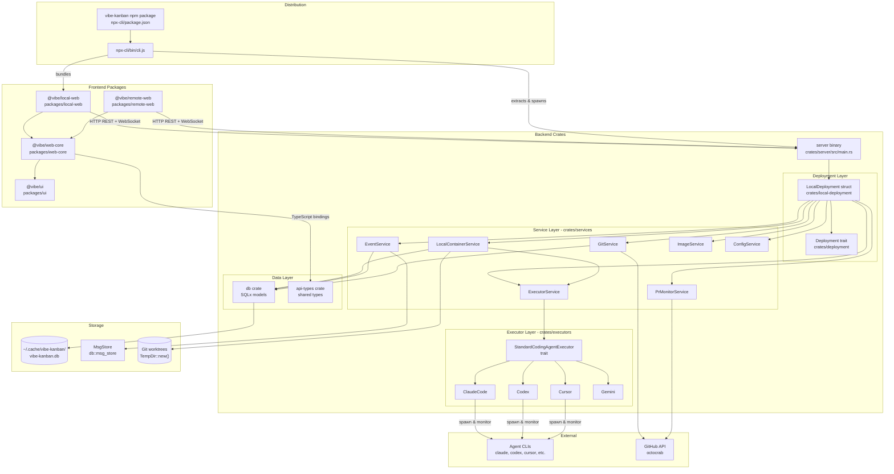

**Architecture Overview**

The system is organized into four primary layers:

1. **Frontend Layer**: React-based SPAs communicate with the backend via HTTP REST endpoints and WebSocket streams. The `@vibe/local-web` package serves desktop users, while `@vibe/remote-web` provides the cloud UI. Both share code through `@vibe/web-core` and `@vibe/ui` [package.json:18-28]().

2. **Backend Service Layer**: The `server` binary [crates/server/Cargo.toml:2-5]() uses the Axum framework to expose HTTP/WebSocket endpoints. The `LocalDeployment` struct [crates/local-deployment/Cargo.toml:2-3]() implements the `Deployment` trait [crates/deployment/Cargo.toml:2-3]() and orchestrates these services:
   - `LocalContainerService`: Workspace lifecycle and Git worktree management [crates/services/Cargo.toml:20]().
   - `EventService`: SQLite hook-based change capture and WebSocket streaming [crates/services/Cargo.toml:28]().
   - `ExecutorService`: Factory for spawning `StandardCodingAgentExecutor` instances [crates/services/Cargo.toml:18]().
   - `GitService`: Git operations via `git2` crate [crates/services/Cargo.toml:16]().
   - `ImageService`: File upload handling and caching [crates/services/Cargo.toml:54]().
   - `PrMonitorService`: GitHub PR status polling [crates/services/Cargo.toml:17]().
   - `ConfigService`: Application configuration persistence [crates/services/Cargo.toml:15]().

3. **Executor Layer**: The `StandardCodingAgentExecutor` trait [crates/executors/Cargo.toml:2-3]() defines a unified interface for agent integrations. Implementations like `ClaudeCode`, `Codex`, `Cursor`, and `Gemini` spawn child processes via `command-group` and normalize agent output streams [crates/executors/Cargo.toml:22-40]().

4. **Data Layer**: The `db` crate [crates/db/Cargo.toml:2-3]() provides SQLx-based models for SQLite persistence. The `api-types` crate [crates/api-types/Cargo.toml:237-247]() defines shared types that generate TypeScript bindings via `ts-rs`. `MsgStore` buffers real-time updates for WebSocket subscribers [crates/db/Cargo.toml:21]().

For details, see [System Architecture](#1.1).

**Sources:** [crates/server/Cargo.toml:10-22](), [crates/local-deployment/Cargo.toml:7-25](), [crates/services/Cargo.toml:13-19](), [crates/executors/Cargo.toml:7-40](), [crates/deployment/Cargo.toml:7-22]()

## Monorepo Structure

**Dependency Graph with Crate Names**

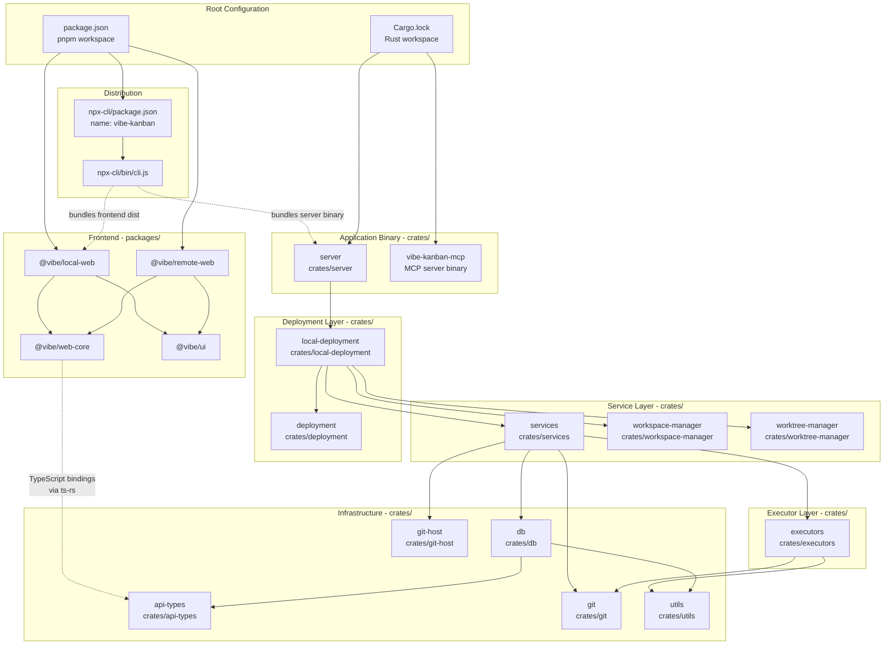

**Crate Organization and Purpose**

| Crate/Package | Binary/Lib | Primary Exports | Core Dependencies |
|---------------|------------|-----------------|-------------------|
| `server` | Binary | `server` binary | `axum`, `local-deployment`, `services`, `db` [crates/server/Cargo.toml:10-22]() |
| `local-deployment` | Library | `LocalDeployment` struct | `deployment`, `services`, `workspace-manager` [crates/local-deployment/Cargo.toml:7-25]() |
| `deployment` | Library | `Deployment` trait | `db`, `services`, `executors` [crates/deployment/Cargo.toml:7-12]() |
| `services` | Library | `LocalContainerService`, `EventService` | `db`, `executors`, `git`, `worktree-manager` [crates/services/Cargo.toml:13-20]() |
| `executors` | Library | `StandardCodingAgentExecutor` | `git`, `utils`, `tokio` [crates/executors/Cargo.toml:7-13]() |
| `db` | Library | SQLx models, `MsgStore` | `sqlx`, `utils`, `api-types` [crates/db/Cargo.toml:7-17]() |
| `api-types` | Library | Shared types with `#[derive(TS)]` | `ts-rs`, `serde`, `schemars` [crates/api-types/Cargo.toml:237-247]() |
| `git` | Library | `GitService` | `git2`, `tokio` [crates/services/Cargo.toml:16]() |
| `utils` | Library | Shared utilities, error types | `tokio`, `serde`, `thiserror` [crates/utils/Cargo.toml:7-33]() |
| `@vibe/local-web` | Frontend | Desktop React app | `@vibe/web-core`, `@vibe/ui`, `vite` [package.json:18-28]() |

**Type System Contract**

The `api-types` crate [crates/api-types/Cargo.toml:237-247]() defines shared data structures between Rust and TypeScript. Rust structs annotated with `#[derive(TS)]` generate TypeScript definitions via `ts-rs`. The `generate-types` script [package.json:35]() exports these to the frontend packages.

**Sources:** [package.json:1-68](), [crates/server/Cargo.toml:1-67](), [crates/local-deployment/Cargo.toml:1-41](), [crates/services/Cargo.toml:1-56](), [crates/executors/Cargo.toml:1-51](), [crates/deployment/Cargo.toml:1-29](), [crates/db/Cargo.toml:1-22]()

## Deployment Modes

Vibe Kanban supports two deployment modes:

### Local Deployment

**Local Mode Characteristics:**

- **Installation**: Single command `npx vibe-kanban` [README.md:42]() downloads and runs the entire stack.
- **Server**: The `server` binary is extracted and executed from the `npx-cli` wrapper [npx-cli/package.json:23]().
- **Database**: SQLite database used for local persistence [crates/server/Cargo.toml:44]().
- **Worktrees**: Git worktrees created for isolated agent execution [README.md:31]().
- **Frontend**: Local web UI served via Axum [crates/server/Cargo.toml:38]().

For details, see [Getting Started](#1.2).

**Sources:** [npx-cli/package.json:1-35](), [README.md:41-52](), [README.md:112-130]()

### Remote Deployment

Remote deployment is designed for cloud hosting with multi-tenant support.

- **Infrastructure**: Supports PostgreSQL and remote execution contexts [README.md:60]().
- **Relay Tunnel**: Support for connecting remote deployments to local environments via the relay tunnel system [crates/server/Cargo.toml:23-30]().
- **Configuration**: Managed via environment variables and cloud-specific services [README.md:147-162]().

**Sources:** [README.md:147-162](), [package.json:46-51]()

## Technology Stack

| Layer | Technologies | Key Crates/Packages |
|-------|-------------|---------------------|
| **Frontend** | React, TypeScript, Vite | `@vibe/local-web`, `@vibe/web-core`, `@vibe/ui` |
| **Backend Framework** | Axum, Tokio | `server`, `axum`, `tokio` |
| **Database** | SQLite via SQLx | `sqlx`, `db` |
| **Type Synchronization** | `ts-rs` | `api-types` |
| **Version Control** | `git2` | `git`, `worktree-manager` |
| **Agent Integration** | `command-group` | `executors` |
| **Error Handling** | `thiserror`, `anyhow` | `utils` |

**Sources:** [package.json:53-67](), [crates/server/Cargo.toml:32-66](), [crates/services/Cargo.toml:21-55](), [crates/executors/Cargo.toml:9-50]()

## Key Concepts

For detailed explanations of the system's core concepts, see:

- [System Architecture](#1.1) - High-level architecture and component interaction.
- [Getting Started](#1.2) - Installation and basic usage guide.

**Sources:** [README.md:24-36](), [package.json:1-68]()

---

# Page: System Architecture

# System Architecture

<details>
<summary>Relevant source files</summary>

The following files were used as context for generating this wiki page:

- [Cargo.lock](Cargo.lock)
- [Cargo.toml](Cargo.toml)
- [crates/client-info/src/lib.rs](crates/client-info/src/lib.rs)
- [crates/db/Cargo.toml](crates/db/Cargo.toml)
- [crates/deployment/Cargo.toml](crates/deployment/Cargo.toml)
- [crates/executors/Cargo.toml](crates/executors/Cargo.toml)
- [crates/local-deployment/Cargo.toml](crates/local-deployment/Cargo.toml)
- [crates/preview-proxy/src/lib.rs](crates/preview-proxy/src/lib.rs)
- [crates/relay-control/Cargo.toml](crates/relay-control/Cargo.toml)
- [crates/relay-tunnel-core/src/client.rs](crates/relay-tunnel-core/src/client.rs)
- [crates/relay-tunnel-core/src/lib.rs](crates/relay-tunnel-core/src/lib.rs)
- [crates/relay-tunnel-core/src/server.rs](crates/relay-tunnel-core/src/server.rs)
- [crates/relay-tunnel/Cargo.lock](crates/relay-tunnel/Cargo.lock)
- [crates/relay-tunnel/Cargo.toml](crates/relay-tunnel/Cargo.toml)
- [crates/review/Cargo.toml](crates/review/Cargo.toml)
- [crates/server/Cargo.toml](crates/server/Cargo.toml)
- [crates/server/src/main.rs](crates/server/src/main.rs)
- [crates/server/src/middleware/error_logging.rs](crates/server/src/middleware/error_logging.rs)
- [crates/server/src/middleware/mod.rs](crates/server/src/middleware/mod.rs)
- [crates/server/src/middleware/origin.rs](crates/server/src/middleware/origin.rs)
- [crates/server/src/routes/mod.rs](crates/server/src/routes/mod.rs)
- [crates/server/src/routes/preview.rs](crates/server/src/routes/preview.rs)
- [crates/server/src/runtime/relay_registration.rs](crates/server/src/runtime/relay_registration.rs)
- [crates/server/src/startup.rs](crates/server/src/startup.rs)
- [crates/services/Cargo.toml](crates/services/Cargo.toml)
- [crates/utils/Cargo.toml](crates/utils/Cargo.toml)
- [npx-cli/package.json](npx-cli/package.json)
- [package.json](package.json)

</details>


This document describes the high-level architecture of Vibe Kanban, focusing on how the major subsystems are organized and interact. For detailed information about specific components, see related pages: [Core Concepts](#2) for data models, [Executor System](#3) for AI agent integration, and [Backend Services](#4) for service-level implementation details.

## Purpose and Scope

Vibe Kanban is architected as a dual-deployment system that can run either **locally** (for individual developers) or **remotely** (cloud-hosted for teams). This page covers:

- The two deployment modes and their architectural differences.
- Backend crate organization and layering.
- Frontend package structure and code sharing.
- Type system synchronization between Rust and TypeScript.
- Distribution mechanisms (NPX, Tauri, Docker).

## Deployment Modes

Vibe Kanban supports two deployment strategies, both sharing the same core business logic but with different infrastructure implementations.

### Local Deployment vs Remote Deployment

Title: "Deployment Strategy Overview"
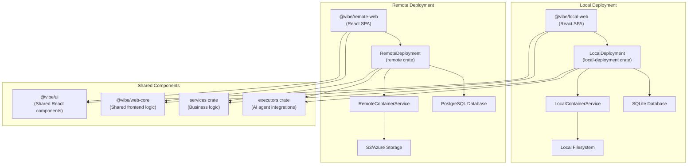

The `Deployment` trait defines the interface that both modes implement [crates/deployment/src/lib.rs:74-149](). `LocalDeployment` uses SQLite and local filesystem storage [crates/local-deployment/Cargo.toml:8-23](), while the remote deployment uses PostgreSQL and cloud storage. Both delegate to the `services` crate for shared business logic [crates/server/Cargo.toml:19-19]().

| Aspect | Local Deployment | Remote Deployment |
|--------|------------------|-------------------|
| **Database** | SQLite (sqlx) | PostgreSQL |
| **Storage** | Local filesystem | S3/Azure Blob |
| **Container Service** | `LocalContainerService` | `RemoteContainerService` |
| **Authentication** | OAuth handoffs + trusted keys | JWT tokens |
| **Entry Point** | `server` binary | `remote` binary |

**Sources**: [crates/deployment/Cargo.toml:7-22](), [crates/local-deployment/Cargo.toml:7-25](), [crates/server/Cargo.toml:11-31](), [crates/deployment/src/lib.rs:74-149]()

## Backend Crate Architecture

The Rust backend is organized into distinct layers, with dependencies flowing downward from application binaries to infrastructure utilities.

### Crate Dependency Graph

Title: "Backend Crate Hierarchy"
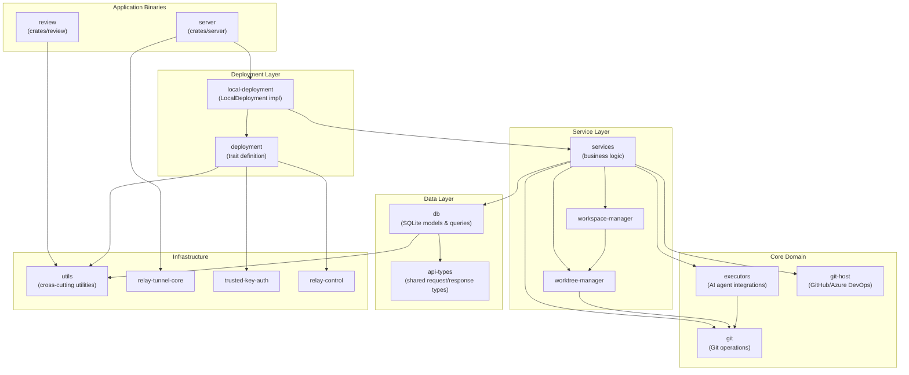

**Sources**: [crates/server/Cargo.toml:10-31](), [crates/local-deployment/Cargo.toml:7-25](), [crates/services/Cargo.toml:13-20](), [crates/deployment/Cargo.toml:7-22](), [package.json:1-34]()

### Layer Breakdown

#### Application Layer
Contains entry point binaries that initialize and run services:
- **`server`** [crates/server/Cargo.toml:2-5](): Main HTTP server using Axum, initializes deployment and starts listening.
- **`review`** [crates/review/Cargo.toml:8-9](): CLI tool for code review workflows.

#### Deployment Layer
The `Deployment` trait abstracts over local vs remote infrastructure [crates/deployment/src/lib.rs:74-149](). `LocalDeployment` implements this trait with local filesystem and SQLite [crates/local-deployment/Cargo.toml:8-23]().

#### Service Layer
Core business logic resides in the `services` crate [crates/services/Cargo.toml:2-4](). Key services include `ContainerService` for execution management [crates/services/Cargo.toml:19-22]() and `EventService` for real-time updates.

#### Core Domain Layer
- **`executors`** [crates/executors/Cargo.toml:2-2](): Integrations with AI coding agents (Claude, Codex, Gemini, etc.) utilizing protocols like `agent-client-protocol` [crates/executors/Cargo.toml:38-40]().
- **`workspace-manager`**: Manages isolated workspace directories.
- **`worktree-manager`**: Git worktree lifecycle management.
- **`git`**: Git operations wrapper.

#### Data Layer
- **`db`** [crates/db/Cargo.toml:2-2](): SQLite models and queries using `sqlx` [crates/db/Cargo.toml:14-14]().
- **`api-types`** [Cargo.lock:238-239](): Shared request/response types for API communication, utilizing `ts-rs` for frontend sync [Cargo.lock:246-246]().

## Frontend Architecture

The frontend is organized as a pnpm monorepo with workspace packages sharing common UI components and business logic.

### Package Structure

Title: "Frontend Package Relationships"
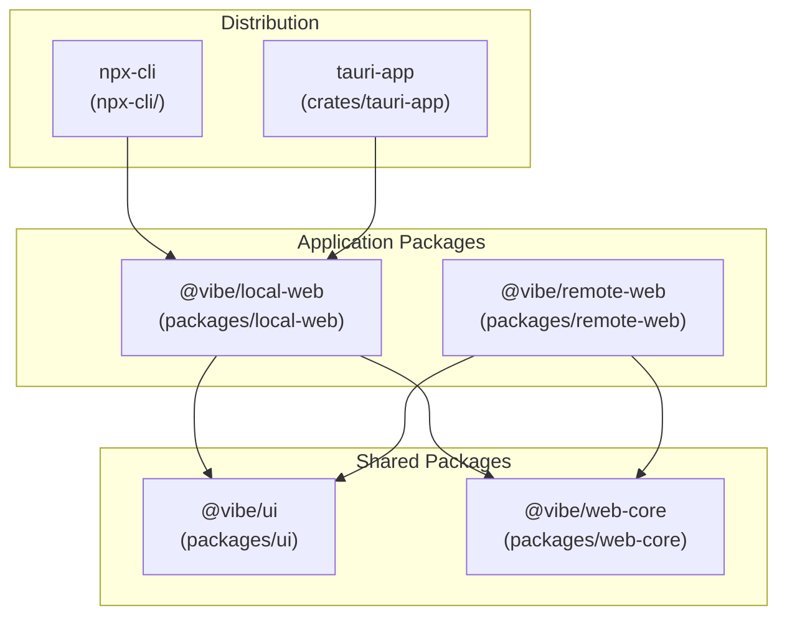

**Sources**: [package.json:18-28](), [package.json:51-52]()

| Package | Purpose |
|---------|---------|
| `@vibe/local-web` | Desktop UI for local deployment [package.json:18-25](). |
| `@vibe/remote-web` | Cloud UI with organization features [package.json:24-26](). |
| `@vibe/ui` | Shared component library [package.json:27-28](). |
| `@vibe/web-core` | Shared API client and state logic [package.json:20-21](). |

## Type System Synchronization

Vibe Kanban maintains type consistency between Rust backend and TypeScript frontend through automatic code generation via the `generate_types` binary.

Title: "Type Synchronization Flow"
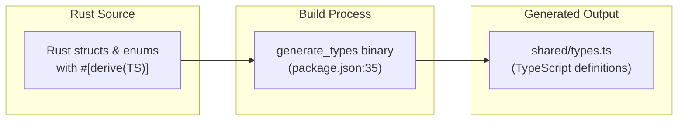

**Sources**: [package.json:35-36](), [Cargo.lock:246-246]()

The `generate_types` binary uses the `ts-rs` crate to export TypeScript definitions from Rust types marked with `#[derive(TS)]` [Cargo.lock:246-246](). This is primarily implemented in `api-types` and `db` crates.

## Distribution Mechanisms

### NPX Distribution
The NPX wrapper detects the platform, extracts the appropriate binary, and launches the server with bundled frontend assets [npx-cli/package.json:23-30]().

Title: "NPX Build and Release Pipeline"
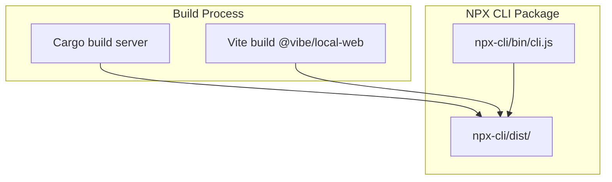

**Sources**: [package.json:5-11](), [npx-cli/package.json:6-10](), [npx-cli/package.json:23-30]()

### Tauri and Docker
- **Tauri**: Bundles the Rust backend and frontend into a native desktop application [package.json:51-52]().
- **Docker**: Used for remote/cloud deployment environments, supporting profiles like `relay` and `attachments` [package.json:46-48]().

---

This architecture enables Vibe Kanban to support both local development workflows and team collaboration, with shared core logic ensuring consistent behavior across deployment modes.

---

# Page: Getting Started

# Getting Started

<details>
<summary>Relevant source files</summary>

The following files were used as context for generating this wiki page:

- [README.md](README.md)
- [dev_assets_seed/config.json](dev_assets_seed/config.json)
- [dev_assets_seed/db.sqlite](dev_assets_seed/db.sqlite)
- [docs/configuration-customisation/agent-configurations.mdx](docs/configuration-customisation/agent-configurations.mdx)
- [docs/configuration-customisation/global-settings.mdx](docs/configuration-customisation/global-settings.mdx)
- [docs/core-features/completing-a-task.mdx](docs/core-features/completing-a-task.mdx)
- [docs/core-features/reviewing-code-changes.mdx](docs/core-features/reviewing-code-changes.mdx)
- [docs/core-features/subtasks.mdx](docs/core-features/subtasks.mdx)
- [docs/getting-started.mdx](docs/getting-started.mdx)
- [docs/index.mdx](docs/index.mdx)
- [docs/integrations/github-integration.mdx](docs/integrations/github-integration.mdx)
- [docs/integrations/vscode-extension.mdx](docs/integrations/vscode-extension.mdx)
- [packages/public/vibe-kanban-screenshot-overview.png](packages/public/vibe-kanban-screenshot-overview.png)
- [packages/public/vibe-kanban-screenshot-workspace.png](packages/public/vibe-kanban-screenshot-workspace.png)
- [scripts/setup-dev-environment.js](scripts/setup-dev-environment.js)

</details>


This page provides instructions for installing and running Vibe Kanban locally. It covers both end-user installation via the `npx` command and development environment setup for contributors. For information about the overall system architecture, see [System Architecture](1.1).

---

## End User Installation

The simplest way to run Vibe Kanban is through the published npm package:

```bash
npx vibe-kanban
```

This command downloads the distribution wrapper, extracts the platform-specific server binary and frontend assets, and launches a local instance with automatic port selection [README.md:42-44](), [README.md:51-53]().

### Prerequisites

| Requirement | Version | Purpose |
|------------|---------|---------|
| Node.js | ≥ 20 | Required to run the npx launcher and CLI tools [README.md:76-76]() |
| Coding Agent | Any supported | Authenticate with agents like Claude Code, Gemini CLI, or Codex [README.md:49-49](), [docs/index.mdx:11-12]() |
| Git | Latest | Required for worktree management and repository operations [README.md:126-126](), [docs/getting-started.mdx:73-74]() |

**Sources:** [README.md:49-76](), [docs/index.mdx:11-12](), [docs/getting-started.mdx:73-74]()

---

### How NPX Distribution Works

The `npx-cli` package acts as a distribution wrapper. When invoked, it executes a bundled CLI which detects the platform and architecture to run the correct native binary.

**Diagram: NPX Installation and Launch Flow**

```mermaid
flowchart TB
    subgraph "NPM_Registry"
        ["vibe-kanban_package"]
    end
    
    subgraph "User_Machine"
        ["npx_vibe-kanban"]
        ["npx-cli/bin/cli.js"]
        ["Extract_platform_binary"]
        ["Local_Server_Process"]
        ["Launch_browser"]
    end
    
    subgraph "Runtime_Components"
        ["db.sqlite"]
        ["Git_Worktrees"]
        ["local-web::UI"]
    end
    
    ["npx_vibe-kanban"] --> ["vibe-kanban_package"]
    ["vibe-kanban_package"] --> ["npx-cli/bin/cli.js"]
    ["npx-cli/bin/cli.js"] --> ["Extract_platform_binary"]
    ["Extract_platform_binary"] --> ["Local_Server_Process"]
    ["Local_Server_Process"] --> ["db.sqlite"]
    ["Local_Server_Process"] --> ["Git_Worktrees"]
    ["Local_Server_Process"] --> ["local-web::UI"]
    ["Local_Server_Process"] --> ["Launch_browser"]
```

1.  **Platform Detection**: The CLI detects the operating system and architecture to fetch the correct server binary [README.md:107-110]().
2.  **Binary Extraction**: The distribution wrapper extracts the server binary and assets to a local directory.
3.  **Initialization**: The server initializes the local environment, including copying a seed database `dev_assets_seed/db.sqlite` if a local database does not exist [README.md:96-96](), [scripts/setup-dev-environment.js:168-177]().

**Sources:** [README.md:96-110](), [scripts/setup-dev-environment.js:168-181]()

---

## Development Environment Setup

### Prerequisites

The development environment requires the following tools:

| Tool | Minimum Version | Purpose |
|------|----------------|---------|
| Rust | Latest Stable | Backend services and binaries [README.md:75-75]() |
| Node.js | 20 | Frontend and CLI development [README.md:76-76]() |
| pnpm | 8 | Package management and monorepo orchestration [README.md:77-77]() |
| cargo-watch | - | Hot-reloading for Rust backend development [README.md:81-81]() |
| sqlx-cli | - | Database migrations and management [README.md:82-82]() |

**Sources:** [README.md:73-83]()

---

### Installation and Build Steps

1.  **Clone the repository**
    ```bash
    git clone https://github.com/BloopAI/vibe-kanban.git
    cd vibe-kanban
    ```

2.  **Install dependencies**
    ```bash
    pnpm i
    ```
    [README.md:86-88]()

3.  **Running the dev server**
    ```bash
    pnpm run dev
    ```
    [README.md:92-94]()
    This command starts both the backend and the web app. It uses `scripts/setup-dev-environment.js` to allocate free ports for the frontend, backend, and preview proxy [scripts/setup-dev-environment.js:86-108](). It also seeds the local database from `dev_assets_seed/db.sqlite` [scripts/setup-dev-environment.js:168-177]().

4.  **Building from Source (macOS)**
    To build the binaries and the web app locally, use the provided build script:
    ```bash
    ./local-build.sh
    cd npx-cli && node bin/cli.js
    ```
    [README.md:107-110]()

**Sources:** [README.md:86-110](), [scripts/setup-dev-environment.js:86-177]()

---

### Development Workflow Sequence

**Diagram: Local Build and Execution Sequence**

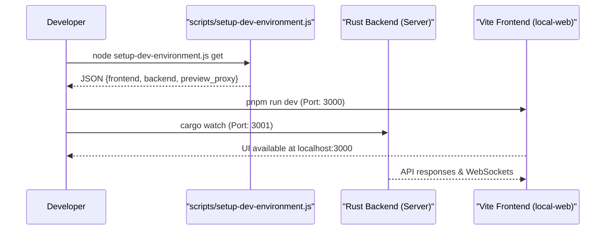

**Sources:** [README.md:92-94](), [scripts/setup-dev-environment.js:159-163](), [scripts/setup-dev-environment.js:204-210]()

---

## Initial Configuration

On the first launch, Vibe Kanban prompts the user for basic preferences including the default coding agent, preferred IDE, and notification settings [docs/getting-started.mdx:18-25]().

### Local vs. Remote Setup

Vibe Kanban can be configured for remote environments, such as a VPS or cloud instance:

1.  **Remote SSH**: Users can configure "Remote SSH Host" and "Remote SSH User" in Settings to open code in a local IDE via an SSH tunnel [docs/configuration-customisation/global-settings.mdx:48-60]().
2.  **Allowed Origins**: When behind a reverse proxy, the `VK_ALLOWED_ORIGINS` environment variable must be set to prevent CORS and 403 Forbidden errors [README.md:134-146]().
3.  **Tunneling**: The system supports a relay tunnel mode via `VK_TUNNEL` and `VK_SHARED_RELAY_API_BASE` [README.md:129-130]().

### Editor Integration

The system supports a variety of editors including VS Code, Cursor, Windsurf, and Neovim [docs/configuration-customisation/global-settings.mdx:34-40](). This configuration is stored in the `config.json` file under the `editor` key [dev_assets_seed/config.json:11-14]().

**Diagram: Editor Opening Logic**

```mermaid
flowchart TD
    ["local-web::UI_Button"] -- "Click 'Open in VSCode'" --> ["frontend::generate_url"]
    ["frontend::generate_url"] -- "Remote SSH Configured?" --> ["vscode-remote://ssh-remote+user@host/path"]
    ["frontend::generate_url"] -- "Local Mode?" --> ["vscode://file/path"]
    ["vscode-remote://..."] --> ["Local_OS_Handler"]
    ["vscode://..."] --> ["Local_OS_Handler"]
    ["Local_OS_Handler"] --> ["VSCode_Process"]
```

**Sources:** [docs/configuration-customisation/global-settings.mdx:48-80](), [dev_assets_seed/config.json:11-14]()

---

## Agent Configuration (Profiles)

Vibe Kanban manages AI coding agents through profiles and variants. Each agent type (e.g., `CLAUDE_CODE`, `GEMINI`, `CODEX`) supports specific flags and parameters defined in a `profiles.json` file [docs/configuration-customisation/agent-configurations.mdx:42-60]().

| Agent | Key Parameters |
|-------|----------------|
| **CLAUDE_CODE** | `plan`, `claude_code_router`, `dangerously_skip_permissions` [docs/configuration-customisation/agent-configurations.mdx:80-94]() |
| **GEMINI** | `model` (default/flash), `yolo` [docs/configuration-customisation/agent-configurations.mdx:96-106]() |
| **CODEX** | `sandbox` (read-only/write), `model_reasoning_effort` [docs/configuration-customisation/agent-configurations.mdx:116-134]() |
| **DROID** | `autonomy`, `reasoning_effort` [docs/configuration-customisation/agent-configurations.mdx:168-182]() |

**Sources:** [docs/configuration-customisation/agent-configurations.mdx:42-182]()

---

# Page: Core Concepts

# Core Concepts

<details>
<summary>Relevant source files</summary>

The following files were used as context for generating this wiki page:

- [crates/db/.sqlx/query-1b186dc075846fc1f7270a942afbf82a88806ee6ababdb437ab5e97ddd2122da.json](crates/db/.sqlx/query-1b186dc075846fc1f7270a942afbf82a88806ee6ababdb437ab5e97ddd2122da.json)
- [crates/db/.sqlx/query-2a57b702e52b3cc9bdbc361267985958b11d4493b01a9ab8daedf5d951422897.json](crates/db/.sqlx/query-2a57b702e52b3cc9bdbc361267985958b11d4493b01a9ab8daedf5d951422897.json)
- [crates/db/.sqlx/query-f584dbe0f2f2a4f1e7dcf5b8f675eb2a6d954bb3f148ac0fece10652f05fb49b.json](crates/db/.sqlx/query-f584dbe0f2f2a4f1e7dcf5b8f675eb2a6d954bb3f148ac0fece10652f05fb49b.json)
- [crates/db/src/models/execution_process.rs](crates/db/src/models/execution_process.rs)
- [crates/db/src/models/scratch.rs](crates/db/src/models/scratch.rs)
- [crates/db/src/models/workspace.rs](crates/db/src/models/workspace.rs)
- [crates/local-deployment/src/container.rs](crates/local-deployment/src/container.rs)
- [crates/server/src/bin/generate_types.rs](crates/server/src/bin/generate_types.rs)
- [crates/server/src/routes/containers.rs](crates/server/src/routes/containers.rs)
- [crates/services/src/services/container.rs](crates/services/src/services/container.rs)
- [crates/utils/src/port_file.rs](crates/utils/src/port_file.rs)
- [shared/types.ts](shared/types.ts)

</details>


This document explains the fundamental data models, type system, and architectural patterns that underpin Vibe Kanban. These concepts form the foundation for understanding how workspaces execute coding agents, how data flows between frontend and backend, and how the system maintains isolation and real-time synchronization.

For information about the executor system and coding agent integration, see [Executor System](#3). For deployment architecture and infrastructure, see [Backend Services](#4).

---

## Fundamental Data Models

Vibe Kanban's core domain model centers on **Workspaces**, **Sessions**, and **ExecutionProcesses**. These entities work together to provide isolated environments where coding agents can make changes to repositories.

### Entity Relationship Diagram

Vibe Kanban uses a relational model to track the state of AI agent interactions and the resulting code changes.

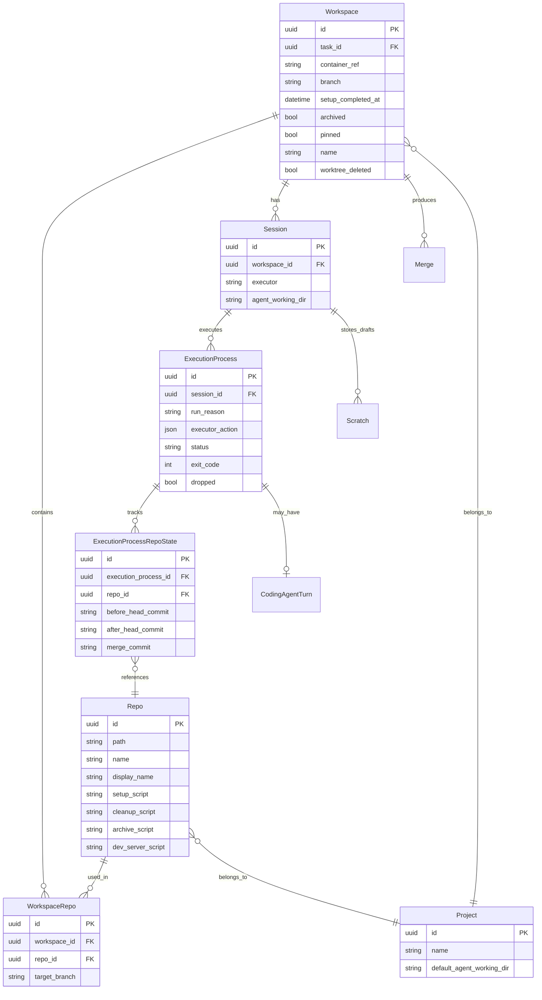

**Sources:** [shared/types.ts:7-9](), [shared/types.ts:21-21](), [shared/types.ts:145-147](), [shared/types.ts:155-157](), [crates/local-deployment/src/container.rs:12-25](), [crates/services/src/services/container.rs:12-24]()

### Core Entity Descriptions

| Entity | Purpose | Key Characteristics |
|--------|---------|-------------------|
| `Workspace` | Isolated environment for coding agent execution | - Has unique branch name<br/>- References container directory (`container_ref`) [shared/types.ts:155]()<br/>- Can be archived/pinned<br/>- Contains one or more repositories |
| `WorkspaceRepo` | Links repositories to workspaces | - Specifies `target_branch` per repo [shared/types.ts:21]()<br/>- One workspace can have multiple repos |
| `Session` | Groups related execution processes | - Tied to one workspace<br/>- Stores executor configuration [shared/types.ts:159]()<br/>- Maintains `agent_working_dir` [shared/types.ts:159]() |
| `ExecutionProcess` | Single invocation of an executor | - Tracks status (`Running`, `Completed`, `Failed`, `Killed`) [crates/db/src/models/execution_process.rs:43-48]()<br/>- Contains `executor_action` chain [crates/db/src/models/execution_process.rs:67]()<br/>- Records exit code and timing |
| `ExecutionProcessRepoState` | Tracks commit state per repo | - Before/after head commits<br/>- Merge commit if applicable<br/>- Enables diff computation [shared/types.ts:165]() |
| `Repo` | Repository configuration | - Local path to git repository<br/>- Setup/cleanup/archive scripts<br/>- Dev server configuration [shared/types.ts:7]() |
| `Project` | High-level organizational unit | - Default working directories for agents [shared/types.ts:9]() |

**Sources:** [shared/types.ts:7-165](), [crates/local-deployment/src/container.rs:12-25](), [crates/db/src/models/execution_process.rs:43-67]()

---

## Type System and API Contracts

Vibe Kanban maintains type safety between its Rust backend and TypeScript frontend through code generation. The `generate_types` binary serves as the bridge.

### Type Generation Flow

The system ensures that changes to Rust database models or API responses are immediately reflected in the TypeScript frontend.

```mermaid
flowchart LR
    "RustModels"["Rust Models<br/>(db::models)"]
    "TsRsMacro"["#[derive(TS)]<br/>ts-rs macro"]
    "GenerateBin"["crates/server/src/bin/generate_types.rs"]
    "TypesFile"["shared/types.ts"]
    "Frontend"["Frontend Packages<br/>(local-web, remote-web)"]
    
    "RustModels" --> "TsRsMacro"
    "TsRsMacro" --> "GenerateBin"
    "GenerateBin" --> "TypesFile"
    "TypesFile" --> "Frontend"
```

**Sources:** [crates/server/src/bin/generate_types.rs:7-133](), [shared/types.ts:1-5]()

### Type Generation Process

1. **Rust Type Definition**: Structs are defined in Rust with `#[derive(Serialize, Deserialize, TS)]` attributes (e.g., `Workspace` in `db::models` [crates/db/src/models/workspace.rs:41-42]()).
2. **Type Declaration Collection**: The `generate_types_content` function in the generator binary explicitly lists every struct that needs to be exported to the frontend [crates/server/src/bin/generate_types.rs:13-133]().
3. **TypeScript Generation**: The `ts-rs` library generates TypeScript types with proper field mappings.
4. **Export**: All types are exported from `shared/types.ts` with a warning banner [shared/types.ts:1-11]().

For details, see [Type System and API Contracts](#2.1).

---

## Workspace Lifecycle

A workspace progresses through several states from creation to cleanup. The lifecycle is managed by the `ContainerService` trait and implemented by `LocalContainerService`.

### Workspace State Transitions

```mermaid
stateDiagram-v2
    [*] --> "Created" : "POST /workspaces"
    "Created" --> "SetupRunning" : "ContainerService::create()"
    "SetupRunning" --> "Ready" : "setup completes"
    "SetupRunning" --> "Failed" : "setup fails"
    "Ready" --> "CodingAgentRunning" : "ContainerService::start_execution()"
    "CodingAgentRunning" --> "Ready" : "agent completes"
    "CodingAgentRunning" --> "Failed" : "agent fails"
    "Ready" --> "Archived" : "ContainerService::delete()"
    "Archived" --> [*]
```

**Sources:** [crates/services/src/services/container.rs:87-198](), [crates/local-deployment/src/container.rs:90-133]()

### Lifecycle Stages

#### 1. Creation
When a workspace is created, the `LocalContainerService` uses a `WorkspaceManager` to initialize the environment [crates/local-deployment/src/container.rs:71](). This involves generating a unique branch ID and setting up the filesystem path [crates/services/src/services/container.rs:55-55]().

#### 2. Execution
During execution, the workspace hosts one or more `ExecutionProcess` instances. The `LocalContainerService` tracks these processes using a `child_store` and `cancellation_tokens` [crates/local-deployment/src/container.rs:72-73]().

#### 3. Archival and Cleanup
Workspaces can be archived, which triggers cleanup scripts defined in the `Repo` model [shared/types.ts:7](). The `LocalContainerService` runs a background task `spawn_workspace_cleanup` to remove stale worktrees [crates/local-deployment/src/container.rs:130]().

For details, see [Workspaces and Execution Lifecycle](#2.3).

---

## Isolation Through Git Worktrees

Vibe Kanban achieves workspace isolation using **git worktrees**. This allows multiple agents to work on the same repository simultaneously without interfering with each other's files or the user's primary working directory.

### Worktree Structure

```mermaid
graph TB
    "MainRepo"["Main Repository<br/>/path/to/repo"]
    "WorkspaceDir"["Workspace Directory<br/>(container_ref)"]
    "Worktree1"["Repo A Worktree<br/>(branch: vk-abc)"]
    "Worktree2"["Repo B Worktree<br/>(branch: vk-abc)"]
    
    "MainRepo" -.->|git worktree add| "Worktree1"
    "MainRepo" -.->|git worktree add| "Worktree2"
    "WorkspaceDir" --> "Worktree1"
    "WorkspaceDir" --> "Worktree2"
```

**Sources:** [crates/local-deployment/src/container.rs:160-188](), [crates/services/src/services/container.rs:125-134]()

The `container_ref` in the `Workspace` model points to the root directory containing these worktrees [shared/types.ts:155](). The `LocalContainerService` resolves paths by joining the `container_ref` with the repository's relative path [crates/services/src/services/container.rs:134-138]().

For details, see [Git Worktree Management](#2.4).

---

## Sessions and Execution Processes

A `Session` groups related execution processes within a workspace. Each `ExecutionProcess` represents a single invocation of an executor (coding agent or script).

### Execution Process Anatomy

Each `ExecutionProcess` has a `run_reason` and a `status` [crates/db/src/models/execution_process.rs:65-68]().

| `run_reason` | Description |
|--------------|-------------|
| `SetupScript` | Initial environment preparation [crates/db/src/models/execution_process.rs:54](). |
| `CodingAgent` | Main AI agent interaction [crates/db/src/models/execution_process.rs:57](). |
| `CleanupScript` | Post-execution cleanup [crates/db/src/models/execution_process.rs:55](). |
| `DevServer` | Long-running background process for previews [crates/db/src/models/execution_process.rs:58](). |

**Sources:** [crates/db/src/models/execution_process.rs:53-59](), [crates/services/src/services/container.rs:200-203]()

For details, see [Sessions and Execution Processes](#2.5).

---

## Draft Storage and State Persistence

The `Scratch` system provides typed, transient storage for draft data and UI preferences. This avoids polluting core domain tables with temporary state.

### Scratch Types

The `ScratchType` enum defines the various categories of data persisted in the scratch system [shared/types.ts:147]():

| Type | Data Model | Purpose |
|------|------------|---------|
| `DRAFT_WORKSPACE` | `DraftWorkspaceData` | Persists multi-repo selection and prompt during workspace creation [shared/types.ts:35](). |
| `UI_PREFERENCES` | `UiPreferencesData` | Stores sidebar visibility, pane sizes, and collapsed file tree paths [shared/types.ts:73-141](). |
| `WORKSPACE_NOTES` | `WorkspaceNotesData` | Per-workspace user notes [shared/types.ts:59](). |
| `PREVIEW_SETTINGS` | `PreviewSettingsData` | Browser preview configuration [shared/types.ts:57](). |

**Sources:** [shared/types.ts:21-147](), [crates/db/src/models/scratch.rs:145-147]()

For details, see [Scratch Data and UI State Persistence](#2.7).

---

## Real-time Streaming and Updates

Vibe Kanban uses WebSockets and an internal event service to provide a live experience.

- **Logs**: Captured via `MsgStore` and streamed to the frontend [crates/local-deployment/src/container.rs:74-77]().
- **Database Changes**: The `EventService` monitors the SQLite database and pushes updates to the frontend.
- **Notifications**: Managed by the `NotificationService` to alert users of completed or failed tasks [crates/local-deployment/src/container.rs:109]().

For details, see [Real-time Streaming and Updates](#2.6).

---

# Page: Type System and API Contracts

# Type System and API Contracts

<details>
<summary>Relevant source files</summary>

The following files were used as context for generating this wiki page:

- [crates/api-types/Cargo.toml](crates/api-types/Cargo.toml)
- [crates/db/src/models/scratch.rs](crates/db/src/models/scratch.rs)
- [crates/server/src/bin/generate_types.rs](crates/server/src/bin/generate_types.rs)
- [packages/web-core/src/shared/hooks/useExecutorConfig.ts](packages/web-core/src/shared/hooks/useExecutorConfig.ts)
- [shared/schemas/claude_code.json](shared/schemas/claude_code.json)
- [shared/types.ts](shared/types.ts)

</details>


This page explains how Rust backend types are translated into TypeScript declarations that the frontend consumes, covering the generation binaries, the `ts-rs` macro system, the generated shared type files, and the JSON schema outputs. It also describes the `ApiResponse` wrapper contract and the specialized remote type synchronization used for the cloud infrastructure.

---

## Purpose and Scope

The frontend (React/TypeScript) and the backend (Rust/Axum) must agree on the shape of every data structure exchanged over HTTP and WebSocket. Rather than maintaining parallel definitions, the codebase uses `ts-rs` to derive TypeScript type declarations directly from Rust structs and enums. Dedicated binaries collect all such declarations and write them to shared TypeScript files.

This approach ensures:
- The Rust type definition is the single source of truth.
- TypeScript consumers import from central files with no hand-written type glue.
- CI check gates enforce that TypeScript files are always synchronized with Rust sources.

---

## Generation Pipeline

Vibe Kanban maintains two distinct type generation pipelines: one for the local development environment (`shared/types.ts`) and one for the remote/cloud service (`shared/remote-types.ts`).

**Type Generation Data Flow**

```mermaid
flowchart TD
    subgraph "Rust_Source_Crates"
        [DB] ["db::models::*"]
        [Executors] ["executors::profile::*"]
        [Services] ["services::services::*"]
        [ServerRoutes] ["server::routes::*"]
        [ApiTypes] ["api_types::*"]
        [RemoteRoutes] ["remote::routes::*"]
    end

    subgraph "ts-rs_derive_macro"
        [TSDerived] ["#[derive(TS)] implements TS::decl()"]
    end

    subgraph "Generation_Binaries"
        [LocalGen] ["crates/server/src/bin/generate_types.rs"]
        [RemoteGen] ["crates/remote/src/bin/remote_generate_types.rs"]
    end

    subgraph "Output_Artifacts"
        [LocalTS] ["shared/types.ts"]
        [RemoteTS] ["shared/remote-types.ts"]
        [Schemas] ["shared/schemas/*.json"]
    end

    [DB] & [Executors] & [Services] & [ServerRoutes] & [ApiTypes] --> [TSDerived]
    [RemoteRoutes] & [ApiTypes] --> [TSDerived]
    
    [TSDerived] --> [LocalGen]
    [TSDerived] --> [RemoteGen]
    
    [LocalGen] --> [LocalTS]
    [LocalGen] --> [Schemas]
    [RemoteGen] --> [RemoteTS]
```

Sources: [crates/server/src/bin/generate_types.rs:7-134](), [shared/types.ts:1-5]()

### The `generate_types` Binaries

1.  **Local Generator**: Resides in `crates/server/src/bin/generate_types.rs`. It assembles declarations by calling `.decl()` on types from `db`, `executors`, `services`, and `server` [crates/server/src/bin/generate_types.rs:13-134](). It also generates JSON schemas for executor configurations using `schemars` to facilitate dynamic UI generation for agent settings.
2.  **Remote Generator**: Resides in `crates/remote/src/bin/remote_generate_types.rs`. It focuses on cloud-specific entities like `OrganizationMember`, `Issue`, and `Project`.

### The `ts-rs` Trait

Every exported Rust type has `#[derive(TS)]` applied [crates/db/src/models/scratch.rs:21](). The `TS` trait provides a `decl()` associated function that returns a `String` containing the TypeScript type alias or interface. Serialization attributes like `#[serde(rename_all = "snake_case")]` are respected to ensure JSON compatibility [crates/db/src/models/scratch.rs:55-79]().

Multiple crates declare `ts-rs` as a dependency:
- `api-types`: [crates/api-types/Cargo.toml:12]()
- `server`: [crates/server/src/bin/generate_types.rs:5]()
- `db`: [crates/db/src/models/scratch.rs:7]()

---

## The `api-types` Crate

The `api-types` crate ([crates/api-types]()) is a foundation crate holding types shared between the local server, the remote service, and the MCP server. It depends on `ts-rs`, `serde`, and `schemars` but has no dependencies on internal services or database logic [crates/api-types/Cargo.toml:6-13]().

Key types defined here include:
- **Identity & Auth**: `LoginStatus`, `ProviderProfile`, `CurrentUserResponse` [crates/server/src/bin/generate_types.rs:67-69](), [crates/server/src/bin/generate_types.rs:105]().
- **Organizations**: `Organization`, `OrganizationMemberInfo`, `Invitation` [crates/server/src/bin/generate_types.rs:73-80]().
- **System Info**: `UserSystemInfo`, `Environment` [crates/server/src/bin/generate_types.rs:96-97]().

Sources: [crates/api-types/Cargo.toml:1-14](), [crates/server/src/bin/generate_types.rs:67-91]()

---

## Key Type Definitions and Contracts

### `ApiResponse<T, E>`

The local backend wraps all REST responses in a standard `ApiResponse` structure to provide consistent success/error signaling [crates/server/src/bin/generate_types.rs:66]().

```typescript
export type ApiResponse<T, E = T> = {
  success: boolean,
  data: T | null,
  error_data: E | null,
  message: string | null,
};
```

### Discriminated Unions: `ScratchPayload`

The `Scratch` system is used for persisting UI state and drafts. The `ScratchPayload` is a tagged union in Rust that translates to a discriminated union in TypeScript [shared/types.ts:145]().

```typescript
export type ScratchPayload = 
  | { "type": "DRAFT_TASK", "data": string } 
  | { "type": "DRAFT_FOLLOW_UP", "data": DraftFollowUpData } 
  | { "type": "DRAFT_WORKSPACE", "data": DraftWorkspaceData } 
  | { "type": "DRAFT_ISSUE", "data": DraftIssueData } 
  | { "type": "PREVIEW_SETTINGS", "data": PreviewSettingsData } 
  | { "type": "WORKSPACE_NOTES", "data": WorkspaceNotesData } 
  | { "type": "UI_PREFERENCES", "data": UiPreferencesData } 
  | { "type": "PROJECT_REPO_DEFAULTS", "data": ProjectRepoDefaultsData };
```

Sources: [shared/types.ts:145-147](), [crates/db/src/models/scratch.rs:21-204]()

---

## API Contract Mapping

The following diagram bridges natural language API concepts to the specific code entities used in contracts for both local and remote operations.

**API Contract Mapping**

```mermaid
graph LR
    subgraph "Natural_Language_Concept"
        [RegisterRepo] ["Register a Repository"]
        [CreateScratch] ["Save a Draft/UI State"]
        [UpdateMember] ["Update Organization Member"]
    end

    subgraph "Code_Entity_(Rust/TS)"
        direction TB
        [RR_Req] ["RegisterRepoRequest"]
        [CS_Req] ["CreateScratch"]
        [UMR_Req] ["UpdateMemberRoleRequest"]
    end

    subgraph "Implementation_Site"
        [RepoRouter] ["server::routes::repo"]
        [ScratchModel] ["db::models::scratch"]
        [ApiTypes] ["api_types"]
    end

    [RegisterRepo] --> [RR_Req]
    [CreateScratch] --> [CS_Req]
    [UpdateMember] --> [UMR_Req]
    
    [RR_Req] --> [RepoRouter]
    [CS_Req] --> [ScratchModel]
    [UMR_Req] --> [ApiTypes]
```

Sources: [crates/server/src/bin/generate_types.rs:92](), [crates/server/src/bin/generate_types.rs:44](), [crates/server/src/bin/generate_types.rs:90](), [shared/types.ts:151]()

---

## Executor Profile Contracts

Executor configurations are heavily typed to ensure the frontend sends valid parameters to the backend. Each executor configuration (e.g., `DraftFollowUpData`) references an `ExecutorConfig` which is derived from the `executors` crate [crates/db/src/models/scratch.rs:21-25](). 

The frontend uses `useExecutorConfig` to resolve effective configurations through a fallback chain: user selections, scratch state, last used config, and finally presets [packages/web-core/src/shared/hooks/useExecutorConfig.ts:201-241]().

**Executor Type Relationship**

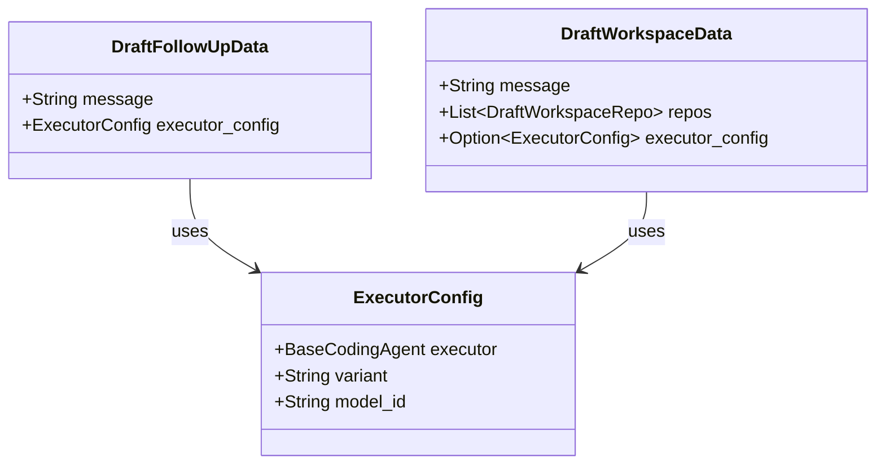

Sources: [crates/db/src/models/scratch.rs:21-26](), [crates/db/src/models/scratch.rs:177-187](), [shared/types.ts:33-35](), [packages/web-core/src/shared/hooks/useExecutorConfig.ts:142-170]()

---

## JSON Schema Integration

For complex configurations like `claude_code`, the system uses JSON Schema files (e.g., `shared/schemas/claude_code.json`) to define property constraints, default values, and UI hints like `format: textarea` [shared/schemas/claude_code.json:1-13](). These schemas are consumed by the frontend to render dynamic forms for executor settings.

Sources: [shared/schemas/claude_code.json:1-102]()

---

# Page: Projects, Tasks, and Issues

# Projects, Tasks, and Issues

<details>
<summary>Relevant source files</summary>

The following files were used as context for generating this wiki page:

- [crates/db/src/models/project.rs](crates/db/src/models/project.rs)
- [crates/db/src/models/task.rs](crates/db/src/models/task.rs)
- [docs/configuration-customisation/creating-task-tags.mdx](docs/configuration-customisation/creating-task-tags.mdx)
- [docs/core-features/creating-projects.mdx](docs/core-features/creating-projects.mdx)
- [docs/core-features/creating-tasks.mdx](docs/core-features/creating-tasks.mdx)
- [docs/images/screenshot-create-task-tag.png](docs/images/screenshot-create-task-tag.png)
- [docs/images/screenshot-task-tag-autocomplete.png](docs/images/screenshot-task-tag-autocomplete.png)
- [docs/images/vk-task-dialog.png](docs/images/vk-task-dialog.png)

</details>


This page documents the data models for organizing work in Vibe Kanban. The system utilizes two parallel hierarchies to support both local development and remote team collaboration:

- **Local System**: `Project` → `Task` → `Workspace` (stored in local SQLite) [[crates/db/src/models/project.rs:8-17]](), [[crates/db/src/models/task.rs:24-33]]()
- **Remote System**: `Organization` → `Project` → `Issue` (stored in remote PostgreSQL, optional cloud service).

Tasks are the local-only work item model used for standalone usage. Issues are the remote-only work item model used when syncing with the cloud service. Projects exist in both systems and can optionally link a local project to a remote project via `remote_project_id` [[crates/db/src/models/project.rs:12]]().

---

## Entity Hierarchy Overview

### Local Work Item Hierarchy

**Project → Task → Workspace → Session → ExecutionProcess**

Title: "Local Hierarchy Mapping"
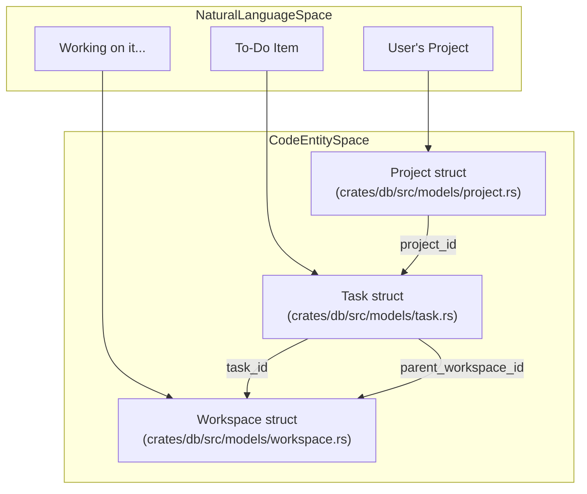

### Task Lifecycle and UI Interaction

Tasks are the primary unit of work on the Kanban board. They move between columns based on execution state [[docs/core-features/creating-tasks.mdx:88-96]]().

| Action | Column |
|--------|---------|
| Task created | **To do** [[docs/core-features/creating-tasks.mdx:92]]() |
| Task attempt started | **In Progress** [[docs/core-features/creating-tasks.mdx:93]]() |
| Task attempt completed | **In Review** [[docs/core-features/creating-tasks.mdx:94]]() |
| Task attempt/PR merged | **Done** [[docs/core-features/creating-tasks.mdx:95-96]]() |

Sources: [[crates/db/src/models/task.rs:8-33]](), [[crates/db/src/models/project.rs:1-54]](), [[docs/core-features/creating-tasks.mdx:88-101]]()

---

## Project Entity (Local and Remote)

Projects represent a git repository [[docs/core-features/creating-projects.mdx:16]](). In the local database, they store configuration for agent execution environments.

### Project Properties

| Property | Type | Description |
|----------|------|-------------|
| `id` | `Uuid` | Unique identifier [[crates/db/src/models/project.rs:9]]() |
| `name` | `String` | Human-readable project name [[crates/db/src/models/project.rs:10]]() |
| `default_agent_working_dir` | `Option<String>` | Default working directory for AI agents [[crates/db/src/models/project.rs:11]]() |
| `remote_project_id` | `Option<Uuid>` | Links local project to remote project [[crates/db/src/models/project.rs:12]]() |

### Project Configuration
Projects include scripts that define the execution lifecycle for coding agents:
- **Setup Scripts**: Run before execution (e.g., `npm install`) [[docs/core-features/creating-projects.mdx:27-29]]().
- **Dev Server Scripts**: Used for previewing work [[docs/core-features/creating-projects.mdx:35-37]]().
- **Cleanup Scripts**: Post-execution tidying (e.g., `npm run format`) [[docs/core-features/creating-projects.mdx:39-41]]().
- **Copy Files**: Files copied from the original directory to the worktree before execution [[docs/core-features/creating-projects.mdx:44-46]]().

Sources: [[crates/db/src/models/project.rs:1-54]](), [[docs/core-features/creating-projects.mdx:12-53]]()

---

## Task Entity (Local Only)

Tasks are the work items displayed on the Kanban board. They can be created manually via the UI or programmatically via MCP clients [[docs/core-features/creating-tasks.mdx:10-12]](), [[docs/core-features/creating-tasks.mdx:53-57]]().

### Task Data Model

```rust
// crates/db/src/models/task.rs:24-33
pub struct Task {
    pub id: Uuid,
    pub project_id: Uuid, 
    pub title: String,
    pub description: Option<String>,
    pub status: TaskStatus,
    pub parent_workspace_id: Option<Uuid>, 
    pub created_at: DateTime<Utc>,
    pub updated_at: DateTime<Utc>,
}
```

### Task Status Workflow
The `TaskStatus` enum [[crates/db/src/models/task.rs:14-21]]() drives the UI column placement:
- `Todo`: Default state [[crates/db/src/models/task.rs:16]]().
- `InProgress`: Active coding agent attempt [[crates/db/src/models/task.rs:17]]().
- `InReview`: Agent has finished its turn [[crates/db/src/models/task.rs:18]]().
- `Done`: Changes merged [[crates/db/src/models/task.rs:19]]().
- `Cancelled`: Task abandoned [[crates/db/src/models/task.rs:20]]().

### Task Tags
The system supports "Task Tags"—reusable text snippets inserted via `@` mentions in descriptions [[docs/configuration-customisation/creating-task-tags.mdx:6-8]](). These are global across projects and use `snake_case` naming [[docs/configuration-customisation/creating-task-tags.mdx:11-16]]().

Sources: [[crates/db/src/models/task.rs:14-58]](), [[docs/configuration-customisation/creating-task-tags.mdx:1-124]]()

---

## Data Model and Database Relationships

### Local Database Schema (SQLite)

Title: "Local Entity Relationships"
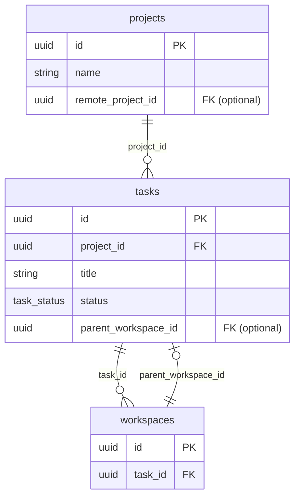

### Relationship Logic

1. **Task-to-Project**: Every `Task` must belong to a `Project` via `project_id` [[crates/db/src/models/task.rs:26]]().
2. **Workspace-to-Task**: A `Workspace` (execution attempt) is linked to a specific `Task` via `task_id`.
3. **Subtasks**: A `Task` can be a subtask if its `parent_workspace_id` is set, linking it to the workspace of a parent task [[crates/db/src/models/task.rs:30]](). This allows agents to spawn new tasks within an existing context.
4. **Task Attempts**: A single task can have multiple attempts. Each attempt creates a new `Workspace` (isolated git worktree) where an agent profile and base branch are configured [[docs/core-features/creating-tasks.mdx:39-44]]().

Sources: [[crates/db/src/models/task.rs:23-33]](), [[crates/db/src/models/project.rs:1-54]](), [[docs/core-features/creating-tasks.mdx:33-52]]()

---

# Page: Workspaces and Execution Lifecycle

# Workspaces and Execution Lifecycle

<details>
<summary>Relevant source files</summary>

The following files were used as context for generating this wiki page:

- [crates/db/.sqlx/query-1b186dc075846fc1f7270a942afbf82a88806ee6ababdb437ab5e97ddd2122da.json](crates/db/.sqlx/query-1b186dc075846fc1f7270a942afbf82a88806ee6ababdb437ab5e97ddd2122da.json)
- [crates/db/.sqlx/query-2a57b702e52b3cc9bdbc361267985958b11d4493b01a9ab8daedf5d951422897.json](crates/db/.sqlx/query-2a57b702e52b3cc9bdbc361267985958b11d4493b01a9ab8daedf5d951422897.json)
- [crates/db/.sqlx/query-f584dbe0f2f2a4f1e7dcf5b8f675eb2a6d954bb3f148ac0fece10652f05fb49b.json](crates/db/.sqlx/query-f584dbe0f2f2a4f1e7dcf5b8f675eb2a6d954bb3f148ac0fece10652f05fb49b.json)
- [crates/db/src/models/execution_process.rs](crates/db/src/models/execution_process.rs)
- [crates/db/src/models/workspace.rs](crates/db/src/models/workspace.rs)
- [crates/local-deployment/src/container.rs](crates/local-deployment/src/container.rs)
- [crates/server/src/routes/containers.rs](crates/server/src/routes/containers.rs)
- [crates/services/src/services/container.rs](crates/services/src/services/container.rs)
- [crates/utils/src/port_file.rs](crates/utils/src/port_file.rs)
- [crates/workspace-manager/Cargo.toml](crates/workspace-manager/Cargo.toml)
- [crates/worktree-manager/Cargo.toml](crates/worktree-manager/Cargo.toml)
- [docs/agents/ccr.mdx](docs/agents/ccr.mdx)
- [docs/images/workspaces-preview-no-script.png](docs/images/workspaces-preview-no-script.png)
- [docs/settings/projects-repositories.mdx](docs/settings/projects-repositories.mdx)
- [docs/workspaces/changes.mdx](docs/workspaces/changes.mdx)
- [docs/workspaces/command-bar.mdx](docs/workspaces/command-bar.mdx)
- [docs/workspaces/creating-workspaces.mdx](docs/workspaces/creating-workspaces.mdx)
- [docs/workspaces/index.mdx](docs/workspaces/index.mdx)
- [docs/workspaces/interface.mdx](docs/workspaces/interface.mdx)
- [docs/workspaces/repositories.mdx](docs/workspaces/repositories.mdx)
- [docs/workspaces/sessions.mdx](docs/workspaces/sessions.mdx)

</details>


## Purpose and Scope

This document provides a deep dive into the **Workspace** concept, which represents a single attempt at solving a task or issue. A workspace provides an isolated development environment using Git worktrees, its own branch, and manages the full execution lifecycle from creation through agent interaction to archiving. This page covers the workspace data models, the multi-repository orchestration, lifecycle states, and automated cleanup mechanisms.

For information about the parent Task entity, see [2.2 Projects, Tasks, and Issues](). For details on Git implementation, see [2.4 Git Worktree Management](). For the Session and ExecutionProcess models that track work within a workspace, see [2.5 Sessions and Execution Processes]().

---

## Workspace as Task Attempt

A **Workspace** is a task attempt—each time a user starts working on a task or an issue, a new workspace is created. Multiple workspaces can exist for the same task, representing different attempts with different approaches or configurations.

Key characteristics:
- **Isolated environment**: Each workspace operates in its own Git worktrees managed by the `WorkspaceManager` [crates/local-deployment/src/container.rs:71]().
- **Dedicated branch**: Every workspace has a unique branch generated using a UUID and a slugified title [utils/src/text.rs:55-60]().
- **Multi-repo support**: A workspace can span multiple repositories simultaneously [crates/db/src/models/workspace_repo.rs:21-25]().
- **Execution tracking**: Associated sessions and execution processes track all work performed [crates/db/src/models/execution_process.rs:61-78]().

Sources: [crates/db/src/models/workspace.rs:42-54](), [crates/local-deployment/src/container.rs:70-71](), [utils/src/text.rs:55-60]()

---

## Workspace Data Model

### Core Workspace Type

The `Workspace` struct defines the persistence layer for an attempt in the SQLite database.

| Field | Type | Description |
| :--- | :--- | :--- |
| `id` | `Uuid` | Unique identifier for the workspace [crates/db/src/models/workspace.rs:43]() |
| `task_id` | `Option<Uuid>` | Optional reference to a Kanban task [crates/db/src/models/workspace.rs:44]() |
| `container_ref` | `Option<String>` | Filesystem path to the workspace directory [crates/db/src/models/workspace.rs:45]() |
| `branch` | `String` | Unique git branch name for this attempt [crates/db/src/models/workspace.rs:46]() |
| `setup_completed_at`| `Option<DateTime>`| Timestamp when worktrees were successfully initialized [crates/db/src/models/workspace.rs:47]() |
| `worktree_deleted` | `bool` | Flag indicating if the physical files have been cleaned up [crates/db/src/models/workspace.rs:53]() |

**Workspace Directory Structure**

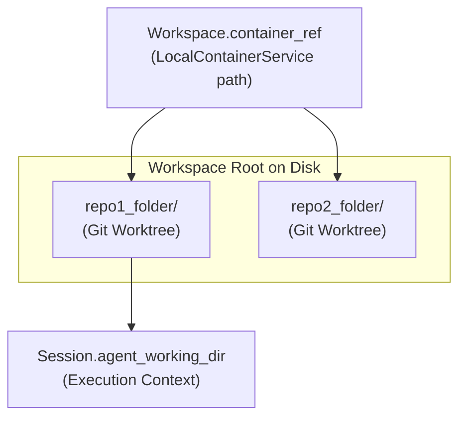

The `container_ref` field stores the absolute filesystem path to the workspace directory [crates/db/src/models/workspace.rs:45](). For multi-repo workspaces, each repository is set up as a subdirectory containing a Git worktree. The `agent_working_dir` (stored on the `Session` object) specifies where the coding agent executes relative to the workspace root [crates/services/src/services/container.rs:135-138]().

Sources: [crates/db/src/models/workspace.rs:42-54](), [crates/services/src/services/container.rs:99-150]()

---

## Multi-Repository Model

Workspaces support multiple repositories through the `WorkspaceRepo` join entity:

```rust
pub struct WorkspaceRepo {
    pub id: Uuid,
    pub workspace_id: Uuid,
    pub repo_id: Uuid,
    pub target_branch: String,
    pub created_at: DateTime<Utc>,
    pub updated_at: DateTime<Utc>,
}
```
[crates/db/src/models/workspace_repo.rs:21]()

**Multi-Repo Workspace Relationships**

```mermaid
graph LR
    Workspace["Workspace struct<br/>(crates/db/src/models/workspace.rs)"]
    
    WR1["WorkspaceRepo struct<br/>(target_branch: main)"]
    WR2["WorkspaceRepo struct<br/>(target_branch: develop)"]
    
    R1["Repo struct: frontend<br/>(path: /src/fe)"]
    R2["Repo struct: backend<br/>(path: /src/be)"]
    
    Workspace -->|"1:N"| WR1
    Workspace --> WR2
    
    WR1 --> R1
    WR2 --> R2
    
    WT1["Git Worktree<br/>/workspace_path/frontend"]
    WT2["Git Worktree<br/>/workspace_path/backend"]
    
    R1 -.->|"WorkspaceManager.setup_workspace"| WT1
    R2 -.->|"WorkspaceManager.setup_workspace"| WT2
```

Each repository in a workspace can target a different branch [crates/db/src/models/workspace_repo.rs:21-25](). This enables coordinated changes across multiple codebases within a single task attempt.

Sources: [crates/db/src/models/workspace_repo.rs:21-25](), [crates/local-deployment/src/container.rs:160-188]()

---

## Workspace Lifecycle Overview

```mermaid
stateDiagram-v2
    [*] --> Created: "Workspace::create()"
    
    Created --> SettingUp: "LocalContainerService.ensure_container_exists()"
    SettingUp --> Ready: "setup_completed_at updated"
    
    Ready --> Executing: "LocalContainerService.start_execution()"
    Executing --> Executing: "LocalContainerService.follow_up()"
    Executing --> Completing: "spawn_exit_monitor()"
    
    Completing --> Ready: "Finalize actions run"
    
    Ready --> Archived: "Workspace::archive()"
    
    Archived --> Deleted: "LocalContainerService.delete()"
    Ready --> Deleted: "worktree_deleted = true"
    
    Deleted --> [*]
```

### Lifecycle Phases

| Phase | Description | Key Field State |
|-------|-------------|-----------------|
| **Created** | Workspace record exists but no filesystem setup | `container_ref = None` [crates/db/src/models/workspace.rs:45]() |
| **Setting Up** | Worktrees being created via `WorkspaceManager` | `container_ref.is_some()`, `setup_completed_at = None` [crates/db/src/models/workspace.rs:47]() |
| **Ready** | Setup complete, ready for execution | `setup_completed_at.is_some()` [crates/db/src/models/workspace.rs:47]() |
| **Executing** | Coding agent or script running | `ExecutionProcessStatus::Running` [crates/db/src/models/execution_process.rs:44]() |
| **Archived** | Workspace preserved but marked inactive | `archived = true` [crates/db/src/models/workspace.rs:50]() |
| **Deleted** | Filesystem resources removed | `worktree_deleted = true` [crates/db/src/models/workspace.rs:53]() |

Sources: [crates/services/src/services/container.rs:193-198](), [crates/db/src/models/workspace.rs:42-54]()

---

## Workspace Creation Flow

### API Endpoint: `POST /api/workspaces/start`

This endpoint handles the atomic creation and initial execution of a workspace.

**Workspace Creation and Execution Sequence**

```mermaid
sequenceDiagram
    participant API as "create_and_start_workspace()"
    participant LocalContainer as "LocalContainerService"
    participant DB as "DBService"
    participant WM as "WorkspaceManager"
    participant Git as "GitService"
    participant Executor as "BaseCodingAgent"
    
    API->>DB: "Workspace::create()"
    API->>DB: "WorkspaceRepo::create_many()"
    
    API->>LocalContainer: "ensure_container_exists()"
    LocalContainer->>WM: "setup_workspace()"
    
    loop Each Repo
        WM->>Git: "create_worktree()"
    end
    
    LocalContainer->>DB: "Update setup_completed_at"
    
    API->>LocalContainer: "start_execution()"
    LocalContainer->>DB: "Create Session"
    LocalContainer->>DB: "Create ExecutionProcess"
    
    LocalContainer->>Executor: "spawn()"
    
    LocalContainer->>LocalContainer: "spawn_exit_monitor()"
    API-->>User: "200 OK (Workspace + ExecutionProcess)"
```

**Key Implementation Details**:

1. **Branch Naming**: Backend generates a unique branch using `git_branch_id()` and `short_uuid()` [utils/src/text.rs:55-60]().
2. **Container Setup**: `LocalContainerService` uses `WorkspaceManager` to create physical worktrees on disk [crates/local-deployment/src/container.rs:71]().
3. **Session Creation**: A `Session` is initialized to track the conversation with the AI agent [crates/db/src/models/session.rs:25-45]().
4. **Initial Execution**: An `ExecutionProcess` is spawned with `ExecutionProcessRunReason::CodingAgent` [crates/db/src/models/execution_process.rs:57-65]().

Sources: [crates/db/src/models/workspace.rs:90-114](), [crates/local-deployment/src/container.rs:135-158](), [utils/src/text.rs:55-60]()

---

## Execution Phase

Once setup is complete, the workspace enters the execution phase where coding agents and scripts perform work.

```mermaid
graph TB
    Workspace["Workspace Entity<br/>(crates/db/src/models/workspace.rs)"]
    
    Session["Session Entity<br/>(crates/db/src/models/session.rs)"]
    
    EP_Agent["ExecutionProcess struct<br/>(run_reason: CodingAgent)"]
    EP_Dev["ExecutionProcess struct<br/>(run_reason: DevServer)"]
    
    MsgStore["MsgStore struct<br/>(In-memory logs)"]
    DBLogs["execution_process_logs table"]
    
    Workspace --> Session
    Session --> EP_Agent
    Session --> EP_Dev
    
    EP_Agent --> MsgStore
    MsgStore -.->|"db_stream_handle task"| DBLogs
```

### Execution Process Lifecycle

For each execution:
1. **`start_execution()`**: Creates the `ExecutionProcess` record in the DB [crates/services/src/services/container.rs:13-16]().
2. **`MsgStore`**: Captures stdout/stderr into an in-memory `MsgStore` for real-time access [crates/local-deployment/src/container.rs:74]().
3. **`db_stream_handles`**: Tracks background tasks that stream logs from `MsgStore` to the database or flat files [crates/local-deployment/src/container.rs:77]().
4. **`exit_monitor_handles`**: Tracks tasks that monitor process exit and handle post-execution logic [crates/local-deployment/src/container.rs:78]().

Sources: [crates/local-deployment/src/container.rs:74-78](), [crates/services/src/services/container.rs:13-16]()

---

## Completion and Finalization

When an execution process exits, the `spawn_exit_monitor()` task handles completion, commits, and cleanup.

### Exit Monitor Implementation

```mermaid
sequenceDiagram
    participant Monitor as "spawn_exit_monitor()"
    participant Child as "AsyncGroupChild"
    participant DB as "DBService"
    participant Container as "LocalContainerService"
    participant Git as "GitService"
    
    Monitor->>Child: "wait()"
    Child-->>Monitor: "ExitStatus"
    
    Monitor->>DB: "ExecutionProcess::update_completion()"
    
    alt status == Completed
        Monitor->>Container: "try_commit_changes()"
        Container->>Git: "git commit"
        
        Monitor->>Container: "try_start_next_action()"
        Note over Monitor: Runs cleanup or follow-up
    end
    
    Monitor->>Container: "finalize_context()"
```

**Key Implementation Details**:

- **Finalization**: The `finalize_context()` method determines if the workspace execution is fully complete. Dev servers are explicitly never finalized automatically to allow persistent previews [crates/services/src/services/container.rs:199-216]().
- **Queued Messages**: If a user sent a message while the agent was busy, the `QueuedMessageService` triggers a follow-up immediately after the current process finalizes [crates/local-deployment/src/container.rs:85]().

Sources: [crates/local-deployment/src/container.rs:85](), [crates/services/src/services/container.rs:199-216]()

---

## Cleanup and Deletion

### Background Cleanup Process

A periodic task runs to clean up expired workspaces and orphaned processes to manage disk space.

```rust
pub fn spawn_workspace_cleanup(&self) {
    let db = self.db.clone();
    tokio::spawn(async move {
        // Orphan cleanup at startup
        WorkspaceManager::cleanup_orphan_workspaces(&db.pool).await;
        
        // Periodic cleanup
        let mut cleanup_interval = tokio::time::interval(Duration::from_secs(1800));
        loop {
            cleanup_interval.tick().await;
            Self::cleanup_expired_workspaces(&db).await;
        }
    });
}
```
[crates/local-deployment/src/container.rs:130]()

**Cleanup Rules**:
- **Expiration**: Workspaces unused for a duration defined by `WORKSPACE_TOUCH_DEBOUNCE` (2 minutes) and subsequent logic are candidates for cleanup [crates/local-deployment/src/container.rs:66-79]().
- **Worktree Deletion**: `WorkspaceManager` removes the physical Git worktrees but preserves the database record, marking `worktree_deleted = true` to allow for later restoration if needed [crates/db/src/models/workspace.rs:53-156]().

Sources: [crates/local-deployment/src/container.rs:66-130](), [crates/db/src/models/workspace.rs:156-167]()

---

## Workspace State Tracking

### Workspace Touch Mechanism

To prevent auto-archiving of active workspaces, the system "touches" workspaces when they are accessed (e.g., via the UI or VSCode extension). The `LocalContainerService` debounces these calls using `WORKSPACE_TOUCH_DEBOUNCE` (2 minutes) to minimize database load.

```rust
const WORKSPACE_TOUCH_DEBOUNCE: Duration = Duration::from_mins(2);
```
[crates/local-deployment/src/container.rs:66]()

The `touch` function updates the `updated_at` column in the `workspaces` table [crates/db/src/models/workspace.rs:184-192]().

Sources: [crates/local-deployment/src/container.rs:66-79](), [crates/db/src/models/workspace.rs:184-192]()

---

# Page: Git Worktree Management

# Git Worktree Management

<details>
<summary>Relevant source files</summary>

The following files were used as context for generating this wiki page:

- [crates/git/Cargo.toml](crates/git/Cargo.toml)
- [crates/git/src/lib.rs](crates/git/src/lib.rs)
- [crates/git/tests/git_ops_safety.rs](crates/git/tests/git_ops_safety.rs)
- [crates/git/tests/git_workflow.rs](crates/git/tests/git_workflow.rs)
- [crates/services/src/services/diff_stream.rs](crates/services/src/services/diff_stream.rs)
- [crates/utils/src/diff.rs](crates/utils/src/diff.rs)
- [crates/workspace-manager/Cargo.toml](crates/workspace-manager/Cargo.toml)
- [crates/worktree-manager/Cargo.toml](crates/worktree-manager/Cargo.toml)
- [packages/web-core/src/shared/hooks/useDiffStream.ts](packages/web-core/src/shared/hooks/useDiffStream.ts)

</details>


This page describes how Vibe Kanban uses git worktrees to provide isolated development environments for each workspace. Git worktrees allow multiple workspaces to operate on the same repository simultaneously without interfering with each other's file state.

For information about workspace creation and lifecycle, see [Workspaces and Execution Lifecycle](2.3). For details about how workspaces execute coding agent sessions, see [Sessions and Execution Processes](2.5).

---

## Git Worktrees Fundamentals

Git worktrees are a native Git feature that allows multiple working directories to be checked out from a single repository. Instead of cloning a repository multiple times, worktrees share the same `.git` directory while maintaining separate working trees.

### Why Worktrees

Vibe Kanban uses git worktrees to enable:

| Benefit | Description |
|---------|-------------|
| **Parallel Execution** | Multiple coding agents can work on different tasks simultaneously without conflicts. |
| **Isolation** | Each workspace has its own file state independent of other workspaces. |
| **Efficiency** | Worktrees share object storage, reducing disk usage compared to full clones. |
| **Branch Safety** | Workspaces can track different branches without switching the main repository. |

**Sources**: [crates/git/src/lib.rs:183-190](), [crates/git/Cargo.toml:1-10]()

---

## System Architecture

### Worktree Management Components

The following diagram bridges the high-level workspace concept to the underlying Rust crates and file system structures.

```mermaid
graph TB
    subgraph "Data Layer (db crate)"
        Workspace["Workspace<br/>(DB record)"]
        WorkspaceRepo["WorkspaceRepo<br/>(DB join table)"]
        Repo["Repo<br/>(Repository config)"]
    end
    
    subgraph "Service Layer"
        DiffStream["DiffStreamManager<br/>(services crate)"]
        GitService["GitService<br/>(git crate)"]
        GitCli["GitCli<br/>(git crate)"]
        WorktreeManager["WorktreeManager<br/>(worktree-manager crate)"]
    end
    
    subgraph "File System"
        MainRepo["Main Repository<br/>(.git directory)"]
        WorktreeDir["Worktree Directory<br/>(container_ref path)"]
        RepoWorktree["Repository Worktree<br/>(repo.name subdirectory)"]
    end
    
    Workspace -->|"has container_ref"| WorktreeDir
    Workspace -->|"linked via"| WorkspaceRepo
    WorkspaceRepo -->|"references"| Repo
    
    WorktreeManager -->|"coordinates"| GitService
    DiffStream -->|"monitors"| RepoWorktree
    DiffStream -->|"uses"| GitService
    
    GitService -->|"interacts with"| MainRepo
    GitService -->|"calls"| GitCli
    MainRepo -->|"spawns"| RepoWorktree
```

**Sources**: [crates/services/src/services/diff_stream.rs:169-182](), [crates/git/src/lib.rs:58-60](), [crates/git/src/lib.rs:13-17](), [crates/worktree-manager/Cargo.toml:1-12]()

---

## Workspace-to-Worktree Mapping

### Directory Structure

Vibe Kanban organizes worktrees within a dedicated temporary or persistent directory depending on the OS. The `Workspace` model's `container_ref` field stores the base path for these worktrees.

### Multi-Repository Worktrees

Workspaces can span multiple repositories. Each repository gets its own worktree subdirectory within the workspace root. The `compute_diff_stats` function demonstrates how paths are constructed by joining the `container_ref` with the repository name.

**Function**: `compute_diff_stats` [crates/services/src/services/diff_stream.rs:43-92]()

```
/vibe-kanban-temp-dir/workspaces/ws-uuid/
├── frontend-repo/                (Worktree 1)
│   └── src/
└── backend-repo/                 (Worktree 2)
    └── crates/
```

**Sources**: [crates/services/src/services/diff_stream.rs:57-59](), [crates/services/src/services/diff_stream.rs:48-53]()

---

## Worktree Diffs and Monitoring

Vibe Kanban provides real-time visibility into worktree changes through a specialized diff streaming service.

### Diff Streaming Architecture

The `DiffStreamManager` monitors a worktree for filesystem events and computes diffs against the base commit. It uses a `SentFileStats` map to track the state of files already processed.

```mermaid
graph TD
    subgraph "Event Sources"
        FSW["FilesystemWatcher<br/>(notify crate)"]
        DiffEvent["DiffEvent::GitStateChange<br/>(Poll)"]
    end

    subgraph "Processing (DiffStreamManager)"
        Manager["DiffStreamManager<br/>run()"]
        SentStats["SentFileStats<br/>(HashMap)"]
        GitSvc["GitService<br/>get_diffs()"]
        TextDiff["TextDiff<br/>(similar crate)"]
    end

    subgraph "Output"
        LogMsg["LogMsg::Diff<br/>(WebSocket)"]
    end

    FSW --> Manager
    DiffEvent --> Manager
    Manager --> SentStats
    Manager --> GitSvc
    GitSvc --> TextDiff
    TextDiff --> LogMsg
```

**Sources**: [crates/services/src/services/diff_stream.rs:169-190](), [crates/services/src/services/diff_stream.rs:33-33](), [crates/utils/src/diff.rs:44-58]()

### Diff Data Model

The system uses a `Diff` struct to represent changes within the worktree. Large file contents are omitted to maintain performance.

**Struct**: `Diff` [crates/utils/src/diff.rs:11-25]()
- `change`: The type of change (`DiffChangeKind`: Added, Deleted, Modified, Renamed, Copied, PermissionChange) [crates/utils/src/diff.rs:29-36]()
- `content_omitted`: Boolean flag set if file exceeds `MAX_INLINE_DIFF_BYTES` (2MB) [crates/utils/src/diff.rs:20](), [crates/git/src/lib.rs:63-63]().
- `additions` / `deletions`: Precomputed stats for the change [crates/utils/src/diff.rs:22-23]().

### Unified Diff Generation

For the UI, the system generates unified diffs using the `similar` crate and normalizes them into standard git-diff format. This ensures compatibility with frontend diff viewers.

**Function**: `create_unified_diff` [crates/utils/src/diff.rs:61-64]()
**Function**: `concatenate_diff_hunks` [crates/utils/src/diff.rs:198-219]()
**Function**: `extract_unified_diff_hunks` [crates/utils/src/diff.rs:79-144]()
**Function**: `normalize_unified_diff` [crates/utils/src/diff.rs:222-225]()

---

## Worktree Creation and Validation

### Creation and Branching

The `GitService` handles the underlying Git operations to prepare a worktree, including ensuring a local identity exists for CLI-based commits.

**Function**: `ensure_cli_commit_identity` [crates/git/src/lib.rs:208-219]()
**Function**: `create_branch` [crates/git/src/lib.rs:193-204]()
**Function**: `validate_worktree` [crates/git/src/lib.rs:183-190]()

### Excluded Directories

During operations like file watching or indexing within a worktree, certain directories are always ignored to maintain performance and prevent recursion into version control metadata.

**Constant**: `ALWAYS_SKIP_DIRS` [crates/git/src/lib.rs:18-18]()
- `.git`
- `node_modules`

---

## Git Operations Safety

Vibe Kanban implements checks to ensure worktrees are in a valid state before performing operations like resets or branch switches.

### Reset Behavior
The system can perform resets on worktrees while checking for "dirty" states (uncommitted changes). The `GitService` provides methods to check worktree cleanliness.

**Struct**: `WorktreeResetOptions` [crates/git/src/lib.rs:115-121]()
**Struct**: `WorktreeResetOutcome` [crates/git/src/lib.rs:139-142]()
**Test Case**: `staged_but_uncommitted_changes_is_dirty` [crates/git/tests/git_workflow.rs:150-161]()

### Conflict Handling
When operations like rebases or merges fail, the system identifies the conflict type and can report conflicted files.

**Enum**: `ConflictOp` [crates/git/src/lib.rs:65-73]()
**Error Variant**: `GitServiceError::MergeConflicts` [crates/git/src/lib.rs:44-48]()

**Sources**: [crates/git/src/lib.rs:65-73](), [crates/git/src/lib.rs:114-142](), [crates/git/tests/git_workflow.rs:150-161]()

---

# Page: Sessions and Execution Processes

# Sessions and Execution Processes

<details>
<summary>Relevant source files</summary>

The following files were used as context for generating this wiki page:

- [crates/db/.sqlx/query-3634e2bab8fef106721bb64a791edd81d3d49eb34fbabd34e4feadfb5f229a6e.json](crates/db/.sqlx/query-3634e2bab8fef106721bb64a791edd81d3d49eb34fbabd34e4feadfb5f229a6e.json)
- [crates/db/src/models/session.rs](crates/db/src/models/session.rs)
- [crates/executors/src/actions/coding_agent_follow_up.rs](crates/executors/src/actions/coding_agent_follow_up.rs)
- [crates/executors/src/actions/coding_agent_initial.rs](crates/executors/src/actions/coding_agent_initial.rs)
- [crates/mcp/src/bin/vibe_kanban_mcp.rs](crates/mcp/src/bin/vibe_kanban_mcp.rs)
- [crates/mcp/src/task_server/mod.rs](crates/mcp/src/task_server/mod.rs)
- [crates/mcp/src/task_server/tools/context.rs](crates/mcp/src/task_server/tools/context.rs)
- [crates/server/src/routes/execution_processes.rs](crates/server/src/routes/execution_processes.rs)
- [crates/server/src/routes/filesystem.rs](crates/server/src/routes/filesystem.rs)
- [crates/services/src/services/events.rs](crates/services/src/services/events.rs)
- [crates/services/src/services/filesystem.rs](crates/services/src/services/filesystem.rs)
- [packages/web-core/src/shared/components/VirtualizedProcessLogs.tsx](packages/web-core/src/shared/components/VirtualizedProcessLogs.tsx)
- [packages/web-core/src/shared/hooks/useJsonPatchWsStream.ts](packages/web-core/src/shared/hooks/useJsonPatchWsStream.ts)
- [packages/web-core/src/shared/hooks/useLogStream.ts](packages/web-core/src/shared/hooks/useLogStream.ts)

</details>


This page describes the `Session` and `ExecutionProcess` models, which track the execution of coding agents and scripts within workspaces. Sessions group related execution attempts, while execution processes represent individual runs with status tracking and action chains.

For information about workspace lifecycle and Git worktree setup, see [Workspaces and Execution Lifecycle](2.3). For real-time log streaming and event propagation, see [Real-time Streaming and Updates](2.6).

---

## Session Model

A `Session` represents a logical execution thread within a workspace. Each session belongs to exactly one workspace and can contain multiple execution processes as the agent performs follow-up actions or retries.

### Session Structure

```rust
pub struct Session {
    pub id: Uuid,
    pub workspace_id: Uuid,
    pub name: Option<String>,
    pub executor: Option<String>,
    pub agent_working_dir: Option<String>,
    pub created_at: DateTime<Utc>,
    pub updated_at: DateTime<Utc>,
}
```

**Sources:** [crates/db/src/models/session.rs:22-31]()

### Session Lifecycle and Discovery

Sessions are created when a user initiates an interaction with an agent or script. The system provides several methods to discover and prioritize sessions:

1.  **Recency-based**: `find_by_workspace_id` and `find_latest_by_workspace_id` order sessions by the most recent non-dev server execution process [crates/db/src/models/session.rs:61-87](), [crates/db/src/models/session.rs:92-119]().
2.  **Creation-based**: `find_first_by_workspace_id` is used by the orchestrator MCP for discovery [crates/db/src/models/session.rs:123-143]().
3.  **Automatic Directory Resolution**: When a session is created, the system attempts to resolve the `agent_working_dir` by inspecting the workspace's repositories [crates/db/src/models/session.rs:175-191]().

**Sources:** [crates/db/src/models/session.rs:145-173](), [crates/services/src/services/events.rs:44-56]()

---

## ExecutionProcess Model

An `ExecutionProcess` represents a single execution run of a coding agent or script. Each process has a status, tracks timing, and maintains a reference to its `ExecutorAction`.

### ExecutionProcess Structure

```rust
pub struct ExecutionProcess {
    pub id: Uuid,
    pub session_id: Uuid,
    pub run_reason: ExecutionProcessRunReason,
    pub executor_action: sqlx::types::Json<ExecutorActionField>,
    pub status: ExecutionProcessStatus,
    pub exit_code: Option<i64>,
    pub dropped: bool,
    pub started_at: DateTime<Utc>,
    pub completed_at: Option<DateTime<Utc>>,
    pub created_at: DateTime<Utc>,
    pub updated_at: DateTime<Utc>,
}
```

**Sources:** [crates/server/src/routes/execution_processes.rs:9-12](), [crates/services/src/services/events.rs:149-156]()

### ExecutionProcessRunReason

The `run_reason` field indicates the intent of the execution:

| Run Reason | Description |
|-----------|-------------|
| `SetupScript` | Initial repository setup (e.g., `npm install`). |
| `CleanupScript` | Post-execution cleanup tasks. |
| `ArchiveScript` | Tasks performed when a workspace is archived. |
| `CodingAgent` | Primary AI agent interaction (Initial or Follow-up). |
| `DevServer` | Long-running development server processes. |

**Sources:** [crates/db/src/models/session.rs:78-78]()

### ExecutionProcessStatus Transitions

Processes transition through these statuses:

```mermaid
stateDiagram-v2
    [*] --> "running" : "LocalContainerService::spawn_executor_task"
    "running" --> "completed" : "ExitCode == 0"
    "running" --> "failed" : "ExitCode != 0"
    "running" --> "killed" : "stop_execution_process route"
    "completed" --> [*]
    "failed" --> [*]
    "killed" --> [*]
```

**Execution Process Status Transitions**

**Sources:** [crates/server/src/routes/execution_processes.rs:203-208]()

---

## ExecutorAction and Action Chains

Each execution process contains an `ExecutorAction` that defines the payload for the executor. Actions are typed and determine how logs are processed and displayed in the UI.

### ExecutorAction Types
The system distinguishes between script-based actions and agent-based actions to determine the correct log endpoint:
- **ScriptRequest**: Uses `/api/execution-processes/:id/raw-logs/ws` [crates/server/src/routes/execution_processes.rs:44-48]().
- **CodingAgentInitialRequest / CodingAgentFollowUpRequest**: Uses `/api/execution-processes/:id/normalized-logs/ws` [crates/server/src/routes/execution_processes.rs:138-142]().

**Sources:** [crates/executors/src/actions/coding_agent_initial.rs:18-27](), [crates/executors/src/actions/coding_agent_follow_up.rs:18-30]()

---

## Log Management and Streaming

Vibe Kanban provides real-time log streaming via WebSockets. The backend implements two streaming modes: **Raw** (for shell output) and **Normalized** (for agent interactions like tool use).

### Log Streaming Architecture

```mermaid
graph TD
    subgraph "Backend Space"
        LCS["LocalContainerService"] -->|"writes to"| MS["MsgStore"]
        ROUTE_RAW["/api/execution-processes/:exec_id/raw-logs/ws"] -->|"calls"| HRLW["handle_raw_logs_ws"]
        ROUTE_NORM["/api/execution-processes/:exec_id/normalized-logs/ws"] -->|"calls"| HNLW["handle_normalized_logs_ws"]
    end

    subgraph "Frontend Space"
        HOOK_LOG["useLogStream.ts"] -->|"WebSocket"| ROUTE_RAW
        HOOK_JSON["useJsonPatchWsStream.ts"] -->|"WebSocket"| ROUTE_NORM
        VIRT_LOGS["VirtualizedProcessLogs.tsx"] -->|"renders"| HOOK_LOG
    end
    
    EVENT_WS["/api/events/ws"] -->|"patches"| DB_HOOKS["EventService::create_hook"]
    DB_HOOKS -->|"monitors"| SQLITE["SqlitePool"]
```

**Sources:** [crates/server/src/routes/execution_processes.rs:44-64](), [crates/server/src/routes/execution_processes.rs:138-171](), [packages/web-core/src/shared/hooks/useLogStream.ts:49-51](), [packages/web-core/src/shared/components/VirtualizedProcessLogs.tsx:163-174]()

### Normalized vs Raw Logs
- **Raw Logs**: Streamed via `handle_raw_logs_ws`. It maps `Stdout` and `Stderr` to `ConversationPatch` objects with incrementing indices using `AtomicUsize` [crates/server/src/routes/execution_processes.rs:87-103]().
- **Normalized Logs**: Streamed via `handle_normalized_logs_ws`. These contain structured data such as agent thoughts, tool calls, and tool results, which the UI renders as rich chat elements [crates/server/src/routes/execution_processes.rs:168-172]().

**Sources:** [crates/server/src/routes/execution_processes.rs:88-104](), [crates/server/src/routes/execution_processes.rs:168-201]()

---

## Dropped Processes and History Management

The `dropped` field on `ExecutionProcess` marks processes that should be excluded from the primary timeline view. This occurs during "Reset" operations where a user reverts to a previous point in the agent's history.

### Reset Process Logic
When a session is reset, the backend marks subsequent processes as `dropped`.
- **Visible Processes**: UI filters where `dropped` is false for the primary timeline.
- **Audit View**: The `SessionExecutionProcessQuery` allows including soft-deleted (dropped) processes in results/stream by setting `show_soft_deleted` to true [crates/server/src/routes/execution_processes.rs:29-35]().

**Sources:** [crates/db/src/models/session.rs:78-78](), [crates/server/src/routes/execution_processes.rs:29-35]()

---

## Real-time Event Propagation

The `EventService` in the backend uses SQLite pre-update and update hooks to detect changes to the `execution_processes` table. These changes are pushed to the `MsgStore` as JSON patches and streamed to the frontend.

```mermaid
sequenceDiagram
    participant DB as "SqliteConnection"
    participant ES as "EventService::create_hook"
    participant MS as "MsgStore"
    participant WS as "useJsonPatchWsStream.ts"

    DB->>ES: "set_update_hook(HookTables::ExecutionProcesses)"
    ES->>DB: "ExecutionProcess::find_by_rowid(rowid)"
    DB-->>ES: "RecordTypes::ExecutionProcess"
    ES->>MS: "push_patch(execution_process_patch::replace(process))"
    MS-->>WS: "JsonPatch Message"
```

**Sources:** [crates/services/src/services/events.rs:59-70](), [crates/services/src/services/events.rs:119-125](), [crates/services/src/services/events.rs:149-156](), [packages/web-core/src/shared/hooks/useJsonPatchWsStream.ts:128-144]()

---

## Summary

- **Sessions** provide the persistent context for agent interactions, grouping multiple execution attempts within a workspace [crates/db/src/models/session.rs:22-31]().
- **ExecutionProcesses** are the atomic units of execution, tracking lifecycle states (`running`, `completed`, `failed`, `killed`) and storing the `ExecutorAction` [crates/server/src/routes/execution_processes.rs:9-12]().
- **Log Streaming** supports both structured agent data (normalized) and raw shell output, delivered via specialized WebSocket routes [crates/server/src/routes/execution_processes.rs:44-201]().
- **Event Synchronization** ensures the UI stays in sync with the backend execution state through a reactive patch system triggered by database hooks [crates/services/src/services/events.rs:59-70]().

---

# Page: Real-time Streaming and Updates

# Real-time Streaming and Updates

<details>
<summary>Relevant source files</summary>

The following files were used as context for generating this wiki page:

- [crates/db/.sqlx/query-12a5c0a8b95d8cb87f1c869ff35692a2cee52bc418b06d00a31a4c139e12d18a.json](crates/db/.sqlx/query-12a5c0a8b95d8cb87f1c869ff35692a2cee52bc418b06d00a31a4c139e12d18a.json)
- [crates/db/.sqlx/query-9139f8d02c4ff94db0f2e8de7a6d5a53092479499815531962b7c84f5e0b2129.json](crates/db/.sqlx/query-9139f8d02c4ff94db0f2e8de7a6d5a53092479499815531962b7c84f5e0b2129.json)
- [crates/db/src/lib.rs](crates/db/src/lib.rs)
- [crates/db/src/models/execution_process_logs.rs](crates/db/src/models/execution_process_logs.rs)
- [crates/server/src/routes/execution_processes.rs](crates/server/src/routes/execution_processes.rs)
- [crates/services/src/services/events.rs](crates/services/src/services/events.rs)
- [crates/services/src/services/execution_process.rs](crates/services/src/services/execution_process.rs)
- [crates/services/src/services/filesystem_watcher.rs](crates/services/src/services/filesystem_watcher.rs)
- [packages/web-core/src/shared/components/VirtualizedProcessLogs.tsx](packages/web-core/src/shared/components/VirtualizedProcessLogs.tsx)
- [packages/web-core/src/shared/hooks/useJsonPatchWsStream.ts](packages/web-core/src/shared/hooks/useJsonPatchWsStream.ts)
- [packages/web-core/src/shared/hooks/useLogStream.ts](packages/web-core/src/shared/hooks/useLogStream.ts)

</details>


This page describes how Vibe Kanban propagates database changes and agent output to connected browser clients in real time. It covers the SQLite hook mechanism, the `MsgStore` buffering layer, `EventPatch` structure, per-process log streaming, WebSocket endpoints, and frontend consumption patterns.

---

## Overview

The system implements two distinct real-time pipelines that deliver data over WebSocket connections:

| Pipeline | What it carries | Source of truth |
|---|---|---|
| **Event pipeline** | Workspace, ExecutionProcess, and Scratch record changes | SQLite update/preupdate hooks → `MsgStore` (global) |
| **Log pipeline** | Agent stdout, stderr, and lifecycle status | Executor output → per-process `MsgStore` |

Both pipelines use the `MsgStore` abstraction. The event pipeline uses a single global store shared across all connections. The log pipeline creates one store per running `ExecutionProcess`, keyed by execution process ID.

**Real-time Data Flow**

```mermaid
flowchart TD
    DB["SQLite Database\n(db.v2.sqlite)"]
    
    subgraph "EventService"
        PH["preupdate_hook"]
        UH["update_hook"]
        GlobalMS["Arc<MsgStore>\n(global singleton)"]
    end
    
    subgraph "WebSocket Routes"
        WSW["GET /api/workspaces/streams/ws"]
        WSEP["GET /api/execution-processes/stream/session/ws"]
    end
    
    DB -->|"DELETE"| PH
    DB -->|"INSERT/UPDATE"| UH
    PH --> GlobalMS
    UH -->|"spawn task\nfind_by_rowid"| GlobalMS
    
    GlobalMS --> WSW
    GlobalMS --> WSEP
    
    subgraph "Executor System"
        EP["ExecutionProcess"]
        RawStream["stream_raw_logs"]
        NormStream["stream_normalized_logs"]
    end
    
    EP --> RawStream
    EP --> NormStream
```

Sources: [crates/services/src/services/events.rs:26-42](), [crates/services/src/services/events.rs:119-130](), [crates/server/src/routes/execution_processes.rs:74-85]()

---

## SQLite Hook Mechanism

### Two Hooks, Two Responsibilities

`EventService::create_hook` [crates/services/src/services/events.rs:59-69]() registers two complementary SQLite hooks on every new connection:

**`set_preupdate_hook`** [crates/services/src/services/events.rs:77-117]() — Fires *before* a DELETE, while the old row is still readable. It handles only deletes on monitored tables (`workspaces`, `execution_processes`, `scratch`) because after deletion the row's UUID cannot be recovered from the update hook. It extracts the primary key using `get_old_column_value` [crates/services/src/services/events.rs:86-112]().

**`set_update_hook`** [crates/services/src/services/events.rs:119-124]() — Fires *after* INSERT or UPDATE. It fetches the current row state from the database using the provided `rowid` [crates/services/src/services/events.rs:135-150](), then constructs an `EventPatch` and pushes it into the global `MsgStore`.

### Monitored Tables

The `HookTables` and `RecordTypes` types enumerate which tables participate:

| Table | `HookTables` variant | `RecordTypes` variants |
|---|---|---|
| `workspaces` | `HookTables::Workspaces` | `RecordTypes::Workspace` |
| `execution_processes` | `HookTables::ExecutionProcesses` | `RecordTypes::ExecutionProcess` |
| `scratch` | `HookTables::Scratch` | `RecordTypes::Scratch` |

**Hook Dispatch Logic**

```mermaid
flowchart TD
    PH["preupdate_hook"]
    UH["update_hook"]
    
    subgraph "preupdate_hook (DELETE)"
        PH --> PT{"preupdate.table"}
        PT -->|"workspaces"| PWR["workspace_patch::remove"]
        PT -->|"execution_processes"| PER["execution_process_patch::remove"]
        PT -->|"scratch"| PSR["scratch_patch::remove"]
    end
    
    subgraph "update_hook (INSERT/UPDATE)"
        UH --> UT{"HookTables::from_str"}
        UT -->|"Workspaces"| FW["Workspace::find_by_rowid"]
        UT -->|"ExecutionProcesses"| FEP["ExecutionProcess::find_by_rowid"]
        
        FW --> WPR["workspace_patch::replace"]
        FEP --> EPR["execution_process_patch::replace"]
    end
    
    PWR --> MS["MsgStore::push_patch"]
    WPR --> MS
    PER --> MS
    EPR --> MS
```

Sources: [crates/services/src/services/events.rs:77-117](), [crates/services/src/services/events.rs:119-160](), [crates/services/src/services/events.rs:23-24]()

---

## Log Streaming

Vibe Kanban provides real-time visibility into agent execution through raw and normalized log streams. These are consumed by the frontend to provide a live terminal-like experience.

### Backend Implementation
The backend exposes endpoints for streaming logs via Axum's WebSocket support.
- **Raw Logs**: `stream_raw_logs_ws` [crates/server/src/routes/execution_processes.rs:44-58]() streams `stdout` and `stderr` output. It uses `handle_raw_logs_ws` [crates/server/src/routes/execution_processes.rs:60-136]() to map raw output into `LogMsg::JsonPatch` frames using `ConversationPatch` [crates/server/src/routes/execution_processes.rs:70-71]().
- **Normalized Logs**: `stream_normalized_logs_ws` [crates/server/src/routes/execution_processes.rs:138-165]() provides structured log events via `handle_normalized_logs_ws` [crates/server/src/routes/execution_processes.rs:168-201]().
- **Persistence**: Historically stored in SQLite, logs are migrated to flat files for performance via `migrate_execution_logs_to_files` [crates/services/src/services/execution_process.rs:30-182]().

### Frontend Consumption
The frontend application uses custom hooks and specialized components to render these streams efficiently:

- **`useLogStream`**: This hook [packages/web-core/src/shared/hooks/useLogStream.ts:12-192]() manages the WebSocket connection for a specific `processId`. It handles reconnection logic with exponential backoff [packages/web-core/src/shared/hooks/useLogStream.ts:149-157]() and prevents stale messages from contaminating logs when switching processes [packages/web-core/src/shared/hooks/useLogStream.ts:22-32]().
- **`useJsonPatchWsStream`**: A generic hook [packages/web-core/src/shared/hooks/useJsonPatchWsStream.ts:33-221]() for consuming WebSocket streams that send JSON patches. It uses `immer`'s `produce` [packages/web-core/src/shared/hooks/useJsonPatchWsStream.ts:138-140]() to apply updates efficiently via `applyUpsertPatch` [packages/web-core/src/shared/hooks/useJsonPatchWsStream.ts:139]().
- **`VirtualizedProcessLogs`**: To handle high-volume output, the UI uses `VirtuosoMessageList` [packages/web-core/src/shared/components/VirtualizedProcessLogs.tsx:163-175](). This component implements windowing to maintain performance even when agents produce thousands of lines of logs. It uses `ItemContent` [packages/web-core/src/shared/components/VirtualizedProcessLogs.tsx:49-64]() to render individual `STDOUT` or `STDERR` entries via the `RawLogText` component [packages/web-core/src/shared/components/VirtualizedProcessLogs.tsx:55-62]().
- **Auto-Scrolling**: The log viewer maintains an `isAtBottomRef` [packages/web-core/src/shared/components/VirtualizedProcessLogs.tsx:82]() to determine if it should automatically scroll to the latest item using `ScrollToLastItem` [packages/web-core/src/shared/components/VirtualizedProcessLogs.tsx:101]().

**Frontend Streaming Architecture**

```mermaid
flowchart LR
    Server["Axum WebSocket\n(crates/server/src/routes/execution_processes.rs)"]
    Hook["useLogStream\n(packages/web-core/src/shared/hooks/useLogStream.ts)"]
    Store["React State (logs)"]
    Virt["VirtualizedProcessLogs\n(packages/web-core/src/shared/components/VirtualizedProcessLogs.tsx)"]

    Server -->|"LogMsg (JSON)"| Hook
    Hook -->|"LogEntry[]"| Store
    Store --> Virt
    Virt -->|"ItemContent"| UI["RawLogText"]
```

Sources: [crates/server/src/routes/execution_processes.rs:44-201](), [packages/web-core/src/shared/components/VirtualizedProcessLogs.tsx:1-179](), [packages/web-core/src/shared/hooks/useLogStream.ts:102-131]()

---

## Workspace Status Cascade

When an `ExecutionProcess` row is updated in the database, the `EventService` ensures the parent workspace is also refreshed to reflect its current status. The `push_workspace_update_for_session` helper [crates/services/src/services/events.rs:44-56]() fetches the `Workspace::find_by_id_with_status` and pushes a `workspace_patch::replace` to the global `MsgStore`. This mechanism ensures that the UI updates status indicators immediately.

Sources: [crates/services/src/services/events.rs:44-56]()

---

# Page: Scratch Data and UI State Persistence

# Scratch Data and UI State Persistence

<details>
<summary>Relevant source files</summary>

The following files were used as context for generating this wiki page:

- [crates/db/src/models/scratch.rs](crates/db/src/models/scratch.rs)
- [crates/server/src/bin/generate_types.rs](crates/server/src/bin/generate_types.rs)
- [packages/remote-web/src/app/providers/RemoteActionsProvider.tsx](packages/remote-web/src/app/providers/RemoteActionsProvider.tsx)
- [packages/web-core/src/pages/kanban/IssueCommentsSectionContainer.tsx](packages/web-core/src/pages/kanban/IssueCommentsSectionContainer.tsx)
- [packages/web-core/src/shared/actions/index.ts](packages/web-core/src/shared/actions/index.ts)
- [packages/web-core/src/shared/hooks/useKanbanIssueComposerScratch.ts](packages/web-core/src/shared/hooks/useKanbanIssueComposerScratch.ts)
- [packages/web-core/src/shared/hooks/useLocalStorageScratch.ts](packages/web-core/src/shared/hooks/useLocalStorageScratch.ts)
- [packages/web-core/src/shared/hooks/useProjectWorkspaceCreateDraft.ts](packages/web-core/src/shared/hooks/useProjectWorkspaceCreateDraft.ts)
- [packages/web-core/src/shared/hooks/useScratch.ts](packages/web-core/src/shared/hooks/useScratch.ts)
- [packages/web-core/src/shared/lib/workspaceCreateState.ts](packages/web-core/src/shared/lib/workspaceCreateState.ts)
- [packages/web-core/src/shared/providers/ActionsProvider.tsx](packages/web-core/src/shared/providers/ActionsProvider.tsx)
- [packages/web-core/src/shared/types/actions.ts](packages/web-core/src/shared/types/actions.ts)
- [shared/types.ts](shared/types.ts)

</details>


The scratch system provides a unified persistence layer for draft data, UI preferences, and temporary state that should survive page refreshes but may not be permanent application data. This system enables features like auto-saving workspace drafts, persisting user UI preferences, and maintaining temporary settings like preview URLs.

For information about how scratch updates are streamed to clients in real-time, see [2.6 Real-time Streaming and Updates]().

## Purpose and Scope

The `scratch` table stores ephemeral or semi-ephemeral data that represents user intent or interface state. Unlike core entities like `workspaces` or `execution_processes`, scratch data is explicitly designed to be:

- **Transient**: Can be safely deleted without affecting system functionality.
- **User-scoped**: Typically associated with a specific user or device.
- **Draft-oriented**: Represents incomplete or in-progress user actions.
- **Preference-driven**: Captures UI state and user customization.

The scratch system uses a composite primary key of `(id, scratch_type)`, allowing the same ID to store different types of scratch data [crates/db/src/models/scratch.rs:261-266](). This design enables, for example, storing both a draft workspace and draft follow-up for the same workspace ID.

Sources: [crates/db/src/models/scratch.rs:10-18](), [crates/db/src/models/scratch.rs:261-266]()

## Runtime-Aware Persistence

The scratch system adapts its storage mechanism based on the application runtime [packages/web-core/src/shared/hooks/useScratch.ts:34-40]().

- **Local Runtime**: Streams a single scratch item via WebSocket (JSON Patch) backed by the server-side SQLite `scratch` table [packages/web-core/src/shared/hooks/useScratch.ts:48-57]().
- **Remote Runtime**: Persists scratch data in the browser's `localStorage` for the stable cloud domain [packages/web-core/src/shared/hooks/useScratch.ts:43-45]().

The `useScratch` hook abstracts these details, providing a consistent interface for `updateScratch` and `deleteScratch` regardless of the environment [packages/web-core/src/shared/hooks/useScratch.ts:63-86](). In the remote runtime, `useLocalStorageScratch` mirrors the interface of the WebSocket-based hook [packages/web-core/src/shared/hooks/useLocalStorageScratch.ts:97-101]().

Sources: [packages/web-core/src/shared/hooks/useScratch.ts:34-86](), [packages/web-core/src/shared/hooks/useLocalStorageScratch.ts:97-101]()

## Scratch Types and Data Structures

The system defines several distinct scratch types, each with a specific data structure and purpose. The `ScratchPayload` enum discriminates between these types using a tagged union pattern [crates/db/src/models/scratch.rs:222-240]().

### Scratch Type Enumeration

```mermaid
graph TB
    subgraph "Code Entity: ScratchPayload Enum"
        ScratchPayload["ScratchPayload (crates/db/src/models/scratch.rs)"]
    end
    
    DraftTask["DRAFT_TASK<br/>String (markdown)"]
    DraftFollowUp["DRAFT_FOLLOW_UP<br/>DraftFollowUpData"]
    DraftWorkspace["DRAFT_WORKSPACE<br/>DraftWorkspaceData"]
    DraftIssue["DRAFT_ISSUE<br/>DraftIssueData"]
    PreviewSettings["PREVIEW_SETTINGS<br/>PreviewSettingsData"]
    WorkspaceNotes["WORKSPACE_NOTES<br/>WorkspaceNotesData"]
    UiPreferences["UI_PREFERENCES<br/>UiPreferencesData"]
    ProjectRepoDefaults["PROJECT_REPO_DEFAULTS<br/>ProjectRepoDefaultsData"]
    
    ScratchPayload --> DraftTask
    ScratchPayload --> DraftFollowUp
    ScratchPayload --> DraftWorkspace
    ScratchPayload --> DraftIssue
    ScratchPayload --> PreviewSettings
    ScratchPayload --> WorkspaceNotes
    ScratchPayload --> UiPreferences
    ScratchPayload --> ProjectRepoDefaults
```

Sources: [crates/db/src/models/scratch.rs:222-240]()

### Scratch Type Purposes

| Scratch Type | Primary Use Case | ID Scope | Example Usage |
|--------------|------------------|----------|---------------|
| `DRAFT_TASK` | Autosave task/comment descriptions | Task ID or Issue ID | User typing a new issue comment [packages/web-core/src/pages/kanban/IssueCommentsSectionContainer.tsx:77-83]() |
| `DRAFT_FOLLOW_UP` | Draft follow-up prompts for workspaces | Workspace ID | Composing a follow-up message before sending |
| `DRAFT_WORKSPACE` | New workspace creation form | Generated UUID | Workspace creation modal with repos and config [packages/web-core/src/shared/lib/workspaceCreateState.ts:23-24]() |
| `DRAFT_ISSUE` | Issue creation on kanban board | Generated UUID or status ID | Creating a new issue with partial information |
| `PREVIEW_SETTINGS` | Preview URL and screen size | Workspace ID | Custom preview URL for a workspace's dev server |
| `WORKSPACE_NOTES` | Free-form workspace notes | Workspace ID | User notes about a workspace's purpose |
| `UI_PREFERENCES` | Global UI state and preferences | User/device ID | Sidebar visibility, panel sizes, expanded state |
| `PROJECT_REPO_DEFAULTS` | Default repos per project | Project ID | Remembered repo selections for new workspaces |

Sources: [crates/db/src/models/scratch.rs:22-218](), [packages/web-core/src/pages/kanban/IssueCommentsSectionContainer.tsx:77-83]()

## Data Model Structures

### DraftFollowUpData

Stores the draft message and executor configuration for a follow-up prompt on an existing workspace [crates/db/src/models/scratch.rs:22-26]().

```mermaid
classDiagram
    class DraftFollowUpData {
        +String message
        +ExecutorConfig executor_config
    }
    
    class ExecutorConfig {
        +BaseCodingAgent executor
        +Option~String~ model_id
        +Option~PermissionPolicy~ permission_policy
    }
    
    DraftFollowUpData --> ExecutorConfig
```

The `executor_config` field includes backwards-compatible aliases (`executor_profile_id`, `config`) to support data migration from older versions [crates/db/src/models/scratch.rs:24-25]().

Sources: [crates/db/src/models/scratch.rs:22-26](), [shared/types.ts:33]()

### UiPreferencesData

The most complex scratch type, storing global user preferences across multiple UI subsystems [crates/db/src/models/scratch.rs:101-147]().

```mermaid
graph TB
    subgraph "Natural Language: UI State Persistence"
        State["UI State and Preferences"]
    end

    subgraph "Code Entity: UiPreferencesData"
        UiPreferencesData["UiPreferencesData (crates/db/src/models/scratch.rs)"]
        RepoActions["repo_actions"]
        Expanded["expanded"]
        PaneSizes["pane_sizes"]
        CollapsedPaths["collapsed_paths"]
        WorkspacePanels["workspace_panel_states"]
        Filters["workspace_filters"]
        Sort["workspace_sort"]
        KanbanViews["kanban_project_view_selections"]
    end
    
    State --> UiPreferencesData
    UiPreferencesData --> RepoActions
    UiPreferencesData --> Expanded
    UiPreferencesData --> PaneSizes
    UiPreferencesData --> CollapsedPaths
    UiPreferencesData --> WorkspacePanels
    UiPreferencesData --> Filters
    UiPreferencesData --> Sort
    UiPreferencesData --> KanbanViews
```

Sources: [crates/db/src/models/scratch.rs:101-153](), [shared/types.ts:73-141]()

### DraftWorkspaceData

Stores all information needed to create a new workspace, including repos, executor configuration, linked issues, and uploaded attachments [crates/db/src/models/scratch.rs:177-187]().

```mermaid
classDiagram
    class DraftWorkspaceData {
        +String message
        +Vec~DraftWorkspaceRepo~ repos
        +Option~ExecutorConfig~ executor_config
        +Option~DraftWorkspaceLinkedIssue~ linked_issue
        +Vec~DraftWorkspaceAttachment~ attachments
    }
    
    class DraftWorkspaceRepo {
        +Uuid repo_id
        +String target_branch
    }
    
    class DraftWorkspaceLinkedIssue {
        +String issue_id
        +String simple_id
        +String title
        +String remote_project_id
    }
    
    class DraftWorkspaceAttachment {
        +Uuid id
        +String file_path
        +String original_name
        +Option~String~ mime_type
        +i64 size_bytes
    }
    
    DraftWorkspaceData --> DraftWorkspaceRepo
    DraftWorkspaceData --> DraftWorkspaceLinkedIssue
    DraftWorkspaceData --> DraftWorkspaceAttachment
```

Sources: [crates/db/src/models/scratch.rs:157-194](), [shared/types.ts:35-41]()

## Database Schema and Operations

### Table Structure

The `scratch` table uses a composite primary key design [crates/db/src/models/scratch.rs:261-266]():

```sql
CREATE TABLE scratch (
    id              TEXT NOT NULL,
    scratch_type    TEXT NOT NULL,
    payload         TEXT NOT NULL,
    created_at      DATETIME DEFAULT (datetime('now', 'subsec')),
    updated_at      DATETIME DEFAULT (datetime('now', 'subsec')),
    PRIMARY KEY (id, scratch_type)
);
```

The `payload` column stores the JSON-serialized `ScratchPayload`, while `scratch_type` stores the enum discriminant as a string (e.g., "DRAFT_WORKSPACE") [crates/db/src/models/scratch.rs:285-302]().

Sources: [crates/db/src/models/scratch.rs:261-302]()

### CRUD Operations

The `Scratch` model provides primary operations for managing state:

```mermaid
graph LR
    CreateScratch["Scratch::create()"]
    FindById["Scratch::find_by_id()"]
    FindAll["Scratch::find_all()"]
    Update["Scratch::update()"]
    Delete["Scratch::delete()"]
    FindByRowid["Scratch::find_by_rowid()"]
    
    ScratchTable[("scratch table")]
    
    CreateScratch -->|"INSERT"| ScratchTable
    FindById -->|"SELECT WHERE id AND type"| ScratchTable
    FindAll -->|"SELECT ALL ORDER BY created_at DESC"| ScratchTable
    Update -->|"INSERT ON CONFLICT DO UPDATE"| ScratchTable
    Delete -->|"DELETE WHERE id AND type"| ScratchTable
    FindByRowid -->|"SELECT WHERE rowid"| ScratchTable
```

Sources: [crates/db/src/models/scratch.rs:317-477]()

## Usage Patterns

### Issue Comment Autosave

When a user types a comment in the Kanban issue panel, the `IssueCommentsSectionContainer` uses the `useScratch` hook with `ScratchType.DRAFT_TASK` [packages/web-core/src/pages/kanban/IssueCommentsSectionContainer.tsx:78-83](). The draft is keyed by `issue-comment:${issueId}` [packages/web-core/src/pages/kanban/IssueCommentsSectionContainer.tsx:77]().

Sources: [packages/web-core/src/pages/kanban/IssueCommentsSectionContainer.tsx:77-115]()

### Workspace Creation Flow

The `persistWorkspaceCreateDraft` function converts the frontend's `CreateModeInitialState` into `DraftWorkspaceData` and persists it [packages/web-core/src/shared/lib/workspaceCreateState.ts:100-110](). In remote runtimes, this uses `localStorageScratchUpdate` [packages/web-core/src/shared/lib/workspaceCreateState.ts:113-118](), while local runtimes use `scratchApi.update` [packages/web-core/src/shared/lib/workspaceCreateState.ts:124-126]().

Sources: [packages/web-core/src/shared/lib/workspaceCreateState.ts:100-133]()

### Kanban Issue Composer

The Kanban issue panel maintains its own specialized scratch mechanism for issue creation state via `useKanbanIssueComposerScratch` [packages/web-core/src/shared/hooks/useKanbanIssueComposerScratch.ts:51](). On remote-web, this synchronizes the `KanbanIssueComposerStore` to `localStorage` under the key `vk-kanban-issue-composer` [packages/web-core/src/shared/hooks/useKanbanIssueComposerScratch.ts:8-12]().

Sources: [packages/web-core/src/shared/hooks/useKanbanIssueComposerScratch.ts:8-87]()

## TypeScript Type Generation

All scratch data structures are decorated with `#[derive(TS)]`, which generates corresponding TypeScript types via the `ts-rs` crate [crates/db/src/models/scratch.rs:7](). The `generate_types` binary includes these models to ensure type safety across the frontend-backend boundary [crates/server/src/bin/generate_types.rs:25-45]().

Sources: [crates/db/src/models/scratch.rs:21-234](), [crates/server/src/bin/generate_types.rs:25-45](), [shared/types.ts:1-153]()

---

# Page: Executor System

# Executor System

<details>
<summary>Relevant source files</summary>

The following files were used as context for generating this wiki page:

- [crates/executors/default_profiles.json](crates/executors/default_profiles.json)
- [crates/executors/src/executors/amp.rs](crates/executors/src/executors/amp.rs)
- [crates/executors/src/executors/claude.rs](crates/executors/src/executors/claude.rs)
- [crates/executors/src/executors/codex.rs](crates/executors/src/executors/codex.rs)
- [crates/executors/src/executors/codex/client.rs](crates/executors/src/executors/codex/client.rs)
- [crates/executors/src/executors/codex/normalize_logs.rs](crates/executors/src/executors/codex/normalize_logs.rs)
- [crates/executors/src/executors/codex/review.rs](crates/executors/src/executors/codex/review.rs)
- [crates/executors/src/executors/codex/slash_commands.rs](crates/executors/src/executors/codex/slash_commands.rs)
- [crates/executors/src/executors/copilot.rs](crates/executors/src/executors/copilot.rs)
- [crates/executors/src/executors/cursor.rs](crates/executors/src/executors/cursor.rs)
- [crates/executors/src/executors/droid.rs](crates/executors/src/executors/droid.rs)
- [crates/executors/src/executors/gemini.rs](crates/executors/src/executors/gemini.rs)
- [crates/executors/src/executors/mod.rs](crates/executors/src/executors/mod.rs)
- [crates/executors/src/executors/opencode.rs](crates/executors/src/executors/opencode.rs)
- [crates/executors/src/executors/qwen.rs](crates/executors/src/executors/qwen.rs)
- [packages/web-core/src/features/workspace-chat/ui/DisplayConversationEntry.tsx](packages/web-core/src/features/workspace-chat/ui/DisplayConversationEntry.tsx)
- [shared/schemas/codex.json](shared/schemas/codex.json)
- [shared/schemas/cursor_agent.json](shared/schemas/cursor_agent.json)

</details>


This section covers the `crates/executors` crate: how AI coding agents are abstracted, configured, spawned as subprocesses, and how their raw output is normalized into a structured conversation format. For information on how executors are invoked within the broader workspace lifecycle, see [Workspaces and Execution Lifecycle](#2.3). For configuration profiles and user overrides, see [Executor Profiles and Configuration](#3.2). For the approval system that gates tool calls, see [Approval System](#3.5).

---

## Core Abstractions

### The `StandardCodingAgentExecutor` Trait

Every AI coding agent in the system implements the `StandardCodingAgentExecutor` trait, defined in [crates/executors/src/executors/mod.rs:221-295](). The trait is dispatched through the `CodingAgent` enum using the `enum_dispatch` crate, which eliminates dynamic dispatch overhead.

| Method | Signature | Purpose |
|---|---|---|
| `apply_overrides` | `(&mut self, &ExecutorConfig)` | Merge profile settings (model, permissions) into the struct before spawning [crates/executors/src/executors/mod.rs:223-223]() |
| `use_approvals` | `(&mut self, Arc<dyn ExecutorApprovalService>)` | Wire in the approval service for tool-use gating [crates/executors/src/executors/mod.rs:225-225]() |
| `spawn` | `(&self, dir, prompt, env) → SpawnedChild` | Launch the agent subprocess for a new session [crates/executors/src/executors/mod.rs:227-232]() |
| `spawn_follow_up` | `(&self, dir, prompt, session_id, reset_to_msg_id, env) → SpawnedChild` | Resume an existing session, optionally rolling back to a specific message [crates/executors/src/executors/mod.rs:234-241]() |
| `spawn_review` | `(&self, dir, prompt, session_id, env) → SpawnedChild` | Launch a code review session (defaults to `spawn`/`spawn_follow_up`) [crates/executors/src/executors/mod.rs:243-249]() |
| `normalize_logs` | `(&self, Arc<MsgStore>, &Path)` | Start a background Tokio task that reads raw stdout/stderr and emits `NormalizedEntry` patches [crates/executors/src/executors/mod.rs:251-255]() |
| `default_mcp_config_path` | `(&self) → Option<PathBuf>` | Return the path of this agent's MCP configuration file [crates/executors/src/executors/mod.rs:258-258]() |
| `get_availability_info` | `(&self) → AvailabilityInfo` | Detect whether the agent is installed/authenticated [crates/executors/src/executors/mod.rs:260-260]() |
| `discover_options` | `(&self, workdir, repo_path) → BoxStream<json_patch::Patch>` | Stream model list, agents, slash commands and permission policies available for this agent [crates/executors/src/executors/mod.rs:262-266]() |
| `get_preset_options` | `(&self) → ExecutorConfig` | Return the current executor config as an `ExecutorConfig` snapshot [crates/executors/src/executors/mod.rs:268-268]() |
| `get_setup_helper_action` | `(&self) → ExecutorAction` | Return a setup action (e.g., login) for agents that need it [crates/executors/src/executors/mod.rs:270-270]() |

Sources: [crates/executors/src/executors/mod.rs:221-295]()

---

### `CodingAgent` Enum and Dispatch

**`CodingAgent` enum dispatch chain**

```mermaid
graph TD
    CS["LocalContainerService\n(crates/local-deployment/src/container.rs)"] -->|"holds CodingAgent, calls trait methods"| CA["CodingAgent\n(enum_dispatch macro)"]
    CA -->|"variant"| CC["ClaudeCode struct\ncrates/executors/src/executors/claude.rs"]
    CA -->|"variant"| CX["Codex struct\ncrates/executors/src/executors/codex.rs"]
    CA -->|"variant"| OC["Opencode struct\ncrates/executors/src/executors/opencode.rs"]
    CA -->|"variant"| CU["CursorAgent struct\ncrates/executors/src/executors/cursor.rs"]
    CA -->|"variant"| AM["Amp struct\ncrates/executors/src/executors/amp.rs"]
    CA -->|"variant"| GE["Gemini struct\ncrates/executors/src/executors/gemini.rs"]
    CA -->|"variant"| CO["Copilot struct\ncrates/executors/src/executors/copilot.rs"]
    CA -->|"variant"| QW["QwenCode struct\ncrates/executors/src/executors/qwen.rs"]
    CA -->|"variant"| DR["Droid struct\ncrates/executors/src/executors/droid.rs"]
    CA -->|"variant qa-mode only"| QM["QaMockExecutor struct\ncrates/executors/src/executors/qa_mock.rs"]

    TRAIT["StandardCodingAgentExecutor trait\nmod.rs:221"] -. "implemented by" .-> CC
    TRAIT -. "implemented by" .-> CX
    TRAIT -. "implemented by" .-> OC
    TRAIT -. "implemented by" .-> CU
    TRAIT -. "implemented by" .-> AM
    TRAIT -. "implemented by" .-> GE
    TRAIT -. "implemented by" .-> CO
    TRAIT -. "implemented by" .-> QW
    TRAIT -. "implemented by" .-> DR
```

The `BaseCodingAgent` discriminant enum (derived from `CodingAgent` via `EnumDiscriminants`) is used as a lightweight identifier stored in the database and used in configuration [crates/executors/src/executors/mod.rs:101-108]().

Sources: [crates/executors/src/executors/mod.rs:93-124](), [crates/local-deployment/src/container.rs:28-36]()

---

### `SpawnedChild`

`spawn()` and `spawn_follow_up()` return a `SpawnedChild`, defined at [crates/executors/src/executors/mod.rs:316-322]():

```rust
pub struct SpawnedChild {
    pub child: AsyncGroupChild,                    // the OS process group
    pub exit_signal: Option<ExecutorExitSignal>,   // executor→container: completion notification
    pub cancel: Option<CancellationToken>,         // container→executor: shutdown request
}
```

- `exit_signal` is a `tokio::sync::oneshot::Receiver<ExecutorExitResult>`. Executors that manage their own lifecycle (Claude SDK, Codex JSON-RPC, Opencode HTTP) send through this channel when the session completes or fails, rather than waiting for the subprocess to exit naturally [crates/executors/src/executors/mod.rs:319-319]().
- `cancel` is a `tokio_util::sync::CancellationToken`. When the container cancels it, in-flight approval loops and protocol tasks should terminate gracefully before the process is killed [crates/executors/src/executors/mod.rs:321-321]().

Sources: [crates/executors/src/executors/mod.rs:316-322]()

---

### `ExecutorError`

`ExecutorError` (defined at [crates/executors/src/executors/mod.rs:67-92]()) enumerates all failure modes:

| Variant | Meaning |
|---|---|
| `FollowUpNotSupported` | Agent does not support session resumption [crates/executors/src/executors/mod.rs:68-69]() |
| `SpawnError` | I/O error from `group_spawn()` [crates/executors/src/executors/mod.rs:70-71]() |
| `Io` | Generic I/O error during execution [crates/executors/src/executors/mod.rs:74-75]() |
| `ExecutableNotFound` | Binary not on `PATH` [crates/executors/src/executors/mod.rs:86-87]() |
| `AuthRequired` | Agent needs authentication before running [crates/executors/src/executors/mod.rs:90-91]() |
| `ExecutorApprovalError` | Error from the approval service [crates/executors/src/executors/mod.rs:82-83]() |
| `CommandBuild` | Error constructing the CLI invocation [crates/executors/src/executors/mod.rs:84-85]() |
| `SetupHelperNotSupported` | `get_setup_helper_action()` called on an unsupported agent [crates/executors/src/executors/mod.rs:88-89]() |

---

### `AvailabilityInfo`

Each executor implements `get_availability_info()` to indicate whether the agent appears to be installed on the current machine:

| Variant | Meaning |
|---|---|
| `LoginDetected { last_auth_timestamp }` | An auth credential file was found (e.g., `~/.claude.json`) [crates/executors/src/executors/mod.rs:206-206]() |
| `InstallationFound` | Installation indicator found (e.g., config or version file) [crates/executors/src/executors/mod.rs:207-207]() |
| `NotFound` | No sign of the agent on this machine [crates/executors/src/executors/mod.rs:208-208]() |

Sources: [crates/executors/src/executors/mod.rs:205-209](), [crates/executors/src/executors/gemini.rs:155-181]()

---

## Executor Roster

**Executor implementations and their communication protocols**

```mermaid
graph LR
    subgraph "stdio JSON streaming"
        CC2["ClaudeCode\n(SDK control protocol over stdio)"]
        AM2["Amp\n(--stream-json over stdio)"]
        CU2["CursorAgent\n(--output-format=stream-json)"]
        DR2["Droid\n(--output-format stream-json)"]
    end

    subgraph "ACP protocol (AcpAgentHarness)"
        GE2["Gemini\n(--experimental-acp)"]
        CO2["Copilot\n(--acp)"]
        QW2["QwenCode\n(--acp)"]
    end

    subgraph "JSON-RPC (codex app-server)"
        CX2["Codex\n(JsonRpcPeer + AppServerClient)"]
    end

    subgraph "HTTP REST plus SSE"
        OC2["Opencode\n(HTTP server on random port)"]
    end
```

The table below summarises each executor's identity and key configuration knobs:

| Agent | Rust Struct | CLI Invocation | Permission Control Field | Session Resume |
|---|---|---|---|---|
| `ClaudeCode` | `ClaudeCode` | `npx @anthropic-ai/claude-code` | `dangerously_skip_permissions` [crates/executors/src/executors/claude.rs:136-136]() | `--replay-user-messages` [crates/executors/src/executors/claude.rs:194-194]() |
| `Codex` | `Codex` | `npx @openai/codex app-server` | `ask_for_approval` [crates/executors/src/executors/codex.rs:159-159]() | `ThreadForkParams` [crates/executors/src/executors/codex.rs:34-48]() |
| `Opencode` | `Opencode` | `npx opencode-ai serve` | `auto_approve` [crates/executors/src/executors/opencode.rs:55-57]() | session ID via API [crates/executors/src/executors/opencode.rs:162-162]() |
| `Amp` | `Amp` | `npx @sourcegraph/amp` | `dangerously_allow_all` [crates/executors/src/executors/amp.rs:26-30]() | `threads continue <id>` [crates/executors/src/executors/amp.rs:93-97]() |
| `Gemini` | `Gemini` | `npx @google/gemini-cli` | `yolo` [crates/executors/src/executors/gemini.rs:38-38]() | ACP follow-up [crates/executors/src/executors/gemini.rs:110-137]() |
| `CursorAgent` | `CursorAgent` | `cursor-agent` | `force` [crates/executors/src/executors/cursor.rs:46-47]() | `--resume <session_id>` [crates/executors/src/executors/cursor.rs:172-174]() |
| `Copilot` | `Copilot` | `npx @github/copilot` | `allow_all_tools` [crates/executors/src/executors/copilot.rs:33-33]() | ACP follow-up [crates/executors/src/executors/copilot.rs:128-150]() |
| `QwenCode` | `QwenCode` | `npx @qwen-code/qwen-code` | `yolo` | ACP follow-up |
| `Droid` | `Droid` | `droid exec` | `autonomy` | session ID via args |
| `QaMock` | `QaMockExecutor` | `sh` script | N/A | treated as new spawn |

Sources: [crates/executors/src/executors/claude.rs:61-67](), [crates/executors/src/executors/codex.rs:153-191](), [crates/executors/src/executors/opencode.rs:90-97](), [crates/executors/src/executors/amp.rs:35-44](), [crates/executors/src/executors/gemini.rs:47-64](), [crates/executors/src/executors/cursor.rs:140-167](), [crates/executors/src/executors/copilot.rs:50-86](), [crates/executors/src/executors/mod.rs:109-124]()

---

## Execution Flow

**End-to-end spawn and normalization lifecycle**

```mermaid
sequenceDiagram
    participant SVC as "LocalContainerService"
    participant EX as "CodingAgent (executor struct)"
    participant PROC as "Child Process (CLI)"
    participant MS as "MsgStore"
    participant FE as "Frontend (WebSocket)"

    SVC->>EX: "apply_overrides(ExecutorConfig)"
    SVC->>EX: "use_approvals(ExecutorApprovalService)"
    SVC->>EX: "spawn(dir, prompt, ExecutionEnv)"
    EX->>PROC: "group_spawn_no_window() → AsyncGroupChild"
    EX-->>SVC: "SpawnedChild { child, exit_signal, cancel }"

    SVC->>EX: "normalize_logs(Arc<MsgStore>, worktree_path)"
    Note over EX: "Tokio task: reads stdout/stderr stream"

    PROC-->>MS: "stdout chunks → LogMsg::Stdout"
    EX->>MS: "push_patch(ConversationPatch::add_normalized_entry)"
    MS-->>FE: "real-time NormalizedEntry patches via WebSocket"

    PROC-->>EX: "process exits or exit_signal fires"
    EX-->>SVC: "ExecutorExitResult (Success / Failure)"
```

Sources: [crates/executors/src/executors/mod.rs:221-295](), [crates/executors/src/executors/claude.rs:148-196](), [crates/executors/src/executors/codex.rs:194-224](), [crates/local-deployment/src/container.rs:28-36]()

---

## Agent Capabilities

Each `CodingAgent` variant reports a set of `BaseAgentCapability` values via the `capabilities()` method [crates/executors/src/executors/mod.rs:176-199]():

| Capability | Meaning | Agents |
|---|---|---|
| `SessionFork` | Agent supports `spawn_follow_up()` with a session ID | ClaudeCode, Opencode, Codex, Gemini, QwenCode [crates/executors/src/executors/mod.rs:179-194]() |
| `SetupHelper` | Agent has a guided setup flow (`get_setup_helper_action()`) | Codex, CursorAgent [crates/executors/src/executors/mod.rs:189-195]() |
| `ContextUsage` | Agent reports context/token usage information in logs | ClaudeCode, Opencode, Codex [crates/executors/src/executors/mod.rs:181-190]() |

---

## Communication Protocol Details

### stdio JSON streaming (Claude, Amp, Cursor, Droid)

These agents are spawned with `--output-format=stream-json` (or equivalent). The executor writes the prompt to `stdin`, then reads newline-delimited JSON from `stdout`. Claude additionally uses a bidirectional SDK control protocol over stdio, handled by `ClaudeAgentClient` and `ProtocolPeer` in `crates/executors/src/executors/claude/client.rs`.

Amp reuses `ClaudeLogProcessor::process_logs()` with `HistoryStrategy::AmpResume` because Amp's JSON format is compatible with Claude's [crates/executors/src/executors/amp.rs:135-140]().

### ACP Protocol (Gemini, Copilot, QwenCode)

These agents implement the Agent Client Protocol (ACP). The shared `AcpAgentHarness` struct in `crates/executors/src/executors/acp/mod.rs` handles process spawning and the ACP session lifecycle. Log normalization is shared via `normalize_logs` in `crates/executors/src/executors/acp/normalize_logs.rs`.

### JSON-RPC App Server (Codex)

Codex spawns `npx @openai/codex app-server`. The executor communicates over stdin/stdout using a JSON-RPC peer (`JsonRpcPeer`) and a higher-level `AppServerClient` [crates/executors/src/executors/codex/client.rs:48-63](). Sessions are resumed by forking a thread via `thread_fork` [crates/executors/src/executors/codex/client.rs:143-152]().

### HTTP REST + SSE (Opencode)

Opencode spawns `npx opencode-ai serve --port 0`. The executor waits for the server to print the listening URL on stdout [crates/executors/src/executors/opencode.rs:143-156](), then issues REST calls via its SDK. A random server password is generated per invocation via `generate_server_password()` [crates/executors/src/executors/opencode.rs:113-113]().

Sources: [crates/executors/src/executors/claude.rs:156-193](), [crates/executors/src/executors/codex/client.rs:110-151](), [crates/executors/src/executors/opencode.rs:105-156]()

---

## Log Normalization Overview

Every executor implements `normalize_logs(Arc<MsgStore>, &Path)`. This method spawns a background Tokio task that reads `LogMsg::Stdout` and `LogMsg::Stderr` events from the `MsgStore` stream and converts them into `NormalizedEntry` records pushed back as `ConversationPatch` operations.

The normalized entries flow into the frontend as real-time JSON patches over WebSocket. Entry types include:

- `AssistantMessage` — text from the model [crates/executors/src/executors/codex/normalize_logs.rs:25-25]()
- `ToolUse { tool_name, action_type, status }` — tool invocations with their result [crates/executors/src/executors/codex/normalize_logs.rs:100-117]()
- `ErrorMessage` — errors from stderr or the executor [crates/executors/src/executors/claude.rs:79-81]()
- `Thinking` — extended thinking blocks [crates/executors/src/executors/codex/normalize_logs.rs:25-25]()

For the full details of normalization logic, see [Log Processing and Normalization](#3.4).

Sources: [crates/executors/src/executors/codex/normalize_logs.rs:86-117](), [crates/executors/src/executors/claude.rs:69-102](), [crates/executors/src/executors/amp.rs:127-146]()

---

## Default Profiles and Configuration

Every executor has a default profile defined in [crates/executors/default_profiles.json](). These profiles set the minimum configuration needed for autonomous operation (e.g., skipping permission prompts):

| Executor | Default Setting |
|---|---|
| `CLAUDE_CODE` | `dangerously_skip_permissions: true` [crates/executors/default_profiles.json:6-6]() |
| `AMP` | `dangerously_allow_all: true` [crates/executors/default_profiles.json:13-13]() |
| `GEMINI` | `yolo: true` [crates/executors/default_profiles.json:20-20]() |
| `CODEX` | `sandbox: "danger-full-access"` [crates/executors/default_profiles.json:27-27]() |
| `OPENCODE` | `auto_approve: true` [crates/executors/default_profiles.json:34-34]() |
| `CURSOR_AGENT` | `force: true`, `model: "auto"` [crates/executors/default_profiles.json:48-49]() |
| `COPILOT` | `allow_all_tools: true` [crates/executors/default_profiles.json:56-56]() |
| `DROID` | `autonomy: "skip-permissions-unsafe"` [crates/executors/default_profiles.json:63-63]() |

User overrides are layered on top of these defaults. See [Executor Profiles and Configuration](#3.2) for the full merging and caching mechanism.

Sources: [crates/executors/default_profiles.json:1-68]()

---

## Approval System Overview

When `approvals` or `plan` mode is enabled, the executor wires in an `ExecutorApprovalService` (injected via `use_approvals()`). Before executing a tool call, the agent pauses and sends an approval request. The service routes this to the UI, where the user can approve or deny.

This is implemented differently per executor:
- **ClaudeCode**: uses `PermissionMode` and `stdio` prompt tools [crates/executors/src/executors/claude.rs:168-173]().
- **Codex**: the `AppServerClient` handles `CommandExecutionApprovalDecision` and `FileChangeApprovalDecision` [crates/executors/src/executors/codex/client.rs:11-16]().
- **Opencode**: supports an `auto_approve` toggle in its configuration [crates/executors/src/executors/opencode.rs:55-57]().

For the full approval mechanism, see [Approval System](#3.5).

Sources: [crates/executors/src/executors/claude.rs:168-173](), [crates/executors/src/executors/codex/client.rs:11-16](), [crates/executors/src/executors/opencode.rs:55-57]()

---

## MCP Configuration

Each executor reports its MCP config file path via `default_mcp_config_path()` and the JSON key structure for MCP server entries via `get_mcp_config()`.

| Agent | MCP Config File | JSON Key |
|---|---|---|
| `ClaudeCode` | `~/.claude.json` | `mcpServers` [crates/executors/src/executors/mod.rs:163-169]() |
| `Codex` | `~/.codex/config.toml` | `mcp_servers` [crates/executors/src/executors/mod.rs:129-136]() |
| `Opencode` | `config.json` | `mcp` [crates/executors/src/executors/mod.rs:145-153]() |
| `Amp` | `~/.config/amp/settings.json` | `amp.mcpServers` [crates/executors/src/executors/mod.rs:137-144]() |
| `Gemini` | `~/.gemini/settings.json` | `mcpServers` [crates/executors/src/executors/gemini.rs:151-153]() |
| `Copilot` | `~/.copilot/mcp-config.json` | `mcpServers` [crates/executors/src/executors/copilot.rs:160-162]() |

Sources: [crates/executors/src/executors/mod.rs:127-171](), [crates/executors/src/executors/amp.rs:149-151](), [crates/executors/src/executors/gemini.rs:151-153](), [crates/executors/src/executors/copilot.rs:160-162]()

---

## `ExecutionEnv`

`ExecutionEnv` is passed to every `spawn()` call and carries ambient context that is not executor-specific:

- `RepoContext` — repository metadata [crates/executors/src/executors/opencode.rs:18-18]().
- Environment variables and profile-level env overrides [crates/executors/src/executors/amp.rs:69-71]().

Executors apply `env.clone().with_profile(&self.cmd).apply_to_command(&mut command)` to propagate environment variables to the child process [crates/executors/src/executors/amp.rs:69-71]().

Sources: [crates/executors/src/executors/amp.rs:69-71](), [crates/executors/src/executors/opencode.rs:129-131]()

---

# Page: Executor Architecture and Traits

# Executor Architecture and Traits

<details>
<summary>Relevant source files</summary>

The following files were used as context for generating this wiki page:

- [crates/executors/default_profiles.json](crates/executors/default_profiles.json)
- [crates/executors/src/command.rs](crates/executors/src/command.rs)
- [crates/executors/src/executors/amp.rs](crates/executors/src/executors/amp.rs)
- [crates/executors/src/executors/claude.rs](crates/executors/src/executors/claude.rs)
- [crates/executors/src/executors/copilot.rs](crates/executors/src/executors/copilot.rs)
- [crates/executors/src/executors/cursor.rs](crates/executors/src/executors/cursor.rs)
- [crates/executors/src/executors/droid.rs](crates/executors/src/executors/droid.rs)
- [crates/executors/src/executors/gemini.rs](crates/executors/src/executors/gemini.rs)
- [crates/executors/src/executors/mod.rs](crates/executors/src/executors/mod.rs)
- [crates/executors/src/executors/opencode.rs](crates/executors/src/executors/opencode.rs)
- [crates/executors/src/executors/qwen.rs](crates/executors/src/executors/qwen.rs)
- [crates/executors/src/logs/mod.rs](crates/executors/src/logs/mod.rs)
- [shared/schemas/cursor_agent.json](shared/schemas/cursor_agent.json)

</details>


This document describes the core executor system that enables Vibe Kanban to integrate with multiple AI coding agents. It covers the `StandardCodingAgentExecutor` trait, the executor enumeration pattern, spawn lifecycle, configuration system, log normalization architecture, and approval integration.

---

## Core Trait: StandardCodingAgentExecutor

The `StandardCodingAgentExecutor` trait defines the common interface that all AI coding agent executors must implement. This trait enables Vibe Kanban to work with diverse executors (Claude Code, Codex, Cursor, etc.) through a unified API.

### StandardCodingAgentExecutor Interface

| Method | Purpose | Returns |
|--------|---------|---------|
| `spawn()` | Start new execution with prompt | `Result<SpawnedChild, ExecutorError>` |
| `spawn_follow_up()` | Continue existing session | `Result<SpawnedChild, ExecutorError>` |
| `spawn_review()` | Start code review session | `Result<SpawnedChild, ExecutorError>` |
| `normalize_logs()` | Convert raw output to structured logs | `Vec<JoinHandle<()>>` |
| `discover_options()` | Query available models/agents | `BoxStream<'static, json_patch::Patch>` |
| `apply_overrides()` | Apply runtime configuration | `()` |
| `use_approvals()` | Inject approval service | `()` |
| `get_preset_options()` | Get default configuration | `ExecutorConfig` |
| `default_mcp_config_path()` | MCP config file location | `Option<PathBuf>` |
| `get_availability_info()` | Check authentication status | `AvailabilityInfo` |

### Architecture Overview
The following diagram bridges the Natural Language concepts (like "Spawning an Agent") to the specific Code Entities used in the Rust backend.

Title: Executor Trait and Data Flow
```mermaid
graph TB
    subgraph "StandardCodingAgentExecutor Trait [crates/executors/src/executors/mod.rs]"
        ApplyOverrides["apply_overrides()"]
        UseApprovals["use_approvals()"]
        Spawn["spawn()"]
        SpawnFollowUp["spawn_follow_up()"]
        NormalizeLogs["normalize_logs()"]
        DiscoverOptions["discover_options()"]
    end
    
    subgraph "Code Entity Space: Core Types"
        SpawnedChild["SpawnedChild [crates/executors/src/executors/mod.rs]"]
        ExecutorError["ExecutorError [crates/executors/src/executors/mod.rs]"]
        ExecutionEnv["ExecutionEnv [crates/executors/src/env.rs]"]
        ExecutorConfig["ExecutorConfig [crates/executors/src/profile.rs]"]
        AvailabilityInfo["AvailabilityInfo [crates/executors/src/executors/mod.rs]"]
    end
    
    Spawn --> SpawnedChild
    SpawnFollowUp --> SpawnedChild
    Spawn --> ExecutorError
    Spawn -.uses.-> ExecutionEnv
    ApplyOverrides -.uses.-> ExecutorConfig
    
    subgraph "Implementations"
        Claude["ClaudeCode [claude.rs]"]
        Codex["Codex [codex.rs]"]
        Opencode["Opencode [opencode.rs]"]
        Cursor["CursorAgent [cursor.rs]"]
        Amp["Amp [amp.rs]"]
        Gemini["Gemini [gemini.rs]"]
        Copilot["Copilot [copilot.rs]"]
        Droid["Droid [droid.rs]"]
    end

    Claude -.implements.-> Spawn
    Codex -.implements.-> Spawn
    Opencode -.implements.-> Spawn
    Cursor -.implements.-> Spawn
    Amp -.implements.-> Spawn
    Gemini -.implements.-> Spawn
    Copilot -.implements.-> Spawn
    Droid -.implements.-> Spawn
```
Sources: [crates/executors/src/executors/mod.rs:220-302](), [crates/executors/src/executors/claude.rs:148-196](), [crates/executors/src/executors/cursor.rs:170-185](), [crates/executors/src/executors/amp.rs:47-53](), [crates/executors/src/executors/gemini.rs:84-108](), [crates/executors/src/executors/copilot.rs:89-106](), [crates/executors/src/executors/droid.rs:144-168]()

---

## Executor Enumeration and Dispatch

Vibe Kanban uses the `enum_dispatch` pattern to provide zero-cost abstraction over different executor implementations. The `CodingAgent` enum contains variants for each supported executor, and trait methods are automatically dispatched to the appropriate implementation.

Title: CodingAgent Dispatch Hierarchy
```mermaid
graph LR
    subgraph "CodingAgent Enum [crates/executors/src/executors/mod.rs]"
        CodingAgent["CodingAgent"]
        ClaudeCode["ClaudeCode"]
        Codex["Codex"]
        Opencode["Opencode"]
        CursorAgent["CursorAgent"]
        Amp["Amp"]
        Gemini["Gemini"]
        QwenCode["QwenCode"]
        Copilot["Copilot"]
        Droid["Droid"]
    end
    
    CodingAgent --> ClaudeCode
    CodingAgent --> Codex
    CodingAgent --> Opencode
    CodingAgent --> CursorAgent
    CodingAgent --> Amp
    CodingAgent --> Gemini
    CodingAgent --> QwenCode
    CodingAgent --> Copilot
    CodingAgent --> Droid
    
    subgraph "Discriminants"
        BaseEnum["BaseCodingAgent<br/>(CLAUDE_CODE, CODEX, etc.)"]
    end
    
    CodingAgent -.derives.-> BaseEnum
```

**Executor Variants**
The `CodingAgent` enum is defined with `#[enum_dispatch(StandardCodingAgentExecutor)]`, which generates trait delegation code automatically. The `BaseCodingAgent` discriminant enum provides a simple enumeration of executor types without the associated data, useful for storage in the database (via `sqlx::Type`) and type identification.

Sources: [crates/executors/src/executors/mod.rs:94-124](), [crates/executors/src/executors/mod.rs:103-108]()

---

## Spawn Lifecycle

The spawn lifecycle describes how an executor is created, configured, launched, and monitored.

Title: Execution Process Sequence
```mermaid
sequenceDiagram
    participant Container as ContainerService
    participant Executor as CodingAgent
    participant Builder as CommandBuilder
    participant Process as AsyncGroupChild
    participant Protocol as Protocol Layer
    
    Container->>Executor: spawn(dir, prompt, env)
    Executor->>Executor: apply_overrides(config)
    Executor->>Executor: use_approvals(service)
    Executor->>Builder: build_command_builder()
    Builder-->>Executor: CommandParts
    
    Executor->>Process: spawn command (group_spawn_no_window)
    Process-->>Executor: stdin/stdout/stderr
    
    alt Exit Signal
        Protocol->>Container: exit_signal.send(result)
    end
    
    alt Cancellation
        Container->>Process: cancel.cancel()
    end
```

**SpawnedChild Structure**
The `SpawnedChild` struct wraps the spawned process and provides bidirectional signaling:
- `child`: `AsyncGroupChild` - The spawned process group. [crates/executors/src/executors/mod.rs:322-339]()
- `exit_signal`: `Option<ExecutorExitSignal>` - Signals completion to the `ContainerService`.
- `cancel`: `Option<CancellationToken>` - Requests cancellation from the `ContainerService`.

Sources: [crates/executors/src/executors/mod.rs:322-339](), [crates/executors/src/executors/claude.rs:148-196](), [crates/executors/src/executors/opencode.rs:105-136]()

---

## Configuration and Overrides

Executors are configured through a layered system: base configuration, profile defaults, and runtime overrides.

**CmdOverrides Pattern**
Every executor struct (e.g., `ClaudeCode`, `Opencode`, `CursorAgent`) includes a `CmdOverrides` field (flattened with serde) that provides common configuration:
- `base_command_override`: Override the default binary (e.g., `npx claude-code`).
- `additional_params`: Extra CLI flags.
- `env`: Environment variables passed to the process.

Sources: [crates/executors/src/executors/claude.rs:119-145](), [crates/executors/src/executors/cursor.rs:42-57](), [crates/executors/src/executors/opencode.rs:46-67](), [crates/executors/src/executors/amp.rs:22-33](), [crates/executors/src/executors/gemini.rs:30-45](), [crates/executors/src/executors/copilot.rs:25-48](), [crates/executors/src/executors/droid.rs:57-85]()

**Default Profiles**
The `default_profiles.json` file defines standard configurations for executors, such as enabling "YOLO" mode or skipping permissions.
- `CLAUDE_CODE`: `dangerously_skip_permissions: true` [crates/executors/default_profiles.json:6]()
- `OPENCODE`: `auto_approve: true` [crates/executors/default_profiles.json:34]()
- `CURSOR_AGENT`: `force: true` [crates/executors/default_profiles.json:48]()
- `GEMINI`: `yolo: true` [crates/executors/default_profiles.json:20]()
- `DROID`: `autonomy: skip-permissions-unsafe` [crates/executors/default_profiles.json:63]()

---

## Log Processing Architecture

Executors produce raw output (stdout/stderr) that must be converted to structured `NormalizedEntry` objects. Each executor implements `normalize_logs()` to spawn background tasks that process these streams.

| Type | Purpose | Example |
|------|---------|---------|
| `AssistantMessage` | AI text responses | Claude thinking out loud |
| `ToolUse` | Tool invocations | Shell command, file edit, web search |
| `ErrorMessage` | Errors | API key missing, auth failed |

**Processing Patterns**
1. **JSON Line Protocol**: `ClaudeCode`, `Amp`, `Droid`, and `CursorAgent` use `PlainTextLogProcessor` or specialized processors to handle streaming JSON output. [crates/executors/src/executors/claude.rs:69-102](), [crates/executors/src/executors/amp.rs:127-146](), [crates/executors/src/executors/droid.rs:186-196]()
2. **ACP Protocol**: `Gemini`, `QwenCode`, and `Copilot` use `AcpAgentHarness` and its associated `normalize_logs` for Agent Client Protocol messages. [crates/executors/src/executors/gemini.rs:139-149](), [crates/executors/src/executors/copilot.rs:152-158](), [crates/executors/src/executors/qwen.rs:148-154]()
3. **Opencode Logic**: `Opencode` uses specialized server event handling to process logs. [crates/executors/src/executors/opencode.rs:172-200]()

Sources: [crates/executors/src/executors/claude.rs:69-102](), [crates/executors/src/executors/gemini.rs:139-149](), [crates/executors/src/executors/amp.rs:127-146](), [crates/executors/src/executors/droid.rs:186-196]()

---

## Executor Discovery System

The discovery system allows the UI to query an executor for available models, agents, and permission policies. Executors return a stream of JSON patches that progressively update the UI.

- **Claude**: Discovers models like `claude-3-7-sonnet` and handles permission policies. [crates/executors/src/executors/claude.rs:404-564]()
- **Opencode**: Discovers agents and providers via its local server protocol. [crates/executors/src/executors/opencode.rs:527-731]()
- **Copilot**: Hardcodes discovery for models like `gpt-5.4` and `claude-opus-4.6`. [crates/executors/src/executors/copilot.rs:192-210]()
- **Gemini**: Provides a list of available Gemini models and reasoning options. [crates/executors/src/executors/gemini.rs:199-220]()
- **Droid**: Discovers autonomy levels and reasoning effort options. [crates/executors/src/executors/droid.rs:202-214]()

Sources: [crates/executors/src/executors/claude.rs:404-564](), [crates/executors/src/executors/opencode.rs:527-731](), [crates/executors/src/executors/copilot.rs:192-210](), [crates/executors/src/executors/gemini.rs:199-220]()

---

## Approval Integration

Executors integrate with the `ExecutorApprovalService` to request user permission before executing dangerous operations.

- **Claude Code**: Uses `PermissionMode::BypassPermissions` when `plan` or `approvals` is enabled, otherwise it suppresses `AskUserQuestion`. [crates/executors/src/executors/claude.rs:160-174]()
- **Gemini/Qwen/Copilot**: Use a `yolo` or `allow_all_tools` flag to toggle between `PermissionPolicy::Auto` and `Supervised`. [crates/executors/src/executors/gemini.rs:68-78](), [crates/executors/src/executors/copilot.rs:99-105](), [crates/executors/src/executors/qwen.rs:69-74]()
- **Opencode**: Provides an `auto_approve` flag that bypasses manual confirmation for agent actions. [crates/executors/src/executors/opencode.rs:55-57]()
- **Droid**: Maps `PermissionPolicy` to `Autonomy` levels (e.g., `Auto` becomes `SkipPermissionsUnsafe`). [crates/executors/src/executors/droid.rs:149-156]()

Sources: [crates/executors/src/executors/claude.rs:160-174](), [crates/executors/src/executors/gemini.rs:68-78](), [crates/executors/src/executors/copilot.rs:99-105](), [crates/executors/src/executors/opencode.rs:55-57](), [crates/executors/src/executors/droid.rs:149-156]()

---

## Error Handling

The `ExecutorError` enum provides comprehensive error handling across all executors.

| Variant | Purpose |
|---------|---------|
| `FollowUpNotSupported` | Session continuation not supported by this agent. |
| `SpawnError` | Process spawn failed (I/O). |
| `ExecutableNotFound` | The agent binary (e.g., `cursor-agent`) is missing from PATH. |
| `AuthRequired` | The agent requires login (e.g., `claude login`). |

Sources: [crates/executors/src/executors/mod.rs:66-92]()

---

# Page: Executor Profiles and Configuration

# Executor Profiles and Configuration

<details>
<summary>Relevant source files</summary>

The following files were used as context for generating this wiki page:

- [crates/deployment/src/lib.rs](crates/deployment/src/lib.rs)
- [crates/executors/src/profile.rs](crates/executors/src/profile.rs)
- [crates/local-deployment/src/lib.rs](crates/local-deployment/src/lib.rs)
- [crates/server/src/error.rs](crates/server/src/error.rs)
- [crates/server/src/routes/config.rs](crates/server/src/routes/config.rs)
- [crates/services/src/services/mod.rs](crates/services/src/services/mod.rs)
- [packages/web-core/src/shared/hooks/useExecutorConfig.ts](packages/web-core/src/shared/hooks/useExecutorConfig.ts)
- [shared/schemas/claude_code.json](shared/schemas/claude_code.json)

</details>


This page covers how executor profiles and configurations are defined, stored, merged, and applied at runtime in `vibe-kanban`. It describes the types `ExecutorConfigs`, `ExecutorProfile`, `ExecutorProfileId`, and `ExecutorConfig`; the configuration files (`default_profiles.json` and `profiles.json`); the static in-memory cache; and the mechanism by which per-request overrides are translated into executor-native settings.

---

## Overview

Every time `vibe-kanban` runs an AI coding agent, it resolves two layers of configuration:

1.  **Identity & Preset**: Which agent family to run (e.g., `CLAUDE_CODE`) and which named preset (variant) to use (e.g., `DEFAULT`).
2.  **Runtime Overrides**: User-level overrides provided at execution time, such as a specific model ID or permission policy.

These are resolved against a merged configuration cache built from embedded defaults and an optional user-written `profiles.json`.

**Configuration Loading Diagram**

```mermaid
flowchart TD
    subgraph "Storage"
        A["default_profiles.json\n(embedded via include_str!)"]
        B["profiles.json\n(User file on disk)"]
    end

    subgraph "Code Entities"
        C["ExecutorConfigs::load()"]
        D["EXECUTOR_PROFILES_CACHE\n(LazyLock<RwLock<ExecutorConfigs>>)"]
        E["ExecutorProfile\n(per BaseCodingAgent)"]
        F["CodingAgent enum\n(e.g. ClaudeCode)"]
    end

    A --> C
    B --> C
    C --> D
    D --> E
    E --> F
```

Sources: [crates/executors/src/profile.rs:55-59](), [crates/executors/src/profile.rs:240-275]()

---

## Key Types

### `ExecutorProfileId`

A lightweight identifier for a profile consisting of the executor type and an optional variant name.

```rust
pub struct ExecutorProfileId {
    pub executor: BaseCodingAgent,
    pub variant: Option<String>,
}
```

The `cache_key()` method produces strings like `CLAUDE_CODE` or `CLAUDE_CODE:PLAN`. Variant keys are normalized to `SCREAMING_SNAKE_CASE` via `canonical_variant_key()`, except for `"DEFAULT"`.

Sources: [crates/executors/src/profile.rs:62-118](), [crates/executors/src/profile.rs:21-29]()

### `ExecutorConfig`

The primary object used in API requests and state persistence. It wraps the `ExecutorProfileId` and adds optional override fields. This type is shared with the frontend via `ts-rs`.

| Field | Type | Description |
| :--- | :--- | :--- |
| `executor` | `BaseCodingAgent` | The agent family (e.g., `CLAUDE_CODE`, `AMP`, `CURSOR_AGENT`). |
| `variant` | `Option<String>` | Named preset; defaults to `None` (which resolves to `"DEFAULT"`). |
| `model_id` | `Option<String>` | Specific model override (e.g., `claude-3-7-sonnet`). |
| `agent_id` | `Option<String>` | Agent mode override (e.g., `architect`). |
| `reasoning_id` | `Option<String>` | Reasoning effort level (e.g., `high`). |
| `permission_policy` | `Option<PermissionPolicy>` | `Auto`, `Supervised`, or `Plan`. |

Sources: [crates/executors/src/profile.rs:120-144]()

### `ExecutorProfile`

Holds the configuration map for a single executor family and metadata about recently used models.

```rust
pub struct ExecutorProfile {
    pub recently_used_models: Option<ExecutorRecentModels>,
    #[serde(flatten)]
    pub configurations: HashMap<String, CodingAgent> ,
}
```

The `configurations` map typically contains at least a `"DEFAULT"` key mapping to a `CodingAgent` variant.

Sources: [crates/executors/src/profile.rs:195-202]()

---

## Configuration Files

### `default_profiles.json` — Embedded Defaults

This file is compiled into the binary using `include_str!` and contains the standard configurations for all supported agents. Each executor is configured by default to its most permissive "auto-approve" or "yolo" mode to facilitate automated workflows within the kanban environment.

| Executor | Key Default Flag in `DEFAULT` Variant |
| :--- | :--- |
| `CLAUDE_CODE` | `dangerously_skip_permissions: true` |
| `AMP` | `dangerously_allow_all: true` |
| `GEMINI` | `yolo: true` |
| `CODEX` | `sandbox: "danger-full-access"` |
| `OPENCODE` | `auto_approve: true` |
| `CURSOR_AGENT`| `force: true` |
| `COPILOT` | `allow_all_tools: true` |

Sources: [crates/executors/src/profile.rs:59]()

### `profiles.json` — User Overrides

Users can define custom profiles in `profiles.json`. `ExecutorConfigs::load()` merges these entries over the defaults. The system prevents the deletion of built-in executors or their `DEFAULT` variants via `ProfileError`.

Sources: [crates/executors/src/profile.rs:31-40](), [crates/executors/src/profile.rs:240-275]()

### MCP Configuration

The system also handles Model Context Protocol (MCP) server configurations via `McpConfig`. This includes preconfigured servers for tools like `vibe_kanban`, `playwright`, `exa`, and `chrome_devtools`.

The `McpConfig` utility abstracts over JSON, TOML, and JSONC formats. It specifically supports preserving comments in JSONC files during updates by using `jsonc-parser`'s CST (Concrete Syntax Tree) navigation.

| Function | Role |
| :--- | :--- |
| `read_agent_config` | Loads config from disk, handling TOML/JSON/JSONC detection. |
| `write_agent_config` | Serializes and saves config, invoking JSONC preservation if needed. |
| `update_jsonc_content` | Uses `CstRootNode` to merge new keys into existing JSONC while keeping comments. |

Sources: [crates/executors/src/routes/config.rs:17-19](), [crates/executors/src/mcp_config.rs:25-37](), [crates/executors/src/mcp_config.rs:59-86](), [crates/executors/src/mcp_config.rs:88-104](), [crates/executors/src/mcp_config.rs:120-131]()

---

## Global System Configuration

The backend maintains a general `Config` object which tracks the globally selected `executor_profile`. This is the profile used by default for new task attempts if not specified otherwise.

The `load_config_from_file` and `save_config_to_file` functions handle persistence for this global state, typically stored in the user's application data directory (`config_path()`).

Sources: [crates/local-deployment/src/lib.rs:98-127](), [crates/server/src/routes/config.rs:180-204]()

---

## In-Memory Cache and Resolution

The `EXECUTOR_PROFILES_CACHE` is a `LazyLock<RwLock<ExecutorConfigs>>`. It is initialized on first access and can be reloaded if the user updates settings via the `/api/profiles` endpoint.

**Type Relationship & Resolution Diagram**

```mermaid
classDiagram
    class ExecutorConfigs {
        +HashMap~BaseCodingAgent, ExecutorProfile~ executors
        +load() ExecutorConfigs
        +get_recommended_executor_profile()
        +get_cached() ExecutorConfigs
    }
    class ExecutorProfile {
        +HashMap~String, CodingAgent~ configurations
        +get_variant(variant: &str) CodingAgent
    }
    class ExecutorConfig {
        +BaseCodingAgent executor
        +Option~String~ variant
        +Option~String~ model_id
        +profile_id() ExecutorProfileId
    }
    class CodingAgent {
        <<enumeration>>
        ClaudeCode
        Codex
        Gemini
        Amp
        Opencode
        CursorAgent
    }

    ExecutorConfigs "1" *-- "many" ExecutorProfile : contains
    ExecutorProfile "1" *-- "many" CodingAgent : variants
    ExecutorConfig ..> ExecutorProfile : resolves via cache
```

Sources: [crates/executors/src/profile.rs:55-56](), [crates/executors/src/profile.rs:120-193](), [crates/server/src/routes/config.rs:161]()

---

## Applying Overrides at Execution Time

When a task starts, the `ExecutorConfig` is used to look up the base `CodingAgent` from the cache. Then, the `apply_overrides` method (part of the `StandardCodingAgentExecutor` trait) is called to merge runtime overrides into the executor-specific fields.

**Execution Configuration Flow**

```mermaid
sequenceDiagram
    participant API as "Task API"
    participant CS as "LocalContainerService"
    participant Cache as "EXECUTOR_PROFILES_CACHE"
    participant Agent as "StandardCodingAgentExecutor"

    API->>CS: "Start Task with ExecutorConfig"
    CS->>Cache: "get_variant(executor, variant)"
    Cache-->>CS: "Base CodingAgent"
    CS->>Agent: "apply_overrides(ExecutorConfig)"
    Note over Agent: "Maps model_id -> agent.model"
    Note over Agent: "Maps permission_policy -> agent.auto_approve/yolo"
    CS->>Agent: "spawn()"
```

Sources: [crates/executors/src/profile.rs:219-238](), [crates/local-deployment/src/container.rs:140-160]()

---

## Frontend Configuration Logic

The frontend uses the `useExecutorConfig` hook to resolve the "effective" configuration for the UI. It follows a fallback chain:
1. **User Selection**: Explicit changes in the current session via `setUserSelections`.
2. **Scratch Data**: Draft data saved for the specific task/workspace via `scratchConfig`.
3. **Last Used**: The most recent successful configuration for that executor via `lastUsedConfig`.
4. **Global Config**: The default profile set in system settings via `configExecutorProfile`.
5. **First Available**: Fallback to the first executor in the list.

The hook independently resolves `effectiveExecutor`, `effectiveVariant`, and `effectiveOverrides` to ensure that changing an executor preserves relevant overrides where applicable.

Sources: [packages/web-core/src/shared/hooks/useExecutorConfig.ts:30-60](), [packages/web-core/src/shared/hooks/useExecutorConfig.ts:67-113](), [packages/web-core/src/shared/hooks/useExecutorConfig.ts:119-178]()

---

## Availability Detection

The `get_recommended_executor_profile` function determines which agent to use if none is specified (e.g., during onboarding) by checking the local environment for authentication tokens or installation markers via the `get_availability_info` trait method.

| Executor | Detection Logic |
| :--- | :--- |
| `ClaudeCode` | Checks for `~/.claude.json` |
| `Codex` | Checks `~/.codex` for configuration |
| `Gemini` | Checks `~/.gemini/oauth_creds.json` for modified timestamp |
| `CursorAgent` | Checks for `cursor-agent` in `PATH` |

Sources: [crates/executors/src/profile.rs:290-310](), [crates/local-deployment/src/lib.rs:101-105]()

---

# Page: Executor Implementations

# Executor Implementations

<details>
<summary>Relevant source files</summary>

The following files were used as context for generating this wiki page:

- [crates/executors/default_profiles.json](crates/executors/default_profiles.json)
- [crates/executors/src/executors/acp/harness.rs](crates/executors/src/executors/acp/harness.rs)
- [crates/executors/src/executors/acp/normalize_logs.rs](crates/executors/src/executors/acp/normalize_logs.rs)
- [crates/executors/src/executors/amp.rs](crates/executors/src/executors/amp.rs)
- [crates/executors/src/executors/claude.rs](crates/executors/src/executors/claude.rs)
- [crates/executors/src/executors/codex.rs](crates/executors/src/executors/codex.rs)
- [crates/executors/src/executors/codex/client.rs](crates/executors/src/executors/codex/client.rs)
- [crates/executors/src/executors/codex/normalize_logs.rs](crates/executors/src/executors/codex/normalize_logs.rs)
- [crates/executors/src/executors/codex/review.rs](crates/executors/src/executors/codex/review.rs)
- [crates/executors/src/executors/codex/slash_commands.rs](crates/executors/src/executors/codex/slash_commands.rs)
- [crates/executors/src/executors/copilot.rs](crates/executors/src/executors/copilot.rs)
- [crates/executors/src/executors/cursor.rs](crates/executors/src/executors/cursor.rs)
- [crates/executors/src/executors/droid.rs](crates/executors/src/executors/droid.rs)
- [crates/executors/src/executors/droid/normalize_logs.rs](crates/executors/src/executors/droid/normalize_logs.rs)
- [crates/executors/src/executors/gemini.rs](crates/executors/src/executors/gemini.rs)
- [crates/executors/src/executors/mod.rs](crates/executors/src/executors/mod.rs)
- [crates/executors/src/executors/opencode.rs](crates/executors/src/executors/opencode.rs)
- [crates/executors/src/executors/opencode/models.rs](crates/executors/src/executors/opencode/models.rs)
- [crates/executors/src/executors/opencode/normalize_logs.rs](crates/executors/src/executors/opencode/normalize_logs.rs)
- [crates/executors/src/executors/opencode/sdk.rs](crates/executors/src/executors/opencode/sdk.rs)
- [crates/executors/src/executors/opencode/types.rs](crates/executors/src/executors/opencode/types.rs)
- [crates/executors/src/executors/qwen.rs](crates/executors/src/executors/qwen.rs)
- [crates/executors/src/stdout_dup.rs](crates/executors/src/stdout_dup.rs)
- [packages/web-core/src/features/workspace-chat/ui/DisplayConversationEntry.tsx](packages/web-core/src/features/workspace-chat/ui/DisplayConversationEntry.tsx)
- [shared/schemas/codex.json](shared/schemas/codex.json)
- [shared/schemas/cursor_agent.json](shared/schemas/cursor_agent.json)
- [shared/schemas/opencode.json](shared/schemas/opencode.json)

</details>


This page describes the specific executor implementations available in Vibe Kanban. Each executor integrates a different AI coding agent (Claude Code, Codex, Cursor, etc.) with standardized interfaces for spawning processes, normalizing logs, and managing configuration.

For information about the `StandardCodingAgentExecutor` trait that all executors implement, see [3.1 Executor Architecture and Traits](). For details on how executor configurations and profiles are loaded, see [3.2 Executor Profiles and Configuration]().

---

## Executor Variants Overview

Vibe Kanban supports several production executor implementations, plus a QA mock executor for testing. Each executor wraps a different third-party AI coding agent CLI tool.

Title: CodingAgent Implementation Hierarchy
```mermaid
graph TB
    subgraph "CodingAgent Enum [crates/executors/src/executors/mod.rs]"
        ClaudeCode["ClaudeCode<br/>@anthropic-ai/claude-code"]
        Amp["Amp<br/>@sourcegraph/amp"]
        Gemini["Gemini<br/>@google/gemini-cli"]
        Codex["Codex<br/>@openai/codex"]
        Opencode["Opencode<br/>opencode-ai"]
        CursorAgent["CursorAgent<br/>cursor-agent"]
        QwenCode["QwenCode<br/>@qwen-code/qwen-code"]
        Copilot["Copilot<br/>@github/copilot"]
        Droid["Droid<br/>droid"]
        QaMock["QaMock<br/>(testing only)"]
    end
    
    ClaudeCode --> StandardCodingAgentExecutor
    Amp --> StandardCodingAgentExecutor
    Gemini --> StandardCodingAgentExecutor
    Codex --> StandardCodingAgentExecutor
    Opencode --> StandardCodingAgentExecutor
    CursorAgent --> StandardCodingAgentExecutor
    QwenCode --> StandardCodingAgentExecutor
    Copilot --> StandardCodingAgentExecutor
    Droid --> StandardCodingAgentExecutor
    QaMock --> StandardCodingAgentExecutor
    
    StandardCodingAgentExecutor["StandardCodingAgentExecutor<br/>(trait) [crates/executors/src/executors/mod.rs]"]
```

**Executor Types and NPM Packages**
Sources: [crates/executors/src/executors/mod.rs:109-124]()

### Executor Capabilities Matrix

The `CodingAgent` enum defines the capabilities available for each implementation through the `capabilities()` method.

| Executor | Session Fork | Setup Helper | Context Usage | MCP Support |
|----------|--------------|--------------|---------------|-------------|
| **ClaudeCode** | ✓ | - | ✓ | ✓ |
| **Codex** | ✓ | ✓ | ✓ | ✓ |
| **Opencode** | ✓ | - | ✓ | ✓ |
| **CursorAgent** | - | ✓ | - | ✓ |
| **Amp** | - | - | - | ✓ |
| **Gemini** | ✓ | - | - | ✓ |
| **Copilot** | - | - | - | ✓ |
| **QwenCode** | ✓ | - | - | - |
| **Droid** | - | - | - | ✓ |

Sources: [crates/executors/src/executors/mod.rs:177-200](), [crates/executors/src/executors/mod.rs:173-175]()

---

## ClaudeCode Executor

The ClaudeCode executor integrates Anthropic's Claude Code CLI (`@anthropic-ai/claude-code` or `@musistudio/claude-code-router`).

### Configuration Structure

```rust
pub struct ClaudeCode {
    pub append_prompt: AppendPrompt,
    pub claude_code_router: Option<bool>,
    pub plan: Option<bool>,
    pub approvals: Option<bool>,
    pub model: Option<String>,
    pub effort: Option<ClaudeEffort>,  // Low, Medium, High, Max
    pub agent: Option<String>,
    pub dangerously_skip_permissions: Option<bool>,
    pub disable_api_key: Option<bool>,
    pub cmd: CmdOverrides,
}
```
Sources: [crates/executors/src/executors/claude.rs:118-146]()

### Key Features

**Permission Modes**: ClaudeCode supports distinct permission modes determined by `plan` and `approvals` flags. If `plan` or `approvals` is enabled, the executor uses `--permission-mode=BypassPermissions` and `--permission-prompt-tool=stdio` to delegate control to the Vibe Kanban approval system.
Sources: [crates/executors/src/executors/claude.rs:166-172]()

**Model Options**: Supports `ClaudeEffort` levels (`Low`, `Medium`, `High`, `XHigh`, `Max`) passed via the `--effort` flag.
Sources: [crates/executors/src/executors/claude.rs:110-116](), [crates/executors/src/executors/claude.rs:182-184]()

**Protocol**: Uses a bidirectional JSON-RPC protocol over stdin/stdout with `ProtocolPeer` to handle tool execution, permissions, and progress updates.
Sources: [crates/executors/src/executors/claude.rs:33-35](), [crates/executors/src/executors/claude.rs:188-194]()

---

## Codex Executor

The Codex executor integrates OpenAI's Codex app server, using a JSON-RPC protocol for bidirectional communication via `AppServerClient`.

### Configuration Structure

```rust
pub struct Codex {
    pub append_prompt: AppendPrompt,
    pub sandbox: Option<SandboxMode>,  // Auto, ReadOnly, WorkspaceWrite, DangerFullAccess
    pub ask_for_approval: Option<AskForApproval>,  // UnlessTrusted, OnFailure, OnRequest, Never
    pub model: Option<String>,
    pub model_reasoning_effort: Option<ReasoningEffort>,
    pub plan: bool,
    pub cmd: CmdOverrides,
}
```
Sources: [crates/executors/src/executors/codex.rs:151-191]()

### App Server Architecture

Title: Codex App Server Communication Pattern
```mermaid
sequenceDiagram
    participant Executor as "Codex [crates/executors/src/executors/codex.rs]"
    participant AppServer as "Codex App Server<br/>(app-server)"
    participant JsonRpc as "JsonRpcPeer [crates/executors/src/executors/codex/jsonrpc.rs]"
    participant Client as "AppServerClient [crates/executors/src/executors/codex/client.rs]"
    
    Executor->>AppServer: spawn app-server process
    AppServer-->>Executor: stdin/stdout pipes
    Executor->>JsonRpc: spawn(stdin, stdout, client)
    Executor->>Client: connect(JsonRpcPeer)
    Executor->>Client: initialize()
    Client->>JsonRpc: send Initialize request
    JsonRpc->>AppServer: JSONRPC message
    AppServer-->>JsonRpc: InitializeResponse
    JsonRpc-->>Client: response
    Executor->>Client: thread_start(params)
    Client->>JsonRpc: ThreadStart request
    JsonRpc->>AppServer: JSONRPC message
    AppServer-->>JsonRpc: ThreadStartResponse
    JsonRpc-->>Client: thread_id
```
Sources: [crates/executors/src/executors/codex/client.rs:111-130](), [crates/executors/src/executors/codex/client.rs:95-97]()

### Key Features

**Sandbox Modes**: Controls file system access with four levels: `Auto`, `ReadOnly`, `WorkspaceWrite`, and `DangerFullAccess`.
Sources: [crates/executors/src/executors/codex.rs:86-94]()

**Thread Management**: Supports thread creation (`thread_start`) and forking (`thread_fork`) with full parameter inheritance via `fork_params_from`.
Sources: [crates/executors/src/executors/codex.rs:34-48](), [crates/executors/src/executors/codex/client.rs:132-152]()

---

## Opencode Executor

The Opencode executor integrates the Opencode AI server, spawning a local HTTP server and communicating via a generated password.

### Configuration Structure

```rust
pub struct Opencode {
    pub append_prompt: AppendPrompt,
    pub model: Option<String>,
    pub variant: Option<String>,
    pub agent: Option<String>,
    pub auto_approve: bool,
    pub auto_compact: bool,
    pub cmd: CmdOverrides,
}
```
Sources: [crates/executors/src/executors/opencode.rs:44-67]()

### Server-Based Architecture

Title: Opencode Server Lifecycle and SDK Interaction
```mermaid
sequenceDiagram
    participant Executor as "Opencode [crates/executors/src/executors/opencode.rs]"
    participant Server as "Opencode Server<br/>(HTTP)"
    participant SDK as "Opencode SDK [crates/executors/src/executors/opencode/sdk.rs]"
    
    Executor->>Server: spawn server process (npx serve)
    Server-->>Executor: stdout (server URL)
    Executor->>Executor: wait_for_server_url()
    
    Executor->>SDK: build_authenticated_client()
    SDK-->>Executor: reqwest::Client
    
    Executor->>SDK: run_session(config)
    SDK->>Server: POST /sessions/start
    Server-->>SDK: session_id
    
    loop During Execution
        SDK->>Server: SSE stream
        Server-->>SDK: OpencodeExecutorEvent
        SDK-->>Executor: Log events via normalize_logs()
    end
```
Sources: [crates/executors/src/executors/opencode.rs:139-156](), [crates/executors/src/executors/opencode.rs:158-251]()

### Key Features

**Server Spawning**: Uses `npx -y opencode-ai@1.4.7 serve --hostname 127.0.0.1 --port 0`. It generates a cryptographically secure `ServerPassword` for `OPENCODE_SERVER_PASSWORD`.
Sources: [crates/executors/src/executors/opencode.rs:91-95](), [crates/executors/src/executors/opencode.rs:113-126]()

**Dynamic Discovery**: Implements `discover_options` to query the server for available providers and models via `list_providers` and `list_agents`.
Sources: [crates/executors/src/executors/opencode/sdk.rs:36-40]()

---

## CursorAgent Executor

The CursorAgent executor integrates the `cursor-agent` CLI.

### Configuration Structure

```rust
pub struct CursorAgent {
    pub append_prompt: AppendPrompt,
    pub force: Option<bool>,
    pub model: Option<String>,
    pub reasoning: Option<String>,
    pub cmd: CmdOverrides,
}
```
Sources: [crates/executors/src/executors/cursor.rs:41-57]()

### Model Resolution

CursorAgent maps base models and reasoning levels (low, medium, high, xhigh) to specific CLI model strings via `resolve_cursor_model_name`.

| Base Model | Reasoning | Resolved Model Name |
|------------|-----------|---------------------|
| `gpt-5.4` | `medium` | `gpt-5.4-medium` |
| `gpt-5.4` | `high` | `gpt-5.4-high` |
| `opus-4.6` | `thinking` | `opus-4.6-thinking` |
| `sonnet-4.6` | `standard` | `sonnet-4.6` |

Sources: [crates/executors/src/executors/cursor.rs:60-110]()

### Key Features

**Trust Mode**: Uses the `--trust` flag by default to allow execution in the workspace directory.
Sources: [crates/executors/src/executors/cursor.rs:157-159]()

**Authentication Detection**: Monitors for `CURSOR_AUTH_REQUIRED_MSG` in output to signal the user to login.
Sources: [crates/executors/src/executors/cursor.rs:39-40]()

---

## ACP-Based Executors (Gemini, Copilot, Qwen)

Several executors use the **Agent Control Protocol (ACP)** via a shared `AcpAgentHarness` [crates/executors/src/executors/acp.rs]().

### Gemini Executor
- **Command**: `npx -y @google/gemini-cli@0.29.3`
- **Flags**: `--experimental-acp`, `--yolo` (auto-approvals).
- **Auth**: Detects `~/.gemini/oauth_creds.json`.
Sources: [crates/executors/src/executors/gemini.rs:49-60](), [crates/executors/src/executors/gemini.rs:156-165]()

### Copilot Executor
- **Command**: `npx -y @github/copilot@0.0.403`
- **Flags**: `--acp`, `--allow-all-tools`.
- **Tool Control**: Supports `--allow-tool` and `--deny-tool` configuration.
Sources: [crates/executors/src/executors/copilot.rs:51-82]()

---

## MCP Configuration Paths

Each executor implementation defines where its native MCP (Model Context Protocol) configuration is stored.

| Executor | MCP Configuration Path |
|----------|------------------------|
| **ClaudeCode** | `~/.claude.json` |
| **Codex** | `~/.codex/config.toml` |
| **Opencode** | `~/.config/opencode/opencode.json` |
| **Amp** | `~/.config/amp/settings.json` |
| **Gemini** | `~/.gemini/settings.json` |
| **Copilot** | `~/.copilot/mcp-config.json` |
| **Droid** | `~/.config/droid/settings.json` |

Sources: [crates/executors/src/executors/mod.rs:127-171](), [crates/executors/src/executors/amp.rs:149-151](), [crates/executors/src/executors/gemini.rs:151-153](), [crates/executors/src/executors/copilot.rs:160-162]()

---

# Page: Log Processing and Normalization

# Log Processing and Normalization

<details>
<summary>Relevant source files</summary>

The following files were used as context for generating this wiki page:

- [crates/executors/src/executors/acp/normalize_logs.rs](crates/executors/src/executors/acp/normalize_logs.rs)
- [crates/executors/src/executors/droid/normalize_logs.rs](crates/executors/src/executors/droid/normalize_logs.rs)
- [crates/executors/src/executors/opencode/models.rs](crates/executors/src/executors/opencode/models.rs)
- [crates/executors/src/executors/opencode/normalize_logs.rs](crates/executors/src/executors/opencode/normalize_logs.rs)
- [crates/executors/src/executors/opencode/sdk.rs](crates/executors/src/executors/opencode/sdk.rs)
- [crates/executors/src/executors/opencode/types.rs](crates/executors/src/executors/opencode/types.rs)
- [crates/executors/src/logs/mod.rs](crates/executors/src/logs/mod.rs)
- [crates/executors/src/logs/utils/patch.rs](crates/executors/src/logs/utils/patch.rs)
- [crates/executors/src/stdout_dup.rs](crates/executors/src/stdout_dup.rs)
- [shared/schemas/opencode.json](shared/schemas/opencode.json)

</details>


## Purpose and Scope

This document describes the log processing and normalization system that converts raw stdout/stderr output from different coding agents into a unified, structured format for display in the frontend. Each executor produces logs in different formats (JSON, JSONC, plain text, or the OpenCode SDK format), and this system standardizes them into `NormalizedEntry` structures delivered to the UI.

For information about the executor architecture and trait definitions, see [3.1 Executor Architecture and Traits](). For details on specific executor implementations and their configuration, see [3.3 Executor Implementations]().

## Normalization Architecture

### Core Data Structures

The system centers around the `NormalizedEntry` struct, which encapsulates a timestamp, an entry type, and the content to be displayed.

```rust
pub struct NormalizedEntry {
    pub timestamp: Option<String>,
    pub entry_type: NormalizedEntryType,
    pub content: String,
    pub metadata: Option<serde_json::Value>,
}
```

**Sources:** [crates/executors/src/logs/mod.rs:115-121]()

### Normalized Entry Types

The `NormalizedEntryType` enum defines the semantic nature of the log entry, allowing the UI to render different components (e.g., chat bubbles, tool execution blocks, or error banners).

| Type | Description |
| :--- | :--- |
| `UserMessage` | Message sent by the user to the agent. |
| `UserFeedback` | Feedback sent back to the agent, such as a denied tool execution [crates/executors/src/logs/mod.rs:75-77](). |
| `AssistantMessage` | Textual response from the AI agent. |
| `ToolUse` | Execution of a specific tool (e.g., `FileEdit`, `CommandRun`). |
| `Thinking` | Internal reasoning steps of the agent [crates/executors/src/logs/mod.rs:88-88](). |
| `SystemMessage` | System-level notifications or startup logs [crates/executors/src/logs/mod.rs:84-84](). |
| `ErrorMessage` | Errors encountered during execution or setup. |
| `TokenUsageInfo` | Metadata regarding model context and token consumption [crates/executors/src/logs/mod.rs:95-95](). |
| `UserAnsweredQuestions` | Results from an `AskUserQuestion` interaction [crates/executors/src/logs/mod.rs:96-98](). |

**Sources:** [crates/executors/src/logs/mod.rs:73-99]()

### Tool Action Types

When an entry is of type `ToolUse`, it contains an `ActionType` which specifies the exact operation performed. This allows the UI to provide specialized rendering for diffs, terminal output, or search results.

```mermaid
graph TD
    subgraph "NormalizedEntry (ToolUse)"
        Action["ActionType"]
    end

    subgraph "Code Operations"
        FileRead["FileRead { path }"]
        FileEdit["FileEdit { path, changes }"]
    end

    subgraph "System Operations"
        CommandRun["CommandRun { command, result, category }"]
        TaskCreate["TaskCreate { description, subagent_type }"]
        TodoMgmt["TodoManagement { todos, operation }"]
    end

    subgraph "Interaction & Search"
        AskUser["AskUserQuestion { questions }"]
        Search["Search { query }"]
        WebFetch["WebFetch { url }"]
        Plan["PlanPresentation { plan }"]
    end

    Action --> FileRead
    Action --> FileEdit
    Action --> CommandRun
    Action --> TaskCreate
    Action --> TodoMgmt
    Action --> AskUser
    Action --> Search
    Action --> WebFetch
    Action --> Plan
```

**Diagram: ActionType Hierarchy for Tool Normalization**

**Sources:** [crates/executors/src/logs/mod.rs:170-219]()

## Normalization Process

### Status Mapping

The system normalizes various executor-specific statuses into a standard `ToolStatus`. This includes mapping from the approval system's `ApprovalStatus` and `QuestionStatus`.

```rust
pub enum ToolStatus {
    Created,
    Success,
    Failed,
    Denied { reason: Option<String> },
    PendingApproval { approval_id: String },
    TimedOut,
}
```

**Sources:** [crates/executors/src/logs/mod.rs:125-137]()

The implementation provides conversion logic to bridge the `workspace_utils::approvals` space into the `NormalizedEntry` space:
* `ApprovalStatus::Approved` maps to `ToolStatus::Created` [crates/executors/src/logs/mod.rs:142-142]().
* `ApprovalStatus::Denied` maps to `ToolStatus::Denied` [crates/executors/src/logs/mod.rs:143-145]().
* `QuestionStatus::Answered` maps to `ToolStatus::Success` [crates/executors/src/logs/mod.rs:153-153]().

### Command Result Normalization

Output from shell commands is captured and structured into `CommandRunResult`. This ensures that exit codes and terminal output are associated correctly with the tool call that triggered them.

```rust
pub struct CommandRunResult {
    pub exit_status: Option<CommandExitStatus>,
    pub output: Option<String>,
}
```

**Sources:** [crates/executors/src/logs/mod.rs:49-52]()

## Log Processors and Patching

### Log Processors
The system employs specialized processors to handle different stream types:
* **Plain Text Processor**: Used primarily for stderr or simple executors. It handles line-buffering and basic cleaning of raw strings into `NormalizedEntry` objects [crates/executors/src/logs/mod.rs:7-7]().
* **Stderr Processor**: Specifically tuned for capturing error streams. It filters out known non-critical warnings and formats actual errors via `normalize_stderr_logs` [crates/executors/src/logs/stderr_processor.rs:26-26]().
* **OpenCode Normalizer**: Handles the complex `OpencodeExecutorEvent` stream, which includes SDK events, token usage, and session lifecycle events [crates/executors/src/executors/opencode/normalize_logs.rs:44-47]().
* **Droid Normalizer**: Parses JSON-based logs from the Droid executor, extracting session IDs and mapping `DroidToolData` to `ActionType` [crates/executors/src/executors/droid/normalize_logs.rs:85-134]().

### Conversation Patching
To support real-time UI updates without re-sending the entire conversation, the system uses a JSON-Patch based approach. The `ConversationPatch` helper creates granular updates (ADD, REPLACE, REMOVE) for entries in the conversation [crates/executors/src/logs/utils/patch.rs:48-50]().

* `add_normalized_entry`: Appends a new entry to the conversation [crates/executors/src/logs/utils/patch.rs:52-60]().
* `replace`: Updates an existing entry (e.g., updating tool status from `Created` to `Success`) [crates/executors/src/logs/utils/patch.rs:135-143]().
* `add_repo_diff`: Specifically handles adding Git diffs under a repository namespace [crates/executors/src/logs/utils/patch.rs:94-105]().

**Sources:** [crates/executors/src/logs/utils/patch.rs:18-152]()

## Data Flow: From Raw Output to UI

The following diagrams illustrate how raw process output is captured and transformed into normalized entries.

### ACP Normalization Flow
This diagram shows the flow for executors using the Agent Client Protocol (ACP).

```mermaid
graph TD
    subgraph "Execution Process (AcpAgentHarness)"
        Stdout["child.stdout"]
        Stderr["child.stderr"]
        ACP["AcpEventParser::parse_line"]
    end

    subgraph "Normalization (crates/executors/src/logs)"
        PTP["plain_text_processor.rs"]
        SEP["normalize_stderr_logs"]
        Patch["ConversationPatch"]
    end

    subgraph "Persistence & UI"
        Store["MsgStore (workspace_utils)"]
        Event["WebSocket Event"]
        UI["Frontend Conversation View"]
    end

    Stdout --> ACP
    ACP --> PTP
    Stderr --> SEP
    PTP --> Patch
    SEP --> Patch
    Patch --> Store
    Store --> Event
    Event --> UI
```

**Diagram: Log Normalization Data Flow via ACP Harness**

**Sources:** [crates/executors/src/executors/acp/normalize_logs.rs:27-65](), [crates/executors/src/logs/utils/patch.rs:171-185](), [crates/executors/src/logs/mod.rs:55-61]()

### OpenCode Normalization Flow
OpenCode uses a dedicated SDK and a specialized event stream for log capture.

```mermaid
graph TD
    subgraph "OpenCode Execution"
        RawStdout["stdout (JSON lines)"]
        LogWriter["LogWriter::log_event"]
    end

    subgraph "Normalization (opencode/normalize_logs.rs)"
        Parse["parse_event"]
        LogState["LogState"]
        SdkEvent["handle_sdk_event"]
    end

    subgraph "Data Storage"
        MsgStore["MsgStore::push_patch"]
        EntryIndex["EntryIndexProvider"]
    end

    RawStdout --> Parse
    LogWriter --> RawStdout
    Parse --> LogState
    LogState --> SdkEvent
    SdkEvent --> MsgStore
    EntryIndex --> MsgStore
```

**Diagram: OpenCode SDK Event Normalization**

**Sources:** [crates/executors/src/executors/opencode/normalize_logs.rs:44-82](), [crates/executors/src/executors/opencode/sdk.rs:45-53]()

## File Change Normalization

For executors that modify the filesystem, the `FileChange` enum standardizes how these edits are represented. This supports full overwrites, deletions, renames, and unified diffs.

| Variant | Data | Purpose |
| :--- | :--- | :--- |
| `Write` | `content: String` | Creating or overwriting a file [crates/executors/src/logs/mod.rs:242-242](). |
| `Delete` | N/A | Removing a file from the worktree [crates/executors/src/logs/mod.rs:244-244](). |
| `Rename` | `new_path: String` | Moving a file [crates/executors/src/logs/mod.rs:246-246](). |
| `Edit` | `unified_diff: String` | Applying a patch with optional line numbers [crates/executors/src/logs/mod.rs:248-253](). |

**Sources:** [crates/executors/src/logs/mod.rs:239-254]()

---

# Page: Approval System

# Approval System

<details>
<summary>Relevant source files</summary>

The following files were used as context for generating this wiki page:

- [crates/executors/src/approvals.rs](crates/executors/src/approvals.rs)
- [crates/executors/src/env.rs](crates/executors/src/env.rs)
- [crates/executors/src/executors/claude/client.rs](crates/executors/src/executors/claude/client.rs)
- [crates/executors/src/executors/claude/protocol.rs](crates/executors/src/executors/claude/protocol.rs)
- [crates/executors/src/executors/claude/types.rs](crates/executors/src/executors/claude/types.rs)
- [crates/executors/src/executors/codex.rs](crates/executors/src/executors/codex.rs)
- [crates/executors/src/executors/codex/client.rs](crates/executors/src/executors/codex/client.rs)
- [crates/executors/src/executors/codex/normalize_logs.rs](crates/executors/src/executors/codex/normalize_logs.rs)
- [crates/executors/src/executors/codex/review.rs](crates/executors/src/executors/codex/review.rs)
- [crates/executors/src/executors/codex/slash_commands.rs](crates/executors/src/executors/codex/slash_commands.rs)
- [crates/server/src/routes/approvals.rs](crates/server/src/routes/approvals.rs)
- [crates/services/src/services/approvals.rs](crates/services/src/services/approvals.rs)
- [crates/services/src/services/approvals/executor_approvals.rs](crates/services/src/services/approvals/executor_approvals.rs)
- [crates/services/src/services/notification.rs](crates/services/src/services/notification.rs)
- [crates/utils/src/approvals.rs](crates/utils/src/approvals.rs)
- [packages/web-core/src/features/workspace-chat/ui/DisplayConversationEntry.tsx](packages/web-core/src/features/workspace-chat/ui/DisplayConversationEntry.tsx)
- [shared/schemas/codex.json](shared/schemas/codex.json)

</details>


This document describes the tool approval workflow in Vibe Kanban, including implementation details of the approval services, data flow between the backend and AI agents, and the lifecycle of approval requests. The approval system ensures that AI coding agents cannot execute sensitive actions (like file edits or shell commands) without explicit user consent when configured in supervised modes.

---

## Architecture and Data Flow

The approval system is built on a tiered architecture that bridges the gap between the asynchronous execution of an AI agent and the real-time user interface.

### Code Entity Space Mapping

The following diagram maps high-level system concepts to specific code entities within the Rust backend and executor crates.

```mermaid
graph TD
    subgraph "Executor Space [crates/executors]"
        Agent["ClaudeAgentClient"]:::code
        CodexClient["AppServerClient"]:::code
        Protocol["ProtocolPeer"]:::code
        Trait["ExecutorApprovalService trait"]:::code
    end

    subgraph "Service Space [crates/services]"
        Bridge["ExecutorApprovalBridge"]:::code
        Approvals["Approvals Service"]:::code
        Notifier["NotificationService"]:::code
    end

    subgraph "Transport & State [crates/server]"
        WS["stream_approvals_ws"]:::code
        Route["respond_to_approval"]:::code
        Pending["PendingApproval struct"]:::code
    end

    Agent -- "calls" --> Trait
    CodexClient -- "holds" --> Trait
    Bridge -- "implements" --> Trait
    Bridge -- "manages" --> Approvals
    Bridge -- "triggers" --> Notifier
    Approvals -- "stores" --> Pending
    WS -- "streams updates from" --> Approvals
    Route -- "updates state in" --> Approvals

    classDef code font-family:monospace,font-weight:bold;
```

**Sources:** [crates/executors/src/executors/claude/client.rs:31-38](), [crates/executors/src/executors/codex/client.rs:48-63](), [crates/services/src/services/approvals/executor_approvals.rs:15-22](), [crates/services/src/services/approvals.rs:50-54](), [crates/server/src/routes/approvals.rs:109-113]()

---

## Core Components

### ExecutorApprovalService Trait
This trait defines the interface used by executors to request permissions or ask questions. It abstracts the underlying transport (WebSockets, HTTP) from the agent logic.

- `create_tool_approval`: Initiates a request for a tool execution [crates/executors/src/approvals.rs:32-32]().
- `wait_tool_approval`: Blocks the executor thread until a response is received or a timeout occurs [crates/executors/src/approvals.rs:41-46]().
- `create_question_approval`: Initiates a request for user input (e.g., `AskUserQuestion`) [crates/executors/src/approvals.rs:35-39]().
- `wait_question_answer`: Blocks until the user provides structured answers [crates/executors/src/approvals.rs:49-53]().

**Sources:** [crates/executors/src/approvals.rs:29-54]()

### Approvals Service
The central coordinator for all pending requests. It uses `DashMap` for thread-safe access to `PendingApproval` and `ApprovalOutcome` states [crates/services/src/services/approvals.rs:50-54](). It also manages a `broadcast::Sender<Patch>` to stream state changes to the frontend via JSON Patches [crates/services/src/services/approvals.rs:53-54]().

**Sources:** [crates/services/src/services/approvals.rs:50-54](), [crates/services/src/services/approvals.rs:76-84]()

---

## Detailed Approval Workflow

When an agent needs to use a tool, it initiates a handshake through its specific client implementation.

```mermaid
sequenceDiagram
    participant Agent as "ClaudeAgentClient / AppServerClient"
    participant Bridge as "ExecutorApprovalBridge"
    participant AppSvc as "Approvals Service"
    participant Notif as "NotificationService"
    participant UI as "Frontend UI"

    Agent->>Bridge: create_tool_approval(tool_name)
    Bridge->>AppSvc: create_with_waiter(request)
    AppSvc-->>Bridge: returns (request, waiter_future)
    Bridge->>Notif: notify("Approval Needed", workspace_name)
    
    Agent->>Bridge: wait_tool_approval(approval_id)
    Note over Bridge: Blocks on waiter_future
    
    UI->>AppSvc: POST /approvals/{id}/respond
    AppSvc->>AppSvc: Resolve waiter_future
    
    Bridge-->>Agent: returns ApprovalOutcome
    Agent->>Agent: Proceed or Deny tool execution
```

**Sources:** [crates/services/src/services/approvals/executor_approvals.rs:40-98](), [crates/services/src/services/approvals/executor_approvals.rs:100-127](), [crates/server/src/routes/approvals.rs:21-49]()

### Timeout Management
Approval requests are not indefinite. The system enforces a timeout (defaulting to 10 hours) via `spawn_timeout_watcher` [crates/services/src/services/approvals.rs:178-216](). If the user does not respond within the `timeout_at` period, the `waiter` future resolves to `ApprovalOutcome::TimedOut`, and the agent is notified to abort or retry [crates/services/src/services/approvals.rs:204-215]().

**Sources:** [crates/services/src/services/approvals.rs:178-216]()

---

## Executor Implementations

### Claude-Specific Workflow
Claude agents use a bidirectional control protocol handled by `ProtocolPeer`. When the Claude CLI sends a `ControlRequestType::CanUseTool`, the `ClaudeAgentClient` intercepts it [crates/executors/src/executors/claude/protocol.rs:114-120]().

1. **Handling Tool Permissions**: The client calls `handle_approval`, which requests an ID from the `ExecutorApprovalService` [crates/executors/src/executors/claude/client.rs:71](), logs a `ClaudeJson::ApprovalRequested` event [crates/executors/src/executors/claude/client.rs:82-87](), and blocks on `wait_tool_approval` [crates/executors/src/executors/claude/client.rs:89-91]().
2. **Handling Questions**: For tools like `AskUserQuestion`, the client uses `handle_question` [crates/executors/src/executors/claude/client.rs:145-150](). It supports multiple questions in a single tool call [crates/executors/src/executors/claude/client.rs:156-160]().

**Sources:** [crates/executors/src/executors/claude/client.rs:60-143](), [crates/executors/src/executors/claude/protocol.rs:107-142]()

### Codex-Specific Workflow
Codex uses an `AppServerClient` to manage its interaction with the underlying Codex app server.

1. **Approval Policy**: Codex supports multiple `AskForApproval` modes: `UnlessTrusted` (read-only auto-approved), `OnFailure` (ask after restricted sandbox fail), `OnRequest` (model decides), and `Never` [crates/executors/src/executors/codex.rs:98-113]().
2. **Log Normalization**: The `normalize_logs.rs` module converts Codex protocol events (like `ExecApprovalRequestEvent` or `ApplyPatchApprovalRequestEvent`) into normalized entries for the UI [crates/executors/src/executors/codex/normalize_logs.rs:26-31](). It tracks the `awaiting_approval` state within `CommandState` [crates/executors/src/executors/codex/normalize_logs.rs:90]().

**Sources:** [crates/executors/src/executors/codex.rs:98-113](), [crates/executors/src/executors/codex/normalize_logs.rs:24-33](), [crates/executors/src/executors/codex/client.rs:48-63]()

---

## Notifications and Real-time Updates

### Push Notifications
The `ExecutorApprovalBridge` triggers the `NotificationService` whenever a new approval or question is created [crates/services/src/services/approvals/executor_approvals.rs:93-95](). This service uses platform-specific commands (e.g., `afplay` on macOS, `powershell` on Windows/WSL, `paplay` or `aplay` on Linux) to send desktop notifications and play sound alerts [crates/services/src/services/notification.rs:106-150]().

**Sources:** [crates/services/src/services/approvals/executor_approvals.rs:93-95](), [crates/services/src/services/notification.rs:71-152]()

### Frontend Integration
The frontend renders approvals using the `ChatApprovalCard` component [packages/web-core/src/features/workspace-chat/ui/DisplayConversationEntry.tsx:39]().

- **Tool Summaries**: The UI generates descriptive text for tool uses (e.g., "Read file", "Ran command") via `getToolSummary` [packages/web-core/src/features/workspace-chat/ui/DisplayConversationEntry.tsx:87-117]().
- **Real-time State**: Updates are streamed via WebSockets, allowing the UI to transition from a pending state to an approved/denied state without a page refresh [crates/server/src/routes/approvals.rs:62-107]().

**Sources:** [packages/web-core/src/features/workspace-chat/ui/DisplayConversationEntry.tsx:39-117](), [crates/server/src/routes/approvals.rs:51-107]()

---

## Data Models

### ApprovalOutcome
The unified result type for both permission requests and user questions.

| Variant | Description |
| :--- | :--- |
| `Approved` | The tool is allowed to execute. |
| `Denied { reason }` | Execution is blocked; includes an optional message for the agent. |
| `Answered { answers }` | Contains a list of `QuestionAnswer` pairs (question string + response values). |
| `TimedOut` | The request expired without user interaction [crates/services/src/services/approvals.rs:188](). |

**Sources:** [crates/services/src/services/approvals.rs:133-140](), [crates/services/src/services/approvals.rs:188-188]()

### ApprovalInfo
The metadata sent to the frontend to render the approval UI.
- `approval_id`: Unique Uuid string [crates/services/src/services/approvals.rs:41]().
- `tool_name`: Name of the tool (e.g., `bash`, `file_edit`) [crates/services/src/services/approvals.rs:42]().
- `execution_process_id`: Links the approval to a specific task execution [crates/services/src/services/approvals.rs:43]().
- `is_question`: Boolean flag to toggle between Permission and Question UI components [crates/services/src/services/approvals.rs:44]().

**Sources:** [crates/services/src/services/approvals.rs:39-47]()

---

# Page: Backend Services

# Backend Services

<details>
<summary>Relevant source files</summary>

The following files were used as context for generating this wiki page:

- [Cargo.lock](Cargo.lock)
- [crates/db/Cargo.toml](crates/db/Cargo.toml)
- [crates/deployment/Cargo.toml](crates/deployment/Cargo.toml)
- [crates/deployment/src/lib.rs](crates/deployment/src/lib.rs)
- [crates/executors/Cargo.toml](crates/executors/Cargo.toml)
- [crates/local-deployment/Cargo.toml](crates/local-deployment/Cargo.toml)
- [crates/local-deployment/src/lib.rs](crates/local-deployment/src/lib.rs)
- [crates/review/Cargo.toml](crates/review/Cargo.toml)
- [crates/server/Cargo.toml](crates/server/Cargo.toml)
- [crates/server/src/error.rs](crates/server/src/error.rs)
- [crates/server/src/routes/config.rs](crates/server/src/routes/config.rs)
- [crates/services/Cargo.toml](crates/services/Cargo.toml)
- [crates/services/src/services/mod.rs](crates/services/src/services/mod.rs)
- [crates/utils/Cargo.toml](crates/utils/Cargo.toml)
- [npx-cli/package.json](npx-cli/package.json)
- [package.json](package.json)

</details>


This section describes the Rust backend server — its crate structure, startup lifecycle, service layer, persistence model, API surface, and background subsystems.

For information about the AI coding agent executors that the backend launches and manages, see [Executor System](#3). For the frontend React application that communicates with the backend, see [Frontend Application](#5). For Git and GitHub integrations, see [Git and GitHub Integration](#6).

---

## Purpose and Scope

The backend is a Rust binary built on the Axum framework [crates/server/src/main.rs:2-2]() that provides REST APIs, WebSocket streams, and workspace orchestration. The entry point is `main()` which initializes the Axum server with all routes and services [crates/server/src/main.rs:33-198]().

Core responsibilities:
- **HTTP/WebSocket API**: Axum router serving REST endpoints and WebSocket streams to the browser UI and MCP clients [crates/server/src/main.rs:142-171]().
- **Workspace Orchestration**: `LocalContainerService` manages workspace lifecycle, spawns executors, and handles execution state [crates/local-deployment/src/lib.rs:58-58]().
- **Git Worktree Isolation**: `WorktreeManager` and `WorkspaceManager` create isolated git checkouts per workspace [crates/local-deployment/src/lib.rs:42-43]().
- **SQLite Persistence**: `DBService` wraps a `sqlx::SqlitePool` connected to the local database, typically `db.v2.sqlite` [crates/server/src/main.rs:59-68]().
- **Event Streaming**: `EventService` hooks into SQLite updates and publishes changes to WebSocket clients [crates/local-deployment/src/lib.rs:24-24]().
- **Image Storage**: `FileService` (often referred to as Image Management) provides storage for attachments [crates/local-deployment/src/lib.rs:25-25]().
- **Background Tasks**: Services like `PrMonitorService` monitor pull request status [crates/local-deployment/src/lib.rs:29-29](), and cleanup jobs for orphan executions run on startup [crates/server/src/main.rs:74-88]().
- **Relay Tunneling**: Optional `relay-tunnel` client for secure remote access and preview proxy functionality [crates/server/src/main.rs:183-183]().

The backend typically runs in local mode using standalone SQLite but is architected via the `Deployment` trait to support different environments [crates/deployment/src/lib.rs:80-80]().

Sources: [crates/server/src/main.rs:1-198](), [crates/deployment/src/lib.rs:1-158](), [crates/local-deployment/src/lib.rs:1-100]()

---

## Crate Map

The backend is a Cargo workspace composed of focused crates, each with a specific responsibility. Below is a summary of the primary crates.

| Crate | Path | Primary Role | Key Types |
|---|---|---|---|
| `server` | `crates/server` | Axum HTTP/WS server, route handlers, startup sequence | `main`, `DeploymentImpl`, `ApiError` |
| `services` | `crates/services` | Business logic layer with core services | `ContainerService`, `EventService`, `FileService` |
| `executors` | `crates/executors` | Coding agent executor integrations | `StandardCodingAgentExecutor` trait |
| `db` | `crates/db` | SQLite schema, models, and migrations via `sqlx` | `DBService` |
| `utils` | `crates/utils` | Shared utilities and helpers | `ApiResponse`, `LogMsg`, tracing setup |
| `deployment` | `crates/deployment` | Deployment abstraction trait | `Deployment` trait |
| `local-deployment` | `crates/local-deployment` | Local deployment implementation | `LocalDeployment` struct |

Sources: [crates/server/src/error.rs:1-30](), [crates/services/src/services/mod.rs:1-24](), [crates/deployment/src/lib.rs:1-38](), [crates/local-deployment/src/lib.rs:1-50](), [crates/executors/Cargo.toml:1-30]()

---

## Crate Dependency Graph

**Backend Crate Dependencies and Key Types**

```mermaid
graph TD
    ServerBin["server binary<br/>crates/server/src/main.rs"]

    subgraph ApplicationLayer["Application Layer"]
        ServerCrate["server crate<br/>routes/*"]
        LocalDeploy["local-deployment<br/>LocalDeployment struct"]
        DeployTrait["deployment<br/>trait Deployment"]
    end

    subgraph ServiceLayer["Service Layer"]
        Services["services crate<br/>ContainerService<br/>EventService"]
        Executors["executors crate<br/>StandardCodingAgentExecutor"]
    end

    subgraph FoundationLayer["Foundation Layer"]
        DB["db crate<br/>DBService<br/>sqlx::SqlitePool"]
        Utils["utils crate<br/>ApiResponse"]
    end

    ServerBin --> ServerCrate
    ServerCrate --> LocalDeploy
    ServerCrate --> DeployTrait
    LocalDeploy -.implements.-> DeployTrait
    LocalDeploy --> Services
    LocalDeploy --> DB
    Services --> DB
    Services --> Executors
    Executors --> Utils
    DB --> Utils
```

Sources: [crates/server/Cargo.toml:10-34](), [crates/local-deployment/Cargo.toml:7-25](), [crates/services/Cargo.toml:11-20](), [crates/db/Cargo.toml:7-14]()

---

## Runtime Service Topology

**Backend Runtime Components and Code Entity Relationships**

```mermaid
graph TD
    subgraph EntryPoints["Entry Points"]
        Browser["Browser UI<br/>packages/local-web"]
        ProxyClient["Preview Proxy<br/>crates/preview-proxy"]
    end

    subgraph ServerLayer["server crate — Axum"]
        MainFn["main()<br/>crates/server/src/main.rs"]
        Router["app_router<br/>routes::router()"]
        ErrorMod["error.rs<br/>ApiError enum"]
    end

    subgraph DeploymentLayer["local-deployment crate"]
        DeploymentImpl["LocalDeployment::new()"]
        DeployTrait["impl Deployment"]
    end

    subgraph ServicesLayer["services crate"]
        LocalContainer["LocalContainerService<br/>cleanup_orphan_executions()"]
        EventSvc["EventService<br/>WebSocket streaming"]
        FileSvc["FileService<br/>delete_orphaned_files()"]
    end

    subgraph PersistenceLayer["Persistence"]
        DBSvc["sqlx::SqlitePool"]
        SQLiteDB["db.v2.sqlite<br/>SQLite database"]
    end

    Browser -->|"REST/WS"| Router
    MainFn --> DeploymentImpl
    DeploymentImpl --> DeployTrait
    MainFn --> Router
    Router --> ErrorMod
    DeploymentImpl --> LocalContainer
    DeploymentImpl --> EventSvc
    DeploymentImpl --> FileSvc
    LocalContainer --> DBSvc
    EventSvc --> DBSvc
    DBSvc --> SQLiteDB
    ProxyClient -->|"Preview Proxy"| Router
```

Sources: [crates/server/src/main.rs:33-198](), [crates/server/src/error.rs:35-92](), [crates/local-deployment/src/lib.rs:91-147]()

---

## Subsection Guide

The child pages in this section each cover a specific aspect of the backend in depth.

| Page | Topic |
|---|---|
| [Crate Organization](#4.1) | Detailed description of each crate, their public surfaces, and the dependency direction |
| [Server Initialization and Configuration](#4.2) | `main.rs` startup sequence, `Deployment` trait, and port assignment [crates/server/src/main.rs:33-140]() |
| [API Routes and Handlers](#4.3) | Axum route tree, route modules, and request/response patterns [crates/server/src/routes/config.rs:43-60]() |
| [Container Service and Workspace Management](#4.4) | `ContainerService` trait and `LocalContainerService` lifecycle management [crates/local-deployment/src/lib.rs:47-48]() |
| [Database Models and Queries](#4.5) | SQLite schema via `sqlx` migrations and model definitions [crates/server/src/main.rs:59-68]() |
| [Background Services and Cleanup](#4.6) | `PrMonitorService`, orphan cleanup, and repo name backfilling [crates/server/src/main.rs:74-88]() |
| [WebSocket Streaming and Event System](#4.7) | `EventService`, SQLite hooks, and real-time state synchronization [crates/local-deployment/src/lib.rs:135-147]() |
| [Image Management Service](#4.8) | `FileService`: storage and orphaned file cleanup [crates/local-deployment/src/lib.rs:149-158]() |
| [Error Handling and ApiResponse System](#4.9) | `ApiError` enum and the unified `ApiResponse` wrapper [crates/server/src/error.rs:35-92]() |
| [Relay Tunnel System](#4.10) | Relay tunnel client/server for remote connectivity and preview proxy |

---

## Key Design Decisions

**Single SQLite database.** All workspace state, execution history, and task records are stored in a single SQLite file (`db.v2.sqlite`). The system handles safe migrations from legacy versions [crates/server/src/main.rs:59-68]().

**Deployment trait abstraction.** The `server` crate depends on a `Deployment` trait [crates/deployment/src/lib.rs:80-80](). `LocalDeployment` implements this trait, allowing the server binary to remain decoupled from environment-specific service initialization [crates/local-deployment/src/lib.rs:91-91]().

**Executor isolation.** The `executors` crate provides agent-specific logic while the `services` crate handles orchestration. This ensures that adding a new AI agent only requires implementing the `StandardCodingAgentExecutor` trait [crates/server/src/routes/config.rs:13-19]().

**Preview Proxy Isolation.** Preview content is served via a separate HTTP server to isolate iframe content from the main application for security [crates/server/Cargo.toml:33-33]().

**Centralized Error Mapping.** The `ApiError` enum in the server crate acts as a central hub, using `thiserror` to map errors from all sub-crates (Git, DB, Container, etc.) into unified HTTP responses [crates/server/src/error.rs:35-92]().

Sources: [crates/server/src/main.rs](), [crates/deployment/src/lib.rs](), [crates/local-deployment/src/lib.rs](), [crates/server/src/error.rs]()

---

# Page: Crate Organization

# Crate Organization

<details>
<summary>Relevant source files</summary>

The following files were used as context for generating this wiki page:

- [Cargo.lock](Cargo.lock)
- [crates/client-info/Cargo.toml](crates/client-info/Cargo.toml)
- [crates/db/Cargo.toml](crates/db/Cargo.toml)
- [crates/deployment/Cargo.toml](crates/deployment/Cargo.toml)
- [crates/desktop-bridge/Cargo.toml](crates/desktop-bridge/Cargo.toml)
- [crates/embedded-ssh/Cargo.toml](crates/embedded-ssh/Cargo.toml)
- [crates/executors/Cargo.toml](crates/executors/Cargo.toml)
- [crates/git-host/Cargo.toml](crates/git-host/Cargo.toml)
- [crates/local-deployment/Cargo.toml](crates/local-deployment/Cargo.toml)
- [crates/mcp/Cargo.toml](crates/mcp/Cargo.toml)
- [crates/preview-proxy/Cargo.toml](crates/preview-proxy/Cargo.toml)
- [crates/relay-hosts/Cargo.toml](crates/relay-hosts/Cargo.toml)
- [crates/relay-tunnel-core/Cargo.toml](crates/relay-tunnel-core/Cargo.toml)
- [crates/relay-ws/Cargo.toml](crates/relay-ws/Cargo.toml)
- [crates/review/Cargo.toml](crates/review/Cargo.toml)
- [crates/server/Cargo.toml](crates/server/Cargo.toml)
- [crates/services/Cargo.toml](crates/services/Cargo.toml)
- [crates/utils/Cargo.toml](crates/utils/Cargo.toml)
- [npx-cli/package.json](npx-cli/package.json)
- [package.json](package.json)

</details>


## Purpose and Scope

This document explains the Rust workspace structure of the Vibe Kanban backend, detailing how the codebase is divided into multiple crates, their individual responsibilities, and their dependency relationships. The workspace follows a layered architecture where lower-level crates provide shared functionality and higher-level crates compose them into application-specific logic.

The backend is structured as a Cargo workspace, allowing for clear separation of concerns between core utilities, database management, git operations, and high-level business services.

**Sources**: [Cargo.lock:1-100](), [package.json:1-68](), [crates/server/Cargo.toml:1-5]()

---

## Workspace Structure

The repository uses a Cargo workspace to manage multiple related crates. All core backend crates are located under the `crates/` directory.

### File System Layout

```mermaid
graph TB
    Root["Root Directory"]
    CratesDir["crates/"]
    PackagesDir["packages/"]
    NPXDir["npx-cli/"]
    
    Utils["utils/"]
    DB["db/"]
    Git["git/"]
    Executors["executors/"]
    Services["services/"]
    Deployment["deployment/"]
    LocalDeployment["local-deployment/"]
    Server["server/"]
    Worktree["worktree-manager/"]
    Workspace["workspace-manager/"]
    ApiTypes["api-types/"]
    Relay["relay-*/"]
    
    Root --> CratesDir
    Root --> PackagesDir
    Root --> NPXDir
    
    CratesDir --> Utils
    CratesDir --> DB
    CratesDir --> Git
    CratesDir --> Executors
    CratesDir --> Services
    CratesDir --> Deployment
    CratesDir --> LocalDeployment
    CratesDir --> Server
    CratesDir --> Worktree
    CratesDir --> Workspace
    CratesDir --> ApiTypes
    CratesDir --> Relay
    
    Utils -.-> UtilsToml["Cargo.toml"]
    DB -.-> DBToml["Cargo.toml"]
    Executors -.-> ExecutorsToml["Cargo.toml"]
    Services -.-> ServicesToml["Cargo.toml"]
    Server -.-> ServerToml["Cargo.toml"]
```

**Sources**: [package.json:1-68](), [crates/server/Cargo.toml:1-34](), [crates/services/Cargo.toml:1-58]()

---

## Crate Dependency Graph

The crates follow a strict dependency hierarchy. Higher-level crates like `server` and `local-deployment` aggregate lower-level domain crates.

```mermaid
graph BT
    Utils["utils<br/>Common Utilities"]
    Git["git<br/>Git Operations"]
    Worktree["worktree-manager<br/>Git Worktrees"]
    DB["db<br/>Database Models"]
    Executors["executors<br/>Coding Agents"]
    Workspace["workspace-manager<br/>Workspace Logic"]
    Services["services<br/>Business Logic"]
    Deployment["deployment<br/>Traits"]
    LocalDeployment["local-deployment<br/>Local Implementation"]
    Server["server<br/>HTTP/WS Entrypoint"]
    
    Git --> Utils
    Worktree --> Git
    Worktree --> Utils
    DB --> Utils
    DB --> Executors
    Executors --> Utils
    Executors --> Git
    Workspace --> DB
    Workspace --> Git
    Workspace --> Worktree
    Services --> DB
    Services --> Executors
    Services --> Worktree
    LocalDeployment --> Deployment
    LocalDeployment --> Workspace
    LocalDeployment --> Services
    Server --> LocalDeployment
    Server --> Services
```

**Sources**: [crates/server/Cargo.toml:11-34](), [crates/services/Cargo.toml:11-20](), [crates/local-deployment/Cargo.toml:7-25](), [crates/db/Cargo.toml:7-8]()

---

## Core Infrastructure Crates

### `utils` Crate

The `utils` crate provides foundational utilities used across all other crates. It handles system-level concerns and common data patterns.

**Location**: [crates/utils/Cargo.toml:1-42]()

| Component | Purpose |
|-----------|---------|
| **Process Management** | Execution via `command-group` [line 34] and `shlex` [line 9] |
| **Tracing & Sentry** | Logging and error reporting [lines 13-14, 22-23] |
| **Environment** | Directory resolution via `dirs` [line 32] and `directories` [line 19] |
| **Networking** | WebSocket types via `axum` [line 10] and `tokio-util` codecs [line 7] |
| **Auth** | JWT handling via `jsonwebtoken` [line 25] |

**Sources**: [crates/utils/Cargo.toml:1-42]()

### `api-types` Crate

Contains shared data structures used by both the backend and frontend. It is the source of truth for the system's type schema. It utilizes `ts-rs` to generate TypeScript interfaces from Rust structs.

**Location**: [crates/api-types/Cargo.toml:1-14]() (Note: referenced in [crates/server/Cargo.toml:11]())

Key dependencies:
- `sqlx` for database trait derivation [crates/db/Cargo.toml:14]()
- `ts-rs` for TypeScript synchronization [crates/db/Cargo.toml:17]()
- `schemars` for JSON schema generation [crates/executors/Cargo.toml:18]()

**Sources**: [crates/server/Cargo.toml:11](), [crates/db/Cargo.toml:14-17](), [crates/executors/Cargo.toml:18]()

### `db` Crate

The `db` crate defines the SQLite database schema, SQLx queries, and logic for real-time update triggers.

**Location**: [crates/db/Cargo.toml:1-22]()

| Component | Purpose |
|-----------|---------|
| **SQLx Integration** | Type-safe SQLite queries using `sqlx` [line 14] |
| **Serialization** | `serde` and `serde_json` for DB-to-JSON mapping [lines 10-11] |
| **Type Generation** | Exporting database models to TypeScript via `ts-rs` [line 17] |

**Sources**: [crates/db/Cargo.toml:1-22]()

---

## Execution and Workspace Management

### `executors` Crate

The `executors` crate abstracts different AI coding agents into a unified interface. It supports multiple protocols and handles the normalization of agent outputs.

**Location**: [crates/executors/Cargo.toml:1-58]()

| Component | Purpose |
|-----------|---------|
| **Agent Protocols** | Implementation of `agent-client-protocol` [line 38] and `codex-protocol` [line 39] |
| **Log Handling** | ANSI escape stripping [line 32] and output streaming [line 50] |
| **Process Control** | Async process management via `tokio` [line 9] and `command-group` [line 22] |

**Sources**: [crates/executors/Cargo.toml:1-58]()

### `worktree-manager` and `workspace-manager`

These crates handle the isolation of development environments using Git's worktree feature.

- **`worktree-manager`**: Low-level management of `git worktree` operations and path resolution [crates/server/Cargo.toml:20]().
- **`workspace-manager`**: Orchestrates the relationship between database workspace entities and physical git worktrees [crates/server/Cargo.toml:21]().

**Sources**: [crates/server/Cargo.toml:20-21](), [crates/local-deployment/Cargo.toml:21-22]()

---

## Business Logic and Deployment

### `services` Crate

The `services` crate contains the core application logic that isn't tied to a specific HTTP endpoint. It acts as the "Service Layer" in the architecture.

**Location**: [crates/services/Cargo.toml:1-58]()

| Service | Role |
|---------|------|
| **GitService** | High-level git operations and integration with `git-host` [line 16-17] |
| **ContainerService** | Execution environment lifecycle management [line 20] |
| **FileWatcher** | Monitoring workspace changes via `notify` [line 46] |
| **ImageService** | Handling image attachments and mime guessing [line 54] |

**Sources**: [crates/services/Cargo.toml:1-58]()

### `deployment` and `local-deployment`

- **`deployment`**: Defines the `Deployment` trait which abstracts environment-specific setup (database initialization, service wiring) [crates/deployment/Cargo.toml:1-28]().
- **`local-deployment`**: Concrete implementation for running on a user's machine, including local PTY support via `portable-pty` [crates/local-deployment/Cargo.toml:40]() and embedded SSH [line 11].

**Sources**: [crates/deployment/Cargo.toml:1-28](), [crates/local-deployment/Cargo.toml:1-47]()

---

## API and Server Layer

### `server` Crate

The `server` crate is the entry point for the backend application. It composes all other crates into a running Axum server.

**Location**: [crates/server/Cargo.toml:1-79]()

| Component | Purpose |
|-----------|---------|
| **Axum Router** | Routing for REST and WebSocket endpoints [line 38] |
| **Relay System** | Support for remote access tunnels (relay-client, relay-ws, relay-tunnel-core) [lines 23-30] |
| **Preview Proxy** | Proxying internal dev servers to the UI [line 33] |
| **Desktop Bridge** | Integration with the Tauri desktop environment [line 32] |

**Sources**: [crates/server/Cargo.toml:1-79]()

---

## Auxiliary and Tooling Crates

In addition to the core server components, the workspace contains several standalone tools and specialized bridge crates.

| Crate | Purpose |
|-------|---------|
| **`review`** | A CLI tool for code review workflows, using `dialoguer` for TUI [crates/review/Cargo.toml:1-31]() |
| **`mcp`** | Model Context Protocol server for external agent integration [crates/mcp/Cargo.toml:1-33]() |
| **`embedded-ssh`** | Provides SSH server capabilities for remote terminal access [crates/server/Cargo.toml:22]() |

**Sources**: [crates/review/Cargo.toml:1-31](), [crates/mcp/Cargo.toml:1-33](), [crates/server/Cargo.toml:22]()

---

## Feature Flags and Build Configuration

### Feature: `qa-mode`
Used to enable testing-only endpoints and behaviors across the workspace.
- **`server`**: Enables `qa-mode` in `services` and `executors` [crates/server/Cargo.toml:78]().
- **`services`**: Enables `qa-mode` in `executors` [crates/services/Cargo.toml:9]().
- **`executors`**: Specific logic for QA testing environments [crates/executors/Cargo.toml:64]().

### Build Scripts and Binaries
- **`generate-types`**: A binary target in the workspace used to synchronize Rust types with the TypeScript frontend [package.json:35]().
- **`npx-cli`**: A wrapper that distributes the compiled binaries via NPM, bundling the CLI using `esbuild` [npx-cli/package.json:1-35]().
- **`vibe-kanban-mcp`**: Binary target for the MCP server [crates/mcp/Cargo.toml:8-9]().

**Sources**: [crates/server/Cargo.toml:78](), [crates/services/Cargo.toml:9](), [package.json:35](), [npx-cli/package.json:1-35](), [crates/mcp/Cargo.toml:8-9]()

---

# Page: Server Initialization and Configuration

# Server Initialization and Configuration

<details>
<summary>Relevant source files</summary>

The following files were used as context for generating this wiki page:

- [crates/client-info/src/lib.rs](crates/client-info/src/lib.rs)
- [crates/deployment/src/lib.rs](crates/deployment/src/lib.rs)
- [crates/local-deployment/src/lib.rs](crates/local-deployment/src/lib.rs)
- [crates/preview-proxy/src/lib.rs](crates/preview-proxy/src/lib.rs)
- [crates/relay-tunnel-core/src/client.rs](crates/relay-tunnel-core/src/client.rs)
- [crates/relay-tunnel-core/src/lib.rs](crates/relay-tunnel-core/src/lib.rs)
- [crates/relay-tunnel-core/src/server.rs](crates/relay-tunnel-core/src/server.rs)
- [crates/server/src/error.rs](crates/server/src/error.rs)
- [crates/server/src/main.rs](crates/server/src/main.rs)
- [crates/server/src/routes/config.rs](crates/server/src/routes/config.rs)
- [crates/server/src/routes/preview.rs](crates/server/src/routes/preview.rs)
- [crates/server/src/runtime/relay_registration.rs](crates/server/src/runtime/relay_registration.rs)
- [crates/server/src/startup.rs](crates/server/src/startup.rs)
- [crates/services/src/services/config/mod.rs](crates/services/src/services/config/mod.rs)
- [crates/services/src/services/config/versions/mod.rs](crates/services/src/services/config/versions/mod.rs)
- [crates/services/src/services/config/versions/v3.rs](crates/services/src/services/config/versions/v3.rs)
- [crates/services/src/services/config/versions/v5.rs](crates/services/src/services/config/versions/v5.rs)
- [crates/services/src/services/config/versions/v7.rs](crates/services/src/services/config/versions/v7.rs)
- [crates/services/src/services/mod.rs](crates/services/src/services/mod.rs)
- [crates/utils/src/msg_store.rs](crates/utils/src/msg_store.rs)
- [crates/utils/src/version.rs](crates/utils/src/version.rs)

</details>


This document explains how the Vibe Kanban server starts up, initializes its services, and manages configuration. It covers the main entry point, the `Deployment` trait pattern, service initialization order, and the configuration system.

---

## Main Entry Point

The server entry point is located in `crates/server/src/main.rs`. The `main` function performs the following initialization steps:

### Initialization Flow

```mermaid
graph TD
    A["main() [crates/server/src/main.rs]"] --> B["Install rustls crypto provider"]
    B --> C["sentry_utils::init_once()"]
    C --> D["Configure tracing/logging"]
    D --> E["Create asset_dir()"]
    E --> F["Migrate/Copy SQLite DB"]
    F --> G["DeploymentImpl::new()"]
    G --> H["container.cleanup_orphan_executions()"]
    H --> I["Start Axum main_server & proxy_server"]
    I --> J["relay_registration::spawn_relay()"]
```

**Sources:** [crates/server/src/main.rs:33-183]()

### Environment Variables

The server reads the following environment variables during startup:

| Variable | Default | Purpose |
|----------|---------|---------|
| `RUST_LOG` | `"info"` | Logging level for all crates [crates/server/src/main.rs:41-45]() |
| `BACKEND_PORT` or `PORT` | `0` | Server port (0 = auto-assign) [crates/server/src/main.rs:96-108]() |
| `PREVIEW_PROXY_PORT` | `0` | Preview proxy port [crates/server/src/main.rs:110-113]() |
| `HOST` | `"127.0.0.1"` | Bind address [crates/server/src/main.rs:115]() |
| `VK_SHARED_API_BASE` | None | Remote API base URL [crates/local-deployment/src/lib.rs:171-173]() |
| `VK_SHARED_RELAY_API_BASE` | None | Remote Relay API base URL [crates/local-deployment/src/lib.rs:174-176]() |

### Logging Configuration

The logging system uses `tracing-subscriber` with environment filters to control verbosity per crate. It specifically silences `codex_core` while enabling internal crates like `server`, `services`, `db`, and `executors`.

**Sources:** [crates/server/src/main.rs:41-50]()

---

## Deployment Trait Pattern

The server uses the `Deployment` trait to abstract over different deployment modes. In the current implementation, `DeploymentImpl` is an alias for `LocalDeployment`.

### Deployment Trait Definition

The trait defines the interface for accessing all core services required by the API handlers.

```mermaid
graph TB
    subgraph "Trait: Deployment [crates/deployment/src/lib.rs]"
        direction LR
        D_Config["config()"]
        D_DB["db()"]
        D_Cont["container()"]
        D_Git["git()"]
        D_Ev["events()"]
        D_File["file()"]
    end
    
    subgraph "Implementation: LocalDeployment [crates/local-deployment/src/lib.rs]"
        L_Config["Arc<RwLock<Config>>"]
        L_DB["DBService"]
        L_Cont["LocalContainerService"]
        L_Git["GitService"]
        L_Ev["EventService"]
        L_File["FileService"]
    end
    
    D_Config -.-> L_Config
    D_DB -.-> L_DB
    D_Cont -.-> L_Cont
    D_Git -.-> L_Git
    D_Ev -.-> L_Ev
    D_File -.-> L_File
```

**Sources:** [crates/deployment/src/lib.rs:80-158](), [crates/local-deployment/src/lib.rs:52-91]()

---

## LocalDeployment Initialization

The `LocalDeployment::new()` method orchestrates the complete initialization sequence, establishing dependencies in the correct order.

### Initialization Sequence

1.  **Log Migration**: Runs `migrate_execution_logs_to_files()` to move logs from the database to the filesystem [crates/local-deployment/src/lib.rs:94-96]().
2.  **Config Loading**: Calls `load_config_from_file()`, handles recommended executor profiles, and updates the version flag [crates/local-deployment/src/lib.rs:98-117]().
3.  **Event System**: Creates a `MsgStore` and hooks it into the `DBService` to capture real-time database changes via `EventService::create_hook()` [crates/local-deployment/src/lib.rs:135-147]().
4.  **Database**: Initializes SQLite via `DBService` with the event hook [crates/local-deployment/src/lib.rs:146-147]().
5.  **File Cleanup**: Spawns a task to call `delete_orphaned_files()` [crates/local-deployment/src/lib.rs:150-158]().
6.  **Auth & Remote**: Sets up `AuthContext`, `OAuthCredentials`, and `RemoteClient` for communication with the Vibe Kanban cloud [crates/local-deployment/src/lib.rs:163-200]().
7.  **Managers**: Initializes `WorkspaceManager` and `WorktreeManager` [crates/local-deployment/src/lib.rs:204-206]().

**Sources:** [crates/local-deployment/src/lib.rs:92-249]()

---

## Configuration System

### Config Structure

The configuration is versioned. The current version is `v8`, re-exported in `services::services::config`.

| Field | Type | Purpose |
|-------|------|---------|
| `onboarding_acknowledged` | `bool` | Whether the user has seen the welcome screen [crates/local-deployment/src/lib.rs:101]() |
| `executor_profile` | `String` | Active executor profile ID [crates/local-deployment/src/lib.rs:104]() |
| `workspace_dir` | `Option<String>` | Custom root for git worktrees [crates/local-deployment/src/lib.rs:122]() |
| `last_app_version` | `Option<String>` | Version used during last run [crates/local-deployment/src/lib.rs:110-115]() |

**Sources:** [crates/services/src/services/config/mod.rs:35-45](), [crates/local-deployment/src/lib.rs:98-125]()

### Config Management

The system supports loading and saving to the filesystem using `serde_json`.

*   **Load**: `load_config_from_file` reads from the asset directory or returns `Config::default()` if missing [crates/services/src/services/config/mod.rs:47-55]().
*   **Save**: `save_config_to_file` performs a pretty-printed JSON write [crates/services/src/services/config/mod.rs:58-65]().

---

## Server Runtime and Cleanup

The server utilizes `axum::serve` to handle requests on two distinct listeners: the main API and the preview proxy.

### Server Lifecycle

```mermaid
sequenceDiagram
    participant Main as "crates/server/src/main.rs"
    participant Startup as "crates/server/src/startup.rs"
    participant Deploy as "crates/local-deployment/src/lib.rs (LocalDeployment)"
    participant Container as "crates/local-deployment/src/container.rs (LocalContainerService)"

    Main->>Deploy: "DeploymentImpl::new()"
    Main->>Container: "cleanup_orphan_executions()"
    Main->>Startup: "start_with_bind()"
    Startup->>Startup: "bind main_listener"
    Startup->>Startup: "bind proxy_listener"
    Main->>Main: "tokio::select! (run servers)"
    Note over Main: "Wait for shutdown_signal"
    Main->>Deploy: "perform_cleanup_actions()"
    Deploy->>Container: "kill_all_running_processes()"
```

**Sources:** [crates/server/src/main.rs:72-198](), [crates/server/src/startup.rs:105-128](), [crates/server/src/startup.rs:186-192]()

### Shutdown and Cleanup

When a shutdown signal is received (SIGINT/SIGTERM), the `CancellationToken` is cancelled [crates/server/src/main.rs:193](). The server then calls `perform_cleanup_actions`, which invokes `kill_all_running_processes()` on the `ContainerService` to ensure no orphaned agent processes or PTYs remain active [crates/server/src/startup.rs:186-192]().

### Preview Proxy and Relay Systems

The server initializes two specialized networking systems for remote access and previews:

1.  **Preview Proxy**: Handles subdomain-based routing for web application previews. During startup, the `actual_proxy_port` is registered in `ClientInfo` [crates/server/src/main.rs:137-140]().
2.  **Relay Tunnel**: The `relay_registration::spawn_relay` function starts a background task that connects to the Vibe Kanban relay servers using `start_relay_client` [crates/server/src/main.rs:183](). This uses `tokio_yamux` over WebSockets to tunnel inbound HTTP requests to the local Axum server [crates/relay-tunnel-core/src/client.rs:30-76]().

**Sources:** [crates/server/src/main.rs:110-140](), [crates/server/src/routes/preview.rs:112-139](), [crates/relay-tunnel-core/src/client.rs:30-92]()

---

# Page: API Routes and Handlers

# API Routes and Handlers

<details>
<summary>Relevant source files</summary>

The following files were used as context for generating this wiki page:

- [Cargo.toml](Cargo.toml)
- [crates/relay-control/Cargo.toml](crates/relay-control/Cargo.toml)
- [crates/relay-tunnel/Cargo.lock](crates/relay-tunnel/Cargo.lock)
- [crates/relay-tunnel/Cargo.toml](crates/relay-tunnel/Cargo.toml)
- [crates/server/src/middleware/error_logging.rs](crates/server/src/middleware/error_logging.rs)
- [crates/server/src/middleware/mod.rs](crates/server/src/middleware/mod.rs)
- [crates/server/src/middleware/origin.rs](crates/server/src/middleware/origin.rs)
- [crates/server/src/routes/execution_processes.rs](crates/server/src/routes/execution_processes.rs)
- [crates/server/src/routes/mod.rs](crates/server/src/routes/mod.rs)
- [crates/server/src/routes/sessions/mod.rs](crates/server/src/routes/sessions/mod.rs)
- [crates/server/src/routes/workspaces/core.rs](crates/server/src/routes/workspaces/core.rs)
- [crates/server/src/routes/workspaces/execution.rs](crates/server/src/routes/workspaces/execution.rs)
- [crates/server/src/routes/workspaces/integration.rs](crates/server/src/routes/workspaces/integration.rs)
- [crates/server/src/routes/workspaces/links.rs](crates/server/src/routes/workspaces/links.rs)
- [crates/server/src/routes/workspaces/mod.rs](crates/server/src/routes/workspaces/mod.rs)
- [crates/server/src/routes/workspaces/repos.rs](crates/server/src/routes/workspaces/repos.rs)
- [crates/server/src/routes/workspaces/streams.rs](crates/server/src/routes/workspaces/streams.rs)
- [crates/services/src/services/events.rs](crates/services/src/services/events.rs)
- [packages/web-core/src/shared/components/VirtualizedProcessLogs.tsx](packages/web-core/src/shared/components/VirtualizedProcessLogs.tsx)
- [packages/web-core/src/shared/hooks/useJsonPatchWsStream.ts](packages/web-core/src/shared/hooks/useJsonPatchWsStream.ts)
- [packages/web-core/src/shared/hooks/useLogStream.ts](packages/web-core/src/shared/hooks/useLogStream.ts)

</details>


This page covers the HTTP route tree of the `crates/server` crate: how routes are organized into modules, how middleware layers are applied, the request/response conventions, and how errors map to HTTP status codes. For the WebSocket-specific streaming endpoints, see [WebSocket Streams](#10.2). For the broader server startup and initialization sequence, see [Server Initialization and Configuration](#4.2). For the error type and `ApiResponse` wrapper in depth, see [Error Handling and ApiResponse System](#4.9).

---

## Route Tree Structure

The top-level router is assembled in `crates/server/src/routes/mod.rs`. Routes are split into three tiers based on applied middleware. The router uses Axum's `Router::merge` and `Router::nest` to compose the full API surface [crates/server/src/routes/mod.rs:36-86]().

**Route tree and middleware hierarchy**

```mermaid
graph TD
    Root["Root Router [crates/server/src/routes/mod.rs:80]"]
    API["/api prefix [crates/server/src/routes/mod.rs:83]"]
    RelayAuth["relay_auth::router() [crates/server/src/routes/mod.rs:71]"]
    RelaySigned["relay_signed_routes [crates/server/src/routes/mod.rs:37]"]

    MwOrigin["middleware: validate_origin [crates/server/src/middleware/origin.rs:7]"]
    MwSig["middleware: require_relay_request_signature [crates/server/src/middleware/relay_request_signature.rs:13]"]
    MwSign["middleware: sign_relay_response [crates/server/src/middleware/relay_request_signature.rs:58]"]
    MwComp["CompressionLayer [crates/server/src/routes/mod.rs:84]"]
    MwLog["middleware: log_server_errors [crates/server/src/middleware/error_logging.rs:7]"]

    Frontend["frontend::serve_frontend [crates/server/src/routes/mod.rs:82]"]

    Root --> MwComp
    MwComp --> Frontend
    MwComp --> API
    API --> MwLog
    API --> MwOrigin
    MwOrigin --> RelayAuth
    MwOrigin --> RelaySigned
    RelaySigned --> MwSig
    RelaySigned --> MwSign
```

Sources: [crates/server/src/routes/mod.rs:36-86](), [crates/server/src/middleware/mod.rs:1-11](), [crates/server/src/middleware/error_logging.rs:7-32]()

The `validate_origin` middleware (applied to all `/api` routes via `ValidateRequestHeaderLayer`) rejects requests from disallowed origins [crates/server/src/routes/mod.rs:74-76](). `require_relay_request_signature` and `sign_relay_response` handle authentication and integrity when requests are forwarded through the relay tunnel [crates/server/src/routes/mod.rs:60-67]().

---

## Route Modules

Each sub-module exposes a `router()` function merged into the main router. The table below lists the primary modules registered in `routes/mod.rs`.

| Module | Key Handlers / Functionality | Path / Method |
|---|---|---|
| `health` | `health_check` | `GET /health` [crates/server/src/routes/mod.rs:38]() |
| `config` | `get_user_system_info`, `update_config` | `merge(config::router())` [crates/server/src/routes/mod.rs:39]() |
| `workspaces` | Core workspace lifecycle and management | `merge(workspaces::router(&deployment))` [crates/server/src/routes/mod.rs:41]() |
| `sessions` | Agent interaction and session context | `merge(sessions::router(&deployment))` [crates/server/src/routes/mod.rs:54]() |
| `repo` | Repository registration and git operations | `merge(repo::router())` [crates/server/src/routes/mod.rs:47]() |
| `execution_processes` | List/get `ExecutionProcess` records | `merge(execution_processes::router(&deployment))` [crates/server/src/routes/mod.rs:42]() |
| `events` | Real-time update streams | `merge(events::router(&deployment))` [crates/server/src/routes/mod.rs:48]() |
| `approvals` | Tool-use approval accept/deny | `merge(approvals::router())` [crates/server/src/routes/mod.rs:49]() |
| `attachments` | Image/file upload via `ImageService` | `nest("/attachments", attachments::routes())` [crates/server/src/routes/mod.rs:59]() |
| `scratch` | Transient UI state persistence | `merge(scratch::router(&deployment))` [crates/server/src/routes/mod.rs:50]() |
| `terminal` | Interactive PTY terminal sessions | `merge(terminal::router())` [crates/server/src/routes/mod.rs:55]() |
| `ssh_session` | WebSocket-based SSH access | `GET /ssh-session` [crates/server/src/routes/mod.rs:56]() |

Sources: [crates/server/src/routes/mod.rs:9-68](), [crates/server/src/routes/sessions/mod.rs:4-10]()

---

## Session and Agent Handlers

The `sessions` module manages the interaction with AI coding agents. The `follow_up` handler is a critical endpoint that initiates new execution processes based on user prompts [crates/server/src/routes/sessions/mod.rs:124-208]().

**Agent Interaction Data Flow**

```mermaid
sequenceDiagram
    participant Client
    participant Handler as follow_up [crates/server/src/routes/sessions/mod.rs:124]
    participant CS as ContainerService [crates/services/src/services/container/mod.rs]
    participant DB as SQLite [crates/db/src/lib.rs]

    Client->>Handler: POST /api/sessions/:id/follow-up (prompt, config)
    Handler->>DB: find_by_id(session.workspace_id) [crates/server/src/routes/sessions/mod.rs:132]
    Handler->>CS: ensure_container_exists(workspace) [crates/server/src/routes/sessions/mod.rs:142]
    Handler->>DB: find_latest_session_info(session_id) [crates/server/src/routes/sessions/mod.rs:178]
    Handler->>CS: start_execution(workspace, session, action) [crates/server/src/routes/sessions/mod.rs:212]
    CS-->>Handler: ExecutionProcess
    Handler-->>Client: ApiResponse<ExecutionProcess>
```

Sources: [crates/server/src/routes/sessions/mod.rs:124-222](), [crates/server/src/routes/workspaces/execution.rs:203-211]()

---

## Log Streaming Handlers

The `execution_processes` module provides specialized WebSocket handlers for streaming process output. It supports both raw stdout/stderr and normalized log formats.

- `stream_raw_logs_ws`: Upgrades a connection to stream raw terminal output [crates/server/src/routes/execution_processes.rs:44-58]().
- `stream_normalized_logs_ws`: Streams logs processed by the agent's log normalizer [crates/server/src/routes/execution_processes.rs:138-166]().

**Log Streaming Code Entity Map**

```mermaid
graph LR
    WS_Route["GET /execution-processes/:id/logs/raw [crates/server/src/routes/execution_processes.rs:44]"]
    Upgrade["SignedWsUpgrade [crates/server/src/middleware/signed_ws.rs]"]
    Handler["handle_raw_logs_ws [crates/server/src/routes/execution_processes.rs:60]"]
    ContSvc["ContainerService::stream_raw_logs [crates/services/src/services/container/mod.rs]"]
    Patch["ConversationPatch [crates/executors/src/logs/utils/patch.rs]"]

    WS_Route --> Upgrade
    Upgrade --> Handler
    Handler --> ContSvc
    Handler --> Patch
```

Sources: [crates/server/src/routes/execution_processes.rs:44-166](), [packages/web-core/src/shared/components/VirtualizedProcessLogs.tsx:20-31]()

---

## Workspace-Scoped Routes and Middleware

Routes acting on specific workspaces or sessions require the target entity to be pre-loaded. The system uses specialized middleware like `load_workspace_middleware` and `load_session_middleware` to resolve rows from the database and inject them as Axum `Extension` objects [crates/server/src/routes/workspaces/mod.rs:25-42](), [crates/server/src/routes/sessions/mod.rs:34]().

**Workspace Route Composition**

```mermaid
graph TD
    WS_Router["workspaces::router [crates/server/src/routes/workspaces/mod.rs:24]"]
    WS_ID_Router["workspace_id_router [crates/server/src/routes/workspaces/mod.rs:25]"]
    LoadWS["load_workspace_middleware [crates/server/src/middleware/model_loaders.rs]"]
    
    WS_Router -->|nest /{id}| WS_ID_Router
    WS_ID_Router -->|layer| LoadWS
    WS_ID_Router --> Git["/git [crates/server/src/routes/workspaces/git.rs]"]
    WS_ID_Router --> Exec["/execution [crates/server/src/routes/workspaces/execution.rs]"]
    WS_ID_Router --> Links["/links [crates/server/src/routes/workspaces/links.rs]"]
```

Sources: [crates/server/src/routes/workspaces/mod.rs:24-61](), [crates/server/src/routes/workspaces/links.rs:105-116]()

---

## Real-time Event Streaming

The `events` module manages the delivery of database change notifications to the frontend via WebSockets. It leverages a `PreupdateHook` in SQLite to capture changes before they are committed [crates/services/src/services/events.rs:77-117]().

- **Patches**: The system sends JSON patches (RFC 6902) to update the frontend state incrementally [crates/services/src/services/events.rs:23-24]().
- **Consumption**: The frontend uses the `useJsonPatchWsStream` hook to apply these patches to local state [packages/web-core/src/shared/hooks/useJsonPatchWsStream.ts:33-64]().

Sources: [crates/services/src/services/events.rs:1-117](), [packages/web-core/src/shared/hooks/useJsonPatchWsStream.ts:1-64]()

---

## Request and Response Conventions

All REST handlers return a uniform `ApiResponse<T>` envelope defined in `crates/utils/src/response.rs`.

- **Success**: Returns `ResponseJson(ApiResponse::success(data))` with HTTP 200 [crates/server/src/routes/sessions/mod.rs:89]().
- **Error**: Returns an `ApiError` which implements `IntoResponse` to convert internal failures into appropriate HTTP responses [crates/server/src/routes/sessions/mod.rs:53]().

### `ApiError` to HTTP Status Mapping

The `ApiError` enum maps internal failures to standard HTTP status codes. The `log_server_errors` middleware ensures that any 5xx responses are logged with request context [crates/server/src/middleware/error_logging.rs:21-29]().

| ApiError Variant | HTTP Status | Context |
|---|---|---|
| `BadRequest` | 400 Bad Request | Validation failures, invalid parameters |
| `Unauthorized` | 401 Unauthorized | Missing or invalid relay signatures |
| `NotFound` | 404 Not Found | Workspace, Session, or File not found |
| `Internal` | 500 Internal Server Error | Database errors, executor crashes |

Sources: [crates/server/src/middleware/error_logging.rs:7-32](), [crates/server/src/routes/mod.rs:77-78]()

---

## Frontend Integration

The `frontend` module handles serving the compiled React application. It includes a fallback route `/{*path}` to support client-side routing (e.g., TanStack Router) by serving the `index.html` for any non-API path [crates/server/src/routes/mod.rs:80-83]().

- `GET /`: Serves `serve_frontend_root` [crates/server/src/routes/mod.rs:81]().
- `GET /{*path}`: Serves `serve_frontend` (SPA fallback) [crates/server/src/routes/mod.rs:82]().

Sources: [crates/server/src/routes/mod.rs:80-86]()

---

# Page: Container Service and Workspace Management

# Container Service and Workspace Management

<details>
<summary>Relevant source files</summary>

The following files were used as context for generating this wiki page:

- [crates/db/.sqlx/query-1b186dc075846fc1f7270a942afbf82a88806ee6ababdb437ab5e97ddd2122da.json](crates/db/.sqlx/query-1b186dc075846fc1f7270a942afbf82a88806ee6ababdb437ab5e97ddd2122da.json)
- [crates/db/.sqlx/query-2a57b702e52b3cc9bdbc361267985958b11d4493b01a9ab8daedf5d951422897.json](crates/db/.sqlx/query-2a57b702e52b3cc9bdbc361267985958b11d4493b01a9ab8daedf5d951422897.json)
- [crates/db/.sqlx/query-f584dbe0f2f2a4f1e7dcf5b8f675eb2a6d954bb3f148ac0fece10652f05fb49b.json](crates/db/.sqlx/query-f584dbe0f2f2a4f1e7dcf5b8f675eb2a6d954bb3f148ac0fece10652f05fb49b.json)
- [crates/db/src/models/execution_process.rs](crates/db/src/models/execution_process.rs)
- [crates/db/src/models/workspace.rs](crates/db/src/models/workspace.rs)
- [crates/executors/src/actions/coding_agent_follow_up.rs](crates/executors/src/actions/coding_agent_follow_up.rs)
- [crates/executors/src/actions/coding_agent_initial.rs](crates/executors/src/actions/coding_agent_initial.rs)
- [crates/local-deployment/src/container.rs](crates/local-deployment/src/container.rs)
- [crates/server/src/routes/containers.rs](crates/server/src/routes/containers.rs)
- [crates/server/src/routes/filesystem.rs](crates/server/src/routes/filesystem.rs)
- [crates/services/src/services/container.rs](crates/services/src/services/container.rs)
- [crates/services/src/services/filesystem.rs](crates/services/src/services/filesystem.rs)
- [crates/utils/src/port_file.rs](crates/utils/src/port_file.rs)

</details>


This document describes the `ContainerService` and its primary implementation `LocalContainerService`, which manage workspace execution environments and process lifecycles. The container service orchestrates workspace creation, execution process spawning, real-time log streaming, and cleanup operations.

For information about the conceptual workspace and execution process data models, see [Workspaces and Execution Lifecycle](2.3). For git worktree mechanics, see [Git Worktree Management](2.4). For server initialization and dependency injection, see [Server Initialization and Configuration](4.2).

## Service Architecture

The container service follows a trait-based architecture where `ContainerService` defines the interface and `LocalContainerService` provides the local deployment implementation.

### Service Structure and Dependencies

The following diagram maps the high-level system components to their specific Rust code entities.

```mermaid
graph TB
    subgraph "Trait Layer [crates/services/src/services/container.rs]"
        ContainerService["ContainerService<br/>(trait)"]
    end
    
    subgraph "Implementation Layer [crates/local-deployment/src/container.rs]"
        LocalContainerService["LocalContainerService"]
    end
    
    subgraph "Core Dependencies"
        DBService["DBService<br/>(crates/db/src/lib.rs)"]
        WorkspaceManager["WorkspaceManager<br/>(crates/workspace-manager/src/lib.rs)"]
        GitService["GitService<br/>(crates/git/src/lib.rs)"]
        FileService["FileService<br/>(crates/services/src/services/file.rs)"]
        Approvals["Approvals<br/>(crates/services/src/services/approvals/mod.rs)"]
    end
    
    subgraph "State Management [LocalContainerService Fields]"
        ChildStore["child_store<br/>HashMap[Uuid, AsyncGroupChild]"]
        CancellationTokens["cancellation_tokens<br/>HashMap[Uuid, CancellationToken]"]
        MsgStores["msg_stores<br/>HashMap[Uuid, MsgStore]"]
        DbStreamHandles["db_stream_handles<br/>HashMap[Uuid, JoinHandle]"]
        ExitMonitorHandles["exit_monitor_handles<br/>HashMap[Uuid, JoinHandle]"]
    end
    
    ContainerService -.implemented by.-> LocalContainerService
    
    LocalContainerService --> DBService
    LocalContainerService --> WorkspaceManager
    LocalContainerService --> GitService
    LocalContainerService --> FileService
    LocalContainerService --> Approvals
    
    LocalContainerService --> ChildStore
    LocalContainerService --> CancellationTokens
    LocalContainerService --> MsgStores
    LocalContainerService --> DbStreamHandles
    LocalContainerService --> ExitMonitorHandles
```

**Sources:** [crates/services/src/services/container.rs:88-100](), [crates/local-deployment/src/container.rs:69-88]()

### ContainerService Trait

The `ContainerService` trait defines the core operations for managing workspace execution:

| Method | Purpose |
|--------|---------|
| `create()` | Create workspace directory and git worktrees |
| `delete()` | Remove workspace directory and worktrees |
| `start_execution()` | Spawn executor process for a session |
| `stop_execution()` | Kill running process and update status |
| `touch()` | Update workspace last-access timestamp |
| `workspace_to_current_dir()` | Resolve workspace container reference to filesystem path |
| `should_finalize()` | Determine if execution context should be finalized |
| `finalize_task()` | Send notifications and perform cleanup |
| `discover_executor_options()` | Fetch available options (e.g., slash commands) from an agent |

**Sources:** [crates/services/src/services/container.rs:88-210]()

### LocalContainerService Implementation

`LocalContainerService` maintains several concurrent hash maps to track running processes and their associated resources:

| State Map | Key | Value | Purpose |
|-----------|-----|-------|---------|
| `child_store` | `Uuid` (process ID) | `Arc<RwLock<AsyncGroupChild>>` | OS process handles (wrapped for cross-platform group killing) |
| `cancellation_tokens` | `Uuid` | `CancellationToken` | Signals for graceful shutdown of executor logic |
| `msg_stores` | `Uuid` | `Arc<MsgStore>` | In-memory log message buffers |
| `db_stream_handles` | `Uuid` | `JoinHandle<()>` | Background tasks that stream logs from `MsgStore` to SQLite |
| `exit_monitor_handles` | `Uuid` | `JoinHandle<()>` | Tasks that wait for process exit and perform post-run logic |
| `workspace_touch_times` | `Uuid` (workspace ID) | `Instant` | Last access times for debounced `touch` updates |

**Sources:** [crates/local-deployment/src/container.rs:69-88]()

## Workspace Lifecycle Management

### Workspace Creation

Workspace creation involves coordinating multiple services to set up an isolated development environment using git worktrees:

```mermaid
sequenceDiagram
    participant API as "API Handler"
    participant Container as "LocalContainerService"
    participant WM as "WorkspaceManager"
    participant DB as "DBService"
    participant Git as "GitService"
    
    API->>Container: create(workspace)
    Container->>Container: workspace_repo_inputs(workspace_id)
    Container->>DB: WorkspaceRepo::find_repos_for_workspace()
    DB-->>Container: repos + target_branches
    
    Container->>WM: create_workspace(workspace_inputs)
    WM->>Git: create_worktree() for each repo
    Git-->>WM: worktree_paths
    WM-->>Container: workspace_dir
    
    Container->>DB: Workspace::update_container_ref()
    Container->>DB: Workspace::mark_setup_completed()
    
    Container-->>API: ContainerRef (path)
```

**Sources:** [crates/local-deployment/src/container.rs:160-194](), [crates/services/src/services/container.rs:193]()

The `workspace_repo_inputs()` helper method retrieves the repository configuration for a workspace and constructs `RepoWorkspaceInput` objects specifying the `target_branch` for each repo in the workspace.

**Sources:** [crates/local-deployment/src/container.rs:160-188]()

### Workspace Deletion and Cleanup

Workspace cleanup occurs in multiple scenarios, including explicit deletion, periodic expiration of inactive workspaces, and cleanup of orphaned directories at startup.

```mermaid
graph TB
    CleanupTrigger["Cleanup Trigger"]
    
    ExplicitDeletion["Explicit Deletion<br/>archive_workspace()"]
    ExpirationCleanup["Expiration Cleanup<br/>cleanup_expired_workspaces()"]
    OrphanCleanup["Orphan Cleanup<br/>WorkspaceManager::cleanup_orphan_workspaces()"]
    
    StopDevServers["Stop Running<br/>Dev Servers"]
    
    FindExpired["Workspace::find_expired_for_cleanup()"]
    CleanupWorkspace["cleanup_workspace()"]
    
    RemoveWorktrees["WorkspaceManager::cleanup_workspace()<br/>Remove git worktrees"]
    RemoveDir["Remove workspace directory"]
    MarkDeleted["Workspace::mark_worktree_deleted()"]
    
    CleanupTrigger --> ExplicitDeletion
    CleanupTrigger --> ExpirationCleanup
    CleanupTrigger --> OrphanCleanup
    
    ExplicitDeletion --> StopDevServers
    StopDevServers --> MarkDeleted
    
    ExpirationCleanup --> FindExpired
    FindExpired --> CleanupWorkspace
    
    OrphanCleanup --> CleanupWorkspace
    
    CleanupWorkspace --> RemoveWorktrees
    RemoveWorktrees --> RemoveDir
    RemoveDir --> MarkDeleted
```

**Sources:** [crates/local-deployment/src/container.rs:241-274](), [crates/local-deployment/src/container.rs:276-297](), [crates/services/src/services/container.rs:524-558]()

### Background Cleanup Service

The container service spawns a background cleanup task during initialization in `LocalContainerService::new()`:

- Performs initial orphan cleanup at startup via `WorkspaceManager`.
- Runs a periodic cleanup loop every 30 minutes.
- Can be disabled via the `DISABLE_WORKTREE_CLEANUP` environment variable.

**Sources:** [crates/local-deployment/src/container.rs:130-132](), [crates/local-deployment/src/container.rs:299-320]()

## Execution Process Management

### Execution Lifecycle: Natural Language to Code Entities

The following diagram bridges the conceptual "Execution" with the specific code entities involved in its lifecycle.

```mermaid
sequenceDiagram
    participant User as "User Action"
    participant EpProvider as "ExecutionProcessesProvider"
    participant Container as "LocalContainerService"
    participant EpModel as "ExecutionProcess (Model)"
    participant Agent as "StandardCodingAgentExecutor"
    participant MsgStore as "MsgStore (In-Memory Logs)"
    
    User->>EpProvider: "Start Agent"
    EpProvider->>Container: start_execution()
    
    Container->>EpModel: create(CreateExecutionProcess)
    EpModel-->>Container: process_id (Uuid)
    
    Container->>MsgStore: new(process_id)
    
    Container->>Agent: spawn(ExecutorAction)
    Agent-->>Container: (AsyncGroupChild, LogStream, ExitSignal)
    
    loop Log Streaming
        Agent->>MsgStore: log_msg
        MsgStore->>Container: stream_logs_to_db()
    end
    
    Agent-->>Container: ExitSignal
    Container->>EpModel: update_status(Completed/Failed)
```

**Sources:** [crates/services/src/services/container.rs:644-868](), [crates/db/src/models/execution_process.rs:16-18]()

### Starting Execution

The `start_execution()` method orchestrates the complete lifecycle of spawning and monitoring an executor process:

1. **Database Entry**: Creates an `ExecutionProcess` record and `ExecutionProcessRepoState` for each repository. [crates/services/src/services/container.rs:644-727]()
2. **Resource Prep**: Ensures the container exists and initializes a `MsgStore` for log buffering. [crates/services/src/services/container.rs:741-764]()
3. **Executor Spawn**: Calls the executor's `spawn` method to get an OS process handle and log stream. [crates/services/src/services/container.rs:766-784]()
4. **Monitoring**: Spawns background tasks for streaming logs to the database (`stream_logs_to_db`) and monitoring process exit (`spawn_exit_monitor`). [crates/services/src/services/container.rs:790-850]()

**Sources:** [crates/services/src/services/container.rs:644-868]()

### Process Exit Monitoring

Each execution process has an associated exit monitor task (`spawn_exit_monitor`) that handles completion:

1. **Graceful Signal Handling**: Listens for an `ExecutorExitSignal` which allows the executor to signal completion even if the process is still alive (e.g., background tasks). [crates/local-deployment/src/container.rs:480-550]()
2. **Status Mapping**: Maps OS exit codes or executor signals to `ExecutionProcessStatus` (Completed, Failed, Killed). [crates/db/src/models/execution_process.rs:43-48]()
3. **Commit Automation**: Attempts to commit changes after successful execution using `try_commit_changes`. [crates/local-deployment/src/container.rs:560-600]()
4. **Action Chaining**: If an execution action has a `next_action` (like a cleanup script after a setup script), it triggers `try_start_next_action`. [crates/local-deployment/src/container.rs:610-650]()

**Sources:** [crates/local-deployment/src/container.rs:480-761](), [crates/db/src/models/execution_process.rs:50-51]()

### Stopping Execution

The `stop_execution()` method terminates a running process by canceling its token and killing the OS process group:

1. Retrieves and cancels the `CancellationToken`. [crates/services/src/services/container.rs:880-890]()
2. Retrieves the `AsyncGroupChild` and calls `kill_process_group`. [crates/services/src/services/container.rs:895-905]()
3. Awaits the `db_stream_handle` to ensure all logs are flushed to the database. [crates/services/src/services/container.rs:910-915]()
4. Awaits the `exit_monitor_handle` to ensure database state is updated. [crates/services/src/services/container.rs:916-920]()

**Sources:** [crates/services/src/services/container.rs:870-930]()

## Filesystem and Repo Discovery

The `FilesystemService` provides utility methods for discovering repositories on the local machine, which is critical for workspace initialization.

| Function | Description |
|----------|-------------|
| `list_git_repos` | Scans a specific path for git repositories with a timeout. |
| `list_common_git_repos` | Scans common development directories (e.g., `~/repos`, `~/code`) for git repositories. |
| `get_directories_to_skip` | Returns a set of directories to ignore during scanning (e.g., `node_modules`, `target`). |

**Sources:** [crates/services/src/services/filesystem.rs:55-91](), [crates/services/src/services/filesystem.rs:94-121](), [crates/services/src/services/filesystem.rs:169-202]()

## Agent Request Management

Agent execution is triggered by `CodingAgentInitialRequest` and `CodingAgentFollowUpRequest`. These requests define the execution environment and parameters for the AI agent.

```mermaid
classDiagram
    class CodingAgentInitialRequest {
        +String prompt
        +ExecutorConfig executor_config
        +Option~String~ working_dir
        +effective_dir(Path) PathBuf
        +spawn(Path, Arc~ExecutorApprovalService~, ExecutionEnv)
    }
    class CodingAgentFollowUpRequest {
        +String prompt
        +String session_id
        +Option~String~ reset_to_message_id
        +ExecutorConfig executor_config
        +Option~String~ working_dir
        +effective_dir(Path) PathBuf
        +spawn(Path, Arc~ExecutorApprovalService~, ExecutionEnv)
    }
    CodingAgentInitialRequest ..|> Executable
    CodingAgentFollowUpRequest ..|> Executable
```

**Sources:** [crates/executors/src/actions/coding_agent_initial.rs:17-40](), [crates/executors/src/actions/coding_agent_follow_up.rs:17-43]()

## Integration Points

### WorkspaceManager Integration
The `LocalContainerService` uses `WorkspaceManager` to perform the physical directory and git worktree operations. Errors from the manager are mapped to `ContainerError` via `map_workspace_manager_error`.

**Sources:** [crates/local-deployment/src/container.rs:135-158]()

### Approval Service Integration
The container service creates an `ExecutorApprovalBridge` for each execution, connecting the executor's approval requests to the global `Approvals` service.

**Sources:** [crates/services/src/services/container.rs:729-739]()

### Database Models
The service interacts with several core models defined in the database crate:
- `Workspace`: [crates/db/src/models/workspace.rs:42-54]()
- `Session`: [crates/db/src/models/session.rs:1-10]()
- `ExecutionProcess`: [crates/db/src/models/execution_process.rs:62-78]()
- `ExecutionProcessRepoState`: [crates/db/src/models/execution_process_repo_state.rs:1-10]()

**Sources:** [crates/db/src/models/execution_process.rs:1-21]()

---

# Page: Database Models and Queries

# Database Models and Queries

<details>
<summary>Relevant source files</summary>

The following files were used as context for generating this wiki page:

- [crates/db/.sqlx/query-12a5c0a8b95d8cb87f1c869ff35692a2cee52bc418b06d00a31a4c139e12d18a.json](crates/db/.sqlx/query-12a5c0a8b95d8cb87f1c869ff35692a2cee52bc418b06d00a31a4c139e12d18a.json)
- [crates/db/.sqlx/query-3634e2bab8fef106721bb64a791edd81d3d49eb34fbabd34e4feadfb5f229a6e.json](crates/db/.sqlx/query-3634e2bab8fef106721bb64a791edd81d3d49eb34fbabd34e4feadfb5f229a6e.json)
- [crates/db/.sqlx/query-9139f8d02c4ff94db0f2e8de7a6d5a53092479499815531962b7c84f5e0b2129.json](crates/db/.sqlx/query-9139f8d02c4ff94db0f2e8de7a6d5a53092479499815531962b7c84f5e0b2129.json)
- [crates/db/src/lib.rs](crates/db/src/lib.rs)
- [crates/db/src/models/execution_process_logs.rs](crates/db/src/models/execution_process_logs.rs)
- [crates/db/src/models/project.rs](crates/db/src/models/project.rs)
- [crates/db/src/models/session.rs](crates/db/src/models/session.rs)
- [crates/db/src/models/task.rs](crates/db/src/models/task.rs)
- [crates/mcp/src/bin/vibe_kanban_mcp.rs](crates/mcp/src/bin/vibe_kanban_mcp.rs)
- [crates/mcp/src/task_server/mod.rs](crates/mcp/src/task_server/mod.rs)
- [crates/mcp/src/task_server/tools/context.rs](crates/mcp/src/task_server/tools/context.rs)
- [crates/services/src/services/execution_process.rs](crates/services/src/services/execution_process.rs)

</details>


This document describes the SQLite database schema, model structures, and query patterns used in Vibe Kanban. The database serves as the primary persistence layer for projects, tasks, workspaces, execution processes, sessions, and UI state.

For information about how database changes propagate to the frontend in real-time, see [2.6 Real-time Streaming and Updates](). For details on the overall backend architecture, see [4.1 Crate Organization]().

## Overview

Vibe Kanban uses SQLite as its local database with SQLx for compile-time verified queries. The database models are defined in Rust structs within `crates/db/src/models/` and are automatically exposed as TypeScript types via `ts-rs` for the frontend [crates/db/src/models/task.rs:23-24](). The database schema centers around **projects** and **tasks** as high-level management entities, with **workspaces** serving as isolated execution environments.

The database service initializes a connection pool to `db.v2.sqlite` located in the application asset directory [crates/db/src/lib.rs:77-80](). It automatically runs migrations defined in `crates/db/migrations` upon startup [crates/db/src/lib.rs:12-20](). On Windows, the system includes logic to handle checksum mismatches caused by line ending differences during migrations [crates/db/src/lib.rs:29-57]().

**Sources:** [crates/db/src/lib.rs:71-154](), [crates/db/src/models/task.rs:1-33]()

## Core Database Models

### Project and Task Models

The `Project` model represents a collection of work, while the `Task` model tracks individual items within those projects. Tasks can be associated with a specific workspace where the work is being executed.

```mermaid
graph TB
    subgraph "Code Entity Space: Project & Task"
        ["Project"] --> ["id: Uuid"]
        ["Project"] --> ["name: String"]
        ["Project"] --> ["default_agent_working_dir: Option<String>"]
        
        ["Task"] --> ["id: Uuid"]
        ["Task"] --> ["project_id: Uuid (FK)"]
        ["Task"] --> ["status: TaskStatus (Enum)"]
        ["Task"] --> ["parent_workspace_id: Option<Uuid> (FK)"]
    end

    subgraph "Natural Language Space"
        ["Project Concept"] --- ["A Repository or Feature Group"]
        ["Task Concept"] --- ["A Kanban Card / Issue"]
        ["TaskStatus Concept"] --- ["Todo, InProgress, Done, etc."]
    end

    ["Task"] -- "belongs to" --> ["Project"]
    ["Task"] -- "active in" --> ["Workspace"]
```

**Key Operations:**
- **Project Discovery**: `Project::find_all` retrieves all projects ordered by creation date [crates/db/src/models/project.rs:20-34]().
- **Task Management**: `Task::find_by_id` and `Task::find_all` provide access to task metadata, including status and parent workspace links [crates/db/src/models/task.rs:36-57]().
- **Remote Sync**: `Project::set_remote_project_id` allows linking local projects to remote identifiers [crates/db/src/models/project.rs:36-52]().

**Sources:** [crates/db/src/models/project.rs:8-53](), [crates/db/src/models/task.rs:8-58]()

### Session and ExecutionProcess Models

`Session` tracks a continuous interaction with a coding agent. It includes metadata such as the `executor` (e.g., Claude, Gemini) and the `agent_working_dir` [crates/db/src/models/session.rs:23-31](). `ExecutionProcess` records individual execution runs including coding agent turns and setup scripts.

```mermaid
graph TD
    subgraph "Code Entity Space: Sessions & Logs"
        ["Session"] --> ["id: Uuid"]
        ["Session"] --> ["executor: Option<String>"]
        ["ExecutionProcess"] --> ["id: Uuid"]
        ["ExecutionProcess"] --> ["session_id: Uuid"]
        ["ExecutionProcessLogs"] --> ["execution_id: Uuid"]
        ["ExecutionProcessLogs"] --> ["logs: String (JSONL)"]
    end

    subgraph "Natural Language Space"
        ["Agent Session"] --- ["A continuous chat context"]
        ["Execution Process"] --- ["A single command run"]
        ["Logs"] --- ["Output from the command"]
    end

    ["Session"] -- "contains" --> ["ExecutionProcess"]
    ["ExecutionProcess"] -- "linked to" --> ["ExecutionProcessLogs"]
```

**Session Management:**
- **Recency Ordering**: `Session::find_by_workspace_id` and `Session::find_latest_by_workspace_id` order sessions based on the most recent non-devserver execution process [crates/db/src/models/session.rs:61-87]().
- **Working Directory Resolution**: When creating a session, the system automatically resolves the `agent_working_dir` based on the repository's default configuration [crates/db/src/models/session.rs:175-191]().

**Execution Logs Migration:**
Vibe Kanban uses a high-performance logging system where logs were historically in SQLite but are migrated to flat files for performance [crates/services/src/services/execution_process.rs:30-45](). The `ExecutionProcessLogs` model facilitates this migration and provides streaming access to log lines [crates/db/src/models/execution_process_logs.rs:104-116]().

**Sources:** [crates/services/src/services/execution_process.rs:30-182](), [crates/db/src/models/execution_process_logs.rs:8-129](), [crates/db/src/models/session.rs:23-191]()

### Workspace and MCP Context

The `Workspace` model is the foundation for execution. For integration with external tools via the Model Context Protocol (MCP), the system provides a `McpContext` which maps database entities like `workspace_id` and `project_id` to a structure consumable by AI agents [crates/mcp/src/task_server/mod.rs:25-41]().

**Sources:** [crates/mcp/src/task_server/mod.rs:25-41](), [crates/db/.sqlx/query-3634e2bab8fef106721bb64a791edd81d3d49eb34fbabd34e4feadfb5f229a6e.json:3-15]()

## Query Patterns

### Compile-Time Verification
Vibe Kanban utilizes SQLx macros like `query_as!` and `query_scalar!` to ensure SQL statements match Rust structs at build time. This is used for critical paths like fetching log migration info [crates/db/src/models/execution_process_logs.rs:59-71]() and task retrieval [crates/db/src/models/task.rs:37-43]().

### High-Performance Log Streaming
The system prioritizes flat-file access for logs but maintains the `ExecutionProcessLogs` model for the transition period. 
1. **Migration Stream**: `stream_distinct_processes` uses a subquery to find processes with pending log migrations [crates/db/src/models/execution_process_logs.rs:56-72]().
2. **Line Streaming**: `stream_log_lines_by_execution_id` fetches logs as a stream of strings from the DB to write into files during migration [crates/db/src/models/execution_process_logs.rs:104-116]().

### Enum Mapping
Enums like `TaskStatus` are mapped to SQLite using the `#[sqlx(type_name = "task_status", rename_all = "lowercase")]` attribute, ensuring type safety between the application and the database [crates/db/src/models/task.rs:8-21]().

### Database Maintenance
The `DBService` supports a `VACUUM` operation during major migrations to reclaim space after deleting large volumes of log data from the SQLite file [crates/services/src/services/execution_process.rs:170-171]().

**Sources:** [crates/db/src/models/execution_process_logs.rs:8-129](), [crates/services/src/services/execution_process.rs:107-171](), [crates/db/src/lib.rs:71-154](), [crates/db/src/models/task.rs:8-21]()

---

# Page: Background Services and Cleanup

# Background Services and Cleanup

<details>
<summary>Relevant source files</summary>

The following files were used as context for generating this wiki page:

- [crates/db/.sqlx/query-1b186dc075846fc1f7270a942afbf82a88806ee6ababdb437ab5e97ddd2122da.json](crates/db/.sqlx/query-1b186dc075846fc1f7270a942afbf82a88806ee6ababdb437ab5e97ddd2122da.json)
- [crates/db/.sqlx/query-2a57b702e52b3cc9bdbc361267985958b11d4493b01a9ab8daedf5d951422897.json](crates/db/.sqlx/query-2a57b702e52b3cc9bdbc361267985958b11d4493b01a9ab8daedf5d951422897.json)
- [crates/db/.sqlx/query-f584dbe0f2f2a4f1e7dcf5b8f675eb2a6d954bb3f148ac0fece10652f05fb49b.json](crates/db/.sqlx/query-f584dbe0f2f2a4f1e7dcf5b8f675eb2a6d954bb3f148ac0fece10652f05fb49b.json)
- [crates/db/src/models/execution_process.rs](crates/db/src/models/execution_process.rs)
- [crates/db/src/models/merge.rs](crates/db/src/models/merge.rs)
- [crates/db/src/models/workspace.rs](crates/db/src/models/workspace.rs)
- [crates/local-deployment/src/container.rs](crates/local-deployment/src/container.rs)
- [crates/server/src/routes/containers.rs](crates/server/src/routes/containers.rs)
- [crates/services/src/services/container.rs](crates/services/src/services/container.rs)
- [crates/services/src/services/filesystem_watcher.rs](crates/services/src/services/filesystem_watcher.rs)
- [crates/services/src/services/pr_monitor.rs](crates/services/src/services/pr_monitor.rs)
- [crates/utils/src/port_file.rs](crates/utils/src/port_file.rs)

</details>


This page covers the background tasks that run alongside the main HTTP server in vibe-kanban's local deployment: periodic workspace expiration cleanup, PR status polling, orphan workspace and worktree cleanup, and filesystem monitoring. These are primarily handled by the `services` and `local-deployment` crates.

For how workspaces and worktrees are created and destroyed as part of the foreground request lifecycle, see [Workspaces and Execution Lifecycle](2.3) and [Git Worktree Management](2.4). For the database models these services operate on, see [Database Models and Queries](4.5).

---

## Initialization Overview

All background services are initialized within the `LocalContainerService` or the main deployment lifecycle. The `LocalContainerService` is responsible for starting the workspace cleanup task immediately upon instantiation.

**Startup sequence for background tasks in `LocalContainerService::new()`**

```mermaid
sequenceDiagram
    participant S as "LocalContainerService::new()"
    participant W as "spawn_workspace_cleanup()"
    participant Q as "QueuedMessageService"
    participant N as "NotificationService"

    S->>N: "new(config)"
    S->>W: "spawn periodic cleanup task"
    Note over W: "cleanup_orphan_workspaces() once at startup"
    Note over W: "then cleanup_expired_workspaces() every 30min"
```

Sources: [crates/local-deployment/src/container.rs:92-133](), [crates/local-deployment/src/container.rs:130-130]()

---

## PrMonitorService

`PrMonitorService` polls open pull requests at a fixed interval and archives workspaces when their PRs are merged. It also handles synchronization of PR states to a remote server if configured.

### Structure

| Field | Type | Description |
|---|---|---|
| `db` | `DBService` | SQLite connection pool [crates/services/src/services/pr_monitor.rs:50]() |
| `poll_interval` | `Duration` | Hard-coded to 60 seconds [crates/services/src/services/pr_monitor.rs:68]() |
| `analytics` | `Option<AnalyticsContext>` | Tracks `pr_merged` events [crates/services/src/services/pr_monitor.rs:52]() |
| `container` | `C: ContainerService` | Used to archive workspaces [crates/services/src/services/pr_monitor.rs:53]() |
| `remote_client` | `Option<RemoteClient>` | Syncs PR status to the cloud backend [crates/services/src/services/pr_monitor.rs:54]() |
| `sync_notify` | `Arc<Notify>` | External trigger for immediate PR sync [crates/services/src/services/pr_monitor.rs:55]() |

Sources: [crates/services/src/services/pr_monitor.rs:49-56]()

### Poll Loop

The service runs an infinite loop using `tokio::select!` on an interval and a notification channel [crates/services/src/services/pr_monitor.rs:85-100](). It fetches all PRs with `MergeStatus::Open` from the database via `PullRequest::get_open` [crates/services/src/services/pr_monitor.rs:104]().

**`PrMonitorService` internal call graph**

```mermaid
flowchart TD
    spawn["PrMonitorService::spawn()"]
    start["PrMonitorService::start()"]
    check_all["PrMonitorService::check_all_open_prs()"]
    get_open["PullRequest::get_open(pool)"]
    check_pr["PrMonitorService::check_open_pr(pr)"]
    git_host["GitHostService::get_pr_status(url)"]
    update_status["PullRequest::update_status(pool, url, status, ...)"]
    try_archive["PrMonitorService::try_archive_workspace(workspace_id, ...)"]
    count_open["PullRequest::count_open_for_workspace(pool, workspace_id)"]
    archive["ContainerService::archive_workspace(workspace_id)"]
    sync["PrMonitorService::sync_pending_to_remote()"]

    spawn -->|"tokio::spawn"| start
    start -->|"interval tick / notify"| check_all
    check_all --> get_open
    get_open -->|"Vec<PullRequest>"| check_pr
    check_pr --> git_host
    git_host -->|"MergeStatus"| update_status
    update_status -->|"if Merged"| try_archive
    try_archive --> count_open
    count_open -->|"0 open PRs remaining"| archive
    start -->|"after check"| sync
```

Sources: [crates/services/src/services/pr_monitor.rs:59-168](), [crates/db/src/models/merge.rs:12-17]()

### Archive Trigger Logic

When a PR transitions to `MergeStatus::Merged`:

1. `PullRequest::update_status()` is called to persist the change in the local SQLite DB [crates/services/src/services/pr_monitor.rs:148-155]().
2. `try_archive_workspace()` checks if the workspace is eligible for archiving [crates/services/src/services/pr_monitor.rs:171]().
3. `PullRequest::count_open_for_workspace()` is called to check if any other PRs remain open for the same workspace [crates/services/src/services/pr_monitor.rs:180-181]().
4. Only if the count is **zero** and `workspace.pinned == false` is `archive_workspace()` called on the `ContainerService` [crates/services/src/services/pr_monitor.rs:183-192]().

Sources: [crates/services/src/services/pr_monitor.rs:129-211](), [crates/db/src/models/merge.rs:12-17]()

---

## Periodic Workspace Cleanup

`LocalContainerService` spawns a background task via `spawn_workspace_cleanup()` that manages workspace lifecycle.

### Workspace Touch Mechanism
To prevent active workspaces from being cleaned up, the system uses a "touch" mechanism. `LocalContainerService` maintains `workspace_touch_times` [crates/local-deployment/src/container.rs:79](). When a workspace is accessed, `Workspace::touch` updates the `updated_at` timestamp in the database [crates/db/src/models/workspace.rs:184-192]().

### Periodic Expiration Cleanup
The cleanup task typically runs on an interval. It identifies workspaces where `updated_at` is older than the configured threshold.

**Workspace Touch and Cleanup Interaction**

```mermaid
flowchart TD
    API["API Access / Editor Event"]
    Touch["LocalContainerService::touch(workspace_id)"]
    DB_Update["UPDATE workspaces SET updated_at = now"]
    Cleanup_Tick["Cleanup Interval (e.g. 30min)"]
    Find_Expired["Workspace::find_expired_for_cleanup()"]
    Archive["ContainerService::archive_workspace()"]

    API --> Touch
    Touch --> DB_Update
    Cleanup_Tick --> Find_Expired
    Find_Expired -->|"updated_at < threshold"| Archive
```

Sources: [crates/local-deployment/src/container.rs:66-79](), [crates/db/src/models/workspace.rs:184-192](), [crates/db/.sqlx/query-2a57b702e52b3cc9bdbc361267985958b11d4493b01a9ab8daedf5d951422897.json:3-3]()

---

## Filesystem Watcher

The system utilizes a `FilesystemWatcher` to monitor changes in workspace directories. This is implemented using the `notify` crate with a debouncer to prevent excessive event firing [crates/services/src/services/filesystem_watcher.rs:20-22]().

### Implementation Details
- **Platform Support**: Uses native recursive watching on macOS (FSEvents) and Windows, but falls back to manual directory descriptors on Linux [crates/services/src/services/filesystem_watcher.rs:57-59]().
- **Ignore Logic**: It builds a `Gitignore` set by walking the directory tree to find all `.gitignore` files [crates/services/src/services/filesystem_watcher.rs:61-118]().
- **Filtering**: Events are filtered to skip "always skip" directories defined in `ALWAYS_SKIP_DIRS` [crates/services/src/services/filesystem_watcher.rs:50-52]().

**Natural Language to Code Entity: Filesystem Watcher**

```mermaid
flowchart LR
    Watcher["Filesystem Watcher"] --- Entity["RecommendedWatcher"]
    Entity --- File["crates/services/src/services/filesystem_watcher.rs"]
    Logic["Debouncing Logic"] --- Func["new_debouncer"]
    Func --- Lib["notify_debouncer_full"]
```

Sources: [crates/services/src/services/filesystem_watcher.rs:1-170](), [crates/services/src/services/filesystem_watcher.rs:20-22]()

---

## Summary Table

| Service | Implementation | Trigger | Frequency |
|---|---|---|---|
| PR status polling | `PrMonitorService` | `PrMonitorService::spawn()` | Every 60 seconds |
| Workspace Expiration | `spawn_workspace_cleanup()` | `LocalContainerService::new()` | Periodic (30m) |
| Workspace Touch | `Workspace::touch()` | API/Editor activity | On access (debounced) |
| Filesystem Monitoring | `FilesystemWatcher` | Session initialization | Real-time (debounced) |

Sources: [crates/services/src/services/pr_monitor.rs:68](), [crates/local-deployment/src/container.rs:130-130](), [crates/db/src/models/workspace.rs:184-192]()

---

# Page: WebSocket Streaming and Event System

# WebSocket Streaming and Event System

<details>
<summary>Relevant source files</summary>

The following files were used as context for generating this wiki page:

- [crates/db/.sqlx/query-12a5c0a8b95d8cb87f1c869ff35692a2cee52bc418b06d00a31a4c139e12d18a.json](crates/db/.sqlx/query-12a5c0a8b95d8cb87f1c869ff35692a2cee52bc418b06d00a31a4c139e12d18a.json)
- [crates/db/.sqlx/query-9139f8d02c4ff94db0f2e8de7a6d5a53092479499815531962b7c84f5e0b2129.json](crates/db/.sqlx/query-9139f8d02c4ff94db0f2e8de7a6d5a53092479499815531962b7c84f5e0b2129.json)
- [crates/db/src/lib.rs](crates/db/src/lib.rs)
- [crates/db/src/models/execution_process_logs.rs](crates/db/src/models/execution_process_logs.rs)
- [crates/server/src/routes/execution_processes.rs](crates/server/src/routes/execution_processes.rs)
- [crates/services/src/services/events.rs](crates/services/src/services/events.rs)
- [crates/services/src/services/execution_process.rs](crates/services/src/services/execution_process.rs)
- [packages/web-core/src/shared/components/VirtualizedProcessLogs.tsx](packages/web-core/src/shared/components/VirtualizedProcessLogs.tsx)
- [packages/web-core/src/shared/hooks/useJsonPatchWsStream.ts](packages/web-core/src/shared/hooks/useJsonPatchWsStream.ts)
- [packages/web-core/src/shared/hooks/useLogStream.ts](packages/web-core/src/shared/hooks/useLogStream.ts)

</details>


**Purpose**: This document describes the real-time event streaming system that provides live updates from the Rust backend to connected clients. The system captures database changes using SQLite hooks, generates JSON Patch operations, and delivers them to clients via WebSocket connections.

For information about the database models being tracked, see [crates/services/src/services/events.rs:5-9](). For details on the frontend's consumption of these streams, see [packages/web-core/src/shared/hooks/useJsonPatchWsStream.ts:33-53]().

## System Overview

The event system consists of three main layers:

1. **Capture Layer**: SQLite database hooks (`preupdate_hook` and `update_hook`) intercept all database changes [crates/services/src/services/events.rs:77-119]().
2. **Processing Layer**: `EventService` fetches full records and generates JSON Patch operations via specific patch modules [crates/services/src/services/events.rs:17-24]().
3. **Transport Layer**: `MsgStore` buffers events and streams them to clients via WebSocket endpoints [crates/server/src/routes/execution_processes.rs:44-58]().

### Data Flow: From Database to UI

Title: Real-time Event Propagation Flow
```mermaid
graph TB
    subgraph "Data Sources"
        SQLite[("sqlx::SqlitePool")]
        ProcessOut["Process stdout/stderr"]
    end
    
    subgraph "Capture Layer"
        PreHook["set_preupdate_hook"]
        UpdateHook["set_update_hook"]
        LogStream["ContainerService::stream_raw_logs"]
    end
    
    subgraph "Processing Layer"
        EventService["services::events::EventService"]
        PatchGen["Patch Generators<br/>workspace_patch<br/>execution_process_patch<br/>scratch_patch"]
    end
    
    subgraph "Message Bus"
        MsgStore["utils::msg_store::MsgStore"]
    end
    
    subgraph "Transport Layer"
        WS1["/api/execution-processes/:id/raw-logs/ws"]
        WS2["/api/execution-processes/:id/normalized-logs/ws"]
    end
    
    subgraph "Frontend Code Entities"
        LogHook["useLogStream"]
        PatchHook["useJsonPatchWsStream"]
        VirtLog["VirtualizedProcessLogs"]
    end
    
    SQLite -->|"DELETE"| PreHook
    SQLite -->|"INSERT/UPDATE"| UpdateHook
    ProcessOut --> LogStream
    
    PreHook --> EventService
    UpdateHook --> EventService
    LogStream --> WS1
    
    EventService --> PatchGen
    PatchGen --> MsgStore
    
    WS1 --> LogHook
    LogHook --> VirtLog
    WS2 --> PatchHook
```

**Sources**: [crates/services/src/services/events.rs:1-32](), [crates/server/src/routes/execution_processes.rs:44-63](), [packages/web-core/src/shared/hooks/useLogStream.ts:12-51](), [packages/web-core/src/shared/components/VirtualizedProcessLogs.tsx:66-72]()

## EventService Implementation

The `EventService` coordinates database change detection and patch generation by wrapping a `MsgStore` and a `DBService`.

Title: EventService Class Relationships
```mermaid
classDiagram
    class EventService {
        +Arc~MsgStore~ msg_store
        +DBService db
        +Arc~RwLock~usize~~ entry_count
        +new(db, msg_store, entry_count) EventService
        +create_hook() HookFunction
    }
    
    class MsgStore {
        +push_patch(patch)
        +subscribe() Receiver
    }
    
    class ExecutionProcess {
        +find_by_rowid(pool, rowid)
        +find_by_id(pool, id)
    }
    
    EventService --> MsgStore
    EventService --> ExecutionProcess : "fetches on update"
```

The service is initialized with a `DBService` configured with hooks, a shared `MsgStore` for message distribution, and an `entry_count` for legacy event numbering [crates/services/src/services/events.rs:27-42]().

**Sources**: [crates/services/src/services/events.rs:26-42](), [crates/services/src/services/events.rs:150-151]()

## Database Hook System

SQLite hooks provide the mechanism for intercepting database changes at the lowest level using `sqlx`.

### Hook Installation

The `create_hook` function returns a closure that installs both `preupdate_hook` and `update_hook` on a `SqliteConnection` [crates/services/src/services/events.rs:59-77](). This is typically passed to `DBService::new_with_after_connect` during initialization [crates/db/src/lib.rs:104-116]().

Title: SQLite Hook Execution Logic
```mermaid
sequenceDiagram
    participant DB as "DBService"
    participant Conn as "sqlx::sqlite::SqliteConnection"
    participant ES as "EventService"
    participant MS as "MsgStore"
    
    DB->>Conn: "lock_handle().await"
    Note over Conn: "Install preupdate_hook"
    Conn->>ES: "set_preupdate_hook"
    
    alt "DELETE operation"
        ES->>ES: "preupdate.get_old_column_value(0)"
        ES->>MS: "push_patch(remove_patch)"
    end
    
    Note over Conn: "Install update_hook"
    Conn->>ES: "set_update_hook"
    
    alt "INSERT/UPDATE operation"
        ES->>DB: "find_by_rowid(hook.rowid)"
        DB-->>ES: "Full Model (e.g. ExecutionProcess)"
        ES->>MS: "push_patch(add/replace_patch)"
    end
```

**Sources**: [crates/services/src/services/events.rs:59-130](), [crates/services/src/services/events.rs:149-151](), [crates/db/src/lib.rs:104-116]()

### Tracked Entities and Patching

The system tracks three primary entities: `Workspaces`, `ExecutionProcesses`, and `Scratch` data.

| Table | Model Class | Patch Generator | Path Format |
|-------|-------------|-----------------|-------------|
| `workspaces` | `Workspace` | `workspace_patch` | `/workspaces/{id}` |
| `execution_processes` | `ExecutionProcess` | `execution_process_patch` | `/execution_processes/{id}` |
| `scratch` | `Scratch` | `scratch_patch` | `/scratch/{type}/{id}` |

**Sources**: [crates/services/src/services/events.rs:85-113](), [crates/services/src/services/events/types.rs:23-25]()

## Log Streaming System

Logs are handled separately from database changes to improve performance and avoid database bloat. Historically, logs were stored in SQLite but are now migrated to flat files for performance [crates/services/src/services/execution_process.rs:30-44]().

### Execution Log Streaming

The backend provides two types of log streams for an `ExecutionProcess`:
1. **Raw Logs**: Direct stdout/stderr from the process, converted to `ConversationPatch` on-the-fly [crates/server/src/routes/execution_processes.rs:44-58]().
2. **Normalized Logs**: Processed logs (e.g., from an AI agent) using `LogMsg` [crates/server/src/routes/execution_processes.rs:138-154]().

In the `handle_raw_logs_ws` function, stdout and stderr are mapped to JSON patches with sequential indices using an `AtomicUsize` counter [crates/server/src/routes/execution_processes.rs:87-104]().

**Sources**: [crates/server/src/routes/execution_processes.rs:44-63](), [crates/server/src/routes/execution_processes.rs:87-104](), [crates/server/src/routes/execution_processes.rs:138-166](), [crates/services/src/services/execution_process.rs:30-44]()

## Frontend Integration

The frontend consumes these streams via specialized hooks like `useLogStream` and `useJsonPatchWsStream`.

### Log Consumption (`useLogStream`)

The `useLogStream` hook manages the WebSocket connection for raw logs [packages/web-core/src/shared/hooks/useLogStream.ts:12-15](). It handles:
- **Automatic Reconnection**: Retries up to 6 times with exponential backoff [packages/web-core/src/shared/hooks/useLogStream.ts:148-158]().
- **History Replay**: When reconnecting, it replaces the log buffer on the first message to avoid duplicates from server-side history replay [packages/web-core/src/shared/hooks/useLogStream.ts:64-66]().
- **Process Isolation**: Tracks `currentProcessIdRef` to prevent stale messages from a previous process from contaminating the current view [packages/web-core/src/shared/hooks/useLogStream.ts:22-32]().

### Patch Consumption (`useJsonPatchWsStream`)

This generic hook handles streams of `rfc6902` JSON patches [packages/web-core/src/shared/hooks/useJsonPatchWsStream.ts:33-38](). It uses `immer` to apply patches efficiently, ensuring only modified parts of the state trigger React re-renders [packages/web-core/src/shared/hooks/useJsonPatchWsStream.ts:138-140]().

**Sources**: [packages/web-core/src/shared/hooks/useLogStream.ts:12-158](), [packages/web-core/src/shared/hooks/useJsonPatchWsStream.ts:33-140]()

## Scratch Data Synchronization

The `Scratch` system enables real-time synchronization of UI state and temporary data across clients [crates/services/src/services/events.rs:102-113]().

- **Composite Keys**: Scratch patches use both an `id` and a `scratch_type` (e.g., `ui_preferences`) [crates/services/src/services/events.rs:103-104]().
- **Preupdate Logic**: On deletion, the `preupdate_hook` extracts both the ID (column 0) and type (column 1) to form the correct patch path [crates/services/src/services/events.rs:104-111]().
- **Update Logic**: On change, the full `Scratch` model is fetched and broadcasted, allowing all connected UIs to update their local state [crates/services/src/services/events.rs:166-179]().

**Sources**: [crates/services/src/services/events.rs:102-113](), [crates/services/src/services/events.rs:166-179]()

---

# Page: Image Management Service

# Image Management Service

<details>
<summary>Relevant source files</summary>

The following files were used as context for generating this wiki page:

- [crates/remote/Cargo.lock](crates/remote/Cargo.lock)
- [crates/remote/Cargo.toml](crates/remote/Cargo.toml)
- [crates/remote/src/attachments/cleanup.rs](crates/remote/src/attachments/cleanup.rs)
- [crates/remote/src/attachments/mod.rs](crates/remote/src/attachments/mod.rs)
- [crates/remote/src/attachments/thumbnail.rs](crates/remote/src/attachments/thumbnail.rs)
- [crates/remote/src/db/attachments.rs](crates/remote/src/db/attachments.rs)
- [crates/remote/src/routes/attachments.rs](crates/remote/src/routes/attachments.rs)
- [crates/remote/src/routes/electric_proxy.rs](crates/remote/src/routes/electric_proxy.rs)
- [crates/remote/src/shapes.rs](crates/remote/src/shapes.rs)

</details>


The Image Management Service provides the infrastructure for uploading, storing, and retrieving image attachments within the Vibe Kanban ecosystem. While local development focuses on filesystem-based storage, the remote service architecture leverages cloud-native storage solutions—primarily **Azure Blob Storage**—to handle issue and comment attachments at scale.

---

## Purpose and Scope

The service manages the lifecycle of image data from initial upload to persistent storage and retrieval. Key features include:

- **Cloud Storage Integration**: Native support for Azure Blob Storage for persistent attachment storage [crates/remote/src/routes/attachments.rs:103-106]().
- **Deduplication**: Content-addressable storage using SHA-256 hashes to prevent redundant uploads of identical files [crates/remote/src/routes/attachments.rs:187-200]().
- **Thumbnail Generation**: Automated creation of JPEG previews (max 200x150) for UI efficiency [crates/remote/src/attachments/thumbnail.rs:3-5]().
- **Attachment Linking**: Associating blobs with specific `Issue` or `IssueComment` entities [crates/remote/src/db/attachments.rs:164-165]().
- **Security**: Generation of presigned URLs for secure, time-limited access to private assets [crates/remote/src/routes/attachments.rs:191-194]().

---

## Storage Architecture

The system distinguishes between **Blobs** (the raw data and metadata) and **Attachments** (the link between a blob and a domain entity like an issue).

### Code Entity Space Mapping

The following diagram bridges the logical storage concepts to the specific Rust structs and database repositories.

```mermaid
graph TD
    subgraph "NaturalLanguageSpace"
        UserUpload["User Uploads Image"]
        IssueAttach["Attach to Issue"]
        CommentAttach["Attach to Comment"]
    end

    subgraph "CodeEntitySpace"
        BlobRepo["db::blobs::BlobRepository"]
        AttachRepo["db::attachments::AttachmentRepository"]
        PendingRepo["db::pending_uploads::PendingUploadRepository"]
    end

    subgraph "DatabaseModels"
        BlobModel["Table: blobs"]
        AttachModel["Table: attachments"]
    end

    UserUpload --> PendingRepo
    IssueAttach --> AttachRepo
    CommentAttach --> AttachRepo
    AttachRepo --> AttachModel
    BlobRepo --> BlobModel
```
Sources: [crates/remote/src/db/attachments.rs:13-15](), [crates/remote/src/attachments/cleanup.rs:9-12]()

### Storage Providers

The service is initialized within the application state, requiring configuration of the storage backend.

| Provider | Implementation | Purpose |
|---|---|---|
| **Azure Blob** | `AzureBlobService` | Primary storage for issue/comment attachments [crates/remote/src/routes/attachments.rs:24](). |
| **Thumbnail** | `ThumbnailService` | Processes raw bytes into optimized JPEGs [crates/remote/src/attachments/thumbnail.rs:27-29](). |

Sources: [crates/remote/src/routes/attachments.rs:20-30](), [crates/remote/src/attachments/thumbnail.rs:32-35]()

---

## Upload and Attachment Flow

The upload process follows a "prepare-upload-confirm" pattern to ensure reliability and handle deduplication before data is transmitted.

### Data Flow Diagram

This diagram traces the interaction between the API routes, repositories, and the cloud storage provider.

```mermaid
sequenceDiagram
    participant Client
    participant Route as "routes::attachments"
    participant BlobRepo as "db::blobs::BlobRepository"
    participant Azure as "AzureBlobService"
    participant DB as "PostgreSQL"

    Client->>Route: POST /attachments/init (InitUploadRequest)
    Route->>BlobRepo: find_by_hash(project_id, hash)
    alt Hash Exists (Deduplication)
        BlobRepo-->>Route: Existing Blob
        Route-->>Client: skip_upload: true, existing_blob_id
    else New Content
        Route->>Azure: create_upload_url(blob_path)
        Azure-->>Route: Presigned PUT URL
        Route-->>Client: upload_url, upload_id
        Client->>Azure: HTTP PUT (Raw Bytes)
        Client->>Route: POST /attachments/confirm (ConfirmUploadRequest)
        Route->>DB: Insert into blobs & attachments
    end
```
Sources: [crates/remote/src/routes/attachments.rs:174-200](), [crates/remote/src/routes/attachments.rs:58-64](), [crates/remote/src/routes/attachments.rs:76-89]()

### Key Functions

- `init_upload`: Validates file size (max 20MB) and checks for existing blobs by hash. If unique, it returns a presigned URL [crates/remote/src/routes/attachments.rs:171-185]().
- `confirm_upload`: Finalizes the upload by creating the `Blob` record and the initial `Attachment` link [crates/remote/src/routes/attachments.rs:35]().
- `commit_issue_attachments`: Links multiple pre-uploaded attachments to an issue in a single operation [crates/remote/src/routes/attachments.rs:44-46]().

---

## Retrieval and Security

Attachments are served via short-lived presigned URLs to ensure that only authorized users can view private project assets.

### URL Generation

- `get_attachment_file`: Generates a temporary read URL for the original high-resolution file [crates/remote/src/routes/attachments.rs:36]().
- `get_attachment_thumbnail`: Generates a read URL for the optimized preview [crates/remote/src/routes/attachments.rs:37]().

### Access Control

Access is enforced using specialized middleware-like functions that verify organization membership:
- `ensure_project_access` [crates/remote/src/routes/attachments.rs:179-181]()
- `ensure_issue_access` [crates/remote/src/routes/attachments.rs:18]()
- `ensure_comment_access` [crates/remote/src/routes/attachments.rs:18]()

---

## Thumbnail Generation and Cleanup

### Thumbnail Service

The `ThumbnailService` uses the `image` crate to process uploads. It supports PNG, JPEG, GIF, and WebP [crates/remote/src/attachments/thumbnail.rs:37-42]().
- **Logic**: It calculates dimensions to preserve aspect ratio within a 200x150 bounding box [crates/remote/src/attachments/thumbnail.rs:3-4]().
- **Output**: Always encodes the resulting thumbnail as a JPEG with 80% quality [crates/remote/src/attachments/thumbnail.rs:5]().

### Cleanup Task

To prevent storage bloat, the `spawn_cleanup_task` runs as a background process [crates/remote/src/attachments/cleanup.rs:20-25]().
- **Expired Attachments**: Deletes attachments past their `expires_at` date. If a blob has no remaining attachments, the physical file is deleted from Azure [crates/remote/src/attachments/cleanup.rs:64-80]().
- **Pending Uploads**: Cleans up files that were uploaded to storage but never "confirmed" via the API [crates/remote/src/attachments/cleanup.rs:105-110]().

Sources: [crates/remote/src/attachments/cleanup.rs:1-121](), [crates/remote/src/attachments/thumbnail.rs:27-73]()

---

## Data Models

### Repository Interface Mapping

The following diagram maps the database interaction layer to the underlying storage logic.

```mermaid
graph LR
    subgraph "RepositoryLayer"
        AR["AttachmentRepository"]
        BR["BlobRepository"]
        PR["PendingUploadRepository"]
    end

    subgraph "DatabaseTables"
        T_A["Table: attachments"]
        T_B["Table: blobs"]
        T_P["Table: pending_uploads"]
    end

    AR -- "find_by_issue_id" --> T_A
    AR -- "create" --> T_A
    BR -- "find_by_hash" --> T_B
    PR -- "delete_expired" --> T_P
```
Sources: [crates/remote/src/db/attachments.rs:81-84](), [crates/remote/src/db/attachments.rs:151-158](), [crates/remote/src/attachments/cleanup.rs:109]()

### Attachment Repository Logic
The `AttachmentRepository` manages the link between blobs and domain entities.
```rust
// Logic from crates/remote/src/db/attachments.rs
pub async fn create(
    pool: &PgPool,
    id: Option<Uuid>,
    blob_id: Uuid,
    issue_id: Option<Uuid>,
    comment_id: Option<Uuid>,
    expires_at: Option<DateTime<Utc>>,
) -> Result<Attachment, AttachmentError>
```
Sources: [crates/remote/src/db/attachments.rs:151-158]()

---

# Page: Error Handling and ApiResponse System

# Error Handling and ApiResponse System

<details>
<summary>Relevant source files</summary>

The following files were used as context for generating this wiki page:

- [crates/deployment/src/lib.rs](crates/deployment/src/lib.rs)
- [crates/local-deployment/src/lib.rs](crates/local-deployment/src/lib.rs)
- [crates/server/src/error.rs](crates/server/src/error.rs)
- [crates/server/src/routes/config.rs](crates/server/src/routes/config.rs)
- [crates/services/src/services/mod.rs](crates/services/src/services/mod.rs)

</details>


This page covers how the Vibe Kanban backend handles errors at the route handler level, maps service-level errors to HTTP status codes, and wraps all responses in a uniform `ApiResponse` envelope.

---

## Overview

The system uses two complementary mechanisms to manage failures and communicate them to the frontend:

| Mechanism | Type | Layer | Purpose |
|:---|:---|:---|:---|
| `ApiError` | Rust `enum` | Route boundary | Signals protocol-level failures (non-200 HTTP status) |
| `ApiResponse<T, E>` | Rust `struct` | Response body | Wraps every HTTP response, distinguishing success from known business errors |

A key design principle in Vibe Kanban is that **not every error results in a non-200 HTTP response**. Well-understood domain failures (e.g., validation errors) are often returned as HTTP 200 with `success: false` inside the `ApiResponse` envelope [crates/server/src/routes/config.rs:187-191](). Only systemic or unexpected failures (unauthorized access, internal database errors) produce non-200 status codes via the `IntoResponse` implementation for `ApiError` [crates/server/src/error.rs:1-6]().

Sources: [crates/server/src/error.rs:33-92](), [crates/server/src/error.rs:29-29](), [crates/server/src/routes/config.rs:187-191]()

---

## `ApiResponse<T, E>` — The Response Envelope

The `ApiResponse` is the standard wrapper for all data returned by the API. It ensures that the frontend receives a consistent structure regardless of the specific endpoint or the success/failure state. This type is exported to TypeScript via `ts-rs` [crates/server/src/error.rs:29-29]().

### Constructor Methods
The Rust implementation provides static helpers to create these envelopes easily within handlers:

| Method | `success` | `data` | `error_data` | `message` |
|:---|:---|:---|:---|:---|
| `ApiResponse::success(data)` | `true` | `Some(data)` | `None` | `None` |
| `ApiResponse::error(msg)` | `false` | `None` | `None` | `Some(msg)` |
| `ApiResponse::error_with_data(err_data)` | `false` | `None` | `Some(err_data)` | `None` |

### Usage in Route Handlers
Handlers return `ResponseJson(ApiResponse::success(user_system_info))` for standard operations like fetching system info [crates/server/src/routes/config.rs:106-178](). When validation fails within a handler, such as an invalid git branch prefix, it returns an error envelope directly [crates/server/src/routes/config.rs:187-191]().

Sources: [crates/server/src/error.rs:29-29](), [crates/server/src/routes/config.rs:177-177](), [crates/server/src/routes/config.rs:188-191]()

---

## `ApiError` — The Protocol Error Enum

`ApiError` is a centralized `thiserror::Error` enum defined in `crates/server/src/error.rs`. It aggregates errors from across the entire backend services and database layers using `ts-rs` to export types to the frontend [crates/server/src/error.rs:33-35]().

### Aggregated Error Variants
`ApiError` uses `#[from]` attributes to automatically convert lower-level errors into API-level errors:

| Variant | Source Error Type | File Reference |
|:---|:---|:---|
| `Repo(RepoError)` | `db::models::repo::RepoError` | [crates/server/src/error.rs:37-37]() |
| `Workspace(WorkspaceError)` | `db::models::workspace::WorkspaceError` | [crates/server/src/error.rs:39-39]() |
| `Session(SessionError)` | `db::models::session::SessionError` | [crates/server/src/error.rs:41-41]() |
| `GitService(GitServiceError)` | `git::GitServiceError` | [crates/server/src/error.rs:47-47]() |
| `Deployment(DeploymentError)` | `deployment::DeploymentError` | [crates/server/src/error.rs:51-51]() |
| `Container(ContainerError)` | `services::services::container::ContainerError` | [crates/server/src/error.rs:53-53]() |
| `Executor(ExecutorError)` | `executors::executors::ExecutorError` | [crates/server/src/error.rs:55-55]() |
| `Database(sqlx::Error)` | `sqlx::Error` | [crates/server/src/error.rs:57-57]() |
| `Config(ConfigError)` | `services::services::config::ConfigError` | [crates/server/src/error.rs:61-61]() |
| `RemoteClient(RemoteClientError)` | `services::services::remote_client::RemoteClientError` | [crates/server/src/error.rs:71-71]() |
| `ScratchError(ScratchError)` | `db::models::scratch::ScratchError` | [crates/server/src/error.rs:43-43]() |

### Conversion Logic
The enum includes manual `From` implementations for common conversion cases, such as turning a static string into a `BadRequest` [crates/server/src/error.rs:94-98]().

It also specifically handles `WorkspaceManagerError` by mapping specific business logic failures (like `RepoAlreadyAttached`) to `Conflict` or `BadRequest` status codes [crates/server/src/error.rs:112-138](). Similarly, `WorktreeError` and `ContainerError` are explicitly converted to ensure nested errors (like `GitServiceError` inside a container error) are flattened correctly [crates/server/src/error.rs:140-161]().

Sources: [crates/server/src/error.rs:33-92](), [crates/server/src/error.rs:112-161]()

---

## Internal Error Mapping Logic

### `ErrorInfo` Helper
The backend uses a private `ErrorInfo` struct to map `ApiError` variants to specific HTTP status codes and user-friendly messages [crates/server/src/error.rs:163-167]().

```rust
struct ErrorInfo {
    status: StatusCode,
    error_type: &'static str,
    message: Option<String>,
}
```

This struct includes constructor helpers like `ErrorInfo::internal()`, `ErrorInfo::not_found()`, and `ErrorInfo::bad_request()` to standardize how different error types are presented to the client [crates/server/src/error.rs:169-209]().

### Deployment and Remote Configuration
Specific errors for missing configurations (like `RemoteClientNotConfigured` or `RelayHostsNotConfigured`) are mapped to `BadRequest` status codes to inform the user that their environment setup is incomplete [crates/server/src/error.rs:100-110]().

Sources: [crates/server/src/error.rs:163-209](), [crates/server/src/error.rs:100-110]()

---

## Data Flow Diagrams

### Error Propagation Path
This diagram illustrates how a low-level service error (Natural Language Space) propagates up through the `ApiError` enum to eventually form an HTTP response (Code Entity Space).

```mermaid
flowchart TD
    subgraph "Natural Language Space (Service Layer)"
        SE["RepoError / ConfigError / DeploymentError"]
    end

    subgraph "Code Entity Space (Server Error System)"
        AE["ApiError enum (crates/server/src/error.rs)"]
        IR["impl IntoResponse for ApiError"]
        EI["ErrorInfo Mapping Logic"]
    end

    subgraph "Output (HTTP Response)"
        AR["ApiResponse { success: false }"]
        SC["HTTP 4xx / 5xx Status Code"]
    end

    SE -->|"? operator or #[from]"| AE
    AE --> IR
    IR --> EI
    EI --> AR
    EI --> SC
```

Sources: [crates/server/src/error.rs:33-92](), [crates/server/src/error.rs:163-167]()

### Remote Client Error Handling
This diagram maps the `RemoteClientError` types to the `ApiError` system, specifically highlighting the conversion of `HandoffErrorCode`.

```mermaid
flowchart TD
    RC["RemoteClient (crates/services/src/services/remote_client.rs)"]
    RE["RemoteClientError (Code Entity)"]
    AE["ApiError::RemoteClient"]
    HM["remote_client_error mapping function"]
    
    RC -->|Returns| RE
    RE -->|Converted to| AE
    AE -->|Processed by| HM
    HM -->|"401 Unauthorized (HandoffErrorCode)"| OUT["Final HTTP Response"]
    HM -->|"502 Bad Gateway (Transport/Server errors)"| OUT
```

Sources: [crates/server/src/error.rs:71-71](), [crates/server/src/error.rs:211-213]()

---

## System-Wide Error Types

The backend defines several error enums for different lifecycle stages:

1.  **`DeploymentError`**: Used by the `Deployment` trait and `LocalDeployment` for environment-level failures during initialization [crates/deployment/src/lib.rs:48-77]().
2.  **`ApiError`**: The primary error type for all Axum route handlers [crates/server/src/error.rs:33-92]().
3.  **`ScratchError`**: Specifically handles failures in the scratch data system [crates/server/src/error.rs:43-43]().
4.  **`ContainerError`**: Handles errors related to workspace execution environments, often wrapping `GitServiceError` or `ExecutorError` [crates/server/src/error.rs:149-161]().

### `DeploymentError` Definition
Used during the `LocalDeployment::new` initialization phase [crates/local-deployment/src/lib.rs:92-96]().

```rust
pub enum DeploymentError {
    #[error(transparent)]
    Io(#[from] std::io::Error),
    #[error(transparent)]
    Sqlx(#[from] SqlxError),
    #[error(transparent)]
    GitServiceError(#[from] GitServiceError),
    // ... other variants
    #[error(transparent)]
    Other(#[from] AnyhowError),
}
```

Sources: [crates/deployment/src/lib.rs:48-77](), [crates/server/src/error.rs:33-92](), [crates/local-deployment/src/lib.rs:92-96]()

---

# Page: Relay Tunnel System

# Relay Tunnel System

<details>
<summary>Relevant source files</summary>

The following files were used as context for generating this wiki page:

- [Cargo.toml](Cargo.toml)
- [crates/client-info/src/lib.rs](crates/client-info/src/lib.rs)
- [crates/preview-proxy/src/lib.rs](crates/preview-proxy/src/lib.rs)
- [crates/relay-control/Cargo.toml](crates/relay-control/Cargo.toml)
- [crates/relay-protocol/Cargo.toml](crates/relay-protocol/Cargo.toml)
- [crates/relay-tunnel-core/src/client.rs](crates/relay-tunnel-core/src/client.rs)
- [crates/relay-tunnel-core/src/lib.rs](crates/relay-tunnel-core/src/lib.rs)
- [crates/relay-tunnel-core/src/server.rs](crates/relay-tunnel-core/src/server.rs)
- [crates/relay-tunnel/Cargo.lock](crates/relay-tunnel/Cargo.lock)
- [crates/relay-tunnel/Cargo.toml](crates/relay-tunnel/Cargo.toml)
- [crates/relay-webrtc/Cargo.toml](crates/relay-webrtc/Cargo.toml)
- [crates/server/src/main.rs](crates/server/src/main.rs)
- [crates/server/src/middleware/error_logging.rs](crates/server/src/middleware/error_logging.rs)
- [crates/server/src/middleware/mod.rs](crates/server/src/middleware/mod.rs)
- [crates/server/src/middleware/origin.rs](crates/server/src/middleware/origin.rs)
- [crates/server/src/routes/mod.rs](crates/server/src/routes/mod.rs)
- [crates/server/src/routes/preview.rs](crates/server/src/routes/preview.rs)
- [crates/server/src/runtime/relay_registration.rs](crates/server/src/runtime/relay_registration.rs)
- [crates/server/src/startup.rs](crates/server/src/startup.rs)
- [docs/images/remote-access-cloud-mobile.png](docs/images/remote-access-cloud-mobile.png)
- [docs/images/remote-access-generate-pairing-code-modal.png](docs/images/remote-access-generate-pairing-code-modal.png)
- [docs/images/remote-access-generate-pairing-code-settings.png](docs/images/remote-access-generate-pairing-code-settings.png)
- [docs/images/remote-access-pair-host-mobile-form.png](docs/images/remote-access-pair-host-mobile-form.png)
- [docs/images/remote-access-pair-host-mobile-select.png](docs/images/remote-access-pair-host-mobile-select.png)
- [docs/remote-access.mdx](docs/remote-access.mdx)

</details>


The Relay Tunnel System provides remote access and preview proxy functionality for Vibe Kanban. It allows a local server (typically running on a developer's machine) to be accessible via a public URL through a cloud-based relay intermediary, bypassing firewalls and NAT without requiring a public IP.

---

## Purpose

By default, a Vibe Kanban server binds to `127.0.0.1` and is accessible only on the local machine [crates/server/src/main.rs:115-115](). The relay tunnel enables:
1.  **Remote Access**: Accessing the Kanban board and workspace UI from any browser via a persistent tunnel [crates/server/src/main.rs:183-183]().
2.  **Preview Proxy**: Proxying web applications running within a workspace (e.g., a React dev server on port 3000) to a public URL for testing and sharing [crates/server/src/routes/mod.rs:52-52]().
3.  **SSH Tunneling**: Establishing secure SSH sessions to local workspaces via the relay using embedded SSH capabilities [crates/server/src/routes/mod.rs:56-56]().

---

## High-Level Architecture

The system consists of a persistent WebSocket control channel between the local server and the relay server. Incoming browser traffic is multiplexed over this single connection using the Yamux protocol.

**Relay Tunnel: Runtime Components**

```mermaid
graph TD
    subgraph "Remote_Cloud"
        Browser["Browser / Remote Client"]
        RelayServer["relay-server binary\n(crates/relay-tunnel/src/bin/relay_server.rs)"]
        Postgres["PostgreSQL\n(sqlx::postgres)"]
    end

    subgraph "Local_Machine"
        LocalServer["vibe-kanban server\n(crates/server/src/main.rs)"]
        WorkspaceApp["Workspace Dev Server\n(e.g. :3000)"]
    end

    Browser -- "HTTPS requests" --> RelayServer
    RelayServer -- "WebSocket + Yamux\n(tokio-yamux)" --> LocalServer
    LocalServer -- "proxy_to_local\n(crates/relay-tunnel-core/src/client.rs)" --> WorkspaceApp
    RelayServer -- "Auth & State" --> Postgres
```

Sources: [crates/relay-tunnel/Cargo.toml:7-9](), [crates/relay-tunnel/Cargo.toml:37-37](), [crates/relay-tunnel/Cargo.toml:26-26](), [crates/server/src/main.rs:183-183](), [crates/relay-tunnel-core/src/client.rs:94-115]()

---

## Deployment and Initialization

The relay tunnel is integrated into the backend via the `Deployment` trait. During startup, the `relay_registration::spawn_relay` function initiates the connection [crates/server/src/main.rs:183-183]().

**Relay Components in Deployment**

```mermaid
graph TD
    Deployment["Deployment Trait\n(crates/deployment/Cargo.toml)"]
    RelayControl["relay-control\n(crates/relay-control/Cargo.toml)"]
    RelayProtocol["relay-protocol\n(crates/relay-protocol/Cargo.toml)"]
    TrustedKeyAuth["trusted-key-auth\n(crates/trusted-key-auth/Cargo.toml)"]
    
    Deployment --> RelayControl
    Deployment --> RelayProtocol
    Deployment --> TrustedKeyAuth
```

### Component Roles
*   **`relay-control`**: Manages the identity and cryptographic primitives for the relay connection, utilizing `ed25519-dalek` for signing and `uuid` for session identification [crates/relay-control/Cargo.toml:11-14]().
*   **`relay-protocol`**: Defines the shared message structures and WebSocket types used for communication between the client and server [crates/relay-protocol/Cargo.toml:1-12]().
*   **`trusted-key-auth`**: Implements key-based authentication for secure handshakes [Cargo.toml:8-8]().

Sources: [Cargo.toml:1-34](), [crates/relay-control/Cargo.toml:1-15](), [crates/server/src/main.rs:183-183]()

---

## Client-Side Implementation: `relay-tunnel-core`

The `relay-tunnel-core` crate contains the shared logic for establishing the connection and proxying requests to local services. It is used by the `relay-server` binary and the local Vibe Kanban instance [crates/relay-tunnel/Cargo.toml:12-12]().

### Connection Lifecycle
1.  **Handshake**: Connects to the relay via `tokio-tungstenite` using a secure WebSocket (WSS) with `rustls` support [crates/relay-tunnel-core/src/client.rs:43-46]().
2.  **Multiplexing**: Wraps the WebSocket in a `tokio-yamux` session to allow multiple virtual streams over one TCP connection [crates/relay-tunnel-core/src/client.rs:48-50]().
3.  **Stream Handling**: The `handle_inbound_stream` function listens for inbound streams from the relay and routes them to local addresses via `hyper` [crates/relay-tunnel-core/src/client.rs:78-92]().

### Configuration
The system uses a shared `yamux_config` that increases the stream window size to 1 MB and sets a 30-second write timeout to handle large HTTP responses over remote connections [crates/relay-tunnel-core/src/lib.rs:13-19]().

Sources: [crates/relay-tunnel-core/src/client.rs:30-76](), [crates/relay-tunnel-core/src/lib.rs:9-19]()

---

## Server-Side Implementation: `relay-server`

The relay server is a standalone binary that acts as the public-facing gateway for remote access [crates/relay-tunnel/Cargo.toml:7-9]().

### API Routes and Multiplexing
The relay server exposes endpoints for both the local host to connect and for the remote client (browser) to access the host.

*   **Authentication**: Uses `jsonwebtoken` for verifying host identity and managing sessions [crates/relay-tunnel/Cargo.toml:32-32]().
*   **Session Management**: Uses `run_control_channel` to initialize the Yamux server session over an upgraded WebSocket [crates/relay-tunnel-core/src/server.rs:24-47]().
*   **Request Proxying**: The `proxy_request_over_control` function opens a new Yamux stream and forwards the incoming HTTP request to the local client [crates/relay-tunnel-core/src/server.rs:50-64]().

**Relay Server Entity Map**

```mermaid
graph TD
    RelayServerBin["relay-server binary\n(crates/relay-tunnel/src/bin/relay_server.rs)"]
    RelayTunnelCore["relay-tunnel-core\n(crates/relay-tunnel-core/src/lib.rs)"]
    RelayWS["relay-ws\n(crates/relay-ws/Cargo.toml)"]
    RelayTypes["relay-types\n(crates/relay-types/Cargo.toml)"]
    RelayProtocol["relay-protocol\n(crates/relay-protocol/src/lib.rs)"]
    
    RelayServerBin --> RelayTunnelCore
    RelayServerBin --> RelayWS
    RelayServerBin --> RelayTypes
    RelayServerBin --> RelayProtocol
    
    subgraph "Core_IO_Bridge"
        WSBridge["ws-bridge\n(crates/ws-bridge/Cargo.toml)"]
        Yamux["tokio-yamux\n(crates/relay-tunnel/Cargo.lock)"]
    end
    
    RelayTunnelCore --> WSBridge
    RelayTunnelCore --> Yamux
```

Sources: [crates/relay-tunnel/Cargo.toml:7-14](), [crates/relay-tunnel/Cargo.toml:26-27](), [crates/relay-tunnel-core/src/server.rs:1-130]()

---

## Preview Proxy and WebSocket Bridging

The `preview-proxy` service manages the specific logic of rewriting URLs and bridging WebSockets for the built-in browser preview [Cargo.toml:31-31]().

### `ws-bridge` and `relay-webrtc`
The `ws-bridge` crate provides utilities like `axum_ws_stream_io` for adapting WebSocket streams into async I/O objects [crates/relay-tunnel-core/src/server.rs:14-14](). For low-latency data channels, the system can utilize `relay-webrtc` [Cargo.toml:33-33]().

**Data Flow for Preview Proxy**
1.  **Request**: Browser hits a preview URL.
2.  **Relay**: The Relay Server identifies the target host and calls `proxy_request_over_control` [crates/relay-tunnel-core/src/server.rs:50-54]().
3.  **Local Server**: The local server receives the stream and identifies the target port via the `preview` router [crates/server/src/routes/mod.rs:52-52]().
4.  **Local Proxy**: The `proxy_to_local` function in the client establishes a `TcpStream` to the local service [crates/relay-tunnel-core/src/client.rs:103-115]().

Sources: [crates/server/src/routes/mod.rs:52-52](), [crates/relay-tunnel-core/src/server.rs:50-121](), [crates/relay-tunnel-core/src/client.rs:94-162]()

---

## Security and Authentication

The relay system employs multiple layers of security to prevent unauthorized access:

1.  **TLS Encryption**: All traffic is encrypted using `rustls` with `aws-lc-rs` as the cryptographic provider, initialized at server startup [crates/server/src/main.rs:35-37]().
2.  **Request Signing**: The `require_relay_request_signature` and `sign_relay_response` middleware ensure that requests and responses flowing through the relay are cryptographically verified [crates/server/src/routes/mod.rs:60-67]().
3.  **Origin Validation**: The `validate_origin` middleware ensures requests come from trusted domains and prevents unauthorized cross-origin access [crates/server/src/main.rs:161-162]().
4.  **Relay Auth**: The `relay_auth` router handles the initial authentication handshake between the local host and the relay service [crates/server/src/routes/mod.rs:71-71]().

Sources: [crates/server/src/main.rs:35-37](), [crates/server/src/routes/mod.rs:60-78](), [crates/relay-tunnel/Cargo.toml:32-37]()

---

# Page: Frontend Application

# Frontend Application

<details>
<summary>Relevant source files</summary>

The following files were used as context for generating this wiki page:

- [packages/local-web/index.html](packages/local-web/index.html)
- [packages/local-web/package.json](packages/local-web/package.json)
- [packages/local-web/tailwind.new.config.js](packages/local-web/tailwind.new.config.js)
- [packages/public/apple-touch-icon.png](packages/public/apple-touch-icon.png)
- [packages/public/site.webmanifest](packages/public/site.webmanifest)
- [packages/remote-web/package.json](packages/remote-web/package.json)
- [packages/remote-web/src/app/entry/App.tsx](packages/remote-web/src/app/entry/App.tsx)
- [packages/remote-web/src/routes/__root.tsx](packages/remote-web/src/routes/__root.tsx)
- [packages/remote-web/src/shared/stores/useMobileWorkspaceTitle.ts](packages/remote-web/src/shared/stores/useMobileWorkspaceTitle.ts)

</details>


This section documents the React/TypeScript frontend for vibe-kanban: its package layout, technology stack, major architectural patterns, and how it communicates with the Rust backend. The frontend is split into two primary applications: `local-web` for local development and `remote-web` for cloud-hosted environments.

---

## Overview

The frontend is a browser-based single-page application built with React and TypeScript. In production, it is compiled to static assets and served directly by the Axum backend. In development, it runs as a separate Vite dev server that proxies API requests to the backend [packages/local-web/package.json:7-8]().

The application supports two primary deployment modes:
*   **Local Application**: High-performance local development tool interacting with the local filesystem and executors [packages/local-web/package.json:2]().
*   **Remote Application**: Cloud-hosted version with multi-user support, organizations, and relay-based workspace access [packages/remote-web/package.json:2]().

---

## Package Layout

The monorepo splits the frontend across four main packages under `packages/`.

**Frontend Package Structure**

```mermaid
graph TD
    subgraph "packages/"
        LocalWeb["@vibe/local-web\n(packages/local-web)"]
        RemoteWeb["@vibe/remote-web\n(packages/remote-web)"]
        UI["@vibe/ui\n(packages/ui)"]
        WebCore["@vibe/web-core\n(packages/web-core)"]
    end

    LocalWeb --> UI
    LocalWeb --> WebCore
    RemoteWeb --> UI
    RemoteWeb --> WebCore
    WebCore --> UI
```

| Package | Role |
|---|---|
| `packages/local-web` | Entry point and routing for the locally deployed application [packages/local-web/package.json:2](). |
| `packages/remote-web` | Entry point for the cloud-hosted deployment with organization and relay support [packages/remote-web/package.json:2](). |
| `packages/ui` | Shared, reusable UI primitives, design system components (Radix UI), and complex organisms [packages/local-web/package.json:61](). |
| `packages/web-core` | Shared logic: hooks, Zustand stores, contexts, and internationalization (`i18next`) [packages/local-web/package.json:60](). |

Sources: [packages/local-web/package.json:1-61](), [packages/remote-web/package.json:1-23]().

---

## Technology Stack

The frontend leverages a modern React stack optimized for real-time updates and complex state management.

| Concern | Technology |
|---|---|
| **UI Framework** | React 18 (TypeScript) [packages/local-web/package.json:81]() |
| **Routing** | TanStack Router [packages/local-web/package.json:56]() |
| **State Management** | Zustand & React Context [packages/local-web/package.json:97]() |
| **Data Fetching** | TanStack Query [packages/local-web/package.json:55]() |
| **Styling** | Tailwind CSS & Radix UI [packages/local-web/package.json:125](), [packages/local-web/package.json:38-48]() |
| **Rich Text** | Lexical [packages/local-web/package.json:77]() |
| **Terminal** | Xterm.js [packages/local-web/package.json:65]() |
| **Real-time** | WebSockets via `react-use-websocket` [packages/local-web/package.json:88]() |

Sources: [packages/local-web/package.json:17-98]().

---

## Application Architecture

The frontend follows a provider-heavy architecture to manage global concerns like authentication, navigation, and workspace state. It bridges the "Natural Language Space" (user chat/tasks) to the "Code Entity Space" (git branches, PRs, and execution logs).

**Entity Mapping: UI to Code**

```mermaid
graph LR
    subgraph "UI_Component_Space"
        Chat["SessionChatInterface"]
        Board["KanbanBoard"]
        Terminal["XtermTerminal"]
    end

    subgraph "Code_Entity_Space"
        Agent["StandardCodingAgentExecutor"]
        Task["Task_Model"]
        Log["ExecutionProcess_Logs"]
    end

    Chat -- "Interacts_with" --> Agent
    Board -- "Visualizes" --> Task
    Terminal -- "Streams" --> Log
```

**Root Component Hierarchy**

The application uses a deep nesting of providers to inject functionality. In `remote-web`, the `RootLayout` manages the transition between standalone routes (login/account) and the main workspace application shell [packages/remote-web/src/routes/__root.tsx:142-160](). The `AppRuntimeProvider` defines whether the app is running in `local` or `remote` mode [packages/remote-web/src/app/entry/App.tsx:8]().

```mermaid
graph TD
    subgraph "App_Entry"
        Runtime["AppRuntimeProvider"]
        Hotkeys["HotkeysProvider"]
        Router["RouterProvider"]
    end

    subgraph "Workspace_Context"
        WP["WorkspaceProvider"]
        EPP["ExecutionProcessesProvider"]
        TP["TerminalProvider"]
        AP["ActionsProvider"]
    end

    Runtime["AppRuntimeProvider"] --> Hotkeys["HotkeysProvider"]
    Hotkeys["HotkeysProvider"] --> Router["RouterProvider"]
    Router["RouterProvider"] --> WP["WorkspaceProvider"]
    WP["WorkspaceProvider"] --> EPP["ExecutionProcessesProvider"]
    EPP["ExecutionProcessesProvider"] --> TP["TerminalProvider"]
    TP["TerminalProvider"] --> AP["ActionsProvider"]
```

Sources: [packages/remote-web/src/app/entry/App.tsx:8-14](), [packages/remote-web/src/routes/__root.tsx:92-107](), [packages/local-web/package.json:55-56]().

---

## Major UI Systems

### Internationalization (i18n)
The application provides comprehensive multi-language support via `i18next`. Localization logic is centralized in `@vibe/web-core` and consumed by the entry point applications [packages/local-web/package.json:73-86](). For details, see [Internationalization (i18n)](#5.9).

### Session Chat and Agent Interaction
The primary interface for working with AI agents is the session chat. This includes a rich text editor (Lexical) for user input and specialized renderers for agent actions [packages/local-web/package.json:33-35](). It supports file mentions and rich text formatting [packages/local-web/package.json:29-32](). For details, see [Session Chat Interface](#5.4).

### Kanban and Drag-and-Drop
The task management interface utilizes `@hello-pangea/dnd` and `@dnd-kit` for fluid kanban board interactions, allowing users to move tasks through different stages of the development lifecycle [packages/local-web/package.json:22-28](). For details, see [Kanban Board and Issue Management](#5.6).

### Browser Testing and Preview
The frontend includes a built-in preview browser for testing applications. This integrates with dev servers and provides responsive testing tools [packages/local-web/package.json:10](). For details, see [Browser Testing and Preview](#5.7).

---

## Sub-Section Index

For detailed information on specific frontend subsystems, see the following child pages:

| Sub-page | Topic |
|---|---|
| [Application Structure and Routing](#5.1) | Monorepo structure, package organization, and routing with TanStack Router. |
| [State Management](#5.2) | State management with Zustand stores and React context providers. |
| [Workspace Creation and Management Flow](#5.3) | UI flow for creating workspaces, selecting repos, and configuring executors. |
| [Session Chat Interface](#5.4) | The chat interface for interacting with coding agents, including rich text editing and file mentions. |
| [Workspaces Layout and Views](#5.5) | UI layout of workspace views including panels, tabs, and navigation. |
| [Kanban Board and Issue Management](#5.6) | The kanban board UI for managing tasks and issues. |
| [Browser Testing and Preview](#5.7) | Built-in preview browser for testing applications and dev server integration. |
| [Settings and Configuration UI](#5.8) | Settings interface for configuring executors, themes, and notifications. |
| [Internationalization (i18n)](#5.9) | How the frontend handles multiple languages and translation keys. |
| [Remote vs Local Deployment UIs](#5.10) | Differences between local-web and remote-web feature sets. |

Sources: [packages/local-web/package.json:1-129](), [packages/remote-web/src/routes/__root.tsx:1-171](), [packages/remote-web/src/app/entry/App.tsx:1-16]().

---

# Page: Application Structure and Routing

# Application Structure and Routing

<details>
<summary>Relevant source files</summary>

The following files were used as context for generating this wiki page:

- [packages/local-web/index.html](packages/local-web/index.html)
- [packages/local-web/package.json](packages/local-web/package.json)
- [packages/local-web/src/routes/__root.tsx](packages/local-web/src/routes/__root.tsx)
- [packages/local-web/src/routes/_app.tsx](packages/local-web/src/routes/_app.tsx)
- [packages/local-web/src/routes/hosts.$hostId.workspaces.$workspaceId.vscode.tsx](packages/local-web/src/routes/hosts.$hostId.workspaces.$workspaceId.vscode.tsx)
- [packages/local-web/src/routes/onboarding_.sign-in.tsx](packages/local-web/src/routes/onboarding_.sign-in.tsx)
- [packages/local-web/src/routes/workspaces.$workspaceId.vscode.tsx](packages/local-web/src/routes/workspaces.$workspaceId.vscode.tsx)
- [packages/local-web/tailwind.new.config.js](packages/local-web/tailwind.new.config.js)
- [packages/public/apple-touch-icon.png](packages/public/apple-touch-icon.png)
- [packages/public/site.webmanifest](packages/public/site.webmanifest)
- [packages/remote-web/package.json](packages/remote-web/package.json)
- [packages/remote-web/src/app/entry/App.tsx](packages/remote-web/src/app/entry/App.tsx)
- [packages/remote-web/src/routes/__root.tsx](packages/remote-web/src/routes/__root.tsx)
- [packages/remote-web/src/shared/stores/useMobileWorkspaceTitle.ts](packages/remote-web/src/shared/stores/useMobileWorkspaceTitle.ts)

</details>


This document describes the frontend application structure, package organization, and routing architecture for Vibe Kanban's React-based user interfaces. It covers the monorepo layout, entry points, and how TanStack Router manages navigation in both local and remote deployments.

## Monorepo Package Organization

Vibe Kanban organizes frontend code into four primary packages within a pnpm workspace:

| Package | Location | Purpose |
|---------|----------|---------|
| `@vibe/local-web` | `packages/local-web/` | Desktop application UI, includes features like preview system, file browser, and local-only integrations. |
| `@vibe/remote-web` | `packages/remote-web/` | Remote web UI for cloud deployments, includes relay host management and authentication flows. |
| `@vibe/web-core` | `packages/web-core/` | Shared business logic, providers, hooks, and utilities used by both local and remote apps. |
| `@vibe/ui` | `packages/ui/` | Shared presentational components (buttons, dialogs, kanban board, etc.). |

The dependency graph flows from specific to shared:

**Frontend Dependency Structure**
```mermaid
graph TD
    subgraph "Applications"
        LocalWeb["@vibe/local-web"]
        RemoteWeb["@vibe/remote-web"]
    end
    
    subgraph "Shared Libraries"
        WebCore["@vibe/web-core"]
        UI["@vibe/ui"]
    end
    
    LocalWeb --> WebCore
    LocalWeb --> UI
    RemoteWeb --> WebCore
    RemoteWeb --> UI
    
    WebCore -.->|"uses components from"| UI
```

Sources: [packages/local-web/package.json:60-61](), [packages/remote-web/package.json:22-23]()

## Application Entry Points

### Local Web Application

The local web application uses a standard Vite entry point that initializes global services before mounting the router.

1.  **Bootstrapping:** The application initializes through the Vite entry point. It manages dependencies like `@tanstack/react-router` [packages/local-web/package.json:56]() and UI components.
2.  **Root Route:** [packages/local-web/src/routes/__root.tsx:43-45]() defines the top-level layout component `RootRouteComponent`.
3.  **Global Initialization:** [packages/local-web/src/routes/__root.tsx:13-30]() initializes analytics identification via `machineId` from `useUserSystem` and manages theme configuration [packages/local-web/src/routes/__root.tsx:34-34]().
4.  **UI State:** The root route also initializes `useUiPreferencesScratch` to persist user interface state [packages/local-web/src/routes/__root.tsx:17-17]().

### Remote Web Application

The remote web application includes logic for managing relay host context and multi-tenant authentication.

1.  **App Entry:** [packages/remote-web/src/app/entry/App.tsx:6-16]() sets the `AppRuntimeProvider` to `remote` and wraps the router in a `HotkeysProvider`.
2.  **Root Layout:** [packages/remote-web/src/routes/__root.tsx:109-172]() handles theme initialization via `useSystemTheme`, authentication state via `useAuth`, and relay host resolution.

Sources: [packages/local-web/src/routes/__root.tsx:13-45](), [packages/remote-web/src/app/entry/App.tsx:6-16](), [packages/remote-web/src/routes/__root.tsx:109-172]()

## Router Configuration

Both applications use **TanStack Router** with file-based routing and type-safe navigation.

### Router Setup

The router is configured with:
-   **File-based routes:** Route files in `src/routes/` define the navigation structure.
-   **Root Route Component:** Both apps define a root route that wraps all other routes via the `<Outlet />` component [packages/local-web/src/routes/__root.tsx:36-36](), [packages/remote-web/src/routes/__root.tsx:4-4]().
-   **Dynamic Path Parameters:** Supports parameters like `hostId` for context-aware rendering [packages/remote-web/src/routes/__root.tsx:115-116]() and `workspaceId` for specific task contexts [packages/local-web/src/routes/workspaces.$workspaceId.vscode.tsx:44-46]().

### Root Route Structure

**Local Web Root:** [packages/local-web/src/routes/__root.tsx:32-41]() includes:
-   `I18nextProvider` for internationalization.
-   `ThemeProvider` for dark/light mode management.
-   `UserProvider` for user context.
-   `useUiPreferencesScratch` for persisting UI state.

**Remote Web Root:** [packages/remote-web/src/routes/__root.tsx:49-52]() includes:
-   `RemoteAppShell` for the global navigation layout.
-   `AppNavigationProvider` for host-aware navigation.
-   `RemoteActionsProvider` and `RemoteUserSystemProvider`.

Sources: [packages/local-web/src/routes/__root.tsx:13-45](), [packages/remote-web/src/routes/__root.tsx:49-52](), [packages/remote-web/src/routes/__root.tsx:163-171](), [packages/local-web/src/routes/workspaces.$workspaceId.vscode.tsx:44-46]()

## Application Provider Hierarchy

The application uses a nested provider pattern to ensure that contextual data (like the active workspace or host) is available to child components.

### Local Web Providers

The `AppRouteProviders` component [packages/local-web/src/routes/_app.tsx:85-102]() defines the standard provider stack for authenticated routes. It includes `WorkspaceProvider`, `ExecutionProcessesProvider`, and `ActionsProvider`. Specialized routes like the VSCode integration also implement a similar stack [packages/local-web/src/routes/workspaces.$workspaceId.vscode.tsx:26-42]().

**Local Provider Hierarchy**
```mermaid
graph TB
    HostId["HostIdProvider"]
    Workspace["WorkspaceProvider"]
    ExecProc["ExecutionProcessesProviderWrapper"]
    Logs["LogsPanelProvider"]
    Actions["ActionsProvider"]
    NiceModal["NiceModalProvider"]
    
    HostId --> Workspace
    Workspace --> ExecProc
    ExecProc --> Logs
    Logs --> Actions
    Actions --> NiceModal
```

### Remote Web Providers

The remote root layout [packages/remote-web/src/routes/__root.tsx:154-171]() conditionally wraps content in `WorkspaceRouteProviders` if the current route destination is a project or workspace [packages/remote-web/src/routes/__root.tsx:139-140]().

**Remote Provider Hierarchy**
```mermaid
graph TB
    AppNav["AppNavigationProvider"]
    User["UserProvider"]
    RemActions["RemoteActionsProvider"]
    RemUserSys["RemoteUserSystemProvider"]
    WorkspaceRoute["WorkspaceRouteProviders (Conditional)"]
    
    AppNav --> User
    User --> RemActions
    RemActions --> RemUserSys
    RemUserSys --> WorkspaceRoute
```

Sources: [packages/local-web/src/routes/_app.tsx:85-102](), [packages/remote-web/src/routes/__root.tsx:155-171](), [packages/local-web/src/routes/workspaces.$workspaceId.vscode.tsx:26-42]()

## Relay and Host Management

In the remote application, routing is heavily tied to the **Relay Host** system, which allows the cloud UI to interact with local backend instances.

### Host Resolution

[packages/remote-web/src/routes/__root.tsx:114-133]() resolves the active relay host from the URL `hostId` parameter. This `navigationHostId` is then used to initialize host-aware navigation via `createRemoteHostAppNavigation`.

-   **`setActiveRelayHostId`**: Synchronizes the detected host from the route to the active host context [packages/remote-web/src/routes/__root.tsx:123-125]().
-   **`resolveRelayNavigationHostId`**: Logic to determine which host is currently active based on the route and available hosts [packages/remote-web/src/routes/__root.tsx:118-121]().

**Host-Aware Routing Flow**
```mermaid
sequenceDiagram
    participant U as User
    participant R as TanStackRouter
    participant RL as RootLayout (remote-web)
    participant NS as NavigationSystem

    U->>R: Navigate to /hosts/$hostId/workspaces
    R->>RL: Render RootLayout
    RL->>RL: resolveRelayNavigationHostId($hostId)
    RL->>RL: setActiveRelayHostId(navigationHostId)
    RL->>NS: createRemoteHostAppNavigation(navigationHostId)
    NS-->>RL: appNavigation Instance
```

Sources: [packages/remote-web/src/routes/__root.tsx:114-133]()

## Keyboard Shortcuts Integration

Shortcuts are managed via `react-hotkeys-hook` with a focus on scope-based activation to prevent collisions.

### Scope Initialization

[packages/remote-web/src/app/entry/App.tsx:9-11]() initializes the global hotkey scopes for the remote application:
-   `global`: Always active (e.g., help dialog).
-   `workspace`: Active when a workspace is selected.
-   `kanban`: Active in the project board view.
-   `projects`: Active in the project list.

### Handler Registration

-   **Global:** `GlobalKeyboardShortcuts` [packages/remote-web/src/routes/__root.tsx:72-80]() handles the help shortcut (`?`) to show the `KeyboardShortcutsDialog`.
-   **Contextual:** `WorkspaceKeyboardShortcuts` [packages/remote-web/src/routes/__root.tsx:86-90]() registers workspace and issue-specific shortcuts (`useWorkspaceShortcuts`, `useIssueShortcuts`) only when the `WorkspaceRouteProviders` are mounted.
-   **Local:** The local-web implementation uses a `KeyboardShortcutsHandler` component [packages/local-web/src/routes/_app.tsx:25-35]() to register these hooks and `SequenceTrackerProvider` for complex key sequences [packages/local-web/src/routes/_app.tsx:110-112]().

Sources: [packages/remote-web/src/app/entry/App.tsx:9-11](), [packages/remote-web/src/routes/__root.tsx:72-90](), [packages/local-web/src/routes/_app.tsx:25-35](), [packages/local-web/src/routes/_app.tsx:110-112]()

## Internationalization (i18n)

Vibe Kanban uses `react-i18next` for managing translations. The `I18nextProvider` is initialized at the root of the local-web application using the global `i18n` configuration [packages/local-web/src/routes/__root.tsx:33-33]().

The frontend build includes linting scripts to ensure i18n consistency [packages/local-web/package.json:13]().

Sources: [packages/local-web/src/routes/__root.tsx:33-33](), [packages/local-web/package.json:13]()

---

# Page: State Management

# State Management

<details>
<summary>Relevant source files</summary>

The following files were used as context for generating this wiki page:

- [packages/ui/src/components/WorkspacesSidebar.tsx](packages/ui/src/components/WorkspacesSidebar.tsx)
- [packages/web-core/src/features/workspace-chat/model/contexts/RetryUiContext.tsx](packages/web-core/src/features/workspace-chat/model/contexts/RetryUiContext.tsx)
- [packages/web-core/src/features/workspace-chat/model/hooks/useConversationHistory.ts](packages/web-core/src/features/workspace-chat/model/hooks/useConversationHistory.ts)
- [packages/web-core/src/features/workspace-chat/model/hooks/useResetProcess.ts](packages/web-core/src/features/workspace-chat/model/hooks/useResetProcess.ts)
- [packages/web-core/src/pages/kanban/KanbanIssuePanelContainer.tsx](packages/web-core/src/pages/kanban/KanbanIssuePanelContainer.tsx)
- [packages/web-core/src/pages/kanban/kanban-issue-panel-state.ts](packages/web-core/src/pages/kanban/kanban-issue-panel-state.ts)
- [packages/web-core/src/pages/root/RootRedirectPage.tsx](packages/web-core/src/pages/root/RootRedirectPage.tsx)
- [packages/web-core/src/pages/workspaces/ProcessListContainer.tsx](packages/web-core/src/pages/workspaces/ProcessListContainer.tsx)
- [packages/web-core/src/pages/workspaces/WorkspacesLayout.tsx](packages/web-core/src/pages/workspaces/WorkspacesLayout.tsx)
- [packages/web-core/src/pages/workspaces/WorkspacesSidebarContainer.tsx](packages/web-core/src/pages/workspaces/WorkspacesSidebarContainer.tsx)
- [packages/web-core/src/shared/components/ui-new/containers/SharedAppLayout.tsx](packages/web-core/src/shared/components/ui-new/containers/SharedAppLayout.tsx)
- [packages/web-core/src/shared/hooks/useActionVisibilityContext.ts](packages/web-core/src/shared/hooks/useActionVisibilityContext.ts)
- [packages/web-core/src/shared/hooks/useExecutionProcesses.ts](packages/web-core/src/shared/hooks/useExecutionProcesses.ts)
- [packages/web-core/src/shared/hooks/useExecutionProcessesContext.ts](packages/web-core/src/shared/hooks/useExecutionProcessesContext.ts)
- [packages/web-core/src/shared/hooks/useUiPreferencesScratch.ts](packages/web-core/src/shared/hooks/useUiPreferencesScratch.ts)
- [packages/web-core/src/shared/hooks/useWorkspaceExecution.ts](packages/web-core/src/shared/hooks/useWorkspaceExecution.ts)
- [packages/web-core/src/shared/hooks/useWorkspaceSidebarPreviewController.ts](packages/web-core/src/shared/hooks/useWorkspaceSidebarPreviewController.ts)
- [packages/web-core/src/shared/lib/firstProjectDestination.ts](packages/web-core/src/shared/lib/firstProjectDestination.ts)
- [packages/web-core/src/shared/providers/ExecutionProcessesProvider.tsx](packages/web-core/src/shared/providers/ExecutionProcessesProvider.tsx)
- [packages/web-core/src/shared/stores/useOrganizationStore.ts](packages/web-core/src/shared/stores/useOrganizationStore.ts)
- [packages/web-core/src/shared/stores/useUiPreferencesStore.ts](packages/web-core/src/shared/stores/useUiPreferencesStore.ts)

</details>


## Purpose and Scope

This document describes the frontend state management architecture in Vibe Kanban. It covers the Zustand-based stores, React context providers, and synchronization mechanisms that manage UI preferences, layout state, and user selections across the application.

Vibe Kanban uses a hybrid state management approach:
- **Zustand** for global UI preferences, client-side application state, and transient composer data.
- **React Context** for scoped runtime state (workspaces, execution processes, user systems, projects).
- **TanStack Query** and **ElectricSQL Shapes** for server-state synchronization and caching.

Persistence is split between `localStorage` (for immediate local access and remote-web scratch) and server-side **Scratch** storage (for cross-device synchronization in local-web).

---

## State Management Architecture

The frontend state architecture bridges local UI interactions with persistent backend storage via a set of specialized stores and providers.

### System Overview

```mermaid
graph TB
    subgraph "Zustand Stores [Code Entity Space]"
        UiPrefs["useUiPreferencesStore"]
        OrgStore["useOrganizationStore"]
        IssueComp["useKanbanIssueComposerStore"]
        DiffStore["useWorkspaceDiffStore"]
    end
    
    subgraph "React Context Providers"
        ActionsCtx["ActionsContext / ActionsProvider"]
        ProjCtx["ProjectContext / ProjectProvider"]
        WorkCtx["WorkspaceContext / WorkspaceProvider"]
        ExecCtx["ExecutionProcessesContext / ExecutionProcessesProvider"]
    end
    
    subgraph "Persistence & Sync"
        LocalStorage["localStorage<br/>'vk-kanban-issue-composer'"]
        ScratchSync["useScratch"]
        Electric["ElectricSQL / useShape"]
        JsonPatch["useJsonPatchWsStream"]
    end
    
    subgraph "Backend Services [Natural Language Space]"
        ScratchAPI["/api/scratch (Rust)"]
        EventStream["WebSocket Event Service"]
        Postgres["PostgreSQL (Remote)"]
        SQLite["SQLite (Local)"]
    end
    
    UiPrefs --> ScratchSync
    IssueComp --> LocalStorage
    
    ScratchSync --> ScratchAPI
    ScratchAPI --> SQLite
    
    Electric --> Postgres
    
    ActionsCtx --> ProjCtx
    ActionsCtx --> WorkCtx
    WorkCtx --> JsonPatch
    JsonPatch --> EventStream
    ExecCtx --> JsonPatch
```

**Sources:**
- [packages/web-core/src/shared/stores/useUiPreferencesStore.ts:1-240]()
- [packages/web-core/src/shared/stores/useOrganizationStore.ts:1-34]()
- [packages/web-core/src/shared/providers/ExecutionProcessesProvider.tsx:9-74]()
- [packages/web-core/src/shared/hooks/useScratch.ts:34-87]()
- [packages/web-core/src/shared/stores/useKanbanIssueComposerStore.ts:1-65]()

---

## UI Preferences and Scratch System

The `useUiPreferencesStore` manages global UI configuration, such as sidebar visibility, pane sizes, and workspace filters [packages/web-core/src/shared/stores/useUiPreferencesStore.ts:232-260](). In local-web, it synchronizes with the backend via `useScratch`.

### Runtime-Aware Persistence

The `useScratch` hook abstracts the persistence layer based on the `AppRuntime` [packages/web-core/src/shared/hooks/useScratch.ts:39-40]().

| Runtime | Implementation | Storage Mechanism |
| :--- | :--- | :--- |
| **Local** | `serverResult` | WebSocket (JSON Patch) via `useJsonPatchWsStream` backed by SQLite [packages/web-core/src/shared/hooks/useScratch.ts:48-57](). |
| **Remote** | `localResult` | `localStorage` via `useLocalStorageScratch` [packages/web-core/src/shared/hooks/useLocalStorageScratch.ts:97-101](). |

The conversion between the Zustand store (camelCase) and the backend Scratch data (snake_case) is handled by mapping functions `storeToScratchData` and `scratchDataToStore` in the sync hook [packages/web-core/src/shared/hooks/useUiPreferencesScratch.ts:35-179]().

### Workspace Panel State
A unique aspect of Vibe Kanban's layout state is the `useWorkspacePanelState` hook, which provides workspace-specific visibility for sidebars and main panels [packages/web-core/src/shared/stores/useUiPreferencesStore.ts:50-60](). This allows the UI to remember if the logs or preview panels were open for a specific workspace [packages/web-core/src/pages/workspaces/WorkspacesLayout.tsx:129-136]().

**Sources:**
- [packages/web-core/src/shared/hooks/useScratch.ts:34-87]()
- [packages/web-core/src/shared/hooks/useUiPreferencesScratch.ts:35-179]()
- [packages/web-core/src/shared/stores/useUiPreferencesStore.ts:51-60]()
- [packages/web-core/src/pages/workspaces/WorkspacesLayout.tsx:129-136]()

---

## Kanban State and Issue Composition

The Kanban board utilizes a specialized store to manage the state of the issue creation interface across different project contexts.

### Issue Composer Store
The `useKanbanIssueComposerStore` tracks drafts for new issues. It is keyed by a combination of `hostId` and `projectId` via `buildKanbanIssueComposerKey` to allow multiple concurrent drafts [packages/web-core/src/shared/stores/useKanbanIssueComposerStore.ts:15-18]().

- **Integration**: `KanbanIssuePanelContainer` consumes this store via `useKanbanIssueComposer` to determine if it should render in "create mode" or "edit mode" [packages/web-core/src/pages/kanban/KanbanIssuePanelContainer.tsx:122-130]().
- **Drafting**: The store allows patching partial issue data (title, status, assignees) before the issue is formally committed to the database [packages/web-core/src/pages/kanban/KanbanIssuePanelContainer.tsx:152-170]().

### Actions Visibility
The `useActionVisibilityContext` hook consolidates state from multiple stores (UI preferences, diffs, dev servers) to provide a unified context for UI elements like the Command Bar [packages/web-core/src/shared/hooks/useActionVisibilityContext.ts:38-40](). It calculates properties such as `hasUnpushedCommits` and `isAttemptRunning` to enable or disable specific user actions [packages/web-core/src/shared/hooks/useActionVisibilityContext.ts:122-145]().

**Sources:**
- [packages/web-core/src/shared/stores/useKanbanIssueComposerStore.ts:1-65]()
- [packages/web-core/src/pages/kanban/KanbanIssuePanelContainer.tsx:122-170]()
- [packages/web-core/src/shared/hooks/useActionVisibilityContext.ts:38-176]()

---

## Real-time State and Conversation History

Vibe Kanban streams logs and process updates in real-time, requiring sophisticated reconciliation logic.

### Execution Processes Context
The `ExecutionProcessesProvider` wraps session views to provide a filtered list of "visible" processes (ignoring soft-deleted or dropped ones) [packages/web-core/src/shared/providers/ExecutionProcessesProvider.tsx:22-24](). It exposes `isAttemptRunningVisible`, which indicates if a coding agent or script is currently active [packages/web-core/src/shared/providers/ExecutionProcessesProvider.tsx:32-42]().

### Conversation History Hook
The `useConversationHistory` hook manages the transport and reconciliation of log entries for the chat interface [packages/web-core/src/features/workspace-chat/model/hooks/useConversationHistory.ts:68-69]().

```mermaid
sequenceDiagram
    participant Hook as useConversationHistory
    participant API as /api/execution-processes/:id/normalized-logs/ws
    participant Store as displayedExecutionProcesses
    
    Hook->>API: streamJsonPatchEntries(url)
    API-->>Hook: PatchType[]
    Hook->>Store: mergeIntoDisplayed(mutator)
    Hook->>Hook: flattenEntries(state)
    Hook-->>UI: onTimelineUpdated(timelineSource)
```

- **Reconciliation**: It reconciles historic logs with live streams, ensuring that as a process completes, its final state is correctly merged into the conversation timeline [packages/web-core/src/features/workspace-chat/model/hooks/useConversationHistory.ts:96-122]().
- **Retry UI**: The `RetryUiProvider` uses the execution process order to determine which parts of the UI should be "greyed out" during a history rollback or retry operation [packages/web-core/src/features/workspace-chat/model/contexts/RetryUiContext.tsx:29-38]().

**Sources:**
- [packages/web-core/src/shared/providers/ExecutionProcessesProvider.tsx:9-74]()
- [packages/web-core/src/features/workspace-chat/model/hooks/useConversationHistory.ts:29-166]()
- [packages/web-core/src/features/workspace-chat/model/contexts/RetryUiContext.tsx:8-58]()

---

## Summary of Key Stores and Providers

| Entity | File Path | Responsibility |
| :--- | :--- | :--- |
| `useUiPreferencesStore` | `useUiPreferencesStore.ts` | Global and workspace-specific UI layout state [packages/web-core/src/shared/stores/useUiPreferencesStore.ts:232-260](). |
| `ExecutionProcessesProvider` | `ExecutionProcessesProvider.tsx` | Streams and filters execution process status for a session [packages/web-core/src/shared/providers/ExecutionProcessesProvider.tsx:44-67](). |
| `useKanbanIssueComposerStore` | `useKanbanIssueComposerStore.ts` | Manages transient issue creation drafts [packages/web-core/src/shared/stores/useKanbanIssueComposerStore.ts:1-20](). |
| `useScratch` | `useScratch.ts` | Unified hook for persistent transient data across runtimes [packages/web-core/src/shared/hooks/useScratch.ts:34-40](). |
| `RetryUiProvider` | `RetryUiContext.tsx` | Manages UI state during process retries and history rollbacks [packages/web-core/src/features/workspace-chat/model/contexts/RetryUiContext.tsx:40-53](). |

**Sources:**
- [packages/web-core/src/shared/stores/useUiPreferencesStore.ts:1-5]()
- [packages/web-core/src/shared/providers/ExecutionProcessesProvider.tsx:1-5]()
- [packages/web-core/src/shared/hooks/useScratch.ts:34-38]()
- [packages/web-core/src/features/workspace-chat/model/contexts/RetryUiContext.tsx:1-7]()

---

# Page: Workspace Creation and Management Flow

# Workspace Creation and Management Flow

<details>
<summary>Relevant source files</summary>

The following files were used as context for generating this wiki page:

- [packages/remote-web/src/app/providers/RemoteActionsProvider.tsx](packages/remote-web/src/app/providers/RemoteActionsProvider.tsx)
- [packages/web-core/src/features/create-mode/model/CreateModeProvider.tsx](packages/web-core/src/features/create-mode/model/CreateModeProvider.tsx)
- [packages/web-core/src/features/create-mode/model/createModeBootstrap.ts](packages/web-core/src/features/create-mode/model/createModeBootstrap.ts)
- [packages/web-core/src/features/create-mode/model/createModeSeedStore.ts](packages/web-core/src/features/create-mode/model/createModeSeedStore.ts)
- [packages/web-core/src/features/create-mode/model/useCreateMode.ts](packages/web-core/src/features/create-mode/model/useCreateMode.ts)
- [packages/web-core/src/features/create-mode/model/useCreateModeState.ts](packages/web-core/src/features/create-mode/model/useCreateModeState.ts)
- [packages/web-core/src/pages/kanban/IssueCommentsSectionContainer.tsx](packages/web-core/src/pages/kanban/IssueCommentsSectionContainer.tsx)
- [packages/web-core/src/shared/actions/index.ts](packages/web-core/src/shared/actions/index.ts)
- [packages/web-core/src/shared/components/CreateChatBoxContainer.tsx](packages/web-core/src/shared/components/CreateChatBoxContainer.tsx)
- [packages/web-core/src/shared/components/CreateModeRepoPickerBar.tsx](packages/web-core/src/shared/components/CreateModeRepoPickerBar.tsx)
- [packages/web-core/src/shared/hooks/useKanbanIssueComposerScratch.ts](packages/web-core/src/shared/hooks/useKanbanIssueComposerScratch.ts)
- [packages/web-core/src/shared/hooks/useLocalStorageScratch.ts](packages/web-core/src/shared/hooks/useLocalStorageScratch.ts)
- [packages/web-core/src/shared/hooks/useProjectWorkspaceCreateDraft.ts](packages/web-core/src/shared/hooks/useProjectWorkspaceCreateDraft.ts)
- [packages/web-core/src/shared/hooks/useScratch.ts](packages/web-core/src/shared/hooks/useScratch.ts)
- [packages/web-core/src/shared/lib/workspaceCreateState.ts](packages/web-core/src/shared/lib/workspaceCreateState.ts)
- [packages/web-core/src/shared/providers/ActionsProvider.tsx](packages/web-core/src/shared/providers/ActionsProvider.tsx)
- [packages/web-core/src/shared/types/actions.ts](packages/web-core/src/shared/types/actions.ts)

</details>


## Purpose and Scope

This page documents the complete UI flow for creating and managing workspaces in Vibe Kanban. It covers the frontend implementation of the creation wizard, the state management for drafts using the scratch system, repository selection, executor configuration, and the lifecycle of workspace sessions.

- **Creation Flow**: UI components, state management via `CreateModeProvider`, draft persistence, and repository/branch selection.
- **Session Management**: Handling multiple sessions within a workspace, creating new sessions, and starting specialized sessions.
- **Integration Points**: How workspace creation integrates with Kanban issues and repository defaults.

## High-Level Creation Flow

The creation flow is managed primarily by the `CreateModeProvider` and the `useCreateModeState` hook, which coordinate between user input, scratch persistence, and the backend API.

```mermaid
sequenceDiagram
    participant User
    participant CreateModeProvider
    participant useCreateModeState
    participant CreateChatBoxContainer
    participant ScratchService
    participant useCreateWorkspace
    participant Backend

    User->>CreateModeProvider: Mount (via WorkspacesLayout)
    CreateModeProvider->>useCreateModeState: Initialize with initialState
    useCreateModeState->>ScratchService: Load draft (ScratchType.DRAFT_WORKSPACE)
    ScratchService-->>useCreateModeState: Return DraftWorkspaceData
    useCreateModeState-->>CreateChatBoxContainer: Provide state & handlers
    
    User->>CreateChatBoxContainer: Select repos/branches
    User->>CreateChatBoxContainer: Enter prompt message
    User->>CreateChatBoxContainer: Select Agent/Model
    CreateChatBoxContainer->>ScratchService: Auto-save draft (debounced)
    
    User->>CreateChatBoxContainer: Click "Create Workspace"
    CreateChatBoxContainer->>useCreateWorkspace: createWorkspace.mutateAsync()
    useCreateWorkspace->>Backend: POST /api/task-attempts/create-and-start
    Backend-->>useCreateWorkspace: { workspace_id, ... }
    useCreateWorkspace-->>CreateChatBoxContainer: Success
    CreateChatBoxContainer->>useCreateModeState: clearDraft()
```

**Sources:** [packages/web-core/src/features/create-mode/model/CreateModeProvider.tsx:17-48](), [packages/web-core/src/features/create-mode/model/useCreateModeState.ts:216-248](), [packages/web-core/src/shared/components/CreateChatBoxContainer.tsx:39-61]()

## Creation State Management

The `useCreateModeState` hook uses a `useReducer` pattern to manage the complex state of a workspace being drafted.

### Initialization and Bootstrapping
When the creation UI loads, it resolves the initial state using `resolveCreateModeBootstrap`. It prioritizes data in the following order:
1.  **Seed State**: Explicit state passed via navigation (e.g., from `DuplicateWorkspace` action or a Kanban issue). [packages/web-core/src/features/create-mode/model/createModeBootstrap.ts:94-134](), [packages/web-core/src/shared/actions/index.ts:176-215]()
2.  **Scratch Data**: Previously saved draft data from the backend or local storage. [packages/web-core/src/features/create-mode/model/createModeBootstrap.ts:136-180]()
3.  **Fresh/Defaults**: User's preferred executor and repository defaults. [packages/web-core/src/features/create-mode/model/createModeBootstrap.ts:182-188]()

### State Transitions
The `draftReducer` handles updates to repositories, target branches, and the prompt message.

| Action Type | Description |
|-----------|-------------|
| `ADD_REPO` | Adds a repository and its selected target branch to the draft. [packages/web-core/src/features/create-mode/model/useCreateModeState.ts:108-120]() |
| `SET_TARGET_BRANCH` | Updates the base branch for a specific repository in the selection. [packages/web-core/src/features/create-mode/model/useCreateModeState.ts:134-142]() |
| `SET_EXECUTOR_CONFIG` | Persists the selected agent (e.g., Claude, GPT) and model variant. [packages/web-core/src/features/create-mode/model/useCreateModeState.ts:167-168]() |
| `SET_ATTACHMENTS` | Manages file attachments added to the workspace draft. [packages/web-core/src/features/create-mode/model/useCreateModeState.ts:170-171]() |

**Sources:** [packages/web-core/src/features/create-mode/model/useCreateModeState.ts:91-176](), [packages/web-core/src/features/create-mode/model/createModeBootstrap.ts:83-189]()

## Repository and Branch Selection

The `CreateModeRepoPickerBar` provides the interface for selecting codebases. It interacts with the `repoApi` to list recent repositories and fetch available branches.

```mermaid
graph TD
    subgraph "Selection Logic (packages/web-core/src/shared/components/)"
        RPB["CreateModeRepoPickerBar"]
        SD["SelectionDialog (packages/web-core/src/dialogs/command-bar/SelectionDialog.tsx)"]
    end

    subgraph "Data Fetching (packages/web-core/src/shared/lib/api.ts)"
        RA["repoApi.listRecent"]
        RB["repoApi.getBranches"]
    end

    RPB -- "Trigger Choose" --> RA
    RA -- "Populate" --> SD
    SD -- "User Selects Repo" --> RB
    RB -- "Populate" --> SD
    SD -- "User Selects Branch" --> State["useCreateMode (State)"]

    subgraph "Natural Language Space to Code Entity Space"
        State -- "Updates" --> SelectedRepo["SelectedRepo (packages/web-core/src/features/create-mode/model/useCreateModeState.ts)"]
        RPB -- "Invokes" --> addRepoWithBranchSelection["addRepoWithBranchSelection (packages/web-core/src/shared/components/CreateModeRepoPickerBar.tsx)"]
    end
```

**Sources:** [packages/web-core/src/shared/components/CreateModeRepoPickerBar.tsx:97-109](), [packages/web-core/src/shared/components/CreateModeRepoPickerBar.tsx:134-149]()

## Workspace Actions and Context

Workspace management is facilitated by a centralized `Actions` system. The `ActionsProvider` exposes an `ActionExecutorContext` which provides hooks and state to various action implementations.

### Duplicate Workspace
The `DuplicateWorkspace` action demonstrates the flow of extracting state from an existing workspace and seeding the `CreateModeProvider`. It fetches the first user message, repositories, and executor configuration to populate the `CreateModeInitialState`. [packages/web-core/src/shared/actions/index.ts:182-212]()

### Navigation and Contextual Creation
Workspaces can be created from specific contexts:
- **From PR**: `CreateWorkspaceFromPrDialog` allows creating a workspace linked to a Pull Request. [packages/web-core/src/shared/actions/index.ts:75]()
- **From Issue**: `openWorkspaceSelection` facilitates linking new or existing workspaces to Kanban issues. [packages/web-core/src/shared/providers/ActionsProvider.tsx:167-175]()

```mermaid
graph LR
    subgraph "Action Context (packages/web-core/src/shared/types/actions.ts)"
        AEC["ActionExecutorContext"]
    end

    subgraph "Workspace Operations (packages/web-core/src/shared/actions/index.ts)"
        DW["DuplicateWorkspace"]
        CW["CreateWorkspaceFromPr"]
    end

    AEC -- "Provides" --> DW
    AEC -- "Provides" --> CW
    DW -- "Seeds" --> CMS["setCreateModeSeedState (packages/web-core/src/features/create-mode/model/createModeSeedStore.ts)"]
    CMS -- "Initializes" --> CMP["CreateModeProvider"]
```

**Sources:** [packages/web-core/src/shared/actions/index.ts:176-215](), [packages/web-core/src/shared/providers/ActionsProvider.tsx:202-230](), [packages/web-core/src/shared/types/actions.ts:55-104]()

## Persistence via Scratch System

To prevent data loss, workspace drafts are persisted using the `Scratch` system.

- **Draft Persistence**: The `persistWorkspaceCreateDraft` function converts `CreateModeInitialState` into `DraftWorkspaceData` and saves it via `scratchApi.update` (local) or `localStorageScratchUpdate` (remote). [packages/web-core/src/shared/lib/workspaceCreateState.ts:100-133]()
- **Scratch Types**: Uses `ScratchType.DRAFT_WORKSPACE` with a fixed `DEFAULT_WORKSPACE_CREATE_DRAFT_ID`. [packages/web-core/src/shared/lib/workspaceCreateState.ts:23-24]()
- **Auto-saving**: The `useCreateModeState` hook debounces updates to the scratch system as the user types or modifies the repository list. [packages/web-core/src/features/create-mode/model/useCreateModeState.ts:21-25]()

**Sources:** [packages/web-core/src/shared/lib/workspaceCreateState.ts:77-133](), [packages/web-core/src/features/create-mode/model/useCreateModeState.ts:20-31]()

---

# Page: Session Chat Interface

# Session Chat Interface

<details>
<summary>Relevant source files</summary>

The following files were used as context for generating this wiki page:

- [packages/ui/src/components/CodeBlockEscapePlugin.tsx](packages/ui/src/components/CodeBlockEscapePlugin.tsx)
- [packages/ui/src/components/InlineCodeBoundaryPlugin.tsx](packages/ui/src/components/InlineCodeBoundaryPlugin.tsx)
- [packages/ui/src/components/KanbanIssuePanel.tsx](packages/ui/src/components/KanbanIssuePanel.tsx)
- [packages/ui/src/components/MarkdownSyncPlugin.tsx](packages/ui/src/components/MarkdownSyncPlugin.tsx)
- [packages/ui/src/components/SessionChatBox.tsx](packages/ui/src/components/SessionChatBox.tsx)
- [packages/ui/src/components/StaticToolbarPlugin.tsx](packages/ui/src/components/StaticToolbarPlugin.tsx)
- [packages/ui/src/components/TurnNavigationPopup.tsx](packages/ui/src/components/TurnNavigationPopup.tsx)
- [packages/web-core/package.json](packages/web-core/package.json)
- [packages/web-core/src/features/workspace-chat/model/conversation-scroll-commands.ts](packages/web-core/src/features/workspace-chat/model/conversation-scroll-commands.ts)
- [packages/web-core/src/features/workspace-chat/model/hooks/useCreateSession.ts](packages/web-core/src/features/workspace-chat/model/hooks/useCreateSession.ts)
- [packages/web-core/src/features/workspace-chat/model/useConversationVirtualizer.ts](packages/web-core/src/features/workspace-chat/model/useConversationVirtualizer.ts)
- [packages/web-core/src/features/workspace-chat/model/useScrollCommandExecutor.ts](packages/web-core/src/features/workspace-chat/model/useScrollCommandExecutor.ts)
- [packages/web-core/src/features/workspace-chat/ui/ConversationListContainer.tsx](packages/web-core/src/features/workspace-chat/ui/ConversationListContainer.tsx)
- [packages/web-core/src/features/workspace-chat/ui/SessionChatBoxContainer.tsx](packages/web-core/src/features/workspace-chat/ui/SessionChatBoxContainer.tsx)
- [packages/web-core/src/features/workspace-chat/ui/forwardWheelToScroller.ts](packages/web-core/src/features/workspace-chat/ui/forwardWheelToScroller.ts)
- [packages/web-core/src/pages/kanban/ProjectRightSidebarContainer.tsx](packages/web-core/src/pages/kanban/ProjectRightSidebarContainer.tsx)
- [packages/web-core/src/pages/workspaces/VSCodeWorkspacePage.tsx](packages/web-core/src/pages/workspaces/VSCodeWorkspacePage.tsx)
- [packages/web-core/src/pages/workspaces/WorkspacesMainContainer.tsx](packages/web-core/src/pages/workspaces/WorkspacesMainContainer.tsx)
- [packages/web-core/src/shared/components/MarkdownPreview.tsx](packages/web-core/src/shared/components/MarkdownPreview.tsx)
- [packages/web-core/src/shared/components/WYSIWYGEditor.tsx](packages/web-core/src/shared/components/WYSIWYGEditor.tsx)
- [packages/web-core/src/shared/dialogs/command-bar/StartReviewDialog.tsx](packages/web-core/src/shared/dialogs/command-bar/StartReviewDialog.tsx)
- [packages/web-core/src/shared/dialogs/tasks/ResolveConflictsDialog.tsx](packages/web-core/src/shared/dialogs/tasks/ResolveConflictsDialog.tsx)
- [packages/web-core/src/shared/hooks/useWorkspaceSessions.ts](packages/web-core/src/shared/hooks/useWorkspaceSessions.ts)
- [packages/web-core/src/shared/hooks/workspaceSessionKeys.ts](packages/web-core/src/shared/hooks/workspaceSessionKeys.ts)
- [pnpm-lock.yaml](pnpm-lock.yaml)

</details>


## Purpose and Scope

The **Session Chat Interface** is the primary UI for interacting with AI coding agents within workspace sessions. It provides a rich text editor based on Lexical, real-time message streaming, approval workflows, and session management capabilities. This page documents the chat box component architecture, its container logic, and the workflows for sending messages, queueing follow-ups, handling approvals, managing feedback, and editing messages.

**Key User Interactions:**
- Send messages to coding agents with rich text formatting and Markdown support.
- Attach images and mention files from the repository via typeahead.
- Queue follow-up messages while an agent is currently executing.
- Approve or request changes for agent actions in supervised or plan modes.
- Edit and retry previous messages with conflict detection.
- Switch between multiple conversation sessions or start new ones.

---

## Component Architecture

The session chat interface follows a layered architecture: a **container** component that manages business logic and hooks, a **primitive** component that handles UI layout, and the **WYSIWYGEditor** which provides the rich text editing surface.

### Component Hierarchy Diagram

Title: Session Chat Interface Component Hierarchy
```mermaid
graph TB
    subgraph "Container Layer"
        ["SessionChatBoxContainer"]
        ["ConversationListContainer"]
    end
    
    ["SessionChatBoxContainer"] -- "Manages Editor State" --> ["SessionChatBox"]
    ["ConversationListContainer"] -- "Manages Message History" --> ["ConversationList"]
    
    subgraph "Primitive Layer"
        ["SessionChatBox"]
        ["ConversationList"]
    end
    
    subgraph "Editor Layer"
        ["WYSIWYGEditor"]
        ["LexicalComposer"]
    end
    
    subgraph "Core Hooks & Logic"
        ["useSessionSend"]
        ["useSessionQueueInteraction"]
        ["useSessionAttachments"]
        ["useScrollCommandExecutor"]
        ["useConversationVirtualizer"]
        ["useConversationHistory"]
    end
    
    subgraph "Lexical Plugins"
        ["FileTagTypeaheadPlugin"]
        ["SlashCommandTypeaheadPlugin"]
        ["StaticToolbarPlugin"]
        ["MarkdownSyncPlugin"]
        ["CodeBlockEscapePlugin"]
        ["InlineCodeBoundaryPlugin"]
    end
    
    ["SessionChatBoxContainer"] --> ["useSessionSend"]
    ["SessionChatBoxContainer"] --> ["useSessionQueueInteraction"]
    ["SessionChatBoxContainer"] --> ["useSessionAttachments"]
    ["ConversationListContainer"] --> ["useScrollCommandExecutor"]
    ["ConversationListContainer"] --> ["useConversationVirtualizer"]
    ["ConversationListContainer"] --> ["useConversationHistory"]
    
    ["SessionChatBox"] --> ["WYSIWYGEditor"]
    ["WYSIWYGEditor"] --> ["LexicalComposer"]
    
    ["LexicalComposer"] --> ["FileTagTypeaheadPlugin"]
    ["LexicalComposer"] --> ["SlashCommandTypeaheadPlugin"]
    ["LexicalComposer"] --> ["StaticToolbarPlugin"]
    ["LexicalComposer"] --> ["MarkdownSyncPlugin"]
    ["LexicalComposer"] --> ["CodeBlockEscapePlugin"]
    ["LexicalComposer"] --> ["InlineCodeBoundaryPlugin"]
```
Sources: [packages/web-core/src/shared/components/WYSIWYGEditor.tsx:12-68](), [packages/web-core/src/shared/components/WYSIWYGEditor.tsx:96-141](), [packages/ui/src/components/StaticToolbarPlugin.tsx:66-72](), [packages/web-core/src/features/workspace-chat/ui/ConversationListContainer.tsx:18-21](), [packages/web-core/src/features/workspace-chat/ui/SessionChatBoxContainer.tsx:27-31]()

---

## Execution Status Model

The interface computes a single `ExecutionStatus` to drive UI states like button visibility and loading indicators. This status is derived from several boolean flags within the container.

| Status | Condition | UI Behavior |
| :--- | :--- | :--- |
| `feedback` | `isInFeedbackMode` | Brand-colored border, "Submit Feedback" button active. |
| `edit` | `isInEditMode` | "Retry" button active, original message in editor. |
| `stopping` | `isStopping` | Spinner shown on stop button, inputs disabled. |
| `queue-loading` | `isQueueLoading` | Spinner on queue actions. |
| `sending` | `isSendingFollowUp` | Primary button shows "Sending...". |
| `queued` | `isQueued` | "Cancel Queue" button visible. |
| `running` | `isAttemptRunning` | "Stop" and "Queue" buttons visible. |
| `idle` | Default | "Send" button active. |

Sources: [packages/ui/src/components/SessionChatBox.tsx:42-50](), [packages/web-core/src/features/workspace-chat/ui/SessionChatBoxContainer.tsx:70-87]()

---

## Rich Text & Markdown Editor

The `WYSIWYGEditor` uses the Lexical framework to provide a hybrid experience where users type in rich text but the underlying state is managed as Markdown [packages/web-core/src/shared/components/WYSIWYGEditor.tsx:94-100]().

### Markdown Synchronization
The `MarkdownSyncPlugin` handles bidirectional synchronization between the Lexical editor state and the external Markdown string. It leverages `TRANSFORMERS` from `@lexical/markdown` [packages/web-core/src/shared/components/WYSIWYGEditor.tsx:17-18]().

### Specialized Editing Plugins
- **CodeBlockEscapePlugin**: Allows users to exit code blocks by pressing Enter on double-empty lines or ArrowDown at the end of the block [packages/web-core/src/shared/components/WYSIWYGEditor.tsx:19-19]().
- **InlineCodeBoundaryPlugin**: Fixes selection inheritance when exiting inline code via keyboard navigation [packages/web-core/src/shared/components/WYSIWYGEditor.tsx:20-20]().
- **MarkdownSyncPlugin**: Syncs state to the parent via `onChange` and `onEditorStateChange` [packages/web-core/src/shared/components/WYSIWYGEditor.tsx:56-56]().

### Static Toolbar
The `StaticToolbarPlugin` provides standard formatting buttons (Bold, Italic, Strikethrough, Code, Lists) [packages/ui/src/components/StaticToolbarPlugin.tsx:89-156](). It includes a `saveStatus` indicator to show when drafts are persisted [packages/ui/src/components/StaticToolbarPlugin.tsx:165-175]().

Sources: [packages/web-core/src/shared/components/WYSIWYGEditor.tsx:53-56](), [packages/ui/src/components/StaticToolbarPlugin.tsx:66-71]()

---

## Message Submission Flow

Sending a message involves gathering the editor content, attachments, and the current executor configuration.

### Data Mapping: Frontend to Backend

Title: Message Submission Flow (Natural Language to Code Entity)
```mermaid
sequenceDiagram
    participant User
    participant UI as "SessionChatBoxContainer"
    participant Editor as "WYSIWYGEditor"
    participant API as "sessionsApi (Rust Backend)"
    participant EP as "ExecutionProcess (DB Table)"

    User->>Editor: Types message + @file mention
    Editor-->>UI: SerializedEditorState (Markdown)
    User->>UI: Clicks "Send" (calls useSessionSend)
    UI->>UI: buildAgentPrompt()
    UI->>API: POST /api/sessions/:id/send-message
    Note right of API: sessionsApi.sendMessage()
    API->>EP: insert into execution_processes
    EP-->>UI: WebSocket Event via EventService
```
Sources: [packages/web-core/src/shared/components/WYSIWYGEditor.tsx:94-100](), [packages/web-core/src/features/workspace-chat/ui/SessionChatBoxContainer.tsx:29-29](), [packages/web-core/src/features/workspace-chat/ui/SessionChatBoxContainer.tsx:65-65]()

---

## File Mentions and Typeahead

The editor integrates repository context via specialized Lexical plugins.

### FileTagTypeaheadPlugin
This plugin triggers when the user types `@`. It calls `searchTagsAndFiles` to fetch matching repository entities [packages/web-core/src/shared/components/WYSIWYGEditor.tsx:73-74]().
- **Data Source**: `repoApi` is used to fetch file trees and tags for the specific `repoIds` associated with the workspace [packages/web-core/src/shared/components/WYSIWYGEditor.tsx:105-106]().
- **Rendering**: Matches are displayed in a floating menu, allowing the user to "tag" a file, which the agent then uses as explicit context.

### Slash Command Discovery
The `SlashCommandTypeaheadPlugin` triggers on `/`. It uses `useSlashCommands` to discover available commands for the current `executor` [packages/web-core/src/shared/components/WYSIWYGEditor.tsx:47-47](). This allows users to invoke agent-specific tools (e.g., `/test`, `/review`) directly from the chat box [packages/web-core/src/shared/components/WYSIWYGEditor.tsx:107-108]().

Sources: [packages/web-core/src/shared/components/WYSIWYGEditor.tsx:43-47](), [packages/web-core/src/shared/components/WYSIWYGEditor.tsx:70-74]()

---

## Conversation History Rendering

The `ConversationListContainer` manages the display of the message history using a virtualized list for performance.

### History Management Logic
The `useConversationHistory` hook owns transport and reconciliation. It processes entries derived from the timeline [packages/web-core/src/features/workspace-chat/ui/ConversationListContainer.tsx:40-40](). It differentiates between standard entries and aggregated groups to drive specific UI states [packages/web-core/src/features/workspace-chat/ui/ConversationListContainer.tsx:36-39]().

### Display Rendering
- **Virtualization**: Uses `useConversationVirtualizer` to handle large message histories efficiently [packages/web-core/src/features/workspace-chat/ui/ConversationListContainer.tsx:20-20]().
- **Entry Derivation**: Entries are derived via `deriveConversationEntries` and `deriveConversationTimeline`, which aggregate logs into groups such as `AggregatedDiffGroup` or `AggregatedThinkingGroup` [packages/web-core/src/features/workspace-chat/ui/ConversationListContainer.tsx:18-19](), [packages/web-core/src/features/workspace-chat/ui/ConversationListContainer.tsx:73-119]().
- **Reset Capabilities**: The `useResetProcess` hook allows users to revert the workspace state to a specific point in the conversation history [packages/web-core/src/features/workspace-chat/ui/ConversationListContainer.tsx:27-29]().

Sources: [packages/web-core/src/features/workspace-chat/ui/ConversationListContainer.tsx:14-25](), [packages/web-core/src/features/workspace-chat/ui/ConversationListContainer.tsx:156-157]()

---

## Workspace Integration

The chat interface is integrated into both the full workspace view and the Kanban sidebar.

### Sidebar Integration
In `ProjectRightSidebarContainer.tsx`, the `WorkspaceSessionPanel` provides a chat view for quick interactions while managing the Kanban board [packages/web-core/src/pages/kanban/ProjectRightSidebarContainer.tsx:138-141](). It uses `useWorkspaceSessions` to manage session switching within the sidebar context [packages/web-core/src/pages/kanban/ProjectRightSidebarContainer.tsx:153-161]().

### Scroll Synchronization
The system maintains "At Bottom" stickiness. When the `SessionChatBox` changes height (e.g., due to typing multiple lines), the `WorkspacesMainContainer` uses a `ResizeObserver` to adjust the scroll position of the `ConversationList` [packages/web-core/src/pages/workspaces/WorkspacesMainContainer.tsx:175-192]().

Sources: [packages/web-core/src/pages/kanban/ProjectRightSidebarContainer.tsx:147-161](), [packages/web-core/src/pages/workspaces/WorkspacesMainContainer.tsx:127-149]()

---

# Page: Workspaces Layout and Views

# Workspaces Layout and Views

<details>
<summary>Relevant source files</summary>

The following files were used as context for generating this wiki page:

- [packages/remote-web/src/app/layout/RemoteAppBarUserPopoverContainer.tsx](packages/remote-web/src/app/layout/RemoteAppBarUserPopoverContainer.tsx)
- [packages/remote-web/src/app/layout/RemoteDesktopNavbar.tsx](packages/remote-web/src/app/layout/RemoteDesktopNavbar.tsx)
- [packages/ui/src/components/Navbar.tsx](packages/ui/src/components/Navbar.tsx)
- [packages/ui/src/components/WorkspacesSidebar.tsx](packages/ui/src/components/WorkspacesSidebar.tsx)
- [packages/web-core/src/pages/kanban/KanbanIssuePanelContainer.tsx](packages/web-core/src/pages/kanban/KanbanIssuePanelContainer.tsx)
- [packages/web-core/src/pages/kanban/kanban-issue-panel-state.ts](packages/web-core/src/pages/kanban/kanban-issue-panel-state.ts)
- [packages/web-core/src/pages/root/RootRedirectPage.tsx](packages/web-core/src/pages/root/RootRedirectPage.tsx)
- [packages/web-core/src/pages/workspaces/ChangesPanelContainer.tsx](packages/web-core/src/pages/workspaces/ChangesPanelContainer.tsx)
- [packages/web-core/src/pages/workspaces/FileTreeContainer.tsx](packages/web-core/src/pages/workspaces/FileTreeContainer.tsx)
- [packages/web-core/src/pages/workspaces/RightSidebar.tsx](packages/web-core/src/pages/workspaces/RightSidebar.tsx)
- [packages/web-core/src/pages/workspaces/WorkspacesLayout.tsx](packages/web-core/src/pages/workspaces/WorkspacesLayout.tsx)
- [packages/web-core/src/pages/workspaces/WorkspacesSidebarContainer.tsx](packages/web-core/src/pages/workspaces/WorkspacesSidebarContainer.tsx)
- [packages/web-core/src/shared/command-bar/actions/pages.ts](packages/web-core/src/shared/command-bar/actions/pages.ts)
- [packages/web-core/src/shared/components/ui-new/containers/NavbarContainer.tsx](packages/web-core/src/shared/components/ui-new/containers/NavbarContainer.tsx)
- [packages/web-core/src/shared/components/ui-new/containers/SharedAppLayout.tsx](packages/web-core/src/shared/components/ui-new/containers/SharedAppLayout.tsx)
- [packages/web-core/src/shared/hooks/useAllOrganizationProjects.ts](packages/web-core/src/shared/hooks/useAllOrganizationProjects.ts)
- [packages/web-core/src/shared/hooks/useExecutionProcesses.ts](packages/web-core/src/shared/hooks/useExecutionProcesses.ts)
- [packages/web-core/src/shared/hooks/useUiPreferencesScratch.ts](packages/web-core/src/shared/hooks/useUiPreferencesScratch.ts)
- [packages/web-core/src/shared/hooks/useWorkspaceSidebarPreviewController.ts](packages/web-core/src/shared/hooks/useWorkspaceSidebarPreviewController.ts)
- [packages/web-core/src/shared/lib/firstProjectDestination.ts](packages/web-core/src/shared/lib/firstProjectDestination.ts)
- [packages/web-core/src/shared/stores/useOrganizationStore.ts](packages/web-core/src/shared/stores/useOrganizationStore.ts)
- [packages/web-core/src/shared/stores/useUiPreferencesStore.ts](packages/web-core/src/shared/stores/useUiPreferencesStore.ts)

</details>


## Purpose and Scope

This document describes the layout system for the workspaces view in Vibe Kanban, including panel management, responsive behavior, and state persistence. The workspaces layout provides a multi-panel interface for viewing workspace lists, chat interfaces, changes, logs, and git operations. It details how the frontend organizes the conversation history and handles complex UI requirements like scroll synchronization and virtualization.

For information about workspace creation flow, see [5.3](). For session chat interface details, see [5.4](). For kanban board views, see [5.6]().

## Layout Architecture

The workspaces view uses a flexible panel-based layout system that adapts between desktop and mobile devices. The layout is managed by the `WorkspacesLayout` component [packages/web-core/src/pages/workspaces/WorkspacesLayout.tsx:47-47]() and controlled by per-workspace state stored in `useUiPreferencesStore` [packages/web-core/src/shared/stores/useUiPreferencesStore.ts:51-54]().

### Desktop Layout Structure

The desktop view utilizes a multi-column approach, often integrated with IDE-like features. It uses `react-resizable-panels` [packages/web-core/src/pages/workspaces/WorkspacesLayout.tsx:9-9]() to allow users to customize their workspace.

```mermaid
graph LR
    subgraph "Desktop Layout (WorkspacesLayout)"
        AppBar["SharedAppLayout / AppBar<br/>(Vertical Projects Bar)"]
        LeftSidebar["WorkspacesSidebarContainer<br/>(Workspace List)"]
        LeftMain["WorkspacesMainContainer<br/>(Chat Interface)"]
        RightMain["RightMainPanel<br/>(Changes/Logs/Preview)"]
        RightSidebar["RightSidebar<br/>(Git/Repos)"]
    end
    
    AppBar --> LeftSidebar
    LeftSidebar --> LeftMain
    LeftMain --> RightMain
    RightMain --> RightSidebar
```

**Sources:** [packages/web-core/src/pages/workspaces/WorkspacesLayout.tsx:9-30](), [packages/web-core/src/shared/components/ui-new/containers/SharedAppLayout.tsx:55-173](), [packages/web-core/src/pages/workspaces/RightSidebar.tsx:1-10]()

### Global Navigation and AppBar

The `SharedAppLayout` serves as the root wrapper for the application, providing the `AppBar` which manages navigation between different projects and organizations.

- **Organization Management**: The `useOrganizationStore` tracks the `selectedOrgId` [packages/web-core/src/shared/components/ui-new/containers/SharedAppLayout.tsx:105-106]().
- **Project Navigation**: The `AppBar` renders a list of projects fetched via `useShape` from the `PROJECTS_SHAPE` [packages/web-core/src/shared/components/ui-new/containers/SharedAppLayout.tsx:127-134]().
- **Remote Hosts**: It displays connected remote environments (hosts) and their statuses (online, offline, unpaired) via `useRemoteCloudHostsAppBarModel` [packages/web-core/src/shared/components/ui-new/containers/SharedAppLayout.tsx:75-75]().

**Sources:** [packages/web-core/src/shared/components/ui-new/containers/SharedAppLayout.tsx:99-138](), [packages/web-core/src/shared/stores/useOrganizationStore.ts:1-10]()

## Workspace Sidebar and Filtering

The `WorkspacesSidebar` provides the primary interface for switching between development environments. It supports two layout modes: `flat` and `accordion` [packages/ui/src/components/WorkspacesSidebar.tsx:20-20]().

### Sidebar Organization
Workspaces are categorized into three main sections in the sidebar:
1.  **Raised Hand**: Workspaces requiring user intervention (e.g., `hasPendingApproval`) [packages/ui/src/components/WorkspacesSidebar.tsx:30-30]().
2.  **Running**: Workspaces with active execution processes [packages/ui/src/components/WorkspacesSidebar.tsx:28-28]().
3.  **Not Running**: Idle workspaces.

The sidebar state (collapsed sections, search queries) is persisted using keys defined in `PERSIST_KEYS` [packages/web-core/src/shared/stores/useUiPreferencesStore.ts:232-239](). Users can filter workspaces by project IDs or Pull Request status (`all`, `has_pr`, `no_pr`) via the `WorkspacesFilterDialog` [packages/web-core/src/pages/workspaces/WorkspacesSidebarContainer.tsx:166-191]().

**Sources:** [packages/ui/src/components/WorkspacesSidebar.tsx:169-216](), [packages/web-core/src/pages/workspaces/WorkspacesSidebarContainer.tsx:73-152](), [packages/web-core/src/pages/workspaces/WorkspacesSidebarContainer.tsx:154-210]()

## Changes Panel and Diff View

The `ChangesPanelContainer` provides a rich interface for reviewing code modifications. It uses `@pierre/diffs` for high-performance diff rendering and virtualization [packages/web-core/src/pages/workspaces/ChangesPanelContainer.tsx:9-13]().

### Diff Rendering and Interaction
- **Virtualization**: The `Virtualizer` is used to handle large diffs efficiently [packages/web-core/src/pages/workspaces/ChangesPanelContainer.tsx:11-13]().
- **Worker Pool**: A `WorkerPoolContextProvider` manages web workers for off-main-thread diff computation [packages/web-core/src/pages/workspaces/ChangesPanelContainer.tsx:55-59]().
- **Inline Comments**: Users can add feedback directly to lines of code. These are handled as `CommentAnnotation` objects [packages/web-core/src/pages/workspaces/ChangesPanelContainer.tsx:39-41]().
- **GitHub Integration**: If a PR is linked, comments from GitHub can be toggled via `useShowGitHubComments` and rendered inline using `GitHubCommentRenderer` [packages/web-core/src/pages/workspaces/ChangesPanelContainer.tsx:25-27](), [packages/web-core/src/pages/workspaces/ChangesPanelContainer.tsx:51-51]().

**Sources:** [packages/web-core/src/pages/workspaces/ChangesPanelContainer.tsx:1-86]()

## State Management and Persistence

UI preferences, including panel sizes and visibility, are managed through a combination of `Zustand` and a "Scratch" persistence layer.

### UI Preferences Store
The `useUiPreferencesStore` tracks the following layout states:
- `isLeftSidebarVisible`: Global toggle for the workspace list [packages/web-core/src/shared/stores/useUiPreferencesStore.ts:242-242]().
- `rightMainPanelMode`: Determines if the right panel shows `CHANGES`, `LOGS`, or `PREVIEW` [packages/web-core/src/shared/stores/useUiPreferencesStore.ts:6-10]().
- `paneSizes`: A record of panel dimensions persisted by key [packages/web-core/src/shared/stores/useUiPreferencesStore.ts:244-245]().

### Scratch Syncing
The `useUiPreferencesScratch` hook synchronizes the local `Zustand` store with the backend `Scratch` service. It converts camelCase store properties to snake_case for storage using `storeToScratchData` [packages/web-core/src/shared/hooks/useUiPreferencesScratch.ts:35-94](). The syncing ensures that layout preferences persist across different devices and sessions [packages/web-core/src/shared/hooks/useUiPreferencesScratch.ts:30-30]().

**Sources:** [packages/web-core/src/shared/stores/useUiPreferencesStore.ts:51-120](), [packages/web-core/src/shared/hooks/useUiPreferencesScratch.ts:121-178](), [packages/web-core/src/shared/hooks/useUiPreferencesScratch.ts:35-94]()

## Mobile Layout

On mobile devices, the layout switches to a tab-based system defined in `WorkspacesLayout`. Visibility is toggled using CSS `hidden` classes instead of conditional rendering to preserve WebSocket connections and scroll positions [packages/web-core/src/pages/workspaces/WorkspacesLayout.tsx:208-210]().

### Mobile Tab Navigation

| Tab | Store Key | Description |
| :--- | :--- | :--- |
| `workspaces` | `workspaces` | Workspace list and project selector. |
| `chat` | `chat` | The primary agent interaction view. |
| `changes` | `changes` | File diffs and code changes. |
| `logs` | `logs` | Detailed execution process logs. |
| `preview` | `preview` | Integrated browser preview. |
| `git` | `git` | Repository and branch management. |

**Sources:** [packages/web-core/src/pages/workspaces/WorkspacesLayout.tsx:211-249](), [packages/web-core/src/shared/stores/useUiPreferencesStore.ts:17-23]()

## Execution Processes and Live Updates

The layout integrates real-time execution data via the `useExecutionProcesses` hook. This hook establishes a WebSocket connection to stream updates for active sessions [packages/web-core/src/shared/hooks/useExecutionProcesses.ts:24-40]().

```mermaid
sequenceDiagram
    participant UI as "WorkspacesLayout (React)"
    participant Hook as "useExecutionProcesses (Hook)"
    participant WS as "useJsonPatchWsStream (WebSocket)"
    participant BE as "ExecutionProcessService (Rust)"

    UI->>Hook: "sessionId"
    Hook->>WS: "Connect to /api/execution-processes/stream/session/ws"
    WS->>BE: "Subscribe via session_id"
    BE-->>WS: "Initial Snapshot (ExecutionProcessState)"
    WS-->>Hook: "Update state"
    BE-->>WS: "JSON Patch (Op: add | replace | remove)"
    WS-->>Hook: "Apply patch to executionProcesses"
    Hook-->>UI: "Sorted executionProcesses array"
```

**Sources:** [packages/web-core/src/shared/hooks/useExecutionProcesses.ts:24-60]()

## Sidebar Preview System

For desktop users who collapse the left sidebar, a "hover to preview" system is implemented. The `useWorkspaceSidebarPreviewController` manages a transient state where the sidebar slides out when the user hovers near the left edge of the screen or over the `WorkspacesSidebarReopenTag` [packages/web-core/src/shared/hooks/useWorkspaceSidebarPreviewController.ts:5-12]().

- **Trigger**: Hovering the `AppBar` or the `WorkspacesSidebarReopenTag` [packages/web-core/src/shared/hooks/useWorkspaceSidebarPreviewController.ts:63-67]().
- **Delay**: A 120ms delay (`PREVIEW_CLOSE_DELAY_MS`) is used to prevent flickering when moving the mouse between the trigger and the sidebar content [packages/web-core/src/shared/hooks/useWorkspaceSidebarPreviewController.ts:3-3]().

**Sources:** [packages/web-core/src/shared/hooks/useWorkspaceSidebarPreviewController.ts:84-113](), [packages/ui/src/components/WorkspacesSidebar.tsx:99-129]()

## Monorepo Context

The frontend layout components are distributed across the monorepo packages. Core logic and page definitions reside in `packages/web-core`, while reusable UI primitives are located in `packages/ui`.

```mermaid
graph TD
    subgraph "packages/web-core"
        WLayout["WorkspacesLayout.tsx"]
        WMain["WorkspacesMainContainer.tsx"]
        WSidebarC["WorkspacesSidebarContainer.tsx"]
        UIPStore["useUiPreferencesStore.ts"]
    end

    subgraph "packages/ui"
        AppBar["AppBar.tsx"]
        WSidebar["WorkspacesSidebar.tsx"]
    end

    WLayout --> WSidebarC
    WLayout --> WMain
    WSidebarC --> WSidebar
    WLayout --> AppBar
```

**Sources:** [packages/web-core/src/pages/workspaces/WorkspacesLayout.tsx:9-30](), [packages/ui/src/components/WorkspacesSidebar.tsx:169-193]()

---

# Page: Kanban Board and Issue Management

# Kanban Board and Issue Management

<details>
<summary>Relevant source files</summary>

The following files were used as context for generating this wiki page:

- [docs/cloud/issues.mdx](docs/cloud/issues.mdx)
- [docs/cloud/kanban-board.mdx](docs/cloud/kanban-board.mdx)
- [docs/cloud/list-view.mdx](docs/cloud/list-view.mdx)
- [docs/configuration-customisation/keyboard-shortcuts.mdx](docs/configuration-customisation/keyboard-shortcuts.mdx)
- [mobile-testing.md](mobile-testing.md)
- [packages/remote-web/src/routes/hosts.$hostId.workspaces.tsx](packages/remote-web/src/routes/hosts.$hostId.workspaces.tsx)
- [packages/ui/src/components/BulkActionBar.tsx](packages/ui/src/components/BulkActionBar.tsx)
- [packages/ui/src/components/Command.tsx](packages/ui/src/components/Command.tsx)
- [packages/ui/src/components/ContextBar.tsx](packages/ui/src/components/ContextBar.tsx)
- [packages/ui/src/components/IssueListRow.tsx](packages/ui/src/components/IssueListRow.tsx)
- [packages/ui/src/components/IssueListSection.tsx](packages/ui/src/components/IssueListSection.tsx)
- [packages/ui/src/components/IssueListView.tsx](packages/ui/src/components/IssueListView.tsx)
- [packages/ui/src/components/KanbanBoard.tsx](packages/ui/src/components/KanbanBoard.tsx)
- [packages/ui/src/components/KanbanCardContent.tsx](packages/ui/src/components/KanbanCardContent.tsx)
- [packages/ui/src/components/KanbanFilterBar.tsx](packages/ui/src/components/KanbanFilterBar.tsx)
- [packages/ui/src/components/WorkspacesMain.tsx](packages/ui/src/components/WorkspacesMain.tsx)
- [packages/web-core/src/app/styles/new/index.css](packages/web-core/src/app/styles/new/index.css)
- [packages/web-core/src/features/kanban/ui/BulkActionBarContainer.tsx](packages/web-core/src/features/kanban/ui/BulkActionBarContainer.tsx)
- [packages/web-core/src/features/kanban/ui/KanbanContainer.tsx](packages/web-core/src/features/kanban/ui/KanbanContainer.tsx)
- [packages/web-core/src/pages/kanban/LocalProjectKanban.tsx](packages/web-core/src/pages/kanban/LocalProjectKanban.tsx)
- [packages/web-core/src/pages/kanban/ProjectKanban.tsx](packages/web-core/src/pages/kanban/ProjectKanban.tsx)
- [packages/web-core/src/pages/kanban/ProjectSunsetPage.tsx](packages/web-core/src/pages/kanban/ProjectSunsetPage.tsx)
- [packages/web-core/src/shared/dialogs/settings/settings/RelaySettingsSection.tsx](packages/web-core/src/shared/dialogs/settings/settings/RelaySettingsSection.tsx)
- [packages/web-core/src/shared/keyboard/useIssueShortcuts.ts](packages/web-core/src/shared/keyboard/useIssueShortcuts.ts)

</details>


The Kanban board is the primary visual interface for managing development tasks and issues within Vibe Kanban. It provides a drag-and-drop environment for tracking work items through their lifecycle, from initial creation to completion or cancellation.

## Overview

The Kanban system serves as the orchestration layer between high-level project goals and low-level AI agent execution. While the session chat interface focuses on individual workspace interactions, the Kanban board provides the bird's-eye view of all work across a project.

Key capabilities include:
- **Visual Workflow**: Multi-column board for status tracking using `@hello-pangea/dnd` [packages/ui/src/components/KanbanBoard.tsx:51-60](), [packages/ui/src/components/KanbanBoard.tsx:96-96]().
- **List View**: Tabular representation for bulk operations and managing hidden statuses [packages/ui/src/components/IssueListView.tsx:33-46]().
- **Issue Lifecycle**: Creation, assignment, prioritization, and tagging via a unified panel [packages/web-core/src/features/kanban/ui/KanbanContainer.tsx:165-196]().
- **Agent Integration**: Direct linking between issues and development workspaces through `IssueWorkspaceCard` [packages/web-core/src/features/kanban/ui/KanbanContainer.tsx:55-58]().
- **Multi-Selection**: Bulk actions for status, priority, and assignee updates [packages/web-core/src/features/kanban/ui/BulkActionBarContainer.tsx:11-52]().

**Sources:** [packages/web-core/src/features/kanban/ui/KanbanContainer.tsx:125-156](), [packages/ui/src/components/KanbanBoard.tsx:51-60](), [packages/ui/src/components/IssueListView.tsx:33-46](), [packages/web-core/src/features/kanban/ui/BulkActionBarContainer.tsx:11-52]()

## Architecture and Data Flow

The Kanban board is implemented as a React container (`KanbanContainer`) that synchronizes local UI state with the remote database via the `ProjectContext` and `OrgContext`.

### Component Hierarchy

```mermaid
graph TD
    subgraph "Kanban_Feature_Frontend"
        KC["KanbanContainer"]
        KB["KanbanBoard_UI_Component"]
        KCards["KanbanCards_Droppable"]
        KCard["KanbanCard_Draggable"]
        KCC["KanbanCardContent"]
        ILV["IssueListView_Tabular"]
        BAB["BulkActionBarContainer"]
    end

    subgraph "Context_and_State"
        PC["ProjectContext"]
        OC["OrgContext"]
        UIP["useUiPreferencesStore"]
        ISS["useIssueSelectionStore"]
    end

    KC -- "uses" --> PC
    KC -- "uses" --> OC
    KC -- "renders" --> KB
    KC -- "renders" --> ILV
    KC -- "renders" --> BAB
    KB -- "contains" --> KCards
    KCards -- "contains" --> KCard
    KCard -- "renders" --> KCC
    BAB -- "connects_to" --> ISS
```

**Sources:** [packages/web-core/src/features/kanban/ui/KanbanContainer.tsx:125-223](), [packages/ui/src/components/KanbanBoard.tsx:56-60](), [packages/web-core/src/features/kanban/ui/BulkActionBarContainer.tsx:11-15](), [packages/ui/src/components/KanbanCardContent.tsx:143-160]()

### Real-Time Synchronization

The board maintains consistency across clients using a combination of REST API calls for mutations and WebSocket events for updates.
1. **Mutations**: Actions like dragging a card trigger `bulkUpdateIssues` or specific issue update endpoints [packages/web-core/src/features/kanban/ui/KanbanContainer.tsx:32-34]().
2. **State Resolution**: The `resolveRelationshipsForIssue` utility merges issue data with related workspaces and pull requests [packages/web-core/src/features/kanban/ui/KanbanContainer.tsx:59-59]().
3. **Optimistic UI**: Drag-and-drop interactions use `@hello-pangea/dnd` for immediate visual feedback before the backend confirms the move [packages/ui/src/components/KanbanBoard.tsx:12-19]().

**Sources:** [packages/web-core/src/features/kanban/ui/KanbanContainer.tsx:32-34](), [packages/web-core/src/features/kanban/ui/KanbanContainer.tsx:59-59](), [packages/ui/src/components/KanbanBoard.tsx:12-19]()

## Issue Management

### Data Model and Statuses

Issues follow a workflow categorized by `statusId`. Common statuses include "To do", "In progress", "In review", and "Done" [docs/cloud/kanban-board.mdx:23-31](). The UI handles hidden statuses like "Backlog" or "Cancelled" via specific tabs [docs/cloud/kanban-board.mdx:32-32]().

### Issue Creation and Editing

Issues are managed through the `KanbanIssueComposer` and the `KanbanContainer` logic [packages/web-core/src/features/kanban/ui/KanbanContainer.tsx:165-178]().
- **Quick Create**: Using the `+` button on a column header pre-fills the status via `onAddTask` [packages/ui/src/components/KanbanBoard.tsx:206-244]().
- **Rich Text Preview**: The `KanbanCardContent` component generates a preview of the issue description, stripping markdown syntax while preserving labels for code blocks and images [packages/ui/src/components/KanbanCardContent.tsx:69-122]().
- **Workspace Linkage**: Users can enable "Create draft workspace immediately" during creation to bridge the gap between a task and an AI agent session [docs/cloud/issues.mdx:96-98]().

**Sources:** [packages/web-core/src/features/kanban/ui/KanbanContainer.tsx:165-178](), [packages/ui/src/components/KanbanBoard.tsx:206-244](), [packages/ui/src/components/KanbanCardContent.tsx:69-122](), [docs/cloud/issues.mdx:96-98]()

## UI Views

### Kanban Board View
The board view uses `KanbanBoard`, `KanbanCards`, and `KanbanCard` components. Each card displays:
- **ID & Title**: Human-readable identifiers (e.g., `TASK-123`) and task summary [packages/ui/src/components/KanbanCardContent.tsx:212-214]().
- **Workspaces**: Indicators for linked active workspaces via `IssueWorkspaceCard` [packages/web-core/src/features/kanban/ui/KanbanContainer.tsx:55-58]().
- **Metadata**: Priority icons, assignee avatars, and tag badges [packages/ui/src/components/KanbanCardContent.tsx:179-191]().

**Sources:** [packages/ui/src/components/KanbanCardContent.tsx:212-214](), [packages/web-core/src/features/kanban/ui/KanbanContainer.tsx:55-58](), [packages/ui/src/components/KanbanCardContent.tsx:179-191]()

### List View
The `IssueListView` provides a dense, grouped representation of issues. It is useful for managing large backlogs where visual column-based tracking is less efficient [packages/ui/src/components/IssueListView.tsx:33-46]().

**Sources:** [packages/ui/src/components/IssueListView.tsx:33-46]()

## Selection and Bulk Actions

Vibe Kanban supports advanced multi-selection for managing large volumes of issues.

### Selection Logic
The `useIssueSelectionStore` manages the `Set<string>` of selected issue IDs [packages/web-core/src/shared/keyboard/useIssueShortcuts.ts:32-34]().
- **Keyboard Selection**: Users can extend selection using `Shift + J/K` or `Cmd/Ctrl + A` [docs/configuration-customisation/keyboard-shortcuts.mdx:52-54]().
- **Toggling**: The `X` key toggles selection for the currently focused issue [docs/configuration-customisation/keyboard-shortcuts.mdx:51-51]().

### Bulk Action Bar
When multiple issues are selected, the `BulkActionBarContainer` renders the `BulkActionBar` component [packages/web-core/src/features/kanban/ui/BulkActionBarContainer.tsx:11-52]().
- **Status Change**: Triggers `bulkUpdateIssues` for all selected IDs [packages/web-core/src/features/kanban/ui/KanbanContainer.tsx:32-34]().
- **Priority/Assignee Change**: Triggers batch updates via the `useActions` hook [packages/web-core/src/features/kanban/ui/KanbanContainer.tsx:199-204]().

**Sources:** [docs/configuration-customisation/keyboard-shortcuts.mdx:51-54](), [packages/web-core/src/features/kanban/ui/BulkActionBarContainer.tsx:11-52](), [packages/web-core/src/shared/keyboard/useIssueShortcuts.ts:32-34]()

## Keyboard Shortcuts

The Kanban board implements extensive keyboard navigation using `useIssueShortcuts` [packages/web-core/src/shared/keyboard/useIssueShortcuts.ts:23-23]().

| Shortcut | Action | Scope |
| :--- | :--- | :--- |
| `C` | Create new task | `KANBAN` |
| `D` | Delete selected issue(s) | `KANBAN` |
| `X` | Toggle selection | `KANBAN` |
| `J` / `K` | Move focus down/up | `GLOBAL` |
| `H` / `L` | Move focus left/right | `GLOBAL` |
| `⌘/Ctrl + A` | Select all visible issues | `KANBAN` |
| `i > s` | Change status of selection | `KANBAN` |
| `i > p` | Change priority of selection | `KANBAN` |

**Sources:** [docs/configuration-customisation/keyboard-shortcuts.mdx:18-55](), [packages/web-core/src/shared/keyboard/useIssueShortcuts.ts:125-185]()

## Workspace Integration Details

The Kanban board directly integrates with the workspace lifecycle. Each issue card can show the status of its associated workspace (Active, Idle, or Completed).

```mermaid
sequenceDiagram
    participant KC as "KanbanContainer"
    participant AC as "ActionsContext"
    participant API as "RemoteAPI"
    participant WS as "WorkspaceService"

    KC->>AC: "executeAction(Actions.LinkWorkspace, issueId)"
    AC->>API: "bulkUpdateIssues (or workspace create)"
    API->>WS: "Initialize Git Worktree"
    WS-->>KC: "WebSocket Event: WorkspaceCreated"
    KC->>KC: "Update Card via useProjectContext"
```

**Sources:** [packages/web-core/src/features/kanban/ui/KanbanContainer.tsx:181-190](), [packages/web-core/src/features/kanban/ui/KanbanContainer.tsx:132-151](), [packages/web-core/src/shared/keyboard/useIssueShortcuts.ts:174-177]()

---

# Page: Browser Testing and Preview

# Browser Testing and Preview

<details>
<summary>Relevant source files</summary>

The following files were used as context for generating this wiki page:

- [crates/client-info/Cargo.toml](crates/client-info/Cargo.toml)
- [crates/client-info/src/lib.rs](crates/client-info/src/lib.rs)
- [crates/desktop-bridge/Cargo.toml](crates/desktop-bridge/Cargo.toml)
- [crates/embedded-ssh/Cargo.toml](crates/embedded-ssh/Cargo.toml)
- [crates/preview-proxy/Cargo.toml](crates/preview-proxy/Cargo.toml)
- [crates/preview-proxy/src/lib.rs](crates/preview-proxy/src/lib.rs)
- [crates/relay-hosts/Cargo.toml](crates/relay-hosts/Cargo.toml)
- [crates/relay-tunnel-core/Cargo.toml](crates/relay-tunnel-core/Cargo.toml)
- [crates/relay-tunnel-core/src/client.rs](crates/relay-tunnel-core/src/client.rs)
- [crates/relay-tunnel-core/src/lib.rs](crates/relay-tunnel-core/src/lib.rs)
- [crates/relay-tunnel-core/src/server.rs](crates/relay-tunnel-core/src/server.rs)
- [crates/relay-ws/Cargo.toml](crates/relay-ws/Cargo.toml)
- [crates/server/src/main.rs](crates/server/src/main.rs)
- [crates/server/src/routes/preview.rs](crates/server/src/routes/preview.rs)
- [crates/server/src/runtime/relay_registration.rs](crates/server/src/runtime/relay_registration.rs)
- [crates/server/src/startup.rs](crates/server/src/startup.rs)

</details>


The Browser Testing and Preview system in Vibe Kanban provides an integrated environment for testing web applications directly within the workspace. It features a dedicated proxy server to handle traffic between the frontend preview pane and local development servers running inside isolated workspace environments.

## Overview and Architecture

Vibe Kanban utilizes a dual-server architecture to facilitate previews. While the main server handles API requests and application state, a secondary **Preview Proxy** server is dedicated to routing traffic to dev servers (e.g., Vite, Webpack) running on arbitrary ports within the user's workspace.

### Core Components
- **Main Server**: The primary Axum router that serves the Vibe Kanban UI and management APIs [crates/server/src/main.rs:142-142]().
- **Preview Proxy Server**: A separate Axum instance that handles subdomain-based or path-based routing to local workspace ports [crates/server/src/main.rs:161-162]().
- **Relay Tunnel**: A mechanism using `tokio-yamux` to multiplex requests over a single connection, allowing remote clients to access local dev servers through the relay [crates/relay-tunnel-core/src/lib.rs:13-19]().
- **Client Info Service**: Manages the state of assigned ports and addresses for the running deployment [crates/client-info/src/lib.rs:1-5]().

### Connection Data Flow
The following diagram illustrates how a request from the Browser Preview UI reaches a local development server running on port 3000.

**Preview Request Routing**
```mermaid
graph TD
    subgraph "Frontend (Browser)"
        UI["Preview Panel (Iframe)"]
    end

    subgraph "Backend (Rust Server)"
        Proxy["Preview Proxy Server (:actual_proxy_port)"]
        Router["subdomain_router"]
        Relay["relay_registration::spawn_relay"]
    end

    subgraph "Workspace (Local Machine)"
        DevServer["Dev Server (e.g. localhost:3000)"]
    end

    UI -->|HTTP/WS Request| Proxy
    Proxy --> Router
    Router -->|proxy_subdomain_request| DevServer
    Relay -.->|Control Channel| Proxy
```
Sources: [crates/server/src/main.rs:120-131](), [crates/server/src/routes/preview.rs:19-23](), [crates/server/src/runtime/relay_registration.rs:1-5](), [crates/relay-tunnel-core/src/client.rs:27-30]()

## Preview Proxy Implementation

The preview proxy is initialized during server startup in `main.rs`. It binds to a random free port (or a configured `PREVIEW_PROXY_PORT`) and is tracked via the `client_info` service [crates/server/src/main.rs:110-140]().

### Subdomain and Path Routing
The system supports two methods for accessing previews:
1.  **Path-based**: Requests to `/preview/{target_port}/{tail}` are routed by the `api_router` [crates/server/src/routes/preview.rs:13-17]().
2.  **Subdomain-based**: Handled by the `subdomain_router`, which falls back to `subdomain_proxy_request` for any unmatched routes [crates/server/src/routes/preview.rs:19-23]().

The `forward_preview_ws` function specifically handles WebSocket upgrades, ensuring that Hot Module Replacement (HMR) and other real-time features of modern dev servers function correctly within the preview pane [crates/server/src/routes/preview.rs:67-110]().

| Function | File | Description |
| :--- | :--- | :--- |
| `subdomain_router` | `crates/server/src/routes/preview.rs` | Defines the router for the preview proxy instance [crates/server/src/routes/preview.rs:19-23](). |
| `proxy_preview_request` | `crates/server/src/routes/preview.rs` | Extracts target port from URL path and proxies the request [crates/server/src/routes/preview.rs:46-65](). |
| `forward_preview_ws` | `crates/server/src/routes/preview.rs` | Bridges browser WebSockets to the local dev server [crates/server/src/routes/preview.rs:67-110](). |
| `proxy_api_request` | `crates/preview-proxy/src/lib.rs` | Low-level logic for forwarding HTTP parts via `preview-proxy` crate [crates/preview-proxy/src/lib.rs:1-10](). |

Sources: [crates/server/src/routes/preview.rs:13-140](), [crates/preview-proxy/Cargo.toml:1-16]()

## Relay Tunnel System

For remote deployments or cases where the browser cannot directly reach the local port, Vibe Kanban uses a Relay Tunnel. This system is built on `tokio-yamux` for multiplexing and `tokio-tungstenite` for the WebSocket transport [crates/relay-tunnel-core/Cargo.toml:15-17]().

### Tunnel Lifecycle
1.  **Connection**: The `start_relay_client` function establishes a WebSocket connection to the relay server using a bearer token [crates/relay-tunnel-core/src/client.rs:30-46]().
2.  **Session Negotiation**: A `tokio_yamux::Session` is created over the WebSocket, providing a virtual stream interface [crates/relay-tunnel-core/src/client.rs:48-50]().
3.  **Request Proxying**: When a request arrives at the server, it calls `control.open_stream()`. The client receives this stream via `session.next()` and dials the local `SocketAddr` [crates/relay-tunnel-core/src/client.rs:63-72]().
4.  **Bidirectional Copy**: Data is copied between the remote stream and the local `TcpStream` using `tokio::io::copy_bidirectional` for upgraded connections [crates/relay-tunnel-core/src/client.rs:152-158]().

**Relay Tunnel Code Entity Mapping**
```mermaid
sequenceDiagram
    participant S as "run_control_channel (server.rs)"
    participant C as "start_relay_client (client.rs)"
    participant L as "Local Dev Server (TcpStream)"

    Note over S, C: tokio_yamux::Session
    S->>C: control.open_stream()
    C->>C: handle_inbound_stream(stream)
    C->>L: TcpStream::connect(local_addr)
    Note right of C: proxy_to_local()
    L-->>C: HTTP Response
    C-->>S: Yamux Stream Data
```
Sources: [crates/relay-tunnel-core/src/server.rs:24-47](), [crates/relay-tunnel-core/src/client.rs:78-92](), [crates/relay-tunnel-core/src/client.rs:103-115]()

## Technical Details

### Yamux Configuration
To handle large assets and potential latency in web previews, the system overrides default `yamux` settings in `yamux_config`:
- `max_stream_window_size`: Increased to 1 MB (from 256 KB) [crates/relay-tunnel-core/src/lib.rs:15-15]().
- `connection_write_timeout`: Increased to 30 seconds (from 10s) [crates/relay-tunnel-core/src/lib.rs:16-16]().

### WebSocket Bridging
The `ws-bridge` crate provides utility functions like `bridge_axum_ws` to pipe messages between the Axum-managed frontend WebSocket and the upstream dev server WebSocket [crates/server/src/routes/preview.rs:105-107](). This is critical for tools like Vite that rely on a persistent WebSocket for dev server communication. The system also handles protocol negotiation via `sec-websocket-protocol` headers [crates/server/src/routes/preview.rs:83-102]().

Sources: [crates/relay-tunnel-core/src/lib.rs:9-19](), [crates/server/src/routes/preview.rs:67-110](), [crates/relay-tunnel-core/Cargo.toml:19-19]()

---

# Page: Settings and Configuration UI

# Settings and Configuration UI

<details>
<summary>Relevant source files</summary>

The following files were used as context for generating this wiki page:

- [crates/services/src/services/config/editor/mod.rs](crates/services/src/services/config/editor/mod.rs)
- [mobile-testing.md](mobile-testing.md)
- [packages/local-web/src/app/providers/ConfigProvider.tsx](packages/local-web/src/app/providers/ConfigProvider.tsx)
- [packages/remote-web/src/app/providers/RemoteUserSystemProvider.tsx](packages/remote-web/src/app/providers/RemoteUserSystemProvider.tsx)
- [packages/remote-web/src/routes/hosts.$hostId.workspaces.tsx](packages/remote-web/src/routes/hosts.$hostId.workspaces.tsx)
- [packages/ui/src/components/AppBar.tsx](packages/ui/src/components/AppBar.tsx)
- [packages/ui/src/components/Command.tsx](packages/ui/src/components/Command.tsx)
- [packages/ui/src/components/ContextBar.tsx](packages/ui/src/components/ContextBar.tsx)
- [packages/ui/src/components/KanbanCardContent.tsx](packages/ui/src/components/KanbanCardContent.tsx)
- [packages/ui/src/components/KanbanFilterBar.tsx](packages/ui/src/components/KanbanFilterBar.tsx)
- [packages/ui/src/components/WorkspacesMain.tsx](packages/ui/src/components/WorkspacesMain.tsx)
- [packages/web-core/src/app/styles/new/index.css](packages/web-core/src/app/styles/new/index.css)
- [packages/web-core/src/shared/dialogs/settings/settings/RelaySettingsSection.tsx](packages/web-core/src/shared/dialogs/settings/settings/RelaySettingsSection.tsx)
- [packages/web-core/src/shared/hooks/useUserSystem.ts](packages/web-core/src/shared/hooks/useUserSystem.ts)

</details>


This document describes the settings and configuration system in Vibe Kanban, covering how system settings, executor profiles, and UI preferences are managed, persisted, and synchronized between the backend and frontend. This includes the backend API routes, frontend state management, and the bidirectional sync between client state and server-side scratch storage.

For information about the executor configuration schemas and profile definitions, see [3.2](). For details about workspace-specific panel state and layout modes, see [5.5]().

---

## System Architecture

The settings and configuration system operates on three layers: system configuration (global settings like Git preferences and analytics), executor profiles (per-agent configurations), and UI preferences (transient UI state). System configuration and executor profiles are stored in JSON files on disk, while UI preferences are stored in a server-side scratch table and synced bidirectionally with the frontend state store.

### Configuration Data Flow

```mermaid
graph TB
    subgraph "Backend Storage"
        ConfigFile["config.json<br/>~/.cache/vibe-kanban"]
        ProfilesFile["executor_profiles.json<br/>~/.cache/vibe-kanban"]
        ScratchDB[("SQLite scratch table<br/>UI preferences")]
        McpJSON["default_mcp.json<br/>crates/executors/default_mcp.json"]
    end
    
    subgraph "Backend API"
        ConfigRoutes["/api/config/*<br/>routes/config.rs"]
        GetInfo["GET /info<br/>get_user_system_info()"]
        UpdateConfig["PUT /config<br/>update_config()"]
        ProfilesAPI["GET/PUT /profiles"]
        McpAPI["GET/POST /mcp-config"]
    end
    
    subgraph "Frontend State Management"
        UserSystemCtx["UserSystemContext<br/>Config, Profiles, Capabilities"]
        UiPrefsStore["useUiPreferencesStore<br/>Zustand store"]
        OrgStore["useOrganizationStore<br/>Zustand + localStorage"]
        ScratchSync["useUiPreferencesScratch<br/>Bidirectional sync hook"]
    end
    
    subgraph "UI Components"
        SettingsDialog["SettingsDialog"]
        AppBar["AppBar + SharedAppLayout"]
        Preferences["UI Preference Controls"]
    end
    
    ConfigFile -->|Read on startup| GetInfo
    ProfilesFile -->|Read on startup| GetInfo
    ScratchDB -->|Read on startup| GetInfo
    McpJSON -->|PRECONFIGURED_MCP_SERVERS| McpAPI
    
    GetInfo -->|UserSystemInfo| UserSystemCtx
    
    UpdateConfig -->|Write| ConfigFile
    ProfilesAPI -->|Read/Write| ProfilesFile
    McpAPI -->|Read/Write agent configs| ConfigFile
    
    UserSystemCtx -->|updateAndSaveConfig()| UpdateConfig
    
    UiPrefsStore -->|Debounced writes| ScratchSync
    ScratchSync -->|POST /scratch| ScratchDB
    ScratchDB -->|Initial load| UiPrefsStore
    
    OrgStore -->|setSelectedOrgId()| UiPrefsStore
    UiPrefsStore -->|scratch payload| ScratchSync
    
    SettingsDialog -->|User edits| UserSystemCtx
    AppBar -->|User edits| OrgStore
    Preferences -->|Toggle/select| UiPrefsStore
```

**Sources:** `crates/server/src/routes/config.rs:42-59`(), `packages/web-core/src/shared/hooks/useUserSystem.ts:11-59`(), `crates/services/src/services/config/mod.rs:47-55`(), `crates/services/src/services/config/mod.rs:58-65`()

---

## Editor Integration

Vibe Kanban supports deep integration with various external editors. This is managed via the `EditorConfig` struct, which defines the editor type, custom commands, and remote SSH settings.

### Editor Configuration Model

The system supports a variety of editors including VS Code, Cursor, Windsurf, and Zed. For editors like VS Code and Cursor, the system can automatically install the Vibe Kanban extension.

```mermaid
classDiagram
    class EditorConfig {
        +EditorType editor_type
        +Option~String~ custom_command
        +Option~String~ remote_ssh_host
        +Option~String~ remote_ssh_user
        +bool auto_install_extension
        +resolve_command()
        +open_file(path)
    }

    class EditorType {
        <<enumeration>>
        VsCode
        VsCodeInsiders
        Cursor
        Windsurf
        IntelliJ
        Zed
        Xcode
        GoogleAntigravity
        Custom
    }

    EditorConfig --> EditorType
```

The `EditorConfig` implementation handles the resolution of editor binaries via `resolve_command()` [crates/services/src/services/config/editor/mod.rs:113-135]() and provides logic for opening files locally or via remote SSH URLs [crates/services/src/services/config/editor/mod.rs:164-201]().

**Sources:** `crates/services/src/services/config/editor/mod.rs:35-61`(), `crates/services/src/services/config/editor/mod.rs:113-135`(), `crates/services/src/services/config/editor/mod.rs:175-201`()

---

## Relay and Remote Access UI

The settings interface provides controls for configuring the Relay Tunnel system, allowing for remote control of local workspaces. This is handled by the `RelaySettingsSectionContent` component [packages/web-core/src/shared/dialogs/settings/settings/RelaySettingsSection.tsx:45-64]().

### Local vs. Remote Relay Configuration
The UI logic branches based on the application runtime:
- **Local Runtime**: Provides `LocalRelaySettingsSectionContent` [packages/web-core/src/shared/dialogs/settings/settings/RelaySettingsSection.tsx:188-240](). It allows the user to act as a "Host" (allowing remote control) or a "Client" (controlling another device). It manages pairing via enrollment codes [packages/web-core/src/shared/dialogs/settings/settings/RelaySettingsSection.tsx:206-211]().
- **Remote Runtime**: Provides `RemoteRelaySettingsSectionContent` [packages/web-core/src/shared/dialogs/settings/settings/RelaySettingsSection.tsx:59-63](), focusing on managing connections to available hosts.

**Sources:** `packages/web-core/src/shared/dialogs/settings/settings/RelaySettingsSection.tsx:45-64`(), `packages/web-core/src/shared/dialogs/settings/settings/RelaySettingsSection.tsx:188-240`()

---

## Agent Profiles & Configuration

The **Settings → Agents** interface uses a finder-style two-column layout to manage agent configurations.

### Configuration Parameters
Agents are configured with various safety and performance parameters:
- **Planning Mode**: Forces the agent to create a plan before execution.
- **Permission Prompts**: Controls whether the agent asks before destructive actions (`dangerously_skip_permissions`).
- **Approval Levels**: Options include `untrusted`, `on-failure`, `on-request`, and `never`.
- **Reasoning Effort**: Controls computational effort for thinking models.

**Sources:** `crates/services/src/services/config/mod.rs:35-45`(), `packages/web-core/src/shared/hooks/useUserSystem.ts:16-17`()

---

## Backend Configuration API

The backend exposes a REST API for configuration management through the `/api/config` route group. All endpoints return `ApiResponse<T>` wrapper types for consistent error handling.

### API Routes

| Route | Method | Handler | Purpose |
|-------|--------|---------|---------|
| `/info` | GET | `get_user_system_info` | Returns complete system state (config, profiles, capabilities, login status) |
| `/config` | PUT | `update_config` | Updates and persists system configuration |
| `/sounds/{sound}` | GET | `get_sound` | Serves notification sound files |
| `/profiles` | GET | `get_profiles` | Returns executor profiles JSON content |
| `/profiles` | PUT | `update_profiles` | Updates and persists executor profiles |

**Sources:** `crates/server/src/routes/config.rs:42-59`()

---

## Frontend State Management

The frontend uses a layered state management approach with specialized stores for different concerns.

### State Store Architecture

```mermaid
graph TB
    subgraph "Zustand Stores"
        UiPrefs["useUiPreferencesStore<br/>In-memory, not persisted"]
        OrgStore["useOrganizationStore<br/>localStorage persisted"]
    end
    
    subgraph "React Context"
        UserSystem["UserSystemContext<br/>TanStack Query backed"]
    end
    
    subgraph "Persistence"
        LocalStorage["localStorage<br/>selectedOrgId"]
        Scratch["Scratch API<br/>UI preferences"]
        ConfigAPI["Config API<br/>System settings"]
    end
    
    UiPrefs -->|useUiPreferencesScratch| Scratch
    UserSystem -->|updateAndSaveConfig| ConfigAPI
    OrgStore -->|Read/Write| LocalStorage
```

**Sources:** `packages/local-web/src/app/providers/ConfigProvider.tsx:13-25`(), `packages/remote-web/src/app/providers/RemoteUserSystemProvider.tsx:12-32`()

---

## User System Context

The `UserSystemContext` provides global access to system configuration, executor profiles, and capabilities. It is implemented via `UserSystemProvider` in local deployments [packages/local-web/src/app/providers/ConfigProvider.tsx:13-14]() and `RemoteUserSystemProvider` for remote ones [packages/remote-web/src/app/providers/RemoteUserSystemProvider.tsx:12-14]().

### Configuration Syncing
In the local provider, the configuration is synced with the `i18n` system whenever the language setting changes [packages/local-web/src/app/providers/ConfigProvider.tsx:32-36](). It also manages the remote API base URL for self-hosting scenarios [packages/local-web/src/app/providers/ConfigProvider.tsx:29-29]().

**Sources:** `packages/local-web/src/app/providers/ConfigProvider.tsx:13-47`(), `packages/remote-web/src/app/providers/RemoteUserSystemProvider.tsx:12-47`()

---

## UI Preferences Synchronization

UI preferences are synchronized bidirectionally between the frontend Zustand store and the server-side scratch table.

### Bidirectional Sync Architecture

```mermaid
sequenceDiagram
    participant Store as useUiPreferencesStore
    participant Hook as useUiPreferencesScratch
    participant API as POST /scratch
    participant DB as SQLite scratch table
    
    Note over Store,DB: Initial Load
    API->>DB: GET /scratch {type: UI_PREFERENCES}
    DB-->>API: UiPreferencesData
    API-->>Hook: scratch.data
    Hook->>Store: Hydrate store with server state
    
    Note over Store,DB: User Interaction
    Store->>Store: User toggles sidebar
    Store->>Hook: Store subscription fires
    Hook->>Hook: Debounce 500ms
    Hook->>API: POST /scratch {type: UI_PREFERENCES, data}
```

The `useUiPreferencesScratch` hook manages this synchronization, converting between camelCase store state and snake_case scratch data.

**Sources:** `packages/local-web/src/app/providers/ConfigProvider.tsx:32-36`(), `packages/remote-web/src/app/providers/RemoteUserSystemProvider.tsx:27-32`()

---

# Page: Internationalization (i18n)

# Internationalization (i18n)

<details>
<summary>Relevant source files</summary>

The following files were used as context for generating this wiki page:

- [packages/local-web/src/app/entry/Bootstrap.tsx](packages/local-web/src/app/entry/Bootstrap.tsx)
- [packages/ui/src/components/CrashScreen.tsx](packages/ui/src/components/CrashScreen.tsx)
- [packages/web-core/src/i18n/locales/en/common.json](packages/web-core/src/i18n/locales/en/common.json)
- [packages/web-core/src/i18n/locales/en/tasks.json](packages/web-core/src/i18n/locales/en/tasks.json)
- [packages/web-core/src/i18n/locales/es/common.json](packages/web-core/src/i18n/locales/es/common.json)
- [packages/web-core/src/i18n/locales/es/tasks.json](packages/web-core/src/i18n/locales/es/tasks.json)
- [packages/web-core/src/i18n/locales/fr/common.json](packages/web-core/src/i18n/locales/fr/common.json)
- [packages/web-core/src/i18n/locales/fr/tasks.json](packages/web-core/src/i18n/locales/fr/tasks.json)
- [packages/web-core/src/i18n/locales/ja/common.json](packages/web-core/src/i18n/locales/ja/common.json)
- [packages/web-core/src/i18n/locales/ja/tasks.json](packages/web-core/src/i18n/locales/ja/tasks.json)
- [packages/web-core/src/i18n/locales/ko/common.json](packages/web-core/src/i18n/locales/ko/common.json)
- [packages/web-core/src/i18n/locales/ko/tasks.json](packages/web-core/src/i18n/locales/ko/tasks.json)
- [packages/web-core/src/i18n/locales/zh-Hans/common.json](packages/web-core/src/i18n/locales/zh-Hans/common.json)
- [packages/web-core/src/i18n/locales/zh-Hans/tasks.json](packages/web-core/src/i18n/locales/zh-Hans/tasks.json)
- [packages/web-core/src/i18n/locales/zh-Hant/common.json](packages/web-core/src/i18n/locales/zh-Hant/common.json)
- [packages/web-core/src/i18n/locales/zh-Hant/tasks.json](packages/web-core/src/i18n/locales/zh-Hant/tasks.json)
- [packages/web-core/src/shared/lib/zoom.ts](packages/web-core/src/shared/lib/zoom.ts)

</details>


The Vibe Kanban frontend uses a structured internationalization system to support multiple languages across its various user interface components. The implementation relies on a centralized repository of locale files and a standardized key-value mapping for translations.

## Architecture Overview

The i18n system is primarily housed within the `web-core` package, which serves as the foundational library for both the local and remote web applications. Translations are organized into namespaces (e.g., `common`, `tasks`) and subdivided by language codes.

### Supported Languages
The system currently supports the following locales:
*   **English (en)**: Default locale. [packages/web-core/src/i18n/locales/en/common.json:1-10]()
*   **Spanish (es)**: [packages/web-core/src/i18n/locales/es/common.json:1-10]()
*   **French (fr)**: [packages/web-core/src/i18n/locales/fr/common.json:1-10]()
*   **Japanese (ja)**: [packages/web-core/src/i18n/locales/ja/common.json:1-10]()
*   **Korean (ko)**: [packages/web-core/src/i18n/locales/ko/common.json:1-10]()
*   **Simplified Chinese (zh-Hans)**: [packages/web-core/src/i18n/locales/zh-Hans/common.json:1-10]()
*   **Traditional Chinese (zh-Hant)**: [packages/web-core/src/i18n/locales/zh-Hant/common.json:1-10]()

### Data Flow Diagram: Translation Resolution
This diagram illustrates how a UI component requests a translation and how the system resolves it through the locale files.

Title: i18n Translation Resolution Flow
```mermaid
graph TD
    subgraph "Code Entity Space"
        A["React Component"] -- "useTranslation()" --> B["i18next Instance"]
        B -- "Lookup Key" --> C["Namespace Loader"]
    end

    subgraph "Natural Language Space"
        C -- "common.json" --> D["English Locale"]
        C -- "common.json" --> E["Japanese Locale"]
        C -- "common.json" --> F["French Locale"]
        
        D --> G["'buttons.save' -> 'Save'"]
        E --> H["'buttons.save' -> '保存'"]
        F --> I["'buttons.save' -> 'Enregistrer'"]
    end

    G --> J["UI Render"]
    H --> J
    I --> J
```
**Sources:** [packages/web-core/src/i18n/locales/ja/common.json:37-37](), [packages/web-core/src/i18n/locales/fr/common.json:6-6](), [packages/web-core/src/i18n/locales/zh-Hans/common.json:6-6]()

## Locale File Structure

Translations are stored in JSON files located in `packages/web-core/src/i18n/locales/{lang}/`. Each language directory contains multiple namespaces to keep translation files manageable.

### 1. `common.json`
Contains general UI elements used across the entire application.
*   **Buttons**: Standard actions like `save`, `cancel`, `edit`, and `retry`. [packages/web-core/src/i18n/locales/es/common.json:24-43]()
*   **Workspaces**: Strings for workspace lifecycle, including archiving, renaming, and deletion confirmation messages. [packages/web-core/src/i18n/locales/ko/common.json:110-156]()
*   **OAuth**: Messaging for authentication flows with GitHub and Google. [packages/web-core/src/i18n/locales/zh-Hans/common.json:81-96]()
*   **Conversation**: High-level agent states like `thinking` and tool execution summaries. [packages/web-core/src/i18n/locales/fr/common.json:35-53]()

### 2. `tasks.json`
Focuses on the Kanban board, agent task execution, and Git integration.
*   **Git Operations**: Complex workflows such as `forcePushDialog`, `rebase`, and `mergeDialog`. [packages/web-core/src/i18n/locales/zh-Hant/tasks.json:125-187]()
*   **Preview System**: Controls for the built-in browser preview and dev server management. [packages/web-core/src/i18n/locales/en/tasks.json:47-83]()
*   **Process Monitoring**: Details for execution processes, including logs, exit codes, and start/completion times. [packages/web-core/src/i18n/locales/ja/tasks.json:208-237]()

### Interpolation and Pluralization
The system utilizes `i18next` syntax for dynamic content:
*   **Pluralization**: Handled via suffix keys like `_one` and `_other`. For example, `filesChanged_one` vs `filesChanged_other`. [packages/web-core/src/i18n/locales/en/tasks.json:85-86]()
*   **Variable Injection**: Uses `{{variableName}}` to insert dynamic data into strings, such as `{{count}} review comments`. [packages/web-core/src/i18n/locales/fr/tasks.json:169-170]()
*   **Tool Context**: Describing specific file paths or queries in agent tool summaries. [packages/web-core/src/i18n/locales/ko/common.json:54-61]()

## Implementation Details

The application initializes the i18n context during the bootstrap phase. This ensures that the user's preferred language (or the browser default) is applied before the main UI renders.

### Bootstrap and Initialization
The `Bootstrap` component in the `local-web` package is responsible for setting up the application environment, including the i18n provider.

Title: Application Bootstrap and i18n Context
```mermaid
graph TD
    subgraph "packages/local-web/src/app/entry/Bootstrap.tsx"
        Start["Bootstrap Component"] --> Init["Initialize i18n"]
        Init --> Provider["I18nextProvider"]
        Provider --> App["Main Application Layout"]
    end

    subgraph "packages/web-core/src/i18n/locales"
        Files["common.json / tasks.json"] -.-> Init
    end
```
**Sources:** [packages/local-web/src/app/entry/Bootstrap.tsx:1-15](), [packages/web-core/src/i18n/locales/en/common.json:1-10]()

### Key Translation Sections Reference

| Namespace | Key Path | Example (English) | Usage |
| :--- | :--- | :--- | :--- |
| `common` | `workspaces.rename` | `Rename Workspace` | Dialog for changing workspace names [packages/web-core/src/i18n/locales/zh-Hans/common.json:131-138]() |
| `common` | `folderPicker` | `Select Path` | Repository and directory selection [packages/web-core/src/i18n/locales/es/common.json:5-12]() |
| `tasks` | `git.status` | `Ahead / Behind` | Git branch synchronization status [packages/web-core/src/i18n/locales/ko/tasks.json:131-138]() |
| `tasks` | `conversation.actions` | `Approve / Request Changes` | Agent workflow approval system [packages/web-core/src/i18n/locales/en/tasks.json:133-150]() |

## Quality Assurance and Maintenance

The codebase includes mechanisms to ensure translation parity across all supported languages.

1.  **Key Synchronization**: Developers are expected to add keys to all `common.json` and `tasks.json` files when introducing new UI strings.
2.  **Missing Key Fallbacks**: If a key is missing in a specific locale (e.g., `es`), the system typically falls back to the `en` (English) version.
3.  **Verification Scripts**: The repository contains scripts to scan for missing keys or mismatched interpolation variables across the JSON files in `packages/web-core/src/i18n/locales/`.

**Sources:** [packages/web-core/src/i18n/locales/en/tasks.json:1-10](), [packages/web-core/src/i18n/locales/zh-Hans/tasks.json:1-10]()

---

# Page: Remote vs Local Deployment UIs

# Remote vs Local Deployment UIs

<details>
<summary>Relevant source files</summary>

The following files were used as context for generating this wiki page:

- [packages/local-web/src/app/entry/App.tsx](packages/local-web/src/app/entry/App.tsx)
- [packages/local-web/src/routes/__root.tsx](packages/local-web/src/routes/__root.tsx)
- [packages/local-web/src/routes/_app.tsx](packages/local-web/src/routes/_app.tsx)
- [packages/local-web/src/routes/hosts.$hostId.workspaces.$workspaceId.vscode.tsx](packages/local-web/src/routes/hosts.$hostId.workspaces.$workspaceId.vscode.tsx)
- [packages/local-web/src/routes/onboarding_.sign-in.tsx](packages/local-web/src/routes/onboarding_.sign-in.tsx)
- [packages/local-web/src/routes/workspaces.$workspaceId.vscode.tsx](packages/local-web/src/routes/workspaces.$workspaceId.vscode.tsx)
- [packages/remote-web/src/app/layout/RemoteAppShell.tsx](packages/remote-web/src/app/layout/RemoteAppShell.tsx)
- [packages/remote-web/src/app/layout/RemoteNavbarContainer.tsx](packages/remote-web/src/app/layout/RemoteNavbarContainer.tsx)
- [packages/remote-web/src/app/navigation/AppNavigation.ts](packages/remote-web/src/app/navigation/AppNavigation.ts)
- [packages/remote-web/src/pages/HomePage.tsx](packages/remote-web/src/pages/HomePage.tsx)
- [packages/remote-web/src/pages/RemoteProjectKanbanShell.tsx](packages/remote-web/src/pages/RemoteProjectKanbanShell.tsx)
- [packages/remote-web/src/pages/RemoteWorkspacesPageShell.tsx](packages/remote-web/src/pages/RemoteWorkspacesPageShell.tsx)
- [packages/remote-web/src/pages/WorkspacesUnavailablePage.tsx](packages/remote-web/src/pages/WorkspacesUnavailablePage.tsx)
- [packages/remote-web/src/routeTree.gen.ts](packages/remote-web/src/routeTree.gen.ts)
- [packages/remote-web/src/routes/projects.$projectId.tsx](packages/remote-web/src/routes/projects.$projectId.tsx)
- [packages/remote-web/src/routes/projects.$projectId_.hosts.$hostId.workspaces.create.$draftId.tsx](packages/remote-web/src/routes/projects.$projectId_.hosts.$hostId.workspaces.create.$draftId.tsx)
- [packages/remote-web/src/routes/projects.$projectId_.issues.$issueId.tsx](packages/remote-web/src/routes/projects.$projectId_.issues.$issueId.tsx)
- [packages/remote-web/src/routes/projects.$projectId_.issues.$issueId_.hosts.$hostId.workspaces.$workspaceId.tsx](packages/remote-web/src/routes/projects.$projectId_.issues.$issueId_.hosts.$hostId.workspaces.$workspaceId.tsx)
- [packages/remote-web/src/routes/projects.$projectId_.issues.$issueId_.hosts.$hostId.workspaces.create.$draftId.tsx](packages/remote-web/src/routes/projects.$projectId_.issues.$issueId_.hosts.$hostId.workspaces.create.$draftId.tsx)
- [packages/remote-web/src/shared/hooks/useRelayWorkspaceHostHealth.ts](packages/remote-web/src/shared/hooks/useRelayWorkspaceHostHealth.ts)
- [packages/remote-web/src/shared/lib/relay/routing.ts](packages/remote-web/src/shared/lib/relay/routing.ts)
- [packages/remote-web/src/shared/lib/relayHostApi.ts](packages/remote-web/src/shared/lib/relayHostApi.ts)
- [packages/web-core/src/shared/hooks/useAppRuntime.tsx](packages/web-core/src/shared/hooks/useAppRuntime.tsx)
- [packages/web-core/src/shared/lib/notificationMessage.ts](packages/web-core/src/shared/lib/notificationMessage.ts)
- [packages/web-core/src/shared/lib/routes/appNavigation.ts](packages/web-core/src/shared/lib/routes/appNavigation.ts)

</details>


This page documents the architectural differences between the `local-web` and `remote-web` frontend applications, including their distinct entry points, deployment-specific features, and how they share common business logic.

## Purpose and Scope

Vibe Kanban provides two distinct frontend applications that serve different deployment scenarios:

- **local-web**: Desktop application bundled with `npx-cli` or Tauri for local deployment, providing direct access to a local server instance. [packages/local-web/src/app/entry/App.tsx:20-45]()
- **remote-web**: Browser-based web application for remote deployment, connecting to workspaces through relay tunnels and managing multi-tenant organizations and projects. [packages/remote-web/src/app/layout/RemoteAppShell.tsx:54-68]()

Both applications share substantial business logic through the `@vibe/web-core` and `@vibe/ui` packages while implementing deployment-specific features independently. [packages/remote-web/src/app/layout/RemoteNavbarContainer.tsx:1-16](), [packages/local-web/src/routes/_app.tsx:23-23]()

## Package Structure

The frontend monorepo is organized into packages with clear separation of concerns:

| Package | Path | Purpose |
|---------|------|---------|
| `@vibe/local-web` | `packages/local-web/` | Local deployment application entry point. |
| `@vibe/remote-web` | `packages/remote-web/` | Remote deployment application with Organization/Project support. |
| `@vibe/ui` | `packages/ui/` | Shared UI components (Navbar, AppBar, Dialogs). |
| `@vibe/web-core` | `packages/web-core/` | Shared business logic, hooks, i18n, and state. |

**Sources:** [packages/remote-web/src/app/layout/RemoteAppShell.tsx:1-41](), [packages/local-web/src/app/entry/App.tsx:1-12](), [packages/remote-web/src/app/layout/RemoteNavbarContainer.tsx:1-8]()

## Runtime Context System

Both applications use a runtime context system to enable shared code to adapt behavior based on the deployment mode. The `useAppRuntime()` hook returns either `'local'` or `'remote'`.

### Runtime Initialization Diagram

```mermaid
graph LR
    subgraph "Local_Web_Application"
        LocalApp["App (local-web)"]
        LocalRuntime["AppRuntimeProvider runtime='local'"]
    end
    
    subgraph "Remote_Web_Application"
        RemoteApp["AppRouter (remote-web)"]
        RemoteRuntime["AppRuntimeProvider runtime='remote'"]
    end
    
    subgraph "Shared_Code_web-core"
        RuntimeContext["AppRuntimeContext"]
        RuntimeHook["useAppRuntime()"]
    end
    
    LocalApp --> LocalRuntime
    RemoteApp --> RemoteRuntime
    LocalRuntime --> RuntimeContext
    RemoteRuntime --> RuntimeContext
    RuntimeContext --> RuntimeHook
```

The `App` component in `local-web` initializes the `AppRuntimeProvider` with the `"local"` runtime. [packages/local-web/src/app/entry/App.tsx:22](). The remote application is initialized with `"remote"`.

**Sources:** [packages/local-web/src/app/entry/App.tsx:20-25](), [packages/web-core/src/shared/hooks/useAppRuntime.tsx:1-10]()

## Application Shells and Navigation

### Remote App Shell
The `RemoteAppShell` in `remote-web` manages complex state including active organizations, projects, and relay host selection. It uses `useUserOrganizations` to populate the organization switcher and `useRelayAppBarHosts` to manage available relay connections. [packages/remote-web/src/app/layout/RemoteAppShell.tsx:72-130]()

### Navbar Implementation
The `Navbar` component in `@vibe/ui` is a shared primitive used by both `SharedAppLayout` (local) and `RemoteNavbarContainer` (remote). [packages/local-web/src/routes/_app.tsx:23-23](), [packages/remote-web/src/app/layout/RemoteNavbarContainer.tsx:218-232]()

- **RemoteNavbarContainer**: Customizes the navigation experience for the remote web app, filtering mobile tabs to exclude "preview" and "workspaces" which are handled differently in the remote context. [packages/remote-web/src/app/layout/RemoteNavbarContainer.tsx:121-125]()
- **Mobile Navigation**: The remote UI uses `useMobileActiveTab` and `useMobileWorkspaceTitle` to manage state for mobile users, specifically handling transitions between project views and workspace chat. [packages/remote-web/src/app/layout/RemoteNavbarContainer.tsx:114-120]()

**Sources:** [packages/remote-web/src/app/layout/RemoteAppShell.tsx:57-141](), [packages/remote-web/src/app/layout/RemoteNavbarContainer.tsx:106-138](), [packages/local-web/src/routes/_app.tsx:23-23]()

## Deployment-Specific Features

### Host Health Monitoring (Remote Only)
Remote workspaces require monitoring of the relay host's health to ensure the connection to the local environment is active. The `useRelayWorkspaceHostHealth` hook performs periodic checks against the host's `/api/info` endpoint via `makeLocalApiRequest`. [packages/remote-web/src/shared/hooks/useRelayWorkspaceHostHealth.ts:18-38]()

### Remote Host Health Check Lifecycle

```mermaid
sequenceDiagram
    participant Shell as "RemoteWorkspacesPageShell"
    participant Health as "useRelayWorkspaceHostHealth"
    participant Transport as "makeLocalApiRequest"
    participant Host as "Relay Host (Local Server)"
    
    Shell->>Health: hostId
    loop Every 15s (refetchInterval)
        Health->>Transport: GET /api/info
        Transport->>Host: Request via Relay Tunnel
        Host-->>Transport: 200 OK
        Transport-->>Health: response.ok
        Health-->>Shell: isError: false
    end
    
    Note over Host,Transport: Connection Lost
    Health->>Transport: GET /api/info
    Transport--xHealth: Error (Host Unavailable)
    Health-->>Shell: isError: true
    Shell->>UI: Render WorkspacesUnavailablePage
```

**Sources:** [packages/remote-web/src/shared/hooks/useRelayWorkspaceHostHealth.ts:21-38](), [packages/remote-web/src/pages/RemoteWorkspacesPageShell.tsx:24-56]()

### Workspace Title Synchronization
The `RemoteWorkspacesPageShell` includes a `WorkspaceTitleSync` component that updates the mobile app bar title based on the active workspace's branch or name using the `useMobileWorkspaceTitle` store. [packages/remote-web/src/pages/RemoteWorkspacesPageShell.tsx:12-22]()

### Tauri Listeners (Local Only)
The `local-web` application includes specific listeners for Tauri desktop environments, such as `useTauriNotificationNavigation` for handling native OS notifications and `useTauriUpdateReady` for app updates. [packages/local-web/src/app/entry/App.tsx:14-18]()

**Sources:** [packages/local-web/src/app/entry/App.tsx:9-18](), [packages/remote-web/src/pages/RemoteWorkspacesPageShell.tsx:12-22]()

## API Request Routing

The `remote-web` application uses a specialized transport layer to determine if an API request should go to the remote cloud backend or be routed through a relay tunnel to a local host.

| Function | File | Logic |
|----------|------|-------|
| `requestLocalApiViaRelay` | [packages/remote-web/src/shared/lib/relayHostApi.ts:38]() | Routes `/api/` calls (excluding `/api/remote/`) to a `hostId`. |
| `shouldRelayApiPath` | [packages/remote-web/src/shared/lib/relay/routing.ts:45]() | Returns true if path starts with `/api/` but not `/api/remote/`. |
| `openRelayHostWebSocket` | [packages/remote-web/src/shared/lib/relayHostApi.ts:135]() | Establishes signed WebSocket connections through the relay tunnel. |

**Sources:** [packages/remote-web/src/shared/lib/relayHostApi.ts:38-86](), [packages/remote-web/src/shared/lib/relay/routing.ts:45-52]()

## Summary of Differences

| Feature | Local Web | Remote Web |
|---------|-----------|------------|
| **Authentication** | `LocalAuthProvider` [packages/local-web/src/app/entry/App.tsx:26]() | `useAuth` via `RemoteAuthProvider` [packages/remote-web/src/app/layout/RemoteAppShell.tsx:58]() |
| **Connectivity** | Direct local access | Relay Tunnel System via `requestRelayHostApi` [packages/remote-web/src/shared/lib/relayHostApi.ts:88]() |
| **Organization Support** | Not applicable | Multi-Org / Multi-Project via `useUserOrganizations` [packages/remote-web/src/app/layout/RemoteAppShell.tsx:72]() |
| **Native Features** | Tauri Listeners & OS Integration [packages/local-web/src/app/entry/App.tsx:14]() | Browser standard |
| **Routing** | Local-only routes | Host-prefixed routes (e.g., `/hosts/$hostId/workspaces`) [packages/remote-web/src/routeTree.gen.ts:151]() |

**Sources:** [packages/remote-web/src/app/layout/RemoteAppShell.tsx:72-130](), [packages/local-web/src/app/entry/App.tsx:14-26](), [packages/remote-web/src/shared/lib/relayHostApi.ts:88-133](), [packages/remote-web/src/routeTree.gen.ts:142-155]()

---

# Page: Git and GitHub Integration

# Git and GitHub Integration

<details>
<summary>Relevant source files</summary>

The following files were used as context for generating this wiki page:

- [crates/git-host/Cargo.toml](crates/git-host/Cargo.toml)
- [crates/git/Cargo.toml](crates/git/Cargo.toml)
- [crates/mcp/Cargo.toml](crates/mcp/Cargo.toml)

</details>


Vibe Kanban integrates deeply with Git version control and Git hosting platforms (GitHub, GitLab, Azure Repos) to enable isolated workspace development, automated PR creation, and status monitoring. This document covers the Git service layer, pull request management workflows, and multi-repository workspace support.

For information about git worktrees used for workspace isolation, see [Git Worktree Management](#2.4). For the workspace execution lifecycle, see [Workspaces and Execution Lifecycle](#2.3). For UI operations related to git, see [Git and GitHub Integration](#6).

---

## Git Service Architecture

The Git integration is structured in three layers: the low-level `git` crate for Git operations [crates/git/Cargo.toml:2](), the `git-host` crate for platform-specific API interactions [crates/git-host/Cargo.toml:2](), and the `services` layer that orchestrates Git workflows for workspaces.

Title: "Git Integration Layer Overview"
```mermaid
graph TB
    subgraph "Frontend UI"
        GitOpsUI["Git Operations UI"]
        ChangesPanel["Changes Panel"]
        PRButton["Create PR Button"]
    end
    
    subgraph "Backend Services"
        ContainerService["ContainerService"]
        WorkspaceManager["WorkspaceManager"]
        PrMonitor["PrMonitorService"]
        FilesystemWatcher["FilesystemWatcher"]
    end
    
    subgraph "Git Layer"
        GitService["GitService"]
        GitHostService["GitHostService"]
        WorktreeManager["WorktreeManager"]
    end
    
    subgraph "Database"
        MergeTable[("merges table")]
        WorkspaceTable[("workspaces table")]
    end
    
    subgraph "External"
        GitHub["GitHub API"]
        LocalGit["Local Git Repos"]
    end
    
    GitOpsUI --> ContainerService
    ChangesPanel --> GitService
    PRButton --> GitHostService
    
    ContainerService --> WorkspaceManager
    WorkspaceManager --> WorktreeManager
    WorkspaceManager --> GitService
    
    PrMonitor --> GitHostService
    PrMonitor --> MergeTable
    
    GitService --> LocalGit
    WorktreeManager --> LocalGit
    
    GitHostService --> GitHub
    GitHostService --> MergeTable
    
    FilesystemWatcher --> LocalGit
```

**Sources:** [crates/git/Cargo.toml:1-23](), [crates/git-host/Cargo.toml:1-21]()

---

## Git Service and Operations

### GitService

The `GitService` is the core abstraction for Git operations, leveraging the `git2` library [crates/git/Cargo.toml:13](). It provides methods for branch operations, commit management, and remote synchronization. It uses `chrono` for timestamping commits and `ts-rs` for exporting types to the frontend [crates/git/Cargo.toml:11,18]().

**Path Normalization and Relativization**

To ensure Git operations work correctly across different environments (especially macOS), the system uses robust path utilities. Paths are converted to worktree-relative formats to maintain consistency across the backend and the executor environments.

**Filesystem Watching**

The system monitors Git repositories for changes. This watcher is configured to respect `.gitignore` files and always ignores internal directories like `.git` and `node_modules` to ensure performance and prevent recursive loops.

For details, see [Git Service and Operations](#6.1).

**Sources:** [crates/git/Cargo.toml:1-23](), [crates/git-host/Cargo.toml:1-21]()

### Worktree Management for Isolation

Each workspace gets isolated Git worktrees to prevent conflicts. This allows multiple agents or users to work on different branches or tasks simultaneously without polluting the main repository checkout.

Title: "Workspace Path and Worktree Mapping"
```mermaid
graph LR
    subgraph "Code Entity Space"
        GitCrate["git crate"]
        GitHostCrate["git-host crate"]
        McpBin["vibe-kanban-mcp"]
    end

    subgraph "System Paths"
        MainRepo["/repos/my-project"]
        WS1["/tmp/vibe-kanban/worktrees/ws-1"]
        WS2["/tmp/vibe-kanban/worktrees/ws-2"]
    end
    
    GitCrate -.-> WS1
    GitCrate -.-> WS2
    MainRepo --> WS1
    MainRepo --> WS2
    McpBin -.-> WS1
    GitHostCrate -.-> MainRepo
```

Each worktree:
- Has its own checked-out branch.
- Shares the `.git` object database with the main repository.
- Is automatically cleaned up when the workspace is archived.
- Utilizes platform-specific temporary directories for storage using the `tempfile` crate [crates/git/Cargo.toml:15]().

**Sources:** [crates/git/Cargo.toml:1-23](), [crates/git-host/Cargo.toml:1-21]()

---

## Pull Request Management

### Creating Pull Requests

Pull requests are created through the `GitHostService` (defined in the `git-host` crate [crates/git-host/Cargo.toml:2]()), which abstracts platform-specific APIs. When a PR is created, it is recorded in the local database via the `db` crate dependency [crates/git-host/Cargo.toml:10]().

**PR Creation Flow:**
1. User commits changes in workspace via the `git` crate operations.
2. User triggers PR creation in the UI.
3. The `git-host` service communicates with the remote provider (GitHub/Azure) using `reqwest` and `url` parsing [crates/git-host/Cargo.toml:19]().
4. The system records the PR metadata and associates it with the workspace.

For details, see [Pull Request Management](#6.2).

### PR Monitor Service

The `PrMonitorService` runs as a background task, polling open PRs to update their status. It utilizes `enum_dispatch` for efficient handling of different Git hosts [crates/git-host/Cargo.toml:11]().

**Key behaviors:**
1. **Polling interval**: Periodically checks for updates on Git hosts using `tokio` runtimes [crates/git-host/Cargo.toml:16]().
2. **Status updates**: Updates database when PRs are merged or closed.
3. **Workspace archiving**: When a PR is merged, the service may trigger workspace archiving to clean up local resources.

For details, see [Pull Request Management](#6.2).

**Sources:** [crates/git-host/Cargo.toml:1-21](), [crates/git/Cargo.toml:1-23]()

---

## Multi-Repository Support

Workspaces can manage multiple repositories simultaneously, enabling cross-repo development workflows.

### Multi-Repo Architecture

- A workspace has `N` repositories attached.
- Each repository gets its own worktree managed by the `git` crate.
- Coding agents (configured via the `executors` crate and exposed through the `mcp` crate [crates/mcp/Cargo.toml:17]()) can read/write files across all repositories.
- Git operations can target specific repos or all repos.
- The `mcp` (Model Context Protocol) server allows external AI tools to interact with these repositories via defined tools and schemas [crates/mcp/Cargo.toml:8,26-27]().

For details, see [Multi-Repository Support](#6.3).

**Sources:** [crates/mcp/Cargo.toml:1-33](), [crates/git/Cargo.toml:1-5]()

---

## Azure Repos Integration

Vibe Kanban supports Azure Repos alongside GitHub through a unified `git-host` abstraction layer. This allows the same PR management and monitoring workflows to function across different enterprise hosting environments. The implementation relies on `async-trait` for the abstraction [crates/git-host/Cargo.toml:7]() and `backon` for exponential backoff and retry logic during API calls [crates/git-host/Cargo.toml:8]().

For details, see [Azure Repos Integration](#6.4).

**Sources:** [crates/git-host/Cargo.toml:1-21]()

---

# Page: Git Service and Operations

# Git Service and Operations

<details>
<summary>Relevant source files</summary>

The following files were used as context for generating this wiki page:

- [.github/actions/setup-jsign/action.yml](.github/actions/setup-jsign/action.yml)
- [crates/git-host/src/azure/cli.rs](crates/git-host/src/azure/cli.rs)
- [crates/git-host/src/github/cli.rs](crates/git-host/src/github/cli.rs)
- [crates/git/Cargo.toml](crates/git/Cargo.toml)
- [crates/git/src/cli.rs](crates/git/src/cli.rs)
- [crates/git/src/lib.rs](crates/git/src/lib.rs)
- [crates/git/tests/git_ops_safety.rs](crates/git/tests/git_ops_safety.rs)
- [crates/git/tests/git_workflow.rs](crates/git/tests/git_workflow.rs)
- [crates/review/src/github.rs](crates/review/src/github.rs)
- [crates/services/src/services/diff_stream.rs](crates/services/src/services/diff_stream.rs)
- [crates/services/src/services/qa_repos.rs](crates/services/src/services/qa_repos.rs)
- [crates/tauri-app/msi-template.wxs](crates/tauri-app/msi-template.wxs)
- [crates/utils/src/diff.rs](crates/utils/src/diff.rs)
- [packages/web-core/src/shared/hooks/useDiffStream.ts](packages/web-core/src/shared/hooks/useDiffStream.ts)
- [scripts/build-tauri-msi.js](scripts/build-tauri-msi.js)

</details>


The Git service provides low-level version control operations for managing repositories, branches, commits, and worktrees within Vibe Kanban. It is the foundation for workspace isolation, enabling each workspace to operate in its own git worktree with independent branches and commits.

Vibe Kanban employs a hybrid approach: it uses the **Git CLI** for destructive or working-tree mutations (rebase, merge, checkout, add/commit) to ensure safety and sparse-checkout correctness, while using **libgit2** for read-only graph queries and credentialed network operations [crates/git/Cargo.toml:13-13](), [crates/git/src/lib.rs:7-7](), [crates/git/src/cli.rs:1-17]().

---

## Git Service Architecture

The system architecture bridges natural language task requests to concrete Git entities through a layered service model.

### Code Entity Mapping: Git Service
The following diagram maps high-level Git concepts to their specific implementations in the Rust codebase.

```mermaid
graph TB
    subgraph "Core Service Logic"
        ["GitService (struct)"] -- "defined in" --> GitService_File["crates/git/src/lib.rs"]
        ["GitCli (struct)"] -- "defined in" --> GitCli_File["crates/git/src/cli.rs"]
    end
    
    subgraph "External Tooling"
        ["'git' executable"]
        ["'gh' executable (GitHub CLI)"]
        ["'az' executable (Azure CLI)"]
    end

    subgraph "Data Models"
        ["Commit (struct)"] -- "defined in" --> Commit_File["crates/git/src/lib.rs"]
        ["StatusDiffEntry (struct)"] -- "defined in" --> StatusDiffEntry_File["crates/git/src/cli.rs"]
        ["Diff (struct)"] -- "defined in" --> Diff_File["crates/utils/src/diff.rs"]
    end

    ["GitService (struct)"] --> ["GitCli (struct)"]
    ["GitCli (struct)"] -- "shell execution" --> ["'git' executable"]
    ["GitCli (struct)"] -- "produces" --> ["StatusDiffEntry (struct)"]
    ["GitService (struct)"] -- "wraps Oid" --> ["Commit (struct)"]
```
**Sources:** [crates/git/src/lib.rs:58-60](), [crates/git/src/cli.rs:44-45](), [crates/git/src/cli.rs:61-66](), [crates/utils/src/diff.rs:11-25]()

---

## Core Git Operations

### Repository State and Diffs
The system provides sophisticated diffing capabilities to track changes within a workspace compared to a base branch.

*   **Diff Generation**: `GitService` computes line change counts and generates unified diffs using the `similar` crate [crates/utils/src/diff.rs:4-5](), [crates/utils/src/diff.rs:44-58]().
*   **Status Diffs**: `GitCli::diff_status` uses a temporary index file via `GIT_INDEX_FILE` environment variable to accurately track renames and untracked files without dirtying the main index [crates/git/src/cli.rs:174-184]().
*   **Diff Streaming**: The `DiffStreamManager` monitors the filesystem and periodically reconciles the git state to stream real-time diff updates to the frontend via WebSockets [crates/services/src/services/diff_stream.rs:169-190](), [packages/web-core/src/shared/hooks/useDiffStream.ts:28-32]().
*   **Stats Calculation**: `compute_diff_stats` aggregates files changed, lines added, and lines removed for a workspace by comparing worktrees against their target branches [crates/services/src/services/diff_stream.rs:43-92]().

### Unified Diff Processing
The system normalizes diffs into a standard format for the UI.

| Function | Purpose |
| :--- | :--- |
| `create_unified_diff` | Generates a full unified diff with headers for a specific file [crates/utils/src/diff.rs:61-64](). |
| `extract_unified_diff_hunks` | Parses a raw diff string into individual `@@` hunks [crates/utils/src/diff.rs:79-104](). |
| `fix_hunk_headers` | Ensures hunk headers have valid range information (e.g., `@@ -1,5 +1,6 @@`) [crates/utils/src/diff.rs:147-191](). |
| `concatenate_diff_hunks` | Outputs git-diff format with `diff --git` prefixes for downstream parsers [crates/utils/src/diff.rs:198-219](). |
| `normalize_unified_diff` | Wrapper to ensure a diff string matches the format expected by the frontend viewer [crates/utils/src/diff.rs:222-225](). |

**Sources:** [crates/utils/src/diff.rs:44-225](), [crates/services/src/services/diff_stream.rs:43-208]()

---

## Worktree Management

Git worktrees allow multiple checkouts of the same repository. Vibe Kanban uses this to provide isolated environments for AI agents.

### Worktree Operations in Code
The `GitCli` implementation manages the worktree lifecycle through direct CLI calls.

```mermaid
graph TD
    subgraph "GitCli Methods"
        Add["worktree_add()"]
        Remove["worktree_remove()"]
        Move["worktree_move()"]
        Prune["worktree_prune()"]
    end

    subgraph "Implementation (crates/git/src/cli.rs)"
        Add_Code["[85-108]"]
        Remove_Code["[111-125]"]
        Move_Code["[127-149]"]
        Prune_Code["[152-155]"]
    end

    Add --> Add_Code -- "git worktree add" --> FS["Filesystem Layout"]
    Remove --> Remove_Code -- "git worktree remove --force" --> FS
    Move --> Move_Code -- "git worktree move" --> FS
    Prune --> Prune_Code -- "git worktree prune" --> FS

    Add_Code -- "post-hook" --> Sparse["git sparse-checkout reapply"]
```

*   **Isolation**: Each workspace is assigned a unique `worktree_path` [crates/services/src/services/diff_stream.rs:155-167]().
*   **Validation**: The system checks if a named worktree is registered in the repository via `validate_worktree` [crates/git/src/lib.rs:183-190]().
*   **Safety**: The system checks `is_worktree_clean` before performing destructive operations [crates/git/tests/git_workflow.rs:160-161]().
*   **Cleanliness**: `has_changes` uses `git status --porcelain` to detect staged or unstaged modifications in a worktree [crates/git/src/cli.rs:158-164]().

**Sources:** [crates/git/src/cli.rs:85-164](), [crates/git/src/lib.rs:183-190]()

---

## Git Host Integrations

Beyond local operations, the system integrates with GitHub and Azure DevOps through their respective CLI tools for PR management and repository discovery.

*   **GitHub Integration**: `GhCli` wraps the `gh` tool for operations like `repo view` and `pr create` [crates/git-host/src/github/cli.rs:135-230](). It also supports fetching PR info via the GitHub API as a fallback [crates/review/src/github.rs:108-144]().
*   **Azure Integration**: `AzCli` wraps `az repos` to fetch organization and project metadata, supporting both HTTPS and SSH remote URL matching [crates/git-host/src/azure/cli.rs:127-216]().
*   **QA Repositories**: For testing, the system can bypass normal discovery and clone hardcoded "QA repos" (e.g., `internal-qa-1`) from `https://github.com/BloopAI/` into a persistent temporary directory [crates/services/src/services/qa_repos.rs:15-41]().

**Sources:** [crates/git-host/src/github/cli.rs:135-230](), [crates/git-host/src/azure/cli.rs:127-242](), [crates/services/src/services/qa_repos.rs:1-105](), [crates/review/src/github.rs:108-144]()

---

## Path Normalization and Safety

Git operations often involve complex path resolutions, especially on macOS or when dealing with symlinks.

*   **Safe Commits**: `ensure_cli_commit_identity` checks for `user.name` and `user.email` in the repository config, providing a fallback ("Vibe Kanban" <noreply@vibekanban.com>) if they are missing to prevent CLI commit failures [crates/git/src/lib.rs:208-219]().
*   **Fallback Signatures**: For `libgit2` operations, `signature_with_fallback` ensures a valid signature is always available for commits [crates/git/src/lib.rs:222-231]().
*   **Large Diff Handling**: To prevent UI crashes, file contents are omitted from diffs if they exceed `MAX_INLINE_DIFF_BYTES` (~2MB) [crates/git/src/lib.rs:61-63](). The `DiffStreamManager` also tracks a `MAX_CUMULATIVE_DIFF_BYTES` (200MB) limit [crates/services/src/services/diff_stream.rs:95-95]().

**Sources:** [crates/git/src/lib.rs:61-231](), [crates/services/src/services/diff_stream.rs:95-95]()

---

# Page: Pull Request Management

# Pull Request Management

<details>
<summary>Relevant source files</summary>

The following files were used as context for generating this wiki page:

- [crates/api-types/src/issue_relationship.rs](crates/api-types/src/issue_relationship.rs)
- [crates/api-types/src/pull_request.rs](crates/api-types/src/pull_request.rs)
- [crates/db/src/models/merge.rs](crates/db/src/models/merge.rs)
- [crates/remote/src/db/workspaces.rs](crates/remote/src/db/workspaces.rs)
- [crates/remote/src/routes/pull_requests.rs](crates/remote/src/routes/pull_requests.rs)
- [crates/server/src/routes/remote/issue_relationships.rs](crates/server/src/routes/remote/issue_relationships.rs)
- [crates/server/src/routes/remote/mod.rs](crates/server/src/routes/remote/mod.rs)
- [crates/server/src/routes/remote/pull_requests.rs](crates/server/src/routes/remote/pull_requests.rs)
- [crates/services/src/services/pr_monitor.rs](crates/services/src/services/pr_monitor.rs)

</details>


This document describes how Vibe Kanban tracks and monitors pull requests created from workspaces. The PR management system maintains the status of pull requests in the database, automatically polls for updates, and manages workspace lifecycle based on PR state changes.

For information about Git operations and repository management, see [6.1 Git Service and Operations](). For workspace creation and lifecycle details, see [2.3 Workspaces and Execution Lifecycle]().

---

## Purpose and Scope

The pull request management system serves two primary functions:

1.  **Tracking**: Records pull requests associated with workspaces and issues in the `pull_requests` table [crates/api-types/src/pull_request.rs:18-32]().
2.  **Monitoring**: Continuously polls Git hosting providers (GitHub, Azure Repos) to detect PR status changes and automatically updates workspace state [crates/services/src/services/pr_monitor.rs:49-56]().

When a workspace creates a pull request, the system records it and begins monitoring it via the `PrMonitorService`. When the PR is merged or closed, the system updates the database and may automatically archive the workspace to free up resources [crates/services/src/services/pr_monitor.rs:157-163]().

**Sources:**
- [crates/services/src/services/pr_monitor.rs:48-56]()
- [crates/db/src/models/merge.rs:37-45]()
- [crates/api-types/src/pull_request.rs:18-32]()

---

## Data Model

### Merge Types

The system supports two types of merges, represented by the `Merge` enum [crates/db/src/models/merge.rs:21-24]():

| Type | Description | Use Case |
|------|-------------|----------|
| `Direct` | Direct merge to target branch | When changes are pushed directly without PR [crates/db/src/models/merge.rs:27-34]() |
| `Pr` | Pull request merge | When changes are submitted via a Git host PR [crates/db/src/models/merge.rs:38-45]() |

### PR Status States

Pull requests can be in one of three primary states defined in `PullRequestStatus` [crates/api-types/src/pull_request.rs:11-15]():

| Status | Description |
|--------|-------------|
| `open` | PR is open and awaiting review/merge |
| `merged` | PR has been merged into the target branch |
| `closed` | PR was closed without merging |

### Database Schema

**Pull Request Entity Relationship:**

```mermaid
erDiagram
    "pull_requests" {
        uuid "id" PK
        uuid "workspace_id" FK
        uuid "project_id" FK
        text "url"
        int "number"
        text "status" "PullRequestStatus"
        text "target_branch_name"
        datetime "merged_at"
        text "merge_commit_sha"
        datetime "updated_at"
        datetime "created_at"
    }
    
    "workspaces" {
        uuid "id" PK
        bool "pinned"
        bool "archived"
    }

    "pull_request_issues" {
        uuid "id" PK
        uuid "pull_request_id" FK
        uuid "issue_id" FK
    }
    
    "pull_requests" }o--|| "workspaces" : "belongs_to"
    "pull_request_issues" }o--|| "pull_requests" : "links"
```

The system manages PRs through a link table `pull_request_issues` [crates/api-types/src/pull_request.rs:35-39](), allowing a single PR to be associated with multiple issues. The `Merge` enum acts as a wrapper to unify direct commits and PRs for UI display and history tracking [crates/db/src/models/merge.rs:66-72]().

**Sources:**
- [crates/api-types/src/pull_request.rs:8-39]()
- [crates/db/src/models/merge.rs:9-54]()
- [crates/remote/src/routes/pull_requests.rs:145-150]()

---

## PR Monitor Service Architecture

### Component Overview

The `PrMonitorService` is a background worker that integrates multiple backend components to keep the workspace state in sync with the upstream Git host.

**PrMonitorService Code Entity Space:**

```mermaid
graph TB
    subgraph "crates/services/src/services/pr_monitor.rs"
        Service["PrMonitorService&lt;C&gt;"]
        CheckAll["check_all_open_prs()"]
        CheckOne["check_open_pr()"]
        ArchiveWS["try_archive_workspace()"]
        SyncRemote["sync_pending_to_remote()"]
    end
    
    subgraph "crates/db/src/models"
        PRModel["pull_request::PullRequest"]
        MergeEnum["merge::MergeStatus"]
        WSModel["workspace::Workspace"]
    end

    subgraph "External Integration"
        GHS["git_host::GitHostService"]
        CS["container::ContainerService"]
        RC["remote_client::RemoteClient"]
    end
    
    Service --> CheckAll
    CheckAll --> PRModel
    CheckAll --> CheckOne
    CheckOne --> GHS
    CheckOne --> MergeEnum
    CheckOne --> ArchiveWS
    ArchiveWS --> WSModel
    ArchiveWS --> CS
    Service --> SyncRemote
    SyncRemote --> RC
```

The `PrMonitorService` [crates/services/src/services/pr_monitor.rs:49-56]() is generic over a `ContainerService` implementation to allow different deployment strategies (e.g., local vs. remote). It also listens to a `sync_notify` channel for external triggers [crates/services/src/services/pr_monitor.rs:94-96]().

**Sources:**
- [crates/services/src/services/pr_monitor.rs:49-77]()
- [crates/db/src/models/merge.rs:9-17]()

---

## Monitoring Loop

### Service Initialization and Execution

The PR monitor service is spawned as a Tokio background task via the `spawn` method [crates/services/src/services/pr_monitor.rs:59-77]().

**Service Lifecycle Diagram:**

```mermaid
sequenceDiagram
    participant Server
    participant Spawn["tokio::spawn"]
    participant Service["PrMonitorService::start"]
    participant Interval["tokio::time::interval"]
    participant DB["PullRequest::get_open"]
    participant GitHost["GitHostService::get_pr_status"]
    
    Server->>Spawn: spawn(db, analytics, container, remote_client, sync_notify)
    Spawn->>Service: start()
    Service->>Interval: Duration::from_secs(60)
    
    loop "Monitoring Loop"
        alt "Interval Tick OR Notify"
            Service->>Service: check_all_open_prs()
            Service->>DB: get_open(&pool)
            DB-->>Service: Vec&lt;PullRequest&gt;
            
            loop "For each open PR"
                Service->>Service: check_open_pr(pr)
                Service->>GitHost: get_pr_status(pr_url)
                GitHost-->>Service: status
                Service->>DB: update_status(...)
                
                alt "PR was merged"
                    Service->>Service: try_archive_workspace(workspace_id)
                end
            end
        end
        Service->>Service: sync_pending_to_remote()
    end
```

**Key implementation details:**

-   **Poll Interval**: Defaults to 60 seconds [crates/services/src/services/pr_monitor.rs:68]().
-   **External Trigger**: Can be woken up via `sync_notify.notified()` to perform an immediate check [crates/services/src/services/pr_monitor.rs:94]().
-   **Error Handling**: Environmental errors (e.g., Git CLI issues) are logged as warnings; database or logic errors are logged as errors [crates/services/src/services/pr_monitor.rs:113-122]().

**Sources:**
- [crates/services/src/services/pr_monitor.rs:59-100]()
- [crates/services/src/services/pr_monitor.rs:103-126]()

---

## PR Status Detection and Updates

### Status Check Process

The `check_open_pr` function uses the `GitHostService` to resolve the correct provider (GitHub or Azure) based on the PR URL and fetch its current state [crates/services/src/services/pr_monitor.rs:130-131]().

**PR Status Update Flow:**

```mermaid
flowchart TD
    Start["check_open_pr(pr)"] --> GetService["GitHostService::from_url()"]
    GetService --> FetchStatus["git_host.get_pr_status()"]
    FetchStatus --> Compare{"Status changed?"}
    
    Compare -->|"Not Open"| UpdateDB["PullRequest::update_status()"]
    Compare -->|"Still Open"| End["End"]
    
    UpdateDB --> CheckMerged{"Status == Merged?"}
    CheckMerged -->|Yes| FindWS["Workspace::find_by_id()"]
    CheckMerged -->|No| End
    
    FindWS --> CountPRs["PullRequest::count_open_for_workspace()"]
    CountPRs --> CheckCount{"Count == 0?"}
    
    CheckCount -->|Yes| CheckPinned{"workspace.pinned?"}
    CheckCount -->|No| Archive["container.archive_workspace()"]
    CheckPinned -->|Yes| End
    
    Archive --> TrackEvent["analytics.track_event('pr_merged')"]
    TrackEvent --> End
```

### Database Update Operations

The system updates the `pull_requests` table when status changes via `PullRequest::update_status` [crates/services/src/services/pr_monitor.rs:148-155]().

The update operation sets:
-   `status`: New status value (Merged, Closed, etc.).
-   `merge_commit_sha`: Commit SHA if merged.
-   `merged_at`: Timestamp from Git host or current time if missing [crates/services/src/services/pr_monitor.rs:142-146]().

**Sources:**
- [crates/services/src/services/pr_monitor.rs:129-168]()
- [crates/api-types/src/pull_request.rs:18-32]()

---

## Workspace Lifecycle Integration

### Automatic Archival Logic

When a PR is merged, the system evaluates whether to archive the associated workspace [crates/services/src/services/pr_monitor.rs:171-211](). This prevents "workspace leak" where development environments remain active long after their code has been integrated.

**Archival Decision Tree:**

```mermaid
flowchart TD
    PRMerged["PR Status = Merged"] --> GetWS["Workspace::find_by_id()"]
    GetWS --> CountOpen["PullRequest::count_open_for_workspace()"]
    
    CountOpen --> CheckCount{"open_pr_count == 0?"}
    
    CheckCount -->|No| LogLeave["Log: leaving workspace active"]
    CheckCount -->|Yes| CheckPinned{"workspace.pinned?"}
    
    CheckPinned -->|Yes| LogPinned["Do not archive (pinned)"]
    CheckPinned -->|No| Archive["container.archive_workspace()"]
    
    Archive --> Success{"Success?"}
    Success -->|Yes| LogArchived["Log: archiving workspace"]
    Success -->|No| LogError["Log: Failed to archive"]
```

**Sources:**
- [crates/services/src/services/pr_monitor.rs:171-211]()

---

## Remote and Cloud Integration

### Remote Synchronization

In distributed deployments, the local service periodically synchronizes PR status changes to the central remote server via `sync_pending_to_remote` [crates/services/src/services/pr_monitor.rs:214-257]().

**Remote Sync Logic:**
1.  Query PRs where `synced_at IS NULL OR synced_at < updated_at`.
2.  For each pending PR, call `remote_client.upsert_pull_request()` [crates/services/src/services/pr_monitor.rs:240]().
3.  Update local `synced_at` timestamp upon successful remote update [crates/services/src/services/pr_monitor.rs:248-251]().

### API Endpoints

The system provides several endpoints for PR management across local and remote routers:

| Endpoint | Method | Description |
|----------|--------|-------------|
| `/pull-requests` | `GET` | Lists PRs for an issue [crates/server/src/routes/remote/pull_requests.rs:22-29]() |
| `/pull-requests/link` | `POST` | Tracks a PR in the local database for monitoring [crates/server/src/routes/remote/pull_requests.rs:41-56]() |
| `/v1/pull_requests` | `PUT` | Upserts PR data on the remote server [crates/remote/src/routes/pull_requests.rs:59]() |

**Sources:**
- [crates/server/src/routes/remote/pull_requests.rs:16-20]()
- [crates/remote/src/routes/pull_requests.rs:53-61]()

---

## Error Handling

### Error Classification

The `PrMonitorError` enum [crates/services/src/services/pr_monitor.rs:27-35]() classifies errors into git-related, workspace-related, or database-related. The `is_environmental` method [crates/services/src/services/pr_monitor.rs:37-46]() identifies errors that are outside the service's control.

**Environmental Errors:**
- `GitHostError::CliNotInstalled`: The underlying git provider CLI (like `gh` or `az`) is missing.
- `GitHostError::NotAGitRepository`: The target directory is no longer a valid repository.

**Sources:**
- [crates/services/src/services/pr_monitor.rs:27-46]()
- [crates/services/src/services/pr_monitor.rs:113-122]()

---

# Page: Multi-Repository Support

# Multi-Repository Support

<details>
<summary>Relevant source files</summary>

The following files were used as context for generating this wiki page:

- [crates/workspace-manager/Cargo.toml](crates/workspace-manager/Cargo.toml)
- [crates/worktree-manager/Cargo.toml](crates/worktree-manager/Cargo.toml)
- [docs/images/workspaces-slash-commands.png](docs/images/workspaces-slash-commands.png)
- [docs/images/workspaces-writing-messages.png](docs/images/workspaces-writing-messages.png)
- [docs/workspaces/chat-interface.mdx](docs/workspaces/chat-interface.mdx)
- [docs/workspaces/git-operations.mdx](docs/workspaces/git-operations.mdx)
- [docs/workspaces/multi-repo-sessions.mdx](docs/workspaces/multi-repo-sessions.mdx)
- [docs/workspaces/slash-commands.mdx](docs/workspaces/slash-commands.mdx)

</details>


Vibe Kanban supports workspaces that span multiple repositories, enabling coding agents to work across service boundaries, monorepo packages, or related codebases simultaneously. Each repository in a workspace operates with its own git worktree, target branch, and execution state tracking.

For information about git worktree mechanics, see [Git Worktree Management](2.4). For git operations and service APIs, see [Git Service and Operations](6.1).

---

## Data Model

Multi-repository workspaces are managed through relationships between workspaces, repositories, and workspace-repo associations.

### Core Types

The `WorkspaceRepo` model links repositories to workspaces with per-repo configuration:

| Field | Type | Description |
|-------|------|-------------|
| `id` | `Uuid` | Unique identifier [crates/db/src/models/workspace_repo.rs:18-18]() |
| `workspace_id` | `Uuid` | Associated workspace [crates/db/src/models/workspace_repo.rs:19-19]() |
| `repo_id` | `Uuid` | Repository reference [crates/db/src/models/workspace_repo.rs:20-20]() |
| `target_branch` | `String` | Base branch for this repo in this workspace [crates/db/src/models/workspace_repo.rs:21-21]() |

The `Repo` model stores repository metadata and configuration for automation:

| Field | Type | Description |
|-------|------|-------------|
| `id` | `Uuid` | Repository identifier [crates/db/src/models/repo.rs:17-17]() |
| `path` | `String` | Filesystem path to repository [crates/db/src/models/repo.rs:18-18]() |
| `display_name` | `String` | User-facing name [crates/db/src/models/repo.rs:21-21]() |
| `setup_script` | `Option<String>` | Script to run on workspace creation [crates/db/src/models/repo.rs:22-22]() |
| `cleanup_script` | `Option<String>` | Script to run after agent execution [crates/db/src/models/repo.rs:23-23]() |

Sources: [crates/db/src/models/workspace_repo.rs:17-25](), [crates/db/src/models/repo.rs:16-30]()

### Relationship Diagram

This diagram bridges the high-level concept of a multi-repo workspace to the underlying `sqlx` models and database schema.

```mermaid
erDiagram
    "Workspace" ||--o{ "WorkspaceRepo" : "references via workspace_id"
    "Repo" ||--o{ "WorkspaceRepo" : "references via repo_id"
    "ExecutionProcess" ||--o{ "ExecutionProcessRepoState" : "tracks per-repo git state"
    "Repo" ||--o{ "ExecutionProcessRepoState" : "identifies repository"
    
    "Workspace" {
        Uuid id
        String container_ref
        String branch
    }
    
    "Repo" {
        Uuid id
        String path
        String display_name
    }
    
    "WorkspaceRepo" {
        Uuid workspace_id
        Uuid repo_id
        String target_branch
    }
    
    "ExecutionProcessRepoState" {
        Uuid execution_process_id
        Uuid repo_id
        String before_head_commit
        String after_head_commit
    }
```

Sources: [crates/db/src/models/workspace.rs:42-54](), [crates/db/src/models/workspace_repo.rs:17-25](), [crates/db/src/models/execution_process_repo_state.rs:11-20]()

---

## Workspace Initialization Flow

When a workspace is activated, the `LocalContainerService` coordinates the setup of multiple repositories. It uses the `WorkspaceManager` to handle the physical filesystem layout and git operations.

### Multi-Repo Setup Sequence

The system resolves all repositories associated with a workspace and prepares them for the coding agent.

```mermaid
sequenceDiagram
    participant LCS as "LocalContainerService"
    participant WM as "WorkspaceManager"
    participant DB as "DBService (SQLite)"
    participant Git as "GitService"
    
    LCS->>DB: "WorkspaceRepo::find_repos_for_workspace(workspace_id)"
    DB-->>LCS: "Vec<Repo>"
    
    LCS->>LCS: "workspace_repo_inputs(workspace_id)"
    Note right of LCS: "Maps Repos to target branches"
    
    LCS->>WM: "create_or_get_workspace(workspace, inputs)"
    
    loop "For each RepoInput"
        WM->>Git: "create_worktree(repo_path, worktree_path, branch)"
    end
    
    WM-->>LCS: "workspace_path"
    LCS->>DB: "Workspace::update_container_ref(workspace_id, path)"
```

Sources: [crates/local-deployment/src/container.rs:160-190](), [crates/local-deployment/src/container.rs:192-205](), [crates/db/src/models/workspace.rs:139-154]()

---

## Worktree Organization

Each repository in a multi-repo workspace is checked out into a dedicated subdirectory within the workspace root. This structure allows the coding agent to see all relevant codebases in a single directory tree.

### Directory Structure

The `container_ref` in the `Workspace` model points to the root of this structure [crates/db/src/models/workspace.rs:45-45]().

```
/path/to/vibe-kanban/workspaces/{workspace_id}/
├── repo_name_a/         # Git Worktree for Repository A
│   ├── .git             # Git worktree file
│   └── [source files]
└── repo_name_b/         # Git Worktree for Repository B
    ├── .git
    └── [source files]
```

Sources: [crates/local-deployment/src/container.rs:192-205](), [crates/workspace-manager/Cargo.toml:1-16](), [crates/worktree-manager/Cargo.toml:1-16]()

---

## Cross-Repo Execution Tracking

When an agent executes a task (an `ExecutionProcess`), the system captures the git state for *every* repository in the workspace. This is handled via the `ExecutionProcessRepoState` model.

### State Capture Logic

1.  **Before Execution**: The system queries the current HEAD commit for every repo in the workspace and stores it in `before_head_commit` [crates/db/src/models/execution_process_repo_state.rs:16-16]().
2.  **After Execution**: Once the agent completes its work, the system again queries the HEAD of every repo and updates `after_head_commit` [crates/db/src/models/execution_process_repo_state.rs:17-17]().

This allows the UI to identify exactly which repositories were modified during a specific agent session [crates/db/src/models/execution_process.rs:148-181]().

Sources: [crates/db/src/models/execution_process_repo_state.rs:11-20](), [crates/db/src/models/execution_process.rs:148-181](), [crates/local-deployment/src/container.rs:12-26]()

---

## UI and Workflow Implementation

The frontend facilitates multi-repo workflows by providing specialized panels for repository management and cross-repo context.

### Repository Panel and Actions
The UI displays a dedicated repository panel showing the status of all repos in the workspace, including current branch, target branch, and uncommitted change counts [docs/workspaces/multi-repo-sessions.mdx:39-50](). Users can perform git operations like PR creation or rebasing on a per-repository basis via the Command Bar [docs/workspaces/multi-repo-sessions.mdx:51-62]().

### Cross-Repo Agent Interaction
Agents like Claude Code or Codex are provided with the full file context across all repositories. Users can reference specific files in any repository using the `@` file mention feature [docs/workspaces/chat-interface.mdx:67-79]().

### Practical Workflow Example: Full-Stack Features
1. **Workspace Creation**: A user adds both `frontend` and `backend` repos to a single workspace [docs/workspaces/multi-repo-sessions.mdx:121-123]().
2. **Coordinated Implementation**: The agent reads code from both repositories to ensure the frontend component matches the backend API endpoint [docs/workspaces/multi-repo-sessions.mdx:136-138]().
3. **Unified Review**: Changes from all repos are visible in a unified diff view before PR creation [docs/workspaces/multi-repo-sessions.mdx:37-37]().

Sources: [docs/workspaces/multi-repo-sessions.mdx:12-62](), [docs/workspaces/multi-repo-sessions.mdx:116-156](), [docs/workspaces/chat-interface.mdx:67-79]()

---

## API and Integration

### Container and Context Resolution
The backend provides endpoints to resolve the full multi-repo context for a given workspace reference. This is used by the frontend and external tools (like the VSCode extension) to understand the workspace layout.

- `GET /containers/attempt-context`: Resolves a `WorkspaceContext` which includes the `Workspace` record and all associated `RepoWithTargetBranch` entries [crates/server/src/routes/containers.rs:37-48]().

### Executor Options Discovery
When an agent is running in a multi-repo workspace, the `ContainerService` determines the appropriate working directory. If a session has a specific `agent_working_dir`, it is joined with the workspace root; otherwise, the root containing all repo subdirectories is used [crates/services/src/services/container.rs:134-138]().

Sources: [crates/server/src/routes/containers.rs:37-48](), [crates/db/src/models/workspace.rs:117-136](), [crates/services/src/services/container.rs:101-150]()

---

# Page: Azure Repos Integration

# Azure Repos Integration

<details>
<summary>Relevant source files</summary>

The following files were used as context for generating this wiki page:

- [.github/actions/setup-jsign/action.yml](.github/actions/setup-jsign/action.yml)
- [crates/git-host/Cargo.toml](crates/git-host/Cargo.toml)
- [crates/git-host/src/azure/cli.rs](crates/git-host/src/azure/cli.rs)
- [crates/git-host/src/github/cli.rs](crates/git-host/src/github/cli.rs)
- [crates/git/src/cli.rs](crates/git/src/cli.rs)
- [crates/mcp/Cargo.toml](crates/mcp/Cargo.toml)
- [crates/review/src/github.rs](crates/review/src/github.rs)
- [crates/services/src/services/qa_repos.rs](crates/services/src/services/qa_repos.rs)
- [crates/tauri-app/msi-template.wxs](crates/tauri-app/msi-template.wxs)
- [scripts/build-tauri-msi.js](scripts/build-tauri-msi.js)

</details>


Vibe Kanban provides native integration with Azure Repos (Azure DevOps) alongside its GitHub support. This integration allows AI coding agents to create and manage pull requests directly within Azure DevOps environments. The system uses a specialized `git-host` abstraction layer to provide a unified interface for different version control providers.

## The Git Host Abstraction Layer

Vibe Kanban does not communicate with Azure Repos or GitHub directly from the core logic. Instead, it uses a provider-agnostic trait system defined in the `git-host` crate. This allows the application to handle pull request creation, commenting, and status monitoring regardless of whether the repository is hosted on GitHub or Azure DevOps.

### Provider Detection and Selection
When a workspace is initialized, the system detects the appropriate provider by inspecting the repository's remote URLs.
*   **GitHub**: Detected via `github.com` or configured enterprise hostnames [crates/git-host/src/github/cli.rs:27-32]().
*   **Azure Repos**: Detected by matching remote URLs against Azure DevOps patterns using the `az repos list` command with the `--detect true` flag [crates/git-host/src/azure/cli.rs:188-191]().

The `GitHostService` (implemented in the `git-host` crate) manages the lifecycle of these connections, ensuring that the correct CLI wrapper is instantiated based on the repository's origin.

### Data Flow: Pull Request Creation
The following diagram illustrates how a request to create a PR flows through the abstraction layer to the Azure CLI.

**Diagram: Pull Request Creation Flow**
```mermaid
sequenceDiagram
    participant WS as "WorkspaceService"
    participant GH as "GitHostProvider (Trait)"
    participant AZP as "AzureDevOpsProvider"
    participant AZC as "AzCli (CLI Wrapper)"
    participant CLI as "az repos CLI"

    WS->>GH: "create_pr(repo_path, remote_url, request)"
    GH->>AZP: "create_pr(...)"
    AZP->>AZP: "get_repo_info(repo_path, remote_url)"
    AZP->>AZC: "get_repo_info(path, url)"
    AZC->>CLI: "az repos list --detect true"
    CLI-->>AZC: "JSON Repo List"
    AZC-->>AZP: "AzureRepoInfo (org, project, repo_name)"
    AZP->>AZC: "create_pr(request, org_url, project, repo_name)"
    AZC->>CLI: "az repos pr create --project <P> --repository <R>"
    CLI-->>AZC: "JSON PR Detail"
    AZC-->>AZP: "PullRequestDetail"
    AZP-->>WS: "PullRequestDetail (Unified Type)"
```

Sources: [crates/git-host/src/azure/cli.rs:127-135](), [crates/git-host/src/azure/cli.rs:183-191](), [crates/git-host/src/azure/cli.rs:21-27]()

## Azure CLI Integration (`az repos`)

The Azure integration is implemented via the `AzureDevOpsProvider` which wraps the `AzCli` struct [crates/git-host/src/azure/cli.rs:127-135](). Unlike GitHub which often uses REST APIs, the Azure integration relies heavily on the `az` command-line interface with the `azure-devops` extension. This ensures that the system respects the user's local authentication state (via `az login`).

### Key Implementation Details

| Component | Entity in Code | Responsibility |
| :--- | :--- | :--- |
| **Provider** | `AzureDevOpsProvider` | Implements `GitHostProvider` trait and handles logic mapping. |
| **CLI Wrapper** | `AzCli` | Executes `az` commands and parses JSON output [crates/git-host/src/azure/cli.rs:140-144](). |
| **Error Handling** | `AzCliError` | Maps CLI exit codes and stderr to types like `AuthFailed` or `NotAvailable` [crates/git-host/src/azure/cli.rs:115-124](). |
| **Repo Info** | `AzureRepoInfo` | Stores organization URL, project ID, and repository ID [crates/git-host/src/azure/cli.rs:21-27](). |

### PR Comment Threading
Azure Repos uses a "Thread" model for comments. The system fetches these threads via the CLI, parsing the `AzThreadsResponse` [crates/git-host/src/azure/cli.rs:58-60](). These are then transformed from the internal `AzThreadComment` [crates/git-host/src/azure/cli.rs:83-89]() into the `UnifiedPrComment` format [crates/git-host/src/azure/cli.rs:18]() used by the Vibe Kanban UI.

Sources: [crates/git-host/src/azure/cli.rs:58-95](), [crates/git-host/src/azure/cli.rs:169-182]()

## Comparison of Git Host Implementations

Vibe Kanban maintains parity between GitHub and Azure Repos by mapping provider-specific concepts to a unified internal representation.

| Feature | GitHub Implementation (`GhCli`) | Azure Implementation (`AzCli`) |
| :--- | :--- | :--- |
| **CLI Tool** | `gh` [crates/git-host/src/github/cli.rs:154]() | `az` [crates/git-host/src/azure/cli.rs:146]() |
| **Auth Detection** | Exit code 4 or string match [crates/git-host/src/github/cli.rs:173-180]() | String matching on "az login" [crates/git-host/src/azure/cli.rs:170-179]() |
| **Repo Metadata** | `GitHubRepoInfo` [crates/git-host/src/github/cli.rs:27-32]() | `AzureRepoInfo` [crates/git-host/src/azure/cli.rs:21-27]() |
| **JSON Response** | `GhPrResponse` [crates/git-host/src/github/cli.rs:105-120]() | `AzPrResponse` [crates/git-host/src/azure/cli.rs:31-43]() |

Sources: [crates/git-host/src/github/cli.rs:1-10](), [crates/git-host/src/azure/cli.rs:1-10]()

## Technical Data Flow: Code Entities

This diagram bridges the gap between the high-level Azure Repos concepts and the specific Rust structs and functions that handle the data.

**Diagram: Mapping Concepts to Code Entities**
```mermaid
graph LR
    subgraph "Natural Language Space"
        PR["Pull Request"]
        Repo["Repository"]
        Comment["PR Comment"]
    end

    subgraph "Code Entity Space (crates/git-host)"
        direction TB
        T_PR["AzPrResponse (Struct)"]
        T_Repo["AzureRepoInfo (Struct)"]
        T_Comm["AzThreadComment (Struct)"]
        
        F_Create["AzCli::create_pr()"]
        F_Info["AzCli::get_repo_info()"]
        F_Threads["AzCli::get_pr_comments()"]
    end

    PR -.-> T_PR
    Repo -.-> T_Repo
    Comment -.-> T_Comm

    F_Create --> T_PR
    F_Info --> T_Repo
    F_Threads --> T_Comm
```

Sources: [crates/git-host/src/azure/cli.rs:31-43](), [crates/git-host/src/azure/cli.rs:21-27](), [crates/git-host/src/azure/cli.rs:83-89]()

## Working Tree vs. Remote Operations
While the `git-host` crate handles remote operations (PRs, comments), the actual file mutations and branch management are handled by the core `git` service which prefers the Git CLI over `libgit2` for safety and correctness [crates/git/src/cli.rs:1-17]().

1.  **Local Changes**: The backend manages worktrees and branch creation using `GitCli::worktree_add` [crates/git/src/cli.rs:85-91]().
2.  **Pushing**: The system pushes the local branch to the Azure remote using the Git CLI.
3.  **PR Management**: Once pushed, the `AzCli` is invoked to wrap that branch into an Azure DevOps Pull Request [crates/git-host/src/azure/cli.rs:1-10]().
4.  **Status Tracking**: The system monitors `MergeStatus` [crates/git-host/src/azure/cli.rs:13]() to determine if the PR has been merged or closed.

Sources: [crates/git/src/cli.rs:1-17](), [crates/git/src/cli.rs:85-108](), [crates/git-host/src/azure/cli.rs:1-10]()

---

# Page: Development and Deployment

# Development and Deployment

<details>
<summary>Relevant source files</summary>

The following files were used as context for generating this wiki page:

- [.github/actions/cargo-checks-common-setup/action.yml](.github/actions/cargo-checks-common-setup/action.yml)
- [.github/actions/setup-node/action.yml](.github/actions/setup-node/action.yml)
- [.github/workflows/pre-release.yml](.github/workflows/pre-release.yml)
- [.github/workflows/publish.yml](.github/workflows/publish.yml)
- [.github/workflows/relay-deploy-dev.yml](.github/workflows/relay-deploy-dev.yml)
- [.github/workflows/relay-deploy-prod.yml](.github/workflows/relay-deploy-prod.yml)
- [.github/workflows/relay-release.yml](.github/workflows/relay-release.yml)
- [.github/workflows/remote-deploy-dev.yml](.github/workflows/remote-deploy-dev.yml)
- [.github/workflows/remote-deploy-prod.yml](.github/workflows/remote-deploy-prod.yml)
- [.github/workflows/remote-release.yml](.github/workflows/remote-release.yml)
- [.github/workflows/test.yml](.github/workflows/test.yml)
- [AGENTS.md](AGENTS.md)
- [CLAUDE.md](CLAUDE.md)
- [Cargo.lock](Cargo.lock)
- [crates/db/Cargo.toml](crates/db/Cargo.toml)
- [crates/deployment/Cargo.toml](crates/deployment/Cargo.toml)
- [crates/executors/Cargo.toml](crates/executors/Cargo.toml)
- [crates/local-deployment/Cargo.toml](crates/local-deployment/Cargo.toml)
- [crates/remote/AGENTS.md](crates/remote/AGENTS.md)
- [crates/review/Cargo.toml](crates/review/Cargo.toml)
- [crates/server/Cargo.toml](crates/server/Cargo.toml)
- [crates/services/Cargo.toml](crates/services/Cargo.toml)
- [crates/utils/Cargo.toml](crates/utils/Cargo.toml)
- [npx-cli/package.json](npx-cli/package.json)
- [package.json](package.json)

</details>


This document covers the development workflow, build process, and deployment mechanisms for Vibe Kanban. It explains the monorepo structure, development environment setup, CI/CD pipelines, npm distribution via npx, type generation system, and remote service deployment architecture.

---

## Monorepo Structure

Vibe Kanban uses a **pnpm workspace** monorepo that combines TypeScript/React frontend packages with Rust backend crates. The workspace is managed by the root `package.json` [package.json:1-69]().

### Workspace Organization

```mermaid
graph TD
    Root["package.json<br/>pnpm workspace root<br/>version: 0.1.44"]
    
    subgraph Frontend["Frontend Packages"]
        LocalWeb["packages/local-web/<br/>@vibe/local-web<br/>Desktop application"]
        RemoteWeb["packages/remote-web/<br/>@vibe/remote-web<br/>Remote web UI"]
        WebCore["packages/web-core/<br/>@vibe/web-core<br/>Shared business logic"]
        UI["packages/ui/<br/>@vibe/ui<br/>Shared components"]
    end
    
    subgraph Backend["Backend Crates"]
        Server["crates/server/<br/>server 0.1.44<br/>HTTP/WS API"]
        LocalDeploy["crates/local-deployment/<br/>local-deployment 0.1.44<br/>Orchestration"]
        Services["crates/services/<br/>services 0.1.44<br/>Business logic"]
        Executors["crates/executors/<br/>executors 0.1.44<br/>Agent integrations"]
        DB["crates/db/<br/>db 0.1.44<br/>Database models"]
        Utils["crates/utils/<br/>utils 0.1.44<br/>Shared utilities"]
        ApiTypes["crates/api-types/<br/>api-types 0.1.44<br/>Type definitions"]
        Git["crates/git/<br/>git 0.1.44"]
        WorktreeManager["crates/worktree-manager/<br/>worktree-manager 0.1.44"]
        Deployment["crates/deployment/<br/>deployment 0.1.44<br/>Trait interface"]
    end
    
    subgraph Remote["Remote Deployment"]
        RemoteCrate["crates/remote/<br/>remote 0.1.44<br/>Separate backend"]
        RelayTunnel["crates/relay-tunnel/<br/>relay-tunnel 0.1.44<br/>Tunnel client/server"]
    end
    
    subgraph Distribution["Distribution"]
        NPXCLI["npx-cli/<br/>vibe-kanban 0.1.44<br/>npm package"]
        TauriApp["crates/tauri-app/<br/>Tauri Desktop Wrapper"]
    end
    
    Root --> LocalWeb
    Root --> RemoteWeb
    Root --> Server
    Root --> NPXCLI
    
    LocalWeb --> WebCore
    LocalWeb --> UI
    RemoteWeb --> WebCore
    RemoteWeb --> UI
    WebCore --> ApiTypes
    
    Server --> LocalDeploy
    Server --> Deployment
    Server --> Services
    Server --> ApiTypes
    Server --> DB
    Server --> Utils
    
    LocalDeploy --> Services
    LocalDeploy --> DB
    LocalDeploy --> WorktreeManager
    
    Services --> DB
    Services --> Executors
    Services --> Git
    
    DB --> Utils
    DB --> Executors
    
    Executors --> Git
    Executors --> Utils
    
    RemoteCrate --> ApiTypes
    RemoteCrate --> Utils
    
    NPXCLI -.->|"bundles"| Server
    NPXCLI -.->|"bundles"| LocalWeb
```

**Sources:** [package.json:1-69](), [crates/server/Cargo.toml:1-68](), [crates/services/Cargo.toml:1-55](), [crates/executors/Cargo.toml:1-50](), [crates/db/Cargo.toml:1-21](), [crates/utils/Cargo.toml:1-35](), [crates/local-deployment/Cargo.toml:1-41](), [crates/deployment/Cargo.toml:1-28]()

### Version Synchronization

All workspace packages share the same version number (`0.1.44`), which is synchronized across:

| File | Field | Purpose |
|------|-------|---------|
| `package.json` | `version` | Root workspace version [package.json:3]() |
| `npx-cli/package.json` | `version` | Distribution package version [npx-cli/package.json:4]() |
| All `Cargo.toml` files | `version` | Rust crate versions [crates/server/Cargo.toml:3]() |

Version bumping is automated by the CI/CD pipeline using `cargo set-version` and `npm version` [.github/workflows/pre-release.yml:125-127]().

**Sources:** [package.json:3](), [npx-cli/package.json:4](), [crates/server/Cargo.toml:3](), [.github/workflows/pre-release.yml:125-127]()

### Package Manager Configuration

The monorepo uses **pnpm 10.13.1** as specified in the `packageManager` field [package.json:68](). Key configuration:

- **Node version**: `>=20` required [package.json:65]()
- **Lockfile**: `pnpm-lock.yaml` tracks all dependencies across the workspace

**Sources:** [package.json:65-68]()

---

## Development Environment Setup

### Prerequisites

The development environment requires specific toolchains:

| Tool | Version | Purpose |
|------|---------|---------|
| **Node.js** | `>=20` | Frontend development and build [package.json:65]() |
| **pnpm** | `10.13.1` | Package manager [package.json:68]() |
| **Rust** | `nightly-2025-12-04` | Backend compilation [.github/workflows/pre-release.yml:29]() |

**Sources:** [package.json:65-68](), [.github/workflows/pre-release.yml:29]()

### Development Scripts

The root `package.json` defines comprehensive development scripts [package.json:12-53]():

| Script | Command | Purpose |
|--------|---------|---------|
| `dev` | `concurrently "pnpm run backend:dev:watch" "pnpm run local-web:dev"` | Start local development environment [package.json:16]() |
| `backend:dev:watch` | `cargo watch -w crates -x 'run --bin server'` | Watch mode for backend with hot reload [package.json:33]() |
| `local-web:dev` | `cd packages/local-web && pnpm run dev` | Frontend development server [package.json:22]() |
| `lint` | Runs linting for all packages | Code quality checks [package.json:13]() |
| `format` | Runs formatters (cargo fmt, prettier) | Code formatting [package.json:14]() |
| `generate-types` | `cargo run --bin generate_types` | Generate TypeScript types from Rust [package.json:35]() |
| `tauri:dev` | `cargo tauri dev` | Start Tauri desktop app in dev mode [package.json:51]() |

**Sources:** [package.json:12-53]()

### Starting the Development Environment

The primary development workflow uses the `dev` script [package.json:16]():

```bash
pnpm run dev
```

This script:

1. **Allocates ports**: Uses `scripts/setup-dev-environment.js` to find available ports for `FRONTEND_PORT`, `BACKEND_PORT`, and `PREVIEW_PROXY_PORT` [package.json:16]().
2. **Sets environment variables**: Configures `VK_ALLOWED_ORIGINS` and `VITE_VK_SHARED_API_BASE` for cross-origin communication [package.json:16]().
3. **Starts concurrent processes**:
   - Backend: `cargo watch` runs the `server` binary with `DISABLE_WORKTREE_CLEANUP=1` and `RUST_LOG=debug` [package.json:33]().
   - Frontend: Vite dev server with HMR for `@vibe/local-web` [package.json:22]().

**Sources:** [package.json:16](), [package.json:33]()

---

## Build and Release Pipeline

### CI/CD Workflow Overview

```mermaid
graph TD
    PR["Pull Request"] --> Test["test.yml<br/>Lint, format, build"]
    
    Manual["Manual Trigger"] --> PreRelease["pre-release.yml<br/>Version bump + build"]
    
    PreRelease --> BumpVersion["bump-version<br/>Update versions, tag"]
    BumpVersion --> BuildFrontend["build-frontend<br/>Vite build"]
    BumpVersion --> BuildBackend["build-backend<br/>Matrix build 6 platforms"]
    
    BuildBackend --> Linux64["linux-x64<br/>cargo-zigbuild"]
    BuildBackend --> LinuxArm["linux-arm64<br/>cargo-zigbuild"]
    BuildBackend --> Win64["windows-x64<br/>cargo-xwin"]
    BuildBackend --> WinArm["windows-arm64<br/>cargo-xwin"]
    BuildBackend --> Mac64["macos-x64<br/>sign + notarize"]
    BuildBackend --> MacArm["macos-arm64<br/>sign + notarize"]
    
    Package["package-npx-cli<br/>Bundle per platform"]
    BuildBackend --> Package
    BuildFrontend --> Package
    
    Package --> R2Upload["upload-to-r2<br/>CDN distribution"]
    R2Upload --> GHRelease["Create GitHub<br/>Pre-Release"]
```

**Sources:** [.github/workflows/pre-release.yml:1-166](), [.github/workflows/test.yml:1-196]()

### Pre-Release Workflow

The `pre-release.yml` workflow [.github/workflows/pre-release.yml:1-166]() is manually triggered with a version type parameter.

#### Version Bump Strategy

The version bump process [.github/workflows/pre-release.yml:72-138]():
1. Fetches latest npm version and compares with repo version.
2. Bumps version based on type (patch/minor/major/prerelease).
3. Updates `package.json` in root, `npx-cli`, and `packages/local-web` [.github/workflows/pre-release.yml:113-123]().
4. Updates all Cargo.toml files with `cargo set-version --workspace` [.github/workflows/pre-release.yml:125]().
5. Updates `tauri.conf.json` version [.github/workflows/pre-release.yml:127-133]().
6. Commits changes and creates a git tag [.github/workflows/pre-release.yml:150-161]().

**Sources:** [.github/workflows/pre-release.yml:72-162]()

---

## NPX Distribution and CLI

### Package Structure

The `npx-cli` package [npx-cli/package.json:1-35]() provides the npm distribution wrapper:

```json
{
  "name": "vibe-kanban",
  "version": "0.1.44",
  "bin": {
    "vibe-kanban": "bin/cli.js"
  }
}
```

**Sources:** [npx-cli/package.json:1-35]()

### Binary Distribution Architecture

```mermaid
graph TD
    NPX["npx vibe-kanban"] --> CLI["bin/cli.js"]
    CLI["bin/cli.js"] --> Detect["Detect platform/arch"]
    Detect --> Extract["Extract from<br/>dist/{platform}/vibe-kanban.zip"]
    Extract --> Execute["Execute binary"]
```

The `bin/cli.js` script is bundled from `src/cli.ts` using `esbuild` [npx-cli/package.json:10](). It utilizes `adm-zip` for binary extraction and `cac` for command-line argument parsing [npx-cli/package.json:28-30]().

**Sources:** [npx-cli/package.json:10](), [npx-cli/package.json:28-30]()

---

## Type Generation and Synchronization

TypeScript types are kept in sync with Rust structs using the `generate_types` binary [package.json:35]().

```mermaid
graph LR
    Rust["Rust Structs<br/>api-types crate"] --> GenBin["generate_types binary"]
    GenBin["generate_types binary"] --> GenTypes["Generated Types<br/>packages/web-core/src/bindings/"]
```

Rust structs in the `api-types` crate are annotated with `#[derive(TS)]` from the `ts-rs` library [crates/api-types/Cargo.toml:246](). The synchronization is verified in CI via the `generate-types:check` script [package.json:36]().

**Sources:** [package.json:35-36](), [Cargo.lock:246]()

---

## Remote Service Architecture

The remote deployment architecture is designed for cloud environments, involving separate build processes for the `remote` crate [package.json:37-38]().

- **Infrastructure**: Utilizes PostgreSQL and S3-compatible storage instead of local SQLite.
- **Development Deployment**: Triggered via docker-compose scripts for local testing of remote features [package.json:46-48]().
- **Relay Tunnel**: The server integrates `relay-client` and `relay-tunnel-core` to facilitate communication between local instances and remote services [crates/server/Cargo.toml:26-29]().

**Sources:** [package.json:46-48](), [crates/server/Cargo.toml:26-29]()

---

## Tauri Desktop Application

Vibe Kanban includes a Tauri-based desktop wrapper located in `crates/tauri-app`. It provides:
- **Native OS Integration**: System tray and native notifications.
- **Platform Builds**: Integrated into the release pipeline for Windows, macOS, and Linux [package.json:52]().
- **Development**: The `tauri:dev` script handles port mapping and environment setup for the desktop environment [package.json:51]().

**Sources:** [package.json:51-52]()

---

**For more details, see:**
- [Monorepo Structure](#7.1) — Overview of the pnpm workspace structure and package organization
- [Development Environment Setup](#7.2) — Setting up a development environment with prerequisites, dependencies, and running the dev server
- [Build and Release Pipeline](#7.3) — The GitHub Actions workflows for building, testing, and releasing across platforms
- [NPX Distribution and CLI](#7.4) — How the npx-cli package is built and distributed for easy installation
- [Type Generation and Synchronization](#7.5) — The generate_types binary and workflow for keeping TypeScript and Rust types in sync
- [Remote Service Architecture](#7.6) — Architecture of the remote/cloud deployment including PostgreSQL, S3, ElectricSQL sync, and billing
- [Tauri Desktop Application](#7.7) — The Tauri-based desktop wrapper for Vibe Kanban, including platform-specific notifications and native OS integration
- [Self-Hosting Guide](#7.8) — How to self-host Vibe Kanban Cloud using Docker Compose, including configuration, OAuth setup, and deployment to a Linux server

---

# Page: Monorepo Structure

# Monorepo Structure

<details>
<summary>Relevant source files</summary>

The following files were used as context for generating this wiki page:

- [Cargo.lock](Cargo.lock)
- [crates/db/Cargo.toml](crates/db/Cargo.toml)
- [crates/deployment/Cargo.toml](crates/deployment/Cargo.toml)
- [crates/executors/Cargo.toml](crates/executors/Cargo.toml)
- [crates/local-deployment/Cargo.toml](crates/local-deployment/Cargo.toml)
- [crates/review/Cargo.toml](crates/review/Cargo.toml)
- [crates/server/Cargo.toml](crates/server/Cargo.toml)
- [crates/services/Cargo.toml](crates/services/Cargo.toml)
- [crates/utils/Cargo.toml](crates/utils/Cargo.toml)
- [npx-cli/package.json](npx-cli/package.json)
- [package.json](package.json)
- [packages/local-web/package.json](packages/local-web/package.json)

</details>


This page describes the physical layout of the vibe-kanban repository: how the JavaScript/TypeScript packages are organized under a pnpm workspace, how the Rust crates are organized under a Cargo workspace, what lives in the `scripts/` and `npx-cli/` directories, and how all of these relate to each other.

---

## Top-Level Layout

The repository root acts as the coordinator for two independent but interconnected build systems: a **pnpm workspace** for TypeScript/JavaScript and a **Cargo workspace** for Rust.

```
vibe-kanban/
├── package.json              # pnpm workspace root, top-level scripts
├── pnpm-lock.yaml            # pnpm lockfile for JS dependencies
├── Cargo.toml                # Cargo workspace root
├── Cargo.lock                # Cargo lockfile for Rust dependencies
├── crates/                   # All Rust crates
├── packages/                 # All JS/TS packages
├── npx-cli/                  # npm-published CLI wrapper
├── scripts/                  # Node.js and shell utility scripts
├── .github/workflows/        # CI/CD GitHub Actions
└── local-build.sh            # Local release build script
```

Sources: [package.json:1-69](), [Cargo.lock:1-4]()

---

## pnpm Workspace

The root `package.json` declares the monorepo as a pnpm workspace managed by `pnpm@10.13.1`, requiring Node `>=20` [package.json:63-68](). Package filter targets like `--filter @vibe/local-web` delegate commands to individual packages.

### Package Overview

| Package (filter name) | Path | Purpose |
|---|---|---|
| `@vibe/local-web` | `packages/local-web` | React frontend served for the local (self-hosted) deployment [packages/local-web/package.json:2]() |
| `@vibe/remote-web` | `packages/remote-web` | React frontend for the optional remote/cloud deployment [package.json:24]() |
| `@vibe/ui` | `packages/ui` | Shared UI component library (shadcn-based primitives) [package.json:27-28]() |
| `@vibe/web-core` | `packages/web-core` | Shared frontend utilities, hooks, and i18n [package.json:20-21]() |
| `vibe-kanban` (root) | `npx-cli/` | npm-published package; the CLI entry point for `npx vibe-kanban` [npx-cli/package.json:2-8]() |

Sources: [package.json:1-69](), [packages/local-web/package.json:1-5](), [npx-cli/package.json:1-35]()

### Frontend Package Relationships

**Frontend dependency diagram**

```mermaid
graph TD
    LocalWeb["@vibe/local-web\npackages/local-web"]
    RemoteWeb["@vibe/remote-web\npackages/remote-web"]
    UI["@vibe/ui\npackages/ui"]
    WebCore["@vibe/web-core\npackages/web-core"]
    SharedTypes["shared/types.ts\n(generated from Rust)"]

    LocalWeb --> UI
    LocalWeb --> WebCore
    RemoteWeb --> UI
    RemoteWeb --> WebCore
    WebCore --> SharedTypes
    UI --> WebCore
```

Sources: [packages/local-web/package.json:60-61](), [package.json:13-35]()

`packages/local-web` and `packages/remote-web` are the two deployable frontends. They both consume `@vibe/ui` for component primitives and `@vibe/web-core` for shared logic and the auto-generated API type bindings.

### Root-Level pnpm Scripts

The root `package.json` provides convenience scripts that coordinate frontend and backend together:

| Script | What it does |
|---|---|
| `dev` | Allocates ports, then runs `backend:dev:watch` and `local-web:dev` concurrently [package.json:16]() |
| `dev:qa` | Like `dev` but enables the `qa-mode` Cargo feature flag [package.json:34]() |
| `lint` | Runs ESLint on `local-web` + `ui`, then Clippy on the Rust workspace [package.json:13]() |
| `format` | Runs `cargo fmt --all` and Prettier across all frontend packages [package.json:14]() |
| `check` | Type-checks `local-web`, `ui`, and runs `cargo check` [package.json:15]() |
| `generate-types` | Runs the `generate_types` Cargo binary to regenerate TypeScript bindings [package.json:35]() |
| `generate-types:check` | CI gate: verifies TypeScript types are up-to-date without writing [package.json:36]() |
| `prepare-db` | Runs `scripts/prepare-db.js` to initialize or migrate the SQLite database [package.json:39]() |
| `build:npx` | Runs `local-build.sh` to produce a release binary bundle [package.json:42]() |
| `remote:dev` | Starts the optional remote stack via Docker Compose [package.json:46]() |

Sources: [package.json:12-53]()

---

## Cargo Workspace

All Rust code lives under `crates/`. Every crate carries the same version as the top-level npm package (currently `0.1.44`) [crates/server/Cargo.toml:3]().

### Crate Inventory

**Cargo workspace crate dependency diagram**

```mermaid
graph TD
    subgraph Binaries["Binaries"]
        ServerBin["server"]
        MCPBin["mcp_task_server"]
        GenTypes["generate_types"]
    end

    subgraph Application["Application Logic"]
        ServerCrate["crates/server"]
        LocalDeploy["crates/local-deployment"]
        DeployTrait["crates/deployment"]
    end

    subgraph Services["Core Services"]
        ServicesLib["crates/services"]
        Executors["crates/executors"]
        WorktreeManager["crates/worktree-manager"]
    end

    subgraph Infrastructure["Infrastructure"]
        DB["crates/db"]
        Utils["crates/utils"]
        ApiTypes["crates/api-types"]
        Git["crates/git"]
    end

    ServerBin --> ServerCrate
    GenTypes --> ServerCrate

    ServerCrate --> LocalDeploy
    ServerCrate --> DeployTrait
    ServerCrate --> ServicesLib
    ServerCrate --> DB
    ServerCrate --> ApiTypes
    ServerCrate --> Utils
    ServerCrate --> Git

    LocalDeploy --> DeployTrait
    LocalDeploy --> ServicesLib
    LocalDeploy --> DB
    LocalDeploy --> Executors
    LocalDeploy --> Utils
    LocalDeploy --> Git

    DeployTrait --> ServicesLib
    DeployTrait --> DB
    DeployTrait --> Git
    DeployTrait --> Executors

    ServicesLib --> DB
    ServicesLib --> Executors
    ServicesLib --> Utils
    ServicesLib --> Git
    ServicesLib --> ApiTypes

    Executors --> Utils
    Executors --> Git

    DB --> Utils
    DB --> Executors

    Utils --> ApiTypes
```

Sources: [crates/server/Cargo.toml:11-34](), [crates/services/Cargo.toml:13-20](), [crates/executors/Cargo.toml:7-8](), [crates/utils/Cargo.toml:1-35](), [crates/db/Cargo.toml:7-8](), [crates/local-deployment/Cargo.toml:7-25](), [crates/deployment/Cargo.toml:7-12]()

### Crate Roles

| Crate | Purpose |
|---|---|
| `crates/server` | HTTP + WebSocket API server; entry point for `server` and `generate_types` binaries [crates/server/Cargo.toml:1-5]() |
| `crates/local-deployment` | Implements the `Deployment` trait for local/self-hosted execution [crates/local-deployment/Cargo.toml:1-10]() |
| `crates/deployment` | Defines the `Deployment` trait abstraction used by the server to initialize services [crates/deployment/Cargo.toml:1-12]() |
| `crates/services` | Core logic for `ContainerService`, `GitService`, and `EventService` [crates/services/Cargo.toml:1-20]() |
| `crates/executors` | AI coding agent executor implementations and the `StandardCodingAgentExecutor` trait [crates/executors/Cargo.toml:1-39]() |
| `crates/db` | SQLite database schema, migrations, and model queries [crates/db/Cargo.toml:1-14]() |
| `crates/api-types` | Shared Rust structs that generate the TypeScript API contract [Cargo.lock:238-249]() |
| `crates/utils` | Shared logging, process management, and common helper functions [crates/utils/Cargo.toml:1-35]() |
| `crates/review` | CLI tool for code review workflows [crates/review/Cargo.toml:1-9]() |

### Cargo Feature Flags

Feature flags are used to toggle testing and deployment-specific logic:

| Flag | Affected crates | Effect |
|---|---|---|
| `qa-mode` | `server`, `services`, `executors` | Enables mock executors and test-specific API routes [crates/server/Cargo.toml:78](), [crates/services/Cargo.toml:9]() |
| `cloud` | `services` | Enables cloud-specific integration paths [crates/services/Cargo.toml:8]() |

---

## npx-cli Package

`npx-cli/` is the directory published to npm as the `vibe-kanban` package [npx-cli/package.json:2](). It is a thin Node.js wrapper that manages the lifecycle of the Rust binary.

| File | Role |
|---|---|
| `npx-cli/src/cli.ts` | Source for the CLI wrapper; handles platform detection and binary execution [npx-cli/package.json:10]() |
| `npx-cli/bin/cli.js` | Bundled entry point; downloads/caches the Rust binary and executes it [package.json:6](), [npx-cli/package.json:7-10]() |
| `npx-cli/package.json` | Declares dependencies like `adm-zip` and `cac` for the wrapper [npx-cli/package.json:27-30]() |

The root `package.json` declares `"bin": { "vibe-kanban": "npx-cli/bin/cli.js" }` so that the workspace root itself is also a valid npm-runnable entry point during development [package.json:5-7]().

---

## scripts/ Directory

The `scripts/` directory contains Node.js and shell utility scripts invoked by the root pnpm scripts.

| Script | Purpose |
|---|---|
| `scripts/setup-dev-environment.js` | Allocates free port numbers for `FRONTEND_PORT` and `BACKEND_PORT` [package.json:16]() |
| `scripts/prepare-db.js` | Initializes or migrates the local SQLite database [package.json:39]() |
| `scripts/build-bippy-bundle.mjs` | Bundles React devtools helpers for embedding in the frontend [package.json:41]() |
| `scripts/check-legacy-frontend-paths.sh` | Verifies frontend code adheres to the monorepo structure [package.json:19]() |
| `scripts/check-unused-i18n-keys.mjs` | Linting for translation keys in `packages/web-core/src/i18n` [package.json:13]() |

---

## Cross-Workspace Integration

The Rust and JavaScript build systems share artifacts primarily through type generation and binary embedding.

**Cross-workspace artifact flow**

```mermaid
graph TB
    subgraph Cargo["Cargo workspace"]
        ApiTypes["crates/api-types\n#[derive(TS)] structs"]
        GenTypesBin["generate_types binary\n(crates/server)"]
        ServerBin["server binary\n(crates/server)"]
    end

    subgraph pnpm["pnpm workspace"]
        SharedTypes["packages/web-core/shared/types.ts\n(generated types)"]
        WebCore["@vibe/web-core"]
        LocalWeb["@vibe/local-web"]
        LocalWebDist["packages/local-web/dist/\n(Vite build output)"]
    end

    subgraph Runtime["Runtime execution"]
        ServerProcess["server process\n(Axum HTTP/WS)"]
        Browser["Browser\n(React app)"]
    end

    ApiTypes -->|"ts-rs export"| GenTypesBin
    GenTypesBin -->|"pnpm generate-types"| SharedTypes
    SharedTypes -->|"imported by"| WebCore
    WebCore -->|"consumed by"| LocalWeb
    LocalWeb -->|"vite build"| LocalWebDist
    LocalWebDist -->|"rust-embed macro"| ServerBin
    ServerBin -->|"spawns"| ServerProcess
    ServerProcess -->|"serves /api + static"| Browser
```

The type-generation step (`pnpm generate-types`) must be run whenever Rust API structs change to keep the frontend's TypeScript types in sync [package.json:35](). The built frontend (`packages/local-web/dist/`) is embedded directly into the `server` binary at compile time using `rust-embed` [crates/server/Cargo.toml:62]().

Sources: [package.json:16-52](), [crates/server/Cargo.toml:11-62](), [Cargo.lock:238-249]()

---

# Page: Development Environment Setup

# Development Environment Setup

<details>
<summary>Relevant source files</summary>

The following files were used as context for generating this wiki page:

- [dev_assets_seed/config.json](dev_assets_seed/config.json)
- [dev_assets_seed/db.sqlite](dev_assets_seed/db.sqlite)
- [docs/configuration-customisation/agent-configurations.mdx](docs/configuration-customisation/agent-configurations.mdx)
- [docs/configuration-customisation/global-settings.mdx](docs/configuration-customisation/global-settings.mdx)
- [docs/core-features/completing-a-task.mdx](docs/core-features/completing-a-task.mdx)
- [docs/core-features/reviewing-code-changes.mdx](docs/core-features/reviewing-code-changes.mdx)
- [docs/core-features/subtasks.mdx](docs/core-features/subtasks.mdx)
- [docs/getting-started.mdx](docs/getting-started.mdx)
- [docs/index.mdx](docs/index.mdx)
- [docs/integrations/github-integration.mdx](docs/integrations/github-integration.mdx)
- [docs/integrations/vscode-extension.mdx](docs/integrations/vscode-extension.mdx)
- [local-build.sh](local-build.sh)
- [scripts/setup-dev-environment.js](scripts/setup-dev-environment.js)

</details>


This page provides detailed instructions for setting up a local development environment for Vibe Kanban. It covers prerequisite software installation, dependency management, database initialization, development server configuration, and build processes. For information about the CI/CD build pipeline and multi-platform releases, see [7.3 Build and Release Pipeline](). For information about the monorepo package structure, see [7.1 Monorepo Structure]().

## Prerequisites

Vibe Kanban requires the following software to be installed on your development machine:

| Software | Minimum Version | Installation |
|----------|----------------|--------------|
| Rust | 1.84+ (Edition 2024) | [rustup.rs](https://rustup.rs/) |
| Node.js | 20 or higher | [nodejs.org](https://nodejs.org/) |
| pnpm | 10.13.1+ | [pnpm.io](https://pnpm.io/) |

**Sources:** [local-build.sh:6-7](), [scripts/setup-dev-environment.js:1]()

### Development Tools

In addition to the core prerequisites, install the following Rust development tools for enhanced workflow:

```bash
cargo install cargo-watch
cargo install sqlx-cli
```

The `cargo-watch` tool enables automatic rebuilding of the Rust backend when source files change. The `sqlx-cli` tool is used for database preparation and migration verification. The backend relies on `sqlx` with features for SQLite and migrations to manage the schema found in the seed database [dev_assets_seed/db.sqlite:58-64]().

**Sources:** [dev_assets_seed/db.sqlite:58-64]()

## Initial Setup

### Installing Dependencies

After cloning the repository, install all JavaScript and Rust dependencies:

```bash
pnpm i
```

This command uses pnpm's workspace feature to install dependencies for all packages in the monorepo, including the frontend packages in `packages/` and the CLI wrapper in `npx-cli/` [local-build.sh:136]().

**Sources:** [local-build.sh:136]()

### Database and Asset Initialization

The development environment uses SQLite for local data storage. To ensure a consistent starting state, the system uses a seeding mechanism.

The script `scripts/setup-dev-environment.js` manages the initial asset setup by copying the contents of `dev_assets_seed/` to a local `dev_assets/` directory if it does not already exist [scripts/setup-dev-environment.js:168-181](). This seed includes:
- `db.sqlite`: A pre-migrated SQLite database containing essential tables like `projects`, `tasks`, and `execution_processes` [dev_assets_seed/db.sqlite:3-58]().
- `config.json`: Default application configuration including theme, default executor (set to `claude`), and editor preferences [dev_assets_seed/config.json:1-19]().

**Sources:** [scripts/setup-dev-environment.js:168-181](), [dev_assets_seed/db.sqlite:3-58](), [dev_assets_seed/config.json:1-19]()

## Development Workflow

### Development Server Architecture

The development environment coordinates multiple processes to provide a seamless hot-reloading experience. A key component is the port orchestration logic that dynamically assigns free ports to avoid conflicts.

Title: Dev Environment Component Interaction
```mermaid
graph TB
    subgraph "Port Management"
        SetupJS["scripts/setup-dev-environment.js"]
        PortsFile[".dev-ports.json"]
        FindFree["findFreePort()"]
    end
    
    subgraph "Runtime Assets"
        SeedDir["dev_assets_seed/"]
        ActiveDir["dev_assets/"]
        SQLiteDB["db.sqlite"]
        ConfigJSON["config.json"]
    end

    subgraph "Process Execution"
        ViteDev["Vite (Frontend)"]
        CargoRun["Cargo (Backend)"]
    end

    SetupJS -- "1. Checks Availability" --> FindFree
    FindFree -- "2. Persists" --> PortsFile
    SetupJS -- "3. Seed if missing" --> SeedDir
    SeedDir -- "copyDevAssets()" --> ActiveDir
    ActiveDir --- SQLiteDB
    ActiveDir --- ConfigJSON
    
    PortsFile -- "frontend_port" --> ViteDev
    PortsFile -- "backend_port" --> CargoRun
```

**Sources:** [scripts/setup-dev-environment.js:28-37](), [scripts/setup-dev-environment.js:133-144](), [scripts/setup-dev-environment.js:168-181]()

### Port Allocation Logic

The `setup-dev-environment.js` script handles port allocation with the following priority [scripts/setup-dev-environment.js:86-154]():
1. **Environment Variables**: If `PORT` is set, it uses `PORT` for frontend, `PORT+1` for backend, and `PORT+2` for the preview proxy.
2. **Persistence**: It attempts to reload ports from `.dev-ports.json` to maintain consistency across restarts.
3. **Dynamic Discovery**: If no ports are saved or they are occupied, it finds the next available ports starting from 3000.

**Sources:** [scripts/setup-dev-environment.js:88-108](), [scripts/setup-dev-environment.js:111-130](), [scripts/setup-dev-environment.js:133-144]()

## Build Processes

### Unified Local Build

The `local-build.sh` script provides a single entry point for building the entire stack for local testing or distribution. It automatically detects the host OS and architecture to target the correct build artifacts [local-build.sh:5-35]().

**Build Steps:**
1. **Frontend**: Builds the React application in `packages/local-web` [local-build.sh:54]().
2. **Rust Binaries**: Compiles the `server`, `vibe-kanban-mcp`, and `review` binaries in release mode [local-build.sh:57-59]().
3. **Packaging**: Zips the binaries into platform-specific directories within `npx-cli/dist/` [local-build.sh:62-78]().
4. **CLI**: Compiles the TypeScript source for the `npx-cli` wrapper [local-build.sh:140]().

**Sources:** [local-build.sh:5-35](), [local-build.sh:54-59](), [local-build.sh:62-78](), [local-build.sh:140]()

### Desktop Application Build

To build the Tauri-based desktop application, pass the `--desktop` flag to the build script:

```bash
./local-build.sh --desktop
```

This triggers `cargo tauri build` and manages the `tauri.conf.json` configuration, specifically injecting dummy updater endpoints for local builds to prevent errors [local-build.sh:106-116]().

**Sources:** [local-build.sh:87-132]()

## Environment Variables

The application behavior can be modified via environment variables, many of which are set automatically during the build or dev process.

| Variable | Source | Description |
|----------|--------|-------------|
| `VK_SHARED_API_BASE` | `local-build.sh` | The base URL for shared API services [local-build.sh:46](). |
| `VITE_VK_SHARED_API_BASE` | `local-build.sh` | Frontend-accessible version of the API base URL [local-build.sh:47](). |
| `CARGO_TARGET_DIR` | `local-build.sh` | Custom directory for Rust build artifacts [local-build.sh:38-40](). |

**Sources:** [local-build.sh:38-47]()

## Summary of Dev Entities

The following diagram maps high-level development tasks to the specific scripts and files responsible for them.

Title: Task to Code Entity Mapping
```mermaid
graph LR
    subgraph "Natural Language Task"
        SetupEnv["'Setup my local dev environment'"]
        BuildAll["'Build everything for release'"]
        RunCLI["'Run the tool locally'"]
    end

    subgraph "Code Entity Space"
        SetupScript["scripts/setup-dev-environment.js"]
        BuildScript["local-build.sh"]
        CLIBin["npx-cli/bin/cli.js"]
    end

    SetupEnv --> SetupScript
    BuildAll --> BuildScript
    RunCLI --> CLIBin
```

**Sources:** [scripts/setup-dev-environment.js:1](), [local-build.sh:1](), [local-build.sh:144]()

---

# Page: Build and Release Pipeline

# Build and Release Pipeline

<details>
<summary>Relevant source files</summary>

The following files were used as context for generating this wiki page:

- [.dockerignore](.dockerignore)
- [.github/actions/cargo-checks-common-setup/action.yml](.github/actions/cargo-checks-common-setup/action.yml)
- [.github/actions/setup-node/action.yml](.github/actions/setup-node/action.yml)
- [.github/workflows/pre-release.yml](.github/workflows/pre-release.yml)
- [.github/workflows/publish.yml](.github/workflows/publish.yml)
- [.github/workflows/relay-deploy-dev.yml](.github/workflows/relay-deploy-dev.yml)
- [.github/workflows/relay-deploy-prod.yml](.github/workflows/relay-deploy-prod.yml)
- [.github/workflows/relay-release.yml](.github/workflows/relay-release.yml)
- [.github/workflows/remote-deploy-dev.yml](.github/workflows/remote-deploy-dev.yml)
- [.github/workflows/remote-deploy-prod.yml](.github/workflows/remote-deploy-prod.yml)
- [.github/workflows/remote-release.yml](.github/workflows/remote-release.yml)
- [.github/workflows/test.yml](.github/workflows/test.yml)
- [AGENTS.md](AGENTS.md)
- [CLAUDE.md](CLAUDE.md)
- [Dockerfile](Dockerfile)
- [crates/api-types/src/notification.rs](crates/api-types/src/notification.rs)
- [crates/relay-tunnel/Dockerfile](crates/relay-tunnel/Dockerfile)
- [crates/remote/.sqlx/query-1d612faf67c945cfe22cfd7ab6b6d360fbce8dceb7b64c4d17b4df108434c822.json](crates/remote/.sqlx/query-1d612faf67c945cfe22cfd7ab6b6d360fbce8dceb7b64c4d17b4df108434c822.json)
- [crates/remote/.sqlx/query-1ea6478b8325ce0313727f756715c988d0c03ccb74a87e67325c73c03a5dcc33.json](crates/remote/.sqlx/query-1ea6478b8325ce0313727f756715c988d0c03ccb74a87e67325c73c03a5dcc33.json)
- [crates/remote/.sqlx/query-32388086083c01d21b0d4d052519a08002b82751e45aa59b3ac628cc96be2723.json](crates/remote/.sqlx/query-32388086083c01d21b0d4d052519a08002b82751e45aa59b3ac628cc96be2723.json)
- [crates/remote/.sqlx/query-3ef67cb768d55e4aa8d551401be7daa6c8a9c76a4218ce776d87db6e6d1c890c.json](crates/remote/.sqlx/query-3ef67cb768d55e4aa8d551401be7daa6c8a9c76a4218ce776d87db6e6d1c890c.json)
- [crates/remote/.sqlx/query-8123b99c8d0df1c3a39ae0b2e02b8f95e438dcaa7f85e4ad37a069d962ae2e39.json](crates/remote/.sqlx/query-8123b99c8d0df1c3a39ae0b2e02b8f95e438dcaa7f85e4ad37a069d962ae2e39.json)
- [crates/remote/AGENTS.md](crates/remote/AGENTS.md)

</details>


## Purpose and Scope

This document describes the automated build and release pipeline for vibe-kanban, covering version management, cross-platform compilation, artifact packaging, and distribution. The pipeline orchestrates building the frontend, compiling backend binaries for multiple target platforms, and distributing them via npm and Cloudflare R2.

For local development workflows, see [7.2 Development Environment Setup](). For the npx distribution mechanism, see [7.4 NPX Distribution and CLI](). For type generation processes, see [7.5 Type Generation and Synchronization]().

## Pipeline Architecture

The release pipeline consists of GitHub Actions workflows that coordinate to build, package, and distribute the application across multiple platforms and deployment targets.

### Main Application Release Pipeline

Titled "Create GitHub Pre-Release", this pipeline handles the core application's lifecycle from version bumping to binary distribution.

**Release Pipeline Data Flow**
```mermaid
graph TB
    Trigger["workflow_dispatch<br/>version_type input"]
    
    subgraph "pre-release.yml"
        BumpJob["bump-version job<br/>Update package.json, Cargo.toml"]
        FrontendJob["build-frontend job<br/>Vite build + Lint"]
        BackendJob["build-backend job<br/>6 platforms × 3 binaries"]
        PackageJob["package-npx-cli job<br/>Create platform zips"]
        R2Job["upload-to-r2 job<br/>Cloudflare R2 storage"]
        GHRelease["create-prerelease job<br/>GitHub pre-release + .tgz"]
    end
    
    subgraph "test.yml"
        Changes["changes job<br/>dorny/paths-filter"]
        FrontendChecks["frontend-checks job<br/>lint, format, build"]
        BackendSchema["backend-schema-checks job<br/>generate-types, sqlx"]
        BackendClippy["backend-clippy job<br/>clippy, rustfmt"]
        BackendTest["backend-test job<br/>cargo nextest"]
    end
    
    subgraph "publish.yml"
        PublishJob["publish job<br/>npm publish --provenance"]
        PromoteTauri["promote-tauri-update job<br/>Update manifest in R2"]
    end
    
    Trigger --> BumpJob
    BumpJob --> FrontendJob
    BumpJob --> BackendJob
    FrontendJob --> BackendJob
    BackendJob --> PackageJob
    PackageJob --> R2Job
    R2Job --> GHRelease
    GHRelease -.manual promotion.-> PublishJob
    
    Changes --> FrontendChecks
    Changes --> BackendSchema
    Changes --> BackendClippy
    Changes --> BackendTest
```
Sources: [.github/workflows/pre-release.yml:1-32](), [.github/workflows/test.yml:1-26](), [.github/workflows/publish.yml:1-32]()

### Remote and Relay Service Deployment Pipelines

The remote backend (`crates/remote`) and relay tunnel (`crates/relay-tunnel`) use independent deployment flows triggered by specific file changes or manual dispatches.

**Remote/Relay Deployment Logic**
```mermaid
graph TB
    DevTrigger["push to main<br/>crates/remote/** or<br/>packages/remote-web/**"]
    ProdTrigger["workflow_dispatch<br/>version_type input"]
    
    subgraph "remote-deploy-dev.yml"
        DevDispatch["repository_dispatch<br/>vibe-kanban-remote-deploy-dev"]
    end
    
    subgraph "remote-deploy-prod.yml"
        BumpRemote["cargo set-version<br/>crates/remote/Cargo.toml"]
        TagRemote["git tag remote-vX.Y.Z"]
        ProdDispatch["repository_dispatch<br/>vibe-kanban-remote-deploy-prod"]
    end
    
    subgraph "External: vibe-kanban-remote-deployment"
        Deploy["Build and deploy<br/>Docker/K8s"]
        Success["repository_dispatch<br/>remote-deploy-success"]
    end
    
    subgraph "remote-release.yml"
        CreateRelease["softprops/action-gh-release<br/>Create GitHub release"]
    end
    
    DevTrigger --> DevDispatch
    ProdTrigger --> BumpRemote
    BumpRemote --> TagRemote
    TagRemote --> ProdDispatch
    
    DevDispatch --> Deploy
    ProdDispatch --> Deploy
    Deploy --> Success
    Success --> CreateRelease
```
Sources: [.github/workflows/remote-deploy-dev.yml:1-30](), [.github/workflows/remote-deploy-prod.yml:1-113](), [.github/workflows/remote-release.yml:1-23](), [.github/workflows/relay-deploy-prod.yml:1-105]()

## Version Management

The `bump-version` job manages version synchronization across the monorepo's multiple package manifests using `npm version` and `cargo set-version`.

### Version Bump Process

**Version Synchronization Flow**
```mermaid
graph LR
    Input["version_type input<br/>patch/minor/major/prerelease"]
    
    NPMCheck["npm view vibe-kanban version<br/>Get latest published"]
    
    Decision{version_type?}
    
    PreRelease["npm version prerelease<br/>--preid=branch_suffix"]
    
    Regular["npm version &lt;type&gt;<br/>based on npm latest"]
    
    Sync["Synchronize versions:<br/>package.json<br/>npx-cli/package.json<br/>packages/local-web/package.json<br/>cargo set-version --workspace<br/>tauri.conf.json"]
    
    Commit["git commit + tag<br/>new_tag with timestamp"]
    
    Input --> NPMCheck
    NPMCheck --> Decision
    Decision -->|prerelease| PreRelease
    Decision -->|patch/minor/major| Regular
    PreRelease --> Sync
    Regular --> Sync
    Sync --> Commit
```

The version bump logic ensures that:
- **Regular releases** use the higher of the latest npm version or the current repo version as the base to prevent downgrade errors [.github/workflows/pre-release.yml:83-93]().
- **Prereleases** append a branch suffix (last 6 characters of branch name, alphanumeric only) and use a timestamped tag [.github/workflows/pre-release.yml:62-70](), [.github/workflows/pre-release.yml:102-103]().
- **Tauri Config** is updated manually via a Node script to sync the `version` field in `crates/tauri-app/tauri.conf.json` [.github/workflows/pre-release.yml:127-133]().
- **Workspace Sync**: Versions are pushed to `npx-cli`, `packages/local-web`, and the entire Cargo workspace via `cargo set-version --workspace` [.github/workflows/pre-release.yml:113-125]().

Sources: [.github/workflows/pre-release.yml:33-162]()

## Frontend Build Process

The `build-frontend` job produces a static site bundle that gets embedded into the backend binary.

### Build Steps

1. **Environment Setup**: Node.js 22, pnpm 10.13.1 via the composite action `.github/actions/setup-node` [.github/workflows/pre-release.yml:174-175]().
2. **Dependency Installation**: `pnpm install` [.github/workflows/pre-release.yml:178]().
3. **Linting**: `cd packages/local-web && npm run lint` [.github/workflows/pre-release.yml:181]().
4. **Type Checking**: `cd packages/local-web && npx tsc --noEmit` [.github/workflows/pre-release.yml:184]().
5. **Vite Build**: `npm run build` produces the production distribution in `packages/local-web/dist` [.github/workflows/pre-release.yml:187](), [Dockerfile:115]().
6. **Sentry Release**: Source maps and releases are managed via `getsentry/action-release` [.github/workflows/pre-release.yml:211-223]().

Sources: [.github/workflows/pre-release.yml:163-226](), [.github/actions/setup-node/action.yml:1-30](), [Dockerfile:3-33]()

## Backend Cross-Platform Build

The `build-backend` job compiles three Rust binaries (`server`, `mcp_task_server`, `review`) for six target platforms.

### Target Platform Matrix

| Target | Tooling | Runner |
|--------|---------|--------|
| `x86_64-unknown-linux-musl` | `cargo zigbuild` | `ubuntu-24.04` |
| `aarch64-unknown-linux-musl` | `cargo zigbuild` | `ubuntu-24.04` |
| `x86_64-pc-windows-msvc` | `cargo xwin` | `ubuntu-24.04` |
| `aarch64-pc-windows-msvc` | `cargo xwin` | `ubuntu-24.04` |
| `x86_64-apple-darwin` | `cargo build` | `macos-15` |
| `aarch64-apple-darwin` | `cargo build` | `macos-15` |

Sources: [.github/workflows/pre-release.yml:228-451]()

### Windows Cross-Compilation Details

Windows builds are performed on Linux runners using `cargo-xwin` [.github/workflows/pre-release.yml:30]().
- **ARM64 Workaround**: For `aarch64-pc-windows-msvc`, a custom `ring-cc-wrapper.sh` is used to force `clang` for the `ring` crate compilation [.github/workflows/pre-release.yml:316-323]().
- **Code Signing**: Windows binaries are signed using `Jsign` via the `setup-jsign` composite action [.github/workflows/pre-release.yml:333-345]().

Sources: [.github/workflows/pre-release.yml:311-345]()

## Testing and Quality Gates

The `test.yml` workflow enforces quality standards on every pull request.

### Path Filtering Strategy

The `changes` job uses `dorny/paths-filter` to detect which subsystems require testing based on file changes [.github/workflows/test.yml:40-42]().

**Quality Gate Logic**
```mermaid
classDiagram
    class PathFilter {
        +frontend: packages/local-web/**, packages/ui/**
        +backend: crates/server/**, crates/services/**
        +backend-remote: crates/remote/**, crates/relay-tunnel/**
        +tauri: crates/tauri-app/**
    }
    class FrontendChecks {
        +lint()
        +format()
        +build()
    }
    class BackendChecks {
        +clippy()
        +test()
        +generate_types_check()
    }
    PathFilter --> FrontendChecks : frontend == true
    PathFilter --> BackendChecks : backend == true
```
Sources: [.github/workflows/test.yml:27-161]()

### Key Quality Commands

| Domain | Command | File |
|--------|---------|------|
| Type Sync | `npm run generate-types:check` | [.github/workflows/test.yml:204]() |
| Database | `npm run prepare-db:check` | [.github/workflows/test.yml:207]() |
| Backend | `cargo nextest run --workspace` | [.github/workflows/test.yml:274]() |
| Frontend | `npx concurrently ...` | [.github/workflows/test.yml:179-195]() |

## Containerization

The project uses Docker for both the main application and the relay tunnel service.

### Main Server Dockerfile
The main `Dockerfile` uses a multi-stage build:
1. `fe-builder`: Builds the frontend assets using Node 24 [.Dockerfile:3-33]().
2. `builder`: Compiles the Rust `server` binary, embedding the frontend assets from the first stage [.Dockerfile:35-121]().
3. `runtime`: A slim Debian Bookworm image that runs the `server` binary as `appuser` [.Dockerfile:123-152]().

### Relay Tunnel Dockerfile
The `crates/relay-tunnel/Dockerfile` is specialized for the relay service:
- It copies necessary workspace member manifests to allow Cargo to resolve shared dependencies like `api-types` and `utils` [.crates/relay-tunnel/Dockerfile:17-46]().
- It builds the `relay-server` binary and exposes port `8082` [.crates/relay-tunnel/Dockerfile:53-70]().

Sources: [Dockerfile:1-153](), [crates/relay-tunnel/Dockerfile:1-76]()

## Binary Distribution via Cloudflare R2

Binaries are uploaded to Cloudflare R2 for the NPX CLI to download.

### Manifest and Checksums

The `upload-to-r2` job generates a `version-manifest.json` containing SHA256 checksums and file sizes for every platform-specific ZIP [.github/workflows/pre-release.yml:618-654]().

Sources: [.github/workflows/pre-release.yml:588-681]()

## npm Publication and Tauri Promotion

When a release is finalized (converted from pre-release), `publish.yml` handles public distribution.

### Tauri Update Manifest Promotion

The workflow promotes the tag-specific Tauri update manifest to a fixed endpoint (`binaries/tauri-update/latest.json`) in R2 so existing desktop app users receive update notifications [.github/workflows/publish.yml:147-169]().

```bash
# Promotion command logic
aws s3 cp \
  "s3://$BUCKET/binaries/$TAG/tauri/latest.json" \
  "s3://$BUCKET/binaries/tauri-update/latest.json" \
  --endpoint-url "$ENDPOINT" --content-type "application/json"
```
Sources: [.github/workflows/publish.yml:158-167]()

### npm Publication Flow

The workflow downloads the `.tgz` asset from the GitHub release and publishes it to npm with OIDC provenance [.github/workflows/publish.yml:44-120]().

Sources: [.github/workflows/publish.yml:110-118]()

## Remote and Relay Service Release

Production deployments for remote services follow a bump-tag-dispatch pattern.

### Production Release Flow

1. **Version Bump**: Updates the specific crate's `Cargo.toml` (`crates/remote` or `crates/relay-tunnel`) using `cargo set-version` [.github/workflows/remote-deploy-prod.yml:78](), [.github/workflows/relay-deploy-prod.yml:73]().
2. **Tagging**: Creates a tag prefixed with `remote-v` or `relay-v` [.github/workflows/remote-deploy-prod.yml:74](), [.github/workflows/relay-deploy-prod.yml:69]().
3. **Dispatch**: Triggers a `repository-dispatch` to the deployment repository with the new ref and version [.github/workflows/remote-deploy-prod.yml:102-113](), [.github/workflows/relay-deploy-prod.yml:94-105]().

Sources: [.github/workflows/remote-deploy-prod.yml:47-113](), [.github/workflows/relay-deploy-prod.yml:42-105]()

---

# Page: NPX Distribution and CLI

# NPX Distribution and CLI

<details>
<summary>Relevant source files</summary>

The following files were used as context for generating this wiki page:

- [Cargo.lock](Cargo.lock)
- [crates/db/Cargo.toml](crates/db/Cargo.toml)
- [crates/deployment/Cargo.toml](crates/deployment/Cargo.toml)
- [crates/executors/Cargo.toml](crates/executors/Cargo.toml)
- [crates/local-deployment/Cargo.toml](crates/local-deployment/Cargo.toml)
- [crates/review/Cargo.toml](crates/review/Cargo.toml)
- [crates/server/Cargo.toml](crates/server/Cargo.toml)
- [crates/services/Cargo.toml](crates/services/Cargo.toml)
- [crates/utils/Cargo.toml](crates/utils/Cargo.toml)
- [npx-cli/package-lock.json](npx-cli/package-lock.json)
- [npx-cli/package.json](npx-cli/package.json)
- [package.json](package.json)

</details>


This page covers the NPX packaging layer for `vibe-kanban`: how the npm package is structured, how the CLI detects the host platform, manages pre-built Rust binaries, and dispatches into various execution modes. The distribution system ensures that users can run the full AI coding agent environment with a single `npx vibe-kanban` command without needing a local Rust toolchain.

---

## Package Structure

The project uses a monorepo structure where the root `package.json` defines the entry point for the published `vibe-kanban` package, while the `npx-cli` directory contains the source logic for the wrapper.

```
.
├── package.json          ← Root package (defines bin/vibe-kanban)
├── npx-cli/
│   ├── package.json      ← CLI metadata and build scripts
│   ├── src/
│   │   └── cli.ts        ← Source logic for platform detection and binary management
│   ├── bin/
│   │   └── cli.js        ← Bundled CJS output (executable)
│   ├── dist/             ← Local-build-only: pre-built zips (gitignored)
│   │   └── <platform>/
│   │       ├── vibe-kanban.zip
│   │       ├── vibe-kanban-mcp.zip
│   │       └── vibe-kanban-review.zip
│   └── tsconfig.json     ← TypeScript configuration for CLI
```

The root `package.json` maps the `vibe-kanban` command to `npx-cli/bin/cli.js` [package.json:5-7](). The `npx-cli` package depends on `adm-zip` for extracting the Rust binaries and `cac` for command-line argument parsing [npx-cli/package.json:27-30](). It uses `esbuild` to bundle the TypeScript source into the final executable [npx-cli/package.json:10]().

Sources: [package.json:1-11](), [npx-cli/package.json:1-35]()

---

## Platform Detection and Mapping

The build and distribution scripts normalize OS and Architecture strings to match the pre-built binary naming convention used in the Rust compilation stage.

**Title: OS and Architecture Normalization**

```mermaid
graph LR
    subgraph "System Info"
        Uname["uname -s"]
        Uarch["uname -m"]
    end

    subgraph "Normalization Logic"
        OS_Map{"Map OS"}
        Arch_Map{"Map Arch"}
    end

    Uname --> OS_Map
    Uarch --> Arch_Map

    OS_Map -- "Darwin" --> MacOS["macos"]
    OS_Map -- "Linux" --> Linux["linux"]
    
    Arch_Map -- "x86_64" --> X64["x64"]
    Arch_Map -- "arm64 / aarch64" --> ARM["arm64"]

    MacOS & Linux & X64 & ARM --> Result["PLATFORM (e.g., macos-arm64)"]
```

The build process determines the target platform to ensure the correct binaries are packaged. The root `package.json` includes scripts like `build:npx` which invokes the local build pipeline [package.json:42](). The CLI is targeted at Node.js version 20 or higher [npx-cli/package.json:19-20]().

Sources: [package.json:42](), [npx-cli/package.json:19-22]()

---

## Build and Distribution Flow

The build pipeline automates the creation of a distributable NPX package by compiling both the web assets and the Rust binaries.

**Title: NPX Distribution Build Pipeline**

```mermaid
graph TD
    Start["pnpm build:npx"] --> Clean["Clean npx-cli/dist/"]
    
    subgraph "Compilers"
        Web["Build Frontend\n(@vibe/local-web)"]
        RustServer["Build 'server' binary\n(crates/server)"]
        RustMCP["Build 'mcp-task-server' binary\n(crates/mcp-task-server)"]
        RustReview["Build 'review' binary\n(crates/review)"]
    end
    
    Clean --> Web
    Clean --> RustServer
    Clean --> RustMCP
    Clean --> RustReview
    
    subgraph "Packaging"
        Zip1["Zip 'server' as\nvibe-kanban.zip"]
        Zip2["Zip 'mcp-task-server' as\nvibe-kanban-mcp.zip"]
        Zip3["Zip 'review' as\nvibe-kanban-review.zip"]
    end
    
    RustServer --> Zip1
    RustMCP --> Zip2
    RustReview --> Zip3
    
    Zip1 --> Move["Move to npx-cli/dist/$PLATFORM/"]
    Zip2 --> Move
    Zip3 --> Move
    
    Move --> BundleCLI["Build npx-cli TypeScript\n(esbuild)"]
```

The build process targets three primary binaries: the main `server` [crates/server/Cargo.toml:2](), the `mcp-task-server` tool, and the `review` tool [crates/review/Cargo.toml:2-9](). Each is zipped to reduce distribution size before being placed in the platform-specific directory within the `npx-cli` package [npx-cli/package.json:31-34](). The `prepack` script in the root ensures these assets are generated before any `npm publish` [package.json:45]().

Sources: [package.json:41-45](), [npx-cli/package.json:10](), [crates/server/Cargo.toml:1-5](), [crates/review/Cargo.toml:1-9]()

---

## Execution Modes

The CLI (bundled in `npx-cli/bin/cli.js`) acts as a dispatcher. It parses command-line arguments to determine which underlying Rust binary to execute.

**Title: CLI Binary Dispatch Logic**

```mermaid
flowchart TD
    CMD["npx vibe-kanban [args]"] --> Parse["Parse Args\n(cac)"]
    Parse --> Mode{Check Args}
    
    Mode -- "--mcp" --> MCP["Execute\nvibe-kanban-mcp"]
    Mode -- "review" --> Review["Execute\nvibe-kanban-review"]
    Mode -- "default" --> Server["Execute\nserver (vibe-kanban)"]
    
    MCP --> BinCheck["Check npx-cli/dist/$PLATFORM/"]
    Review --> BinCheck
    Server --> BinCheck
    
    BinCheck --> Spawn["ChildProcess.spawn()"]
```

| Execution Mode | Command Example | Binary Target | Source Crate |
| :--- | :--- | :--- | :--- |
| **Main App** | `npx vibe-kanban` | `vibe-kanban` | `crates/server` [crates/server/Cargo.toml:2]() |
| **MCP Server** | `npx vibe-kanban --mcp` | `vibe-kanban-mcp` | `crates/mcp-task-server` |
| **Review Tool** | `npx vibe-kanban review` | `vibe-kanban-review` | `crates/review` [crates/review/Cargo.toml:2]() |

The `npx-cli` build script uses `esbuild` with a `--banner:js="#!/usr/bin/env node"` flag to ensure the output is a valid Node.js executable [npx-cli/package.json:10](). The `bin` mapping in `npx-cli/package.json` registers the `vibe-kanban` command globally when installed via npm [npx-cli/package.json:6-8]().

Sources: [npx-cli/package.json:6-10](), [npx-cli/package.json:27-30](), [crates/server/Cargo.toml:1-5](), [crates/review/Cargo.toml:1-9]()

---

## Desktop Application Integration

The system also supports building a Tauri-based desktop application, which provides platform-specific installers rather than raw binaries.

1.  **Tauri Build**: The root `package.json` provides a `tauri:build` script that enters the `crates/tauri-app` directory to execute the build [package.json:52]().
2.  **Dev Environment**: For development, `tauri:dev` sets up the environment, including frontend and backend ports, and runs the Tauri dev server [package.json:51]().
3.  **Platform Support**: The build process handles dependencies for various platforms, including `openssl` for Linux builds when cross-compiling for `musl` to satisfy requirements for crates like `codex-protocol` [crates/executors/Cargo.toml:59-60]().

Sources: [package.json:51-52](), [crates/executors/Cargo.toml:52-60]()

---

## Local Development and Testing

For developers working on the CLI or the distribution flow, the root `package.json` provides several verification pathways.

*   **Build**: Run `pnpm run build:npx` to compile all components and package them into `npx-cli/dist` [package.json:42]().
*   **Lint/Check**: Run `pnpm run check:npx-cli` to perform type checking on the CLI source using `tsconfig.json` [package.json:44]().
*   **Test**: The `test:npm` script is available to verify the package integrity [package.json:17]().

The `prepack` script ensures that both the NPX binaries and the CLI wrapper are built before the package is published to a registry [package.json:45]().

Sources: [package.json:17-45](), [npx-cli/package.json:11]()

---

# Page: Type Generation and Synchronization

# Type Generation and Synchronization

<details>
<summary>Relevant source files</summary>

The following files were used as context for generating this wiki page:

- [crates/api-types/Cargo.toml](crates/api-types/Cargo.toml)
- [crates/db/src/models/scratch.rs](crates/db/src/models/scratch.rs)
- [crates/server/src/bin/generate_types.rs](crates/server/src/bin/generate_types.rs)
- [shared/types.ts](shared/types.ts)

</details>


## Purpose and Scope

This document describes the type generation system in Vibe Kanban that maintains strict type safety between the Rust backend and TypeScript frontend. The system uses the `ts-rs` library to automatically generate TypeScript type definitions from Rust structs, ensuring the frontend and backend share a common type contract.

The core of this workflow is the `generate_types` binary, which serves as a bridge between the Rust "Code Entity Space" and the TypeScript "Natural Language/UI Space."

---

## System Overview

Vibe Kanban employs a unidirectional type generation system where Rust structs serve as the source of truth for all shared data types. The `ts-rs` crate processes annotated Rust types and generates corresponding TypeScript definitions into the primary contract file: `shared/types.ts` [shared/types.ts:1-1]().

### Type Mapping Architecture

The following diagram bridges the Rust backend entities to the generated TypeScript contracts used by the frontend.

**Type Mapping: Rust Entities to TypeScript Contracts**

```mermaid
graph TD
    subgraph "Rust_Backend_(Code_Entity_Space)"
        direction LR
        subgraph "db::models"
            RepoRS["struct Repo"]
            WorkspaceRS["struct Workspace"]
            SessionRS["struct Session"]
            EP_RS["struct ExecutionProcess"]
            ScratchRS["struct Scratch"]
        end
        subgraph "api_types"
            OrgRS["struct Organization"]
        end
        subgraph "server::routes"
            LoginRS["struct LoginStatus"]
        end
    end

    subgraph "Type_Generation_Logic"
        GenBin["crates/server/src/bin/generate_types.rs"]
    end

    subgraph "TypeScript_Frontend_(Natural_Language_Space)"
        direction LR
        subgraph "shared/types.ts"
            RepoTS["export type Repo"]
            WorkspaceTS["export type Workspace"]
            SessionTS["export type Session"]
            EP_TS["export type ExecutionProcess"]
            ScratchTS["export type Scratch"]
        end
    end

    RepoRS -- "ts-rs::TS" --> GenBin
    WorkspaceRS -- "ts-rs::TS" --> GenBin
    SessionRS -- "ts-rs::TS" --> GenBin
    EP_RS -- "ts-rs::TS" --> GenBin
    ScratchRS -- "ts-rs::TS" --> GenBin
    OrgRS -- "ts-rs::TS" --> GenBin
    LoginRS -- "ts-rs::TS" --> GenBin
    
    GenBin -- "fs::write" --> RepoTS
    GenBin -- "fs::write" --> WorkspaceTS
    GenBin -- "fs::write" --> SessionTS
    GenBin -- "fs::write" --> EP_TS
    GenBin -- "fs::write" --> ScratchTS
```

**Sources:** [crates/server/src/bin/generate_types.rs:13-134](), [shared/types.ts:7-161]()

---

## The generate_types Binary

The type generation is handled by a dedicated binary located in the server crate.

### Local Type Generation (`crates/server/src/bin/generate_types.rs`)

This binary handles types for the application environment, including database models and executor configurations. It aggregates types from the `db`, `executors`, `services`, `utils`, `api_types`, and `server` crates.

**Key Implementation Details:**
- **Header Generation:** Every file starts with a warning banner defined in the `HEADER` constant to prevent manual edits [crates/server/src/bin/generate_types.rs:9-11]().
- **Type Collection:** The `generate_types_content` function constructs a `Vec<String>` by calling `.decl()` on Rust types that implement the `TS` trait [crates/server/src/bin/generate_types.rs:13-134]().
- **Output Destination:** The generated content is written to `shared/types.ts` [shared/types.ts:1-1]().

**Sources:** [crates/server/src/bin/generate_types.rs:7-134](), [shared/types.ts:1-5]()

---

## Synchronization Workflow

The synchronization process ensures that any change in the Rust backend models is reflected in the frontend TypeScript types.

**Data Flow: From Rust Modification to Frontend Update**

```mermaid
sequenceDiagram
    participant Dev as "Developer"
    participant RS as "Rust Struct (e.g., db/models/workspace.rs)"
    participant Bin as "generate_types Binary"
    participant TS as "shared/types.ts"
    participant FE as "Frontend Component (React)"

    Note over Dev, RS: 1. Modify Rust Entity
    Dev->>RS: Add field 'pinned: boolean'
    
    Note over Dev, Bin: 2. Run Generation
    Dev->>Bin: cargo run --bin generate_types
    
    Note over Bin, TS: 3. Reflect in Contract
    Bin->>RS: Extract TS definition via .decl()
    Bin->>TS: Overwrite file with new 'pinned' field
    
    Note over TS, FE: 4. Consume in UI
    TS->>FE: TypeScript compiler alerts missing prop
    FE->>Dev: Red squiggly in IDE (packages/local-web)
```

**Sources:** [crates/server/src/bin/generate_types.rs:1-134](), [shared/types.ts:155-155]()

---

## Data Model Synchronization

The system synchronizes several critical data models. Below is a summary of the most important synchronized entities.

| Rust Entity | TypeScript Type | Source Crate | Purpose |
| :--- | :--- | :--- | :--- |
| `Repo` | `Repo` | `db` | Local repository metadata [shared/types.ts:7]() |
| `Workspace` | `Workspace` | `db` | Development environment state [shared/types.ts:155]() |
| `ExecutionProcess` | `ExecutionProcess` | `db` | Agent execution lifecycle [shared/types.ts:161]() |
| `Scratch` | `Scratch` | `db` | UI state and draft persistence [shared/types.ts:149]() |
| `Organization` | `Organization` | `api_types` | Multi-tenancy structure [crates/server/src/bin/generate_types.rs:73]() |

### The Scratch System
A notable use of synchronized types is the `ScratchPayload` [shared/types.ts:145](). This enum-like union allows the Rust backend to store arbitrary UI state (like `UI_PREFERENCES` or `DRAFT_ISSUE`) in a way that the TypeScript frontend can consume with full type safety using discriminated unions [crates/db/src/models/scratch.rs:100-153]().

**Sources:** [shared/types.ts:7-161](), [crates/server/src/bin/generate_types.rs:14-134](), [crates/db/src/models/scratch.rs:21-203]()

---

## Technical Implementation Details

### Type Mapping Logic

The `ts-rs` macros handle the mapping of Rust primitives to TypeScript:
- `uuid::Uuid` typically maps to `string` [crates/db/src/models/scratch.rs:167]().
- `chrono::DateTime<Utc>` maps to `Date` or `string` [shared/types.ts:7-21]().
- `Option<T>` maps to `T | null` [shared/types.ts:11-11]().
- `Vec<T>` maps to `Array<T>` [shared/types.ts:35-35]().
- `i64` or `bigint` types map to `bigint` in TypeScript for precision [shared/types.ts:17-17]().

### Enum Synchronization
Rust enums are generated as TypeScript string literal unions or enums. For example, `SearchMatchType` in Rust becomes:
```typescript
export type SearchMatchType = "FileName" | "DirectoryName" | "FullPath";
```
[shared/types.ts:19-19]()

And `ScratchType` is generated as a TypeScript `enum`:
```typescript
export enum ScratchType { DRAFT_TASK = "DRAFT_TASK", DRAFT_FOLLOW_UP = "DRAFT_FOLLOW_UP", ... }
```
[shared/types.ts:147-147]()

**Sources:** [shared/types.ts:19-147](), [crates/server/src/bin/generate_types.rs:18-42](), [crates/db/src/models/scratch.rs:54-79]()

---

# Page: Remote Service Architecture

# Remote Service Architecture

<details>
<summary>Relevant source files</summary>

The following files were used as context for generating this wiki page:

- [.github/actions/cargo-checks-common-setup/action.yml](.github/actions/cargo-checks-common-setup/action.yml)
- [.github/actions/setup-node/action.yml](.github/actions/setup-node/action.yml)
- [.github/workflows/pre-release.yml](.github/workflows/pre-release.yml)
- [.github/workflows/publish.yml](.github/workflows/publish.yml)
- [.github/workflows/relay-deploy-dev.yml](.github/workflows/relay-deploy-dev.yml)
- [.github/workflows/relay-deploy-prod.yml](.github/workflows/relay-deploy-prod.yml)
- [.github/workflows/relay-release.yml](.github/workflows/relay-release.yml)
- [.github/workflows/remote-deploy-dev.yml](.github/workflows/remote-deploy-dev.yml)
- [.github/workflows/remote-deploy-prod.yml](.github/workflows/remote-deploy-prod.yml)
- [.github/workflows/remote-release.yml](.github/workflows/remote-release.yml)
- [.github/workflows/test.yml](.github/workflows/test.yml)
- [AGENTS.md](AGENTS.md)
- [CLAUDE.md](CLAUDE.md)
- [crates/remote/AGENTS.md](crates/remote/AGENTS.md)
- [crates/remote/Cargo.lock](crates/remote/Cargo.lock)
- [crates/remote/Cargo.toml](crates/remote/Cargo.toml)
- [crates/remote/Dockerfile](crates/remote/Dockerfile)
- [crates/remote/README.md](crates/remote/README.md)
- [crates/remote/docker-compose.yml](crates/remote/docker-compose.yml)
- [crates/remote/src/analytics.rs](crates/remote/src/analytics.rs)
- [crates/remote/src/app.rs](crates/remote/src/app.rs)
- [crates/remote/src/db/mod.rs](crates/remote/src/db/mod.rs)
- [crates/remote/src/lib.rs](crates/remote/src/lib.rs)
- [crates/remote/src/mail.rs](crates/remote/src/mail.rs)
- [docs/self-hosting/deploy-docker.mdx](docs/self-hosting/deploy-docker.mdx)
- [docs/self-hosting/local-development.mdx](docs/self-hosting/local-development.mdx)

</details>


This page describes the optional cloud/remote service architecture for Vibe Kanban. It covers the `remote` Rust crate, the `remote-web` frontend, the containerized service stack (PostgreSQL, ElectricSQL, Azurite, relay-server), and core services for authentication, billing, and storage.

---

## Overview

The remote service is an Axum-based HTTP server that provides a multi-tenant environment distinct from the local `server` crate. It is designed for team collaboration and persistent cloud hosting.

- **Multi-user Authentication**: Supports OAuth login (GitHub or Google) and a bootstrap local auth for self-hosting [crates/remote/src/app.rs:60-78]().
- **PostgreSQL Storage**: Uses a central PostgreSQL database managed via `sqlx` [crates/remote/Cargo.toml:33-33]().
- **Real-time Synchronization**: Integrates **ElectricSQL** for active logical replication between the database and the browser [crates/remote/docker-compose.yml:52-64]().
- **Cloud Storage**: Pluggable support for Azure Blob Storage or Cloudflare R2 for issue attachments and review artifacts [crates/remote/src/app.rs:118-134]().
- **Relay Tunneling**: A relay server (`crates/relay-tunnel`) enables remote access to local development instances behind NAT [crates/remote/docker-compose.yml:159-180]().
- **Transactional Email**: Integrated with **Loops** for organization invitations, review updates, and activity digests [crates/remote/src/mail.rs:149-234]().

Sources: [crates/remote/src/app.rs:25-210](), [crates/remote/docker-compose.yml:1-186](), [crates/remote/Cargo.toml:1-75]()

---

## Runtime Service Topology

The remote stack is orchestrated via Docker Compose, defining how the Rust backend interacts with specialized infrastructure services.

**Service Topology Diagram**

```mermaid
graph TD
    subgraph "External_Access"
        [Browser_Client]
        [Desktop_App]
    end

    subgraph "Docker_Compose_Services"
        RemoteServer["remote-server (crates/remote)\n:8081"]
        RelayServer["relay-server (crates/relay-tunnel)\n:8082"]
        Electric["electric (electricsql/electric)\n:3000"]
        RemoteDB["remote-db (postgres:16-alpine)\n:5433"]
        Azurite["azurite (azure-storage/azurite)\n:10000"]
    end

    [Browser_Client] -->|"REST API / OAuth"| RemoteServer
    [Desktop_App] -->|"WebSocket Tunnel"| RelayServer
    RelayServer -->|"JWT / User Lookup"| RemoteDB
    RemoteServer -->|"sqlx::PgPool"| RemoteDB
    RemoteServer -->|"AzureBlobService"| Azurite
    Electric -->|"Logical Replication"| RemoteDB
    Electric -->|"Health Check Dependency"| RemoteServer
    [Browser_Client] -->|"ElectricSQL Sync"| Electric
```

Sources: [crates/remote/docker-compose.yml:3-180](), [crates/remote/src/app.rs:34-55]()

### Service Details

| Service | Image / Source | Role |
|---|---|---|
| `remote-server` | `crates/remote/Dockerfile` | Hosts the Axum API, Auth handlers, and serves the `remote-web` static assets [crates/remote/docker-compose.yml:73-157](). |
| `relay-server` | `crates/relay-tunnel/Dockerfile` | Manages secure WebSocket tunnels for the `relay-tunnel` system [crates/remote/docker-compose.yml:159-180](). |
| `remote-db` | `postgres:16-alpine` | Primary data store; configured with `wal_level=logical` for ElectricSQL [crates/remote/docker-compose.yml:4-20](). |
| `electric` | `electricsql/electric:1.4.13` | Sync engine that streams database changes to frontend clients [crates/remote/docker-compose.yml:52-64](). |
| `azurite` | `azure-storage/azurite` | Emulates Azure Blob Storage for local development of attachment features [crates/remote/docker-compose.yml:22-33](). |

Sources: [crates/remote/docker-compose.yml:1-186]()

---

## The `remote` Crate

### Application Initialization

The `Server::run` function in `crates/remote/src/app.rs` is the entry point for the remote backend. It initializes the `AppState` and spawns background tasks.

**Initialization Sequence Diagram**

```mermaid
sequenceDiagram
    participant S as Server::run
    participant DB as db::create_pool
    participant Auth as ProviderRegistry
    participant Storage as AzureBlobService
    participant Digest as spawn_digest_task

    S->>DB: Create PgPool & Run Migrations [crates/remote/src/app.rs:34-40]
    S->>DB: Set electric_sync Role Password [crates/remote/src/app.rs:43]
    S->>Auth: Register OAuth Providers (GitHub/Google) [crates/remote/src/app.rs:60-74]
    S->>Storage: Init Azure/R2 Storage [crates/remote/src/app.rs:118-134]
    Note over S,Digest: If enabled in config
    S->>Digest: Start Notification Digest Loop [crates/remote/src/app.rs:193]
    S->>S: Bind Axum Router [crates/remote/src/app.rs:207]
```

Sources: [crates/remote/src/app.rs:25-210](), [crates/remote/src/db/mod.rs:1-100]()

---

## Data Model and Repository Pattern

The remote service utilizes a centralized PostgreSQL database. Data access is encapsulated in Repository structs that handle complex queries and transaction management.

### Key Repositories
- **`IssueRepository`**: Handles searching, filtering, and CRUD for `Issue` entities. It supports advanced filtering by `status_ids`, `priority`, and full-text search.
- **`OrganizationRepository`**: Manages multi-tenant organizations, memberships, and roles (`ADMIN` vs `MEMBER`). It automatically creates initial projects and default statuses for new personal organizations.

**Repository to Code Mapping**

```mermaid
graph LR
    subgraph "Natural_Language_Space"
        Issue["Issue Management"]
        Org["Organization Multi-tenancy"]
        Sync["Real-time Data Sync"]
    end

    subgraph "Code_Entity_Space"
        IssueRepo["IssueRepository (crates/remote/src/db/issues.rs)"]
        OrgRepo["OrganizationRepository (crates/remote/src/db/organizations.rs)"]
        ElectricSQL["Electric (electricsql/electric)"]
        PgPool["sqlx::PgPool (crates/remote/src/db/mod.rs)"]
    end

    Issue --- IssueRepo
    Org --- OrgRepo
    Sync --- ElectricSQL
    IssueRepo --- PgPool
    OrgRepo --- PgPool
```

Sources: [crates/remote/src/db/mod.rs:1-100](), [crates/remote/src/app.rs:34-55]()

---

## Storage and Attachments

The remote architecture supports both Azure Blob Storage and Cloudflare R2 for different use cases.

- **Azure Blob Storage**: Primary storage for issue attachments. The `AzureBlobService` handles SAS token generation for secure direct-to-browser uploads [crates/remote/src/app.rs:127-134]().
- **Cloudflare R2**: Used by the `R2Service` for storing review artifacts and artifacts from the review worker [crates/remote/src/app.rs:118-126]().
- **Cleanup Task**: The `spawn_cleanup_task` periodically removes orphaned blobs from storage that are no longer referenced in the database [crates/remote/src/app.rs:184-186]().

Sources: [crates/remote/src/app.rs:118-134](), [crates/remote/src/app.rs:185](), [crates/remote/docker-compose.yml:141-147]()

---

## Billing and Multi-tenancy

The `remote` crate includes optional billing integration for commercial deployments.

- **Feature Flag**: The `vk-billing` feature enables the private `billing` crate dependency [crates/remote/Cargo.toml:11-17]().
- **`BillingService`**: An abstraction that checks organization seat limits and subscription status [crates/remote/src/app.rs:165-169]().
- **Stripe Integration**: Configuration includes `STRIPE_SECRET_KEY` and `STRIPE_WEBHOOK_SECRET` for handling subscription lifecycle events [crates/remote/docker-compose.yml:136-140]().

Sources: [crates/remote/Cargo.toml:11-17](), [crates/remote/src/app.rs:165-169](), [crates/remote/docker-compose.yml:135-140]()

---

## Transactional Email and Digests

The system uses **Loops** to handle user communication.

- **`Mailer` Trait**: Defines interface for invitations and PR status updates [crates/remote/src/mail.rs:37-59]().
- **`LoopsMailer`**: Implementation that sends transactional emails via the Loops API using templates defined in environment variables [crates/remote/src/mail.rs:114-147]().
- **Notification Digests**: A background task `spawn_digest_task` aggregates missed notifications and sends a summary email periodically [crates/remote/src/app.rs:193-197]().

Sources: [crates/remote/src/mail.rs:1-234](), [crates/remote/src/app.rs:188-202]()

---

## Docker Deployment

The `Dockerfile` is optimized for both public cloud deployment and private self-hosting.

- **FE Builder Stage**: Builds the `remote-web` React application using `pnpm` [crates/remote/Dockerfile:8-34]().
- **Rust Builder Stage**: Compiles the `remote` binary. It includes a conditional step to strip private billing dependencies if building for a public/self-hosted environment by modifying `Cargo.toml` on the fly [crates/remote/Dockerfile:91-96]().
- **Runtime Stage**: A slim Debian image containing only the compiled binary and the static frontend assets [crates/remote/Dockerfile:105-128]().

Sources: [crates/remote/Dockerfile:1-128]()

---

## Deployment Pipelines

Remote services are managed via dedicated GitHub Action workflows.

| Workflow | Path | Purpose |
|---|---|---|
| **Remote Release** | `.github/workflows/remote-release.yml` | Tags and creates releases specifically for the remote crate. |
| **Remote Deploy Prod** | `.github/workflows/remote-deploy-prod.yml` | Bumps version in `crates/remote/Cargo.toml` and dispatches to a private deployment repository [`.github/workflows/remote-deploy-prod.yml:47-113`](). |
| **Relay Release** | `.github/workflows/relay-release.yml` | Manages releases for the `relay-tunnel` component. |

Sources: [`.github/workflows/remote-deploy-prod.yml:1-113`](), [crates/remote/Cargo.toml:1-5]()

---

# Page: Tauri Desktop Application

# Tauri Desktop Application

<details>
<summary>Relevant source files</summary>

The following files were used as context for generating this wiki page:

- [crates/tauri-app/Cargo.toml](crates/tauri-app/Cargo.toml)
- [crates/tauri-app/src/linux_notifications.rs](crates/tauri-app/src/linux_notifications.rs)
- [crates/tauri-app/src/macos_notifications.rs](crates/tauri-app/src/macos_notifications.rs)
- [crates/tauri-app/src/main.rs](crates/tauri-app/src/main.rs)
- [crates/tauri-app/src/windows_notifications.rs](crates/tauri-app/src/windows_notifications.rs)
- [crates/tauri-app/tauri.conf.json](crates/tauri-app/tauri.conf.json)
- [packages/local-web/src/app/hooks/useTauriNotificationNavigation.ts](packages/local-web/src/app/hooks/useTauriNotificationNavigation.ts)
- [packages/local-web/src/app/notifications/AppSystemNotifications.tsx](packages/local-web/src/app/notifications/AppSystemNotifications.tsx)
- [packages/local-web/src/app/notifications/showSystemNotification.ts](packages/local-web/src/app/notifications/showSystemNotification.ts)

</details>


The Vibe Kanban desktop application is built using **Tauri**, providing a cross-platform wrapper for the web-based workspace. It integrates the Rust backend services directly into the application lifecycle and implements native operating system features such as push notifications with click-handling, auto-updates, and clipboard access.

## Application Architecture

The desktop application is defined in the `vibe-kanban-tauri` crate [[crates/tauri-app/Cargo.toml:1-4]](). It acts as a coordinator that initializes the core `server` and `services` crates while providing a native webview frontend.

### Component Interaction
The following diagram illustrates how the Tauri wrapper bridges the frontend React application with the native OS and the Rust backend services.

**Tauri Bridge Architecture**
```mermaid
graph TD
  subgraph "Frontend_packages_local_web"
    [AppSystemNotifications.tsx] -- "invoke('show_system_notification')" --> [main.rs]
    [useTauriNotificationNavigation.ts] -- "listen('notification-clicked')" --> [main.rs]
  end

  subgraph "Tauri_App_crates_tauri_app"
    [main.rs] -- "manages" --> [TauriNotifier]
    [main.rs] -- "initializes" --> [macos_notifications.rs]
    [main.rs] -- "initializes" --> [windows_notifications.rs]
    [main.rs] -- "initializes" --> [linux_notifications.rs]
  end

  subgraph "Native_OS_APIs"
    [macos_notifications.rs] -- "UNUserNotificationCenter" --> "macOS_Notification"
    [windows_notifications.rs] -- "tauri-winrt-notification" --> "Windows_Toast"
    [linux_notifications.rs] -- "notify-rust" --> "D_Bus_Notification"
  end

  subgraph "Backend_Services_crates_services"
    [TauriNotifier] -- "implements_PushNotifier" --> [NotificationService]
  end
```
**Sources:** [[crates/tauri-app/src/main.rs:38-40]](), [[packages/local-web/src/app/notifications/showSystemNotification.ts:11-30]](), [[crates/tauri-app/src/macos_notifications.rs:21-25]](), [[crates/tauri-app/Cargo.toml:13-22]]()

## Native Notification System

A key feature of the desktop application is its custom notification implementation. While Tauri provides a standard notification plugin, Vibe Kanban implements platform-specific modules to support **click-handling** (deep-linking), which allows users to click a notification and be taken directly to a specific workspace.

### Platform Implementations
- **macOS**: Uses the `UNUserNotificationCenter` framework via `objc2`. A custom delegate `VKNotifDelegate` handles `userNotificationCenter:didReceiveNotificationResponse:withCompletionHandler:` to extract `deeplinkPath` from the notification's `userInfo` [[crates/tauri-app/src/macos_notifications.rs:49-109]]().
- **Windows**: Uses the `tauri-winrt-notification` crate to create toast notifications. It registers an `on_activated` callback that triggers when the user clicks the notification body [[crates/tauri-app/src/windows_notifications.rs:36-57]]().
- **Linux**: Uses `notify-rust` and spawns a dedicated thread for each notification to call `wait_for_action`, listening for the D-Bus `default` action signal [[crates/tauri-app/src/linux_notifications.rs:31-55]]().

### Notification Data Flow
The system bridges backend-initiated notifications (e.g., from an AI agent finishing a task) and frontend-initiated notifications.

**Notification Flow**
```mermaid
sequenceDiagram
    participant FE as "AppSystemNotifications.tsx"
    participant CMD as "main.rs::show_system_notification"
    participant OS as "Platform_Notifier"
    participant UI as "Native_OS_UI"

    FE->>CMD: invoke("show_system_notification", {deeplinkPath})
    CMD->>OS: show_native_notification(title, body, path)
    OS->>UI: Display Toast/Banner
    UI->>OS: User Clicks Notification
    OS->>CMD: Callback (VKNotifDelegate / on_activated)
    CMD->>FE: emit("notification-clicked", {deeplinkPath})
    FE->>FE: router.navigate(path)
```
**Sources:** [[crates/tauri-app/src/main.rs:64-80]](), [[packages/local-web/src/app/hooks/useTauriNotificationNavigation.ts:10-35]](), [[crates/tauri-app/src/windows_notifications.rs:42-53]](), [[packages/local-web/src/app/notifications/AppSystemNotifications.tsx:51-57]]()

## Application Lifecycle & Configuration

### Initialization
The `main` function in `src/main.rs` performs several critical setup steps:
1.  **Crypto Provider**: Installs the `aws-lc-rs` provider for `rustls` before any TLS operations [[crates/tauri-app/src/main.rs:113-116]]().
2.  **Telemetry**: Initializes Sentry for desktop-specific error tracking via `sentry_utils::init_once(SentrySource::Desktop)` [[crates/tauri-app/src/main.rs:125]]().
3.  **Plugin Registration**: Loads essential plugins including `tauri_plugin_shell`, `tauri_plugin_opener`, and `tauri_plugin_notification` [[crates/tauri-app/src/main.rs:142-149]]().
4.  **macOS Performance**: On macOS, it uses `tauri-plugin-macos-fps` to unlock high refresh rates (ProMotion) in the `WKWebView` by disabling the 60fps cap [[crates/tauri-app/src/main.rs:151-157]]().

### Update System
The application includes an automated update checker that runs every hour defined by `UPDATE_CHECK_INTERVAL` [[crates/tauri-app/src/main.rs:26]](). 
- It checks for updates using `tauri-plugin-updater` only in release builds [[crates/tauri-app/src/main.rs:161-163]]().
- If an update is found, it downloads the bytes into a `pending_update` `Arc<Mutex<Option<Vec<u8>>>>` [[crates/tauri-app/src/main.rs:138]]().
- The update is applied when the application exits or restarts via the `RunEvent::Exit` handler.

### Tauri Configuration
The `tauri.conf.json` file defines the application identity and security policies:
- **Identifier**: `ai.bloop.vibe-kanban` [[crates/tauri-app/tauri.conf.json:5]]().
- **Content Security Policy (CSP)**: Restricted to `self`, `localhost`, and `127.0.0.1` to allow communication with the local backend server and WebSocket streams while preventing external script execution [[crates/tauri-app/tauri.conf.json:17]]().
- **Bundle Settings**: Configures icons and categories for the final installer [[crates/tauri-app/tauri.conf.json:20-38]]().

## Key Commands and Handlers

| Command | Function | Description |
| :--- | :--- | :--- |
| `show_system_notification` | [[crates/tauri-app/src/main.rs:64-80]]() | Routes a notification request to the appropriate native OS module or `NotificationService` fallback. |
| `read_clipboard_text` | [[crates/tauri-app/src/main.rs:82-86]]() | Uses the `arboard` crate to safely read text from the system clipboard. |
| `TauriNotifier::send` | [[crates/tauri-app/src/main.rs:89-110]]() | Implementation of the `PushNotifier` trait for the backend `NotificationService` to trigger OS notifications. |

**Sources:** [[crates/tauri-app/src/main.rs:64-110]](), [[crates/tauri-app/Cargo.toml:32]]()

---

# Page: Self-Hosting Guide

# Self-Hosting Guide

<details>
<summary>Relevant source files</summary>

The following files were used as context for generating this wiki page:

- [.dockerignore](.dockerignore)
- [Dockerfile](Dockerfile)
- [crates/api-types/src/notification.rs](crates/api-types/src/notification.rs)
- [crates/relay-tunnel/Dockerfile](crates/relay-tunnel/Dockerfile)
- [crates/remote/.sqlx/query-1d612faf67c945cfe22cfd7ab6b6d360fbce8dceb7b64c4d17b4df108434c822.json](crates/remote/.sqlx/query-1d612faf67c945cfe22cfd7ab6b6d360fbce8dceb7b64c4d17b4df108434c822.json)
- [crates/remote/.sqlx/query-1ea6478b8325ce0313727f756715c988d0c03ccb74a87e67325c73c03a5dcc33.json](crates/remote/.sqlx/query-1ea6478b8325ce0313727f756715c988d0c03ccb74a87e67325c73c03a5dcc33.json)
- [crates/remote/.sqlx/query-32388086083c01d21b0d4d052519a08002b82751e45aa59b3ac628cc96be2723.json](crates/remote/.sqlx/query-32388086083c01d21b0d4d052519a08002b82751e45aa59b3ac628cc96be2723.json)
- [crates/remote/.sqlx/query-3ef67cb768d55e4aa8d551401be7daa6c8a9c76a4218ce776d87db6e6d1c890c.json](crates/remote/.sqlx/query-3ef67cb768d55e4aa8d551401be7daa6c8a9c76a4218ce776d87db6e6d1c890c.json)
- [crates/remote/.sqlx/query-8123b99c8d0df1c3a39ae0b2e02b8f95e438dcaa7f85e4ad37a069d962ae2e39.json](crates/remote/.sqlx/query-8123b99c8d0df1c3a39ae0b2e02b8f95e438dcaa7f85e4ad37a069d962ae2e39.json)
- [crates/remote/Dockerfile](crates/remote/Dockerfile)
- [crates/remote/README.md](crates/remote/README.md)
- [crates/remote/docker-compose.yml](crates/remote/docker-compose.yml)
- [crates/remote/src/analytics.rs](crates/remote/src/analytics.rs)
- [crates/remote/src/app.rs](crates/remote/src/app.rs)
- [crates/remote/src/db/mod.rs](crates/remote/src/db/mod.rs)
- [crates/remote/src/lib.rs](crates/remote/src/lib.rs)
- [crates/remote/src/mail.rs](crates/remote/src/mail.rs)
- [docs/self-hosting/deploy-docker.mdx](docs/self-hosting/deploy-docker.mdx)
- [docs/self-hosting/local-development.mdx](docs/self-hosting/local-development.mdx)

</details>


This guide provides technical instructions for self-hosting the Vibe Kanban Cloud infrastructure. The self-hosted stack includes the remote server, a PostgreSQL database, and ElectricSQL for real-time synchronization.

## System Architecture

The self-hosted deployment relies on a containerized architecture managed via Docker Compose. The core components include the Rust-based `remote` server, which serves both the API and the pre-built React frontend, and supporting services for data persistence and real-time updates.

### Component Relationship

The following diagram illustrates how the self-hosted services interact and how they map to specific code entities within the `remote` crate.

**Diagram: Infrastructure to Code Mapping**

```mermaid
graph TD
    subgraph "Docker Compose Stack"
        DB["remote-db (PostgreSQL)"]
        Sync["electric (ElectricSQL)"]
        Server["remote-server (Rust Binary)"]
        Relay["relay-server (Optional)"]
    end

    subgraph "Code Entity Space"
        App["crates/remote/src/app.rs: Server::run"]
        Routes["crates/remote/src/routes/"]
        Config["crates/remote/src/config.rs: RemoteServerConfig"]
        DBLayer["crates/remote/src/db/mod.rs"]
        Mail["crates/remote/src/mail.rs: Mailer"]
    end

    Server -- "Initializes" --> App
    App -- "Loads" --> Config
    App -- "Migrates" --> DBLayer
    DBLayer -- "Connects" --> DB
    Sync -- "Logical Replication" --> DB
    App -- "Configures Role" --> Sync
    App -- "Instantiates" --> Mail
    Server -- "Serves" --> Routes
```

**Sources:**
- [crates/remote/docker-compose.yml:3-181]()
- [crates/remote/src/app.rs:27-55]()
- [crates/remote/src/db/mod.rs:34-46]()
- [crates/remote/src/mail.rs:38-59]()

---

## Configuration

Self-hosting is primarily configured via environment variables defined in a `.env.remote` file.

### Required Variables

| Variable | Description | Source |
| :--- | :--- | :--- |
| `VIBEKANBAN_REMOTE_JWT_SECRET` | Base64 string for signing authentication tokens. | [crates/remote/README.md:11]() |
| `SERVER_DATABASE_URL` | Connection string for the PostgreSQL instance. | [crates/remote/docker-compose.yml:97]() |
| `PUBLIC_BASE_URL` | The external URL where the service is accessible. | [crates/remote/docker-compose.yml:101]() |
| `ELECTRIC_ROLE_PASSWORD` | Password for the `electric_sync` database user. | [crates/remote/docker-compose.yml:100]() |

### Authentication Setup

Vibe Kanban requires at least one authentication provider. You can use GitHub OAuth, Google OAuth, or a "bootstrap" local account for initial setup.

1.  **OAuth Providers**: Requires registering an application in the provider's developer console and setting the callback URL to `${PUBLIC_BASE_URL}/v1/oauth/[provider]/callback`.
2.  **Local Auth**: Enabled by setting `SELF_HOST_LOCAL_AUTH_EMAIL` and `SELF_HOST_LOCAL_AUTH_PASSWORD`.

**Sources:**
- [crates/remote/src/app.rs:60-78]()
- [crates/remote/README.md:14-22]()
- [docs/self-hosting/local-development.mdx:24-54]()

---

## Deployment via Docker Compose

The `crates/remote/docker-compose.yml` file defines the standard production-ready stack.

### Service Definitions

*   **`remote-server`**: Built from `crates/remote/Dockerfile`. It uses a multi-stage build:
    1.  **fe-builder**: Compiles the `remote-web` React application using `pnpm`. [crates/remote/Dockerfile:8-34]()
    2.  **builder**: Compiles the Rust `remote` binary. It conditionally strips private billing dependencies if no specific features are requested via `sed` commands on `crates/remote/Cargo.toml`. [crates/remote/Dockerfile:36-103]()
    3.  **runtime**: A slim Debian image containing the binary and static assets. [crates/remote/Dockerfile:105-128]()
*   **`remote-db`**: A PostgreSQL 16 image configured with `wal_level=logical` to support ElectricSQL logical replication. [crates/remote/docker-compose.yml:4-10]()
*   **`electric`**: Handles real-time synchronization between the PostgreSQL backend and frontend clients. [crates/remote/docker-compose.yml:52-64]()

### Data Flow and Initialization

When the stack starts, the `remote-server` performs several initialization steps defined in `Server::run`:

**Diagram: Server Initialization Sequence**

```mermaid
sequenceDiagram
    participant OS as Docker Engine
    participant S as Server::run (app.rs)
    participant DB as remote-db (Postgres)
    participant E as electric (ElectricSQL)

    OS->>S: Start Process
    S->>DB: db::create_pool
    S->>DB: db::migrate (Run Migrations)
    S->>DB: db::ensure_electric_role_password
    Note over S,DB: ALTER ROLE electric_sync WITH PASSWORD
    S->>DB: ensure_electric_publications
    Note over S,DB: Configures Logical Replication
    E->>DB: Connect & Subscribe
    S->>S: Initialize OAuth Providers (GitHub/Google)
    S->>S: Start Axum HTTP Server (8081)
```

**Sources:**
- [crates/remote/src/app.rs:33-55]()
- [crates/remote/src/db/mod.rs:84-115]()
- [crates/remote/docker-compose.yml:52-72]()

---

## Advanced Features

### Optional Profiles

The Docker Compose setup supports optional profiles for additional functionality:

*   **`relay`**: Starts the `relay-server` (from `crates/relay-tunnel/Dockerfile`) to allow remote access to local development environments via tunnels. [crates/remote/docker-compose.yml:159-180]()
*   **`attachments`**: Starts an `azurite` container to provide local S3-compatible blob storage for issue attachments. [crates/remote/docker-compose.yml:22-50]()

### Email Notifications

To enable email invitations and PR review notifications, a `LOOPS_EMAIL_API_KEY` must be provided. The system uses the `LoopsMailer` implementation to send transactional emails via the Loops.so API. If not provided, the system defaults to a `NoopMailer`.

**Sources:**
- [crates/remote/src/mail.rs:114-147]()
- [crates/remote/src/app.rs:95-110]()

### Storage Configuration

For production attachments, the system supports Azure Blob Storage and Cloudflare R2. Configuration is handled in `crates/remote/src/app.rs` which initializes `AzureBlobService` and `R2Service` based on environment variables.

**Sources:**
- [crates/remote/src/app.rs:118-134]()
- [crates/remote/src/azure_blob.rs:1-10]()
- [crates/remote/src/r2.rs:1-10]()

### Analytics and Monitoring

The self-hosted instance can be configured with PostHog for analytics and Sentry for error tracking. These are initialized during the build and runtime if keys are provided.

**Sources:**
- [crates/remote/src/analytics.rs:7-33]()
- [crates/remote/src/app.rs:171-182]()
- [crates/remote/Dockerfile:39-48]()

---

# Page: Additional Tools

# Additional Tools

<details>
<summary>Relevant source files</summary>

The following files were used as context for generating this wiki page:

- [crates/executors/src/mcp_config.rs](crates/executors/src/mcp_config.rs)
- [crates/git-host/Cargo.toml](crates/git-host/Cargo.toml)
- [crates/mcp/Cargo.toml](crates/mcp/Cargo.toml)
- [docs/docs.json](docs/docs.json)
- [docs/images/vk-mcp-server-config.png](docs/images/vk-mcp-server-config.png)
- [docs/integrations/mcp-server-configuration.mdx](docs/integrations/mcp-server-configuration.mdx)
- [docs/integrations/vibe-kanban-mcp-server.mdx](docs/integrations/vibe-kanban-mcp-server.mdx)
- [docs/responsible-disclosure.mdx](docs/responsible-disclosure.mdx)
- [docs/supported-coding-agents.mdx](docs/supported-coding-agents.mdx)

</details>


This document covers standalone command-line tools and servers that complement the main Vibe Kanban application. These tools provide programmatic interfaces for external integrations and specialized workflows, allowing the Vibe Kanban ecosystem to interact with other AI assistants and terminal-based developer environments.

For information about configuring MCP servers **within** Vibe Kanban for use by coding agents, see [Settings and Configuration UI](#5.8) or the [Connecting MCP Servers guide](docs/integrations/mcp-server-configuration.mdx). This page focuses on the **MCP server exposed by Vibe Kanban** and other standalone tools.

---

## Overview

Vibe Kanban provides standalone tools that extend its functionality beyond the web interface:

| Tool | Command / Binary | Purpose | Reference |
|------|--------|---------|---------|
| **MCP Task Server** | `vibe-kanban-mcp` | Model Context Protocol server that enables external AI assistants (Claude Desktop, Raycast) to control Vibe Kanban | [crates/mcp/Cargo.toml:8-9]() |
| **Review CLI** | `review` | Command-line tool for code review workflows and artifact inspection | [crates/review/Cargo.toml:7-9]() |
| **VSCode Integration** | N/A | Extension-based integration for in-editor logs, diffs, and monitoring | [docs/integrations/vscode-extension.mdx:1-10]() |

Both tools are separate binaries that interact with the main Vibe Kanban server, leveraging shared types and utilities for API communication.

**Sources:** [crates/mcp/Cargo.toml:1-33](), [docs/docs.json:115-117]()

---

## MCP Task Server Architecture

The MCP Task Server (`vibe-kanban-mcp`) is a local-only Model Context Protocol server [docs/integrations/vibe-kanban-mcp-server.mdx:12-14](). It allows external clients to manage organizations, projects, issues, and workspaces via standardized tools.

### Binary Entry Point and Initialization

The MCP server is defined as a binary in the `mcp` crate [crates/mcp/Cargo.toml:7-9](). It depends on the `rmcp` library to handle the server-side protocol and transport [crates/mcp/Cargo.toml:26](). The server can be launched manually using `npx vibe-kanban@latest --mcp` [docs/integrations/vibe-kanban-mcp-server.mdx:46-48]().

**Vibe Kanban MCP Startup Flow**
```mermaid
graph TB
    subgraph "Binary: vibe-kanban-mcp [crates/mcp/src/bin/vibe_kanban_mcp.rs]"
        Entry["main()"]
        Init["McpServer::new()"]
        Serve["rmcp::Server::serve(stdio)"]
    end

    subgraph "Logic & Tools [crates/mcp/src/]"
        Handler["ServerHandler"]
        Tools["Tool Definitions"]
    end

    Entry --> Init
    Init --> Serve
    Serve -.-> Handler
    Handler --> Tools
```

**Sources:** [crates/mcp/Cargo.toml:8-26](), [docs/integrations/vibe-kanban-mcp-server.mdx:42-54]()

### Available MCP Tools

The server exposes a wide array of tools that map to Vibe Kanban's backend services. These include `get_context` for workspace metadata, `list_organizations`, and comprehensive `Issue` management tools [docs/integrations/vibe-kanban-mcp-server.mdx:63-134]().

**MCP to Backend API Bridge**
```mermaid
sequenceDiagram
    participant Client as "MCP Client (e.g. Claude Desktop)"
    participant MCP as "vibe-kanban-mcp (crates/mcp)"
    participant API as "Axum Backend (crates/server)"
    participant DB as "SQLite (crates/db)"

    Client->>MCP: Call "list_issues"
    MCP->>API: GET /api/issues?project_id=...
    API->>DB: SELECT * FROM issues
    DB-->>API: rows
    API-->>MCP: ApiResponse<Vec<Issue>>
    MCP-->>Client: CallToolResult (JSON)
```

**Sources:** [docs/integrations/vibe-kanban-mcp-server.mdx:86-121](), [crates/mcp/Cargo.toml:15-17]()

For a deep dive into the MCP implementation, see **[MCP Task Server](#8.1)**.

---

## Review CLI Tool

The Review CLI is a specialized tool designed to streamline code review processes. It is built using `clap` for command-line argument parsing and `reqwest` for communicating with the Vibe Kanban backend.

### Key Capabilities
- **Artifact Inspection**: Handles compressed review artifacts generated during agent executions.
- **Interactive Prompts**: Utilizes terminal interactions during reviews to approve or reject changes.
- **Workflow Integration**: Bridges the gap between the web-based Kanban board and the local terminal environment.

For details on usage and commands, see **[Review CLI Tool](#8.2)**.

---

## VSCode Extension Integration

Vibe Kanban integrates with Visual Studio Code to provide a seamless transition between the AI agent's execution and the developer's primary editor.

- **Log Streaming**: View real-time output from `ExecutionProcess` directly in VSCode output channels.
- **Diff Management**: Review file changes proposed by executors within the VSCode diff editor.
- **Process Monitoring**: Start and stop workspace sessions from the editor.

For details on setting up the extension, see **[VSCode Extension Integration](#8.3)**.

---

## Shared Infrastructure

To ensure these additional tools can communicate with the main Vibe Kanban application without manual configuration, the system shares logic and types across crates.

- **API Types**: The MCP server uses the `api-types` crate to ensure request/response schemas match the backend [crates/mcp/Cargo.toml:15]().
- **Agent Config**: The `executors` crate provides `mcp_config.rs`, which contains utilities for reading and writing agent configuration files in JSON, TOML, or JSONC formats [crates/executors/src/mcp_config.rs:1-4]().
- **JSONC Preservation**: The `update_jsonc_content` function ensures that when updating agent configs (like Claude Code or Cursor), user comments are preserved [crates/executors/src/mcp_config.rs:120-131]().

**Sources:** [crates/mcp/Cargo.toml:15-18](), [crates/executors/src/mcp_config.rs:8-15]()

---

# Page: MCP Task Server

# MCP Task Server

<details>
<summary>Relevant source files</summary>

The following files were used as context for generating this wiki page:

- [crates/executors/src/mcp_config.rs](crates/executors/src/mcp_config.rs)
- [crates/git-host/Cargo.toml](crates/git-host/Cargo.toml)
- [crates/mcp/Cargo.toml](crates/mcp/Cargo.toml)
- [crates/mcp/src/task_server/handler.rs](crates/mcp/src/task_server/handler.rs)
- [crates/mcp/src/task_server/tools/issue_assignees.rs](crates/mcp/src/task_server/tools/issue_assignees.rs)
- [crates/mcp/src/task_server/tools/issue_relationships.rs](crates/mcp/src/task_server/tools/issue_relationships.rs)
- [crates/mcp/src/task_server/tools/issue_tags.rs](crates/mcp/src/task_server/tools/issue_tags.rs)
- [crates/mcp/src/task_server/tools/mod.rs](crates/mcp/src/task_server/tools/mod.rs)
- [crates/mcp/src/task_server/tools/organizations.rs](crates/mcp/src/task_server/tools/organizations.rs)
- [crates/mcp/src/task_server/tools/remote_issues.rs](crates/mcp/src/task_server/tools/remote_issues.rs)
- [crates/mcp/src/task_server/tools/remote_projects.rs](crates/mcp/src/task_server/tools/remote_projects.rs)
- [crates/mcp/src/task_server/tools/repos.rs](crates/mcp/src/task_server/tools/repos.rs)
- [crates/mcp/src/task_server/tools/sessions.rs](crates/mcp/src/task_server/tools/sessions.rs)
- [crates/mcp/src/task_server/tools/task_attempts.rs](crates/mcp/src/task_server/tools/task_attempts.rs)
- [crates/mcp/src/task_server/tools/workspaces.rs](crates/mcp/src/task_server/tools/workspaces.rs)
- [docs/docs.json](docs/docs.json)
- [docs/images/vk-mcp-server-config.png](docs/images/vk-mcp-server-config.png)
- [docs/integrations/mcp-server-configuration.mdx](docs/integrations/mcp-server-configuration.mdx)
- [docs/integrations/vibe-kanban-mcp-server.mdx](docs/integrations/vibe-kanban-mcp-server.mdx)
- [docs/responsible-disclosure.mdx](docs/responsible-disclosure.mdx)
- [docs/supported-coding-agents.mdx](docs/supported-coding-agents.mdx)

</details>


The MCP Task Server is a Model Context Protocol (MCP) server implementation that exposes Vibe Kanban's functionality to external AI assistants such as Claude Desktop, Raycast, or other MCP-compatible clients. It provides a programmatic interface for creating and managing workspaces, sessions, issues, repositories, and other Vibe Kanban entities through standardized MCP tools.

For information about configuring MCP servers **within** Vibe Kanban for use by coding agents, see the [MCP Server Configuration](/integrations/mcp-server-configuration) guide. This page covers the standalone MCP server that allows external clients to control Vibe Kanban itself.

## Architecture Overview

The MCP server is implemented as a standalone Rust binary `vibe-kanban-mcp` [crates/mcp/src/bin/vibe_kanban_mcp.rs:1-10]() that communicates with the Vibe Kanban backend via REST API. It operates in stdio mode, accepting JSON-RPC requests from MCP clients and translating them into API calls.

Title: "MCP Server Architecture and Data Flow"
```mermaid
graph TB
    subgraph "External_MCP_Clients"
        Claude["Claude Desktop"]
        Raycast["Raycast"]
        OtherClient["Other MCP Clients"]
    end
    
    subgraph "vibe_kanban_mcp_Binary"
        McpBinary["vibe_kanban_mcp::main"]
        McpServer["McpServer"]
        ToolRouter["ToolRouter<McpServer>"]
        ServerHandler["ServerHandler impl"]
    end
    
    subgraph "Tool_Categories"
        ContextTools["context_tools_router"]
        WorkspaceTools["workspaces_tools_router"]
        SessionTools["session_tools_router"]
        IssueTools["remote_issues_tools_router"]
        RepoTools["repos_tools_router"]
        OrgTools["organizations_tools_router"]
    end
    
    subgraph "Vibe_Kanban_Backend"
        API["Axum REST API"]
        DB["SQLite Database"]
    end
    
    Claude -->|"stdio (JSON-RPC)"| McpBinary
    Raycast -->|"stdio (JSON-RPC)"| McpBinary
    OtherClient -->|"stdio (JSON-RPC)"| McpBinary
    
    McpBinary --> McpServer
    McpServer --> ToolRouter
    McpServer --> ServerHandler
    
    ToolRouter --> ContextTools
    ToolRouter --> WorkspaceTools
    ToolRouter --> SessionTools
    ToolRouter --> IssueTools
    ToolRouter --> RepoTools
    ToolRouter --> OrgTools
    
    McpServer -->|"HTTP Requests"| API
    API --> DB
```

Sources: [crates/mcp/src/task_server/handler.rs:9-11](), [crates/mcp/src/task_server/tools/mod.rs:51-74](), [docs/integrations/vibe-kanban-mcp-server.mdx:6-14]()

## Server Modes

The MCP server operates in one of two modes, determined at startup via command-line arguments:

### Global Mode

Global Mode provides unrestricted access to all MCP tools, allowing clients to manage any workspace, issue, or repository. This is the default mode.

**Initialization:**
```bash
npx vibe-kanban --mcp --mode global
```

**Available Tools:** All tools from all routers are exposed, including administrative tools like `list_workspaces` and `delete_workspace` [crates/mcp/src/task_server/tools/mod.rs:52-64]().

### Orchestrator Mode

Orchestrator Mode restricts the server to operate within the context of a specific workspace and session. The server automatically discovers workspace context from the current working directory and exposes only tools relevant to that workspace's workflow.

**Initialization:**
```bash
npx vibe-kanban --mcp --mode orchestrator
```

**Restricted Tools:** Administrative tools like `list_workspaces` and `delete_workspace` are explicitly removed from the router [crates/mcp/src/task_server/tools/mod.rs:70-71]().

| Mode | Use Case | Tool Access | Context Discovery |
|------|----------|-------------|-------------------|
| `Global` | External MCP clients managing multiple workspaces | Full access to all tools | Optional - provides context if running inside workspace |
| `Orchestrator` | Coding agents within a workspace session | Scoped to workspace operations only | Required - fails if no workspace context found |

Sources: [crates/mcp/src/task_server/handler.rs:20-27](), [crates/mcp/src/task_server/tools/mod.rs:66-73](), [docs/integrations/vibe-kanban-mcp-server.mdx:42-53]()

## Context Resolution and Workspace Discovery

At startup, the MCP server attempts to discover workspace context. This context enriches tool responses and enables workspace-scoped operations.

Title: "Context Resolution Sequence"
```mermaid
sequenceDiagram
    participant MCP as "McpServer::init"
    participant API as "Axum API (/containers/attempt-context)"
    participant DB as "Workspace Model"
    
    MCP->>API: GET /api/containers/attempt-context?container_ref=path
    API->>DB: Workspace::load_context(pool, workspace_id)
    DB-->>API: WorkspaceContext
    API-->>MCP: WorkspaceContext
    
    alt Context Found
        MCP->>MCP: Build McpContext (org_id, project_id, etc)
    end
```

Sources: [crates/mcp/src/task_server/tools/context.rs:1-14]()

### McpContext and Tool Scoping

The server uses helper methods to resolve and validate workspace scope:

- **`resolve_workspace_id`**: Returns the explicit ID if provided, otherwise falls back to the scoped workspace ID from the context [crates/mcp/src/task_server/tools/mod.rs:177-187]().
- **`scope_allows_workspace`**: In `Orchestrator` mode, this ensures the requested operation is within the configured workspace scope [crates/mcp/src/task_server/tools/mod.rs:189-204]().

Sources: [crates/mcp/src/task_server/tools/mod.rs:177-204]()

## Tool Organization

Tools are organized into separate modules and combined using the `ToolRouter` composition pattern [crates/mcp/src/task_server/tools/mod.rs:39-49]().

Title: "MCP Tool Router Composition"
```mermaid
graph TB
    GlobalRouter["global_mode_router()"]
    OrchestratorRouter["orchestrator_mode_router()"]
    
    subgraph "Tool_Router_Modules"
        ContextRouter["context_tools_router"]
        WorkspacesRouter["workspaces_tools_router"]
        SessionsRouter["session_tools_router"]
        OrgsRouter["organizations_tools_router"]
        ReposRouter["repos_tools_router"]
        ProjectsRouter["remote_projects_tools_router"]
        IssuesRouter["remote_issues_tools_router"]
        AssigneesRouter["issue_assignees_tools_router"]
        TagsRouter["issue_tags_tools_router"]
        RelationsRouter["issue_relationships_tools_router"]
        AttemptsRouter["task_attempts_tools_router"]
    end
    
    GlobalRouter --> ContextRouter
    GlobalRouter --> WorkspacesRouter
    GlobalRouter --> SessionsRouter
    GlobalRouter --> OrgsRouter
    GlobalRouter --> ReposRouter
    GlobalRouter --> ProjectsRouter
    GlobalRouter --> IssuesRouter
    GlobalRouter --> AssigneesRouter
    GlobalRouter --> TagsRouter
    GlobalRouter --> RelationsRouter
    GlobalRouter --> AttemptsRouter
    
    OrchestratorRouter --> ContextRouter
    OrchestratorRouter --> WorkspacesRouter
    OrchestratorRouter --> SessionsRouter
```

Sources: [crates/mcp/src/task_server/tools/mod.rs:51-74]()

### Communication with Backend API

The MCP server communicates with the Vibe Kanban backend through HTTP requests. All requests are wrapped in helper methods that handle serialization and error conversion.

- **`send_json<T>`**: Sends a request and deserializes the response into an `ApiResponseEnvelope<T>` [crates/mcp/src/task_server/tools/mod.rs:113-144]().
- **`send_empty_json`**: Sends a request and expects a success/failure indicator without a data payload [crates/mcp/src/task_server/tools/mod.rs:146-175]().

Sources: [crates/mcp/src/task_server/tools/mod.rs:113-175]()

## Key Tool Categories

### Workspace Management
Enables listing, updating, and deleting workspaces. The `list_workspaces` tool supports filtering by `archived`, `pinned`, `branch`, and `name_search` [crates/mcp/src/task_server/tools/workspaces.rs:102-167]().

### Issue Management
Comprehensive tools for managing remote issues, including:
- **`list_issues`**: Supports extensive filtering (status, priority, assignee, tags) [crates/mcp/src/task_server/tools/remote_issues.rs:42-75]().
- **`create_issue`**: Creates issues in specific projects [crates/mcp/src/task_server/tools/remote_issues.rs:19-34]().
- **`get_issue`**: Returns full details including PRs, tags, and sub-issues [crates/mcp/src/task_server/tools/remote_issues.rs:154-188]().
- **`create_issue_relationship`**: Links issues with types like `blocking`, `related`, or `has_duplicate` [crates/mcp/src/task_server/tools/issue_relationships.rs:47-72]().

### Task and Workspace Execution
The `start_workspace` tool creates a new workspace and immediately starts its first session with a specified executor (e.g., `CLAUDE_CODE`, `GEMINI`) [crates/mcp/src/task_server/tools/task_attempts.rs:94-206](). It can also link the workspace to an existing remote issue [crates/mcp/src/task_server/tools/task_attempts.rs:151-167]().

### Session Interaction
- **`create_session`**: Starts a new agent session in a `Workspace` [crates/mcp/src/task_server/tools/sessions.rs:146-191]().
- **`run_coding_agent_in_session`**: Sends a prompt to an active coding agent via the `/api/sessions/follow-up` endpoint [crates/mcp/src/task_server/tools/sessions.rs:223-272]().
- **`get_execution`**: Polls the status of an `ExecutionProcess` [crates/mcp/src/task_server/tools/sessions.rs:296-332]().

Sources: [crates/mcp/src/task_server/tools/workspaces.rs:100-206](), [crates/mcp/src/task_server/tools/remote_issues.rs:11-188](), [crates/mcp/src/task_server/tools/task_attempts.rs:92-206](), [crates/mcp/src/task_server/tools/sessions.rs:143-332]()

## Agent Configuration Management

The system provides utilities for managing the MCP configuration files of various coding agents (e.g., Claude Desktop, Cursor). This is handled in the `executors` crate, which supports JSON, TOML, and JSONC (JSON with comments) formats [crates/executors/src/mcp_config.rs:1-6]().

- **`read_agent_config`**: Loads the configuration from disk, handling different file extensions and formats [crates/executors/src/mcp_config.rs:59-86]().
- **`write_agent_config`**: Persists updates to agent configurations while attempting to preserve comments in JSONC files via `deep_merge_cst_object` [crates/executors/src/mcp_config.rs:88-104](), [crates/executors/src/mcp_config.rs:135-163]().

Title: "Agent MCP Configuration Flow"
```mermaid
graph LR
    subgraph "Vibe_Kanban_UI"
        Settings["Settings -> MCP Servers"]
    end
    
    subgraph "executors_crate"
        Read["read_agent_config"]
        Write["write_agent_config"]
        Merge["deep_merge_cst_object"]
    end
    
    subgraph "Filesystem"
        ClaudeConfig["claude_desktop_config.json"]
        CursorConfig["cursor_config.jsonc"]
    end
    
    Settings --> Read
    Read --> Filesystem
    Settings --> Write
    Write --> Merge
    Merge --> Filesystem
```

Sources: [crates/executors/src/mcp_config.rs:59-163](), [docs/integrations/mcp-server-configuration.mdx:15-32]()

## Data Flow: Starting a Task via MCP

The following diagram illustrates the flow from a Natural Language request to the creation of code entities in the backend.

Title: "MCP Task Initiation Data Flow"
```mermaid
sequenceDiagram
    participant Agent as "External AI Agent"
    participant MCP as "McpServer::start_workspace"
    participant API as "Axum API (/api/workspaces/start)"
    participant DB_WS as "Workspace"
    participant DB_S as "Session"
    
    Agent->>MCP: Call "start_workspace" with prompt & repo
    MCP->>API: POST CreateAndStartWorkspaceRequest
    API->>DB_WS: Create record (crates/db/src/models/workspace.rs)
    API->>DB_S: Create associated Session (crates/db/src/models/session.rs)
    API-->>MCP: CreateAndStartWorkspaceResponse
    MCP-->>Agent: workspace_id
```

Sources: [crates/mcp/src/task_server/tools/task_attempts.rs:179-206](), [crates/db/src/models/session.rs:1-10]()

## Error Handling

The server uses a custom `ToolError` struct to capture error messages and optional details [crates/mcp/src/task_server/tools/mod.rs:19-37](). Errors from the backend API are converted into MCP-compatible error responses using the `tool_error` helper [crates/mcp/src/task_server/tools/mod.rs:98-111]().

Sources: [crates/mcp/src/task_server/tools/mod.rs:19-111]()

---

# Page: Review CLI Tool

# Review CLI Tool

<details>
<summary>Relevant source files</summary>

The following files were used as context for generating this wiki page:

- [.github/actions/setup-jsign/action.yml](.github/actions/setup-jsign/action.yml)
- [crates/git-host/src/azure/cli.rs](crates/git-host/src/azure/cli.rs)
- [crates/git-host/src/github/cli.rs](crates/git-host/src/github/cli.rs)
- [crates/git/src/cli.rs](crates/git/src/cli.rs)
- [crates/remote/.sqlx/query-7373b3a43a7dd6c5d77c13b5094bb01a63e2902a89dec683659644dd80eb6990.json](crates/remote/.sqlx/query-7373b3a43a7dd6c5d77c13b5094bb01a63e2902a89dec683659644dd80eb6990.json)
- [crates/remote/src/config.rs](crates/remote/src/config.rs)
- [crates/remote/src/db/reviews.rs](crates/remote/src/db/reviews.rs)
- [crates/remote/src/routes/github_app.rs](crates/remote/src/routes/github_app.rs)
- [crates/remote/src/routes/review.rs](crates/remote/src/routes/review.rs)
- [crates/review/src/github.rs](crates/review/src/github.rs)
- [crates/services/src/services/qa_repos.rs](crates/services/src/services/qa_repos.rs)
- [crates/tauri-app/msi-template.wxs](crates/tauri-app/msi-template.wxs)
- [scripts/build-tauri-msi.js](scripts/build-tauri-msi.js)

</details>


## Purpose and Scope

The `review` tool is a command-line utility within the Vibe Kanban ecosystem designed to facilitate code review workflows, particularly those triggered by AI agents or external webhooks. It allows developers to interact with pull request (PR) data, clone repositories for inspection, and manage review artifacts (like tarball snapshots) that are processed by the Vibe Kanban backend and AI workers. It also provides a bridge for local environments to utilize the same review logic used by the remote services, including rate-limited uploads and status tracking.

**Sources:** [crates/review/src/github.rs:1-19](), [crates/git/src/cli.rs:1-17](), [crates/remote/src/routes/review.rs:21-32]()

---

## Overview

The Review CLI serves as a bridge between the local development environment and the Vibe Kanban remote services. It provides mechanisms to parse GitHub PR URLs, fetch metadata, and prepare codebases for AI-assisted reviews. It is used both as a standalone tool for developers and as a component in automated workflows. The tool leverages the system's `git` CLI for reliable working-tree mutations and the GitHub `gh` CLI for repository metadata. In remote deployments, it interacts with the `ReviewRepository` to track the lifecycle of review objects stored in R2 or Azure Blob storage.

**Sources:** [crates/review/src/github.rs:52-88](), [crates/git/src/cli.rs:14-17](), [crates/review/src/github.rs:147-199](), [crates/remote/src/db/reviews.rs:69-77]()

---

## Core Logic and Implementation

### GitHub Integration and Metadata Fetching

The CLI interacts with GitHub primarily through the `gh` CLI. This ensures that authentication is handled by the user's existing environment and provides access to fields like `baseRefOid` and `headRefOid`.

| Component | Role | Key Functionality |
|:---|:---|:---|
| `parse_pr_url` | URL Parser | Extracts owner, repo, and PR number from GitHub URLs [crates/review/src/github.rs:52-88](). |
| `get_pr_info` | Metadata Fetcher | Uses `gh pr view --json` to retrieve PR titles, bodies, and commit SHAs [crates/review/src/github.rs:147-199](). |
| `get_pr_info_via_api` | Fallback Fetcher | Uses `gh api` for older CLI versions that don't support specific JSON fields [crates/review/src/github.rs:108-144](). |
| `clone_repo` | Repo Manager | Uses `gh repo clone` to bring the codebase local for analysis [crates/review/src/github.rs:202-226](). |

**Sources:** [crates/review/src/github.rs:52-199](), [crates/review/src/github.rs:202-226]()

### Git CLI Operations

The review tool relies on a specialized `GitCli` wrapper rather than `libgit2` for destructive operations. This is due to the CLI's superior handling of sparse-checkouts and cross-platform stability (specifically WSL/Windows interoperability).

```mermaid
graph TD
    subgraph "Natural Language Space"
        UserCmd["Review Request (PR URL)"]
        WorktreeReq["Create Review Worktree"]
    end

    subgraph "Code Entity Space"
        GitCli["GitCli (crates/git/src/cli.rs)"]
        WorktreeAdd["GitCli::worktree_add()"]
        DiffStatus["GitCli::diff_status()"]
        StatusDiffEntry["StatusDiffEntry"]
    end

    UserCmd --> GitCli
    WorktreeReq --> WorktreeAdd
    GitCli --> DiffStatus
    DiffStatus -->|"returns"| StatusDiffEntry
```
**Diagram: Git Operation Mapping**

- **`worktree_add`**: Creates isolated environments for reviews without clobbering the main development branch [crates/git/src/cli.rs:85-108]().
- **`diff_status`**: Generates a list of changes (`StatusDiffEntry`) between the PR head and the base commit using a temporary index file to track renames and untracked files accurately [crates/git/src/cli.rs:168-185]().

**Sources:** [crates/git/src/cli.rs:1-17](), [crates/git/src/cli.rs:85-108](), [crates/git/src/cli.rs:168-185]()

---

## Remote and Local Review Workflows

The system supports both local review preparation and remote service integration. For remote reviews, the backend utilizes the `ReviewRepository` and `R2Config` or `AzureBlobConfig` to manage the storage and state of review artifacts.

### Review Lifecycle Sequence

```mermaid
sequenceDiagram
    participant CLI as Review CLI
    participant Srv as Remote Server (crates/remote/src/routes/review.rs)
    participant GH as GitHub CLI (gh)
    participant DB as ReviewRepository (crates/remote/src/db/reviews.rs)

    CLI->>GH: get_pr_info()
    CLI->>Srv: init_review_upload(InitReviewRequest)
    Srv->>DB: check_rate_limit(ip)
    Srv->>DB: create(CreateReviewParams)
    Srv-->>CLI: InitReviewResponse (upload_url, review_id)
    CLI->>Srv: start_review(review_id)
    Srv->>DB: mark_completed/mark_failed
```
**Diagram: Review Initialization and Backend Integration**

1.  **URL Parsing**: The CLI validates the PR URL and extracts identifiers [crates/review/src/github.rs:52-88]().
2.  **Rate Limiting**: The remote server enforces limits (e.g., 2 per minute, 20 per hour) based on the client's IP address extracted from headers like `CF-Connecting-IP` or `X-Forwarded-For` [crates/remote/src/routes/review.rs:146-177](), [crates/remote/src/routes/review.rs:181-199]().
3.  **Storage Config**: Reviews are uploaded to object storage configured via `R2Config` or `AzureBlobConfig` [crates/remote/src/config.rs:26-32](), [crates/remote/src/config.rs:81-90]().
4.  **Database Persistence**: The `ReviewRepository` tracks the `status`, `gh_pr_url`, and `r2_path` for each review session [crates/remote/src/db/reviews.rs:19-37]().

**Sources:** [crates/remote/src/routes/review.rs:181-205](), [crates/remote/src/db/reviews.rs:78-115](), [crates/remote/src/config.rs:25-90]()

---

## Host-Specific Implementations

The review logic is abstracted via the `git-host` crate to support multiple Git hosts, primarily GitHub and Azure DevOps.

| Host | CLI Tool | Implementation Detail |
|:---|:---|:---|
| **GitHub** | `gh` | Supports JSON output for PR details and repository views via `GhCli` [crates/git-host/src/github/cli.rs:135-202](). |
| **Azure DevOps** | `az` | Uses `az repos` for PR list and thread (comment) management via `AzCli` [crates/git-host/src/azure/cli.rs:127-216](). |

### Azure Integration
The `AzCli` helper manages authentication checks by looking for strings like "az login" or "not logged in" in the stderr output of command executions [crates/git-host/src/azure/cli.rs:170-180](). It extracts organization URLs and project IDs to uniquely identify the review context [crates/git-host/src/azure/cli.rs:218-241]().

**Sources:** [crates/git-host/src/github/cli.rs:135-202](), [crates/git-host/src/azure/cli.rs:127-138](), [crates/git-host/src/azure/cli.rs:170-241]()

---

## Architecture and Tooling

The tool is part of a larger ecosystem of standalone binaries and services that complement the Vibe Kanban server.

```mermaid
graph LR
    subgraph "Review Tooling"
        CLI["Review CLI (crates/review)"]
        GitHost["Git Host Abstraction (crates/git-host)"]
        QASrv["QA Repo Service (crates/services)"]
    end

    subgraph "External Dependencies"
        GH_CLI["gh (GitHub CLI)"]
        AZ_CLI["az (Azure CLI)"]
        GIT_EXE["git (Git CLI)"]
    end

    CLI --> GitHost
    GitHost --> GH_CLI
    GitHost --> AZ_CLI
    CLI --> GIT_EXE
    CLI -.-> QASrv
```
**Diagram: Review CLI System Context**

### Key Components
- **`GitCli`**: Centralizes all destructive working-tree operations to ensure safety and correctness [crates/git/src/cli.rs:14-17]().
- **`PrInfo`**: An internal structure used to pass PR metadata (owner, repo, SHAs) between functions [crates/review/src/github.rs:11-19]().
- **`QA Repos`**: For testing and QA mode, the system can bypass standard discovery and use hardcoded repositories (`internal-qa-1`, `internal-qa-2`) cloned to a persistent temp directory [crates/services/src/services/qa_repos.rs:15-28]().
- **`Review` Model**: Represents the persistent state of a review in the PostgreSQL database, including webhook-specific fields like `github_installation_id` [crates/remote/src/db/reviews.rs:19-37]().

**Sources:** [crates/git/src/cli.rs:14-17](), [crates/review/src/github.rs:11-19](), [crates/services/src/services/qa_repos.rs:1-28](), [crates/remote/src/db/reviews.rs:19-37]()

---

# Page: VSCode Extension Integration

# VSCode Extension Integration

<details>
<summary>Relevant source files</summary>

The following files were used as context for generating this wiki page:

- [crates/db/.sqlx/query-1b186dc075846fc1f7270a942afbf82a88806ee6ababdb437ab5e97ddd2122da.json](crates/db/.sqlx/query-1b186dc075846fc1f7270a942afbf82a88806ee6ababdb437ab5e97ddd2122da.json)
- [crates/db/.sqlx/query-2a57b702e52b3cc9bdbc361267985958b11d4493b01a9ab8daedf5d951422897.json](crates/db/.sqlx/query-2a57b702e52b3cc9bdbc361267985958b11d4493b01a9ab8daedf5d951422897.json)
- [crates/db/.sqlx/query-f584dbe0f2f2a4f1e7dcf5b8f675eb2a6d954bb3f148ac0fece10652f05fb49b.json](crates/db/.sqlx/query-f584dbe0f2f2a4f1e7dcf5b8f675eb2a6d954bb3f148ac0fece10652f05fb49b.json)
- [crates/db/src/models/execution_process.rs](crates/db/src/models/execution_process.rs)
- [crates/db/src/models/workspace.rs](crates/db/src/models/workspace.rs)
- [crates/local-deployment/src/container.rs](crates/local-deployment/src/container.rs)
- [crates/server/src/routes/containers.rs](crates/server/src/routes/containers.rs)
- [crates/services/src/services/container.rs](crates/services/src/services/container.rs)
- [crates/utils/src/port_file.rs](crates/utils/src/port_file.rs)
- [packages/ui/src/components/SessionChatBox.tsx](packages/ui/src/components/SessionChatBox.tsx)
- [packages/ui/src/components/TurnNavigationPopup.tsx](packages/ui/src/components/TurnNavigationPopup.tsx)
- [packages/web-core/src/features/workspace-chat/model/conversation-scroll-commands.ts](packages/web-core/src/features/workspace-chat/model/conversation-scroll-commands.ts)
- [packages/web-core/src/features/workspace-chat/model/useConversationVirtualizer.ts](packages/web-core/src/features/workspace-chat/model/useConversationVirtualizer.ts)
- [packages/web-core/src/features/workspace-chat/model/useScrollCommandExecutor.ts](packages/web-core/src/features/workspace-chat/model/useScrollCommandExecutor.ts)
- [packages/web-core/src/features/workspace-chat/ui/ConversationListContainer.tsx](packages/web-core/src/features/workspace-chat/ui/ConversationListContainer.tsx)
- [packages/web-core/src/features/workspace-chat/ui/forwardWheelToScroller.ts](packages/web-core/src/features/workspace-chat/ui/forwardWheelToScroller.ts)
- [packages/web-core/src/pages/kanban/ProjectRightSidebarContainer.tsx](packages/web-core/src/pages/kanban/ProjectRightSidebarContainer.tsx)
- [packages/web-core/src/pages/workspaces/VSCodeWorkspacePage.tsx](packages/web-core/src/pages/workspaces/VSCodeWorkspacePage.tsx)
- [packages/web-core/src/pages/workspaces/WorkspacesMainContainer.tsx](packages/web-core/src/pages/workspaces/WorkspacesMainContainer.tsx)

</details>


The Vibe Kanban VSCode extension provides a bridge between the local IDE environment and the Vibe Kanban backend. It allows developers to monitor AI agent progress, view real-time logs, and inspect diffs directly within VSCode while the backend manages isolated workspaces and execution processes.

## Overview and Purpose

The integration is designed to synchronize the IDE's state with the backend's active workspaces. It enables:
- **Workspace Discovery**: Automatically detecting which Vibe Kanban workspace corresponds to the currently open folder in VSCode [crates/server/src/routes/containers.rs:52-54]().
- **Process Monitoring**: Displaying the status and logs of active `ExecutionProcess` entities [crates/db/src/models/execution_process.rs:62-78]().
- **Integrated Chat**: Providing a specialized view of the session chat tailored for the IDE [packages/web-core/src/pages/workspaces/VSCodeWorkspacePage.tsx:83-101]().

## Backend Integration Points

The backend exposes specific REST endpoints and file-system markers to facilitate the extension's functionality.

### Workspace Resolution
The extension identifies the active workspace by querying the `/containers/info` endpoint. This endpoint maps a directory path (container reference) to a Vibe Kanban `Workspace` ID [crates/server/src/routes/containers.rs:23-35]().

| Endpoint | Method | Purpose |
| :--- | :--- | :--- |
| `/containers/info` | `GET` | Resolves a container reference prefix to a `workspace_id` [crates/server/src/routes/containers.rs:55-55](). |
| `/containers/attempt-context` | `GET` | Retrieves full `WorkspaceContext`, including repository mappings and session IDs [crates/server/src/routes/containers.rs:37-48](). |

### Port Discovery
To connect to the local Vibe Kanban server, the extension reads a `.port` file stored in the system's temporary directory. This file contains the dynamically assigned ports for the main API and the preview proxy [crates/utils/src/port_file.rs:13-29]().

### Workspace Activity Tracking
The extension signals to the backend that a workspace is actively being used in an editor by calling the `touch` method. This updates the `updated_at` timestamp in the `workspaces` table, preventing the `LocalContainerService` from automatically cleaning up the workspace worktree [crates/db/src/models/workspace.rs:182-192](), [crates/local-deployment/src/container.rs:130-130]().

### Data Flow: IDE to Backend
The following diagram illustrates how the VSCode Extension discovers the backend and associates the local filesystem with a database workspace.

**Workspace Discovery and Synchronization**
```mermaid
sequenceDiagram
    participant VSCode as "VSCode Extension"
    participant PortFile as "TempDir/vibe-kanban.port"
    participant Server as "Axum Server (crates/server)"
    participant DB as "SQLite (workspaces table)"

    VSCode->>PortFile: read_port_info()
    PortFile-->>VSCode: main_port (e.g. 5173)
    VSCode->>Server: GET /containers/info?container_ref={cwd}
    Server->>DB: Workspace::resolve_container_ref_by_prefix()
    DB-->>Server: workspace_id
    Server-->>VSCode: { attempt_id: workspace_id }
    VSCode->>Server: POST /workspaces/{id}/touch
    Server->>DB: Workspace::touch(pool, workspace_id)
```
Sources: [crates/utils/src/port_file.rs:35-55](), [crates/server/src/routes/containers.rs:23-35](), [crates/db/src/models/workspace.rs:184-192]()

## Execution and Log Monitoring

The extension monitors `ExecutionProcess` entities to provide real-time feedback within the IDE.

### Process Lifecycle
Processes are tracked via the `ExecutionProcessStatus` enum. The extension filters for processes related to the active session [crates/db/src/models/execution_process.rs:43-48]().

- **Running**: The process is currently executing (e.g., a `CodingAgent` or `SetupScript`) [crates/db/src/models/execution_process.rs:53-59]().
- **Completed/Failed/Killed**: Terminal states that trigger UI updates in the extension's process list [crates/db/src/models/execution_process.rs:45-47]().

### Log Capture
Logs are captured by the `LocalContainerService` using `db_stream_handles` [crates/local-deployment/src/container.rs:77-77](). The backend manages these via `MsgStore` instances mapped to specific execution IDs [crates/local-deployment/src/container.rs:74-74]().

**Process Log Integration**
```mermaid
graph TD
    subgraph "Backend Space"
        LCS["LocalContainerService (crates/local-deployment)"]
        EP["ExecutionProcess (crates/db)"]
        MSG["MsgStore (crates/utils)"]
    end

    subgraph "IDE Space"
        VSC["VSCode Extension"]
        LOGV["Log Viewer Panel"]
    end

    LCS -- "captures stdout/stderr" --> MSG
    MSG -- "persists to" --> EP
    EP -- "triggers event via WebSocket" --> VSC
    VSC -- "renders" --> LOGV
```
Sources: [crates/local-deployment/src/container.rs:72-78](), [crates/services/src/services/container.rs:89-91](), [crates/db/src/models/execution_process.rs:62-78]()

## Frontend Integration: VSCodeWorkspacePage

The extension hosts a specialized webview component, `VSCodeWorkspacePage`, which provides a optimized UI for the IDE sidebar or editor panel [packages/web-core/src/pages/workspaces/VSCodeWorkspacePage.tsx:83-83]().

### Features and Constraints
- **Bridge Integration**: Installs a keyboard and clipboard bridge to ensure the webview behaves like a native IDE component [packages/web-core/src/pages/workspaces/VSCodeWorkspacePage.tsx:1-2]().
- **Theme Sync**: Uses `useStyleOverrideThemeSetter` to synchronize the Vibe Kanban UI colors with the user's VSCode theme [packages/web-core/src/pages/workspaces/VSCodeWorkspacePage.tsx:85-85]().
- **Context Menu**: Implements `WebviewContextMenu` to provide native-feeling right-click actions [packages/web-core/src/pages/workspaces/VSCodeWorkspacePage.tsx:175-175]().
- **Scroll Synchronization**: Automatically adjusts scroll positions when the chat input or other UI elements resize, ensuring the user stays at the bottom of the conversation [packages/web-core/src/pages/workspaces/VSCodeWorkspacePage.tsx:148-163]().

### Component Hierarchy
The VSCode-specific view wraps the core chat components but disables certain web-only features:
- `VSCodeChatBox`: A wrapper around `SessionChatBoxContainer` that sets `disableViewCode` to true (as the code is already visible in the IDE) [packages/web-core/src/pages/workspaces/VSCodeWorkspacePage.tsx:26-81]().
- `ConversationList`: Handles the virtualization and rendering of log entries and agent turns [packages/web-core/src/pages/workspaces/VSCodeWorkspacePage.tsx:210-214]().

| Component | File Path | Role |
| :--- | :--- | :--- |
| `LocalContainerService` | `crates/local-deployment/src/container.rs` | Manages the actual shell processes and log capture [crates/local-deployment/src/container.rs:69-88](). |
| `ExecutionProcess` | `crates/db/src/models/execution_process.rs` | The data model representing an active or past execution [crates/db/src/models/execution_process.rs:62-78](). |
| `VSCodeWorkspacePage` | `packages/web-core/src/pages/workspaces/VSCodeWorkspacePage.tsx` | The entry point for the VSCode webview UI [packages/web-core/src/pages/workspaces/VSCodeWorkspacePage.tsx:83-83](). |

Sources: [crates/local-deployment/src/container.rs:1-133](), [crates/server/src/routes/containers.rs:1-58](), [crates/db/src/models/execution_process.rs:1-145](), [packages/web-core/src/pages/workspaces/VSCodeWorkspacePage.tsx:1-200]()

---

# Page: Cloud and Team Collaboration

# Cloud and Team Collaboration

<details>
<summary>Relevant source files</summary>

The following files were used as context for generating this wiki page:

- [crates/remote/.sqlx/query-b97175fb9a4f5a7379119da3760be7efc1ba2bf95bd5d3e6725f4f98aa7d955a.json](crates/remote/.sqlx/query-b97175fb9a4f5a7379119da3760be7efc1ba2bf95bd5d3e6725f4f98aa7d955a.json)
- [crates/remote/Cargo.lock](crates/remote/Cargo.lock)
- [crates/remote/Cargo.toml](crates/remote/Cargo.toml)
- [crates/remote/scripts/prepare-db.sh](crates/remote/scripts/prepare-db.sh)
- [crates/remote/src/db/organizations.rs](crates/remote/src/db/organizations.rs)

</details>


The Vibe Kanban Cloud infrastructure extends the local AI coding agent experience into a multi-user environment. It enables team-based workflows, centralized project management, and real-time synchronization between distributed clients. While the local application focuses on individual workspace execution, the Cloud layer provides the persistence and collaboration primitives necessary for organizations to manage shared backlogs and remote resources.

## System Overview

The Cloud architecture bridges the frontend application with a PostgreSQL backend, utilizing ElectricSQL for real-time data propagation. The system is designed to handle multiple "Organizations," each containing "Projects," "Issues," and "Remote Workspaces." The backend is implemented in the `remote` crate, which leverages `sqlx` for database interactions and `axum` for the web server [crates/remote/Cargo.toml:20-33]().

### Collaboration Topology

The following diagram illustrates how high-level collaboration entities in the "Natural Language Space" map to specific backend repositories and frontend types in the "Code Entity Space."

| Natural Language Concept | Code Entity (Backend) | Code Entity (Frontend) |
| :--- | :--- | :--- |
| **Organization** | `OrganizationRepository` [crates/remote/src/db/organizations.rs:14]() | `Organization` [crates/remote/src/db/organizations.rs:1]() |
| **Team Member** | `organization_members` module [crates/remote/src/db/organizations.rs:7]() | `MemberRole` [crates/remote/src/db/organizations.rs:1]() |
| **Project** | `ProjectRepository` [crates/remote/src/db/organizations.rs:11]() | `Project` (via `api-types`) |
| **Issue** | `IssueRepository` (in `db/issues.rs`) | `Issue` (via `api-types`) |
| **Sync Engine** | `ElectricSQL` | `Shape` (Client-side) |

### Data Relationship Flow

```mermaid
graph TD
    subgraph "Cloud Backend (remote crate)"
        [OrganizationRepository] -->|owns| [ProjectRepository]
        [ProjectRepository] -->|contains| [IssueRepository]
        [PgPool] -->|manages| [PostgresDB]
    end

    subgraph "Frontend (Remote Web)"
        [RemoteAppShell] -->|queries| [useUserOrganizations]
        [RemoteNavbarContainer] -->|displays| [ProjectContext]
    end

    [OrganizationRepository] -.->|uses| [PgPool]
    [RemoteAppShell] -.->|Axum Routes| [OrganizationRepository]
    [PostgresDB] -.->|ElectricSQL Sync| [RemoteAppShell]
```
**Sources:** [crates/remote/src/db/organizations.rs:14-21](), [crates/remote/src/db/organizations.rs:113-176](), [crates/remote/Cargo.toml:20-33]()

---

## Key Collaboration Features

### Organizations and Team Members
The system uses a hierarchical multi-tenancy model. Users can belong to multiple organizations, including a "Personal Organization" automatically created upon first sign-in via `ensure_personal_org_and_admin_membership` [crates/remote/src/db/organizations.rs:60-95](). Access control is managed via the `MemberRole` enum (Admin or Member), which dictates permissions for project creation and organization settings [crates/remote/src/db/organizations.rs:1-12]().

For details, see [Organizations and Team Members](#9.1).

### Cloud Authentication and OAuth
Authentication is handled through a centralized OAuth flow supporting GitHub and Google. The backend manages JWT token issuance and validation. The `remote` crate includes dependencies like `jsonwebtoken` and `aes-gcm` to handle secure token management and data encryption [crates/remote/Cargo.toml:43-51]().

For details, see [Cloud Authentication and OAuth](#9.2).

### ElectricSQL Real-time Sync
Vibe Kanban Cloud employs **ElectricSQL** to provide a reactive UI. Instead of traditional polling, the frontend subscribes to "Shapes"—subsets of the Postgres database. The backend infrastructure supports this via a PostgreSQL instance prepared with specific migrations found in the `remote` crate's database scripts [crates/remote/scripts/prepare-db.sh:65-72]().

For details, see [ElectricSQL Real-time Sync](#9.3).

### Remote Projects and Issues
The core of the collaboration experience is the Remote Project model. Unlike local projects, these are stored in the Cloud PostgreSQL database. The `OrganizationRepository` ensures that every new organization (including personal ones) is initialized with a default project through `ProjectRepository::create_initial_project_tx` [crates/remote/src/db/organizations.rs:79-87]().

For details, see [Remote Projects and Issues](#9.4).

---

## Technical Integration Map

The interaction between the user's organization management and the underlying PostgreSQL storage is mediated by the `OrganizationRepository`.

```mermaid
sequenceDiagram
    participant User
    participant Axum as [Axum Router]
    participant Repo as [OrganizationRepository]
    participant DB as [PostgreSQL]

    User->>Axum: POST /v1/organizations (Create Org)
    Axum->>Repo: create_organization(name, slug, user_id)
    Repo->>DB: BEGIN Transaction
    Repo->>DB: INSERT INTO organizations
    Repo->>DB: INSERT INTO organization_member_metadata (Role: Admin)
    Repo->>DB: CALL ProjectRepository::create_initial_project_tx
    DB-->>Repo: Success
    Repo->>DB: COMMIT
    Repo-->>Axum: OrganizationWithRole
    Axum-->>User: 201 Created
```
**Sources:** [crates/remote/src/db/organizations.rs:113-176](), [crates/remote/src/db/organizations.rs:182-205](), [crates/remote/scripts/prepare-db.sh:71-72]()

---

# Page: Organizations and Team Members

# Organizations and Team Members

<details>
<summary>Relevant source files</summary>

The following files were used as context for generating this wiki page:

- [crates/api-types/src/issue.rs](crates/api-types/src/issue.rs)
- [crates/remote/.sqlx/query-a5d1aeb3ce62a3f286a2a4bddc38c3f5caf2eb556236b561b68483b17dc24cfd.json](crates/remote/.sqlx/query-a5d1aeb3ce62a3f286a2a4bddc38c3f5caf2eb556236b561b68483b17dc24cfd.json)
- [crates/remote/.sqlx/query-b97175fb9a4f5a7379119da3760be7efc1ba2bf95bd5d3e6725f4f98aa7d955a.json](crates/remote/.sqlx/query-b97175fb9a4f5a7379119da3760be7efc1ba2bf95bd5d3e6725f4f98aa7d955a.json)
- [crates/remote/.sqlx/query-d2275416ba3ddb1bbaf929787b5df4c736084582ddebdbe9f4a4aa6853727484.json](crates/remote/.sqlx/query-d2275416ba3ddb1bbaf929787b5df4c736084582ddebdbe9f4a4aa6853727484.json)
- [crates/remote/scripts/prepare-db.sh](crates/remote/scripts/prepare-db.sh)
- [crates/remote/src/bin/generate_types.rs](crates/remote/src/bin/generate_types.rs)
- [crates/remote/src/db/issues.rs](crates/remote/src/db/issues.rs)
- [crates/remote/src/db/organizations.rs](crates/remote/src/db/organizations.rs)
- [crates/remote/src/routes/issues.rs](crates/remote/src/routes/issues.rs)
- [crates/remote/src/routes/mod.rs](crates/remote/src/routes/mod.rs)
- [crates/remote/src/routes/workspaces.rs](crates/remote/src/routes/workspaces.rs)
- [crates/remote/src/shape_routes.rs](crates/remote/src/shape_routes.rs)
- [crates/server/src/routes/remote/issues.rs](crates/server/src/routes/remote/issues.rs)
- [crates/services/src/services/remote_client.rs](crates/services/src/services/remote_client.rs)
- [shared/remote-types.ts](shared/remote-types.ts)

</details>


In Vibe Kanban Cloud, organizations serve as the top-level container for collaborative work. They manage projects, issues, and member access. The system distinguishes between **Personal Organizations**, which are automatically provisioned for individual users, and **Team Organizations**, which support multi-user collaboration through roles and invitations.

## Organization Model and Implementation

Organizations are defined by the `Organization` struct and persisted in the `organizations` table. Each organization is identified by a unique `Uuid` and a URL-friendly `slug`.

### Core Data Structures
- **Organization**: Represents the entity itself, including its name, slug, and whether it is a personal workspace [shared/remote-types.ts:7-7]().
- **OrganizationMember**: Links a `User` to an `Organization` with a specific `MemberRole` [shared/remote-types.ts:82-82]().
- **MemberRole**: An enum defining permissions, currently supporting `ADMIN` and `MEMBER` [shared/remote-types.ts:80-80]().

### Data Flow: Organization Resolution
The backend uses `OrganizationRepository` to manage the lifecycle and access checks for organizations.

| Function | Purpose | Location |
| :--- | :--- | :--- |
| `fetch_organization` | Retrieves organization metadata by ID | [crates/remote/src/db/organizations.rs:31-54]() |
| `list_user_organizations` | Returns all organizations a user belongs to | [crates/remote/src/db/organizations.rs:178-205]() |
| `assert_admin` | Validates that a user has administrative rights | [crates/remote/src/db/organizations.rs:105-111]() |
| `create_organization` | Initializes a new org, a default project, and assigns the creator as ADMIN | [crates/remote/src/db/organizations.rs:113-176]() |

**Sources:** [crates/remote/src/db/organizations.rs:1-213](), [shared/remote-types.ts:7-82]()

## Personal vs. Team Organizations

Vibe Kanban ensures every user has a sandbox environment upon registration.

### Personal Organizations
When a user first authenticates, the system calls `ensure_personal_org_and_admin_membership` [crates/remote/src/db/organizations.rs:60-95]().
1. **Auto-provisioning**: A personal organization is created with `is_personal = true`.
2. **Naming**: The name is derived from the user's display name or email [crates/remote/src/db/organizations.rs:65-66]().
3. **Default Project**: The `ProjectRepository::create_initial_project_tx` function is called to generate a "General" project with standard Kanban statuses (Todo, In Progress, Done) and tags [crates/remote/src/db/organizations.rs:79-86]().

### Team Organizations
Team organizations are created via the `create_organization` method [crates/remote/src/db/organizations.rs:113-118](). Unlike personal orgs, these allow multiple members and are intended for shared repository management.

**Sources:** [crates/remote/src/db/organizations.rs:60-176]()

## Membership and Access Control

Access control is enforced at the route level using middleware and repository assertions.

### Role-Based Access Control (RBAC)
Permissions are verified using the `OrganizationRepository::check_user_role` method [crates/remote/src/db/organizations.rs:97-103]().

- **ADMIN**: Can manage organization settings, invite members, and delete projects.
- **MEMBER**: Can view and interact with projects and issues but cannot modify organization-level metadata.

### Project and Issue Access
Before performing operations on issues or workspaces, the system verifies the user's relationship to the parent project via `ensure_project_access` [crates/remote/src/routes/issues.rs:186-186](). This helper function ensures that the project belongs to an organization where the user is an active member.

### Technical Entity Mapping
The following diagram illustrates how the code entities relate to the logical concepts of organizations and members.

**Diagram: Organization Access Logic**
```mermaid
graph TD
    subgraph "Request Handling (axum)"
        Handler["issues::list_issues"]
        AuthCtx["RequestContext (Extension)"]
    end

    subgraph "Access Enforcement"
        EPA["ensure_project_access"]
        CheckMem["OrganizationRepository::assert_membership"]
    end

    subgraph "Database Entities (PostgreSQL)"
        OrgTable[("organizations")]
        MemTable[("organization_member_metadata")]
        ProjTable[("projects")]
    end

    Handler --> AuthCtx
    Handler --> EPA
    EPA --> CheckMem
    CheckMem --> MemTable
    CheckMem --> OrgTable
    ProjTable -- "belongs_to" --> OrgTable
```
**Sources:** [crates/remote/src/routes/issues.rs:180-212](), [crates/remote/src/db/organizations.rs:23-29](), [crates/remote/src/routes/organization_members.rs:18-18]() (Note: file reference inferred from existing structure)

## Invitations and Onboarding

Collaboration is facilitated through an invitation system managed by the `RemoteClient`.

### Invitation Workflow
1. **Creation**: An `ADMIN` generates an invitation via `create_invitation` in the `RemoteClient` [crates/services/src/services/remote_client.rs:8-9]().
2. **Redemption**: A user accepts the invitation, which triggers `add_member` in the database [crates/remote/src/db/organizations.rs:162-162]().
3. **Synchronization**: Upon joining, the user's client subscribes to the organization's data "shapes" via ElectricSQL to receive real-time updates of projects and issues [crates/remote/src/shape_routes.rs:74-80]().

### Data Flow: Remote Client Interaction
The `RemoteClient` in the services crate handles the communication between the local environment and the Cloud API for member management.

**Diagram: Member Management Data Flow**
```mermaid
sequenceDiagram
    participant C as "RemoteClient (crates/services/src/services/remote_client.rs)"
    participant API as "Axum Router (crates/remote/src/routes/mod.rs)"
    participant DB as "OrganizationRepository (crates/remote/src/db/organizations.rs)"

    C->>API: "POST /v1/organizations (CreateOrganizationRequest)"
    API->>DB: "create_organization(name, slug, user_id)"
    DB-->>API: "OrganizationWithRole"
    API-->>C: "CreateOrganizationResponse"

    C->>API: "GET /v1/members (ListMembersResponse)"
    API->>DB: "list_user_organizations(user_id)"
    DB-->>API: "Vec<OrganizationWithRole>"
    API-->>C: "ListMembersResponse"
```
**Sources:** [crates/services/src/services/remote_client.rs:5-20](), [crates/remote/src/routes/mod.rs:116-117](), [crates/remote/src/db/organizations.rs:113-181]()

## Real-time Sync and Shapes

Organizations define the boundary for data synchronization. The `all_shape_routes` function defines "shapes" that are filtered by `organization_id` [crates/remote/src/shape_routes.rs:72-98]().

- **Org-Scoped Shapes**: Projects, Organization Members, and Users are synced based on the `organization_id` provided in the fallback query [crates/remote/src/shape_routes.rs:74-98]().
- **User-Scoped Shapes**: Notifications and User-specific Workspaces are filtered by the authenticated `user_id` [crates/remote/src/shape_routes.rs:81-86]().

**Sources:** [crates/remote/src/shape_routes.rs:1-181]()

---

# Page: Cloud Authentication and OAuth

# Cloud Authentication and OAuth

<details>
<summary>Relevant source files</summary>

The following files were used as context for generating this wiki page:

- [Caddyfile.example](Caddyfile.example)
- [crates/api-types/src/oauth.rs](crates/api-types/src/oauth.rs)
- [crates/remote/.sqlx/query-efb2b5c658e8b19949dfecf7993578c10248c7a16db74eb3476cc9e8d90573a2.json](crates/remote/.sqlx/query-efb2b5c658e8b19949dfecf7993578c10248c7a16db74eb3476cc9e8d90573a2.json)
- [crates/remote/src/auth/handoff.rs](crates/remote/src/auth/handoff.rs)
- [crates/remote/src/auth/jwt.rs](crates/remote/src/auth/jwt.rs)
- [crates/remote/src/auth/local.rs](crates/remote/src/auth/local.rs)
- [crates/remote/src/auth/mod.rs](crates/remote/src/auth/mod.rs)
- [crates/remote/src/auth/oauth_token_validator.rs](crates/remote/src/auth/oauth_token_validator.rs)
- [crates/remote/src/auth/provider.rs](crates/remote/src/auth/provider.rs)
- [crates/remote/src/routes/tokens.rs](crates/remote/src/routes/tokens.rs)
- [crates/server/src/routes/oauth.rs](crates/server/src/routes/oauth.rs)
- [crates/services/src/services/remote_sync.rs](crates/services/src/services/remote_sync.rs)
- [packages/ui/src/components/Dialog.tsx](packages/ui/src/components/Dialog.tsx)
- [packages/ui/src/components/GuideDialogShell.tsx](packages/ui/src/components/GuideDialogShell.tsx)
- [packages/ui/src/components/KeyboardDialog.tsx](packages/ui/src/components/KeyboardDialog.tsx)
- [packages/ui/src/components/MobileDrawer.tsx](packages/ui/src/components/MobileDrawer.tsx)
- [packages/web-core/src/features/onboarding/ui/LandingPage.tsx](packages/web-core/src/features/onboarding/ui/LandingPage.tsx)
- [packages/web-core/src/features/onboarding/ui/OnboardingSignInPage.tsx](packages/web-core/src/features/onboarding/ui/OnboardingSignInPage.tsx)
- [packages/web-core/src/shared/dialogs/global/OAuthDialog.tsx](packages/web-core/src/shared/dialogs/global/OAuthDialog.tsx)
- [packages/web-core/src/shared/dialogs/settings/SettingsDialog.tsx](packages/web-core/src/shared/dialogs/settings/SettingsDialog.tsx)
- [packages/web-core/src/shared/dialogs/shared/KeyboardShortcutsDialog.tsx](packages/web-core/src/shared/dialogs/shared/KeyboardShortcutsDialog.tsx)

</details>


Vibe Kanban employs a sophisticated authentication system designed for both local and cloud deployments. It supports traditional local login (email/password) alongside OAuth 2.0 providers like GitHub and Google. A key architectural feature is the **Authentication Handoff** pattern, which allows the local application to securely delegate authentication to the remote cloud server while maintaining proof-of-possession of the resulting session tokens.

## Authentication Handoff Flow

The handoff pattern is used when a local Vibe Kanban instance needs to authenticate a user via the cloud service. It utilizes a PKCE-like flow with an `app_challenge` and `app_verifier` to ensure that only the instance that initiated the login can redeem the final session tokens.

### Data Flow and Logic

1.  **Initialization**: The local server generates a secret `app_verifier` and its SHA-256 hash, the `app_challenge` [crates/server/src/routes/oauth.rs:120-121]().
2.  **Remote Registration**: The local server calls the remote `/auth/handoff/init` endpoint, providing the provider and the challenge [crates/server/src/routes/oauth.rs:123-129]().
3.  **State Management**: The remote server creates an `OAuthHandoff` record in the PostgreSQL database via `OAuthHandoffRepository::create` [crates/remote/src/auth/handoff.rs:152-160]().
4.  **User Authorization**: The user is redirected to the OAuth provider (GitHub/Google). Upon successful login, the provider redirects back to the remote server's callback URL [crates/remote/src/auth/handoff.rs:203-212]().
5.  **Token Redemption**: After the browser-based flow completes, the local server redeems the `handoff_id` by providing the original `app_verifier` to the `/auth/handoff/redeem` endpoint [crates/server/src/routes/oauth.rs:188-195]().

### Handoff Sequence Diagram

```mermaid
sequenceDiagram
    participant Local as "Local Server (crates/server/src/routes/oauth.rs)"
    participant Remote as "Remote Server (crates/remote/src/auth/handoff.rs)"
    participant Provider as "OAuth Provider (GitHub/Google)"

    Local->>Local: "generate_secret() (app_verifier)"
    Local->>Remote: "POST /auth/handoff/init (app_challenge)"
    Remote->>Remote: "OAuthHandoffRepository::create()"
    Remote-->>Local: "handoff_id, authorize_url"
    Local-->>Provider: "Redirect User"
    Provider-->>Remote: "GET /v1/oauth/{provider}/callback (code)"
    Remote->>Remote: "OAuthHandoffService::handle_callback()"
    Remote->>Remote: "Create AuthSession & User"
    Local->>Remote: "POST /auth/handoff/redeem (app_verifier)"
    Remote->>Remote: "Verify hash(app_verifier) == app_challenge"
    Remote-->>Local: "JWT Access + Refresh Tokens"
```

**Sources:** [crates/server/src/routes/oauth.rs:114-141](), [crates/remote/src/auth/handoff.rs:128-174](), [crates/remote/src/auth/handoff.rs:215-250]()

## JWT Token Management

The system uses JSON Web Tokens (JWT) for session management. The `JwtService` handles the generation and validation of two distinct token types:

| Token Type | TTL | Purpose | Claims |
| :--- | :--- | :--- | :--- |
| **Access Token** | 2 Minutes | Short-lived token for authorizing API requests. | `sub` (User ID), `session_id`, `aud: "access"` |
| **Refresh Token** | 365 Days | Long-lived token used to obtain new access tokens. | `sub`, `session_id`, `jti` (Refresh ID), `aud: "refresh"`, `provider` |

### Token Security and Rotation
*   **Rotation**: Every time a refresh token is used via `refresh_token`, a new refresh token is issued, and the old one is invalidated [crates/remote/src/auth/jwt.rs:112-114]().
*   **Reuse Detection**: The `AuthSessionRepository` tracks token lineage. If a previously used refresh token is presented (indicating a potential theft/replay attack), the entire session is immediately revoked via `revoke_auth_session` [crates/remote/src/routes/tokens.rs:137-155]().
*   **Grace Period**: A small window is allowed for network failures where the previous token might be retried [crates/remote/src/routes/tokens.rs:127-128]().
*   **Encryption**: Provider-specific tokens (like GitHub access tokens) are stored encrypted within the `OAuthAccount` record [crates/remote/src/auth/jwt.rs:167-174]().

**Sources:** [crates/remote/src/auth/jwt.rs:22-24](), [crates/remote/src/auth/jwt.rs:124-169](), [crates/remote/src/routes/tokens.rs:103-155]()

## OAuth Provider Integration

Vibe Kanban implements the `AuthorizationProvider` trait to support multiple OAuth backends.

### Supported Providers
1.  **GitHub**: Authenticates via GitHub OAuth app. It fetches the user's primary verified email to establish identity [crates/remote/src/auth/provider.rs:167-240]().
2.  **Google**: Uses standard Google OpenID Connect flow.

### Token Validation Service
The `OAuthTokenValidator` is a component that ensures the underlying provider token is still valid when a user refreshes their session.

*   If the user revokes the Vibe Kanban app access in their GitHub settings, the next refresh attempt will fail validation.
*   Upon validation failure, `OAuthTokenValidator::validate` triggers `revoke_all_user_sessions` to ensure the user is logged out of all devices [crates/remote/src/auth/oauth_token_validator.rs:52-85]().

```mermaid
graph TD
    subgraph "Auth Entity Mapping"
    A["OAuth Provider"] -- "ProviderUser" --> B["UserRepository (crates/remote/src/db/users.rs)"]
    B -- "sub" --> C["AccessTokenClaims (crates/remote/src/auth/jwt.rs)"]
    D["OAuthAccountRepository"] -- "links" --> B
    end

    subgraph "Validation Flow"
    E["TokenRefreshRequest (crates/api-types/src/tokens.rs)"] --> F["OAuthTokenValidator::validate()"]
    F --> G{"provider.validate_token()"}
    G -- "Revoked" --> H["AuthSessionRepository::revoke_all_user_sessions()"]
    G -- "Valid" --> I["JwtService::generate_tokens_for_refresh_token_id()"]
    end
```

**Sources:** [crates/remote/src/auth/provider.rs:60-72](), [crates/remote/src/auth/oauth_token_validator.rs:31-57](), [crates/remote/src/auth/oauth_token_validator.rs:93-117]()

## Frontend Implementation

The frontend handles authentication via the `useUserSystem` hook and the `OnboardingSignInPage`.

*   **Provider Selection**: Users can choose between GitHub and Google (if enabled) [packages/web-core/src/features/onboarding/ui/OnboardingSignInPage.tsx:101-102]().
*   **OAuth Dialog**: The `OAuthDialog` manages the popup window for the provider's authorization page [packages/web-core/src/features/onboarding/ui/OnboardingSignInPage.tsx:7-9]().
*   **Onboarding State**: Completion of the sign-in flow triggers the `finishOnboarding` logic, which saves the `remote_onboarding_acknowledged` flag to the user's local configuration [packages/web-core/src/features/onboarding/ui/OnboardingSignInPage.tsx:161-178]().

**Sources:** [packages/web-core/src/features/onboarding/ui/OnboardingSignInPage.tsx:74-113](), [packages/web-core/src/features/onboarding/ui/OnboardingSignInPage.tsx:161-207]()

## Configuration

Cloud authentication requires specific environment variables to be set in the remote server:

*   **JWT Secrets**: `JWT_SECRET` for signing tokens and an encryption key for provider tokens [crates/remote/src/auth/jwt.rs:88-103]().
*   **Provider Credentials**: `GITHUB_CLIENT_ID` and `GITHUB_CLIENT_SECRET` for the GitHub OAuth application [crates/remote/src/auth/provider.rs:108-122]().
*   **Public Origin**: `SERVER_PUBLIC_BASE_URL` used to construct redirect URIs for the handoff flow [crates/remote/src/auth/handoff.rs:105-121]().

**Sources:** [crates/remote/src/auth/handoff.rs:108-122](), [crates/remote/src/auth/jwt.rs:88-103]()

---

# Page: ElectricSQL Real-time Sync

# ElectricSQL Real-time Sync

<details>
<summary>Relevant source files</summary>

The following files were used as context for generating this wiki page:

- [.github/actions/cargo-checks-common-setup/action.yml](.github/actions/cargo-checks-common-setup/action.yml)
- [.github/actions/setup-node/action.yml](.github/actions/setup-node/action.yml)
- [.github/workflows/pre-release.yml](.github/workflows/pre-release.yml)
- [.github/workflows/publish.yml](.github/workflows/publish.yml)
- [.github/workflows/relay-deploy-dev.yml](.github/workflows/relay-deploy-dev.yml)
- [.github/workflows/relay-deploy-prod.yml](.github/workflows/relay-deploy-prod.yml)
- [.github/workflows/relay-release.yml](.github/workflows/relay-release.yml)
- [.github/workflows/remote-deploy-dev.yml](.github/workflows/remote-deploy-dev.yml)
- [.github/workflows/remote-deploy-prod.yml](.github/workflows/remote-deploy-prod.yml)
- [.github/workflows/remote-release.yml](.github/workflows/remote-release.yml)
- [.github/workflows/test.yml](.github/workflows/test.yml)
- [AGENTS.md](AGENTS.md)
- [CLAUDE.md](CLAUDE.md)
- [crates/remote/AGENTS.md](crates/remote/AGENTS.md)
- [crates/remote/src/attachments/cleanup.rs](crates/remote/src/attachments/cleanup.rs)
- [crates/remote/src/attachments/mod.rs](crates/remote/src/attachments/mod.rs)
- [crates/remote/src/attachments/thumbnail.rs](crates/remote/src/attachments/thumbnail.rs)
- [crates/remote/src/db/attachments.rs](crates/remote/src/db/attachments.rs)
- [crates/remote/src/routes/attachments.rs](crates/remote/src/routes/attachments.rs)
- [crates/remote/src/routes/electric_proxy.rs](crates/remote/src/routes/electric_proxy.rs)
- [crates/remote/src/shapes.rs](crates/remote/src/shapes.rs)

</details>


Vibe Kanban Cloud utilizes **ElectricSQL** to provide a seamless, real-time reactive data layer between the PostgreSQL backend and frontend clients. This system ensures that changes made by one user (or an AI agent) are instantly reflected across all connected clients without manual polling.

## Architecture Overview

The synchronization architecture consists of a central PostgreSQL database, an ElectricSQL replication server, and a proxy layer within the `remote` crate. Clients subscribe to "Shapes"—filtered subsets of the database—which are then streamed to the frontend.

### Data Flow: Natural Language to Code Entities

This diagram maps the high-level synchronization concepts to specific code entities within the `crates/remote` and `shared` directories.

"Natural Language Space to Code Entity Space: Sync Architecture"
```mermaid
graph TD
    subgraph "Cloud-Backend-Crate" [crates/remote]
        DB[("PostgreSQL Database")]
        Electric["ElectricSQL Server"]
        RemoteProxy["src/routes/electric_proxy.rs"]
        ShapeDefs["src/shapes.rs"]
    end

    subgraph "Shared-Definitions" [shared]
        TS_Types["remote-types.ts"]
    end

    subgraph "Frontend-Client" [packages/remote-web]
        Client["Electric Client Library"]
        UI["React Components"]
    end

    DB <-->|"Logical Replication"| Electric
    Electric <-->|"Proxy Shape Requests"| RemoteProxy
    RemoteProxy -.->|"Uses"| ShapeDefs
    ShapeDefs -.->|"Informs Types"| TS_Types
    Client -->|"Subscribe to Shape"| RemoteProxy
    Client -->|"Update UI"| UI
```

**Sources:**
- [crates/remote/src/routes/electric_proxy.rs:41-51]()
- [crates/remote/src/shapes.rs:15-30]()
- [AGENTS.md:15-27]()

---

## Shape Subscriptions

A **Shape** is a set of rows and columns from a specific table, often filtered by a `WHERE` clause (e.g., "all issues for Project X"). In Vibe Kanban, these are defined in the backend to ensure security and consistency.

### Shape Definitions
Shapes are defined using the `ShapeDefinition` struct and the `define_shape!` macro. These definitions include the table name, a parameterized `where_clause`, and the API path used for proxying.

| Shape Name | Table | Filter Parameter | Source |
| :--- | :--- | :--- | :--- |
| `PROJECTS_SHAPE` | `projects` | `organization_id` | [crates/remote/src/shapes.rs:15-21]() |
| `NOTIFICATIONS_SHAPE` | `notifications` | `user_id` | [crates/remote/src/shapes.rs:23-29]() |
| `PROJECT_ISSUES_SHAPE` | `issues` | `project_id` | [crates/remote/src/shapes.rs:67-73]() |
| `ISSUE_COMMENTS_SHAPE` | `issue_comments` | `issue_id` | [crates/remote/src/shapes.rs:147-153]() |
| `USER_WORKSPACES_SHAPE` | `workspaces` | `owner_user_id` | [crates/remote/src/shapes.rs:75-81]() |

### The Proxy Layer
To prevent unauthorized access, clients do not connect to ElectricSQL directly. Instead, they request shapes through the `remote` server's proxy. The proxy validates the user's session and appends the correct `WHERE` clause parameters before forwarding the request to the Electric origin.

**Key Implementation Details:**
- **Route Merging:** The router in `electric_proxy.rs` dynamically merges all shape routes defined in the shape definition system [crates/remote/src/routes/electric_proxy.rs:33-39]().
- **Security:** The `proxy_table` function enforces that the `table` and `where` clause are set server-side, preventing clients from overriding them with malicious parameters [crates/remote/src/routes/electric_proxy.rs:58-67]().
- **Parameter Forwarding:** Safe client parameters like `offset`, `handle`, `live`, and `cursor` are forwarded to Electric, while others are stripped [crates/remote/src/routes/electric_proxy.rs:30-31](), [crates/remote/src/routes/electric_proxy.rs:75-80]().
- **Sticky Sessions:** The proxy uses an `x-vk-electric-sticky` header based on the `session_id` to ensure consistent routing to Electric nodes during live synchronization [crates/remote/src/routes/electric_proxy.rs:91]().

**Sources:**
- [crates/remote/src/routes/electric_proxy.rs:45-116]()
- [crates/remote/src/shapes.rs:1-162]()

---

## The txid Handshake Pattern

Vibe Kanban implements a "txid handshake" to handle the transition between an HTTP mutation (e.g., creating an issue) and the subsequent real-time update. This prevents UI "flicker" where a client might receive an optimistic update, then a stale server state, before finally receiving the real-time sync.

### Implementation Flow

1.  **Mutation Request:** The client sends a POST request to a mutation endpoint (e.g., creating an issue or adding an attachment).
2.  **Transaction ID:** The backend executes the SQL inside a transaction and retrieves the Postgres transaction ID.
3.  **Response:** The server returns a `MutationResponse` containing the `txid`.
4.  **Handshake:** The client uses this `txid` to ensure its local Electric cache has "caught up" to at least that transaction before clearing optimistic state.

"Code Entity Space: Mutation and Txid Flow"
```mermaid
sequenceDiagram
    participant C as Frontend (React)
    participant R as Remote Server (Axum)
    participant DB as PostgreSQL
    participant E as ElectricSQL

    C->>R: POST /attachments/confirm
    Note over R: crates/remote/src/routes/attachments.rs
    R->>DB: INSERT INTO attachments ...
    DB-->>R: RETURNING txid
    R-->>C: 200 OK (MutationResponse { txid: 5001 })
    
    DB->>E: Logical Replication (txid: 5001)
    E->>C: Stream Change (txid: 5001)
    
    Note over C: Client waits for Electric to reach txid 5001
    C->>C: Finalize UI State
```

**Sources:**
- [crates/remote/src/routes/attachments.rs:76-89]()
- [crates/remote/src/routes/electric_proxy.rs:45-51]()
- [AGENTS.md:15-17]()

---

## Type Synchronization

To ensure the frontend correctly interprets the data streamed via ElectricSQL, TypeScript types are auto-generated from the Rust structs using `ts-rs`.

- **Generation Script:** The `remote-generate-types` binary iterates through the models and shapes to export their TypeScript equivalents [AGENTS.md:25-27]().
- **Output File:** `shared/remote-types.ts` contains the interface definitions used by the frontend for both REST responses and ElectricSQL shape data [AGENTS.md:8]().
- **Command:** Developers run `pnpm run remote:generate-types` to synchronize types after modifying Rust database models in `crates/remote` [AGENTS.md:25]().

**Sources:**
- [AGENTS.md:19-27]()
- [crates/remote/src/shapes.rs:3-7]()

---

# Page: Remote Projects and Issues

# Remote Projects and Issues

<details>
<summary>Relevant source files</summary>

The following files were used as context for generating this wiki page:

- [crates/api-types/src/issue.rs](crates/api-types/src/issue.rs)
- [crates/remote/.sqlx/query-a5d1aeb3ce62a3f286a2a4bddc38c3f5caf2eb556236b561b68483b17dc24cfd.json](crates/remote/.sqlx/query-a5d1aeb3ce62a3f286a2a4bddc38c3f5caf2eb556236b561b68483b17dc24cfd.json)
- [crates/remote/.sqlx/query-d2275416ba3ddb1bbaf929787b5df4c736084582ddebdbe9f4a4aa6853727484.json](crates/remote/.sqlx/query-d2275416ba3ddb1bbaf929787b5df4c736084582ddebdbe9f4a4aa6853727484.json)
- [crates/remote/migrations/20260112000000_remote-projects.sql](crates/remote/migrations/20260112000000_remote-projects.sql)
- [crates/remote/src/bin/generate_types.rs](crates/remote/src/bin/generate_types.rs)
- [crates/remote/src/db/issues.rs](crates/remote/src/db/issues.rs)
- [crates/remote/src/db/project_statuses.rs](crates/remote/src/db/project_statuses.rs)
- [crates/remote/src/db/projects.rs](crates/remote/src/db/projects.rs)
- [crates/remote/src/db/tags.rs](crates/remote/src/db/tags.rs)
- [crates/remote/src/db/types.rs](crates/remote/src/db/types.rs)
- [crates/remote/src/routes/issues.rs](crates/remote/src/routes/issues.rs)
- [crates/remote/src/routes/mod.rs](crates/remote/src/routes/mod.rs)
- [crates/remote/src/routes/project_statuses.rs](crates/remote/src/routes/project_statuses.rs)
- [crates/remote/src/routes/projects.rs](crates/remote/src/routes/projects.rs)
- [crates/remote/src/routes/tags.rs](crates/remote/src/routes/tags.rs)
- [crates/remote/src/routes/workspaces.rs](crates/remote/src/routes/workspaces.rs)
- [crates/remote/src/shape_routes.rs](crates/remote/src/shape_routes.rs)
- [crates/server/src/routes/remote/issues.rs](crates/server/src/routes/remote/issues.rs)
- [crates/services/src/services/remote_client.rs](crates/services/src/services/remote_client.rs)
- [shared/remote-types.ts](shared/remote-types.ts)

</details>


This page details the data model and backend implementation for managing projects and issues in the Vibe Kanban cloud environment. Unlike the local workspace-centric model, the remote system implements a multi-tenant, relational structure designed for team collaboration, featuring configurable workflows, tagging, and integrated pull request tracking.

## Overview

The remote data model is built on PostgreSQL and exposed via the `remote` crate. It supports hierarchical organization of work through Organizations, Projects, and Issues. Key features include:
- **Project-Specific Workflows**: Customizable statuses and priorities [crates/remote/migrations/20260112000000_remote-projects.sql:29-38]().
- **Relational Integrity**: Issues support parent-child relationships, blockers, and duplicates [crates/remote/migrations/20260112000000_remote-projects.sql:141-152]().
- **Automated Identifiers**: Sequential issue numbering and human-readable "Simple IDs" (e.g., `VIBE-42`) via database triggers [crates/remote/migrations/20260112000000_remote-projects.sql:92-121]().
- **Real-time Sync**: Tight integration with ElectricSQL for frontend state synchronization [crates/remote/src/shape_routes.rs:72-180]().

## Data Model and Relationships

The core of the system is the `Issue` entity, which resides within a `Project`. Projects are owned by `Organizations`.

### Entity Relationship Diagram

The following diagram illustrates the relationships between core entities in the `remote` database schema.

Title: Remote Issue Data Model
```mermaid
erDiagram
    "ORGANIZATION" ||--o{ "PROJECT" : "contains"
    "PROJECT" ||--o{ "PROJECT_STATUS" : "defines workflow"
    "PROJECT" ||--o{ "TAG" : "defines"
    "PROJECT" ||--o{ "ISSUE" : "contains"
    "ISSUE" ||--o{ "ISSUE_ASSIGNEE" : "assigned to"
    "ISSUE" ||--o{ "ISSUE_TAG" : "categorized by"
    "ISSUE" ||--o{ "ISSUE_COMMENT" : "has"
    "ISSUE" ||--o{ "ISSUE_RELATIONSHIP" : "relates to"
    "ISSUE" ||--o{ "PULL_REQUEST" : "tracked by"
    "ISSUE" ||--o{ "WORKSPACE" : "associated with"
    "ISSUE_COMMENT" ||--o{ "ISSUE_COMMENT_REACTION" : "receives"
```
**Sources:** [crates/remote/migrations/20260112000000_remote-projects.sql:53-195](), [shared/remote-types.ts:7-43]()

### Core Entities

| Entity | Role | Code Reference |
| :--- | :--- | :--- |
| `Project` | Container for issues, defines the "Issue Prefix" and default color. | [shared/remote-types.ts:7-7]() |
| `ProjectStatus` | Defines a column on the Kanban board (e.g., "Todo", "In Progress"). | [shared/remote-types.ts:19-19]() |
| `Issue` | The primary unit of work, containing title, description, and metadata. | [shared/remote-types.ts:23-23]() |
| `Tag` | Categorical labels applied across issues in a project. | [shared/remote-types.ts:21-21]() |
| `IssueRelationship` | Tracks dependencies (blocking, related, duplicate). | [shared/remote-types.ts:37-39]() |

**Sources:** [shared/remote-types.ts:7-43](), [crates/remote/src/db/projects.rs:30-55](), [crates/remote/src/db/project_statuses.rs:28-56]()

## Implementation Details

### Sequential ID Generation
Vibe Kanban uses a database trigger `set_issue_simple_id` to maintain human-readable IDs. When a new issue is inserted into the `issues` table:
1. The `issue_counter` in the `projects` table is atomically incremented [crates/remote/migrations/20260112000000_remote-projects.sql:98-102]().
2. The organization's `issue_prefix` is retrieved from the `organizations` table [crates/remote/migrations/20260112000000_remote-projects.sql:105-108]().
3. The `simple_id` is concatenated using the prefix and the counter (e.g., `PREFIX-N`) [crates/remote/migrations/20260112000000_remote-projects.sql:112-112]().

### Search and Filtering
The `IssueRepository::search` function handles complex filtering including full-text search on titles/descriptions, filtering by multiple status IDs, assignees, and tags [crates/remote/src/db/issues.rs:63-138](). It uses PostgreSQL `ILIKE` with escaped patterns for safe text matching [crates/remote/src/db/issues.rs:56-61]().

### Workspace Integration
Remote issues are linked to development environments via the `Workspace` entity [shared/remote-types.ts:17-17](). When a workspace is created from an issue, the system triggers `sync_issue_from_workspace_created`, which can automatically move the issue to an "In Progress" status [crates/remote/src/routes/workspaces.rs:92-98]().

## Data Flow: Issue Creation and Sync

This diagram bridges the Natural Language Space (UI Actions) to the Code Entity Space (Backend Handlers and Database).

Title: Issue Creation Flow
```mermaid
sequenceDiagram
    participant UI as "Frontend (Kanban Board)"
    participant API as "Axum Router (issues::router)"
    participant Repo as "IssueRepository (Rust)"
    participant DB as "PostgreSQL (issues table)"
    participant Sync as "ElectricSQL Sync"

    UI->>API: POST /v1/issues (CreateIssueRequest)
    Note over API: ensure_project_access()
    API->>Repo: IssueRepository::create()
    Repo->>DB: INSERT INTO issues (...)
    Note over DB: Trigger: set_issue_simple_id()
    DB-->>Repo: Return Issue + generated simple_id
    Repo-->>API: MutationResponse { data, txid }
    API-->>UI: Json(Issue)
    DB->>Sync: Postgres WAL Capture
    Sync-->>UI: WebSocket Update (Electric)
```
**Sources:** [crates/remote/src/routes/issues.rs:34-41](), [crates/remote/src/db/issues.rs:140-161](), [crates/remote/migrations/20260112000000_remote-projects.sql:118-121]()

## GitHub and PR Integration

The remote system integrates with external Git hosts to track code changes associated with issues.

### Automated Status Sync
The `IssueRepository` contains logic to sync statuses based on external events:
- **Local Merge**: `sync_status_from_local_workspace_merge` updates issue state when a developer merges code locally [crates/remote/src/routes/workspaces.rs:186-191]().
- **PR Status**: The `PullRequest` entity tracks `open`, `merged`, and `closed` states in the cloud backend [shared/remote-types.ts:55-57]().

### Notification System
Changes to issues (status, title, priority) trigger notifications to interested parties. The `notify_issue_update_changes` function determines which fields changed and dispatches notifications via `send_issue_notifications` or `send_debounced_issue_notifications` [crates/remote/src/routes/issues.rs:51-173]().

## Type Synchronization

To ensure consistency between the Rust backend and TypeScript frontend, the system uses an automated generation script.

Title: Type Synchronization Flow
```mermaid
graph LR
    subgraph "Rust Backend"
        "api_types::Issue"["api_types::Issue"]
        "api_types::Project"["api_types::Project"]
    end

    subgraph "Generation Tool"
        "generate_types"["bin/generate_types.rs"]
    end

    subgraph "Frontend Types"
        "remote_types_ts"["shared/remote-types.ts"]
    end

    "api_types::Issue" --> "generate_types"
    "api_types::Project" --> "generate_types"
    "generate_types" -- "export_shapes()" --> "remote_types_ts"
```

- **Definition**: Types are defined in Rust using the `TS` trait from `ts-rs` [crates/remote/src/bin/generate_types.rs:28-28]().
- **Generation**: The `generate_types` binary iterates through all models, mutation definitions, and ElectricSQL shape routes [crates/remote/src/bin/generate_types.rs:74-139]().
- **Output**: The results are written to `shared/remote-types.ts` for consumption by the React frontend [crates/remote/src/bin/generate_types.rs:37-42]().

**Sources:**
- `crates/remote/src/db/issues.rs`
- `crates/remote/src/routes/issues.rs`
- `crates/remote/migrations/20260112000000_remote-projects.sql`
- `shared/remote-types.ts`
- `crates/remote/src/bin/generate_types.rs`
- `crates/remote/src/routes/workspaces.rs`
- `crates/remote/src/shape_routes.rs`

---

# Page: API Reference

# API Reference

<details>
<summary>Relevant source files</summary>

The following files were used as context for generating this wiki page:

- [crates/db/src/models/scratch.rs](crates/db/src/models/scratch.rs)
- [crates/server/src/bin/generate_types.rs](crates/server/src/bin/generate_types.rs)
- [crates/server/src/routes/sessions/mod.rs](crates/server/src/routes/sessions/mod.rs)
- [crates/server/src/routes/workspaces/core.rs](crates/server/src/routes/workspaces/core.rs)
- [crates/server/src/routes/workspaces/execution.rs](crates/server/src/routes/workspaces/execution.rs)
- [crates/server/src/routes/workspaces/integration.rs](crates/server/src/routes/workspaces/integration.rs)
- [crates/server/src/routes/workspaces/links.rs](crates/server/src/routes/workspaces/links.rs)
- [crates/server/src/routes/workspaces/mod.rs](crates/server/src/routes/workspaces/mod.rs)
- [crates/server/src/routes/workspaces/repos.rs](crates/server/src/routes/workspaces/repos.rs)
- [crates/server/src/routes/workspaces/streams.rs](crates/server/src/routes/workspaces/streams.rs)
- [shared/types.ts](shared/types.ts)

</details>


This document provides a comprehensive reference for Vibe Kanban's HTTP REST API, WebSocket streaming endpoints, and data type schemas. It serves as a technical specification for integrating with the Vibe Kanban backend.

For implementation details of specific API handlers, see [Backend Services](#4). For information about frontend data fetching patterns, see [Frontend Application](#5). For details on the executor configuration schemas, see [Executor System](#3).

## Overview

The Vibe Kanban API is built on the Axum web framework [crates/server/src/routes/mod.rs:4-10]() and provides:

- **REST API**: Conventional HTTP endpoints for CRUD operations on workspaces, sessions, repositories, configuration, and more [crates/server/src/routes/workspaces/mod.rs:24-61]().
- **WebSocket Streams**: Real-time streaming endpoints for live updates to workspace state, execution logs, and diffs [crates/server/src/routes/workspaces/streams.rs:27-53]().
- **MCP Server**: A Model Context Protocol (MCP) interface for external tools to interact with the Kanban system [crates/server/src/bin/generate_types.rs:98-100]().
- **Type-Safe Contracts**: TypeScript types automatically generated from Rust structs using `ts-rs`, ensuring frontend-backend type consistency [shared/types.ts:1-11]().

All API responses follow a standardized `ApiResponse<T>` wrapper format [shared/types.ts:221](). Request/call authorization is handled via a multi-layered middleware system, including specific handlers for workspace and session context loading [crates/server/src/routes/workspaces/mod.rs:39-42]().

Sources: [crates/server/src/routes/mod.rs:1-87](), [shared/types.ts:1-11](), [crates/server/src/routes/workspaces/mod.rs:24-61](), [crates/server/src/routes/workspaces/streams.rs:27-53]()

---

## REST API Architecture

### API Route Organization

Vibe Kanban uses a modular routing structure where specialized routers are merged into a primary router collection. The workspace router, for instance, handles a wide array of sub-resources [crates/server/src/routes/workspaces/mod.rs:24-61]().

| Route Prefix | Purpose | Primary Source |
| :--- | :--- | :--- |
| `/workspaces` | Workspace lifecycle, Git operations, and integration | [crates/server/src/routes/workspaces/mod.rs:44]() |
| `/sessions` | Agent interaction contexts and execution follow-ups | [crates/server/src/routes/sessions/mod.rs:4-10]() |
| `/workspaces/{id}/repos` | Managing repositories attached to a workspace | [crates/server/src/routes/workspaces/repos.rs:28-30]() |
| `/workspaces/{id}/execution` | Controlling dev servers, cleanup, and archive scripts | [crates/server/src/routes/workspaces/execution.rs:29-35]() |
| `/workspaces/{id}/links` | Linking local workspaces to remote cloud projects | [crates/server/src/routes/workspaces/links.rs:105-116]() |
| `/workspaces/{id}/integration`| Opening editors and running agent-specific setup | [crates/server/src/routes/workspaces/integration.rs:52-58]() |

### Request Lifecycle and Middleware

```mermaid
graph TB
    subgraph "Axum Router [crates/server/src/routes/workspaces/mod.rs]"
        WorkspaceRouter["workspace_id_router"]
        CoreRoutes["core::get_workspace"]
        GitRoutes["git::router()"]
        ExecRoutes["execution::router()"]
    end
    
    subgraph "Middleware Layer [crates/server/src/middleware/]"
        WS_MW["load_workspace_middleware<br/>(Context Injection)"]
        Session_MW["load_session_middleware<br/>(Session Context)"]
    end
    
    subgraph "Backend Entities [crates/db/src/models/]"
        WorkspaceEntity["Workspace Struct"]
        SessionEntity["Session Struct"]
    end
    
    WorkspaceRouter --> WS_MW
    WS_MW --> WorkspaceEntity
    WorkspaceEntity --> CoreRoutes
    WorkspaceEntity --> GitRoutes
    WorkspaceEntity --> ExecRoutes
    
    Session_MW --> SessionEntity
```

The API enforces context through middleware. For example, `load_workspace_middleware` ensures that the `Workspace` entity is loaded into the request extensions before reaching handlers like `get_workspace` or `start_dev_server` [crates/server/src/routes/workspaces/mod.rs:39-42](). This ensures that all operations are performed against a valid, existing workspace.

Sources: [crates/server/src/routes/workspaces/mod.rs:25-61](), [crates/server/src/routes/sessions/mod.rs:34](), [crates/server/src/routes/workspaces/execution.rs:38-41]()

---

## Child Pages Reference

For detailed endpoint lists and schemas, please refer to the following child pages:

### [REST API Endpoints](#10.1)
Complete list of HTTP endpoints including:
- **Workspaces**: Core lifecycle management including creation, update, and deletion [crates/server/src/routes/workspaces/core.rs:29-103]().
- **Sessions**: Creating agent sessions and handling follow-up attempts with `CreateFollowUpAttempt` [crates/server/src/routes/sessions/mod.rs:108-115]().
- **Integration**: Commands to open local paths in editors like VS Code or Cursor [crates/server/src/routes/workspaces/integration.rs:92-139]().

### [WebSocket Streams](#10.2)
Documentation of real-time communication channels:
- **Workspaces Stream**: Streaming workspace updates via `stream_workspaces_ws` [crates/server/src/routes/workspaces/streams.rs:27-38]().
- **Diff Stream**: Live git diff updates for a specific workspace via `stream_workspace_diff_ws` [crates/server/src/routes/workspaces/streams.rs:40-53]().

### [Data Types and Schemas](#10.3)
Reference of shared data types:
- **Core Models**: `Workspace` [shared/types.ts:155](), `Session` [shared/types.ts:212](), `ExecutionProcess` [shared/types.ts:214]().
- **Scratch/Draft Data**: UI persistence types like `UiPreferencesData` [crates/db/src/models/scratch.rs:101-153]() and `DraftWorkspaceData` [crates/db/src/models/scratch.rs:177-187]().

---

## Type Generation System

Vibe Kanban maintains a "Single Source of Truth" for data structures by defining them in Rust and exporting them to TypeScript using the `generate_types.rs` utility [crates/server/src/bin/generate_types.rs:7-12]().

### Type Synchronization Flow

```mermaid
graph LR
    subgraph "Rust Source [crates/db/src/models/]"
        Scratch["scratch::ScratchPayload"]
        EP["execution_process::ExecutionProcess"]
        WS["workspace::Workspace"]
    end
    
    subgraph "Generation Binary [crates/server/src/bin/generate_types.rs]"
        GenBin["generate_types_content()"]
        TS_RS["ts_rs::TS trait"]
    end
    
    subgraph "Frontend [shared/types.ts]"
        TS_File["export type Workspace = { ... }"]
        TS_Scratch["export type ScratchPayload = ..."]
    end
    
    Scratch -- "derives TS" --> GenBin
    EP -- "derives TS" --> GenBin
    WS -- "derives TS" --> GenBin
    GenBin -- "writes to" --> TS_File
```

The `generate_types.rs` binary collects declarations from database models [crates/server/src/bin/generate_types.rs:14-57](), utility types like `ApprovalInfo` [crates/server/src/bin/generate_types.rs:58](), and API-specific request types like `AddWorkspaceRepoRequest` [crates/server/src/bin/generate_types.rs:119]().

Sources: [crates/server/src/bin/generate_types.rs:1-133](), [shared/types.ts:1-11](), [crates/db/src/models/scratch.rs:21-26]()

---

## Standard Response Format

The backend utilizes a consistent response pattern to ensure the frontend can reliably handle both data and errors.

- **Success**: `200 OK` with a JSON body containing the requested data wrapped in `ApiResponse<T>` [crates/server/src/routes/sessions/mod.rs:89]().
- **Error Handling**: Custom `ApiError` enum maps various internal errors (Database, Workspace, Session) to appropriate HTTP status codes and standardized error messages [crates/server/src/routes/sessions/mod.rs:157-161]().
- **Validation**: Handlers like `follow_up` perform logic checks (e.g., executor mismatch) and return structured errors before execution begins [crates/server/src/routes/sessions/mod.rs:148-162]().

Sources: [crates/server/src/routes/sessions/mod.rs:50-106](), [crates/server/src/bin/generate_types.rs:66](), [crates/db/src/models/scratch.rs:10-18]()

---

# Page: REST API Endpoints

# REST API Endpoints

<details>
<summary>Relevant source files</summary>

The following files were used as context for generating this wiki page:

- [Cargo.toml](Cargo.toml)
- [crates/deployment/src/lib.rs](crates/deployment/src/lib.rs)
- [crates/local-deployment/src/lib.rs](crates/local-deployment/src/lib.rs)
- [crates/relay-control/Cargo.toml](crates/relay-control/Cargo.toml)
- [crates/relay-tunnel/Cargo.lock](crates/relay-tunnel/Cargo.lock)
- [crates/relay-tunnel/Cargo.toml](crates/relay-tunnel/Cargo.toml)
- [crates/server/src/error.rs](crates/server/src/error.rs)
- [crates/server/src/middleware/error_logging.rs](crates/server/src/middleware/error_logging.rs)
- [crates/server/src/middleware/mod.rs](crates/server/src/middleware/mod.rs)
- [crates/server/src/middleware/origin.rs](crates/server/src/middleware/origin.rs)
- [crates/server/src/routes/config.rs](crates/server/src/routes/config.rs)
- [crates/server/src/routes/mod.rs](crates/server/src/routes/mod.rs)
- [crates/server/src/routes/sessions/mod.rs](crates/server/src/routes/sessions/mod.rs)
- [crates/server/src/routes/workspaces/core.rs](crates/server/src/routes/workspaces/core.rs)
- [crates/server/src/routes/workspaces/execution.rs](crates/server/src/routes/workspaces/execution.rs)
- [crates/server/src/routes/workspaces/integration.rs](crates/server/src/routes/workspaces/integration.rs)
- [crates/server/src/routes/workspaces/links.rs](crates/server/src/routes/workspaces/links.rs)
- [crates/server/src/routes/workspaces/mod.rs](crates/server/src/routes/workspaces/mod.rs)
- [crates/server/src/routes/workspaces/repos.rs](crates/server/src/routes/workspaces/repos.rs)
- [crates/server/src/routes/workspaces/streams.rs](crates/server/src/routes/workspaces/streams.rs)
- [crates/services/src/services/mod.rs](crates/services/src/services/mod.rs)

</details>


This document provides a comprehensive reference for all REST API endpoints in the Vibe Kanban backend server. The API is implemented using **Axum** and follows RESTful conventions with JSON request/response bodies wrapped in a standardized `ApiResponse<T>` envelope type. [crates/server/src/error.rs:29-29](), [crates/server/src/routes/mod.rs:36-86]()

For real-time data streaming over WebSockets, see [10.2 WebSocket Streams](). For detailed information about request/response data structures, see [10.3 Data Types and Schemas]().

---

## API Architecture Overview

The REST API is organized into functional route modules. The server uses Axum's routing system with specialized middleware for model loading (Sessions, Workspaces) and security (Relay signature validation). [crates/server/src/routes/mod.rs:37-78]()

**API Route Hierarchy**

```mermaid
graph TB
    Server["Axum Router<br/>(crates/server/src/routes/mod.rs)"]
    
    subgraph "Public / Unsigned"
        Frontend["/ (frontend.rs)"]
        Health["/health (health.rs)"]
        Auth["/api/relay-auth (relay_auth.rs)"]
    end

    subgraph "Relay Signed Routes"
        direction TB
        Config["/api/config<br/>(config.rs)"]
        Workspaces["/api/workspaces<br/>(workspaces/mod.rs)"]
        Sessions["/api/sessions<br/>(sessions/mod.rs)"]
        Containers["/api/containers<br/>(containers.rs)"]
        ExecProc["/api/execution-processes<br/>(execution_processes.rs)"]
        Filesystem["/api/filesystem<br/>(filesystem.rs)"]
        Scratch["/api/scratch<br/>(scratch.rs)"]
        Orgs["/api/organizations<br/>(organizations.rs)"]
        Repos["/api/repos<br/>(repo.rs)"]
    end
    
    Server --> Frontend
    Server --> Health
    Server --> Auth
    Server --> RelayLayer["Middleware:<br/>require_relay_request_signature"]
    RelayLayer --> Config
    RelayLayer --> Workspaces
    RelayLayer --> Sessions
    RelayLayer --> Containers
    RelayLayer --> ExecProc
    RelayLayer --> Filesystem
    RelayLayer --> Scratch
    RelayLayer --> Orgs
    RelayLayer --> Repos
```

**Sources:** [crates/server/src/routes/mod.rs:36-86](), [crates/server/src/routes/repo.rs:1-20]()

---

## System Configuration & Info

Endpoints for retrieving system metadata, environment details, and managing user preferences.

### Get System Info
`GET /api/info`

Returns comprehensive information about the current deployment, including OS details via the `Environment` struct, login status, and executor capabilities. [crates/server/src/routes/config.rs:106-178]()

### Update Configuration
`PUT /api/config`

Updates the system configuration (e.g., git branch prefix, analytics settings). It validates the git branch prefix using `git::is_valid_branch_prefix` and persists changes to the filesystem via `save_config_to_file`. [crates/server/src/routes/config.rs:180-205]()

**Sources:** [crates/server/src/routes/config.rs:106-205](), [crates/local-deployment/src/lib.rs:120-120]()

---

## Repository Endpoints

These endpoints manage the lifecycle of local git repositories registered within the system.

### Register Repository
`POST /api/repos`

Registers an existing local directory as a repository in the system. [crates/server/src/routes/repo.rs:50-64]()

### Get Repository Details
`GET /api/repos/:id`

Fetches metadata for a specific repository. [crates/server/src/routes/repo.rs:131-140]()

### Git Operations
| Endpoint | Method | Description |
|----------|--------|-------------|
| `/api/repos/:id/branches` | `GET` | Lists all local and remote branches for the repo. [crates/server/src/routes/repo.rs:83-94]() |
| `/api/repos/:id/remotes` | `GET` | Lists configured git remotes. [crates/server/src/routes/repo.rs:96-107]() |
| `/api/repos/:id/open-in-editor` | `POST` | Opens the repository in the user's configured IDE. [crates/server/src/routes/repo.rs:151-196]() |
| `/api/repos/:id/search` | `GET` | Performs a file search using the `file_search_cache`. [crates/server/src/routes/repo.rs:198-225]() |

**Sources:** [crates/server/src/routes/repo.rs:50-225]()

---

## Workspace & Execution Endpoints

Workspaces represent isolated development environments. Execution endpoints manage background scripts and dev servers.

### Workspace Core Operations
`GET /api/workspaces` - List all workspaces. [crates/server/src/routes/workspaces/core.rs:29-35]()
`PUT /api/workspaces/:id` - Update workspace status (archive, pin, rename). [crates/server/src/routes/workspaces/core.rs:43-88]()
`DELETE /api/workspaces/:id` - Deletes the workspace and its associated git worktrees. [crates/server/src/routes/workspaces/core.rs:99-183]()

### Workspace Execution Control
`POST /api/workspaces/:id/execution/dev-server/start`

Starts the dev server scripts configured for the repositories in the workspace. It automatically stops existing dev servers before starting new ones. [crates/server/src/routes/workspaces/execution.rs:38-137]()

`POST /api/workspaces/:id/execution/stop`

Stops all active execution processes in the workspace container. [crates/server/src/routes/workspaces/execution.rs:139-155]()

**Sources:** [crates/server/src/routes/workspaces/core.rs:29-183](), [crates/server/src/routes/workspaces/execution.rs:38-155]()

---

## Session & Agent Interaction Endpoints

Sessions manage the conversation history and state between the user and the AI coding agents.

### Create Session
`POST /api/sessions`

Initializes a new interaction context within a workspace. [crates/server/src/routes/sessions/mod.rs:65-90]()

### Follow-up (Agent Execution)
`POST /api/sessions/:id/follow-up`

Sends a prompt to the coding agent. This endpoint triggers the actual execution logic, starting a container if necessary and an `ExecutionProcess`. [crates/server/src/routes/sessions/mod.rs:124-219]()

**Logic Flow:**
1. Validates the workspace and ensures the container is running via `ContainerService`. [crates/server/src/routes/sessions/mod.rs:140-143]()
2. Validates executor profile compatibility. [crates/server/src/routes/sessions/mod.rs:148-162]()
3. If `retry_process_id` is provided, performs a git reset to the state of that process via `reset_session_to_process`. [crates/server/src/routes/sessions/mod.rs:169-176]()
4. Calls `deployment.container().start_execution()` to begin the background agent process. [crates/server/src/routes/sessions/mod.rs:212-219]()

**Sources:** [crates/server/src/routes/sessions/mod.rs:65-219]()

---

## Execution Process & Logs

Endpoints for monitoring individual task executions and retrieving logs.

### Get Execution Process
`GET /api/execution-processes/:id`

Returns the current status and metadata of a specific execution process. [crates/server/src/routes/execution_processes.rs:37-42]()

### WebSocket Log Streams
| Endpoint | Type | Description |
|----------|------|-------------|
| `/api/execution-processes/:id/raw-logs/ws` | WS | Streams raw `stdout`/`stderr` wrapped in `LogMsg`. [crates/server/src/routes/execution_processes.rs:44-58]() |
| `/api/execution-processes/:id/normalized-logs/ws` | WS | Streams structured logs parsed by the executor's normalization logic. [crates/server/src/routes/execution_processes.rs:138-166]() |

**Sources:** [crates/server/src/routes/execution_processes.rs:37-166]()

---

## Data Flow & Entity Mapping

The following diagram bridges the high-level API concepts to the internal code entities and services.

```mermaid
graph LR
    subgraph "API Space"
        FollowUp["POST /api/sessions/:id/follow-up"]
        LogWS["WS /raw-logs/ws"]
        RepoUpdate["PUT /api/repos/:id"]
    end

    subgraph "Code Entity Space (crates/server/src/routes)"
        SessionRoute["sessions::mod::follow_up"]
        LogHandler["execution_processes::handle_raw_logs_ws"]
        RepoHandler["repo::update_repo"]
    end

    subgraph "Service & Data Space"
        ContainerSvc["services::container::ContainerService"]
        GitSvc["git::GitService"]
        DB["db::models"]
    end

    FollowUp --> SessionRoute
    SessionRoute --> ContainerSvc
    SessionRoute --> DB
    
    LogWS --> LogHandler
    LogHandler --> ContainerSvc
    
    RepoUpdate --> RepoHandler
    RepoHandler --> GitSvc
    RepoHandler --> DB
```

**Sources:** [crates/server/src/routes/sessions/mod.rs:124-219](), [crates/server/src/routes/execution_processes.rs:60-136](), [crates/server/src/routes/repo.rs:142-149]()

---

## UI State Persistence (Scratch)

The "Scratch" system is used to persist UI state that doesn't belong in the primary domain models, such as panel sizes, expanded tree nodes, and filter preferences.

| Endpoint | Method | Purpose |
|----------|--------|---------|
| `/api/scratch` | `GET` | Retrieve all scratch data for the user. [crates/server/src/routes/scratch.rs]() |
| `/api/scratch/:id` | `PUT` | Update a specific scratch record. [crates/server/src/routes/scratch.rs]() |

The `EventService` monitors the `scratch` table in SQLite and pushes updates to clients via the WebSocket event stream when UI state changes. [crates/local-deployment/src/lib.rs:141-147]()

**Sources:** [crates/local-deployment/src/lib.rs:141-147](), [crates/server/src/routes/mod.rs:50-50]()

---

# Page: WebSocket Streams

# WebSocket Streams

<details>
<summary>Relevant source files</summary>

The following files were used as context for generating this wiki page:

- [Cargo.toml](Cargo.toml)
- [crates/relay-control/Cargo.toml](crates/relay-control/Cargo.toml)
- [crates/relay-tunnel/Cargo.lock](crates/relay-tunnel/Cargo.lock)
- [crates/relay-tunnel/Cargo.toml](crates/relay-tunnel/Cargo.toml)
- [crates/server/src/middleware/error_logging.rs](crates/server/src/middleware/error_logging.rs)
- [crates/server/src/middleware/mod.rs](crates/server/src/middleware/mod.rs)
- [crates/server/src/middleware/origin.rs](crates/server/src/middleware/origin.rs)
- [crates/server/src/routes/execution_processes.rs](crates/server/src/routes/execution_processes.rs)
- [crates/server/src/routes/mod.rs](crates/server/src/routes/mod.rs)
- [crates/services/src/services/events.rs](crates/services/src/services/events.rs)
- [packages/web-core/src/shared/components/VirtualizedProcessLogs.tsx](packages/web-core/src/shared/components/VirtualizedProcessLogs.tsx)
- [packages/web-core/src/shared/hooks/useJsonPatchWsStream.ts](packages/web-core/src/shared/hooks/useJsonPatchWsStream.ts)
- [packages/web-core/src/shared/hooks/useLogStream.ts](packages/web-core/src/shared/hooks/useLogStream.ts)

</details>


This page documents every WebSocket endpoint exposed by the vibe-kanban backend server: their paths, query parameters, message formats, and connection lifecycle. It covers the underlying event propagation machinery that feeds those streams.

For information about the HTTP REST endpoints that complement these streams, see [10.1](). For the `EventService` and `MsgStore` internals in broader context, see [4.7](). For how normalized log entries are produced by executors, see [3.4]().

---

## Architecture Overview

All WebSocket streams follow one of two source patterns:

| Pattern | Used by | Source |
|---|---|---|
| **Event-driven patch** | Workspaces, Execution Processes | SQLite update hook → `MsgStore` → subscriber stream |
| **Live log stream** | Raw logs, Normalized logs | `MsgStore` keyed by `execution_process_id` |

**Event propagation pipeline diagram**

```mermaid
flowchart TD
    subgraph "SQLite Layer"
        DB["SQLite\n(db.v2.sqlite)"]
        PreHook["set_preupdate_hook\n(DELETE capture)"]
        UpdateHook["set_update_hook\n(INSERT / UPDATE)"]
    end

    subgraph "EventService\n(crates/services/src/services/events.rs)"
        Hook["create_hook()"]
        WPatch["workspace_patch::add/replace/remove"]
        EPPatch["execution_process_patch::add/replace/remove"]
        SPatch["scratch_patch::add/replace/remove"]
    end

    subgraph "MsgStore\n(utils::msg_store::MsgStore)"
        GlobalStore["Global MsgStore\n(workspace + ep patches)"]
    end

    subgraph "Executor Layer"
        Executor["StandardCodingAgentExecutor\nstdout / stderr"]
        NormLogs["normalize_logs()"]
    end

    subgraph "WebSocket Handlers"
        WSRaw["handle_raw_logs_ws"]
        WSNorm["handle_normalized_logs_ws"]
    end

    DB --> PreHook & UpdateHook
    PreHook --> Hook
    UpdateHook --> Hook
    Hook --> WPatch & EPPatch & SPatch
    WPatch & EPPatch & SPatch --> GlobalStore
    Executor --> WSRaw
    NormLogs --> WSNorm
```

Sources: [crates/services/src/services/events.rs:27-42](), [crates/server/src/routes/execution_processes.rs:44-63](), [crates/services/src/services/events.rs:59-117]()

---

## Common Connection Lifecycle

Every WebSocket handler uses a `tokio::select!` loop pattern to handle simultaneous stream transmission and client control messages (like `Close`).

```mermaid
sequenceDiagram
    participant "Browser" as Client
    participant "SignedWsUpgrade" as Upgrade
    participant "Handler" as Handler
    participant "Stream" as Src

    Client->>Upgrade: "HTTP GET /...ws"
    Upgrade->>Handler: "on_upgrade(socket)"
    Handler->>Src: "subscribe / get stream"
    loop "select loop"
        alt "stream item ready"
            Src-->>Handler: "LogMsg or patch"
            Handler-->>Client: "WS Text/Binary frame"
        else "client sends message"
            Client-->>Handler: "Message::Close or ping"
            Handler->>Handler: "break on Close / None"
        end
    end
    Handler-->>Client: "connection closed"
```

Sources: [crates/server/src/routes/execution_processes.rs:106-131](), [crates/server/src/routes/execution_processes.rs:173-198]()

All endpoints use `SignedWsUpgrade` and `MaybeSignedWebSocket` from the server middleware. These wrappers handle relay-mode authentication transparently.

Sources: [crates/server/src/routes/execution_processes.rs:23-27](), [crates/server/src/routes/execution_processes.rs:44-48]()

---

## Endpoint Reference

The backend router [crates/server/src/routes/mod.rs:36-86]() aggregates these streaming endpoints alongside REST routes.

| Endpoint | Path | Query Parameters | Source pattern |
|---|---|---|---|
| Raw logs | `GET /api/execution-processes/{id}/raw-logs/ws` | — | Live log stream |
| Normalized logs | `GET /api/execution-processes/{id}/normalized-logs/ws` | — | Live log stream |
| Events (Generic) | `GET /api/events/ws` | `session_id` | Event-driven patch |
| SSH Session | `GET /api/ssh-session` | — | Direct stream |

Sources: [crates/server/src/routes/mod.rs:42-56](), [crates/server/src/routes/execution_processes.rs:44-58](), [crates/server/src/routes/execution_processes.rs:138-142]()

---

## Raw Logs Stream

**Handler:** `stream_raw_logs_ws` / `handle_raw_logs_ws` [crates/server/src/routes/execution_processes.rs:44-63]()

Streams the unprocessed stdout and stderr bytes from a running or completed execution process. Each output chunk is wrapped in a `ConversationPatch` JSON Patch operation so the client can append it to an array at a stable index.

**Source:** `ContainerService::stream_raw_logs(&exec_id)` returns a stream of `LogMsg`. The handler converts each item on-the-fly:

| `LogMsg` variant | Patch produced |
|---|---|
| `LogMsg::Stdout(content)` | `ConversationPatch::add_stdout(index, content)` |
| `LogMsg::Stderr(content)` | `ConversationPatch::add_stderr(index, content)` |
| `LogMsg::Finished` | Sentinel message; loop exits |

The index is a monotonically increasing counter local to each connection, managed via `AtomicUsize`. [crates/server/src/routes/execution_processes.rs:87-103]()

**Message format:** Each frame is a JSON Patch (array), where each operation uses a `PatchType` envelope.

Sources: [crates/server/src/routes/execution_processes.rs:44-63](), [crates/server/src/routes/execution_processes.rs:87-103](), [packages/web-core/src/shared/hooks/useLogStream.ts:102-122]()

---

## Normalized Logs Stream

**Handler:** `stream_normalized_logs_ws` / `handle_normalized_logs_ws` [crates/server/src/routes/execution_processes.rs:138-166]()

Streams agent output that has been parsed and normalized by the executor's normalization layer into structured entries. This is the stream the frontend uses to render the conversation UI.

**Source:** `ContainerService::stream_normalized_logs(&exec_id)` returns a `Stream<Item = LogMsg>`. [crates/server/src/routes/execution_processes.rs:144-147]()

**Message format:** Each frame is a JSON Patch containing structured data like assistant messages, tool uses, or thinking blocks.

Sources: [crates/server/src/routes/execution_processes.rs:138-147](), [crates/server/src/routes/execution_processes.rs:168-171]()

---

## Frontend Integration

The frontend consumes these streams using specialized React hooks that manage connection lifecycle, reconnection with exponential backoff, and state updates via `immer`.

### `useLogStream`
Used for the terminal-like view of raw process output. It maintains a `logs` array state and handles `finished` signals to stop reconnection attempts.

- **File:** `packages/web-core/src/shared/hooks/useLogStream.ts` [packages/web-core/src/shared/hooks/useLogStream.ts:12-12]()
- **Reconnection:** Retries up to 6 times with exponential backoff (max 1.5s delay). [packages/web-core/src/shared/hooks/useLogStream.ts:148-154]()
- **Deduplication:** Tracks `isReconnect` via `retryCountRef` to replace (not append) logs on the first message after a drop, avoiding duplicates from server history replay. [packages/web-core/src/shared/hooks/useLogStream.ts:64-65]()
- **Rendering:** Logs are rendered using `VirtualizedProcessLogs`, which uses `@virtuoso.dev/message-list` for efficient display of large log volumes. [packages/web-core/src/shared/components/VirtualizedProcessLogs.tsx:6-10]()

### `useJsonPatchWsStream`
A generic hook for streams that deliver RFC 6902 JSON Patches. It applies incoming patches to a local state using `produce` from `immer`.

- **File:** `packages/web-core/src/shared/hooks/useJsonPatchWsStream.ts` [packages/web-core/src/shared/hooks/useJsonPatchWsStream.ts:33-33]()
- **Patch Application:** Uses `applyUpsertPatch` inside an `immer` `produce` call to update the local `dataRef`. [packages/web-core/src/shared/hooks/useJsonPatchWsStream.ts:138-140]()
- **Connection Management:** Uses `openLocalApiWebSocket` to establish the connection through the local transport layer. [packages/web-core/src/shared/hooks/useJsonPatchWsStream.ts:105-105]()

---

## Event System Internals

The `EventService` manages database-level change detection and propagates those changes to subscribers.

**SQLite hook → MsgStore → WebSocket data flow**

```mermaid
flowchart LR
    subgraph "SQLite Connection setup"
        AFC["after_connect callback\n(EventService::create_hook)"]
        PUH["set_preupdate_hook\n(DELETE-only)"]
        UH["set_update_hook\n(INSERT / UPDATE)"]
    end

    subgraph "Patch factories\n(crates/services/src/services/events/patches.rs)"
        WP["workspace_patch"]
        EPP["execution_process_patch"]
        SP["scratch_patch"]
    end

    subgraph "MsgStore\n(utils::msg_store)"
        MS["push_patch(patch)"]
    end

    AFC --> PUH & UH
    PUH -->|"workspace DELETE"| WP
    PUH -->|"execution_process DELETE"| EPP
    PUH -->|"scratch DELETE"| SP
    UH -->|"workspace INSERT/UPDATE"| WP
    UH -->|"execution_process INSERT/UPDATE"| EPP
    UH -->|"scratch INSERT/UPDATE"| SP
    WP & EPP & SP --> MS
```

**Implementation details:**
- `EventService::create_hook` initializes the SQLite preupdate and update hooks. [crates/services/src/services/events.rs:59-77]()
- The preupdate hook handles `DELETE` operations to capture old primary keys before they are purged, supporting `workspaces`, `execution_processes`, and `scratch` tables. [crates/services/src/services/events.rs:79-117]()
- The update hook handles `INSERT` and `UPDATE`, spawning tasks to fetch the new record state (e.g., via `ExecutionProcess::find_by_rowid`) and push patches to `MsgStore`. [crates/services/src/services/events.rs:119-150]()

Sources: [crates/services/src/services/events.rs:59-150](), [crates/services/src/services/events.rs:16-24]()

---

## Log Stream Internals

The diagram below shows how live executor output reaches a WebSocket client.

**Per-process log pipeline**

```mermaid
flowchart TD
    subgraph "Executor process"
        Stdout["stdout bytes"]
        Stderr["stderr bytes"]
    end

    subgraph "ContainerService Implementation"
        LogTask["db_stream / log capture"]
        NormTask["normalize_logs()"]
    end

    subgraph "ContainerService trait"
        SRL["stream_raw_logs(&exec_id)"]
        SNL["stream_normalized_logs(&exec_id)"]
    end

    Stdout --> LogTask
    Stderr --> LogTask
    LogTask --> NormTask
    SRL --> WSRaw["handle_raw_logs_ws"]
    SNL --> WSNorm["handle_normalized_logs_ws"]
```

Sources: [crates/server/src/routes/execution_processes.rs:74-85](), [crates/server/src/routes/execution_processes.rs:144-147]()

---

# Page: Data Types and Schemas

# Data Types and Schemas

<details>
<summary>Relevant source files</summary>

The following files were used as context for generating this wiki page:

- [crates/api-types/Cargo.toml](crates/api-types/Cargo.toml)
- [crates/api-types/src/issue.rs](crates/api-types/src/issue.rs)
- [crates/db/src/models/scratch.rs](crates/db/src/models/scratch.rs)
- [crates/remote/.sqlx/query-a5d1aeb3ce62a3f286a2a4bddc38c3f5caf2eb556236b561b68483b17dc24cfd.json](crates/remote/.sqlx/query-a5d1aeb3ce62a3f286a2a4bddc38c3f5caf2eb556236b561b68483b17dc24cfd.json)
- [crates/remote/.sqlx/query-d2275416ba3ddb1bbaf929787b5df4c736084582ddebdbe9f4a4aa6853727484.json](crates/remote/.sqlx/query-d2275416ba3ddb1bbaf929787b5df4c736084582ddebdbe9f4a4aa6853727484.json)
- [crates/remote/src/bin/generate_types.rs](crates/remote/src/bin/generate_types.rs)
- [crates/remote/src/db/issues.rs](crates/remote/src/db/issues.rs)
- [crates/remote/src/routes/issues.rs](crates/remote/src/routes/issues.rs)
- [crates/remote/src/routes/mod.rs](crates/remote/src/routes/mod.rs)
- [crates/remote/src/routes/workspaces.rs](crates/remote/src/routes/workspaces.rs)
- [crates/remote/src/shape_routes.rs](crates/remote/src/shape_routes.rs)
- [crates/server/src/bin/generate_types.rs](crates/server/src/bin/generate_types.rs)
- [crates/server/src/routes/remote/issues.rs](crates/server/src/routes/remote/issues.rs)
- [crates/services/src/services/remote_client.rs](crates/services/src/services/remote_client.rs)
- [shared/remote-types.ts](shared/remote-types.ts)
- [shared/types.ts](shared/types.ts)

</details>


This page provides a comprehensive reference for all shared data types and schemas used throughout the Vibe Kanban system. These types form the contract between the Rust backend and TypeScript frontend, ensuring type safety across the entire application.

---

## Overview

Vibe Kanban uses a **type generation system** to maintain consistency between Rust backend models and TypeScript frontend types. All types are defined in Rust using the `ts-rs` and `schemars` crates, then automatically exported to `shared/types.ts` (for local development) and `shared/remote-types.ts` (for the remote service) for use in the frontend. This ensures compile-time type safety on both sides of the API boundary.

The type system covers:
- **Core entities**: `Workspace`, `Session`, `ExecutionProcess`, `Repo`, `Project`.
- **Scratch/draft data**: Temporary UI state and draft workspace configurations.
- **Remote service types**: `Organization`, `Issue`, `PullRequest`, `Notification`.
- **Request/response types**: API payloads for creating and updating entities.
- **Configuration types**: User settings, executor profiles, executor-specific options.
- **Log types**: Normalized log entries and streaming data structures.

---

## Type Generation System

### Generation Flow

The `generate_types` binary acts as the bridge between the Rust "Code Entity Space" and the TypeScript "Natural Language/Frontend Space".

```mermaid
graph LR
    subgraph "Rust Backend (Code Entity Space)"
        Models["db::models::*<br/>(Repo, Workspace, etc.)"]
        ApiTypes["api_types::*<br/>(Organization, Invitation)"]
        ExecutorTypes["executors::profile::*<br/>(ExecutorConfig)"]
        ServiceTypes["services::services::*<br/>(MigrationRequest)"]
    end
    
    subgraph "Generation (The Bridge)"
        GenLocal["crates/server/src/bin/generate_types.rs"]
        GenRemote["crates/remote/src/bin/generate_types.rs"]
    end
    
    subgraph "Frontend Artifacts (TypeScript Space)"
        TypesLocal["shared/types.ts"]
        TypesRemote["shared/remote-types.ts"]
    end
    
    Models --> GenLocal
    ApiTypes --> GenLocal
    ExecutorTypes --> GenLocal
    ServiceTypes --> GenLocal
    
    GenLocal --> TypesLocal
    GenRemote --> TypesRemote
    
    TypesLocal --> FrontendCode["Frontend Code"]
    TypesRemote --> FrontendCode
```

**Sources:** [crates/server/src/bin/generate_types.rs:7-135](), [crates/remote/src/bin/generate_types.rs:30-61](), [shared/types.ts:1-5]()

The `generate_types.rs` binary iterates through all Rust types decorated with `#[derive(TS)]` and generates TypeScript declarations using the `ts-rs` library [crates/server/src/bin/generate_types.rs:13-135](). 

### Type Annotations

Rust types use key derive macros to participate in this system:
- **`#[derive(TS)]`**: Generates TypeScript type declaration via `ts-rs` [crates/server/src/bin/generate_types.rs:5-5]().
- **`#[derive(JsonSchema)]`**: Generates JSON Schema for validation (used for executor configs and tool definitions) [crates/server/src/bin/generate_types.rs:3-3]().
- **`#[derive(FromRow)]`**: Allows `sqlx` to map database rows directly to these structures [crates/api-types/Cargo.toml:11-11]().

Example of a bridged entity mapping to TypeScript in [shared/types.ts:155-155]():
```typescript
export type Workspace = { id: string, task_id: string | null, container_ref: string | null, branch: string, setup_completed_at: string | null, created_at: string, updated_at: string, archived: boolean, pinned: boolean, name: string | null, worktree_deleted: boolean, };
```

**Sources:** [crates/server/src/bin/generate_types.rs:46-47](), [shared/types.ts:155-155]()

---

## Core Entity Types

These types represent the primary database models managed by the backend services.

### Data Flow and Ownership

```mermaid
graph TB
    subgraph "Workspace Lifecycle"
        LCS["LocalContainerService"]
        WM["WorkspaceManager"]
        GS["GitService"]
    end

    subgraph "Entity Relationships"
        Project["Project (db::models::project::Project)"]
        Repo["Repo (db::models::repo::Repo)"]
        Workspace["Workspace (db::models::workspace::Workspace)"]
        Session["Session (db::models::session::Session)"]
        EP["ExecutionProcess (db::models::execution_process::ExecutionProcess)"]
    end

    LCS -->|manages| Workspace
    LCS -->|spawns| EP
    Workspace -->|linked to| Project
    Workspace -->|contains| Repo
    EP -->|belongs to| Session
    Session -->|belongs to| Workspace
```

**Sources:** [crates/server/src/bin/generate_types.rs:46-51]()

### Workspace

The `Workspace` type represents an isolated development environment typically backed by a git worktree.

| Field | Type | Description |
|-------|------|-------------|
| `id` | `string` | Unique workspace identifier (UUID) |
| `task_id` | `string?` | Optional linked task/issue ID |
| `container_ref` | `string?` | File path or reference to workspace directory |
| `branch` | `string` | Git branch name for this workspace |
| `setup_completed_at` | `string?` | Timestamp when setup scripts completed |
| `archived` | `boolean` | Whether workspace is archived |
| `pinned` | `boolean` | Whether workspace is pinned in UI |
| `worktree_deleted` | `boolean` | Whether git worktree has been cleaned up |

**TypeScript Definition:** [shared/types.ts:155-155]()
**Rust Definition:** `db::models::workspace::Workspace` [crates/server/src/bin/generate_types.rs:46-46]()

### Session

The `Session` type represents a specific conversation or interaction context with a coding agent.

| Field | Type | Description |
|-------|------|-------------|
| `id` | `string` | Unique session identifier |
| `workspace_id` | `string` | Parent workspace |
| `agent_working_dir` | `string?` | Specific directory for agent execution |

**TypeScript Definition:** [shared/types.ts:157-157]()
**Sources:** [crates/server/src/bin/generate_types.rs:48-48]()

### ExecutionProcess

Tracks individual task executions, including setup scripts, coding agents, and cleanup scripts.

| Field | Type | Description |
|-------|------|-------------|
| `id` | `string` | Unique process identifier |
| `session_id` | `string` | Parent session |
| `run_reason` | `ExecutionProcessRunReason` | Why this process was started (e.g., `CodingAgent`, `SetupScript`) |
| `status` | `ExecutionProcessStatus` | `Running`, `Completed`, `Failed`, `Killed` |

**TypeScript Definition:** [shared/types.ts:158-158]()
**Enums:** [shared/types.ts:160-161]()
**Sources:** [crates/server/src/bin/generate_types.rs:49-51]()

---

## Remote and Cloud Types

The remote service (Vibe Kanban Cloud) uses a separate set of schemas for multi-user collaboration and issue tracking. These are defined in the `api-types` crate and synchronized via `shared/remote-types.ts`.

### Organization and Issues

```mermaid
graph TD
    Org["Organization (api_types::Organization)"]
    Proj["Project (api_types::Project)"]
    Issue["Issue (api_types::Issue)"]
    WS["Workspace (api_types::Workspace)"]
    PR["PullRequest (api_types::PullRequest)"]

    Org --> Proj
    Proj --> Issue
    Issue --> WS
    Issue --> PR
```

**Sources:** [shared/remote-types.ts:7-57](), [crates/remote/src/bin/generate_types.rs:3-15]()

### Key Remote Entities

| Entity | Description | Reference |
|--------|-------------|-----------|
| `Project` | Container for issues and organization-wide settings. | [shared/remote-types.ts:7-7]() |
| `Issue` | The unit of work (Task) in the Kanban board. | [shared/remote-types.ts:23-23]() |
| `Workspace` | Cloud-side metadata for a local developer environment. | [shared/remote-types.ts:17-17]() |
| `PullRequest` | Metadata for git PRs linked to issues. | [shared/remote-types.ts:57-57]() |
| `Notification` | Real-time alerts for issue updates and comments. | [shared/remote-types.ts:9-9]() |

**Sources:** [shared/remote-types.ts:7-57](), [crates/api-types/src/issue.rs:1-1]()

---

## Scratch Data Types

The `Scratch` system provides temporary storage for draft data and UI state via the `ScratchPayload` enum [shared/types.ts:145-145]().

### ScratchPayload Variants

| Variant | Data Type | Purpose |
|---------|-----------|---------|
| `DRAFT_WORKSPACE` | `DraftWorkspaceData` | State for new workspace creation [shared/types.ts:35-35]() |
| `DRAFT_FOLLOW_UP` | `DraftFollowUpData` | Queued follow-up message for a running agent [shared/types.ts:33-33]() |
| `UI_PREFERENCES` | `UiPreferencesData` | Global UI state (pane sizes, visibility, sidebar state) [shared/types.ts:73-141]() |
| `WORKSPACE_NOTES` | `WorkspaceNotesData` | Per-workspace scratchpad notes [shared/types.ts:59-59]() |
| `PREVIEW_SETTINGS` | `PreviewSettingsData` | Browser preview URL and responsive sizing [shared/types.ts:57-57]() |
| `PROJECT_REPO_DEFAULTS` | `ProjectRepoDefaultsData` | Default repositories/branches for a project [shared/types.ts:143-143]() |

**Sources:** [crates/server/src/bin/generate_types.rs:41-42](), [shared/types.ts:145-147](), [crates/db/src/models/scratch.rs:21-200]()

### UI Preferences Persistence

The `UiPreferencesData` structure persists the "state of the IDE" across reloads:
- `repo_actions`: Preferred git actions per repo [shared/types.ts:77-77]()
- `pane_sizes`: JSON map of resizable UI dimensions [shared/types.ts:89-89]()
- `collapsed_paths`: Map of collapsed folders in the file tree per workspace [shared/types.ts:93-93]()
- `workspace_panel_states`: Visibility and mode of panels per workspace [shared/types.ts:113-113]()
- `workspace_filters`: Sidebar filter preferences (PR status, projects) [shared/types.ts:117-117]()

**Sources:** [shared/types.ts:73-141](), [crates/db/src/models/scratch.rs:101-153]()

---

## Git and Repository Types

### Repo

Represents a git repository registered in the Vibe Kanban system.

| Field | Type | Description |
|-------|------|-------------|
| `id` | `string` | Unique repository identifier |
| `path` | `string` | Absolute path on the local disk [shared/types.ts:7-7]() |
| `display_name` | `string` | User-friendly name for the UI |
| `setup_script` | `string?` | Script run before agent starts [shared/types.ts:7-7]() |
| `dev_server_script` | `string?` | Script to start the preview/dev server [shared/types.ts:7-7]() |

**Sources:** [shared/types.ts:7-7](), [crates/server/src/bin/generate_types.rs:14-14]()

### SearchResult

Used for repository and file discovery within the system, particularly in the workspace creation flow.

| Field | Type | Description |
|-------|------|-------------|
| `path` | `string` | File or directory path [shared/types.ts:13-13]() |
| `is_file` | `boolean` | Whether the result is a file [shared/types.ts:13-13]() |
| `match_type` | `SearchMatchType` | `FileName`, `DirectoryName`, or `FullPath` [shared/types.ts:19-19]() |
| `score` | `bigint` | Ranking score based on git history frequency/recency [shared/types.ts:17-17]() |

**Sources:** [shared/types.ts:13-19](), [crates/server/src/bin/generate_types.rs:17-18]()

---

# Page: Glossary

# Glossary

<details>
<summary>Relevant source files</summary>

The following files were used as context for generating this wiki page:

- [.github/actions/cargo-checks-common-setup/action.yml](.github/actions/cargo-checks-common-setup/action.yml)
- [.github/actions/setup-node/action.yml](.github/actions/setup-node/action.yml)
- [.github/workflows/pre-release.yml](.github/workflows/pre-release.yml)
- [.github/workflows/publish.yml](.github/workflows/publish.yml)
- [.github/workflows/relay-deploy-dev.yml](.github/workflows/relay-deploy-dev.yml)
- [.github/workflows/relay-deploy-prod.yml](.github/workflows/relay-deploy-prod.yml)
- [.github/workflows/relay-release.yml](.github/workflows/relay-release.yml)
- [.github/workflows/remote-deploy-dev.yml](.github/workflows/remote-deploy-dev.yml)
- [.github/workflows/remote-deploy-prod.yml](.github/workflows/remote-deploy-prod.yml)
- [.github/workflows/remote-release.yml](.github/workflows/remote-release.yml)
- [.github/workflows/test.yml](.github/workflows/test.yml)
- [AGENTS.md](AGENTS.md)
- [CLAUDE.md](CLAUDE.md)
- [Cargo.toml](Cargo.toml)
- [crates/db/.sqlx/query-1b186dc075846fc1f7270a942afbf82a88806ee6ababdb437ab5e97ddd2122da.json](crates/db/.sqlx/query-1b186dc075846fc1f7270a942afbf82a88806ee6ababdb437ab5e97ddd2122da.json)
- [crates/db/.sqlx/query-2a57b702e52b3cc9bdbc361267985958b11d4493b01a9ab8daedf5d951422897.json](crates/db/.sqlx/query-2a57b702e52b3cc9bdbc361267985958b11d4493b01a9ab8daedf5d951422897.json)
- [crates/db/.sqlx/query-f584dbe0f2f2a4f1e7dcf5b8f675eb2a6d954bb3f148ac0fece10652f05fb49b.json](crates/db/.sqlx/query-f584dbe0f2f2a4f1e7dcf5b8f675eb2a6d954bb3f148ac0fece10652f05fb49b.json)
- [crates/db/src/models/execution_process.rs](crates/db/src/models/execution_process.rs)
- [crates/db/src/models/scratch.rs](crates/db/src/models/scratch.rs)
- [crates/db/src/models/workspace.rs](crates/db/src/models/workspace.rs)
- [crates/executors/default_profiles.json](crates/executors/default_profiles.json)
- [crates/executors/src/executors/amp.rs](crates/executors/src/executors/amp.rs)
- [crates/executors/src/executors/claude.rs](crates/executors/src/executors/claude.rs)
- [crates/executors/src/executors/copilot.rs](crates/executors/src/executors/copilot.rs)
- [crates/executors/src/executors/cursor.rs](crates/executors/src/executors/cursor.rs)
- [crates/executors/src/executors/droid.rs](crates/executors/src/executors/droid.rs)
- [crates/executors/src/executors/gemini.rs](crates/executors/src/executors/gemini.rs)
- [crates/executors/src/executors/mod.rs](crates/executors/src/executors/mod.rs)
- [crates/executors/src/executors/opencode.rs](crates/executors/src/executors/opencode.rs)
- [crates/executors/src/executors/qwen.rs](crates/executors/src/executors/qwen.rs)
- [crates/local-deployment/src/container.rs](crates/local-deployment/src/container.rs)
- [crates/relay-control/Cargo.toml](crates/relay-control/Cargo.toml)
- [crates/relay-tunnel/Cargo.lock](crates/relay-tunnel/Cargo.lock)
- [crates/relay-tunnel/Cargo.toml](crates/relay-tunnel/Cargo.toml)
- [crates/remote/AGENTS.md](crates/remote/AGENTS.md)
- [crates/server/src/bin/generate_types.rs](crates/server/src/bin/generate_types.rs)
- [crates/server/src/middleware/error_logging.rs](crates/server/src/middleware/error_logging.rs)
- [crates/server/src/middleware/mod.rs](crates/server/src/middleware/mod.rs)
- [crates/server/src/middleware/origin.rs](crates/server/src/middleware/origin.rs)
- [crates/server/src/routes/containers.rs](crates/server/src/routes/containers.rs)
- [crates/server/src/routes/mod.rs](crates/server/src/routes/mod.rs)
- [crates/services/src/services/container.rs](crates/services/src/services/container.rs)
- [crates/utils/src/port_file.rs](crates/utils/src/port_file.rs)
- [shared/schemas/cursor_agent.json](shared/schemas/cursor_agent.json)
- [shared/types.ts](shared/types.ts)

</details>


This glossary defines the technical terms, architectural concepts, and domain-specific jargon used within the Vibe Kanban codebase. It serves as a bridge between high-level development concepts and their specific implementations in Rust and TypeScript.

## Core Domain Entities

### Workspace
The primary unit of isolation for development tasks. A Workspace maps to a specific branch and contains one or more git worktrees. It manages the lifecycle of AI agent interactions for a specific feature or fix.
*   **Implementation**: `Workspace` struct in [shared/types.ts:155-155]() and `WorkspaceWithStatus` in [shared/types.ts:157-157]().
*   **Data Flow**: Managed by the `WorkspaceManager` and `WorktreeManager` crates [crates/local-deployment/src/container.rs:62-62]().
*   **Status**: Tracks execution state via `is_running` and `is_errored` flags [shared/types.ts:157-157]().

### Session
A continuous conversation or interaction context between a user and an AI coding agent within a specific Workspace.
*   **Implementation**: `Session` struct referenced in [shared/types.ts:159-159]().
*   **Role**: Groups multiple `ExecutionProcesses` into a coherent history, allowing the agent to maintain context across multiple turns. It also tracks session-level errors via `SessionError` [crates/local-deployment/src/container.rs:22-22]().

### Execution Process
A single, discrete run of an AI agent or a system command. Every time an agent is "started" to perform a task (e.g., "Fix this bug"), a new `ExecutionProcess` is tracked.
*   **Implementation**: Tracked via `ExecutionProcessStatus` and stored in the database [shared/types.ts:157-157]().
*   **Lifecycle**: Transitions through states (`Running`, `Completed`, `Failed`) managed by the `ContainerService` [crates/local-deployment/src/container.rs:16-18]().

### Scratch
A mechanism for persisting ephemeral UI state, drafts, and temporary data that does not belong in the primary relational schema (e.g., a half-written issue description or UI panel positions).
*   **Implementation**: `Scratch` struct and `ScratchPayload` enum in [shared/types.ts:145-149]().
*   **Types**: Includes `DRAFT_ISSUE`, `UI_PREFERENCES`, `PREVIEW_SETTINGS`, and `WORKSPACE_NOTES` defined in `ScratchType` [shared/types.ts:147-147]().
*   **Persistence**: Stored via the `DBService` in the `db` crate [crates/local-deployment/src/container.rs:12-13]().

**Sources**: [shared/types.ts:145-157](), [crates/local-deployment/src/container.rs:12-23](), [crates/local-deployment/src/container.rs:62-62]().

---

## Executor System Terms

### Executor
A backend component that wraps an AI coding agent (e.g., Claude, OpenAI Codex, Gemini, Cursor). It implements the logic to translate user requests into agent actions like file edits or shell commands.
*   **Implementations**: Located in `crates/executors/src/executors/` (e.g., `claude.rs` [crates/executors/src/executors/claude.rs:1-146](), `opencode.rs` [crates/executors/src/executors/opencode.rs:1-46](), `cursor.rs` [crates/executors/src/executors/cursor.rs:1-42](), `amp.rs` [crates/executors/src/executors/amp.rs:22-33]()).
*   **Traits**: Most executors implement `StandardCodingAgentExecutor` [crates/executors/src/executors/claude.rs:41-41]().

### Log Normalization
The process of converting raw, vendor-specific output from different AI agents into a standardized format for the Vibe Kanban UI. This ensures that a file edit from Claude looks the same as one from Cursor in the frontend.
*   **Logic**: Handled by modules like `PlainTextLogProcessor` or specific `normalize_logs.rs` within executor directories [crates/executors/src/executors/claude.rs:47-47]().
*   **Standardization**: Uses `NormalizedEntryType` and `NormalizedEntry` to ensure UI consistency [crates/executors/src/executors/claude.rs:77-84]().

### Executor Profile
A configuration object that defines which AI model to use, its API parameters, and default behaviors.
*   **Definition**: Found in [crates/executors/default_profiles.json]().
*   **Structure**: Maps agent types (e.g., `CLAUDE_CODE`, `CURSOR_AGENT`, `OPENCODE`) to specific settings like `dangerously_skip_permissions` or `auto_approve` [crates/executors/default_profiles.json:3-52]().

**Sources**: [crates/executors/src/executors/claude.rs:1-146](), [crates/executors/src/executors/opencode.rs:1-46](), [crates/executors/src/executors/cursor.rs:1-42](), [crates/executors/src/executors/amp.rs:127-146](), [crates/executors/default_profiles.json:1-69]().

---

## System Architecture Mapping

The following diagram bridges the Natural Language concepts to the specific Code Entities and Services that implement them.

### Concept to Code Mapping
```mermaid
graph TD
    subgraph "NaturalLanguageSpace"
        A["DevelopmentEnvironment"]
        B["AICodingAgent"]
        C["PersistentUIState"]
        D["BackgroundTask"]
    end

    subgraph "CodeEntitySpace"
        A1["Workspace[shared/types.ts]"]
        A2["GitService[crates/git]"]
        B1["BaseCodingAgent[crates/executors]"]
        B2["ExecutionProcess[crates/db/models]"]
        C1["Scratch[crates/db/models/scratch.rs]"]
        D1["LocalContainerService[crates/local-deployment/src/container.rs]"]
    end

    A --- A1
    A1 --- A2
    B --- B1
    B1 --- B2
    C --- C1
    D --- D1
```
**Sources**: [shared/types.ts:145-157](), [crates/local-deployment/src/container.rs:12-88]().

---

## Infrastructure & Tooling

### LocalContainerService
The concrete implementation of the `ContainerService` trait for local deployments. It manages the physical execution of processes and the lifecycle of workspaces on the user's machine.
*   **Key Responsibilities**: Spawning child processes using `AsyncGroupChild` [crates/local-deployment/src/container.rs:11-11](), managing cancellation tokens [crates/local-deployment/src/container.rs:73-73](), and tracking workspace activity via `workspace_touch_times` [crates/local-deployment/src/container.rs:79-79]().
*   **Cleanup**: Automatically spawns a workspace cleanup task upon initialization [crates/local-deployment/src/container.rs:130-130]().

### Type Generation (`generate_types`)
A utility that parses Rust structs (marked with `TS` derive) and generates the corresponding TypeScript definitions used by the frontend to ensure type safety across the network boundary.
*   **Binary**: `crates/server/src/bin/generate_types.rs` [crates/server/src/bin/generate_types.rs:1-7]().
*   **Output**: [shared/types.ts:1-1]().

### Workspace Execution Flow
```mermaid
sequenceDiagram
    participant UI as "Frontend(packages/local-web)"
    participant SRV as "AxumServer(crates/server)"
    participant LCS as "LocalContainerService(crates/local-deployment)"
    participant EX as "Executor(crates/executors)"
    participant DB as "SQLite(crates/db)"

    UI->>SRV: "POST /workspaces/:id/execute"
    SRV->>LCS: "start_execution(workspace_id, session_id)"
    LCS->>DB: "Create ExecutionProcess (Status: Running)"
    LCS->>EX: "Run Agent Logic (BaseCodingAgent)"
    EX-->>LCS: "Stream Logs (MsgStore)"
    LCS->>DB: "Persist Normalized Logs via db_stream_handles"
    LCS-->>UI: "WebSocket Event (ExecutionUpdate)"
```
**Sources**: [crates/server/src/bin/generate_types.rs:1-133](), [shared/types.ts:145-157](), [crates/local-deployment/src/container.rs:69-133](), [crates/services/src/services/container.rs:88-107]().

---

## Abbreviations & Jargon

| Term | Full Name / Meaning | Code Pointer |
| :--- | :--- | :--- |
| **ACP** | Agent Client Protocol | [crates/executors/src/executors/claude.rs:32-32]() |
| **MCP** | Model Context Protocol - enables external AI to control Vibe | [crates/server/src/bin/generate_types.rs:98-98]() |
| **PR** | Pull Request | [shared/types.ts:63-63]() |
| **Worktree** | Git Worktree - isolated directory for a branch | [crates/local-deployment/src/container.rs:40-40]() |
| **Scratch** | Ephemeral Data Store for UI state and drafts | [shared/types.ts:145-151]() |
| **TS-RS** | Tool for generating TS types from Rust | [crates/server/src/bin/generate_types.rs:5-5]() |
| **FSI** | File System Interface / Service | [crates/local-deployment/src/container.rs:48-48]() |
| **YOLO** | Mode where agents execute commands without approval | [crates/executors/default_profiles.json:20-20]() |

**Sources**: [shared/types.ts:1-155](), [crates/server/src/bin/generate_types.rs:1-133](), [crates/local-deployment/src/container.rs:1-88](), [crates/executors/default_profiles.json:1-69]().