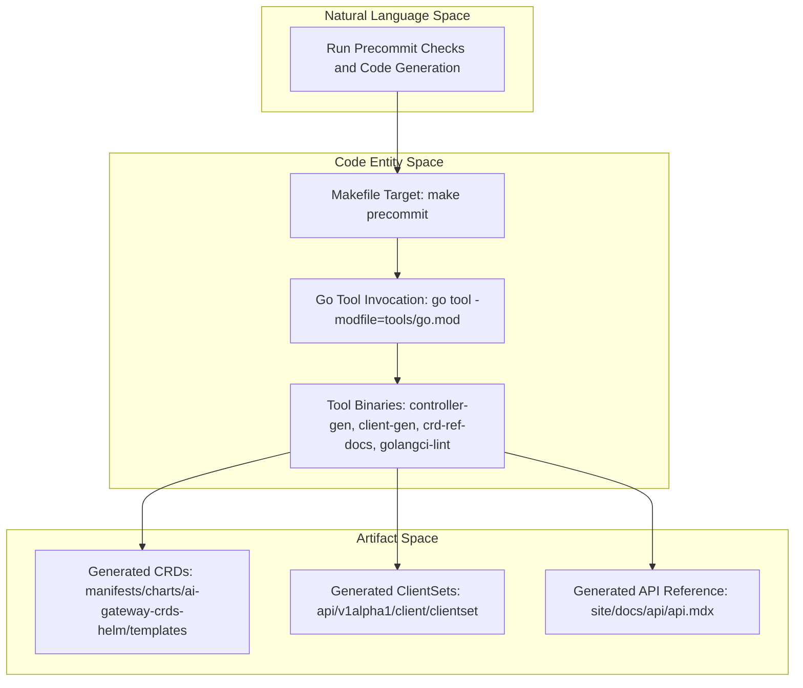
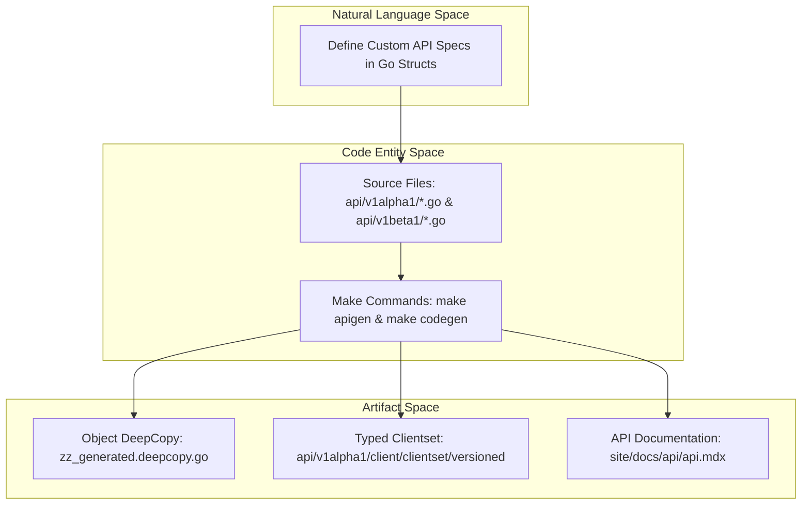
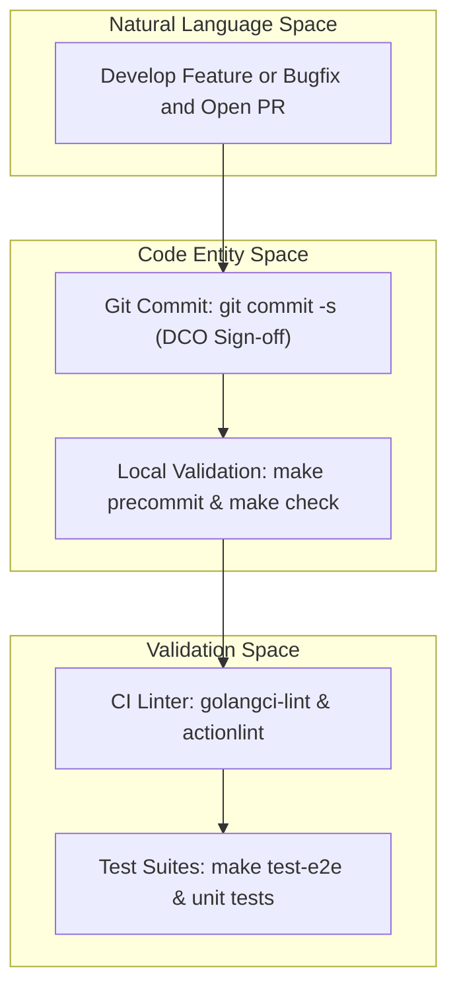

<!-- source: DeepWiki mcp.deepwiki.com · repo theagentrouter/agent-router · page 1.2 Repository Layout and Contributing · fetched 2026-10-21 -->

# Repository Layout and Contributing

Relevant source files

The following files were used as context for generating this wiki page:

- [.github/dependabot.yml](.github/dependabot.yml)
- [.golangci.yml](.golangci.yml)
- [.licenserc.yaml](.licenserc.yaml)
- [CONTRIBUTING.md](CONTRIBUTING.md)
- [MAINTAINERS.md](MAINTAINERS.md)
- [Makefile](Makefile)
- [docs/proposals/008-gemini-context-caching/context-caching-architecture.svg](docs/proposals/008-gemini-context-caching/context-caching-architecture.svg)
- [docs/proposals/008-gemini-context-caching/context-caching-flow1-single-region.svg](docs/proposals/008-gemini-context-caching/context-caching-flow1-single-region.svg)
- [docs/proposals/008-gemini-context-caching/context-caching-flow2-multi-region.svg](docs/proposals/008-gemini-context-caching/context-caching-flow2-multi-region.svg)
- [docs/proposals/008-gemini-context-caching/context-caching-flow3-explicit.svg](docs/proposals/008-gemini-context-caching/context-caching-flow3-explicit.svg)
- [docs/proposals/008-gemini-context-caching/proposal.md](docs/proposals/008-gemini-context-caching/proposal.md)
- [docs/proposals/009-quota-aware-routing/proposal.md](docs/proposals/009-quota-aware-routing/proposal.md)
- [go.mod](go.mod)
- [go.sum](go.sum)
- [internal/controller/rotators/aws_common.go](internal/controller/rotators/aws_common.go)
- [internal/filterapi/filterconfig_test.go](internal/filterapi/filterconfig_test.go)
- [internal/filterapi/watcher.go](internal/filterapi/watcher.go)
- [internal/filterapi/watcher_test.go](internal/filterapi/watcher_test.go)
- [pre-commit.sh](pre-commit.sh)
- [tests/e2e-inference-extension/inference_pool_test.go](tests/e2e-inference-extension/inference_pool_test.go)
- [tests/e2e-upgrade/upgrade_test.go](tests/e2e-upgrade/upgrade_test.go)
- [tests/internal/e2elib/e2elib.go](tests/internal/e2elib/e2elib.go)
- [tests/internal/e2elib/forwarder_test.go](tests/internal/e2elib/forwarder_test.go)
- [tests/internal/testopenai/openai.go](tests/internal/testopenai/openai.go)
- [tools/go.mod](tools/go.mod)
- [tools/go.sum](tools/go.sum)

## Purpose and Scope

This page documents the structural layout, build automation, code generation pipelines, contribution workflows, and release lifecycle of the Agent Router codebase [`CONTRIBUTING.md:1-5`](). It is targeted at developers, maintainers, and contributors seeking a comprehensive map of the repository organization, tooling modules (`tools/go.mod`), and engineering standards [`go.mod:1-5`]().

Sources: `CONTRIBUTING.md:1-5`, `go.mod:1-5`

---

## Repository Directory Map and `tools/` Module

The repository is organized into distinct functional domains separating API definitions, control plane logic, data plane filters, CLI components, documentation, and tooling. 

| Directory | Architectural Role & Contents |
| :--- | :--- |
| `api/` | Kubernetes Custom Resource Definitions (CRDs) grouped by version (`v1alpha1`, `v1beta1`), deepcopy functions, type definitions, and generated client sets [`Makefile:103-109`]() |
| `cmd/` | Binary entrypoints for the control plane controller manager, CLI (`aigw`), and auxiliary components |
| `internal/` | Core implementation packages containing controllers, xDS translation logic, the `extproc` gRPC data plane, provider schema handlers, and credential rotators [`Makefile:15-16`]() |
| `manifests/` | Helm charts (`ai-gateway-helm`, `ai-gateway-crds-helm`) and static manifests for cluster deployment [`Makefile:109`]() |
| `site/` | Docusaurus documentation source code, blog posts, static assets, and CRD reference documentation templates [`Makefile:116-122`]() |
| `tools/` | Isolated tooling module (`tools/go.mod`) hosting pinned versions of dependencies like `controller-gen`, `client-gen`, `golangci-lint`, and `crd-ref-docs` [`Makefile:11`]() |
| `tests/` | Comprehensive test suites including end-to-end (`test-e2e`), data-plane VCR suites, and mock upstream servers [`CONTRIBUTING.md:43-51`]() |
| `docs/proposals/` | Architecture design proposals (ADRs) guiding major features (e.g., quota-aware routing and model virtualization) [`docs/proposals/009-quota-aware-routing/proposal.md:1-13`]() |

The `tools/` module isolates development dependencies from the main application module (`go.mod`), ensuring that tool versions remain reproducible across developer environments and CI pipelines without polluting runtime dependency trees [`tools/go.mod:1-35`]() [`go.mod:1-79`]().

Sources: `Makefile:11-122`, `tools/go.mod:1-35`, `CONTRIBUTING.md:43-51`, `go.mod:1-79`, `docs/proposals/009-quota-aware-routing/proposal.md:1-13`

---

## Makefile Targets and Build System

Build, lint, and test validation workflows are orchestrated entirely via `make`. The `Makefile` exposes standardized targets that wrap tool invocations via `go tool -modfile=tools/go.mod` [`Makefile:11`]().

Diagram: Build Automation and Code Generation Tooling

Sources: `Makefile:11-148`, `tools/go.mod:17-34`

### Key Makefile Targets

- `make precommit`: Executes the complete validation pipeline including `tidy`, `spellcheck`, `apigen`, `codegen`, `apidoc`, `format`, `lint`, `editorconfig`, and `helm-test` [`Makefile:45-46`]().
- `make apigen`: Invokes `controller-gen` to generate Kubernetes deepcopy methods (`zz_generated.deepcopy.go`) for `v1alpha1` and `v1beta1`, and compiles combined CRD manifests into the Helm chart templates [`Makefile:103-110`]().
- `make codegen`: Generates Kubernetes typed clientsets (`versioned`), listers, and informers for custom resources [`Makefile:126-148`]().
- `make apidoc`: Uses `crd-ref-docs` to parse API structs and compile Markdown documentation at `site/docs/api/api.mdx` [`Makefile:113-123`]().
- `make lint`: Runs `golangci-lint` with specific build tags (`test_crdcel`, `test_controller`, `test_extproc`, `test_e2e`) and `actionlint` [`Makefile:48-53`]().

Sources: `Makefile:11-148`

---

## Code Generation Architecture and Pipelines

Code generation guarantees strict consistency between Kubernetes CRD specifications, Go type definitions, and client SDKs. The generation pipeline bridges higher-level Go struct definitions to Kubernetes-native APIs and documentation artifacts.

Diagram: Schema-to-Code Translation Pipeline

Sources: `Makefile:103-148`

### Client Generation Parameters

The `codegen` target constructs Kubernetes-native clients for custom APIs such as `BackendSecurityPolicy` [`Makefile:126-137`]():
- `--clientset-name="versioned"`: Establishes the top-level versioned clientset package [`Makefile:131`].
- `--input="github.com/envoyproxy/ai-gateway/api/v1alpha1"`: Specifies the target API input package [`Makefile:133`].
- `--plural-exceptions="BackendSecurityPolicy:BackendSecurityPolicies"`: Corrects irregular pluralization rules for Kubernetes resource names [`Makefile:137`].

Sources: `Makefile:126-148`

---

## Contributing Workflow and Governance

Contributing to Agent Router requires adherence to strict quality gates, licensing requirements, DCO sign-offs, and review conventions [`CONTRIBUTING.md:1-134`]().

Diagram: Contribution and Validation Lifecycle

Sources: `CONTRIBUTING.md:7-134`, `Makefile:45-92`

### Workflow Requirements

1. **Prerequisites**: Contributors require the latest Go toolchain, `make`, and `docker` [`CONTRIBUTING.md:7-13`]().
2. **Pre-commit Checks**: Prior to pushing, developers must execute `make precommit` and ensure zero code or status differences exist (`make check`) [`CONTRIBUTING.md:28-30`(), `Makefile:85-92`()].
3. **Developer Certificate of Origin (DCO)**: Every commit must include a `Signed-off-by` trailer via `git commit -s`, certifying adherence to `developercertificate.org` [`CONTRIBUTING.md:101-114`]().
4. **Review Protocol**: During code reviews, developers must avoid force-pushing, rebasing, or squashing incremental commits, allowing reviewers to track incremental changes. Maintainers squash commits upon final merge [`CONTRIBUTING.md:121-133`]().
5. **Generative AI Policy**: Generative AI assistance is permitted provided the submitter fully understands, takes ownership of, and can defend all submitted code and responses [`CONTRIBUTING.md:61-84`]().

Sources: `CONTRIBUTING.md:7-134`, `Makefile:85-92`

---

## Release Engineering and Compatibility Lifecycle

Release cycles align closely with Envoy Gateway releases, targeting a cadence of approximately every 2-3 months, supplemented by frequent updates reflecting the fast-moving AI ecosystem.

### Versioning and Compatibility
- **Alpha vs. Beta**: `v1beta1` represents the committed stable control-plane API covered by backward-compatibility guarantees. `v1alpha1` remains served but deprecated. `QuotaPolicy` is currently `v1alpha1`-only.
- **Upgrade Guarantees**: Upgrading the controller across consecutive minor versions is fully supported when migration paths and CRD storage version transitions are followed [tests/e2e-upgrade/upgrade_test.go:110-125]().

### Release Process
1. **Release Candidate (RC) Phase**: The main branch is frozen for feature additions. An RC tag (`vX.Y.Z-rc1`) is cut from `origin/main`, triggering automated container image and Helm chart builds.
2. **Release Notes Automation**: Release notes are compiled using automated tools analyzing commit deltas since the prior tag, generating JSON data and MDX documentation pages.
3. **General Availability**: Stable tags are published once RC validation concludes successfully.

Sources: `Makefile:22-26`, `tests/e2e-upgrade/upgrade_test.go:110-125`

---

## Architectural Proposals and Design Evolution

Major architectural additions originate as design proposals inside `docs/proposals/`. For example, `docs/proposals/009-quota-aware-routing/proposal.md` establishes the blueprint for transitioning from reactive post-response quota metering (`QuotaPolicy`) to proactive capacity-aware routing between Provisioned Throughput (PT) and On-Demand backend pools [`docs/proposals/009-quota-aware-routing/proposal.md:1-13`]. Proposals define architectural drivers, multi-path request flows, and Envoy filter configurations before implementation in `internal/` packages.

Sources: `docs/proposals/009-quota-aware-routing/proposal.md:1-13`

---

