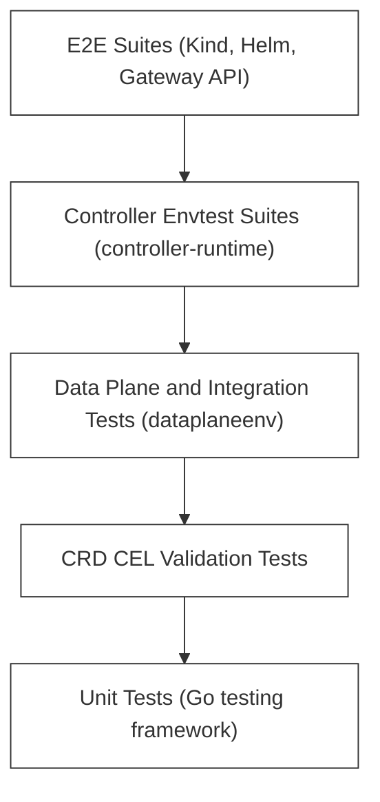
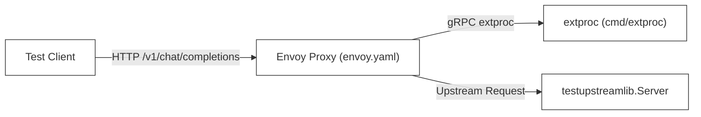
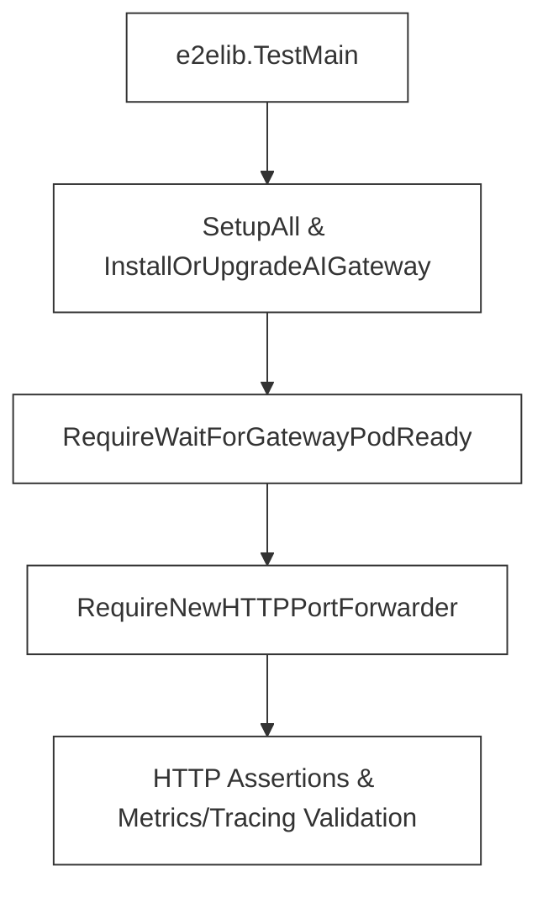

<!-- source: DeepWiki mcp.deepwiki.com · repo theagentrouter/agent-router · page 10 Testing Infrastructure · fetched 2026-10-21 -->

# Testing Infrastructure

Relevant source files

The following files were used as context for generating this wiki page:

- [.github/codecov.yml](.github/codecov.yml)
- [.testcoverage.yml](.testcoverage.yml)
- [tests/e2e-inference-extension/e2e_inference_extension_test.go](tests/e2e-inference-extension/e2e_inference_extension_test.go)
- [tests/e2e-inference-extension/testdata/inference-extension-conformance.yaml](tests/e2e-inference-extension/testdata/inference-extension-conformance.yaml)
- [tests/e2e-upgrade/testdata/manifest.yaml](tests/e2e-upgrade/testdata/manifest.yaml)
- [tests/internal/envtest.go](tests/internal/envtest.go)

The testing infrastructure for the Envoy AI Gateway codebase provides a comprehensive verification mechanism spanning unit tests, CRD CEL validation, controller `envtest` suites, data-plane external processor tests, and Kubernetes-based end-to-end (e2e) test suites.

For detailed information on specific test suites, refer to the child pages:
- For Envoy-based data plane tests, VCR cassettes, testupstream servers, and real provider integration, see [Data Plane and VCR Tests](#10.1).
- For Kind-based e2e suites, upgrade tests, namespaced routing, inference-extension conformance, and `crdcel`/`envtest` helpers, see [E2E and Envtest Suites](#10.2).

---

## 1. The Test Pyramid Architecture

The testing strategy is organized into a test pyramid that balances fast feedback loops during local development with high-fidelity validation of Kubernetes controllers and data-plane proxy interactions.

*Figure 1: Test Pyramid Architecture from unit tests to full Kubernetes E2E suites.*

The end-to-end suites initialize test environments using `e2elib.TestMain` [tests/e2e-inference-extension/e2e_inference_extension_test.go:14-16](), applying manifests and running port-forwarded requests against Envoy gateways. Similarly, data-plane integration tests utilize `dataplaneenv.TestEnvironment` to orchestrate local instances of Envoy, the `extproc` binary, and mock upstreams.

Code coverage is tracked using `.testcoverage.yml` [.testcoverage.yml:1-10]() and `.github/codecov.yml` [.github/codecov.yml:1-14](), with specific paths excluded from coverage calculations, such as generated code and test-only libraries [.testcoverage.yml:11-26](), [.github/codecov.yml:15-22]().

Sources:
- `tests/e2e-inference-extension/e2e_inference_extension_test.go:14-16` 
- `.testcoverage.yml:1-10` 
- `.testcoverage.yml:11-27` 
- `.github/codecov.yml:1-14` 
- `.github/codecov.yml:15-22` 

---

## 2. Data Plane and Upstream Testing

Data plane testing validates the behavior of the external processor (`extproc`) gRPC service when paired with an Envoy proxy instance. These tests simulate real-world AI traffic, checking header transformations, token cost tracking, rate-limiting budgets, and provider payload translation without requiring an active Kubernetes control plane.

*Figure 2: Data Plane Local Test Topology.*

The test harness uses `testupstreamlib.Server` to mock upstream Large Language Model (LLM) endpoints, verifying expected HTTP headers, paths, and request bodies. Additionally, performance benchmarks measure chat completion throughput across multiple payload sizes.

For deeper details on VCR cassettes, provider harnesses, and mock upstream behavior, see [Data Plane and VCR Tests](#10.1).

Sources:
- `tests/e2e-upgrade/testdata/manifest.yaml:104-147` 

---

## 3. Controller, Envtest and E2E Suites

Controller reconciliation logic and Custom Resource Definitions (CRDs) are validated using `controller-runtime`'s `envtest` environment (implemented via `NewEnvTest` in [tests/internal/envtest.go:28-61]()) along with Kind-based end-to-end testing against real cluster deployments. Third-party CRDs such as Gateway API definitions are fetched dynamically via `requireThirdPartyCRDDownloaded` [tests/internal/envtest.go:65-85]().

Examples of integration tests include token rate-limiting verification, provider fallback behavior under upstream failure, and traffic splitting across multiple backends. The `e2e-upgrade` test suite uses a `manifest.yaml` [tests/e2e-upgrade/testdata/manifest.yaml:1-147]() to define `GatewayClass`, `Gateway`, `EnvoyProxy`, `AIGatewayRoute`, `MCPRoute`, `AIServiceBackend`, and `Backend` resources, along with a `testupstream` deployment and service. The `e2e-inference-extension` suite includes conformance tests for the inference extension [tests/e2e-inference-extension/testdata/inference-extension-conformance.yaml:1-11]().

*Figure 3: E2E Test Execution Workflow.*

For complete coverage of Kind cluster bootstrapping, upgrade testing, CRD CEL rule validation helpers, and inference-extension conformance tests, see [E2E and Envtest Suites](#10.2).

Sources:
- `tests/internal/envtest.go:28-61` 
- `tests/internal/envtest.go:65-85` 
- `tests/e2e-upgrade/testdata/manifest.yaml:1-147` 
- `tests/e2e-inference-extension/testdata/inference-extension-conformance.yaml:1-12` 

---

