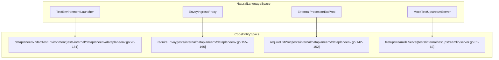
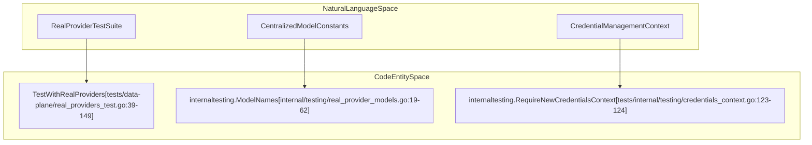

<!-- source: DeepWiki mcp.deepwiki.com · repo theagentrouter/agent-router · page 10.1 Data Plane and VCR Tests · fetched 2026-10-21 -->

# Data Plane and VCR Tests

<details>
<summary>Relevant source files</summary>

The following files were used as context for generating this wiki page:

- [internal/extensionserver/extensionserver.go](internal/extensionserver/extensionserver.go)
- [internal/testing/credentials_context.go](internal/testing/credentials_context.go)
- [internal/testing/real_provider_models.go](internal/testing/real_provider_models.go)
- [tests/data-plane/bench_test.go](tests/data-plane/bench_test.go)
- [tests/data-plane/envoy.yaml](tests/data-plane/envoy.yaml)
- [tests/data-plane/extproc_test.go](tests/data-plane/extproc_test.go)
- [tests/data-plane/real_providers_test.go](tests/data-plane/real_providers_test.go)
- [tests/internal/dataplaneenv/dataplaneenv.go](tests/internal/dataplaneenv/dataplaneenv.go)
- [tests/internal/testopenai/README.md](tests/internal/testopenai/README.md)
- [tests/internal/testopenai/cassettes.go](tests/internal/testopenai/cassettes.go)
- [tests/internal/testopenai/cassettes_test.go](tests/internal/testopenai/cassettes_test.go)
- [tests/internal/testopenai/handler.go](tests/internal/testopenai/handler.go)
- [tests/internal/testopenai/handler_test.go](tests/internal/testopenai/handler_test.go)
- [tests/internal/testopenai/vcr.go](tests/internal/testopenai/vcr.go)
- [tests/internal/testopenai/vcr_test.go](tests/internal/testopenai/vcr_test.go)
- [tests/internal/testopeninference/assertions.go](tests/internal/testopeninference/assertions.go)
- [tests/internal/testopeninference/assertions_test.go](tests/internal/testopeninference/assertions_test.go)
- [tests/internal/testopeninference/openai_proxy.py](tests/internal/testopeninference/openai_proxy.py)
- [tests/internal/testopeninference/recorder.go](tests/internal/testopeninference/recorder.go)
- [tests/internal/testopeninference/recorder_test.go](tests/internal/testopeninference/recorder_test.go)
- [tests/internal/testopeninference/server_test.go](tests/internal/testopeninference/server_test.go)
- [tests/internal/testupstreamlib/server.go](tests/internal/testupstreamlib/server.go)
- [tests/internal/testupstreamlib/server_test.go](tests/internal/testupstreamlib/server_test.go)
- [tests/internal/testupstreamlib/testupstream.go](tests/internal/testupstreamlib/testupstream.go)
- [tests/internal/testupstreamlib/testupstream/main.go](tests/internal/testupstreamlib/testupstream/main.go)

</details>


## Purpose and Scope
This page covers the data plane testing infrastructure for Agent Router. It documents the Envoy-based data plane test suites, real provider integration tests, the mock `testupstream` server framework, the VCR cassette subsystem, the `testopenai` test harness, and data plane benchmarking.

Sources: [tests/data-plane/envoy.yaml:1-153](), [tests/internal/dataplaneenv/dataplaneenv.go:1-181]()

---

## 1. Data Plane Test Environment Architecture (`dataplaneenv`)

Data plane tests run against a fully integrated local environment consisting of an Envoy proxy process, the compiled external processor (`extproc`) binary, and an upstream test server. The test helper `dataplaneenv.StartTestEnvironment` orchestrates the lifecycle of these components, assigning ephemeral ports and managing output capturing and failure logging.


*Diagram 1: Mapping test infrastructure concepts to package code entities.*

Sources: [tests/internal/dataplaneenv/dataplaneenv.go:76-181](), [tests/internal/testupstreamlib/server.go:31-63](), [tests/data-plane/envoy.yaml:1-153]()

---

## 2. Real Provider Tests and Model Configurations

The `TestWithRealProviders` suite verifies that the `extproc` proxy and translation layers communicate successfully with live provider endpoints (such as OpenAI, Anthropic, AWS Bedrock, Google Gemini, and Groq).


*Diagram 2: Real provider test suite interaction with model constants and credentials.*

### Centralized Model Constants
To prevent broken tests when cloud providers deprecate specific model versions, test model strings are centralized in `internal/testing/real_provider_models.go`.

| Constant Name | Provider | Target Model ID |
| :--- | :--- | :--- |
| `OpenAIModelName` | OpenAI | `gpt-5-nano` [internal/testing/real_provider_models.go:23-23]() |
| `AWSBedrockModelName` | AWS Bedrock | `us.amazon.nova-micro-v1:0` [internal/testing/real_provider_models.go:25-25]() |
| `AzureOpenAIModelName` | Azure OpenAI | `o1` [internal/testing/real_provider_models.go:27-27]() |
| `GeminiModelName` | Google Gemini | `gemini-3.1-flash-lite` [internal/testing/real_provider_models.go:29-29]() |
| `AnthropicModelName` | Anthropic | `claude-sonnet-4-5` [internal/testing/real_provider_models.go:55-55]() |

Sources: [tests/data-plane/real_providers_test.go:39-149](), [internal/testing/real_provider_models.go:19-62]()

---

## 3. TestUpstream Server

The `testupstreamlib.Server` implementation ([tests/internal/testupstreamlib/server.go:31-63]()) simulates model provider backends for end-to-end routing validation. It checks incoming HTTP headers, expected paths, and request bodies, returning deterministic mock responses or error status codes based on control headers defined in [tests/internal/testupstreamlib/testupstream.go:8-54]():

* `x-response-type`: Specifies response streaming formatting (`sse`, `aws-event-stream`, or standard JSON).
* `x-expected-headers`: Base64-encoded key-value pairs required in the incoming request.
* `x-fake-response`: Triggers pre-cached response bodies (`small`, `medium`, `large`) useful for performance benchmarks.

```go
// Example request assertion handled by testupstreamlib.Server
if v := r.Header.Get(ExpectedHostKey); v != "" {
    if r.Host != v {
        s.logAndSendError(w, http.StatusBadRequest, "unexpected host: got %q, expected %q", r.Host, v)
        return
    }
}
```

End-to-end tests deploy this upstream alongside Kubernetes manifests to ensure that routing rules, header mutations, and schema translations work correctly without relying on external API credentials.

Sources: [tests/internal/testupstreamlib/server.go:31-188](), [tests/internal/testupstreamlib/testupstream.go:8-54](), [tests/internal/testupstreamlib/testupstream/main.go:24-43]()

---

## 4. VCR Cassettes and TestOpenAI Harness

Agent Router includes a VCR-style testing subsystem located under `tests/internal/testopenai/` and `tests/data-plane/vcr/`. 
* **VCR Recorders**: Capture live HTTP exchanges between the gateway and LLM providers into YAML/JSON cassette files via `cassetteHandler` ([tests/internal/testopenai/handler.go:31-42]()).
* **Harness Replay**: Replays recorded payloads during unit and integration test runs, enabling deterministic evaluation of streaming responses, token extraction, and translation logic without incurring external API costs or network flakiness. Requests are matched via `X-Cassette-Name` headers ([tests/internal/testopenai/handler.go:28-29]()).

Sources: [tests/internal/testopenai/handler.go:31-124](), [tests/internal/testopenai/handler_test.go:81-145](), `tests/data-plane/vcr/`

---

## 5. Benchmarking Data Plane Performance

Performance benchmarks are implemented in `tests/data-plane/bench_test.go` to measure proxy throughput and latency overhead under concurrent loads.

* `BenchmarkChatCompletions` ([tests/data-plane/bench_test.go:34-108]()) measures request processing performance across various prompt sizes and backends (`openai`, `aws-bedrock`, `gcp-vertexai`, `gcp-anthropicai`).
* `BenchmarkEmbeddings` ([tests/data-plane/bench_test.go:136-189]()) benchmarks vector embedding payload handling.

Tests use Go's `b.RunParallel` to simulate high concurrency against local Envoy listeners backed by `testupstream`.

Sources: [tests/data-plane/bench_test.go:34-189]()

---

