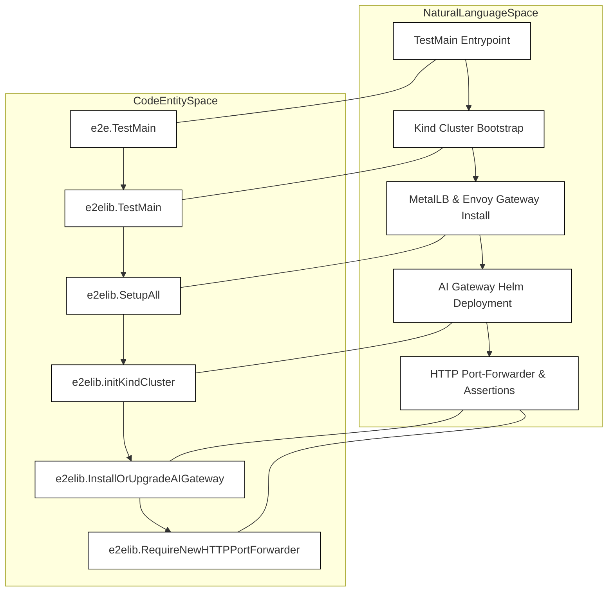
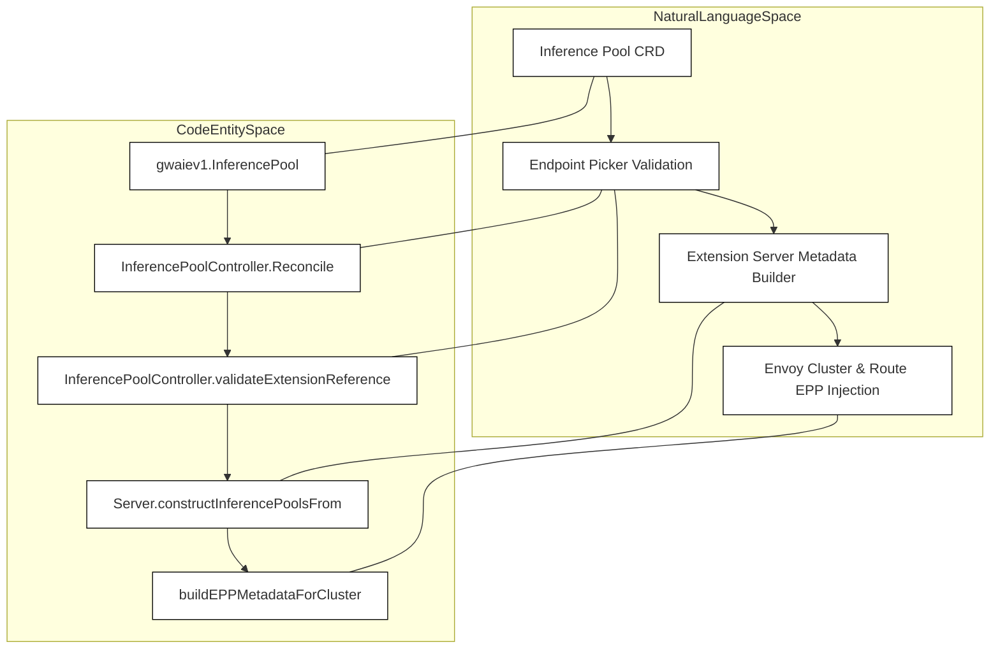

<!-- source: DeepWiki mcp.deepwiki.com · repo theagentrouter/agent-router · page 10.2 E2E and Envtest Suites · fetched 2026-10-21 -->

# E2E and Envtest Suites

<details>
<summary>Relevant source files</summary>

The following files were used as context for generating this wiki page:

- [.github/dependabot.yml](.github/dependabot.yml)
- [Makefile](Makefile)
- [examples/basic/README.md](examples/basic/README.md)
- [examples/token_ratelimit/token_ratelimit.yaml](examples/token_ratelimit/token_ratelimit.yaml)
- [go.mod](go.mod)
- [go.sum](go.sum)
- [internal/translator/anthropic_awsanthropic.go](internal/translator/anthropic_awsanthropic.go)
- [internal/translator/anthropic_awsanthropic_test.go](internal/translator/anthropic_awsanthropic_test.go)
- [tests/e2e-inference-extension/inference_pool_test.go](tests/e2e-inference-extension/inference_pool_test.go)
- [tests/e2e-upgrade/upgrade_test.go](tests/e2e-upgrade/upgrade_test.go)
- [tests/e2e/basic_test.go](tests/e2e/basic_test.go)
- [tests/e2e/cross_namespace_test.go](tests/e2e/cross_namespace_test.go)
- [tests/e2e/e2e_test.go](tests/e2e/e2e_test.go)
- [tests/e2e/provider_fallback_test.go](tests/e2e/provider_fallback_test.go)
- [tests/e2e/testdata/cross_namespace_mcproute.yaml](tests/e2e/testdata/cross_namespace_mcproute.yaml)
- [tests/e2e/testdata/otel_tracing_console.yaml](tests/e2e/testdata/otel_tracing_console.yaml)
- [tests/e2e/testdata/testupstream.yaml](tests/e2e/testdata/testupstream.yaml)
- [tests/e2e/testdata/traffic_splitting_fallback.yaml](tests/e2e/testdata/traffic_splitting_fallback.yaml)
- [tests/e2e/testupstream_test.go](tests/e2e/testupstream_test.go)
- [tests/e2e/token_ratelimit_test.go](tests/e2e/token_ratelimit_test.go)
- [tests/e2e/traffic_splitting_fallback_test.go](tests/e2e/traffic_splitting_fallback_test.go)
- [tests/internal/e2elib/e2elib.go](tests/internal/e2elib/e2elib.go)

</details>


## Purpose and Scope
This page details the testing infrastructure and validation suites for the Envoy AI Gateway codebase, focusing on Kind-based end-to-end (E2E) tests, upgrade verification, namespaced test topologies and cross-namespace references, Gateway API Inference Extension conformance suites, traffic splitting and fallback tests, and `controller-runtime` `envtest` helpers.

---

## 1. Kind-Based End-to-End (E2E) Infrastructure & Suites

The E2E testing framework bootstraps real Kubernetes clusters using Kind (Kubernetes in Docker), installs Envoy Gateway and the AI Gateway control/data planes, configures network load balancing via MetalLB, and executes live black-box and grey-box assertions against deployed gateways.

The test orchestrator is initialized via `TestMain` in `tests/e2e/e2e_test.go`, which configures tenant headers for spans, access logs, and metrics before delegating to `e2elib.TestMain` [tests/e2e/e2e_test.go:14-24]().


*Diagram 1: Bridging E2E harness initialization concepts to `e2elib` code functions.*

Sources: `tests/e2e/e2e_test.go:14-24()`, `tests/internal/e2elib/e2elib.go:87-133()`

---

## 2. Token Rate Limiting, Metrics, and Advanced Feature E2E Suites

Token-based rate limiting and telemetry tests validate that language model token counts (prompt tokens, completion tokens, cached input tokens, and CEL-evaluated cost expressions) are correctly intercepted by the `extproc` filter, recorded into metadata namespaces, and enforced via `BackendTrafficPolicy` global rate limit rules.

The suite `Test_Examples_TokenRateLimit` applies token rate limit manifests, restarts the Redis and rate limit pods, issues simulated chat completion requests with custom response headers specifying usage tokens, and scrapes Prometheus metrics to verify attribute propagation [tests/e2e/token_ratelimit_test.go:38-157](). Additional suites validate traffic splitting and fallback behavior (`TestTrafficSplittingFallback`) as well as cross-namespace reference grants (`TestCrossNamespace` and `TestCrossNamespaceMCPRoute`) [tests/e2e/traffic_splitting_fallback_test.go:24-135](), [tests/e2e/cross_namespace_test.go:29-107]().

| Test Target / Feature | Manifest Path | Key Validation Metric / Behavior |
| :--- | :--- | :--- |
| **Token Rate Limit** | `examples/token_ratelimit/token_ratelimit.yaml` | Enforces prompt/completion/cached token limits per unique `x-tenant-id` header [tests/e2e/token_ratelimit_test.go:110-152]() |
| **Basic Provider Routing** | `examples/basic/basic.yaml` | Validates OpenAI, Anthropic, Bedrock, and Cohere SDK routing through the gateway [tests/e2e/basic_test.go:35-91]() |
| **Provider Fallback & Splitting** | `tests/e2e/testdata/traffic_splitting_fallback.yaml` | Verifies priority and weight-based fallback when primary backends fail, and 50/50 traffic distribution [tests/e2e/traffic_splitting_fallback_test.go:24-135]() |
| **Cross-Namespace References** | `tests/e2e/testdata/cross_namespace.yaml` | Validates gateways, routes, and backends across namespaces using `ReferenceGrant` [tests/e2e/cross_namespace_test.go:29-73]() |

Sources: `tests/e2e/token_ratelimit_test.go:38-157()`, `examples/token_ratelimit/token_ratelimit.yaml:30-130()`, `tests/e2e/basic_test.go:35-91()`, `tests/e2e/traffic_splitting_fallback_test.go:24-135()`, `tests/e2e/cross_namespace_test.go:29-107()`

---

## 3. Upgrade and Lifecycle Testing Suites

Upgrade suites verify zero-downtime rolling updates of data plane proxies (Envoy pods) and control-plane upgrades across gateway versions. Defined in `tests/e2e-upgrade/upgrade_test.go`, the test framework simulates two distinct upgrade paths [tests/e2e-upgrade/upgrade_test.go:74-126]():

1. **Rolling Out Pods**: Forces a rolling update of Envoy proxy deployments via JSON patching of deployment annotations while continuously bombarding the gateway with HTTP requests to assert zero dropped packets [tests/e2e-upgrade/upgrade_test.go:84-108]().
2. **Control-Plane Upgrade**: Installs a previous stable release (`v0.5.0`), streams continuous traffic, and upgrades the Helm chart to the latest main build, subsequently verifying CRD storage version migrations [tests/e2e-upgrade/upgrade_test.go:109-125]().

Sources: `tests/e2e-upgrade/upgrade_test.go:74-126()`

---

## 4. Gateway API Inference Extension Conformance and Inference Pool Suites

The gateway integrates with the Gateway API Inference Extension (`gateway-api-inference-extension`). The conformance suite executes upstream Kubernetes Gateway API inference conformance tests against the gateway implementation [tests/e2e-inference-extension/e2e_inference_extension_test.go]().

Controller-level reconciliation for inference pools is handled by `InferencePoolController`, which validates endpoint picker references and synchronizes backend pool endpoints [internal/controller/inference_pool.go:28-84](). The extension server parses unstructured `InferencePool` resources and injects EPP metadata clusters [internal/extensionserver/inferencepool.go:55-86]().


*Diagram 2: Mapping inference pool concepts to controller and extension server entities.*

Sources: `tests/e2e-inference-extension/e2e_inference_extension_test.go()`, `internal/controller/inference_pool.go:28-84()`, `internal/extensionserver/inferencepool.go:55-86()`

---

## 5. Envtest Helpers and Controller Unit/Integration Suites

For controller and webhook testing without requiring a full Kubernetes cluster, the codebase utilizes `controller-runtime`'s `envtest` framework.

The helper `NewEnvTest` configures local control plane binaries via `setup-envtest`, discovers AI Gateway CRDs from Helm chart templates, downloads third-party Envoy Gateway CRDs (`3rd_party_crds_for_tests.yaml`), and initializes a test client with the unified controller scheme [tests/internal/envtest.go:28-61]().

```go
// Example pattern used across internal controller unit tests
func NewEnvTest(t *testing.T) (c client.Client, cfg *rest.Config, k kubernetes.Interface)
```

Unit and integration tests for extensions and controllers (such as `TestInferencePoolController_Reconcile` and `TestServerPostTranslateModify`) leverage fake clients initialized with status subresources and indexers [internal/controller/inference_pool_test.go:27-39](), [internal/extensionserver/extensionserver_test.go:66-72]().

Sources: `tests/internal/envtest.go:28-61()`, `internal/controller/inference_pool_test.go:27-39()`, `internal/extensionserver/extensionserver_test.go:66-72()`

---

