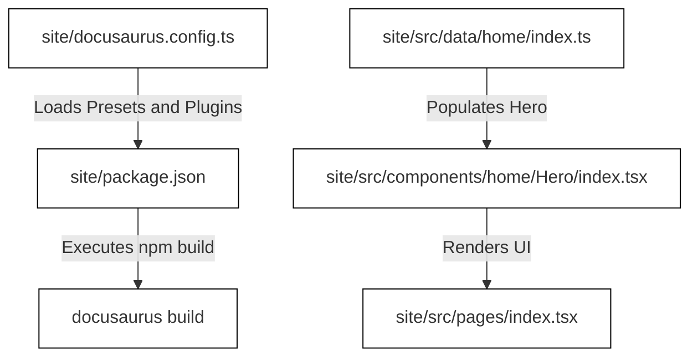
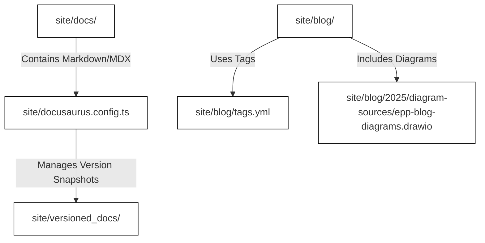

<!-- source: DeepWiki mcp.deepwiki.com · repo theagentrouter/agent-router · page 11 Documentation Site · fetched 2026-10-21 -->

# Documentation Site

Relevant source files

The following files were used as context for generating this wiki page:

- [site/.npmrc](site/.npmrc)
- [site/.nvmrc](site/.nvmrc)
- [site/blog/2025/diagram-sources/epp-blog-diagrams.drawio](site/blog/2025/diagram-sources/epp-blog-diagrams.drawio)
- [site/blog/tags.yml](site/blog/tags.yml)
- [site/package-lock.json](site/package-lock.json)
- [site/package.json](site/package.json)
- [site/src/components/Adopters/index.tsx](site/src/components/Adopters/index.tsx)
- [site/src/components/Adopters/styles.module.css](site/src/components/Adopters/styles.module.css)
- [site/src/data/adopters/README.md](site/src/data/adopters/README.md)
- [site/src/data/adopters/index.ts](site/src/data/adopters/index.ts)
- [site/src/data/talks.json](site/src/data/talks.json)
- [site/src/pages/talks.module.css](site/src/pages/talks.module.css)
- [site/src/pages/talks.tsx](site/src/pages/talks.tsx)
- [site/static/img/adopters/README.md](site/static/img/adopters/README.md)
- [site/tsconfig.json](site/tsconfig.json)

## Purpose and Scope

This page provides an architectural overview of the Agent Router documentation site, implemented using Docusaurus and housed within the `site/` directory (`[site/package.json:1-60]()`). The site serves as the central hub for technical documentation, capability guides, command-line interface references, blog posts, and community tools.

As a parent page, this section outlines the high-level organization of the documentation portal. For detailed implementation guides regarding Docusaurus configurations, custom React components, styling tokens, and deployment pipelines, see [Site Build and Components](#11.1). For specifics on Markdown content structures, versioned documentation snapshots, release notes, and blog integration, see [Docs Content, Versioning and Blog](#11.2).

Sources: `[site/package.json:1-60]()`

---

## Docusaurus Architecture and Site Infrastructure

The documentation site is powered by Docusaurus `3.x` with `@docusaurus/preset-classic` (`[site/package.json:20-21]()`). The core runtime is configured in `site/docusaurus.config.ts`, which sets site metadata, markdown hooks, plugin integrations like `latestBlogsPlugin.ts` and `llmsTxtPlugin.ts`, and internationalization settings.

Styling and structure rely on React components and static assets. For example, the homepage layout orchestrates components such as `Hero` (`[site/src/components/home/Hero/index.tsx:1-36]()`) whose data is defined in `site/src/data/home/index.ts` and styled via CSS modules (`[site/src/components/home/Hero/styles.module.css:1-23]()`).

### Diagram: Docusaurus Site Build and Configuration Pipeline

Sources: `[site/package.json:20-21]()`, `[site/src/components/home/Hero/index.tsx:1-36]()`, `[site/src/components/home/Hero/styles.module.css:1-23]()`, `[site/src/pages/index.tsx:1-37]()`

---

## Site Build, Styling, and Components

For details, see [Site Build and Components](#11.1).

The frontend leverages React `19.x` (`[site/package.json:30]()`), TypeScript (`[site/tsconfig.json:1-24]()`), and custom styling assets to maintain the Agent Router brand identity across landing pages, capability cards, terminal components (`[site/src/components/home/Hero/index.tsx:1-36]()`), and community portals. The `site/package.json` also defines various Docusaurus scripts like `start`, `build`, and `deploy` (`[site/package.json:5-14]()`).

The build pipeline compiles Markdown/MDX content, bundles custom React modules, and integrates third-party widgets such as the Kapa.ai documentation assistant prior to publishing. The site also includes dedicated pages for "Talks and Presentations" (`[site/src/pages/talks.tsx:1-109]()`) which dynamically load data from `site/src/data/talks.json` (`[site/src/pages/talks.tsx:5]()`). Adopters are managed via `site/src/components/Adopters/index.tsx` (`[site/src/components/Adopters/index.tsx:1-61]()`) which uses data from `site/src/data/adopters/index.ts` (`[site/src/data/adopters/index.ts:1-14]()`).

Sources: `[site/package.json:30]()`, `[site/tsconfig.json:1-24]()`, `[site/package.json:5-14]()`, `[site/src/pages/talks.tsx:1-109]()`, `[site/src/pages/talks.tsx:5]()`, `[site/src/components/Adopters/index.tsx:1-61]()`, `[site/src/data/adopters/index.ts:1-14]()`

---

## Content Organization, Versioning, and Blog

For details, see [Docs Content, Versioning and Blog](#11.2).

Documentation content is organized hierarchically and stored within the `docs/` tree, supplemented by version variables. Versioning is managed natively through Docusaurus version snapshots, enabling support for multiple active software releases alongside compatibility references and the unreleased `next` development channel.

The blog functionality is configured to use tags defined in `site/blog/tags.yml` (`[site/blog/tags.yml:1-28]()`), allowing for categorization of posts into "Announcements", "News", "Releases", "Features", "Reference", and "Adopters". Diagrams for blog posts, such as those for EPP, are stored in `site/blog/2025/diagram-sources/epp-blog-diagrams.drawio` (`[site/blog/2025/diagram-sources/epp-blog-diagrams.drawio:1-78]()`).

### Diagram: Content Hierarchy and Versioning Pipeline

Sources: `[site/blog/tags.yml:1-28]()`, `[site/blog/2025/diagram-sources/epp-blog-diagrams.drawio:1-78]()`

---

