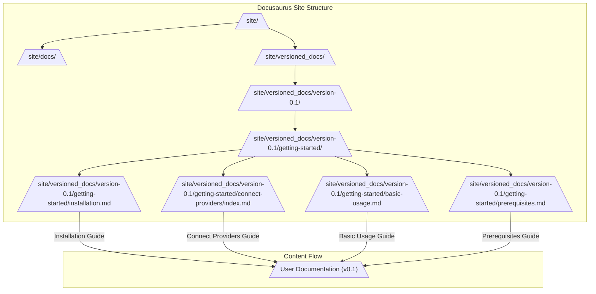
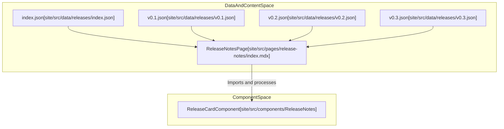
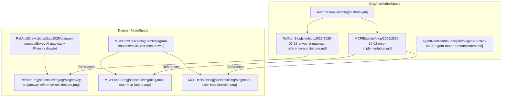

<!-- source: DeepWiki mcp.deepwiki.com · repo theagentrouter/agent-router · page 11.2 Docs Content, Versioning and Blog · fetched 2026-10-21 -->

# Docs Content, Versioning and Blog

Relevant source files

The following files were used as context for generating this wiki page:

- [api/v1alpha1/quota_policy.go](api/v1alpha1/quota_policy.go)
- [manifests/charts/ai-gateway-crds-helm/templates/aigateway.envoyproxy.io_quotapolicies.yaml](manifests/charts/ai-gateway-crds-helm/templates/aigateway.envoyproxy.io_quotapolicies.yaml)
- [release-notes/v0.6.0.md](release-notes/v0.6.0.md)
- [site/blog/2024/2024-11-14-kubecon-end-user-keynote.md](site/blog/2024/2024-11-14-kubecon-end-user-keynote.md)
- [site/blog/2025/2025-02-25-first-ai-gw-release.md](site/blog/2025/2025-02-25-first-ai-gw-release.md)
- [site/blog/2025/2025-07-15-envoy-ai-gateway-reference-architecture.md](site/blog/2025/2025-07-15-envoy-ai-gateway-reference-architecture.md)
- [site/blog/2025/2025-07-30-epp-introduction.md](site/blog/2025/2025-07-30-epp-introduction.md)
- [site/blog/2025/2025-08-22-v0.3-release-announcement.md](site/blog/2025/2025-08-22-v0.3-release-announcement.md)
- [site/blog/2025/2025-08-25-openinference-for-ai-observability.md](site/blog/2025/2025-08-25-openinference-for-ai-observability.md)
- [site/blog/2025/2025-10-02-mcp-implementation.md](site/blog/2025/2025-10-02-mcp-implementation.md)
- [site/blog/2025/diagram-sources/Envoy AI gateway + Phoenix.drawio](site/blog/2025/diagram-sources/Envoy AI gateway + Phoenix.drawio)
- [site/blog/2026/2026-07-05-multi-user-mcp-header-forwarding.md](site/blog/2026/2026-07-05-multi-user-mcp-header-forwarding.md)
- [site/blog/2026/2026-09-09-agent-router-announcement.md](site/blog/2026/2026-09-09-agent-router-announcement.md)
- [site/blog/2026/diagram-sources/multi-user-mcp.drawio](site/blog/2026/diagram-sources/multi-user-mcp.drawio)
- [site/blog/authors.yml](site/blog/authors.yml)
- [site/docs/capabilities/a2a/index.md](site/docs/capabilities/a2a/index.md)
- [site/docs/capabilities/index.md](site/docs/capabilities/index.md)
- [site/docs/capabilities/llm-integrations/index.md](site/docs/capabilities/llm-integrations/index.md)
- [site/docs/capabilities/llm-integrations/prompt-caching.md](site/docs/capabilities/llm-integrations/prompt-caching.md)
- [site/docs/capabilities/scaling.md](site/docs/capabilities/scaling.md)
- [site/docs/capabilities/traffic/header-body-mutations.md](site/docs/capabilities/traffic/header-body-mutations.md)
- [site/docs/capabilities/traffic/index.md](site/docs/capabilities/traffic/index.md)
- [site/docs/capabilities/traffic/quota-policy.md](site/docs/capabilities/traffic/quota-policy.md)
- [site/src/components/home/Community/index.tsx](site/src/components/home/Community/index.tsx)
- [site/src/data/releases/index.json](site/src/data/releases/index.json)
- [site/src/data/releases/v0.2.json](site/src/data/releases/v0.2.json)
- [site/src/data/releases/v0.3.json](site/src/data/releases/v0.3.json)
- [site/src/data/releases/v0.4.json](site/src/data/releases/v0.4.json)
- [site/src/data/releases/v0.5.json](site/src/data/releases/v0.5.json)
- [site/src/data/releases/v0.6.json](site/src/data/releases/v0.6.json)
- [site/src/pages/release-notes/index.mdx](site/src/pages/release-notes/index.mdx)
- [site/src/pages/release-notes/v0.2.mdx](site/src/pages/release-notes/v0.2.mdx)
- [site/src/pages/release-notes/v0.3.mdx](site/src/pages/release-notes/v0.3.mdx)
- [site/src/pages/release-notes/v0.4.mdx](site/src/pages/release-notes/v0.4.mdx)
- [site/src/pages/release-notes/v0.6.mdx](site/src/pages/release-notes/v0.6.mdx)
- [site/static/img/blog/multi-user-mcp-decision.png](site/static/img/blog/multi-user-mcp-decision.png)
- [site/static/img/blog/multi-user-mcp-fanout.png](site/static/img/blog/multi-user-mcp-fanout.png)
- [site/static/img/og/blog/envoy-ai-gateway-is-now-agent-router.png](site/static/img/og/blog/envoy-ai-gateway-is-now-agent-router.png)
- [site/versioned_docs/version-0.1/getting-started/basic-usage.md](site/versioned_docs/version-0.1/getting-started/basic-usage.md)
- [site/versioned_docs/version-0.1/getting-started/connect-providers/index.md](site/versioned_docs/version-0.1/getting-started/connect-providers/index.md)
- [site/versioned_docs/version-0.1/getting-started/index.md](site/versioned_docs/version-0.1/getting-started/index.md)
- [site/versioned_docs/version-0.1/getting-started/installation.md](site/versioned_docs/version-0.1/getting-started/installation.md)
- [site/versioned_docs/version-0.1/getting-started/prerequisites.md](site/versioned_docs/version-0.1/getting-started/prerequisites.md)

## Purpose and Scope
This page details the technical architecture, content organization, snapshot versioning (`versioned_docs`), release notes pipelines, and blogging infrastructure for the Agent Router documentation site (`site/`). Built on Docusaurus, the documentation platform manages multi-version historical snapshots, structured JSON/MDX release notes, capability specifications, author metadata, and architectural diagram assets (`site/static/diagrams/`).

---

## 1. Capabilities Documentation and Guides

The documentation content is structured around getting started guides, core capabilities, API integrations, and reference manuals. Historical snapshots under `site/versioned_docs/` maintain version-locked instructions for deploying the Helm chart, configuring Envoy Gateway, and wiring backends.

For instance, initialization flows are captured in versioned getting-started manifests where users install the AI Gateway Helm chart (`oci://docker.io/envoyproxy/ai-gateway-helm`) and configure Envoy Gateway controllers [site/versioned_docs/version-0.1/getting-started/installation.md:17-23](). In addition, feature-specific guides such as Model Context Protocol (MCP) support [site/blog/2025/2025-10-02-mcp-implementation.md:34-43]() and OpenInference tracing [site/blog/2025/2025-08-25-openinference-for-ai-observability.md]() document operational workflows and architectural decisions.

The `site/docs/capabilities/` directory serves as the primary entry point for current capabilities documentation [site/docs/capabilities/index.md:1-66](). This includes sections on LLM Provider Integrations [site/docs/capabilities/llm-integrations/index.md:1-22](), Inference Optimization, Gateway Configuration, Traffic Management, Security, Model Context Protocol (MCP), Agent2Agent (A2A), and Observability. Each of these sections further branches into detailed markdown files, such as `site/docs/capabilities/traffic/quota-policy.md` for quota management [site/docs/capabilities/traffic/quota-policy.md]() and `site/docs/capabilities/traffic/header-body-mutations.md` for header and body manipulation [site/docs/capabilities/traffic/header-body-mutations.md]().

```mermaid
graph TD
  subgraph "DocumentationSourceSpace"
    GetStartedDoc["GetStartedDoc[site/versioned_docs/version-0.1/getting-started/index.md]"]
    InstallDoc["InstallationDoc[site/versioned_docs/version-0.1/getting-started/installation.md]"]
    McpBlog["McpBlog[site/blog/2025/2025-10-02-mcp-implementation.md]"]
    CapabilitiesIndex["CapabilitiesIndex[site/docs/capabilities/index.md]"]
    LLMIntegrations["LLMIntegrations[site/docs/capabilities/llm-integrations/index.md]"]
    QuotaPolicyDoc["QuotaPolicyDoc[site/docs/capabilities/traffic/quota-policy.md]"]
    HeaderBodyMutationsDoc["HeaderBodyMutationsDoc[site/docs/capabilities/traffic/header-body-mutations.md]"]
  end
  subgraph "SiteGenerationEngine"
    DocusaurusEngine["DocusaurusBuildEngine"]
  end
  GetStartedDoc --> DocusaurusEngine
  InstallDoc --> DocusaurusEngine
  McpBlog --> DocusaurusEngine
  CapabilitiesIndex --> DocusaurusEngine
  LLMIntegrations --> DocusaurusEngine
  QuotaPolicyDoc --> DocusaurusEngine
  HeaderBodyMutationsDoc --> DocusaurusEngine
```

Sources:
- `site/versioned_docs/version-0.1/getting-started/index.md:37-56`
- `site/versioned_docs/version-0.1/getting-started/installation.md:17-23`
- `site/blog/2025/2025-10-02-mcp-implementation.md:34-43`
- `site/blog/2025/2025-08-25-openinference-for-ai-observability.md`
- `site/docs/capabilities/index.md:1-67`
- `site/docs/capabilities/llm-integrations/index.md:1-23`
- `site/docs/capabilities/traffic/quota-policy.md`
- `site/docs/capabilities/traffic/header-body-mutations.md`

---

## 2. Documentation Versioning (`versioned_docs` and `versions.json`)

Docusaurus versioning isolates documentation snapshots per minor/major release series. Each version directory under `site/versioned_docs/` contains an independent copy of sidebar configurations, getting-started guides, and API specs matching that specific gateway release cycle [site/versioned_docs/version-0.1/getting-started/installation.md:1-23](). For example, `site/versioned_docs/version-0.1/getting-started/connect-providers/index.md` details how to connect providers for version 0.1 [site/versioned_docs/version-0.1/getting-started/connect-providers/index.md:1-55]().

The active version mappings and drop-down menu selectors are governed by site-level configuration files, allowing users to switch between the current stable release and legacy APIs.

Sources:
- `site/versioned_docs/version-0.1/getting-started/installation.md:1-23`
- `site/versioned_docs/version-0.1/getting-started/connect-providers/index.md:1-56`
- `site/versioned_docs/version-0.1/getting-started/basic-usage.md:1-154`
- `site/versioned_docs/version-0.1/getting-started/prerequisites.md`

---

## 3. Release Notes Pipeline: JSON Datasets and MDX Components

Release notes are decoupled from layout rendering by storing release metadata, tags, feature lists, and dependency versions in structured JSON data files (`site/src/data/releases/index.json`) [site/src/data/releases/index.json](). Individual version data, such as `v0.1.json` [site/src/data/releases/v0.1.json](), `v0.2.json` [site/src/data/releases/v0.2.json](), and `v0.3.json` [site/src/data/releases/v0.3.json](), are also stored in this directory.

These JSON datasets are imported into MDX pages such as `site/src/pages/release-notes/index.mdx`, which feed specialized React components for timeline generation and release card rendering [site/src/pages/release-notes/index.mdx:1-30](). The `ReleaseCard` component [site/src/pages/release-notes/index.mdx:48-154]() is used to display information for each release series, while the `allReleases` array [site/src/pages/release-notes/index.mdx:20-30]() aggregates data from all version-specific JSON files to construct the release timeline.

Sources:
- `site/src/pages/release-notes/index.mdx:1-30`
- `site/src/pages/release-notes/index.mdx:48-154`
- `site/src/data/releases/index.json`
- `site/src/data/releases/v0.1.json`
- `site/src/data/releases/v0.2.json`
- `site/src/data/releases/v0.3.json`

---

## 4. Blog Posts, Author Metadata and Diagram Assets

Major milestones, architectural overviews, and community announcements are authored as Markdown blog posts located under `site/blog/` [site/blog/2025/2025-07-15-envoy-ai-gateway-reference-architecture.md:1-12](). Examples include the Model Context Protocol support announcement [site/blog/2025/2025-10-02-mcp-implementation.md:1-8]() and the Agent Router announcement [site/blog/2026/2026-09-09-agent-router-announcement.md]().

### Author Metadata and Frontmatter Standards
Contributor profiles are centralized in `site/blog/authors.yml`, defining maintainer names, titles, organizational affiliations, URLs, and social links [site/blog/authors.yml:1-125](). Blog posts reference these keys within strict YAML frontmatter blocks containing `slug`, `title`, `authors`, `tags`, `image`, and `description`. For instance, the MCP implementation blog post lists `nacx` and `mathetake` as authors [site/blog/2025/2025-10-02-mcp-implementation.md:4](), whose details are defined in `authors.yml` [site/blog/authors.yml:46-54](), [site/blog/authors.yml:73-81]().

### Architectural Diagrams
Diagram sources are stored as Draw.io XML files in `site/blog/2026/diagram-sources/` and exported to PNG assets (`site/static/img/blog/`) to illustrate multi-tier proxy topologies, extproc filter chaining, and upstream provider authentication flows. For example, the reference architecture blog post uses `aigw-ref.drawio.png` [site/blog/2025/2025-07-15-envoy-ai-gateway-reference-architecture.md:58]() which is derived from a Draw.io source. Similarly, MCP-related diagrams like `multi-user-mcp-fanout.png` [site/static/img/blog/multi-user-mcp-fanout.png]() and `multi-user-mcp-decision.png` [site/static/img/blog/multi-user-mcp-decision.png]() are used in blog posts such as `2026-07-05-multi-user-mcp-header-forwarding.md` [site/blog/2026/2026-07-05-multi-user-mcp-header-forwarding.md](), with their sources in `site/blog/2026/diagram-sources/multi-user-mcp.drawio` [site/blog/2026/diagram-sources/multi-user-mcp.drawio]().

Sources:
- `site/blog/authors.yml:1-126`
- `site/blog/2025/2025-07-15-envoy-ai-gateway-reference-architecture.md:1-12`
- `site/blog/2025/2025-07-15-envoy-ai-gateway-reference-architecture.md:58`
- `site/blog/2025/2025-10-02-mcp-implementation.md:1-8`
- `site/blog/2025/2025-10-02-mcp-implementation.md:4`
- `site/blog/authors.yml:46-54`
- `site/blog/authors.yml:73-81`
- `site/blog/2026/2026-09-09-agent-router-announcement.md`
- `site/static/img/blog/multi-user-mcp-fanout.png`
- `site/static/img/blog/multi-user-mcp-decision.png`
- `site/blog/2026/2026-07-05-multi-user-mcp-header-forwarding.md`
- `site/blog/2026/diagram-sources/multi-user-mcp.drawio`

---

