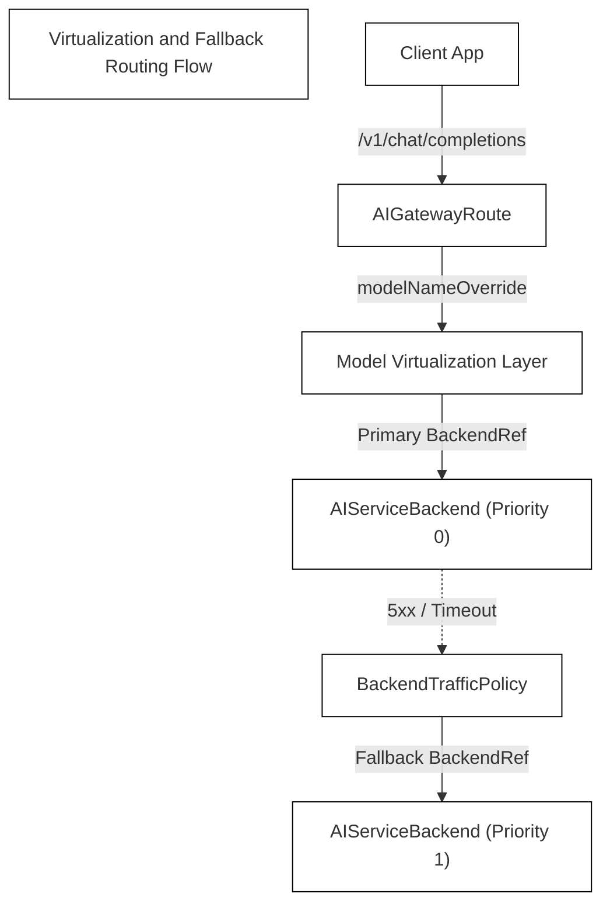
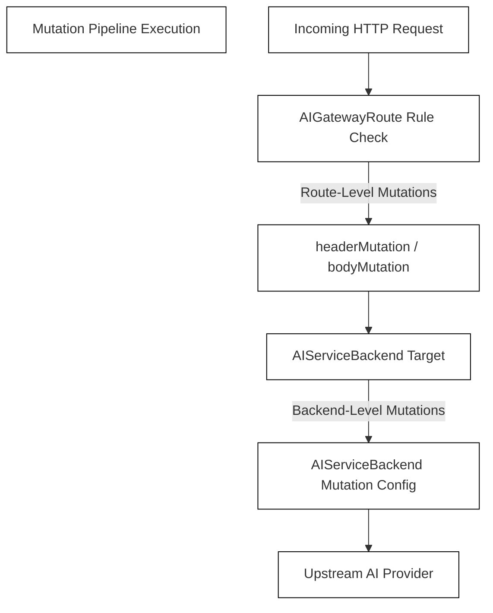
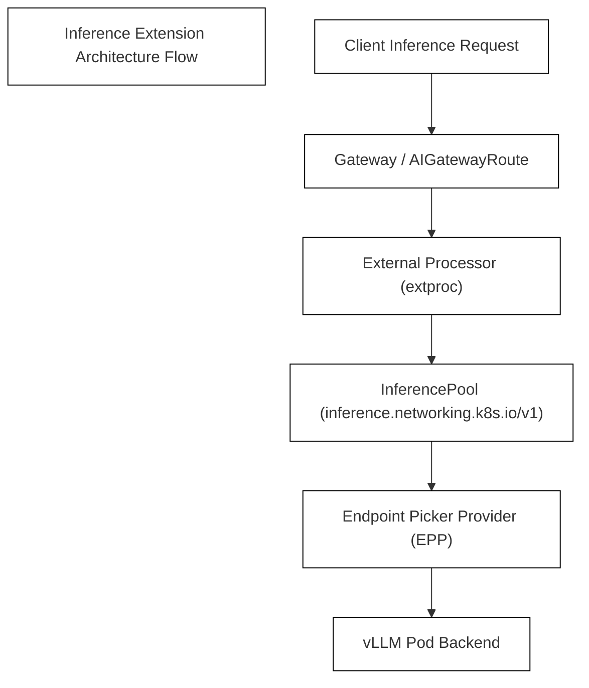

<!-- source: DeepWiki mcp.deepwiki.com · repo theagentrouter/agent-router · page 12 Traffic Management Capabilities · fetched 2026-10-21 -->

# Traffic Management Capabilities

<details>
<summary>Relevant source files</summary>

The following files were used as context for generating this wiki page:

- [api/v1alpha1/quota_policy.go](api/v1alpha1/quota_policy.go)
- [manifests/charts/ai-gateway-crds-helm/templates/aigateway.envoyproxy.io_quotapolicies.yaml](manifests/charts/ai-gateway-crds-helm/templates/aigateway.envoyproxy.io_quotapolicies.yaml)
- [site/docs/capabilities/a2a/index.md](site/docs/capabilities/a2a/index.md)
- [site/docs/capabilities/index.md](site/docs/capabilities/index.md)
- [site/docs/capabilities/llm-integrations/index.md](site/docs/capabilities/llm-integrations/index.md)
- [site/docs/capabilities/llm-integrations/prompt-caching.md](site/docs/capabilities/llm-integrations/prompt-caching.md)
- [site/docs/capabilities/scaling.md](site/docs/capabilities/scaling.md)
- [site/docs/capabilities/traffic/header-body-mutations.md](site/docs/capabilities/traffic/header-body-mutations.md)
- [site/docs/capabilities/traffic/index.md](site/docs/capabilities/traffic/index.md)
- [site/docs/capabilities/traffic/quota-policy.md](site/docs/capabilities/traffic/quota-policy.md)

</details>


This page provides an overview of the traffic management capabilities in Agent Router (Envoy AI Gateway). These features control how client inference requests are routed, transformed, virtualized across vendor models, and balanced across backends and inference pools.

For deep technical details, see the child pages:
- [Provider Fallback and Model Virtualization](#12.1) — Fallback priorities, model name overrides, connect-providers configuration.
- [InferencePool and Endpoint Picker Integration](#12.2) — Gateway API Inference Extension support, EPP wiring, inference-pool examples and docs.

Sources: [site/docs/capabilities/index.md:34-43](), [site/docs/capabilities/traffic/index.md:1-6]()

---

## 1. Provider Fallback and Model Virtualization

Agent Router supports robust provider fallback to guarantee high availability and reliability for mission-critical LLM workloads. When a primary upstream backend fails due to network partitions, connection timeouts, or HTTP `5xx` error codes, the data plane automatically shifts traffic to a prioritized fallback backend. Concurrently, model virtualization abstracts divergent vendor naming conventions into a unified downstream model interface using properties like `modelNameOverride`.

For details, see [Provider Fallback and Model Virtualization](#12.1).


Sources: [site/docs/capabilities/traffic/index.md:1-6](), [site/docs/capabilities/traffic/header-body-mutations.md:1-18](), [api/v1alpha1/quota_policy.go:34-60]()

---

## 2. Header and Body Mutations

Agent Router allows operators to mutate HTTP headers and JSON request body fields before requests are dispatched to upstream backends. Mutations can be configured at either the `AIServiceBackend` level (applying globally to all traffic routed to that backend) or at the `AIGatewayRoute` backend reference level (applying specifically when traffic matches a given route rule) [site/docs/capabilities/traffic/header-body-mutations.md:18-27]().

Header mutations support adding, overwriting, or removing HTTP headers (such as custom organization IDs or API keys) [site/docs/capabilities/traffic/header-body-mutations.md:33-63](). Body mutations support modifying or removing top-level JSON fields in the request body (such as `service_tier`, `max_tokens`, or `temperature`) [site/docs/capabilities/traffic/header-body-mutations.md:64-112](). Route-level mutations take precedence over backend-level mutations for conflicting fields [site/docs/capabilities/traffic/header-body-mutations.md:25-27]().


Sources: [site/docs/capabilities/traffic/header-body-mutations.md:1-187]()

---

## 3. Quota Policy

`QuotaPolicy` enables token-based quota management for AI inference services. It allows defining token budgets for individual models, using CEL expressions to calculate request costs, and applying client-selector bucket rules for fine-grained control [site/docs/capabilities/traffic/quota-policy.md:9-28](). When a quota is exceeded, requests are rejected with a `429 Too Many Requests` status code [site/docs/capabilities/traffic/quota-policy.md:10-11](). This is distinct from rate limiting, focusing on total consumption budgets over time windows rather than request velocity [site/docs/capabilities/traffic/quota-policy.md:12-16]().

`QuotaPolicy` resources are attached to `AIServiceBackend` resources via `targetRefs` [site/docs/capabilities/traffic/quota-policy.md:30-31](). The system relies on a Redis instance for storing quota counters and requires Envoy Gateway to be configured for rate limiting [site/docs/capabilities/traffic/quota-policy.md:39-45]().

```mermaid
graph TD
    subgraph "Agent Router Control Plane"
        AIServiceBackendCRD["AIServiceBackend CRD"]
        QuotaPolicyCRD["QuotaPolicy CRD (aigateway.envoyproxy.io/v1alpha1.QuotaPolicy)"]
        QuotaPolicyCRD -- "targetRefs" --> AIServiceBackendCRD
    end

    subgraph "Agent Router Data Plane (extproc)"
        ClientRequest["Client Request"] --> AIGatewayRoute["AIGatewayRoute"]
        AIGatewayRoute --> BackendRef["BackendRef (modelNameOverride)"]
        BackendRef --> AIServiceBackendInstance["AIServiceBackend Instance"]
        AIServiceBackendInstance --> QuotaEnforcement["Quota Enforcement"]
        QuotaEnforcement -- "CostExpression (CEL)" --> TokenCostCalc["Token Cost Calculation"]
        TokenCostCalc -- "PerModelQuotas" --> QuotaBuckets["Quota Buckets (Redis)"]
        QuotaBuckets -- "Exceeded?" --> |"429 Too Many Requests"| ClientRequest
        QuotaBuckets -- "Available" --> UpstreamAIProvider["Upstream AI Provider"]
    end

    style QuotaPolicyCRD fill:#f9f,stroke:#333,stroke-width:2px
    style AIServiceBackendCRD fill:#f9f,stroke:#333,stroke-width:2px
    style QuotaEnforcement fill:#ccf,stroke:#333,stroke-width:2px
    style TokenCostCalc fill:#ccf,stroke:#333,stroke-width:2px
    style QuotaBuckets fill:#ccf,stroke:#333,stroke-width:2px
```
Sources: [manifests/charts/ai-gateway-crds-helm/templates/aigateway.envoyproxy.io_quotapolicies.yaml:1-130](), [api/v1alpha1/quota_policy.go:1-160](), [site/docs/capabilities/traffic/quota-policy.md:1-168]()

---

## 4. InferencePool and Endpoint Picker Integration

For self-hosted inference infrastructure (such as vLLM deployments), Agent Router integrates natively with the **Gateway API Inference Extension** via `InferencePool` and Endpoint Picker Provider (`EPP`) resources [site/docs/capabilities/index.md:21-28](). 

This architecture enables intelligent load balancing, dynamic endpoint selection based on real-time token metrics, and advanced model routing [site/docs/capabilities/index.md:21-28]().

For details, see [InferencePool and Endpoint Picker Integration](#12.2).


Sources: [site/docs/capabilities/index.md:21-28](), [api/v1alpha1/quota_policy.go:34-75]()

---

## Summary of Traffic Control Mechanisms

| Capability | Associated CRDs / Resources | Primary Purpose |
| :--- | :--- | :--- |
| **Provider Fallback** | `AIGatewayRoute`, `BackendTrafficPolicy`, `Backend` | Automatic failover to alternative upstream providers upon connection or `5xx` errors. |
| **Model Virtualization** | `AIGatewayRoute` (`modelNameOverride`) | Abstract divergent vendor model naming conventions into a unified downstream model interface. |
| **Header/Body Mutations** | `AIServiceBackend`, `AIGatewayRoute` | Customize HTTP headers and JSON request body parameters per backend or per route rule. |
| **Quota Policy** | `QuotaPolicy`, `AIServiceBackend` | Manage token-based consumption budgets for AI inference services. |
| **Inference Pools** | `InferencePool`, `AIGatewayRoute`, `HTTPRoute` | Intelligent load balancing and endpoint picker integration for self-hosted LLM clusters. |

Sources: [site/docs/capabilities/index.md:34-43](), [site/docs/capabilities/traffic/header-body-mutations.md:18-28](), [site/docs/capabilities/traffic/quota-policy.md:1-168]()

---

