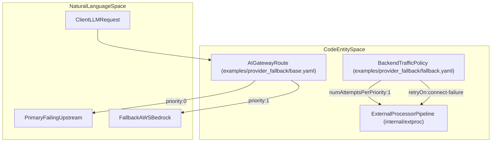
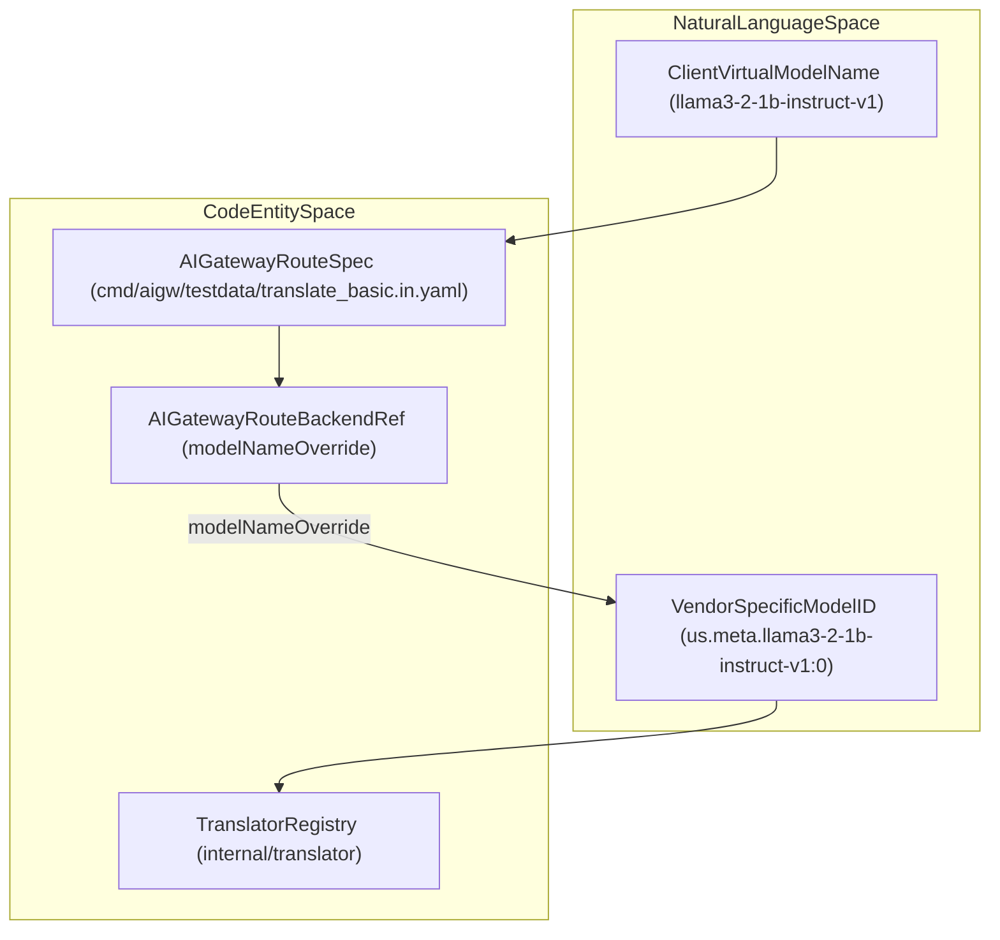

<!-- source: DeepWiki mcp.deepwiki.com · repo theagentrouter/agent-router · page 12.1 Provider Fallback and Model Virtualization · fetched 2026-10-21 -->

# Provider Fallback and Model Virtualization

Relevant source files

The following files were used as context for generating this wiki page:

- [cmd/aigw/testdata/translate_basic.in.yaml](cmd/aigw/testdata/translate_basic.in.yaml)
- [examples/basic/anthropic.yaml](examples/basic/anthropic.yaml)
- [examples/basic/aws-bedrock-openai-anthropic.yaml](examples/basic/aws-bedrock-openai-anthropic.yaml)
- [examples/basic/aws-irsa.yaml](examples/basic/aws-irsa.yaml)
- [examples/basic/aws-pod-identity.yaml](examples/basic/aws-pod-identity.yaml)
- [examples/basic/aws.yaml](examples/basic/aws.yaml)
- [examples/basic/cohere.yaml](examples/basic/cohere.yaml)
- [examples/provider_fallback/base.yaml](examples/provider_fallback/base.yaml)
- [examples/provider_fallback/fallback.yaml](examples/provider_fallback/fallback.yaml)
- [site/docs/capabilities/llm-integrations/connect-providers.md](site/docs/capabilities/llm-integrations/connect-providers.md)
- [site/docs/capabilities/traffic/model-virtualization.md](site/docs/capabilities/traffic/model-virtualization.md)
- [site/docs/capabilities/traffic/provider-fallback.md](site/docs/capabilities/traffic/provider-fallback.md)

## Purpose and Scope
This page details the implementation and configuration of provider fallback priorities, model name virtualization, and multi-provider connectivity (`connect-providers`) within Agent Router. It covers how Kubernetes Custom Resources (`AIGatewayRoute`, `AIServiceBackend`, `BackendTrafficPolicy`) coordinate with the data plane and translators to provide high availability, error failover, and model identifier abstraction.

---

## 1. Fallback Mechanics and Priorities

Agent Router supports high availability across multiple upstream AI providers by allowing a prioritized list of backends within an `AIGatewayRoute` [examples/provider_fallback/base.yaml:46-50](). When a primary backend fails due to network errors, connection timeouts, or retriable HTTP 5xx status codes, traffic shifts automatically to the next healthy backend in order of priority.

### Configuration Structure

Routing priority is defined using the `priority` integer field inside `backendRefs`, where lower numbers indicate higher priority [examples/provider_fallback/base.yaml:46-50](). Retry triggers and priority exhaustion parameters are governed by Envoy Gateway's `BackendTrafficPolicy` [examples/provider_fallback/fallback.yaml:8-30]().

### Diagram: Fallback Architecture & Execution Flow

Sources: [examples/provider_fallback/base.yaml:46-50](), [examples/provider_fallback/fallback.yaml:8-30](), [site/docs/capabilities/traffic/provider-fallback.md:17-22]()

---

## 2. Model Name Virtualization and Overrides

Different AI providers utilize distinct naming conventions for identical or equivalent base models (e.g., AWS Bedrock vs. GCP Vertex AI vs. OpenAI) [site/docs/capabilities/traffic/model-virtualization.md:16-20](). Agent Router provides **Model Name Virtualization** to decouple downstream client applications from provider-specific version strings [site/docs/capabilities/traffic/model-virtualization.md:26-26]().

### `modelNameOverride` Implementation

Within the `AIGatewayRoute` rule specifications, backend references support a `modelNameOverride` property [cmd/aigw/testdata/translate_basic.in.yaml:45-54](). This rewrites the request model identifier before it is serialized and dispatched to the target vendor backend schema [site/docs/capabilities/traffic/model-virtualization.md:84-88]().

### Diagram: Model Name Virtualization Flow

Sources: [cmd/aigw/testdata/translate_basic.in.yaml:45-54](), [site/docs/capabilities/traffic/model-virtualization.md:16-26](), [site/docs/capabilities/traffic/model-virtualization.md:84-88]()

---

## 3. Connecting Providers Configuration (`connect-providers`)

Connecting to diverse AI providers follows a uniform Kubernetes-native configuration pattern [site/docs/capabilities/llm-integrations/connect-providers.md:7-19](). Establishing provider connectivity requires three interrelated resources:

1.  **`AIServiceBackend`**: Maps the target API schema (`OpenAI`, `AWSBedrock`, `AzureOpenAI`, `GCPVertexAI`, `Cohere`, etc.) to an Envoy Gateway `Backend` reference [site/docs/capabilities/llm-integrations/connect-providers.md:23-51]().
2.  **`BackendSecurityPolicy`**: Manages authentication tokens, API keys, or cloud credential chains (`APIKey`, `AWSCredentials`, `AzureCredentials`, `GCPCredentials`) [site/docs/capabilities/llm-integrations/connect-providers.md:69-100]().
    *   For AWS, this includes support for EKS Pod Identity [examples/basic/aws-pod-identity.yaml:106-145]() and IRSA [examples/basic/aws-irsa.yaml:126-145](), allowing automatic credential chain usage without explicit file references.
3.  **`AIGatewayRoute`**: Intercepts matching traffic based on headers or path criteria and directs it to the appropriate backend [site/docs/capabilities/llm-integrations/connect-providers.md:13-17]().

Sources: [site/docs/capabilities/llm-integrations/connect-providers.md:7-51](), [examples/basic/aws.yaml:6-85](), [examples/basic/aws-pod-identity.yaml:106-145](), [examples/basic/aws-irsa.yaml:126-145]()

---

