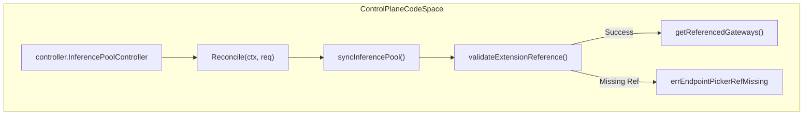
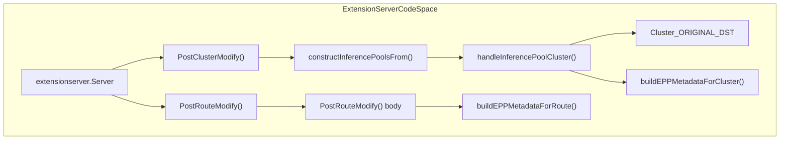

<!-- source: DeepWiki mcp.deepwiki.com · repo theagentrouter/agent-router · page 12.2 InferencePool and Endpoint Picker Integration · fetched 2026-10-21 -->

# InferencePool and Endpoint Picker Integration

<details>
<summary>Relevant source files</summary>

The following files were used as context for generating this wiki page:

- [examples/inference-pool/README.md](examples/inference-pool/README.md)
- [examples/inference-pool/base.yaml](examples/inference-pool/base.yaml)
- [examples/inference-pool/envoy-gateway-config.yaml](examples/inference-pool/envoy-gateway-config.yaml)
- [examples/inference-pool/envoy-gateway-values-addon.yaml](examples/inference-pool/envoy-gateway-values-addon.yaml)
- [examples/inference-pool/with-annotations.yaml](examples/inference-pool/with-annotations.yaml)
- [examples/token_ratelimit/README.md](examples/token_ratelimit/README.md)
- [examples/token_ratelimit/envoy-gateway-values-addon.yaml](examples/token_ratelimit/envoy-gateway-values-addon.yaml)
- [examples/token_ratelimit/redis.yaml](examples/token_ratelimit/redis.yaml)
- [internal/controller/inference_pool.go](internal/controller/inference_pool.go)
- [internal/controller/inference_pool_test.go](internal/controller/inference_pool_test.go)
- [internal/extensionserver/extensionserver_test.go](internal/extensionserver/extensionserver_test.go)
- [internal/extensionserver/inferencepool.go](internal/extensionserver/inferencepool.go)
- [internal/extensionserver/post_cluster_modify.go](internal/extensionserver/post_cluster_modify.go)
- [internal/extensionserver/post_route_modify.go](internal/extensionserver/post_route_modify.go)
- [internal/extensionserver/post_translate_modify.go](internal/extensionserver/post_translate_modify.go)
- [internal/extensionserver/post_translate_modify_test.go](internal/extensionserver/post_translate_modify_test.go)
- [manifests/envoy-gateway-values.yaml](manifests/envoy-gateway-values.yaml)
- [site/docs/capabilities/inference/_setup.mdx](site/docs/capabilities/inference/_setup.mdx)
- [site/docs/capabilities/inference/aigatewayroute-inferencepool.md](site/docs/capabilities/inference/aigatewayroute-inferencepool.md)
- [site/docs/capabilities/inference/httproute-inferencepool.md](site/docs/capabilities/inference/httproute-inferencepool.md)
- [site/docs/capabilities/inference/inferencepool-support.md](site/docs/capabilities/inference/inferencepool-support.md)
- [site/docs/compatibility.md](site/docs/compatibility.md)
- [site/versioned_docs/version-0.7/_vars.json](site/versioned_docs/version-0.7/_vars.json)
- [site/versioned_docs/version-0.7/compatibility.md](site/versioned_docs/version-0.7/compatibility.md)
- [tests/e2e-inference-extension/conformance_test.go](tests/e2e-inference-extension/conformance_test.go)

</details>


## Purpose and Scope

This page documents the integration of the Gateway API Inference Extension (`inference.networking.k8s.io/v1`) within Agent Router (Envoy AI Gateway). It covers control-plane reconciliation via `controller.InferencePoolController`, data-plane translation via the Envoy Gateway extension server (`extensionserver.Server`), Endpoint Picker Protocol (EPP) routing mechanisms (`ORIGINAL_DST` clusters and header injection), configuration annotations, and conformance test suites.

---

## 1. Overview & Architecture

Agent Router natively supports the **Gateway API Inference Extension** (`inference.networking.k8s.io/v1`) to manage advanced LLM traffic, autoscaling pods, and dynamic endpoint selection via Endpoint Picker Protocols (EPP) [internal/controller/inference_pool.go:28-38](), [internal/extensionserver/inferencepool.go:43-53]().

When an `AIGatewayRoute` references an `InferencePool` via its `backendRefs`, the control-plane reconcilers and the Envoy Gateway extension server intercept the translation process. They configure the Envoy data plane to route traffic through an upstream Endpoint Picker service using `ORIGINAL_DST` clusters and dynamic HTTP headers [internal/extensionserver/post_cluster_modify.go:26-117](), [internal/extensionserver/post_route_modify.go:21-70]().

Sources:
- [internal/controller/inference_pool.go:28-84]()
- [internal/extensionserver/post_cluster_modify.go:26-66]()
- [internal/extensionserver/post_route_modify.go:21-70]()

---

## 2. Control Plane Reconciliation: `InferencePoolController`

The control plane runs `controller.InferencePoolController` [internal/controller/inference_pool.go:33-38](), which implements a Kubernetes reconciler for `gwaiev1.InferencePool` resources [internal/controller/inference_pool.go:28]().

### Key Responsibilities
- **Extension Reference Validation**: Ensures that the `spec.endpointPickerRef` points to a valid, existing Kubernetes `corev1.Service` acting as the Endpoint Picker [internal/controller/inference_pool.go:137-165](). If `endpointPickerRef` is missing, it reports `gwaiev1.InferencePoolReasonEndpointPickerRefMissing` [internal/controller/inference_pool.go:40-45](), [internal/controller/inference_pool.go:76-78]().
- **Gateway Discovery**: Scans cluster `Gateway` resources to locate parent gateways referencing the pool via `AIGatewayRoute` rules [internal/controller/inference_pool.go:115-135]().
- **Status Reporting**: Updates status subresources with acceptance conditions and error summaries [internal/controller/inference_pool.go:72-83]().

Title: "Control Plane Code Entity Flow"

Sources:
- [internal/controller/inference_pool.go:28-165]()

---

## 3. Envoy Gateway Extension Server Wiring

Agent Router implements an Envoy Gateway extension server (`extensionserver.Server`) that hooks into xDS translation via `PostClusterModify` and `PostRouteModify` callbacks [internal/extensionserver/post_cluster_modify.go:26-66](), [internal/extensionserver/post_route_modify.go:21-70]().

### Cluster Modification (`PostClusterModify`)
When Envoy Gateway generates a cluster for an `InferencePool` backend, `PostClusterModify` [internal/extensionserver/post_cluster_modify.go:32-66]() intercepts the cluster and invokes `handleInferencePoolCluster` [internal/extensionserver/post_cluster_modify.go:77-117]():
1. **Cluster Discovery Type**: Sets `ClusterDiscoveryType` to `clusterv3.Cluster_ORIGINAL_DST` [internal/extensionserver/post_cluster_modify.go:80]().
2. **Load Balancing Policy**: Sets `LbPolicy` to `clusterv3.Cluster_CLUSTER_PROVIDED` [internal/extensionserver/post_cluster_modify.go:83]().
3. **Original Destination Config**: Configures `OriginalDstLbConfig` to use `UseHttpHeader: true` and sets `HttpHeaderName` to `internalapi.EndpointPickerHeaderKey` (`x-gateway-destination-endpoint`) [internal/extensionserver/post_cluster_modify.go:90-95]().
4. **Metadata Encoding**: Embeds EPP metadata into the cluster metadata using `buildEPPMetadataForCluster` [internal/extensionserver/post_cluster_modify.go:115](), [internal/extensionserver/inferencepool.go:134-140]().

### Route Modification (`PostRouteModify`)
`PostRouteModify` [internal/extensionserver/post_route_modify.go:21-70]() processes forwarding routes referencing an `InferencePool`:
1. **Host Rewrite Control**: Disables `AutoHostRewrite` (`AutoHostRewrite: wrapperspb.Bool(false)`) to prevent Envoy from stripping or altering the host header set by the endpoint picker [internal/extensionserver/post_route_modify.go:60-62]().
2. **Route Metadata**: Attaches EPP metadata via `buildEPPMetadataForRoute` [internal/extensionserver/post_route_modify.go:66](), [internal/extensionserver/inferencepool.go:143-149]().

Title: "Extension Server Code Entity Flow"

Sources:
- [internal/extensionserver/post_cluster_modify.go:26-117]()
- [internal/extensionserver/post_route_modify.go:21-70]()
- [internal/extensionserver/inferencepool.go:132-150]()

---

## 4. Data Flow & Endpoint Picker Protocol (EPP) Integration

The runtime data flow relies on the Endpoint Picker service to intercept or advise the routing decision by specifying target backend pods dynamically via HTTP headers.

Title: "InferencePool Data Flow Sequence"
```mermaid
sequenceDiagram
    participant Client as "Client"
    participant Gateway as "Envoy Gateway (ORIGINAL_DST)"
    participant EPP as "Endpoint Picker Service (EPP)"
    participant Backend as "Selected Model Pod"

    Client->>Gateway: "POST /v1/chat/completions"
    Gateway->>EPP: "Query endpoint selection via EPP protocol"
    EPP--->Gateway: "Selects pod and sets x-gateway-destination-endpoint"
    Gateway->>Backend: "Forward request to destination endpoint"
    Backend--->Gateway: "LLM Stream Response"
    Gateway--->Client: "Response"
```
Sources:
- [internal/extensionserver/post_cluster_modify.go:77-117]()
- [site/docs/capabilities/inference/aigatewayroute-inferencepool.md:141-176]()

---

## 5. InferencePool Configuration Annotations

InferencePool resources support custom annotations recognized by the Envoy AI Gateway external processor and extension server [site/docs/capabilities/inference/aigatewayroute-inferencepool.md:177-241]():

| Annotation Key | Description | Supported Values |
| --- | --- | --- |
| `aigateway.envoyproxy.io/processing-body-mode` | Controls how request/response bodies are handled by the external processor | `"duplex"` (default, `FULL_DUPLEX_STREAMED`), `"buffered"` (`BUFFERED`) [site/docs/capabilities/inference/aigatewayroute-inferencepool.md:191-202]() |
| `aigateway.envoyproxy.io/allow-mode-override` | Configures whether the external processor can override processing modes | `"false"` (default), `"true"` [site/docs/capabilities/inference/aigatewayroute-inferencepool.md:212-223]() |

Sources:
- [internal/extensionserver/inferencepool.go:38-53]()
- [site/docs/capabilities/inference/aigatewayroute-inferencepool.md:177-241]()

---

## 6. Examples and Conformance Testing

### Example Manifests
Referenced InferencePool configurations and deployment examples are located under the `examples/inference-pool/` directory:
- `examples/inference-pool/base.yaml`: Basic InferencePool and AIGatewayRoute binding.
- `examples/inference-pool/with-annotations.yaml`: Advanced setup utilizing body processing and mode override annotations.

### Conformance Testing
Gateway API Inference Extension conformance suites are executed against the integration layer in `tests/e2e-inference-extension/conformance_test.go` [tests/e2e-inference-extension/conformance_test.go:27-71](), verifying gateway-layer profile compliance [tests/e2e-inference-extension/conformance_test.go:45]().

Sources:
- [tests/e2e-inference-extension/conformance_test.go:27-71]()
- `examples/inference-pool/base.yaml`
- `examples/inference-pool/with-annotations.yaml`

---

