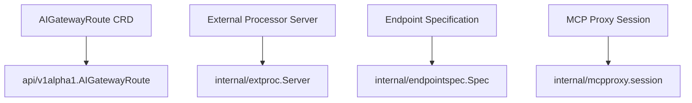
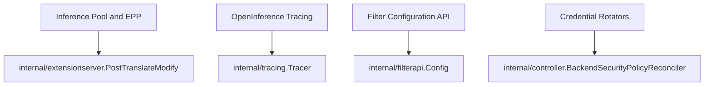

<!-- source: DeepWiki mcp.deepwiki.com · repo theagentrouter/agent-router · page 13 Glossary · fetched 2026-10-21 -->

# Glossary

Relevant source files

The following files were used as context for generating this wiki page:

- [api/v1alpha1/mcp_route.go](api/v1alpha1/mcp_route.go)
- [api/v1alpha1/zz_generated.deepcopy.go](api/v1alpha1/zz_generated.deepcopy.go)
- [api/v1beta1/mcp_route.go](api/v1beta1/mcp_route.go)
- [api/v1beta1/zz_generated.deepcopy.go](api/v1beta1/zz_generated.deepcopy.go)
- [internal/controller/mcp_route.go](internal/controller/mcp_route.go)
- [internal/controller/mcp_route_test.go](internal/controller/mcp_route_test.go)
- [internal/extproc/mocks_test.go](internal/extproc/mocks_test.go)
- [internal/extproc/processor.go](internal/extproc/processor.go)
- [internal/extproc/processor_test.go](internal/extproc/processor_test.go)
- [internal/extproc/server.go](internal/extproc/server.go)
- [internal/extproc/server_test.go](internal/extproc/server_test.go)
- [internal/filterapi/mcpconfig.go](internal/filterapi/mcpconfig.go)
- [internal/internalapi/internalapi.go](internal/internalapi/internalapi.go)
- [internal/mcpproxy/config.go](internal/mcpproxy/config.go)
- [internal/mcpproxy/config_test.go](internal/mcpproxy/config_test.go)
- [internal/mcpproxy/fanout_subset_test.go](internal/mcpproxy/fanout_subset_test.go)
- [internal/mcpproxy/handlers.go](internal/mcpproxy/handlers.go)
- [internal/mcpproxy/handlers_test.go](internal/mcpproxy/handlers_test.go)
- [internal/mcpproxy/legacy.go](internal/mcpproxy/legacy.go)
- [internal/mcpproxy/legacy_test.go](internal/mcpproxy/legacy_test.go)
- [internal/mcpproxy/mcpproxy.go](internal/mcpproxy/mcpproxy.go)
- [internal/mcpproxy/mcpproxy_test.go](internal/mcpproxy/mcpproxy_test.go)
- [internal/mcpproxy/modern.go](internal/mcpproxy/modern.go)
- [internal/mcpproxy/modern_test.go](internal/mcpproxy/modern_test.go)
- [internal/mcpproxy/session.go](internal/mcpproxy/session.go)
- [internal/mcpproxy/session_test.go](internal/mcpproxy/session_test.go)
- [manifests/charts/ai-gateway-crds-helm/templates/aigateway.envoyproxy.io_mcproutes.yaml](manifests/charts/ai-gateway-crds-helm/templates/aigateway.envoyproxy.io_mcproutes.yaml)
- [site/docs/api/api.mdx](site/docs/api/api.mdx)
- [site/docs/capabilities/mcp/index.md](site/docs/capabilities/mcp/index.md)
- [tests/crdcel/main_test.go](tests/crdcel/main_test.go)
- [tests/e2e/mcp_route_test.go](tests/e2e/mcp_route_test.go)
- [tests/internal/testmcp/server.go](tests/internal/testmcp/server.go)

## Purpose and Scope

This page provides formal technical definitions, implementation details, and code entity references for codebase-specific terminology used across the Agent Router (Envoy AI Gateway) project. It serves as an authoritative index linking natural language concepts and system architecture to their corresponding Go types, controllers, CRDs, and data-plane routines.

---

## 1. Core Architectural Terms

### extproc
- **Definition**: The Envoy External Processor (`extproc`) gRPC filter framework integration. In Agent Router, the data plane delegates HTTP request/response header and body inspection, prompt translation, token counting, and redaction to a dedicated `extproc` gRPC server.
- **Implementation**: The `Server` struct in `internal/extproc/server.go` [internal/extproc/server.go:55-64]() implements the `extprocv3.ExternalProcessorServer` interface. The core processing logic is handled by `Processor` implementations [internal/extproc/processor.go:29-40]().
- **Data Flow**: Intercepts downstream client traffic, coordinates with `EndpointSpec` and `Translator` components, mutates headers/bodies, and forwards traffic to upstream AI providers or downstream clients. The `Process` method [internal/extproc/server.go:128-176]() orchestrates the request processing pipeline.

### filterapi.Config
- **Definition**: The internal Go configuration schema representation shared between the control plane translation logic and the `extproc` server runtime. It defines routes, backends, authentication credentials, and policy mappings.
- **Implementation**: Defined by the `Config` struct in `internal/filterapi/config.go` [internal/filterapi/config.go:29-34](). The `extproc` server loads this configuration via `LoadConfig` [internal/extproc/server.go:81-88]().

### config bundle
- **Definition**: A packaged collection of secrets and filter parameters generated by the control plane controller and pushed into Envoy Gateway filter configurations as secrets or configuration secrets.
- **Implementation**: Managed by gateway controller components and applied via extension server xDS hooks (`internal/extensionserver/post_translate_modify.go`).

### UDS cluster
- **Definition**: A Unix Domain Socket (`UDS`) Envoy cluster (`ai-gateway-extproc-uds`) used for low-latency, secure local IPC communication between the Envoy proxy data plane and the `extproc` gRPC server container running within the gateway pod.
- **Implementation**: Injected during xDS translation in `internal/extensionserver/post_translate_modify.go`.

### aigw
- **Definition**: The standalone CLI binary and local orchestration mode for Agent Router. It allows running Envoy and the `extproc` locally via Docker Compose or standalone translation processes without Kubernetes.
- **Implementation**: Found in `cmd/aigw/` and supporting autoconfig routines (`internal/autoconfig`).

Sources:
- `internal/extproc/server.go` [internal/extproc/server.go:55-64], [internal/extproc/server.go:81-88], [internal/extproc/server.go:128-176]()
- `internal/extproc/processor.go` [internal/extproc/processor.go:29-40]()
- `internal/filterapi/config.go` [internal/filterapi/config.go:29-34]()

---

## 2. Kubernetes CRDs and API Resources

### AIGatewayRoute
- **Definition**: A top-level Custom Resource Definition (`aigateway.envoyproxy.io/v1alpha1` and `v1beta1`) that combines multiple `AIServiceBackend` targets and binds them to Gateway API `Gateway` resources, exposing a unified OpenAI/Anthropic-compatible endpoint.
- **Implementation**: Defined by the `AIGatewayRoute` struct in `api/v1alpha1/ai_gateway_route.go` [api/v1alpha1/ai_gateway_route.go:25-32]() and `api/v1beta1/ai_gateway_route.go`. Documented in `site/docs/api/api.mdx` [site/docs/api/api.mdx:36-60](). The `AIGatewayRouteSpec` [api/v1alpha1/zz_generated.deepcopy.go:205-225]() defines its configuration.
- **Validation**: CEL validation rules are applied, for example, to ensure unique rule names or correct backend references [tests/crdcel/main_test.go:35-69]().

### MCPRoute
- **Definition**: A Custom Resource Definition (`aigateway.envoyproxy.io/v1alpha1` and `v1beta1`) defining how to route Model Context Protocol (`MCP`) requests to upstream backend MCP servers, aggregating tools, prompts, and resources into a single downstream endpoint.
- **Implementation**: Defined by the `MCPRoute` struct in `api/v1alpha1/mcp_route.go` [api/v1alpha1/mcp_route.go:25-32]() and `api/v1beta1/mcp_route.go`. Its schema is detailed in `manifests/charts/ai-gateway-crds-helm/templates/aigateway.envoyproxy.io_mcproutes.yaml` [manifests/charts/ai-gateway-crds-helm/templates/aigateway.envoyproxy.io_mcproutes.yaml:33-37](). The `MCPRouteSpec` [api/v1alpha1/mcp_route.go:47-128]() includes fields for `ParentRefs`, `Path`, `Headers`, `Hostnames`, `BackendRefs`, `SecurityPolicy`, `BackendTrafficPolicy`, and `BackendSelector`.
- **Backend Selection**: The `BackendSelector` field [api/v1alpha1/mcp_route.go:117-128]() allows restricting which backends a request can fan out to, with CEL expressions potentially referencing JWT claims [api/v1alpha1/mcp_route.go:46-46]().

### BackendSecurityPolicy
- **Definition**: A CRD specifying credential management, API key rotation, AWS SigV4, GCP, or Azure authentication configurations for backend AI services.
- **Implementation**: Reconciled by the backend security policy controller (`internal/controller/`). CEL validation ensures correct configuration based on the `type` field [tests/crdcel/main_test.go:173-209]().

### QuotaPolicy
- **Definition**: A CRD establishing usage-based rate limiting, request cost criteria using Common Expression Language (CEL), and quota enforcement on routes or backends.
- **Implementation**: Mapped into rate limiting xDS runners and translators (`internal/ratelimit`).

### GatewayConfig
- **Definition**: A global configuration CRD supplying gateway-wide settings, telemetry collectors, and default timeouts for the Agent Router installation.
- **Implementation**: Processed by the controller manager startup sequences. CEL validation applies to fields like `metadataForwardingNamespaces` [tests/crdcel/main_test.go:139-143]().

### PrefixMode
- **Definition**: A routing prefix configuration style determining how path prefixes (e.g., `/v1`, `/anthropic/v1`) are stripped or rewritten when forwarding to upstream provider services.

Sources:
- `site/docs/api/api.mdx` [site/docs/api/api.mdx:36-60]()
- `manifests/charts/ai-gateway-crds-helm/templates/aigateway.envoyproxy.io_mcproutes.yaml` [manifests/charts/ai-gateway-crds-helm/templates/aigateway.envoyproxy.io_mcproutes.yaml:33-37]()
- `api/v1alpha1/ai_gateway_route.go` [api/v1alpha1/ai_gateway_route.go:25-32]()
- `api/v1alpha1/mcp_route.go` [api/v1alpha1/mcp_route.go:25-32], [api/v1alpha1/mcp_route.go:46-46], [api/v1alpha1/mcp_route.go:47-128]()
- `api/v1alpha1/zz_generated.deepcopy.go` [api/v1alpha1/zz_generated.deepcopy.go:205-225]()
- `tests/crdcel/main_test.go` [tests/crdcel/main_test.go:35-69], [tests/crdcel/main_test.go:139-143], [tests/crdcel/main_test.go:173-209]()

---

## 3. Advanced Inference, Routing, and Observability

### InferencePool
- **Definition**: Integration supporting the Gateway API Inference Extension specification, enabling dynamic pool-based load balancing across LLM inference engines.
- **Implementation**: Handled via `internal/extensionserver/post_translate_modify.go`. The `AIGatewayRoute` CRD supports referencing `InferencePool` backends [tests/crdcel/main_test.go:48-63]().

### EPP (Endpoint Picker)
- **Definition**: Endpoint Picker Service utilized alongside `InferencePool` to dynamically route requests to optimal inference pod instances based on model weights and queue depths.
- **Implementation**: Built via `buildClustersForInferencePoolEndpointPickers` in `internal/extensionserver/post_translate_modify.go`.

### Converse API
- **Definition**: An abstraction layer used to translate standard requests into AWS Bedrock and Anthropic Converse API structures, supporting unified multimodal message schemas.
- **Implementation**: Implemented across `internal/translator/`.

### OpenInference
- **Definition**: An open tracing specification for Generative AI applications. Agent Router maps chat completions, vector embeddings, image generation spans, and token metrics to OpenInference semantic conventions.
- **Implementation**: Implemented in `internal/tracing/tracer.go` and `internal/tracing/span.go`.

### rotators
- **Definition**: Token and credential provider mechanisms that automatically refresh short-lived cloud IAM tokens (AWS, GCP, Azure) for AI backends.
- **Implementation**: Found in credential management subsystems (`internal/controller/rotators`).

### endpointspec
- **Definition**: A generic interface bundle (`endpointspec.Spec`) mapping specific API endpoints (`/v1/chat/completions`, `/v1/embeddings`, `/anthropic/v1/messages`, etc.) to their respective request/response types, validation logic, body parsers, and translator selectors.
- **Implementation**: Defined in `internal/endpointspec/` with comprehensive tests.

### VCR cassettes
- **Definition**: Recorded HTTP interaction files used in data plane integration tests (`internal/testing`) to replay deterministic LLM responses without requiring live API keys. These are used in tests like `internal/extproc/server_test.go` [internal/extproc/server_test.go:1-179]() and `internal/mcpproxy/handlers_test.go` [internal/mcpproxy/handlers_test.go:1-208]().

Sources:
- `tests/crdcel/main_test.go` [tests/crdcel/main_test.go:48-63]()
- `internal/extproc/server_test.go` [internal/extproc/server_test.go:1-179]()
- `internal/mcpproxy/handlers_test.go` [internal/mcpproxy/handlers_test.go:1-208]()

---

## 4. Natural Language to Code Entity Mapping

To bridge natural language terminology with the physical codebase, the following diagrams associate core system concepts directly with their implementing Go structs, interfaces, and packages.

### Diagram: Routing & Extproc Architecture Mapping

*Sources: `api/v1alpha1/ai_gateway_route.go`, `internal/extproc/server.go`, `internal/endpointspec/`, `internal/mcpproxy/session.go`*

### Diagram: Control Plane & Data Plane Extension Mapping

*Sources: `internal/extensionserver/post_translate_modify.go`, `internal/tracing/tracer.go`, `internal/filterapi/`, `internal/controller/`*