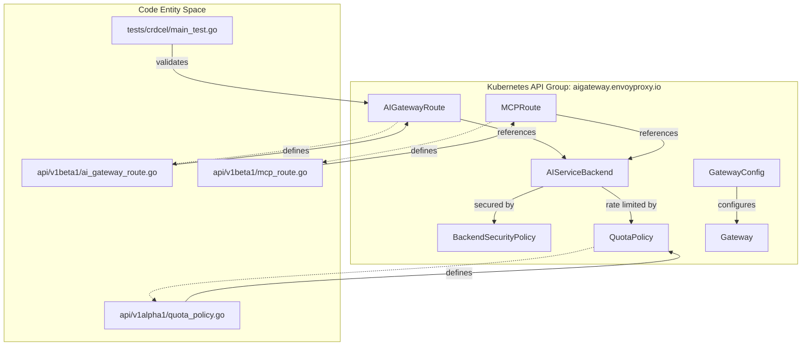
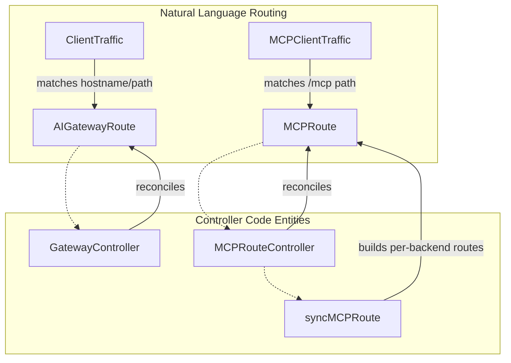

<!-- source: DeepWiki mcp.deepwiki.com · repo theagentrouter/agent-router · page 2 Kubernetes API and CRDs · fetched 2026-10-21 -->

# Kubernetes API and CRDs

Relevant source files

The following files were used as context for generating this wiki page:

- [api/v1alpha1/mcp_route.go](api/v1alpha1/mcp_route.go)
- [api/v1alpha1/zz_generated.deepcopy.go](api/v1alpha1/zz_generated.deepcopy.go)
- [api/v1beta1/mcp_route.go](api/v1beta1/mcp_route.go)
- [api/v1beta1/zz_generated.deepcopy.go](api/v1beta1/zz_generated.deepcopy.go)
- [internal/controller/mcp_route.go](internal/controller/mcp_route.go)
- [internal/controller/mcp_route_test.go](internal/controller/mcp_route_test.go)
- [manifests/charts/ai-gateway-crds-helm/templates/aigateway.envoyproxy.io_mcproutes.yaml](manifests/charts/ai-gateway-crds-helm/templates/aigateway.envoyproxy.io_mcproutes.yaml)
- [site/docs/api/api.mdx](site/docs/api/api.mdx)
- [site/docs/capabilities/mcp/index.md](site/docs/capabilities/mcp/index.md)
- [tests/crdcel/main_test.go](tests/crdcel/main_test.go)
- [tests/e2e/mcp_route_test.go](tests/e2e/mcp_route_test.go)

## Purpose and Scope

The Envoy AI Gateway defines a dedicated Kubernetes API under the `aigateway.envoyproxy.io` API group [site/docs/api/api.mdx:8-10](). This API bridges standard Kubernetes Gateway API constructs (`Gateway`, `HTTPRoute`) with generative AI operational requirements, such as model-aware routing, provider schema translation, token-based quota enforcement, and Model Context Protocol (MCP) proxying. 

The API supports dual versions: `v1alpha1` [site/docs/api/api.mdx:13-16]() (retained for backward compatibility with deprecation warnings) and `v1beta1` [site/docs/api/api.mdx:10](), which serves as the designated storage version [api/v1beta1/mcp_route.go:48-49](). All CustomResourceDefinitions (CRDs) are packaged via Helm [manifests/charts/ai-gateway-crds-helm/templates/aigateway.envoyproxy.io_aigatewayroutes.yaml:7-14]() and validated using Common Expression Language (CEL) rules executed during `envtest` suites [tests/crdcel/main_test.go:23-26]().

As this is a parent page, this document provides a high-level overview. For deep technical details, schemas, field validations, and implementation code, consult the linked child sections.

### Diagram: API Group Architecture and Code Entities

Sources: [site/docs/api/api.mdx:8-10](), [api/v1beta1/ai_gateway_route.go:1-20](), [api/v1beta1/mcp_route.go:38-56](), [tests/crdcel/main_test.go:23-26]()

---

## 2.1 Routing Resources: AIGatewayRoute and MCPRoute

Routing custom resources act as the primary entry points for incoming GenAI client traffic. `AIGatewayRoute` [manifests/charts/ai-gateway-crds-helm/templates/aigateway.envoyproxy.io_aigatewayroutes.yaml:33-37]() aggregates multiple `AIServiceBackend` targets and maps them onto Gateway API `HTTPRoute` objects [api/v1alpha1/ai_gateway_route.go:18-21](). It supports rule-based matching on model headers, cost calculations via `llmRequestCosts` [api/v1alpha1/ai_gateway_route.go:100-103](), and strict CEL rules ensuring unique rule names [api/v1alpha1/ai_gateway_route.go:96-97]().

`MCPRoute` [manifests/charts/ai-gateway-crds-helm/templates/aigateway.envoyproxy.io_mcproutes.yaml:33-36]() configures proxying for Model Context Protocol servers over Streamable HTTP transports [api/v1alpha1/mcp_route.go:56-63](). It manages tool/prompt name prefixing modes and handles backend service multiplexing through dedicated internal headers [internal/controller/mcp_route.go:113-116]().

### Diagram: Routing Controller Mapping to Code Entities

Sources: [internal/controller/gateway.go:74-86](), [internal/controller/mcp_route.go:42-48](), [internal/controller/mcp_route.go:86-93]()

For detailed schemas, field validations, helpers, and CEL rule implementations, see [Routing Resources: AIGatewayRoute and MCPRoute](#2.1).

Sources: [api/v1alpha1/ai_gateway_route.go:13-44](), [api/v1alpha1/mcp_route.go:14-32](), [api/v1beta1/mcp_route.go:14-36](), [internal/controller/mcp_route.go:113-116]()

---

## 2.2 Backends, Security and Quota Policies

To configure upstream AI providers and secure proxy traffic, the control plane relies on `AIServiceBackend`, `BackendSecurityPolicy`, `QuotaPolicy`, and `GatewayConfig` [site/docs/api/api.mdx:24-32](). `AIServiceBackend` links Kubernetes Services or Envoy Gateway `Backend` objects to specific provider schemas like `OpenAI`, `Anthropic`, or `AWSBedrock` [tests/crdcel/main_test.go:96-104]().

`BackendSecurityPolicy` manages credentials such as API keys, AWS SigV4, and Azure OIDC token exchanges [tests/crdcel/main_test.go:171-195](). `QuotaPolicy` enforces model-specific token quotas and bucket rules, while `GatewayConfig` sets global cluster defaults like namespace forwarding scopes [tests/crdcel/main_test.go:139-143]().

For detailed CRD schemas, configuration examples, and CEL test suites, see [Backends, Security and Quota Policies](#2.2).

Sources: [tests/crdcel/main_test.go:96-161](), [internal/filterapi/filterconfig.go:24-55]()

---

## 2.3 API Reference Docs Generation

The `aigateway.envoyproxy.io` API definitions are maintained as Go structs under `api/v1alpha1/` and `api/v1beta1/`. Deepcopy functions (`zz_generated.deepcopy.go`) are automatically generated via `controller-gen` [api/v1alpha1/zz_generated.deepcopy.go:8-10](), enabling runtime object cloning and deep comparisons during controller reconciliation.

API reference documentation is automatically compiled from struct doc comments using specialized code generation Makefiles and `crd-ref-docs` configurations, producing user-facing markdown indexes such as `site/docs/api/api.mdx` [site/docs/api/api.mdx:1-16]().

For detailed information on Makefile flows, custom doc templates, and generated clientsets, see [API Reference Docs Generation](#2.3).

Sources: [site/docs/api/api.mdx:1-16](), [api/v1alpha1/zz_generated.deepcopy.go:8-10](), [api/v1beta1/zz_generated.deepcopy.go:8-10]()

---

