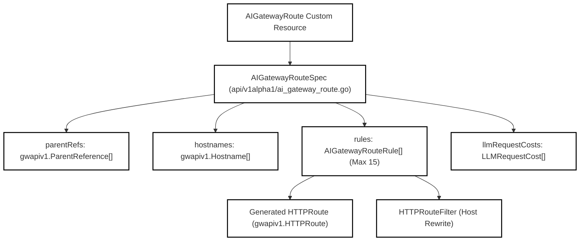
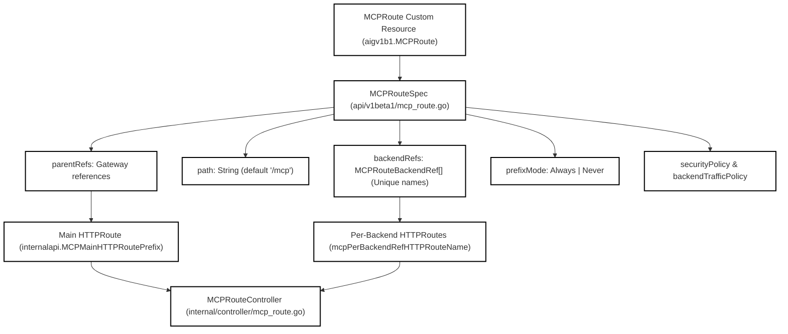

<!-- source: DeepWiki mcp.deepwiki.com · repo theagentrouter/agent-router · page 2.1 Routing Resources: AIGatewayRoute and MCPRoute · fetched 2026-10-21 -->

# Routing Resources: AIGatewayRoute and MCPRoute

<details>
<summary>Relevant source files</summary>

The following files were used as context for generating this wiki page:

- [api/v1alpha1/ai_gateway_route.go](api/v1alpha1/ai_gateway_route.go)
- [api/v1alpha1/ai_gateway_route_helper.go](api/v1alpha1/ai_gateway_route_helper.go)
- [api/v1alpha1/ai_gateway_route_helper_test.go](api/v1alpha1/ai_gateway_route_helper_test.go)
- [api/v1alpha1/mcp_route.go](api/v1alpha1/mcp_route.go)
- [api/v1alpha1/zz_generated.deepcopy.go](api/v1alpha1/zz_generated.deepcopy.go)
- [api/v1beta1/ai_gateway_route.go](api/v1beta1/ai_gateway_route.go)
- [api/v1beta1/mcp_route.go](api/v1beta1/mcp_route.go)
- [api/v1beta1/zz_generated.deepcopy.go](api/v1beta1/zz_generated.deepcopy.go)
- [internal/controller/mcp_route.go](internal/controller/mcp_route.go)
- [internal/controller/mcp_route_test.go](internal/controller/mcp_route_test.go)
- [manifests/charts/ai-gateway-crds-helm/templates/aigateway.envoyproxy.io_aigatewayroutes.yaml](manifests/charts/ai-gateway-crds-helm/templates/aigateway.envoyproxy.io_aigatewayroutes.yaml)
- [manifests/charts/ai-gateway-crds-helm/templates/aigateway.envoyproxy.io_mcproutes.yaml](manifests/charts/ai-gateway-crds-helm/templates/aigateway.envoyproxy.io_mcproutes.yaml)
- [site/docs/api/api.mdx](site/docs/api/api.mdx)
- [site/docs/capabilities/mcp/index.md](site/docs/capabilities/mcp/index.md)
- [tests/crdcel/main_test.go](tests/crdcel/main_test.go)
- [tests/e2e/mcp_route_test.go](tests/e2e/mcp_route_test.go)

</details>


## Purpose and Scope

This page provides full technical documentation for the routing Custom Resource Definitions (CRDs) in the Envoy AI Gateway (`agent-router`) codebase: `AIGatewayRoute` and `MCPRoute`. It details their OpenAPI schemas, core fields, CEL (Common Expression Language) validation rules, deepcopy code generation, and how controllers translate these resources into Gateway API `HTTPRoute` primitives and Envoy configurations.

Sources:
- `site/docs/api/api.mdx:1-11` [site/docs/api/api.mdx]()
- `api/v1alpha1/ai_gateway_route.go:1-44` [api/v1alpha1/ai_gateway_route.go]()
- `api/v1alpha1/mcp_route.go:1-32` [api/v1alpha1/mcp_route.go]()

---

## 1. AIGatewayRoute Schema and Fields

`AIGatewayRoute` (`aigateway.envoyproxy.io/v1alpha1` and `v1beta1`) defined in `api/v1alpha1/ai_gateway_route.go` [api/v1alpha1/ai_gateway_route.go:37-44]() combines multiple `AIServiceBackend` resources and attaches them to Gateway resources. The AI Gateway controller translates an `AIGatewayRoute` into a top-level Gateway API `HTTPRoute` and an `HTTPRouteFilter` for automatic hostname rewriting.

Title: AIGatewayRoute Translation Architecture

*Figure 1: AIGatewayRoute Translation Architecture mapping CRD specifications to Gateway API resources.*

Sources:
- `api/v1alpha1/ai_gateway_route.go:37-98` [api/v1alpha1/ai_gateway_route.go]()
- `manifests/charts/ai-gateway-crds-helm/templates/aigateway.envoyproxy.io_aigatewayroutes.yaml:31-100` [manifests/charts/ai-gateway-crds-helm/templates/aigateway.envoyproxy.io_aigatewayroutes.yaml]()

### Key Fields in `AIGatewayRouteSpec`

- `parentRefs`: A list of Gateway references (`gwapiv1.ParentReference`) to attach the route to. Limited to a maximum of 16 items [api/v1alpha1/ai_gateway_route.go:58-65]().
- `hostnames`: A list of fully-qualified or wildcard domain names matched against the HTTP `Host` header, mirroring standard Gateway API `HTTPRouteSpec.Hostnames` [api/v1alpha1/ai_gateway_route.go:67-75]().
- `rules`: A list of `AIGatewayRouteRule` entries (maximum of 15 per route). Each rule defines match conditions, backend references, mutations, and timeouts [api/v1alpha1/ai_gateway_route.go:77-98]().
- `llmRequestCosts`: Configuration specifying how to capture token usage (`InputToken`, `OutputToken`, `TotalToken`, etc.) and store it in Envoy dynamic metadata under the `io.envoy.ai_gateway` namespace key [api/v1alpha1/ai_gateway_route.go:100-108]().

Sources:
- `api/v1alpha1/ai_gateway_route.go:57-108` [api/v1alpha1/ai_gateway_route.go]()

---

## 2. MCPRoute Schema and Fields

`MCPRoute` defined in `api/v1beta1/mcp_route.go` [api/v1beta1/mcp_route.go:38-56]() details how Model Context Protocol (MCP) requests are routed to backend MCP servers, aggregating multiple servers behind a unified endpoint (default path `/mcp`).

Title: MCPRoute Reconciliation and Proxy Routing Flow

*Figure 2: MCPRoute Reconciliation and Proxy Routing Flow linking route definitions to controller operations.*

Sources:
- `api/v1beta1/mcp_route.go:14-151` [api/v1beta1/mcp_route.go]()
- `internal/controller/mcp_route.go:113-156` [internal/controller/mcp_route.go]()

### Key Fields in `MCPRouteSpec`

- `path`: The HTTP endpoint path serving MCP requests over Streamable HTTP transport (defaults to `/mcp`) [api/v1beta1/mcp_route.go:80-87]().
- `backendRefs`: A list of backend references to MCP servers. Names must be unique within the list, and cross-namespace references are disallowed [api/v1beta1/mcp_route.go:109-122]().
- `prefixMode`: Controls how tool and prompt names are prefixed (`Always` prefixes with `<backendName>__`, `Never` exposes unprefixed names) [api/v1beta1/mcp_route.go:14-36,146-150]().
- `securityPolicy`: Configures authentication and security wrappers (e.g., OAuth) for the route [api/v1beta1/mcp_route.go:124-128]().

Sources:
- `api/v1beta1/mcp_route.go:14-156` [api/v1beta1/mcp_route.go]()
- `manifests/charts/ai-gateway-crds-helm/templates/aigateway.envoyproxy.io_mcproutes.yaml:32-100` [manifests/charts/ai-gateway-crds-helm/templates/aigateway.envoyproxy.io_mcproutes.yaml]()

---

## 3. CEL Validation Rules

Kubernetes CustomResourceDefinitions for routing enforce strict CEL validation rules tested in `tests/crdcel/main_test.go` [tests/crdcel/main_test.go:23-86]() to prevent misconfigurations at admission time.

### AIGatewayRoute CEL Rules
- **Parent Reference Validation**: All `parentRefs` must reference a `Gateway` kind [api/v1alpha1/ai_gateway_route.go:58-62]():
  ```cel
  self.all(match, match.kind == 'Gateway')
  ```
- **Unique Rule Names**: Optional rule names must be unique across the route [api/v1alpha1/ai_gateway_route.go:97]():
  ```cel
  self.all(r1, !has(r1.name) || self.exists_one(r2, has(r2.name) && r1.name == r2.name))
  ```
- **Rule Count Limit**: Maximum of 15 rules per route [api/v1alpha1/ai_gateway_route.go:96]().

### MCPRoute CEL Rules
- **Backend Uniqueness**: All names in `backendRefs` must be unique [api/v1beta1/mcp_route.go:121]():
  ```cel
  self.all(i, self.exists_one(j, j.name == i.name))
  ```

Sources:
- `api/v1alpha1/ai_gateway_route.go:58-98` [api/v1alpha1/ai_gateway_route.go]()
- `api/v1beta1/mcp_route.go:77-122` [api/v1beta1/mcp_route.go]()
- `tests/crdcel/main_test.go:27-68` [tests/crdcel/main_test.go]()

---

## 4. Helpers and DeepCopy Implementation

Routing CRDs utilize auto-generated deepcopy functions and dedicated helper modules to manipulate structures during reconciliation.

- **DeepCopy Methods**: Autogenerated in `api/v1alpha1/zz_generated.deepcopy.go` [api/v1alpha1/zz_generated.deepcopy.go:20-170]() and `api/v1beta1/zz_generated.deepcopy.go` [api/v1beta1/zz_generated.deepcopy.go:20-170]() for all route specs, rules, and backend references.
- **MCP Route Controller Helpers**: `MCPRouteController` defined in `internal/controller/mcp_route.go` [internal/controller/mcp_route.go:42-48]() manages shared per-namespace proxies (`ensureMCPProxyBackend`), constructs main HTTP routes (`newMainHTTPRoute`), and creates per-backend HTTP routing entries (`newPerBackendRefHTTPRoute`) using internal header selectors (`internalapi.MCPBackendHeader`) [internal/controller/mcp_route.go:103-156]().

Sources:
- `api/v1alpha1/zz_generated.deepcopy.go:20-170` [api/v1alpha1/zz_generated.deepcopy.go]()
- `api/v1beta1/zz_generated.deepcopy.go:20-170` [api/v1beta1/zz_generated.deepcopy.go]()
- `internal/controller/mcp_route.go:42-61` [internal/controller/mcp_route.go]()

---

