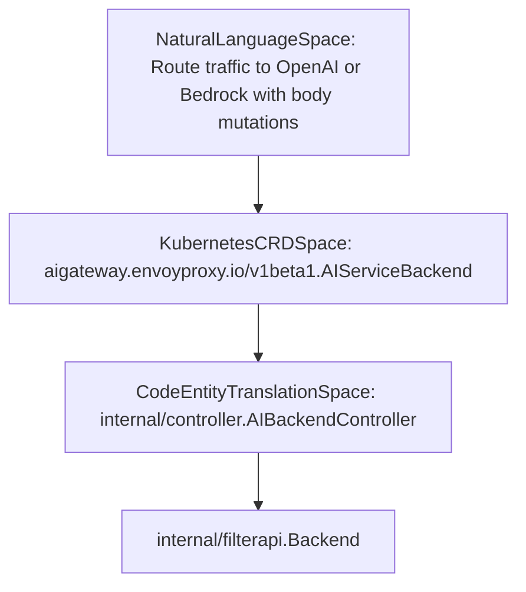
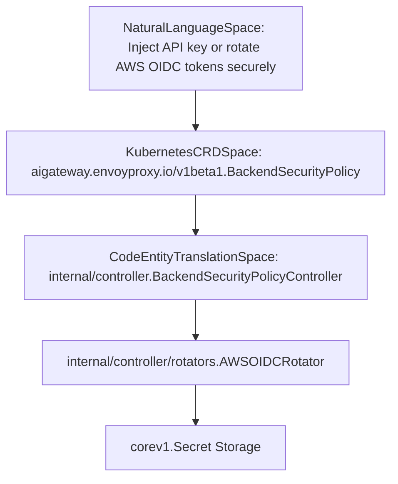
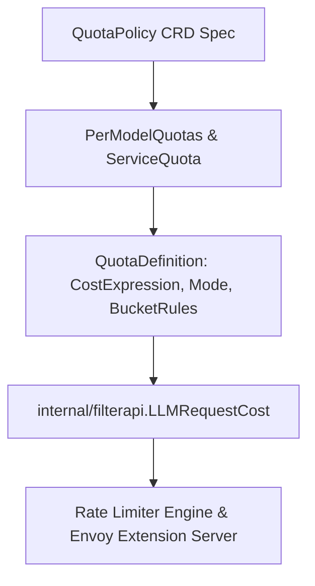

<!-- source: DeepWiki mcp.deepwiki.com · repo theagentrouter/agent-router · page 2.2 Backends, Security and Quota Policies · fetched 2026-10-21 -->

# Backends, Security and Quota Policies

Relevant source files

The following files were used as context for generating this wiki page:

- [api/v1alpha1/gateway_config.go](api/v1alpha1/gateway_config.go)
- [api/v1alpha1/quota_policy.go](api/v1alpha1/quota_policy.go)
- [api/v1alpha1/shared_types.go](api/v1alpha1/shared_types.go)
- [api/v1beta1/gateway_config.go](api/v1beta1/gateway_config.go)
- [api/v1beta1/shared_types.go](api/v1beta1/shared_types.go)
- [cmd/aigw/translate.go](cmd/aigw/translate.go)
- [internal/controller/gateway.go](internal/controller/gateway.go)
- [internal/controller/gateway_test.go](internal/controller/gateway_test.go)
- [internal/extensionserver/forward_proxy.go](internal/extensionserver/forward_proxy.go)
- [internal/extensionserver/forward_proxy_test.go](internal/extensionserver/forward_proxy_test.go)
- [internal/filterapi/filterconfig.go](internal/filterapi/filterconfig.go)
- [manifests/charts/ai-gateway-crds-helm/templates/aigateway.envoyproxy.io_aiservicebackends.yaml](manifests/charts/ai-gateway-crds-helm/templates/aigateway.envoyproxy.io_aiservicebackends.yaml)
- [manifests/charts/ai-gateway-crds-helm/templates/aigateway.envoyproxy.io_gatewayconfigs.yaml](manifests/charts/ai-gateway-crds-helm/templates/aigateway.envoyproxy.io_gatewayconfigs.yaml)
- [manifests/charts/ai-gateway-crds-helm/templates/aigateway.envoyproxy.io_quotapolicies.yaml](manifests/charts/ai-gateway-crds-helm/templates/aigateway.envoyproxy.io_quotapolicies.yaml)
- [site/docs/capabilities/a2a/index.md](site/docs/capabilities/a2a/index.md)
- [site/docs/capabilities/gateway-config.md](site/docs/capabilities/gateway-config.md)
- [site/docs/capabilities/index.md](site/docs/capabilities/index.md)
- [site/docs/capabilities/llm-integrations/index.md](site/docs/capabilities/llm-integrations/index.md)
- [site/docs/capabilities/llm-integrations/prompt-caching.md](site/docs/capabilities/llm-integrations/prompt-caching.md)
- [site/docs/capabilities/scaling.md](site/docs/capabilities/scaling.md)
- [site/docs/capabilities/traffic/header-body-mutations.md](site/docs/capabilities/traffic/header-body-mutations.md)
- [site/docs/capabilities/traffic/index.md](site/docs/capabilities/traffic/index.md)
- [site/docs/capabilities/traffic/quota-policy.md](site/docs/capabilities/traffic/quota-policy.md)
- [tests/crdcel/testdata/aiservicebackends/aws-openai-schema.yaml](tests/crdcel/testdata/aiservicebackends/aws-openai-schema.yaml)

## Purpose and Scope

This document details the CRD schemas, validation logic, and runtime translation mechanisms for backend services, security policies, token quotas, and gateway-level configurations within the Envoy AI Gateway. It focuses on four primary Custom Resource Definitions (CRDs) under the `aigateway.envoyproxy.io` API group: `AIServiceBackend`, `BackendSecurityPolicy`, `QuotaPolicy`, and `GatewayConfig`, along with their associated CEL test data and structures defined in `internal/filterapi`, `api/v1alpha1`, and `internal/controller`.

Sources: `[manifests/charts/ai-gateway-crds-helm/templates/aigateway.envoyproxy.io_aiservicebackends.yaml:1-41]`, `[api/v1alpha1/quota_policy.go:14-32]`, `[manifests/charts/ai-gateway-crds-helm/templates/aigateway.envoyproxy.io_gatewayconfigs.yaml:33-54]()`

---

## 1. AIServiceBackend Schema and Target Resolution

`AIServiceBackend` represents a concrete LLM provider endpoint or inference target, bridging standard Gateway API `Backend` resources with AI-specific API schemas and body mutation rules.

*Figure 1: AIServiceBackend Natural Language to Code Entity Mapping*

Sources: `[manifests/charts/ai-gateway-crds-helm/templates/aigateway.envoyproxy.io_aiservicebackends.yaml:32-41]`, `[api/v1alpha1/shared_types.go:15-48]`

### Key Schema Attributes

- **`backendRef`**: References an Envoy Gateway `Backend` resource (`gateway.envoyproxy.io` group, `Backend` kind). Core Kubernetes `Service` references require explicit port specifications.
- **`schema`**: Specifies the target vendor protocol via `VersionedAPISchema`, supporting schemas such as `OpenAI`, `AWSBedrock`, `AzureOpenAI`, `GCPVertexAI`, `Anthropic`, and `AWSAnthropic`.
- **`bodyMutation`**: Defines JSON body modifications applied prior to dispatching requests to the upstream provider.

Sources: `[manifests/charts/ai-gateway-crds-helm/templates/aigateway.envoyproxy.io_aiservicebackends.yaml:62-147]`, `[api/v1alpha1/shared_types.go:15-48]`

---

## 2. BackendSecurityPolicy and Credential Management

`BackendSecurityPolicy` handles upstream authentication, credential injection, and automatic token rotation for AI providers.

*Figure 2: BackendSecurityPolicy Natural Language to Code Entity Mapping*

Sources: `[api/v1alpha1/shared_types.go:15-48]`, `[internal/controller/gateway.go:38-43]`, `[internal/controller/gateway_test.go:41-45]`

### Authentication Mechanisms and Rotators

- **API Keys**: Configured via secret references or literals, scrubbed using custom formatters to prevent leakage in controller logs.
- **AWS SigV4 & OIDC**: Managed via `AWSOIDCRotator` which coordinates token exchanges with AWS STS using cluster or external OIDC providers.
- **GCP & Azure**: Manages OAuth2 tokens and service account credentials for Vertex AI and Azure OpenAI endpoints via dedicated token provider packages.

Sources: `[internal/controller/gateway.go:38-43]`, `[internal/controller/gateway_test.go:41-45]`

---

## 3. QuotaPolicy and Token-Based Rate Limiting

`QuotaPolicy` enforces consumption limits based on token metrics derived from LLM request and response bodies.

*Figure 3: QuotaPolicy Translation Model*

Sources: `[api/v1alpha1/quota_policy.go:34-124]`, `[manifests/charts/ai-gateway-crds-helm/templates/aigateway.envoyproxy.io_quotapolicies.yaml:30-76]`

### Cost Calculation and CEL Expressions

`QuotaPolicy` rules utilize Common Expression Language (CEL) to compute request costs dynamically. Supported variables include `input_tokens`, `output_tokens`, `cached_input_tokens`, `cache_creation_input_tokens`, `total_tokens`, `reasoning_tokens`, `model`, and `backend`.

Sources: `[api/v1alpha1/quota_policy.go:62-101]`, `[manifests/charts/ai-gateway-crds-helm/templates/aigateway.envoyproxy.io_quotapolicies.yaml:77-105]`

---

## 4. GatewayConfig CRD and ExtProc Settings

`GatewayConfig` supplies gateway-level configuration for the external processor (`extproc`) sidecar container.

Sources: `[manifests/charts/ai-gateway-crds-helm/templates/aigateway.envoyproxy.io_gatewayconfigs.yaml:33-54]()`

### Environment Variable Precedence

When merging container environment variables, the following precedence order applies (from highest to lowest):
1. `GatewayConfig.Spec.ExtProc.Kubernetes.Env`
2. Global controller flags (`extProcExtraEnvVars`)

Sources: `[manifests/charts/ai-gateway-crds-helm/templates/aigateway.envoyproxy.io_gatewayconfigs.yaml:47-54]`

---

## 5. CEL Test Data and Validation Suites

CEL validation rules defined on CRDs are verified using test manifests located under `tests/crdcel/testdata/`. These test assets validate correctness for schemas, security policies, and quotas before cluster admission.

Sources: `[tests/crdcel/testdata/aiservicebackends/aws-openai-schema.yaml:1-5]`, `[internal/controller/gateway_test.go:117-177]()`

---

