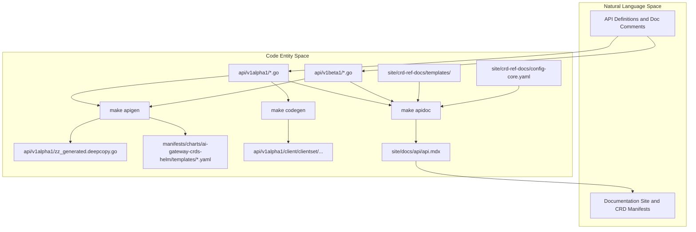
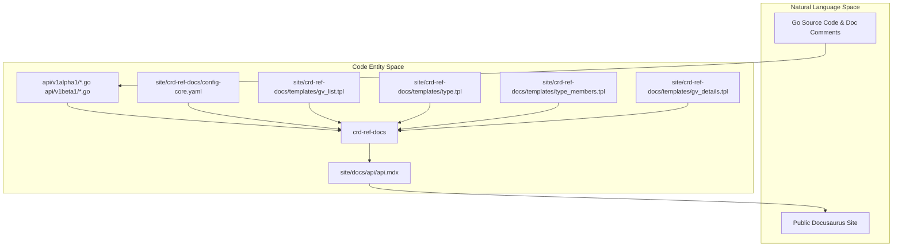

<!-- source: DeepWiki mcp.deepwiki.com · repo theagentrouter/agent-router · page 2.3 API Reference Docs Generation · fetched 2026-10-21 -->

# API Reference Docs Generation

Relevant source files

The following files were used as context for generating this wiki page:

- [.github/dependabot.yml](.github/dependabot.yml)
- [Makefile](Makefile)
- [go.mod](go.mod)
- [go.sum](go.sum)
- [site/crd-ref-docs/config-core.yaml](site/crd-ref-docs/config-core.yaml)
- [site/crd-ref-docs/templates/gv_details.tpl](site/crd-ref-docs/templates/gv_details.tpl)
- [site/crd-ref-docs/templates/gv_list.tpl](site/crd-ref-docs/templates/gv_list.tpl)
- [site/crd-ref-docs/templates/type.tpl](site/crd-ref-docs/templates/type.tpl)
- [site/crd-ref-docs/templates/type_members.tpl](site/crd-ref-docs/templates/type_members.tpl)
- [tests/e2e-inference-extension/inference_pool_test.go](tests/e2e-inference-extension/inference_pool_test.go)
- [tests/e2e-upgrade/upgrade_test.go](tests/e2e-upgrade/upgrade_test.go)
- [tests/internal/e2elib/e2elib.go](tests/internal/e2elib/e2elib.go)

The API Reference Docs Generation subsystem automates the maintenance of Kubernetes Custom Resource Definitions (CRDs), deepcopy methods, typed Kubernetes clientsets, informers, listers, and the public API reference documentation site (`api.mdx`). These artifacts are driven by `controller-gen`, Kubernetes code-generator utilities, and `crd-ref-docs`, all orchestrated via standardized targets in the repository `Makefile` [Makefile:102-148]().

---

## Makefile Flow and Codegen Architecture

The generation lifecycle is partitioned into three core `Makefile` targets: `apigen`, `codegen`, and `apidoc`. These targets inspect the Go struct definitions and Go doc comments under `api/v1alpha1/` and `api/v1beta1/` to produce manifests, runtime deepcopy logic, typed clients, and documentation.

Diagram: "Natural Language Space to Code Entity Space for API Generation"

Sources: [Makefile:102-148](), [api/v1alpha1/zz_generated.deepcopy.go:1-46](), [site/docs/api/api.mdx:1-36]()

### Target Descriptions

- **`apigen`**: Executes `controller-gen object` to build Go runtime deepcopy methods (`zz_generated.deepcopy.go`) for both `v1alpha1` and `v1beta1` packages [Makefile:104-107](). It also invokes `controller-gen crd` to compile schema definitions into Helm chart CRD templates (`manifests/charts/ai-gateway-crds-helm/templates/`) [Makefile:108-110]().
- **`codegen`**: Invokes Kubernetes code-generator tools (`client-gen`, `lister-gen`, `informer-gen`) targeting `api/v1alpha1` to generate typed Kubernetes API interaction primitives [Makefile:125-148](). Plural exceptions like `BackendSecurityPolicy:BackendSecurityPolicies` are explicitly registered [Makefile:137]().
- **`apidoc`**: Executes `crd-ref-docs` referencing source paths, configuration (`site/crd-ref-docs/config-core.yaml`), and custom templates (`site/crd-ref-docs/templates/`) to output markdown/MDX documentation at `site/docs/api/api.mdx` [Makefile:113-123]().

Sources: [Makefile:102-148](), [api/v1alpha1/zz_generated.deepcopy.go:1-46]()

---

## Deepcopy and Typed Clientset Generation

Runtime objects in Kubernetes require deepcopy implementations to satisfy the `runtime.Object` interface and enable safe in-memory caching and mutation by controllers.

### Object Deepcopy Generation

Controller markers such as `+k8s:deepcopy-gen:interfaces=k8s.io/apimachinery/pkg/runtime.Object` and `+kubebuilder:object:root=true` instruct `controller-gen` to generate methods like `DeepCopy()`, `DeepCopyInto()`, and `DeepCopyObject()` [api/v1alpha1/mcp_route.go:20-22](), [api/v1alpha1/zz_generated.deepcopy.go:20-45]().

Sources: [api/v1alpha1/mcp_route.go:19-32](), [api/v1alpha1/zz_generated.deepcopy.go:20-46]()

### Typed Clients (`client-gen`)

The `codegen` target constructs a complete `clientset/versioned` package enabling type-safe interaction with custom resources such as `AIGatewayRoute`, `AIServiceBackend`, `MCPRoute`, and `BackendSecurityPolicy` [Makefile:125-137]().

Sources: [Makefile:125-137](), [api/v1alpha1/zz_generated.deepcopy.go:20-46]()

---

## `crd-ref-docs` Configuration and Templates

API reference documentation is automatically generated from Go struct comments and struct tags via the `crd-ref-docs` tool [Makefile:113-123](). 

Diagram: "Natural Language Space to Code Entity Space for Documentation Pipeline"

Sources: [Makefile:113-123](), [site/crd-ref-docs/config-core.yaml:1-76](), [site/crd-ref-docs/templates/type.tpl:1-66]()

### Template Structure and Integration

The rendering templates customize how kinds, fields, descriptions, and validations are presented in the Docusaurus-compatible MDX file:
- **`gv_list.tpl`**: Iterates through registered API group-versions (`aigateway.envoyproxy.io/v1alpha1`, `aigateway.envoyproxy.io/v1beta1`) [site/crd-ref-docs/templates/gv_list.tpl:1-21]().
- **`type.tpl` & `type_members.tpl`**: Formats individual resource fields into `<ApiField>` React components containing types, requirements, and godoc descriptions [site/crd-ref-docs/templates/type.tpl:1-66](), [site/crd-ref-docs/templates/type_members.tpl:1-8]().
- **`gv_details.tpl`**: Aggregates resource lists and kind definitions into structured sections [site/crd-ref-docs/templates/gv_details.tpl:1-55]().

Sources: [Makefile:113-123](), [site/crd-ref-docs/config-core.yaml:1-76](), [site/crd-ref-docs/templates/type.tpl:1-66](), [site/crd-ref-docs/templates/gv_list.tpl:1-21](), [site/crd-ref-docs/templates/type_members.tpl:1-8](), [site/crd-ref-docs/templates/gv_details.tpl:1-55]()

---

