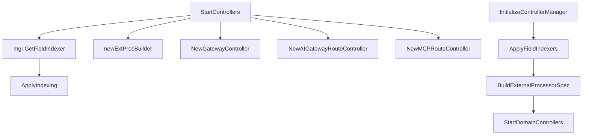
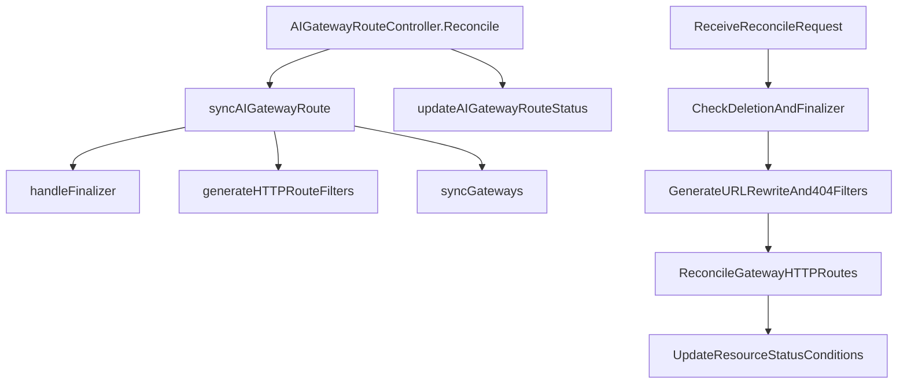

<!-- source: DeepWiki mcp.deepwiki.com · repo theagentrouter/agent-router · page 3.1 Controllers and Reconciliation · fetched 2026-10-21 -->

# Controllers and Reconciliation

Relevant source files

The following files were used as context for generating this wiki page:

- [api/v1alpha1/mcp_route.go](api/v1alpha1/mcp_route.go)
- [api/v1alpha1/zz_generated.deepcopy.go](api/v1alpha1/zz_generated.deepcopy.go)
- [api/v1beta1/mcp_route.go](api/v1beta1/mcp_route.go)
- [api/v1beta1/zz_generated.deepcopy.go](api/v1beta1/zz_generated.deepcopy.go)
- [cmd/aigw/testdata/translate_basic.out.yaml](cmd/aigw/testdata/translate_basic.out.yaml)
- [internal/controller/ai_gateway_route.go](internal/controller/ai_gateway_route.go)
- [internal/controller/ai_gateway_route_test.go](internal/controller/ai_gateway_route_test.go)
- [internal/controller/ai_service_backend.go](internal/controller/ai_service_backend.go)
- [internal/controller/ai_service_backend_test.go](internal/controller/ai_service_backend_test.go)
- [internal/controller/controller.go](internal/controller/controller.go)
- [internal/controller/controller_test.go](internal/controller/controller_test.go)
- [internal/controller/mcp_route.go](internal/controller/mcp_route.go)
- [internal/controller/mcp_route_test.go](internal/controller/mcp_route_test.go)
- [internal/controller/secret.go](internal/controller/secret.go)
- [internal/controller/secret_test.go](internal/controller/secret_test.go)
- [manifests/charts/ai-gateway-crds-helm/templates/aigateway.envoyproxy.io_mcproutes.yaml](manifests/charts/ai-gateway-crds-helm/templates/aigateway.envoyproxy.io_mcproutes.yaml)
- [site/docs/api/api.mdx](site/docs/api/api.mdx)
- [site/docs/capabilities/mcp/index.md](site/docs/capabilities/mcp/index.md)
- [tests/controller/controller_test.go](tests/controller/controller_test.go)
- [tests/crdcel/main_test.go](tests/crdcel/main_test.go)
- [tests/e2e/mcp_route_test.go](tests/e2e/mcp_route_test.go)

## Purpose and Scope
This page details the control plane reconciliation architecture of Envoy AI Gateway (`agent-router`). It covers controller manager initialization (`StartControllers`), field indexing, the reconciliation loops for `AIGatewayRoute`, `AIServiceBackend`, `MCPRoute`, and `InferencePool` resources, finalizer management, and cross-namespace `ReferenceGrant` validation.

---

## 1. Controller Manager Initialization and Indexing

The controller manager entrypoint is managed by `StartControllers`, which registers controllers, configures field indexers, and discovers server versions (`[internal/controller/controller.go:116-139]()`).

### Diagram: Controller Initialization and Indexing Flow

*Diagram 1: Controller Initialization and Indexing Flow*

Sources: `[internal/controller/controller.go:116-139]()`

---

## 2. AIGatewayRoute and AIServiceBackend Reconcilers

The `AIGatewayRouteController` implements `reconcile.TypedReconciler` to manage `AIGatewayRoute` custom resources (`[internal/controller/ai_gateway_route.go:53-84]()`). 

### Reconciliation Data Flow
When an `AIGatewayRoute` is created or updated, `Reconcile` invokes `syncAIGatewayRoute` (`[internal/controller/ai_gateway_route.go:86-107]()`). The sync process performs:
1. Finalizer checks via `handleFinalizer` (`[internal/controller/ai_gateway_route.go:161-164]()`).
2. Verification of static default `HTTPRouteFilters` (`generateHTTPRouteFilters`, `[internal/controller/ai_gateway_route.go:117-157]()`), which injects hostname rewrite filters and 404 direct response filters for unrouted models (`[cmd/aigw/testdata/translate_basic.out.yaml:166-187]()`).
3. Resolution of `AIServiceBackend` and `InferencePool` backend references.

### Diagram: AIGatewayRoute Reconciliation Lifecycle

*Diagram 2: AIGatewayRoute Reconciliation Lifecycle*

Sources: `[internal/controller/ai_gateway_route.go:53-164]()`, `[cmd/aigw/testdata/translate_basic.out.yaml:166-187]()`

---

## 3. MCPRoute Controller and Security Policy Reconciliation

The `MCPRouteController` manages Model Context Protocol routing resources (`[internal/controller/mcp_route.go:37-48]()`). 

### MCPRoute Sync Sequence
1. Validates `prefixMode` configurations per backend (`[internal/controller/mcp_route.go:98-100]()`).
2. Ensures a shared per-namespace MCP proxy `Backend` exists (`ensureMCPProxyBackend`, `[internal/controller/mcp_route.go:102-106]()`).
3. Constructs and updates the main proxy `HTTPRoute` (`[internal/controller/mcp_route.go:113-127]()`).
4. Generates per-backend `HTTPRoutes` to bypass the rule limit per `HTTPRoute` (`[internal/controller/mcp_route.go:129-156]()`).
5. Reconciles associated security policies via `syncMCPRouteSecurityPolicy`, which provisions Envoy Gateway `SecurityPolicy` and JWT provider metadata (`[internal/controller/mcp_route.go:163-165]()`).

Sources: `[internal/controller/mcp_route.go:37-165]()`

---

## 4. InferencePool and Gateway-API Integration

Envoy AI Gateway integrates with the Gateway API Inference Extension (`sigs.k8s.io/gateway-api-inference-extension/api/v1`) to support native LLM inference pools (`[internal/controller/controller.go:37-57]()`).

* **Validation Rules (CEL)**: CRD validation enforces that:
  * An `InferencePool` cannot be mixed with regular `AIServiceBackend` references within the same rule (`[tests/crdcel/main_test.go:50-52]()`).
  * Only a single `InferencePool` reference is permitted per rule (`[tests/crdcel/main_test.go:54-56]()`).
  * The group must strictly match `inference.networking.k8s.io` (`[tests/crdcel/main_test.go:62-64]()`).

Sources: `[internal/controller/controller.go:37-57](), [tests/crdcel/main_test.go:48-64]()`

---

## 5. Finalizers and ReferenceGrant Validation

### Finalizers
Controllers utilize custom finalizers (e.g., `aiGatewayControllerFinalizer`) to coordinate cascading garbage collection and status updates. When an object metadata deletion timestamp is detected, `handleFinalizer` invokes cleanup callbacks (such as propagating deletions up to parent `Gateways` or releasing shared backends) before removing the finalizer string (`[internal/controller/ai_gateway_route.go:161-164]()`).

### ReferenceGrant Cross-Namespace Validation
Cross-namespace references between routing CRDs (`AIGatewayRoute`, `MCPRoute`, `AIServiceBackend`) and target backends or services are validated by the `referenceGrantValidator` (`[internal/controller/referencegrant.go:21-29]()`). The validator queries Kubernetes `ReferenceGrant` resources in the target namespace via `validateReference` (`[internal/controller/referencegrant.go:73-80]()`) to confirm that cross-namespace traffic permissions are explicitly granted (`[internal/controller/referencegrant.go:96-109]()`).

Sources: `[internal/controller/ai_gateway_route.go:161-164](), [internal/controller/referencegrant.go:21-180]()`

---

