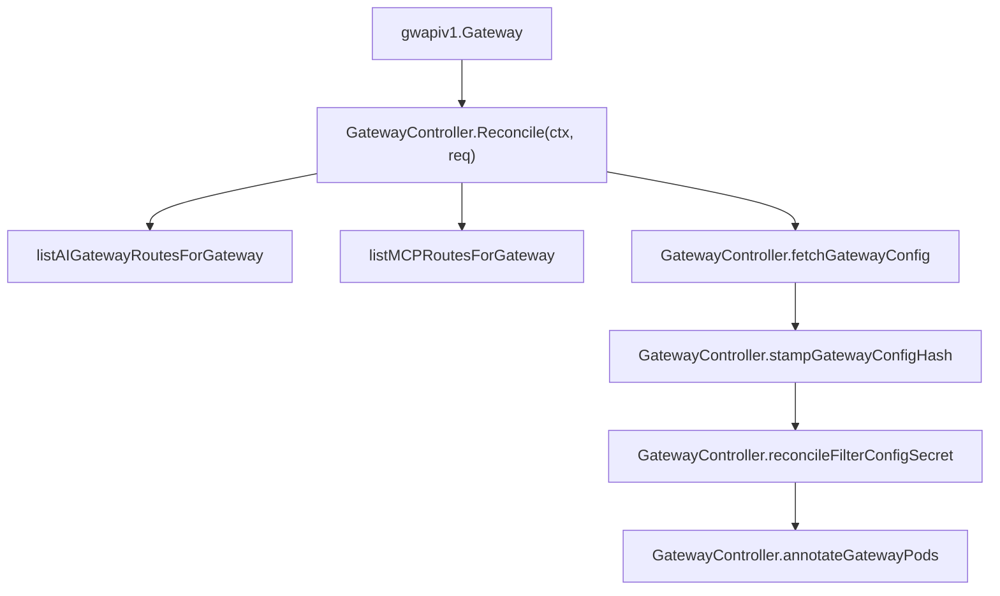
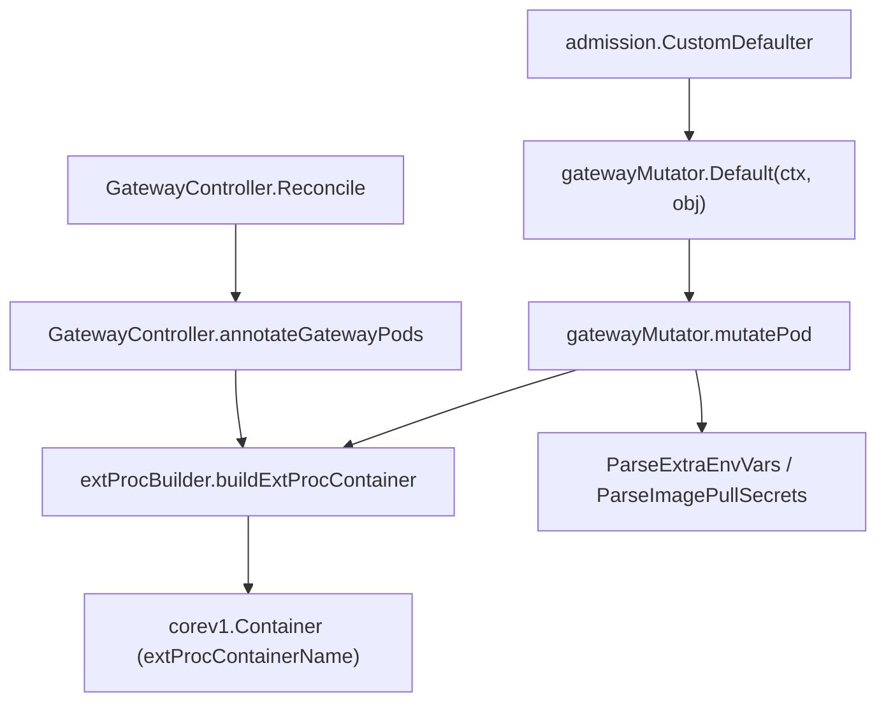

<!-- source: DeepWiki mcp.deepwiki.com · repo theagentrouter/agent-router · page 3.2 Filter Config Generation and Pod Mutation · fetched 2026-10-21 -->

# Filter Config Generation and Pod Mutation

Relevant source files

The following files were used as context for generating this wiki page:

- [api/v1alpha1/shared_types.go](api/v1alpha1/shared_types.go)
- [api/v1beta1/shared_types.go](api/v1beta1/shared_types.go)
- [cmd/aigw/translate.go](cmd/aigw/translate.go)
- [cmd/controller/main.go](cmd/controller/main.go)
- [cmd/controller/main_test.go](cmd/controller/main_test.go)
- [cmd/extproc/mainlib/main.go](cmd/extproc/mainlib/main.go)
- [cmd/extproc/mainlib/main_test.go](cmd/extproc/mainlib/main_test.go)
- [internal/controller/extproc_builder.go](internal/controller/extproc_builder.go)
- [internal/controller/extproc_builder_test.go](internal/controller/extproc_builder_test.go)
- [internal/controller/gateway.go](internal/controller/gateway.go)
- [internal/controller/gateway_mutator.go](internal/controller/gateway_mutator.go)
- [internal/controller/gateway_mutator_test.go](internal/controller/gateway_mutator_test.go)
- [internal/controller/gateway_test.go](internal/controller/gateway_test.go)
- [internal/filterapi/filterconfig.go](internal/filterapi/filterconfig.go)
- [manifests/charts/ai-gateway-crds-helm/templates/aigateway.envoyproxy.io_aiservicebackends.yaml](manifests/charts/ai-gateway-crds-helm/templates/aigateway.envoyproxy.io_aiservicebackends.yaml)
- [manifests/charts/ai-gateway-helm/templates/deployment.yaml](manifests/charts/ai-gateway-helm/templates/deployment.yaml)
- [manifests/charts/ai-gateway-helm/values.yaml](manifests/charts/ai-gateway-helm/values.yaml)
- [tests/crdcel/testdata/aiservicebackends/aws-openai-schema.yaml](tests/crdcel/testdata/aiservicebackends/aws-openai-schema.yaml)

## Purpose and Scope

This page details the implementation of the control plane components responsible for generating runtime configuration bundles for the external processor (`extproc`) and injecting the `extproc` sidecar container into Envoy Gateway-managed Gateway pods. Specifically, it covers the `GatewayController` reconciliation loop [internal/controller/gateway.go:75-86](), the `filterapi.Config` schema [internal/filterapi/filterconfig.go:24-55](), configuration secret bundling, the `gatewayMutator` admission webhook [internal/controller/gateway_mutator.go:28-42](), and the shared `extProcBuilder`.

Sources: `internal/controller/gateway.go`, `internal/controller/gateway_mutator.go`, `internal/filterapi/filterconfig.go`

---

## 1. Filter Configuration Schema (`filterapi.Config`)

The external processor relies on a decoupled, non-Kubernetes configuration schema defined in the `filterapi` package [internal/filterapi/filterconfig.go:6-22](). This decoupling allows the data plane proxy filter to be tested and run independently of a Kubernetes cluster.

The core structure `filterapi.Config` contains fields governing routing, version compatibility, LLM request costs, backend definitions, model registries, and Model Context Protocol (MCP) settings [internal/filterapi/filterconfig.go:24-55]():

| Field | Type | Description |
| :--- | :--- | :--- |
| `Version` | `string` | Version of AI Gateway (e.g., derived from `internal/version`) ensuring compatibility between the control plane and data plane binaries [internal/filterapi/filterconfig.go:32](). |
| `UUID` | `string` | Unique identifier assigned by the controller upon configuration updates [internal/filterapi/filterconfig.go:34](). |
| `GlobalLLMRequestCosts` | `[]GlobalLLMRequestCost` | Gateway-level default request cost rules applied across all routes [internal/filterapi/filterconfig.go:37](). |
| `LLMRequestCosts` | `[]LLMRequestCost` | Route-specific or backend/model-scoped rules used to compute request costs (input, output, cached tokens) for rate limiting and quotas [internal/filterapi/filterconfig.go:40](). |
| `Backends` | `[]Backend` | List of backend destinations that the filter can route traffic to [internal/filterapi/filterconfig.go:41](). |
| `Models` | `[]Model` | Global model definitions used to populate OpenAI-compatible `/models` endpoints [internal/filterapi/filterconfig.go:43](). |
| `ModelsByHost` | `map[string][]Model` | Hostname-scoped model registries for multi-tenant virtual hosting [internal/filterapi/filterconfig.go:48](). |
| `UnscopedModels` | `[]Model` | Fallback models contributed by routes lacking explicit hostnames [internal/filterapi/filterconfig.go:52](). |
| `MCPConfig` | `*MCPConfig` | Configuration parameters for MCPRoute multiplexing and proxying [internal/filterapi/filterconfig.go:54](). |

Sources: `internal/filterapi/filterconfig.go`

---

## 2. Gateway Controller Reconciliation and Secret Bundling

The `GatewayController` implements `reconcile.TypedReconciler` for `gwapiv1.Gateway` resources [internal/controller/gateway.go:74-86](). When a Gateway is created or modified, the controller coordinates route discovery, configuration building, secret sharding, and pod annotation.

### Gateway Reconciliation Control Flow

Diagram: Gateway Controller Reconciliation Code Flow

Sources: `internal/controller/gateway.go`

### Secret Bundling and Sharding
Because Envoy Gateway proxy pods consume configuration via Kubernetes Secrets, and configuration sizes can exceed single-secret limits or change dynamically, large configurations are sharded into secret bundles (`internal/controller/secret.go`). 
- `GatewayController.Reconcile()` generates a unique `uuid` [internal/controller/gateway.go:129]() and invokes `reconcileFilterConfigSecret` [internal/controller/gateway.go:154]().
- The configuration is serialized, sharded into numbered parts, and stored across an index secret (`FilterConfigBundleIndexSecretName`) and part secrets.
- The `extproc` sidecar reads these sharded secrets via a projected volume mount defined by the container builder.

Sources: `internal/controller/gateway.go`, `internal/controller/gateway_test.go`, `internal/controller/secret.go`

---

## 3. Extproc Container Builder and Pod Mutation

To ensure data plane pods contain the correct `extproc` sidecar with matching command-line arguments, environment variables, and volume mounts, the controller and mutating webhook share a single source of truth: `extProcBuilder` [internal/controller/gateway_mutator.go:38-42]().

### Webhook and Controller Integration

Diagram: Pod Mutation and Extproc Container Building Code Entities

Sources: `internal/controller/gateway.go`, `internal/controller/gateway_mutator.go`, `internal/controller/extproc_builder.go`

### Pod Mutation Details
1. **Pod Interception**: The `gatewayMutator` implements `admission.CustomDefaulter` and intercepts `corev1.Pod` objects created by Envoy Gateway [internal/controller/gateway_mutator.go:28-58]().
2. **Label Matching**: It extracts `egOwningGatewayNameLabel` and `egOwningGatewayNamespaceLabel` from the pod metadata [internal/controller/gateway_mutator.go:63-64]() to locate associated `AIGatewayRoute` and `MCPRoute` resources [internal/controller/gateway_mutator.go:142-148]().
3. **Sidecar Injection**: It injects the `ai-gateway-extproc` container (`extProcContainerName`) [internal/controller/gateway_mutator.go:78]() with:
   - Config bundle volume mounts (projected secrets containing the index and sharded parts) [internal/controller/gateway_mutator.go:99-116]().
   - Command-line flags parsed from controller arguments, such as `-configBundlePath`, `-extProcAddr`, `-rootPrefix`, and MCP options when `needMCP` is true [internal/controller/gateway_mutator.go:124-147]().
   - Extra environment variables parsed via `ParseExtraEnvVars` [internal/controller/gateway_mutator.go:85-115]() and image pull secrets parsed via `ParseImagePullSecrets` [internal/controller/gateway_mutator.go:120-140]().

Sources: `internal/controller/gateway_mutator.go`, `internal/controller/gateway_mutator_test.go`

---

## 4. Configuration Watcher and Dynamic Loading

The external processor container runs a configuration watcher (`internal/filterapi/watcher.go`) that monitors the sharded secret bundle directory on disk [cmd/extproc/mainlib/main.go:91-95](). 
- When the control plane updates the configuration secret bundle via `GatewayController`, Kubernetes updates the projected volume mount inside the `extproc` pod.
- The watcher detects file system updates (atomic symlink updates typical of Kubernetes secret mounts), validates the new index and parts, unmarshals `filterapi.Config`, and atomically swaps the active configuration used by the `extproc` gRPC handlers without restarting the container or dropping connections.

Sources: `internal/filterapi/watcher.go`, `cmd/extproc/mainlib/main.go`

---

