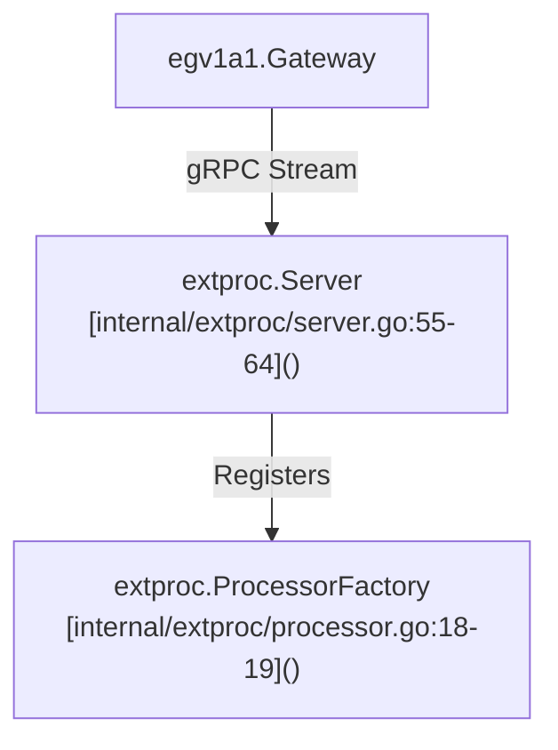
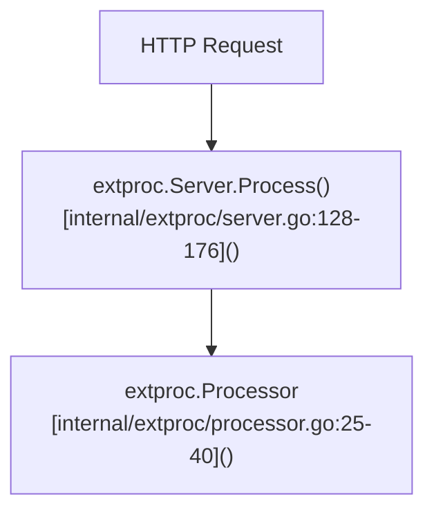

<!-- source: DeepWiki mcp.deepwiki.com · repo theagentrouter/agent-router · page 4 Data Plane: External Processor · fetched 2026-10-21 -->

# Data Plane: External Processor

Relevant source files

The following files were used as context for generating this wiki page:

- [cmd/extproc/main.go](cmd/extproc/main.go)
- [internal/extproc/mocks_test.go](internal/extproc/mocks_test.go)
- [internal/extproc/processor.go](internal/extproc/processor.go)
- [internal/extproc/processor_test.go](internal/extproc/processor_test.go)
- [internal/extproc/server.go](internal/extproc/server.go)
- [internal/extproc/server_test.go](internal/extproc/server_test.go)
- [internal/internalapi/internalapi.go](internal/internalapi/internalapi.go)
- [internal/pprof/pprof.go](internal/pprof/pprof.go)
- [internal/pprof/pprof_test.go](internal/pprof/pprof_test.go)

## Purpose and Scope

The data plane external processor (`extproc`) functions as the core gRPC server [internal/extproc/server.go:55-64]() for Envoy AI Gateway. It intercepts GenAI HTTP traffic via Envoy’s `ext_proc` filter, executing request and response transformations, schema translations, payload redaction, and auxiliary traffic controls. 

As a parent overview, this page introduces the primary architectural components of the external processor. For granular details, consult the child pages:
- Processor Pipeline [Processor Pipeline](#4.1)
- Backend Authentication and Credential Injection [Backend Authentication and Credential Injection](#4.2)
- Rate Limiting and Quotas [Rate Limiting and Quotas](#4.3)

*Figure 1: ExtProc Server Architecture and Core Types.*

Sources: `[internal/extproc/server.go:55-64]()`, `[internal/extproc/processor.go:18-19]()`

---

## Processor Pipeline

The processor pipeline governs the sequential processing of HTTP request headers, request bodies, response headers, and response bodies over bidirectional gRPC streams. The `Server` type manages connection lifecycles [internal/extproc/server.go:128-176]() and delegates per-request handling to registered `Processor` instances [internal/extproc/processor.go:25-40]().

Within the pipeline, requests are parsed, validated, mapped against model endpoints, and subjected to body or header mutators and redaction rules. Upstream processors handle backend-specific token usage tracking, tracing span completion, and response stream chunk folding.

For details, see [Processor Pipeline](#4.1).

*Figure 2: Request Lifecycle Through Processor Pipeline.*

Sources: `[internal/extproc/server.go:128-176]()`, `[internal/extproc/processor.go:25-40]()`

---

## Backend Authentication and Credential Injection

The backend authentication subsystem secures communication between the gateway and upstream AI providers (such as OpenAI, Anthropic, AWS Bedrock, and GCP Vertex AI). Handled primarily via `[internal/backendauth]()` components, the gateway dynamically injects authentication tokens, API keys, or cloud-native credentials on a per-request basis.

This subsystem integrates with token rotators and signature generators (such as AWS SigV4) to sign payloads using upstream host metadata (`[internal/internalapi/internalapi.go:31-33]()`), allowing secure multi-tenant credential overrides without exposing secrets to downstream clients.

For details, see [Backend Authentication and Credential Injection](#4.2).

Sources: `[internal/backendauth]()`, `[internal/internalapi/internalapi.go:31-33]()`

---

## Rate Limiting and Quotas

The rate limiting and quota subsystem provides usage-based traffic control across LLM routes. Implemented under `[internal/ratelimit]()`, it synchronizes configuration via xDS translators and runners to enforce rate thresholds based on token consumption, request counts, or custom cost models.

Evaluation relies on Common Expression Language (CEL) expressions (`[internal/llmcostcel]()`) to dynamically calculate request costs—such as counting combined input and output tokens—and throttle traffic before it reaches upstream providers.

For details, see [Rate Limiting and Quotas](#4.3).

Sources: `[internal/ratelimit]()`, `[internal/llmcostcel]()`

---

