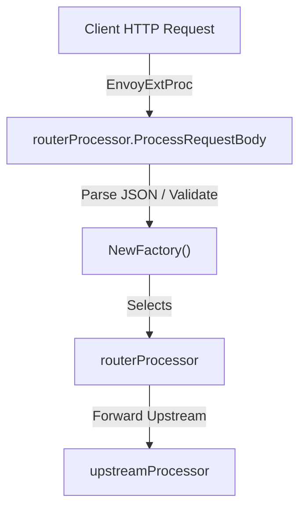
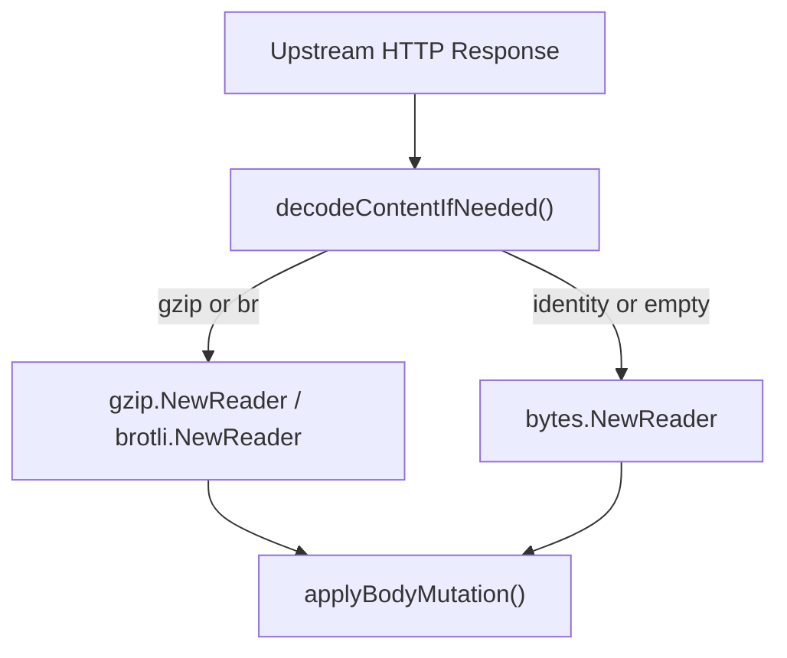

<!-- source: DeepWiki mcp.deepwiki.com · repo theagentrouter/agent-router · page 4.1 Processor Pipeline · fetched 2026-10-21 -->

# Processor Pipeline

Relevant source files

The following files were used as context for generating this wiki page:

- [examples/basic/anthropic-openai-local.yaml](examples/basic/anthropic-openai-local.yaml)
- [internal/bodymutator/body_mutator.go](internal/bodymutator/body_mutator.go)
- [internal/bodymutator/body_mutator_test.go](internal/bodymutator/body_mutator_test.go)
- [internal/extproc/processor_impl.go](internal/extproc/processor_impl.go)
- [internal/extproc/processor_impl_test.go](internal/extproc/processor_impl_test.go)
- [internal/extproc/util.go](internal/extproc/util.go)
- [internal/extproc/util_test.go](internal/extproc/util_test.go)
- [internal/redaction/redaction.go](internal/redaction/redaction.go)
- [internal/redaction/redaction_test.go](internal/redaction/redaction_test.go)
- [internal/translator/anthropic_openai.go](internal/translator/anthropic_openai.go)
- [internal/translator/anthropic_openai_test.go](internal/translator/anthropic_openai_test.go)
- [internal/translator/openai_azureopenai.go](internal/translator/openai_azureopenai.go)
- [internal/translator/openai_azureopenai_test.go](internal/translator/openai_azureopenai_test.go)
- [internal/translator/openai_helper.go](internal/translator/openai_helper.go)
- [internal/translator/openai_helper_test.go](internal/translator/openai_helper_test.go)
- [tests/data-plane/testupstream_test.go](tests/data-plane/testupstream_test.go)

The processor pipeline serves as the core data-plane execution engine of Envoy AI Gateway, implemented as a gRPC External Processor (`extproc`) server. It intercepts, validates, mutates, and translates AI API requests and responses passing through Envoy proxies.

---

## 1. Processor Factory and Dual-Filter Architecture

The gateway uses a factory pattern via `NewFactory` to instantiate protocol-specific processors depending on whether the filter is executing in the downstream router phase or the upstream-bound phase [internal/extproc/processor_impl.go:44-71]().

### Key Structures and Functions

* `NewFactory`: A generic factory function parameterized by request (`ReqT`), response (`RespT`), streaming chunk (`RespChunkT`), and endpoint spec (`EndpointSpecT`) types [internal/extproc/processor_impl.go:59-63]().
* `routerProcessor`: Implements the `Processor` interface for the downstream router filter, intercepting initial request headers/bodies, handling request parsing failures with immediate HTTP 400 responses, and injecting metadata headers [internal/extproc/processor_impl.go:73-111]().
* `upstreamProcessor`: Implements the `Processor` interface for the upstream filter, handling vendor translation, credential injection, token usage extraction, and response streaming [internal/extproc/processor_impl.go:115-135]().

Sources: [internal/extproc/processor_impl.go:44-135](), [internal/extproc/processor_impl_test.go:43-74]()

---

## 2. Request and Response Header/Body Processing

When `ProcessRequestBody` executes, incoming JSON payloads are unmarshaled against endpoint schemas. Malformed requests trigger immediate `ImmediateResponse` errors (HTTP 400) containing structured JSON error payloads [internal/extproc/processor_impl_test.go:100-120]().

### Content Decoding and Decompression

Upstream responses often arrive compressed with gzip or Brotli encoding. The `decodeContentIfNeeded` utility inspects the `content-encoding` header and provides a decompressed stream reader while handling empty body edge cases to prevent `io.EOF` errors [internal/extproc/util.go:32-68]().

Sources: [internal/extproc/util.go:32-68](), [internal/extproc/util_test.go:28-108]()

---

## 3. Mutators and Translation Integration

Dynamic modifications to request/response bodies and headers are orchestrated using mutators and translation result mappers [internal/extproc/util.go:98-144]().

* `applyBodyMutation`: Applies `bodymutator.BodyMutator` rules to original or mutated request bodies, ensuring correct fallback behavior on retries [internal/extproc/util.go:119-144]().
* `mutationsFromTranslationResult`: Converts translated internal headers and output bodies into Envoy `HeaderMutation` and `BodyMutation` gRPC messages [internal/extproc/util.go:98-116]().
* `removeContentEncodingIfNeeded`: Strips the `content-encoding` header if a compressed upstream response was decompressed and modified by body mutators [internal/extproc/util.go:70-85]().

Sources: [internal/extproc/util.go:70-144](), [internal/extproc/util_test.go:176-223]()

---

## 4. Redaction Subsystem

To ensure safe debug logging without exposing sensitive data (such as API keys, prompts, or personal identifying information), the `redaction` package provides tree-walking and hashing utilities [internal/redaction/redaction.go:6-94]().

* `ComputeContentHash`: Generates a 16-character SHA-256 cryptographic content hash for uniqueness tracking and cache correlation [internal/redaction/redaction.go:29-32]().
* `RedactString`: Replaces sensitive strings with structured placeholders containing length and hash attributes [internal/redaction/redaction.go:41-47]().
* `RedactJSONTree`: Recursively walks JSON-compatible `any` trees (maps, slices, strings) and redacts string leaves while explicitly preserving `"type"` JSON-union discriminator keys so that redacted structures successfully round-trip through custom unmarshalers [internal/redaction/redaction.go:48-94]().

Sources: [internal/redaction/redaction.go:6-94](), [internal/redaction/redaction_test.go:22-74]()

---

## 5. Models Endpoint and Utility Functions

The processor pipeline handles auxiliary control endpoints such as `/v1/models` by intercepting the request and returning a synthesized `ModelList` constructed from configured gateway backends [tests/data-plane/testupstream_test.go:99-106](). Additional status check utilities like `isGoodStatusCode` verify successful HTTP response ranges [internal/extproc/util.go:87-92]().

Sources: [internal/extproc/util.go:87-92](), [tests/data-plane/testupstream_test.go:86-106]()

---

