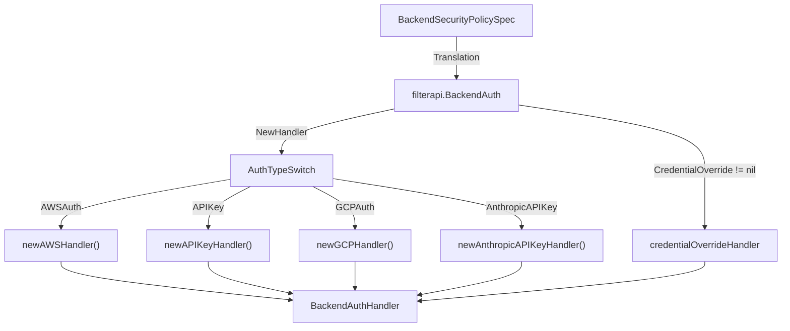
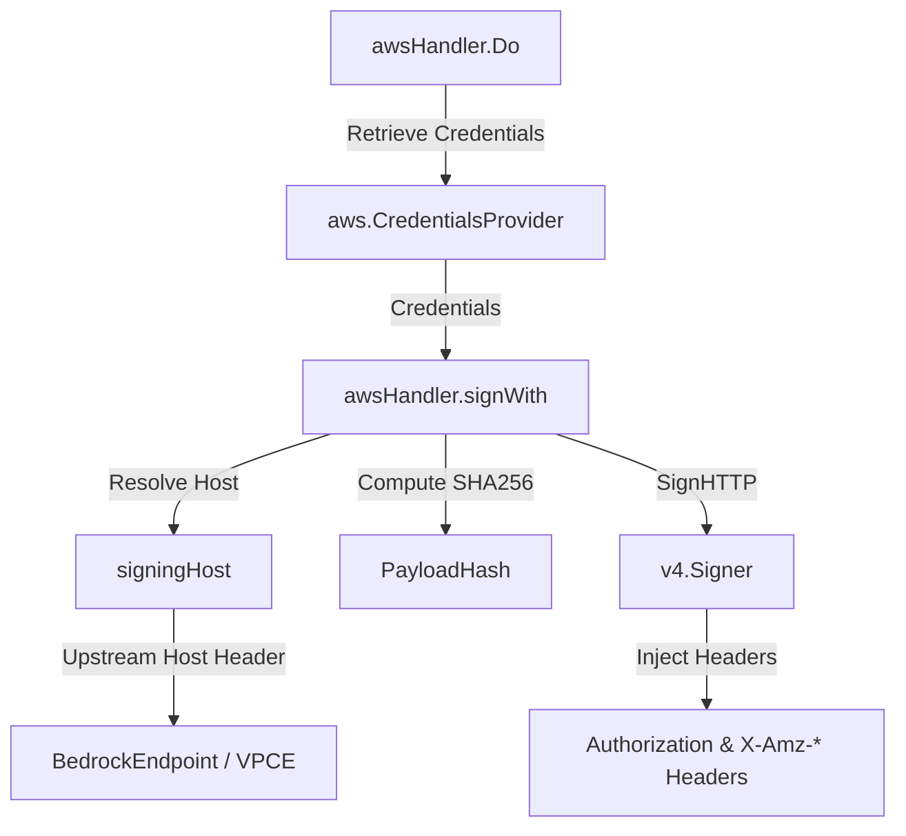
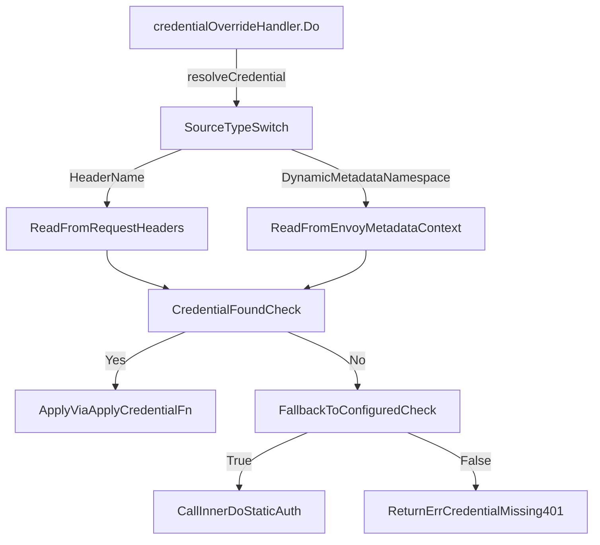

<!-- source: DeepWiki mcp.deepwiki.com · repo theagentrouter/agent-router · page 4.2 Backend Authentication and Credential Injection · fetched 2026-10-21 -->

# Backend Authentication and Credential Injection

Relevant source files

The following files were used as context for generating this wiki page:

- [api/v1beta1/backendsecurity_policy.go](api/v1beta1/backendsecurity_policy.go)
- [examples/access-log/README.md](examples/access-log/README.md)
- [examples/access-log/basic.yaml](examples/access-log/basic.yaml)
- [internal/backendauth/auth.go](internal/backendauth/auth.go)
- [internal/backendauth/aws.go](internal/backendauth/aws.go)
- [internal/backendauth/aws_test.go](internal/backendauth/aws_test.go)
- [internal/backendauth/credential_override.go](internal/backendauth/credential_override.go)
- [internal/backendauth/credential_override_test.go](internal/backendauth/credential_override_test.go)
- [site/docs/capabilities/observability/accesslogs.md](site/docs/capabilities/observability/accesslogs.md)
- [site/docs/capabilities/observability/index.md](site/docs/capabilities/observability/index.md)
- [site/docs/capabilities/security/index.md](site/docs/capabilities/security/index.md)
- [site/docs/capabilities/security/upstream-auth.mdx](site/docs/capabilities/security/upstream-auth.mdx)

## 1. Purpose and Scope

This page documents the internal architecture of backend authentication and per-request credential injection provided by the `internal/backendauth` package and defined by the `BackendSecurityPolicy` Kubernetes API resource (`api/v1beta1/backendsecurity_policy.go`). 

The subsystem is responsible for authenticating outbound traffic from the Envoy AI Gateway to AI model providers (such as AWS Bedrock, GCP Vertex AI, OpenAI, Azure, and Anthropic). It supports static credentials, cloud provider default credential chains, and dynamic per-request credential overrides sourced from request headers or Envoy dynamic metadata.

Sources: [api/v1beta1/backendsecurity_policy.go:16-110](), [internal/backendauth/auth.go:1-67]()

---

## 2. Policy Schema and Handler Factory

Authentication policies are declared in Kubernetes via `BackendSecurityPolicy` and translated into runtime handlers by `internal/backendauth`.

### CRD Validation and Types
The `BackendSecurityPolicySpec` uses Common Expression Language (CEL) validation rules to ensure that only one authentication mechanism is configured per policy type [api/v1beta1/backendsecurity_policy.go:49-55]. Supported policy types include `APIKey`, `AWSCredentials`, `AzureAPIKey`, `AzureCredentials`, `GCPCredentials`, and `AnthropicAPIKey` [api/v1beta1/backendsecurity_policy.go:18-25].

### Handler Instantiation
The factory function `NewHandler` inspects the `filterapi.BackendAuth` configuration structure and returns a concrete implementation of `filterapi.BackendAuthHandler` [internal/backendauth/auth.go:18-67]. If `CredentialOverride` is configured, it wraps the inner handler with a `credentialOverrideHandler` or `awsCredentialOverrideHandler` [internal/backendauth/auth.go:35,60-64].

Sources: [api/v1beta1/backendsecurity_policy.go:16-70](), [internal/backendauth/auth.go:18-67]()

---

## 3. AWS SigV4 Authentication (`awsHandler`)

AWS Bedrock integration requires AWS Signature Version 4 (SigV4) signing for HTTP requests.

### Configuration and Credential Loading
The `awsHandler` struct manages AWS credentials and signing state [internal/backendauth/aws.go:28-32]. The constructor `newAWSHandler` loads credentials either from an explicit literal credential file or by falling back to the AWS SDK default credential chain (supporting IRSA, EKS Pod Identity, instance roles, and environment variables) [internal/backendauth/aws.go:35-75].

### Request Signing Flow
When `Do()` is invoked, `awsHandler` retrieves active credentials and delegates to `signWith()` [internal/backendauth/aws.go:86-92]:
1. **Host Resolution**: `signingHost()` checks `internalapi.UpstreamHostHeader` (forwarded by the ext_proc filter from configuration translation) to correctly target VPC endpoints (`.vpce.amazonaws.com`), falling back to the regional default bedrock runtime host [internal/backendauth/aws.go:154-159].
2. **Region Correction**: Derives the SigV4 signing region from the resolved host using `internalapi.AWSBedrockRegionFromHost()` to prevent region mismatches [internal/backendauth/aws.go:106-108].
3. **Content-Length Handling**: Sets `req.ContentLength = -1` to omit `Content-Length` from the signature, allowing Envoy to use chunked transfer encoding via `ext_proc` [internal/backendauth/aws.go:123-130].
4. **SigV4 Signing**: Uses `v4.NewSigner().SignHTTP()` to generate the `Authorization` and `X-Amz-*` headers [internal/backendauth/aws.go:132-136].

Sources: [internal/backendauth/aws.go:28-159]()

---

## 4. GCP Vertex AI Authentication (`gcpHandler`)

GCP authentication handles communicating with Vertex AI and Gemini APIs.

### Initialization and Path Prefixing
`newGCPHandler` configures a `gcpHandler` using either a static access token or GCP Application Default Credentials (ADC) [internal/backendauth/auth.go:45-47]. During requests, `makeGCPApplyFn` constructs the project and location path hierarchy (`/v1/projects/{projectName}/locations/{region}`) and prepends it to the incoming `:path` header while injecting a Bearer token [internal/backendauth/credential_override.go:74-87].

Sources: [internal/backendauth/auth.go:45-47](), [internal/backendauth/credential_override.go:74-87]()

---

## 5. Per-Request Credential Overrides

The gateway supports overriding static backend credentials on a per-request basis using client-supplied headers or dynamic metadata produced by upstream filters (e.g., `ext_authz`).

### Credential Override Handler
`credentialOverrideHandler` wraps a static `BackendAuthHandler` and implements conditional override logic [internal/backendauth/credential_override.go:89-97]:
1. `resolveCredential()` reads the credential from either a configured header name (`HeaderName`) or Envoy dynamic metadata namespace and key (`DynamicMetadataNamespace`, `DynamicMetadataKey`) [internal/backendauth/credential_override.go:113-122].
2. Envoy metadata is threaded into the request context via `WithEnvoyMetadata()` and retrieved via `envoyMetadataFromContext()` [internal/backendauth/credential_override.go:34-45].
3. If the credential is absent, the handler checks `FallbackToConfigured` [internal/backendauth/credential_override.go:101-107]:
   - If `true`, it delegates to the inner static handler.
   - If `false`, it returns `ErrCredentialMissing`, which translates to an HTTP `401 Unauthorized` immediate response [internal/backendauth/credential_override.go:22-25,103-106].
4. If present, it applies the credential using provider-specific helper functions (`applyBearerCredential`, `applyAnthropicCredential`, `applyAzureAPIKeyCredential`, or `makeGCPApplyFn`) [internal/backendauth/credential_override.go:51-87,108].

Sources: [internal/backendauth/credential_override.go:22-140]()

---

