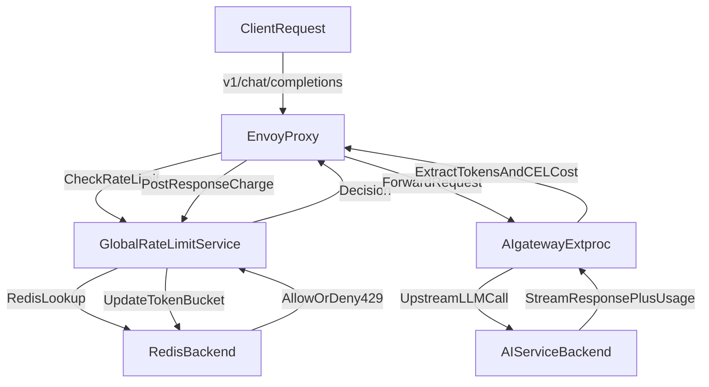
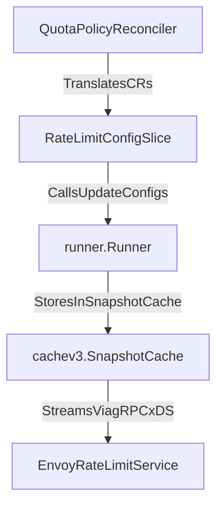

<!-- source: DeepWiki mcp.deepwiki.com · repo theagentrouter/agent-router · page 4.3 Rate Limiting and Quotas · fetched 2026-10-21 -->

# Rate Limiting and Quotas

<details>
<summary>Relevant source files</summary>

The following files were used as context for generating this wiki page:

- [internal/ratelimit/runner/runner.go](internal/ratelimit/runner/runner.go)
- [internal/ratelimit/runner/runner_test.go](internal/ratelimit/runner/runner_test.go)
- [site/docs/capabilities/traffic/usage-based-ratelimiting.md](site/docs/capabilities/traffic/usage-based-ratelimiting.md)
- [tests/e2e/dynamic_metadata_ratelimit_test.go](tests/e2e/dynamic_metadata_ratelimit_test.go)
- [tests/e2e/testdata/dynamic_metadata_ratelimit.yaml](tests/e2e/testdata/dynamic_metadata_ratelimit.yaml)
- [tests/internal/testextauth/testextauth.go](tests/internal/testextauth/testextauth.go)
- [tests/internal/testextauth/testextauthserver/main.go](tests/internal/testextauth/testextauthserver/main.go)

</details>


This page covers the technical implementation of rate limiting and quotas in Agent Router (Envoy AI Gateway), focusing on the `internal/ratelimit` xDS runner and translator subsystems, usage-based rate limiting, `QuotaPolicy` custom resource definitions, and LLM request cost evaluation via Common Expression Language (CEL) expressions.

---

## 1. Architecture and Data Flow

Agent Router integrates with Envoy Gateway's Global Rate Limit API to enforce token-aware rate limiting and consumption quotas for Large Language Model (LLM) workloads. Because LLM request costs depend heavily on prompt and completion token counts—which are only known *after* the upstream model generates a response—rate limiting relies on asynchronous token extraction and reporting.

The following diagram illustrates the lifecycle of a rate-limited LLM request across the data plane, control plane, and the global rate limit service:



Sources:
- `site/docs/capabilities/traffic/usage-based-ratelimiting.md` [site/docs/capabilities/traffic/usage-based-ratelimiting.md:1-78]()
- `tests/e2e/testdata/dynamic_metadata_ratelimit.yaml` [tests/e2e/testdata/dynamic_metadata_ratelimit.yaml:1-122]()

---

## 2. xDS Rate Limit Config Runner (`internal/ratelimit/runner`)

The control plane includes an xDS gRPC server runner located in `internal/ratelimit/runner`. This runner manages dynamic rate limit configuration distribution to Envoy's rate limit service using the xDS protocol (`RateLimitConfig` resources).

### Key Classes and Functions

- `runner.Runner`: Manages the gRPC server lifecycle, snapshot cache, and versioning for rate-limiting configurations [internal/ratelimit/runner/runner.go:39-46]().
- `runner.New`: Initializes a new xDS config server runner, defaulting to port `18002` via `DefaultPort` [internal/ratelimit/runner/runner.go:33-57]().
- `runner.Runner.Start`: Sets up an in-memory snapshot cache (`cachev3.NewSnapshotCache`), registers the aggregated discovery service server, and starts serving TCP connections [internal/ratelimit/runner/runner.go:60-88]().
- `runner.Runner.UpdateConfigs`: Updates the xDS snapshot cache with new rate limit configurations under `NodeID` (`envoy-ai-gateway-ratelimit`), incrementing the snapshot version safely with wraparound handling at `math.MaxInt64` [internal/ratelimit/runner/runner.go:30-34](), [internal/ratelimit/runner/runner.go:93-132]().

The following diagram bridges the control plane reconciliation loop to the xDS runner code entities:



Sources:
- `internal/ratelimit/runner/runner.go` [internal/ratelimit/runner/runner.go:1-132]()
- `internal/ratelimit/runner/runner_test.go` [internal/ratelimit/runner/runner_test.go:1-193]()

---

## 3. QuotaPolicy CRD and Token Quotas

The `QuotaPolicy` custom resource (`aigateway.envoyproxy.io/v1alpha1`) specifies token quota configurations, rate limit rules, and cost calculation expressions for inference services [manifests/charts/ai-gateway-crds-helm/templates/aigateway.envoyproxy.io_quotapolicies.yaml:31-35]().

### Go API Structures

The Go representation defines policies, service quotas, per-model quotas, and rule selectors:

- `v1alpha1.QuotaPolicy`: Root CRD structure with `ObjectMeta`, `Spec`, and `Status` [api/v1alpha1/quota_policy.go:26-32]().
- `v1alpha1.QuotaPolicySpec`: Contains `TargetRefs`, `ServiceQuota`, and `PerModelQuotas` [api/v1alpha1/quota_policy.go:34-60]().
- `v1alpha1.QuotaDefinition`: Specifies `CostExpression`, `Mode` (`QuotaBucketModeShared`), `DefaultBucket`, and `BucketRules` [api/v1alpha1/quota_policy.go:92-124]().
- `v1alpha1.QuotaRule`: Associates `ClientSelectors` with specific `Quota` limits and `ShadowMode` flags [api/v1alpha1/quota_policy.go:136-160]().

```yaml
apiVersion: aigateway.envoyproxy.io/v1alpha1
kind: QuotaPolicy
metadata:
  name: sample-quota-policy
spec:
  targetRefs:
    - group: aigateway.envoyproxy.io
      kind: AIServiceBackend
      name: my-ai-backend
  perModelQuotas:
    - modelName: "gpt-4"
      quota:
        costExpression: "input_tokens + (output_tokens * 2)"
        mode: Shared
        defaultBucket:
          requests: 1000
          unit: Hour
```

Sources:
- `manifests/charts/ai-gateway-crds-helm/templates/aigateway.envoyproxy.io_quotapolicies.yaml` [manifests/charts/ai-gateway-crds-helm/templates/aigateway.envoyproxy.io_quotapolicies.yaml:1-130]()
- `api/v1alpha1/quota_policy.go` [api/v1alpha1/quota_policy.go:1-160]()

---

## 4. LLM Request Cost CEL Expressions and Token Tracking

To support advanced usage-based rate limiting, AI Gateway extracts token usage from LLM responses adhering to the OpenAI schema format (`prompt_tokens`, `completion_tokens`, `total_tokens`) and exposes them under metadata namespaces [site/docs/capabilities/traffic/usage-based-ratelimiting.md:25-30]().

### Token Types and Cost Calculation

1. **InputToken**: Counts prompt tokens.
2. **CachedInputToken**: Counts cached prompt tokens.
3. **OutputToken**: Counts completion tokens.
4. **TotalToken**: Combined prompt and completion tokens.
5. **CEL**: Custom expression evaluation for weighting tokens (e.g., discounting cached tokens or penalizing output tokens) [site/docs/capabilities/traffic/usage-based-ratelimiting.md:36-47]().

### Example: Configurable Request Costs in GatewayConfig

Gateway-scoped configurations define global LLM request costs emitted on the response path [tests/e2e/testdata/dynamic_metadata_ratelimit.yaml:63-78]():

```yaml
apiVersion: aigateway.envoyproxy.io/v1beta1
kind: GatewayConfig
metadata:
  name: envoy-ai-gateway-dynamic-ratelimit
  namespace: default
spec:
  globalLLMRequestCosts:
    - metadataKey: llm_input_token
      type: InputToken
    - metadataKey: llm_output_token
      type: OutputToken
    - metadataKey: llm_total_token
      type: TotalToken
```

When integrated with Envoy Gateway's `BackendTrafficPolicy`, token costs are evaluated against dynamic metadata or static limits [tests/e2e/testdata/dynamic_metadata_ratelimit.yaml:147-198](). Streaming responses are permitted to complete even if they exceed token thresholds during generation; post-stream charges are recorded to enforce limits on subsequent requests [site/docs/capabilities/traffic/usage-based-ratelimiting.md:56-62]().

Sources:
- `site/docs/capabilities/traffic/usage-based-ratelimiting.md` [site/docs/capabilities/traffic/usage-based-ratelimiting.md:1-333]()
- `tests/e2e/testdata/dynamic_metadata_ratelimit.yaml` [tests/e2e/testdata/dynamic_metadata_ratelimit.yaml:1-202]()
- `tests/e2e/dynamic_metadata_ratelimit_test.go` [tests/e2e/dynamic_metadata_ratelimit_test.go:1-147]()

---

