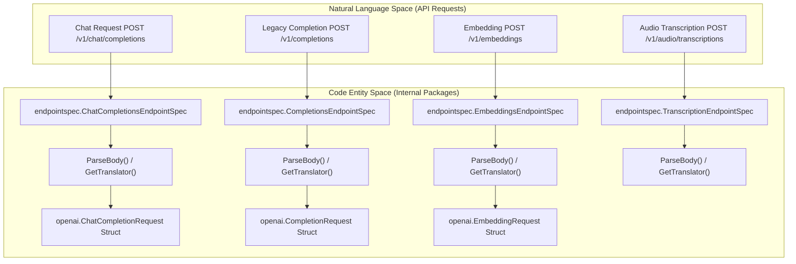
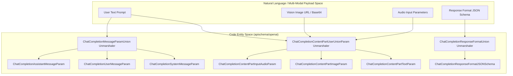

<!-- source: DeepWiki mcp.deepwiki.com · repo theagentrouter/agent-router · page 5.1 OpenAI Schema and Endpoint Specs · fetched 2026-10-21 -->

# OpenAI Schema and Endpoint Specs

<details>
<summary>Relevant source files</summary>

The following files were used as context for generating this wiki page:

- [internal/apischema/openai/openai.go](internal/apischema/openai/openai.go)
- [internal/apischema/openai/openai_test.go](internal/apischema/openai/openai_test.go)
- [internal/apischema/openai/union_test.go](internal/apischema/openai/union_test.go)
- [internal/tracing/openinference/openai/request_attrs.go](internal/tracing/openinference/openai/request_attrs.go)
- [internal/tracing/openinference/openai/request_attrs_test.go](internal/tracing/openinference/openai/request_attrs_test.go)
- [internal/translator/gemini_helper.go](internal/translator/gemini_helper.go)
- [internal/translator/gemini_helper_test.go](internal/translator/gemini_helper_test.go)
- [internal/translator/openai_completions.go](internal/translator/openai_completions.go)
- [internal/translator/openai_gcpvertexai.go](internal/translator/openai_gcpvertexai.go)
- [internal/translator/openai_gcpvertexai_test.go](internal/translator/openai_gcpvertexai_test.go)
- [internal/translator/openai_openai.go](internal/translator/openai_openai.go)
- [internal/translator/openai_openai_test.go](internal/translator/openai_openai_test.go)
- [internal/translator/openai_responses.go](internal/translator/openai_responses.go)
- [internal/translator/openai_responses_test.go](internal/translator/openai_responses_test.go)
- [internal/translator/openai_speech.go](internal/translator/openai_speech.go)
- [internal/translator/openai_speech_test.go](internal/translator/openai_speech_test.go)
- [internal/translator/openai_transcription.go](internal/translator/openai_transcription.go)
- [internal/translator/util.go](internal/translator/util.go)
- [internal/translator/util_test.go](internal/translator/util_test.go)
- [tests/internal/testopenai/chat_requests.go](tests/internal/testopenai/chat_requests.go)

</details>


## Purpose and Scope
This page details the implementation of OpenAI API schemas, polymorphic union unmarshaling, and the `EndpointSpec` routing layer within the Agent Router data plane. It covers the request/response data structures defined in the `openai` package [internal/apischema/openai/openai.go](), the custom JSON unmarshaling strategies for multi-type fields [internal/apischema/openai/openai_test.go](), and how incoming HTTP paths map to provider-agnostic endpoint specifications (`endpointspec.Spec`) [internal/endpointspec/endpointspec.go]().

---

## 1. OpenAI API Request and Response Structs

The Agent Router maintains an internal Go representation of the OpenAI API specification [internal/apischema/openai/openai.go]() rather than relying on automatic code generation tools. This design choice accommodates inconsistencies in vendor-supplied OpenAPI definitions and allows fine-grained control over parsing, serialization, and translation.

### Core Message Roles and Content Types
The schema defines standard chat message roles and content part types:
- **Roles**: `ChatMessageRoleSystem` (`system`), `ChatMessageRoleDeveloper` (`developer`), `ChatMessageRoleUser` (`user`), `ChatMessageRoleAssistant` (`assistant`), `ChatMessageRoleTool` (`tool`) [internal/apischema/openai/openai.go:29-37]().
- **Content Part Types**: Text (`text`), Refusal (`refusal`), Input Audio (`input_audio`), Image URL (`image_url`), Audio URL (`audio_url`), Video URL (`video_url`), and File (`file`) [internal/apischema/openai/openai.go:88-96]().

### Key Request Structures
- `ChatCompletionRequest`: Represents payloads sent to `/v1/chat/completions`, including `Model`, `Messages`, `Tools`, `ToolChoice`, `Temperature`, `TopP`, `Stream`, and `StreamOptions` [internal/apischema/openai/openai.go]().
- `ChatCompletionContentPartTextParam`, `ChatCompletionContentPartImageParam`, and `ChatCompletionContentPartInputAudioParam`: Structs encapsulating multi-modal input parameters [internal/apischema/openai/openai.go:98-154]().

Sources:
- `internal/apischema/openai/openai.go`

---

## 2. Union Unmarshaling and Polymorphic Types

Because OpenAI API fields often accept multiple primitive or structured types (e.g., message content can be a plain string or an array of content parts, and response formats can be text, json_object, or json_schema), the schema implements custom unmarshaling logic.

### Polymorphic Unmarshaling Implementation
The unmarshaler inspects the JSON payload (specifically checking for discriminator fields like `"type"` or structural attributes) and routes the bytes into the appropriate concrete struct fields [internal/apischema/openai/openai_test.go:23-128]().

Tests in `internal/apischema/openai/openai_test.go` and `internal/apischema/openai/union_test.go` validate union unmarshaling for:
1. `ChatCompletionContentPartUserUnionParam` (handling text, image_url, audio_url, video_url, input_audio) [internal/apischema/openai/openai_test.go:23-128]().
2. `ChatCompletionResponseFormatUnion` (handling `text`, `json_object`, and `json_schema`) [internal/apischema/openai/openai_test.go:131-196]().
3. `ChatCompletionMessageParamUnion` (handling system, developer, user, tool, and assistant message permutations) [internal/apischema/openai/openai_test.go:198-226]().
4. Nested unions such as completion prompts and embedding inputs [internal/apischema/openai/union_test.go:18-79]().

Sources:
- `internal/apischema/openai/openai.go`
- `internal/apischema/openai/openai_test.go`
- `internal/apischema/openai/union_test.go`

---

## 3. Supported Endpoints and EndpointSpec Routing

The `internal/endpointspec` package defines the generic `Spec[ReqT, RespT, RespChunkT]` interface, which bundles request parsing, translator selection, and request redaction for distinct AI API routes [internal/endpointspec/endpointspec.go:35-97]().

### The `Spec` Interface
```go
type Spec[ReqT, RespT, RespChunkT any] interface {
    ParseBody(body []byte, costConfigured bool) (originalModel internalapi.OriginalModel, req *ReqT, stream bool, mutatedBody []byte, err error)
    GetTranslator(schema filterapi.VersionedAPISchema, modelNameOverride string) (translator.Translator[ReqT, tracingapi.Span[RespT, RespChunkT]], error)
    RedactSensitiveInfoFromRequest(req *ReqT) (redactedReq *ReqT, err error)
    ParseMultipartBody(body []byte, contentType string, costConfigured bool) (originalModel internalapi.OriginalModel, req *ReqT, stream bool, mutatedBody []byte, err error)
}
```
[internal/endpointspec/endpointspec.go:47-97]()

### Concrete Endpoint Specs
The codebase implements concrete specification structs for each supported route:

| Endpoint Path | Struct Name | Description |
| :--- | :--- | :--- |
| `POST /v1/chat/completions` | `ChatCompletionsEndpointSpec` | Multi-turn chat completions [internal/endpointspec/endpointspec.go:98-99]() |
| `POST /v1/completions` | `CompletionsEndpointSpec` | Legacy text completions [internal/endpointspec/endpointspec.go:100-101]() |
| `POST /v1/embeddings` | `EmbeddingsEndpointSpec` | Vector embeddings [internal/endpointspec/endpointspec.go:102-103]() |
| `POST /v1/images/generations` | `ImageGenerationEndpointSpec` | Image synthesis [internal/endpointspec/endpointspec.go:104-105]() |
| `POST /v1/responses` | `ResponsesEndpointSpec` | Advanced reasoning/responses API [internal/endpointspec/endpointspec.go:106-107]() |
| `POST /anthropic/v1/messages` | `MessagesEndpointSpec` | Anthropic-compatible messages [internal/endpointspec/endpointspec.go:108-109]() |
| `POST /v1/audio/speech` | `SpeechEndpointSpec` | Text-to-speech audio generation [internal/endpointspec/endpointspec.go:115-116]() |
| `POST /v1/audio/transcriptions` | `TranscriptionEndpointSpec` | Audio transcription [internal/endpointspec/endpointspec.go:116-117]() |
| `POST /tokenize` | `TokenizeEndpointSpec` | Token counting and tokenization [internal/endpointspec/endpointspec.go:121-122]() |

### Request Parsing and Stream Option Mutation
When `ChatCompletionsEndpointSpec.ParseBody` executes, if streaming (`req.Stream == true`) is enabled and cost metrics are configured without explicit `stream_options.include_usage`, the spec automatically injects `StreamOptions = &openai.StreamOptions{IncludeUsage: true}` and generates a `mutatedBody` byte slice to ensure downstream token accounting functions correctly [internal/endpointspec/endpointspec.go:132-144]().

Sources:
- `internal/endpointspec/endpointspec.go`
- `internal/endpointspec/endpointspec_test.go`
- `site/docs/capabilities/llm-integrations/supported-endpoints.md`

---

## 4. Architectural Mapping Diagrams

### Diagram 1: Natural Language Space to Code Entity Space — Endpoint Routing & Parsing Flow
This diagram bridges user-facing HTTP endpoints and natural language requests to the concrete `endpointspec.Spec` implementations and parsing functions in the codebase.


Sources:
- `internal/endpointspec/endpointspec.go`
- `site/docs/capabilities/llm-integrations/supported-endpoints.md`

### Diagram 2: Natural Language Space to Code Entity Space — Union Unmarshaling Architecture
This diagram connects multi-modal user input formats (text, images, audio payloads) to the polymorphic union unmarshaling structs and functions in the `openai` schema package.


Sources:
- `internal/apischema/openai/openai.go`
- `internal/apischema/openai/openai_test.go`
- `internal/apischema/openai/union_test.go`

---

