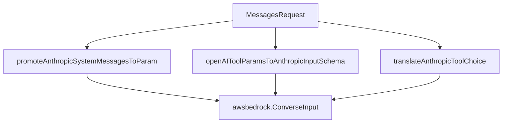
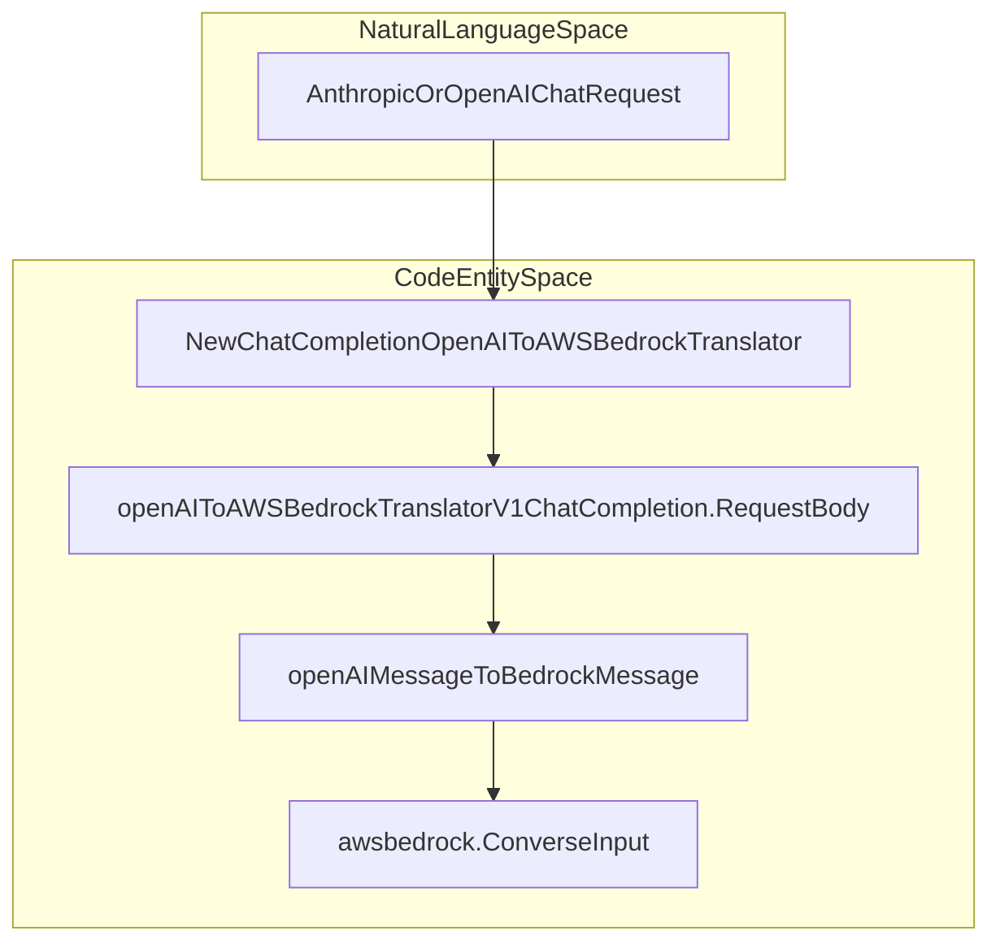
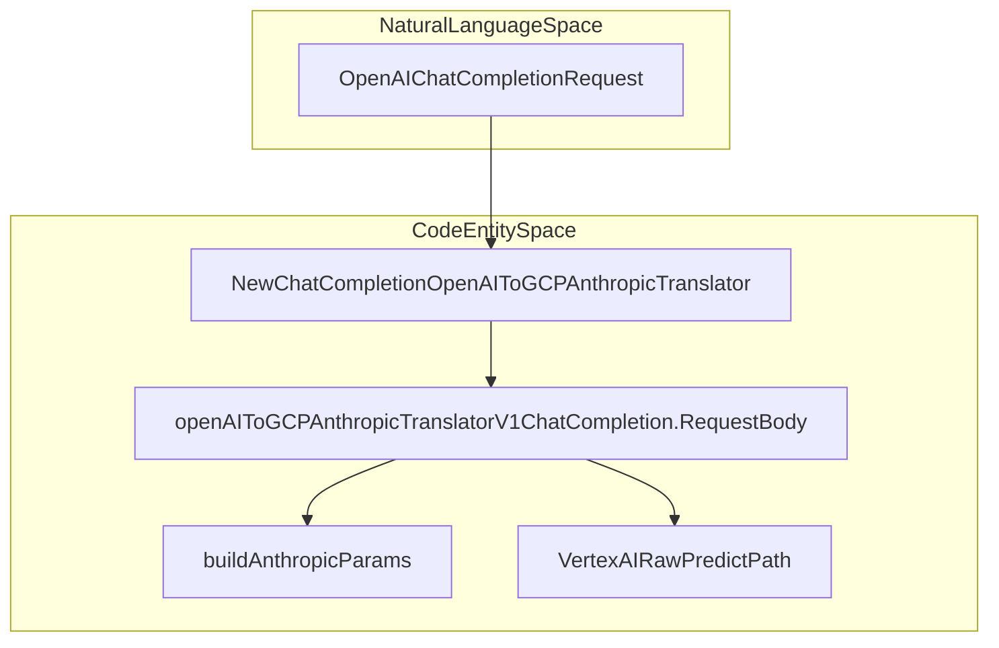
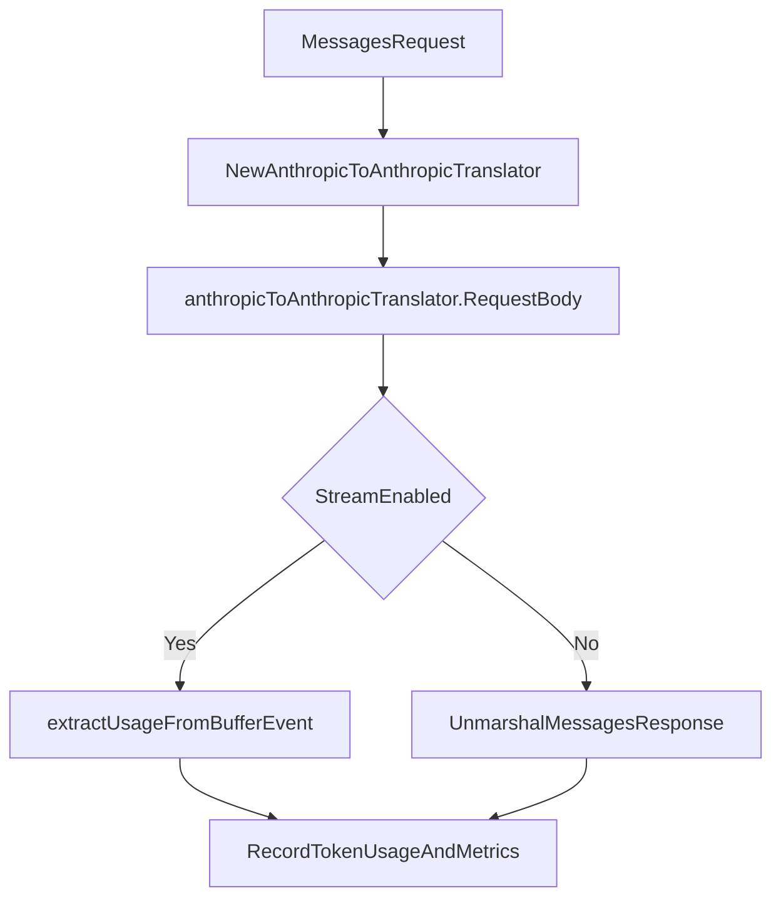

<!-- source: DeepWiki mcp.deepwiki.com · repo theagentrouter/agent-router · page 5.2 AWS Bedrock and Anthropic Translators · fetched 2026-10-21 -->

# AWS Bedrock and Anthropic Translators

Relevant source files

The following files were used as context for generating this wiki page:

- [internal/apischema/anthropic/anthropic.go](internal/apischema/anthropic/anthropic.go)
- [internal/apischema/anthropic/anthropic_test.go](internal/apischema/anthropic/anthropic_test.go)
- [internal/apischema/anthropic/stream_fold.go](internal/apischema/anthropic/stream_fold.go)
- [internal/apischema/anthropic/stream_fold_bench_test.go](internal/apischema/anthropic/stream_fold_bench_test.go)
- [internal/apischema/anthropic/stream_fold_buffers_test.go](internal/apischema/anthropic/stream_fold_buffers_test.go)
- [internal/apischema/anthropic/stream_fold_test.go](internal/apischema/anthropic/stream_fold_test.go)
- [internal/apischema/awsbedrock/awsbedrock.go](internal/apischema/awsbedrock/awsbedrock.go)
- [internal/apischema/openai/vendor_fields_test.go](internal/apischema/openai/vendor_fields_test.go)
- [internal/extproc/models_processor.go](internal/extproc/models_processor.go)
- [internal/extproc/models_processor_test.go](internal/extproc/models_processor_test.go)
- [internal/testing/testotel/assertions.go](internal/testing/testotel/assertions.go)
- [internal/translator/anthropic_anthropic.go](internal/translator/anthropic_anthropic.go)
- [internal/translator/anthropic_anthropic_test.go](internal/translator/anthropic_anthropic_test.go)
- [internal/translator/anthropic_gcpanthropic_test.go](internal/translator/anthropic_gcpanthropic_test.go)
- [internal/translator/anthropic_helper.go](internal/translator/anthropic_helper.go)
- [internal/translator/anthropic_helper_test.go](internal/translator/anthropic_helper_test.go)
- [internal/translator/converse_helper.go](internal/translator/converse_helper.go)
- [internal/translator/converse_helper_test.go](internal/translator/converse_helper_test.go)
- [internal/translator/openai_awsanthropic.go](internal/translator/openai_awsanthropic.go)
- [internal/translator/openai_awsanthropic_test.go](internal/translator/openai_awsanthropic_test.go)
- [internal/translator/openai_awsbedrock.go](internal/translator/openai_awsbedrock.go)
- [internal/translator/openai_awsbedrock_test.go](internal/translator/openai_awsbedrock_test.go)
- [internal/translator/openai_gcpanthropic.go](internal/translator/openai_gcpanthropic.go)
- [internal/translator/openai_gcpanthropic_test.go](internal/translator/openai_gcpanthropic_test.go)
- [internal/translator/tokenize_awsbedrock.go](internal/translator/tokenize_awsbedrock.go)
- [internal/translator/tokenize_awsbedrock_test.go](internal/translator/tokenize_awsbedrock_test.go)
- [site/docs/capabilities/llm-integrations/vendor-specific-fields.md](site/docs/capabilities/llm-integrations/vendor-specific-fields.md)

## Purpose and Scope
This page details the translation engine responsible for processing Anthropic Messages API and OpenAI Chat Completion requests and routing them across vendor backends, including native Anthropic, AWS Bedrock (via the Converse API), and GCP Vertex AI (via `rawPredict`). It covers request/response translation, tool and tool-choice mapping, system prompt promotion, error handling, and server-sent events (SSE) stream folding.

Sources: `internal/translator/anthropic_helper.go:1-170()`, `internal/translator/openai_awsbedrock.go:1-190()`, `internal/translator/openai_gcpanthropic.go:1-157()`

---

## 1. Anthropic Messages API Schema and Helpers
The core schema for Anthropic requests is defined in `internal/apischema/anthropic/anthropic.go:26-89()`. The `MessagesRequest` struct defines fields such as `Model`, `Messages`, `MaxTokens`, `System`, `Tools`, `ToolChoice`, and `Stream`.

Helper functions in `internal/translator/anthropic_helper.go:50-83()` convert OpenAI tool definitions into Anthropic's `ToolInputSchemaParam` format by mapping `type`, `properties`, and `required` fields while preserving extra parameters. Tool choice parameters are translated via `translateAnthropicToolChoice` (`internal/translator/anthropic_helper.go:115-155()`).

Title: Anthropic Request and Tool Translation Flow

Sources: `internal/apischema/anthropic/anthropic.go:26-89()`, `internal/translator/anthropic_helper.go:50-155()`

---

## 2. AWS Bedrock Converse API Translator
The AWS Bedrock translators convert Anthropic or OpenAI Messages API payloads into the AWS Bedrock Converse API schema (`awsbedrock.ConverseInput`).

### Key Types and Functions
- `NewChatCompletionOpenAIToAWSBedrockTranslator`: Constructs an `OpenAIChatCompletionTranslator` implementation using `openAIToAWSBedrockTranslatorV1ChatCompletion` (`internal/translator/openai_awsbedrock.go:31-33()`).
- `RequestBody`: Implements request transformation, model name overriding, URL path escaping for model IDs/ARNs, and route selection between `/model/{model}/converse` and `/model/{model}/converse-stream` (`internal/translator/openai_awsbedrock.go:103-179()`).
- `openAIMessageToBedrockMessage`: Converts OpenAI chat completion messages to AWS Bedrock messages (`internal/translator/openai_awsbedrock.go:183-190()`).

Title: AWS Bedrock Natural Language to Code Entity Space Translation

Sources: `internal/translator/openai_awsbedrock.go:31-190()`, `internal/apischema/awsbedrock/awsbedrock.go:126-144()`

---

## 3. GCP Vertex AI and Anthropic Translators
The GCP Anthropic translator converts requests into the GCP Vertex AI format using the `rawPredict` and `streamRawPredict` endpoints (`internal/translator/openai_gcpanthropic.go:33-54()`).

### Implementation Details
- `NewChatCompletionOpenAIToGCPAnthropicTranslator`: Returns an `openAIToGCPAnthropicTranslatorV1ChatCompletion` instance (`internal/translator/openai_gcpanthropic.go:35-40()`).
- `RequestBody`: Constructs the GCP path suffix, injects the `anthropic_version` key (`anthropicVertex.DefaultVersion`), and sets the `stream` flag if requested (`internal/translator/openai_gcpanthropic.go:57-101()`).
- `ResponseError`: Translates GCP error responses into standard OpenAI-compatible error payloads (`internal/translator/openai_gcpanthropic.go:104-154()`).

Title: GCP Vertex AI Natural Language to Code Entity Space Translation

Sources: `internal/translator/openai_gcpanthropic.go:33-154()`

---

## 4. Native Anthropic Passthrough and Stream Folding
The native Anthropic translator (`anthropicToAnthropicTranslator`) handles passthrough traffic for Anthropic-compatible endpoints (`internal/translator/anthropic_anthropic.go:32-51()`).

### Streaming & Token Extraction
- `RequestBody`: Updates the model name if an override is provided and sets the target path to `/v1/messages` (`internal/translator/anthropic_anthropic.go:53-77()`).
- `ResponseBody`: Buffers and processes Server-Sent Events (SSE) streams when `body.Stream` is true, extracting usage statistics and recording chunks via `extractUsageFromBufferEvent` and `reflectStreamingEvent` (`internal/translator/anthropic_anthropic.go:87-183()`).

Title: Native Anthropic Streaming and Stream Folding Pipeline

Sources: `internal/translator/anthropic_anthropic.go:32-183()`

---

