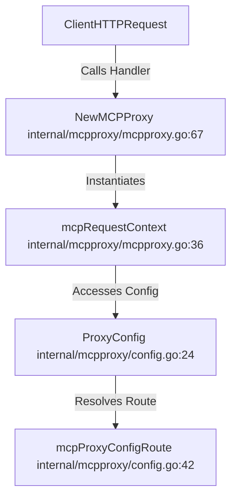
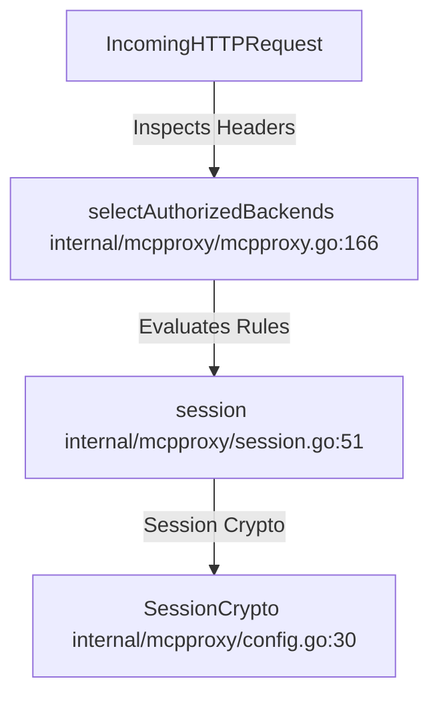
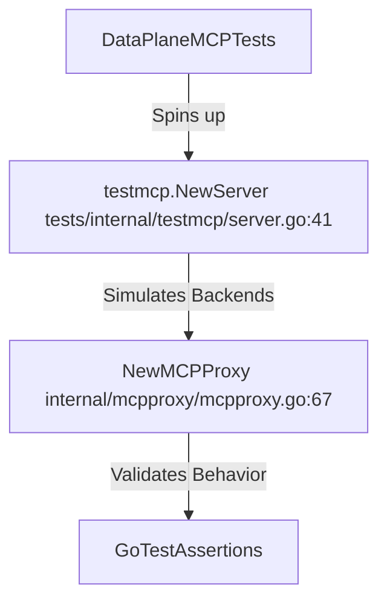

<!-- source: DeepWiki mcp.deepwiki.com · repo theagentrouter/agent-router · page 6 MCP Gateway · fetched 2026-10-21 -->

# MCP Gateway

Relevant source files

The following files were used as context for generating this wiki page:

- [internal/filterapi/mcpconfig.go](internal/filterapi/mcpconfig.go)
- [internal/mcpproxy/config.go](internal/mcpproxy/config.go)
- [internal/mcpproxy/config_test.go](internal/mcpproxy/config_test.go)
- [internal/mcpproxy/fanout_subset_test.go](internal/mcpproxy/fanout_subset_test.go)
- [internal/mcpproxy/handlers.go](internal/mcpproxy/handlers.go)
- [internal/mcpproxy/handlers_test.go](internal/mcpproxy/handlers_test.go)
- [internal/mcpproxy/legacy.go](internal/mcpproxy/legacy.go)
- [internal/mcpproxy/legacy_test.go](internal/mcpproxy/legacy_test.go)
- [internal/mcpproxy/mcpproxy.go](internal/mcpproxy/mcpproxy.go)
- [internal/mcpproxy/mcpproxy_test.go](internal/mcpproxy/mcpproxy_test.go)
- [internal/mcpproxy/modern.go](internal/mcpproxy/modern.go)
- [internal/mcpproxy/modern_test.go](internal/mcpproxy/modern_test.go)
- [internal/mcpproxy/session.go](internal/mcpproxy/session.go)
- [internal/mcpproxy/session_test.go](internal/mcpproxy/session_test.go)
- [site/blog/2025/2025-12-08-mcp-routing.md](site/blog/2025/2025-12-08-mcp-routing.md)
- [tests/data-plane-mcp/bench/aigw.yaml](tests/data-plane-mcp/bench/aigw.yaml)
- [tests/data-plane-mcp/bench/bench_test.go](tests/data-plane-mcp/bench/bench_test.go)
- [tests/internal/testmcp/server.go](tests/internal/testmcp/server.go)

The Model Context Protocol (MCP) Gateway in Agent Router provides enterprise-grade proxying, multiplexing, security, and observability for Model Context Protocol servers. It bridges AI agents with backend MCP capabilities (tools, prompts, and resources) via the `MCPRoute` custom resource and a robust data plane proxy layer [internal/filterapi/mcpconfig.go:37-60]().

For full technical details, consult the child pages:
- [MCP Proxy Internals](#6.1) — Sessions, composite session IDs and encryption, SSE streaming, tool/prompt merging and selectors, config loading, legacy and era handling.
- [MCP Security and Authorization](#6.2) — OAuth flows, claim-to-header mapping, MCPRoute security policy controller and extension server wiring.
- [MCP Testing and Examples](#6.3) — testmcp servers, data-plane-mcp tests, benchmarks, MCP example manifests and agent scripts.

---

## Architecture and Multiplexing Overview

The MCP Gateway operates by exposing a unified endpoint that accepts MCP over HTTP and Server-Sent Events (SSE) / JSON-RPC [internal/mcpproxy/mcpproxy.go:67-105](). Incoming requests are handled by `NewMCPProxy`, which initializes request-scoped contexts (`mcpRequestContext`) carrying route headers mapped from Envoy routing rules [internal/mcpproxy/mcpproxy.go:36-50](). These direct traffic to backend configurations managed within `ProxyConfig` and `mcpProxyConfigRoute` [internal/mcpproxy/config.go:24-70]().

The proxy maintains state across sessions using composite session IDs encrypted via `SessionCrypto` [internal/mcpproxy/config.go:24-35](). When a client initializes a session, the gateway fans out initialization to all configured backends for that route, merging tool and prompt catalogs while enforcing prefixing modes (`PrefixModeAlways` or `PrefixModeNever`), tool selectors, and authorization rules [internal/mcpproxy/config.go:42-70](), [internal/mcpproxy/handlers_test.go:93-106]().

Title: MCP Gateway Multiplexing Architecture

Sources: `internal/mcpproxy/mcpproxy.go:36-105`, `internal/mcpproxy/config.go:24-70`

For deep dives into session management, composite session IDs, encryption, SSE event parsing, and tool/prompt selector compilation, see [MCP Proxy Internals](#6.1).

---

## Security and Authorization

MCP Gateway integrates natively with upstream OAuth flows, claim-to-header mapping [internal/mcpproxy/session.go:51-67](), and fine-grained authorization policies [internal/mcpproxy/handlers_test.go:93-106](). The `BackendSecurityPolicy` and `MCPRoute` controllers coordinate with extension servers to secure connections to backend MCP servers.

Client requests undergo JWT verification, scope checking, and CEL-based authorization rules evaluated by `selectAuthorizedBackends` before any tools or prompts are exposed or invoked [internal/mcpproxy/mcpproxy.go:166-189](). Header forwarding rules ensure tenant identity and claims are safely propagated to internal backend servers while session states are tracked via the `session` struct [internal/mcpproxy/session.go:51-67]().

Title: MCP Security and Authorization Flow

Sources: `internal/mcpproxy/mcpproxy.go:166-189`, `internal/mcpproxy/session.go:51-67`, `internal/mcpproxy/config.go:24-35`

For comprehensive documentation on OAuth flows, claim-to-header mapping, security policy controllers, and extension wiring, see [MCP Security and Authorization](#6.2).

---

## Testing, Examples, and Verification

The repository provides extensive test harnesses, mock MCP servers (`testmcp`), and end-to-end data plane validation suites to guarantee protocol compliance [tests/internal/testmcp/server.go:41-166](). The `testmcp` package implements standard demo tools (`echo`, `sum`, errors, prompts, and resources) supporting HTTP JSON and SSE streaming responses [tests/internal/testmcp/server.go:41-166]().

Title: MCP Testing Harness Architecture

Sources: `tests/internal/testmcp/server.go:41-166`, `internal/mcpproxy/mcpproxy.go:67-105`

For details on test servers, data plane tests, benchmarks, and agent script examples, see [MCP Testing and Examples](#6.3).

---

