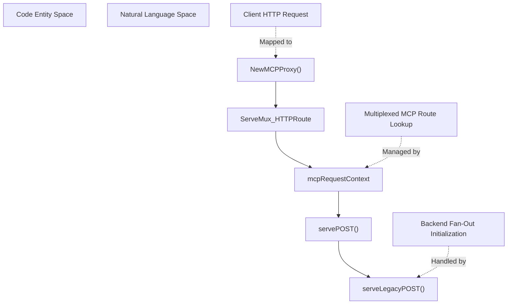
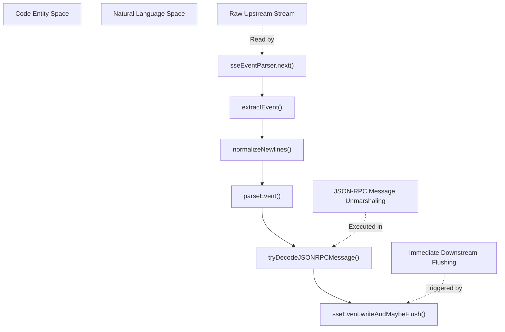

<!-- source: DeepWiki mcp.deepwiki.com · repo theagentrouter/agent-router · page 6.1 MCP Proxy Internals · fetched 2026-10-21 -->

# MCP Proxy Internals

Relevant source files

The following files were used as context for generating this wiki page:

- [internal/filterapi/mcpconfig.go](internal/filterapi/mcpconfig.go)
- [internal/lang/maps.go](internal/lang/maps.go)
- [internal/lang/maps_test.go](internal/lang/maps_test.go)
- [internal/mcpproxy/config.go](internal/mcpproxy/config.go)
- [internal/mcpproxy/config_test.go](internal/mcpproxy/config_test.go)
- [internal/mcpproxy/fanout_subset_test.go](internal/mcpproxy/fanout_subset_test.go)
- [internal/mcpproxy/handlers.go](internal/mcpproxy/handlers.go)
- [internal/mcpproxy/handlers_test.go](internal/mcpproxy/handlers_test.go)
- [internal/mcpproxy/legacy.go](internal/mcpproxy/legacy.go)
- [internal/mcpproxy/legacy_test.go](internal/mcpproxy/legacy_test.go)
- [internal/mcpproxy/mcpproxy.go](internal/mcpproxy/mcpproxy.go)
- [internal/mcpproxy/mcpproxy_test.go](internal/mcpproxy/mcpproxy_test.go)
- [internal/mcpproxy/modern.go](internal/mcpproxy/modern.go)
- [internal/mcpproxy/modern_test.go](internal/mcpproxy/modern_test.go)
- [internal/mcpproxy/session.go](internal/mcpproxy/session.go)
- [internal/mcpproxy/session_test.go](internal/mcpproxy/session_test.go)
- [internal/mcpproxy/sse.go](internal/mcpproxy/sse.go)
- [internal/mcpproxy/sse_test.go](internal/mcpproxy/sse_test.go)
- [internal/metrics/mcp_metrics.go](internal/metrics/mcp_metrics.go)
- [internal/metrics/mcp_metrics_test.go](internal/metrics/mcp_metrics_test.go)
- [internal/tracing/mcp.go](internal/tracing/mcp.go)
- [internal/tracing/mcp_test.go](internal/tracing/mcp_test.go)
- [internal/tracing/tracingapi/mcp.go](internal/tracing/tracingapi/mcp.go)
- [tests/internal/testmcp/server.go](tests/internal/testmcp/server.go)

## Purpose and Scope
This page details the implementation of Model Context Protocol (MCP) support within the `internal/mcpproxy` package and its configuration definitions in `internal/filterapi`. It covers multiplexed sessions, composite session identifier encryption, server-sent events (SSE) parsing and streaming, tool and prompt name merging under different `PrefixMode` strategies, dynamic configuration loading, and legacy/era dispatch handling.

Sources:
- `internal/mcpproxy/mcpproxy.go`()
- `internal/mcpproxy/session.go`()
- `internal/filterapi/mcpconfig.go`()

---

## Architecture & Request Flow

Incoming HTTP traffic targeting MCP endpoints is intercepted by `NewMCPProxy` defined in `internal/mcpproxy/mcpproxy.go:67-105`(). The request multiplexer dispatches requests to an active `mcpRequestContext` (`internal/mcpproxy/mcpproxy.go:36-50`)(), which evaluates HTTP methods (`GET`, `POST`, `DELETE`) and manages connection routing.

*Figure 1: MCP Proxy Request Lifecycle mapping conceptual routes to code components.*

Sources:
- `internal/mcpproxy/mcpproxy.go:36-105`()
- `internal/mcpproxy/handlers.go:65-110`()

---

## Session Management and Composite Session IDs

The proxy coordinates client sessions via the `session` struct (`internal/mcpproxy/session.go:51-67`)(). Because a single client session can span multiple backend MCP servers, the proxy maintains a map of per-backend sessions (`perBackendSessions`).

### Session Lifecycle and Cleanup
- **Initialization**: `newSession` multiplexes initialize requests across selected backends based on route definitions and `backendSelector` rules (`internal/mcpproxy/mcpproxy.go:191`)().
- **Termination**: Calling `Close()` (`internal/mcpproxy/session.go:69-112`)() iterates over all active `perBackendSessions`, generating `DELETE` HTTP requests with appropriate headers (`sessionIDHeader`) to tear down upstream sessions.
- **Capabilities**: Client and server capabilities are encoded into and decoded from bitflags using `encodeCapabilityFlags` and `decodeCapabilityFlags` (`internal/mcpproxy/session_test.go:52-147`)(), respectively.
- **Last Event ID tracking**: Managed via `lastEventID()` (`internal/mcpproxy/session.go:144-166`)(), encrypting concatenated state when `sessionCrypto` is configured.

Sources:
- `internal/mcpproxy/session.go:51-166`()
- `internal/mcpproxy/session_test.go:52-147`()
- `internal/mcpproxy/mcpproxy.go:191`()

---

## SSE Streaming and Event Parsing

Upstream MCP servers communicate via Server-Sent Events (SSE). The `sseEventParser` struct (`internal/mcpproxy/sse.go:42-48`)(), reads from an `io.Reader` and robustly handles line terminations (`CR`, `LF`, `CRLF`).

*Figure 2: SSE parsing pipeline and message delivery.*

Key parsing functions:
- `tryDecodeJSONRPCMessage` (`internal/mcpproxy/sse.go:57-65`)(_): Strips leading UTF-8 Byte Order Marks (`utf8BOM`) and leading whitespace prior to JSON-RPC decoding.
- `normalizeNewlines` (`internal/mcpproxy/sse.go:146-151`)(_): Normalizes mixed or legacy newlines (`\r\n`, `\r`) into standard `\n`.
- `sseEvent` (`internal/mcpproxy/sse.go:153-159`)(_): Encapsulates parsed event fields (`event`, `id`, `messages`, `backend`) and flushes output via `writeAndMaybeFlush` (`internal/mcpproxy/sse.go:161-184`)(_).

Sources:
- `internal/mcpproxy/sse.go:42-184`()

---

## Tool/Prompt Merging and Selectors

Routes define how tools and prompts from multiple backends are filtered and presented to downstream clients.

### Selectors and Prefix Modes
- **`toolSelector`**: Filters tools using exact match maps and RE2 regular expressions (`internal/mcpproxy/config.go:72-80`)(_). Deny rules take precedence over include rules.
- **`PrefixMode`**: Governed by `PrefixMode` (`internal/filterapi/mcpconfig.go:22-34`)(_):
  - `PrefixModeAlways`: Prefixes tool and prompt names with `<backend>__` using `downstreamResourceName` (`internal/mcpproxy/handlers.go:180-184`)(_).
  - `PrefixModeNever`: Exposes tools and prompts unprefixed, relying on `neverModeToolIndex` and `neverModePromptIndex` computed during configuration load (`internal/mcpproxy/config.go:55-70`)(_).
- **Resource name translation**: `upstreamResourceName` (`internal/mcpproxy/handlers.go:191-192`)(_) splits compound downstream names back into backend names and raw resource identifiers.

Sources:
- `internal/mcpproxy/config.go:42-80`()
- `internal/filterapi/mcpconfig.go:22-34`()
- `internal/mcpproxy/handlers.go:180-192`()

---

## Config Loading and Change Signaling

The proxy implements dynamic configuration updates through `ProxyConfig`, which embeds `mcpProxyConfig` and fulfills the configuration receiver contract (`internal/mcpproxy/config.go:23-41`)(_).

- **Change Signaling**: `changeSignaler` and `multiWatcherSignaler` (`internal/mcpproxy/config.go:83-96`)(_) broadcast notifications when tools or routes change.
- **Diffing**: `sameTools` (`internal/mcpproxy/config.go:98-144`)(_) compares backends, authorization policies, selectors, and prefix indexes between configuration reloads to avoid redundant watcher notifications.
- **Selector Building**: `buildSelector` (`internal/mcpproxy/config.go:155-174`)(_) compiles inclusion and exclusion lists into optimized lookup structures.

Sources:
- `internal/mcpproxy/config.go:23-174`()

---

## Legacy and Era Handling

To maintain backwards compatibility while adopting modern stateless and streamable MCP specifications, the proxy handles requests via era-neutral dispatchers.

- `servePOST` (`internal/mcpproxy/handlers.go:65-110`)(_) reads and decodes the JSON-RPC message body once up to `maxRequestBodySize` (`internal/mcpproxy/mcpproxy.go:58-65`)(_).
- It extracts completion metrics, handles request body limits (`http.MaxBytesError`), and routes requests via `recordPOSTCompletion` (`internal/mcpproxy/handlers.go:116-163`)(_).
- Legacy fallback behaviors are isolated, ensuring that future removal of legacy MCP specifications will not destabilize the modern stateless execution path.

Sources:
- `internal/mcpproxy/handlers.go:52-163`()
- `internal/mcpproxy/mcpproxy.go:58-65`()

---

