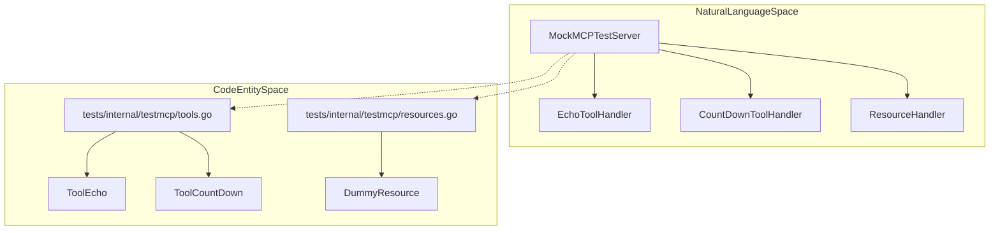
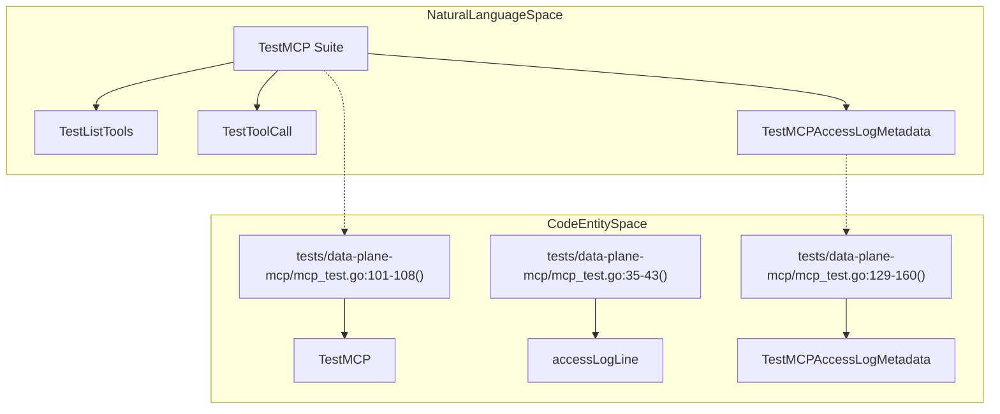

<!-- source: DeepWiki mcp.deepwiki.com · repo theagentrouter/agent-router · page 6.3 MCP Testing and Examples · fetched 2026-10-21 -->

# MCP Testing and Examples

Relevant source files

The following files were used as context for generating this wiki page:

- [cmd/aigw/.env.otel.console](cmd/aigw/.env.otel.console)
- [cmd/aigw/.env.otel.host](cmd/aigw/.env.otel.host)
- [cmd/aigw/.env.otel.otel-tui](cmd/aigw/.env.otel.otel-tui)
- [cmd/aigw/.env.otel.phoenix](cmd/aigw/.env.otel.phoenix)
- [examples/basic/azure_openai.yaml](examples/basic/azure_openai.yaml)
- [examples/basic/gcp_vertex.yaml](examples/basic/gcp_vertex.yaml)
- [examples/basic/openai.yaml](examples/basic/openai.yaml)
- [examples/basic/tars.yaml](examples/basic/tars.yaml)
- [examples/mcp/agent.py](examples/mcp/agent.py)
- [examples/mcp/mcp_example.yaml](examples/mcp/mcp_example.yaml)
- [examples/mcp/mcp_oauth_example.yaml](examples/mcp/mcp_oauth_example.yaml)
- [examples/mcp/mcp_oauth_keycloak.yaml](examples/mcp/mcp_oauth_keycloak.yaml)
- [examples/mcp/openai-github.yaml](examples/mcp/openai-github.yaml)
- [internal/testing/testotel/collector.go](internal/testing/testotel/collector.go)
- [tests/data-plane-mcp/envoy.yaml](tests/data-plane-mcp/envoy.yaml)
- [tests/data-plane-mcp/mcp_test.go](tests/data-plane-mcp/mcp_test.go)
- [tests/internal/testmcp/resources.go](tests/internal/testmcp/resources.go)
- [tests/internal/testmcp/tools.go](tests/internal/testmcp/tools.go)
- [tests/internal/testopeninference/Dockerfile.openai_client](tests/internal/testopeninference/Dockerfile.openai_client)

## Purpose and Scope

This page covers the testing infrastructure, benchmarks, example manifests, and agent scripts dedicated to Model Context Protocol (MCP) support in Envoy AI Gateway. It details the mock Model Context Protocol servers in `tests/internal/testmcp`, the integration test suite in `tests/data-plane-mcp`, performance benchmarking utilities, and client agent implementations such as `examples/mcp/agent.py`.

Sources: `tests/data-plane-mcp/mcp_test.go:1-187()`, `examples/mcp/agent.py:1-84()`

---

## 1. Mock MCP Servers (`testmcp`)

The testing framework includes an embedded mock Model Context Protocol server implementation inside `tests/internal/testmcp/` that registers standard tools (e.g., `ToolEcho`, `ToolCountDown`, `ToolSum`), resources, and prompts to validate client-gateway-upstream interactions without hitting external third-party services.

*Diagram 1: Mapping Natural Language test constructs to `testmcp` code entities.*

Sources: `tests/internal/testmcp/tools.go:1-187()`, `tests/internal/testmcp/resources.go:1-50()`

---

## 2. Data Plane MCP Test Suite (`data-plane-mcp`)

The `tests/data-plane-mcp` package runs comprehensive functional, routing, and access-logging verification against the proxy data plane. `TestMCP` iterates through a table of test functions `[tests/data-plane-mcp/mcp_test.go:70-99]()` checking tool listing, tool invocation, error cases, change notifications, prompts, resources, and sampling.

*Diagram 2: Data Plane test suite execution flow mapping to `mcp_test.go` functions.*

Key validation aspects tested in `[tests/data-plane-mcp/mcp_test.go:129-187]()` include:
* Verifying JSON-RPC request IDs in access logs (`accessLogLine`).
* Ensuring `mcp.session.id`, `mcp.provider.name`, and `mcp.method.name` are accurately written to dynamic metadata and access logs.
* Ensuring client-provided metadata headers (e.g., `agent-session-id`) propagate properly.

Sources: `tests/data-plane-mcp/mcp_test.go:35-187()`

---

## 3. Performance Benchmarks

Performance evaluations for stateful Model Context Protocol session encryption and routing overhead are located in `[tests/data-plane-mcp/bench/bench_test.go]`. These benchmarks measure the performance impact of Key Derivation Functions (KDF) and session tokens against direct invocation.

Sources: `tests/data-plane-mcp/bench/bench_test.go:1-50()`, `tests/data-plane-mcp/bench/aigw.yaml:1-50()`

---

## 4. MCP Example Manifests and Authentication

Envoy AI Gateway provides reference manifests for deploying `MCPRoute` resources alongside `Backend` and `Secret` configurations.

### Basic Manifest (`mcp_example.yaml`)
`[examples/mcp/mcp_example.yaml:7-47]()` defines an `MCPRoute` routing requests to upstream GitHub Copilot and Kiwi endpoints, demonstrating path prefixes, regex tool selectors, and environment variable substitution for API keys.

Sources: `examples/mcp/mcp_example.yaml:7-60()`

### OAuth and Keycloak Policy Manifests
`[examples/mcp/mcp_oauth_example.yaml:9-40]()` and `[examples/mcp/mcp_oauth_keycloak.yaml:7-46]()` illustrate securing an `MCPRoute` using OAuth validation, JWKS configuration maps, and protected resource metadata.

Sources: `examples/mcp/mcp_oauth_example.yaml:9-40()`, `examples/mcp/mcp_oauth_keycloak.yaml:7-46()`

---

## 5. Agent Client Scripts and E2E Suites

### Python Agent Script (`agent.py`)
`[examples/mcp/agent.py:36-83]()` provides a reference implementation using the OpenAI agents framework and `MCPServerStreamableHttp` to connect an agent to Envoy AI Gateway's MCP proxy endpoint.

Sources: `examples/mcp/agent.py:36-84()`

### End-to-End Tests (`mcp_route_test.go`)
`[tests/e2e/mcp_route_test.go]()` exercises `MCPRoute` specifications in a Kubernetes cluster using `e2elib`. It verifies default routes, tenant route headers, invalid routes, multi-backend fan-out, and JWT-backed backend selectors.

Sources: `tests/e2e/mcp_route_test.go:54-140()`

---

