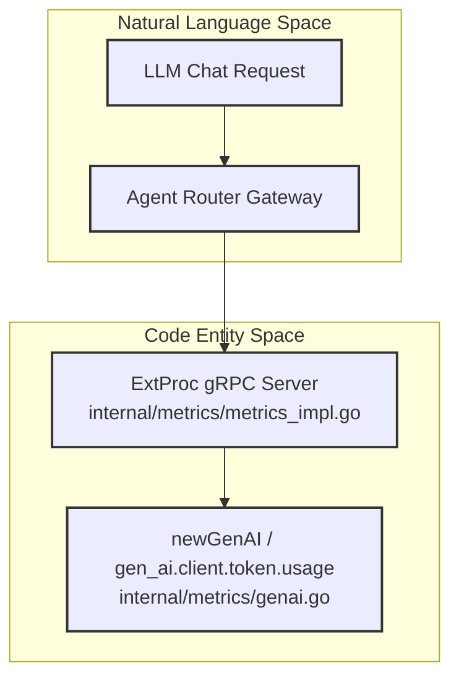
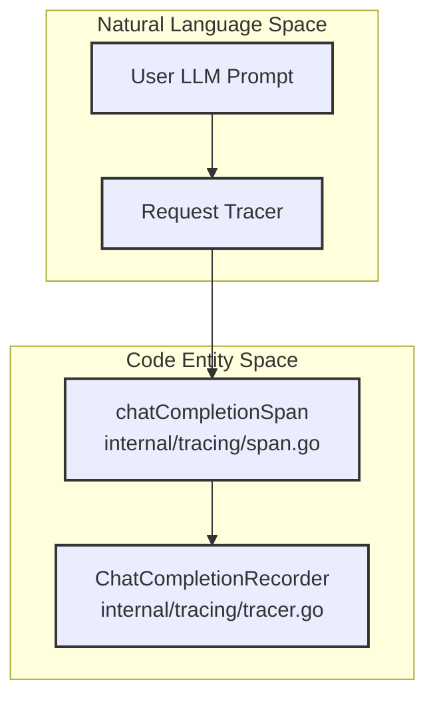
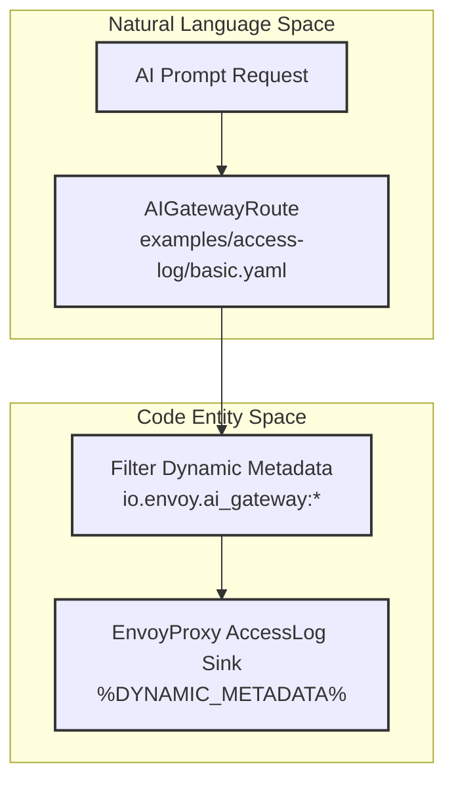

<!-- source: DeepWiki mcp.deepwiki.com · repo theagentrouter/agent-router · page 7 Observability · fetched 2026-10-21 -->

# Observability

Relevant source files

The following files were used as context for generating this wiki page:

- [internal/internalapi/internalapi_test.go](internal/internalapi/internalapi_test.go)
- [internal/metrics/genai.go](internal/metrics/genai.go)
- [internal/metrics/metrics_impl.go](internal/metrics/metrics_impl.go)
- [internal/metrics/metrics_impl_test.go](internal/metrics/metrics_impl_test.go)
- [site/docs/capabilities/observability/metrics.md](site/docs/capabilities/observability/metrics.md)
- [tests/data-plane/vcr/azure_otel_chat_completions_metrics_test.go](tests/data-plane/vcr/azure_otel_chat_completions_metrics_test.go)
- [tests/data-plane/vcr/otel_chat_completions_metrics_test.go](tests/data-plane/vcr/otel_chat_completions_metrics_test.go)
- [tests/data-plane/vcr/otel_completions_metrics_test.go](tests/data-plane/vcr/otel_completions_metrics_test.go)
- [tests/data-plane/vcr/otel_embeddings_metrics_test.go](tests/data-plane/vcr/otel_embeddings_metrics_test.go)
- [tests/data-plane/vcr/otel_test.go](tests/data-plane/vcr/otel_test.go)
- [tests/data-plane/vcr/prometheus_metrics_test.go](tests/data-plane/vcr/prometheus_metrics_test.go)
- [tests/e2e-aigw/otel_test.go](tests/e2e-aigw/otel_test.go)

## Purpose and Scope

The **Observability** subsystem of Agent Router provides comprehensive telemetry for GenAI and Model Context Protocol (MCP) traffic. By intercepting AI gateway traffic at the data plane via the external processor (`internal/metrics/metrics_impl.go`), Agent Router collects standardized metrics (`internal/metrics/genai.go`), records distributed traces mapped to semantic conventions, and injects LLM metadata into Envoy access logs.

As a parent page, this document outlines the high-level architecture of metrics, tracing, and access logs. For detailed configurations, exporters, and code structures, refer to the child pages:
- [Metrics](#7.1) — GenAI metrics, MCP metrics, exporters, Prometheus/Grafana monitoring example.
- [Tracing and OpenInference](#7.2) — Tracer/span abstractions, OpenInference attribute mapping for chat, responses, embeddings, image generation; SSE converter; otelgenai semconv.

---

## 7.1 Metrics

Agent Router collects AI-specific metrics and exposes them in OpenTelemetry format, compatible with Prometheus and Grafana [site/docs/capabilities/observability/metrics.md:10-16](). Metrics track token consumption, request durations, time-to-first-token (TTFT), and time-per-output-token across supported endpoints such as `/v1/chat/completions`, `/v1/completions`, `/v1/embeddings`, `/cohere/v2/rerank`, and `/anthropic/v1/messages` [site/docs/capabilities/observability/metrics.md:21-34]().

Metrics collection is coordinated by `metricsImplFactory` and recorded via `metricsImpl` using OpenTelemetry meters initialized in `newGenAI` [internal/metrics/metrics_impl.go:19-38](), [internal/metrics/genai.go:94-121]().

For details on supported GenAI metrics, MCP metrics, exporters, and Prometheus/Grafana monitoring examples, see [Metrics](#7.1).

GenAI Metrics Pipeline

Sources: [internal/metrics/genai.go:10-121](), [internal/metrics/metrics_impl.go:19-38](), [site/docs/capabilities/observability/metrics.md:10-34]()

---

## 7.2 Tracing and OpenInference

Agent Router records distributed traces when configured with an OpenTelemetry collector endpoint [site/docs/capabilities/observability/tracing.md:10-11](). Spans capture complete request/response lifetimes, token counts, and invocation parameters using either **OpenInference** semantic conventions (default) or **OpenTelemetry GenAI** conventions [site/docs/capabilities/observability/tracing.md:107-119](). Tracing configuration is managed via environment variables and tracer factory structures [internal/tracing/tracing.go:129-160]() to control request metrics and span context propagation [internal/tracing/tracer.go:68-85]().

For details on tracer and span abstractions, OpenInference attribute mappings, SSE converters, and environment overrides, see [Tracing and OpenInference](#7.2).

Tracing and OpenInference Pipeline

Sources: [internal/tracing/tracing.go:129-160](), [internal/tracing/tracer.go:68-85](), [internal/tracing/span.go:57-73](), [site/docs/capabilities/observability/tracing.md:10-25]()

---

## 7.3 Access Logs with AI Metadata

Envoy access logs can be configured to capture fine-grained LLM and MCP metadata produced during request processing. Agent Router populates filter dynamic metadata under the `io.envoy.ai_gateway` namespace, including model names, prompt/completion token counts, and backend identifiers.

### Configuration Flow

To expose LLM metadata in access logs, two components must be configured:
1. **`AIGatewayRoute`**: Specifies `llmRequestCosts` mapping token types (such as `InputToken`, `OutputToken`, `TotalToken`, and `ReasoningToken`) to dynamic metadata keys [examples/access-log/basic.yaml:91-100]().
2. **`EnvoyProxy`**: Defines access log sinks and extracts the dynamic metadata variables (e.g., `%DYNAMIC_METADATA(io.envoy.ai_gateway:llm_input_token)%`) into structured JSON logs [examples/access-log/basic.yaml:32-79]().

Access Logs Dynamic Metadata Flow

Sources: [site/docs/capabilities/observability/accesslogs.md:15-77](), [examples/access-log/basic.yaml:32-100]()

---

