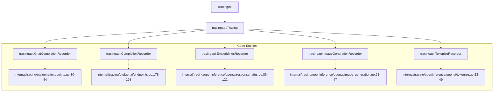
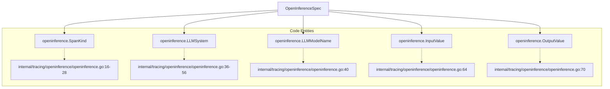
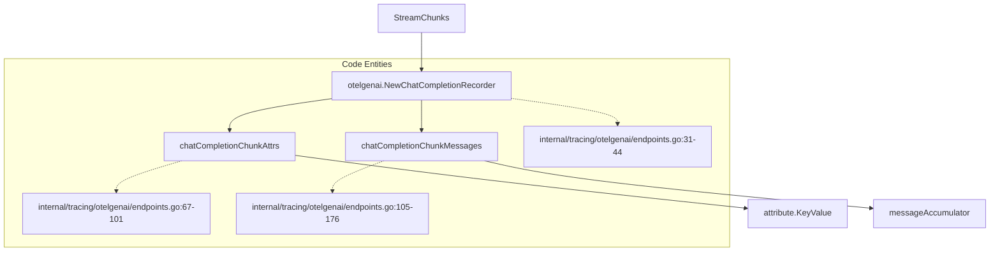

<!-- source: DeepWiki mcp.deepwiki.com · repo theagentrouter/agent-router · page 7.2 Tracing and OpenInference · fetched 2026-10-21 -->

# Tracing and OpenInference

<details>
<summary>Relevant source files</summary>

The following files were used as context for generating this wiki page:

- [internal/apischema/openai/tokenize/tokenize.go](internal/apischema/openai/tokenize/tokenize.go)
- [internal/apischema/openai/tokenize/tokenize_test.go](internal/apischema/openai/tokenize/tokenize_test.go)
- [internal/testing/testotel/mem.go](internal/testing/testotel/mem.go)
- [internal/tracing/openinference/config.go](internal/tracing/openinference/config.go)
- [internal/tracing/openinference/config_test.go](internal/tracing/openinference/config_test.go)
- [internal/tracing/openinference/openai/chat_completion_config_test.go](internal/tracing/openinference/openai/chat_completion_config_test.go)
- [internal/tracing/openinference/openai/chat_completion_test.go](internal/tracing/openinference/openai/chat_completion_test.go)
- [internal/tracing/openinference/openai/image_generation.go](internal/tracing/openinference/openai/image_generation.go)
- [internal/tracing/openinference/openai/image_generation_config_test.go](internal/tracing/openinference/openai/image_generation_config_test.go)
- [internal/tracing/openinference/openai/image_generation_test.go](internal/tracing/openinference/openai/image_generation_test.go)
- [internal/tracing/openinference/openai/response_attrs.go](internal/tracing/openinference/openai/response_attrs.go)
- [internal/tracing/openinference/openai/response_attrs_test.go](internal/tracing/openinference/openai/response_attrs_test.go)
- [internal/tracing/openinference/openai/responses_test.go](internal/tracing/openinference/openai/responses_test.go)
- [internal/tracing/openinference/openai/sse_converter.go](internal/tracing/openinference/openai/sse_converter.go)
- [internal/tracing/openinference/openai/sse_converter_test.go](internal/tracing/openinference/openai/sse_converter_test.go)
- [internal/tracing/openinference/openai/tokenize.go](internal/tracing/openinference/openai/tokenize.go)
- [internal/tracing/openinference/openai/tokenize_test.go](internal/tracing/openinference/openai/tokenize_test.go)
- [internal/tracing/openinference/openinference.go](internal/tracing/openinference/openinference.go)
- [internal/tracing/openinference/test_helpers.go](internal/tracing/openinference/test_helpers.go)
- [internal/tracing/otelgenai/endpoints.go](internal/tracing/otelgenai/endpoints.go)
- [internal/tracing/otelgenai/params_test.go](internal/tracing/otelgenai/params_test.go)
- [internal/tracing/span_test.go](internal/tracing/span_test.go)
- [internal/tracing/tracer_test.go](internal/tracing/tracer_test.go)
- [internal/tracing/tracing_test.go](internal/tracing/tracing_test.go)
- [site/docs/capabilities/observability/tracing.md](site/docs/capabilities/observability/tracing.md)

</details>


## Purpose and Scope

This page documents the tracing architecture and OpenInference semantic convention mapping implemented in the `agent-router` codebase (`github.com/envoyproxy/ai-gateway`). It details tracer and span abstractions via `tracingapi` and `otelgenai`, OpenInference attribute mapping for chat completions, text completions, embeddings, and image generation, configuration and redaction controls via `TraceConfig`, specialized recorders like `TokenizeRecorder` and `ImageGenerationRecorder`, and the `otelgenai` semantic convention layer.

Sources: [internal/tracing/openinference/openinference.go:1-174](), [internal/tracing/openinference/config.go:1-135](), [internal/tracing/otelgenai/endpoints.go:1-44]()

---

## Tracer and Span Abstractions

The tracing subsystem builds upon the OpenTelemetry Go SDK, offering environment-driven initialization and domain-specific tracer wrappers via `tracingapi` and `otelgenai`. Span abstractions define operations such as chat completions, completions, embeddings, image generation, and tokenization.



Sources: [internal/tracing/otelgenai/endpoints.go:30-198](), [internal/tracing/openinference/openai/tokenize.go:23-49](), [internal/tracing/openinference/openai/image_generation.go:21-47](), [internal/tracing/openinference/openai/response_attrs.go:86-122]()

---

## OpenInference Attribute Mapping

OpenInference semantic conventions standardize how LLM operations, prompts, tools, and token metrics are exposed in OpenTelemetry traces.

### Core Constants and Semantic Conventions
The `openinference` package defines keys and span kinds following the OpenInference specification:
* Span kinds: `openinference.SpanKind` (`"openinference.span.kind"`), `SpanKindLLM` (`"LLM"`), `SpanKindEmbedding` (`"EMBEDDING"`), `SpanKindTokenCounter` (`"TOKEN_COUNTER"`).
* Systems: `LLMSystemOpenAI` (`"openai"`), `LLMSystemCohere` (`"cohere"`), `LLMSystemAnthropic` (`"anthropic"`).



Sources: [internal/tracing/openinference/openinference.go:12-119]()

### Configuration and Redaction (`TraceConfig`)
Privacy and observability levels are controlled via `TraceConfig`, which maps to OpenInference environment variables such as `OPENINFERENCE_HIDE_INPUTS`, `OPENINFERENCE_HIDE_OUTPUTS`, `OPENINFERENCE_HIDE_LLM_INVOCATION_PARAMETERS`, and `OPENINFERENCE_BASE64_IMAGE_MAX_LENGTH`. When content is hidden, `openinference.RedactedValue` (`"__REDACTED__"`) is substituted.

```go
// TraceConfig controls redaction and size limits for traces.
type TraceConfig struct {
	HideLLMInvocationParameters bool
	HideInputs                  bool
	HideOutputs                 bool
	HideInputMessages           bool
	HideOutputMessages          bool
	HideInputImages             bool
	HideInputText               bool
	HideOutputText              bool
	HideEmbeddingsText          bool
	HideEmbeddingsVectors       bool
	Base64ImageMaxLength        int
	HidePrompts                 bool
	HideChoices                 bool
}
```

Sources: [internal/tracing/openinference/config.go:16-123]()

---

## Specialized Recorders: Tokenize and Image Generation

### TokenizeRecorder
`TokenizeRecorder` implements token-counting spans (`SpanKindTokenCounter`) for tokenization endpoints. It processes requests containing either chat or completion unions via `buildTokenizeRequestAttributes` and `buildTokenizeResponseAttributes`.

```go
type TokenizeRecorder struct {
	traceConfig                            *openinference.TraceConfig
	tracingapi.NoopChunkRecorder[struct{}] 
}
```

Sources: [internal/tracing/openinference/openai/tokenize.go:23-82]()

### ImageGenerationRecorder
`ImageGenerationRecorder` tracks image generation requests (`openai.ImageGenerationRequest`), creating spans with `SpanKindLLM` and capturing invocation parameters and output MIME/value structures.

```go
type ImageGenerationRecorder struct {
	tracingapi.NoopChunkRecorder[struct{}]
	traceConfig *openinference.TraceConfig
}
```

Sources: [internal/tracing/openinference/openai/image_generation.go:21-47]()

---

## SSE Converter and `otelgenai` Semconv

To compute accurate OpenInference metrics and record request/response attributes for Server-Sent Events (SSE) streaming chat completions, chunks are folded into unified messages and responses using helper recorders like `chatCompletionChunkMessages` and `chatCompletionChunkAttrs`. The `convertSSEToJSON` function [internal/tracing/openinference/openai/sse_converter.go:27-144]() is responsible for converting a stream of `openai.ChatCompletionResponseChunk` into a single `openai.ChatCompletionResponse` for tracing purposes. This involves accumulating content, roles, annotations, usage, and finish reasons from individual chunks.



Sources: [internal/tracing/otelgenai/endpoints.go:31-176](), [internal/tracing/openinference/openai/sse_converter.go:27-144]()

---

