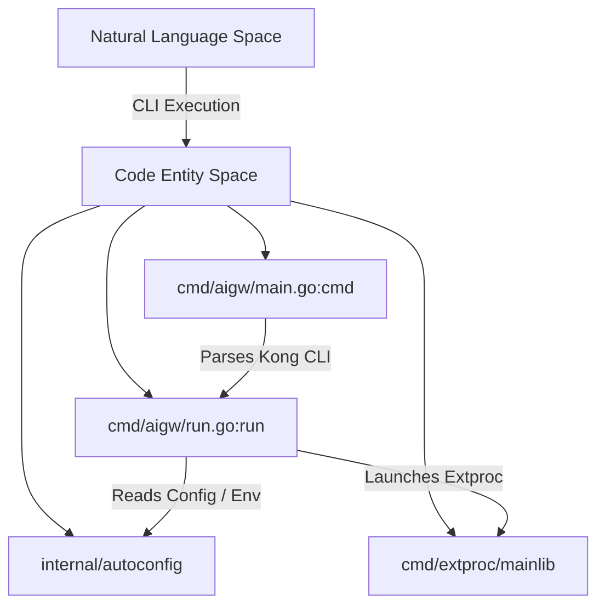
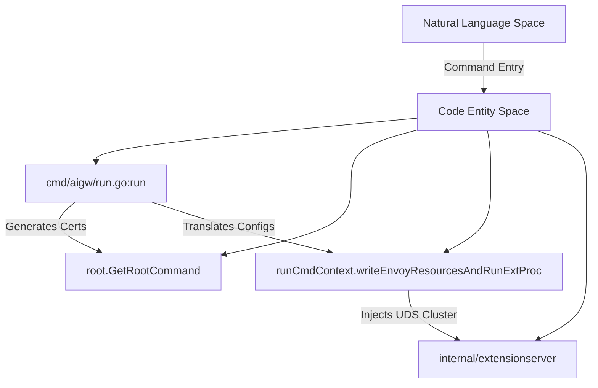

<!-- source: DeepWiki mcp.deepwiki.com · repo theagentrouter/agent-router · page 8 aigw CLI and Standalone Mode · fetched 2026-10-21 -->

# aigw CLI and Standalone Mode

Relevant source files

The following files were used as context for generating this wiki page:

- [Dockerfile](Dockerfile)
- [cmd/aigw/config_test.go](cmd/aigw/config_test.go)
- [cmd/aigw/main.go](cmd/aigw/main.go)
- [cmd/aigw/main_test.go](cmd/aigw/main_test.go)
- [cmd/aigw/run.go](cmd/aigw/run.go)
- [cmd/aigw/run_test.go](cmd/aigw/run_test.go)
- [cmd/aigw/translate_test.go](cmd/aigw/translate_test.go)
- [site/docs/cli/index.md](site/docs/cli/index.md)
- [site/docs/cli/installation.md](site/docs/cli/installation.md)
- [site/docs/cli/run.md](site/docs/cli/run.md)

## Purpose and Scope

The `aigw` binary serves as the official command-line interface (CLI) for the Agent Router (Envoy AI Gateway) project. It provides developer tooling to execute the gateway locally as a standalone proxy—combining Envoy Gateway, Envoy Proxy, and the external processor (`extproc`) into a single unified process without requiring a Kubernetes cluster or Docker dependencies [site/docs/cli/run.md:11-12]().

This parent page provides a high-level architectural overview of the CLI structure, command execution flows, XDG directory conventions, and containerized deployment patterns.

For detailed technical implementations, refer to the child pages:
- For local run mechanics, manifest translation, and `stdio2http` proxying, see [aigw run and translate](#8.1).
- For `internal/autoconfig` templates and environment-based configuration generation, see [Autoconfiguration](#8.2).

Sources: [cmd/aigw/main.go:27-65](), [cmd/aigw/run.go:91-169](), [site/docs/cli/run.md:11-12]()

---

## CLI Structure and XDG Base Directories

The CLI is implemented using the Kong parser library [cmd/aigw/main.go:16](). It organizes functionality into global XDG-compliant configuration flags and distinct subcommands (`run`, `healthcheck`, `download-envoy`, and `version`) [cmd/aigw/main.go:28-43]().

### XDG Directory Compliance
`aigw` adheres strictly to the XDG Base Directory Specification to manage state, configuration, runtime sockets, and downloaded binaries independently [site/docs/cli/installation.md:78-85]():
- **Config Home (`--config-home` / `AIGW_CONFIG_HOME`)**: Defaults to `~/.config/aigw` [cmd/aigw/main.go:30]().
- **Data Home (`--data-home` / `AIGW_DATA_HOME`)**: Defaults to `~/.local/share/aigw`, holding downloaded Envoy binaries [cmd/aigw/main.go:31]() [Dockerfile:45]().
- **State Home (`--state-home` / `AIGW_STATE_HOME`)**: Defaults to `~/.local/state/aigw`, storing run logs and temporary configuration bundles [cmd/aigw/main.go:32]() [Dockerfile:46]().
- **Runtime Dir (`--runtime-dir` / `AIGW_RUNTIME_DIR`)**: Defaults to `/tmp/aigw-${UID}`, housing ephemeral domain sockets (`uds.sock`) [cmd/aigw/main.go:33]() [Dockerfile:48]().

Sources: [cmd/aigw/main.go:26-102](), [site/docs/cli/installation.md:76-94]()

---

## `aigw run` and Manifest Translation Overview

The `aigw run` command initializes a local control plane and data plane pipeline. It reads user-supplied custom resource YAML or auto-configures defaults from standard environment variables (e.g., `OPENAI_API_KEY`, `ANTHROPIC_API_KEY`, `AZURE_OPENAI_API_KEY`) [cmd/aigw/main.go:45-58]() [site/docs/cli/run.md:21-38]().

Sources: [cmd/aigw/run.go:91-160](), [cmd/aigw/run.go:190-250](), [site/docs/cli/run.md:11-40]()

For details on local Envoy bootstrapping via `func-e`, translating Custom Resources (`AIGatewayRoute`, `AIServiceBackend`) into Envoy Gateway manifests, and bridging stdio MCP servers via `stdio2http`, see [aigw run and translate](#8.1).

Sources: [cmd/aigw/run.go:1-169](), [site/docs/cli/run.md:1-158]()

---

## Autoconfiguration and Environment Mapping

When a user invokes `aigw run` without an explicit configuration file path, the gateway automatically inspects active environment variables to synthesize a functional configuration bundle [cmd/aigw/main.go:47]() [cmd/aigw/config_test.go:31-100]().

The autoconfiguration module (`internal/autoconfig`) maps provider-specific environment variables (such as OpenAI, Anthropic, and local Ollama endpoints) into canonical `AIServiceBackend` and `AIGatewayRoute` definitions [site/docs/cli/run.md:21-38](). It also wires Model Context Protocol (MCP) servers and OpenTelemetry (OTEL) access logging exporters if corresponding flags or environment variables are detected [cmd/aigw/config_test.go:41-99]().

For details on template generation, provider mappings, and testdata-driven config evaluation, see [Autoconfiguration](#8.2).

Sources: [cmd/aigw/config_test.go:28-132](), [site/docs/cli/run.md:50-79]()

---

## Containerized Usage and Docker Compose

The `aigw` binary is packaged into official container images using a multi-stage `Dockerfile` based on distroless Debian images [Dockerfile:1-59]().

During the container build phase, the `download-envoy` subcommand pre-downloads the required Envoy binary into `AIGW_DATA_HOME` (`/home/nonroot/.local/share/aigw`) [Dockerfile:25-27](). When running inside containers or Kubernetes environments, setting `AIGW_RUN_ID=0` enforces predictable, static paths for logs, runtime Unix domain sockets, and state files [Dockerfile:42-49]().

A health check mechanism is built directly into the container lifecycle by invoking the `healthcheck` subcommand, which performs an HTTP `GET` request against the local admin server health endpoint [Dockerfile:51-54]() (defaulting to port `1064`) [cmd/aigw/main.go:48]().

Sources: [Dockerfile:1-59](), [site/docs/cli/installation.md:13-27]()

---

