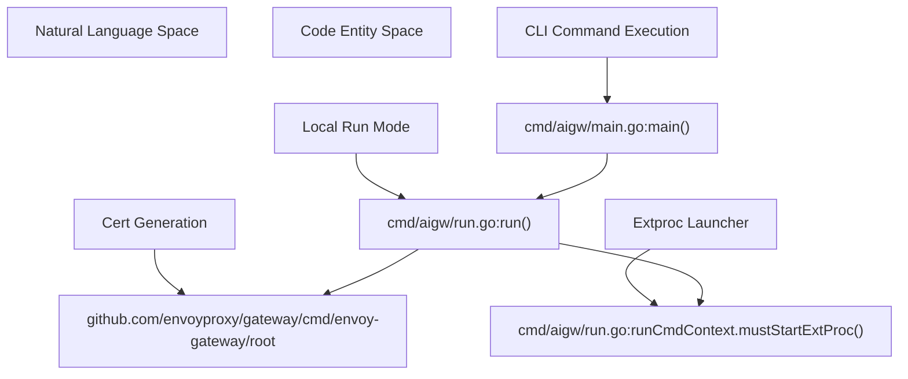
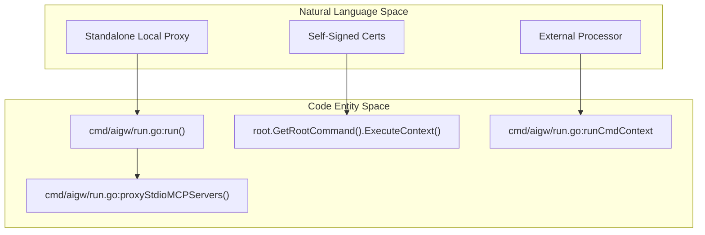
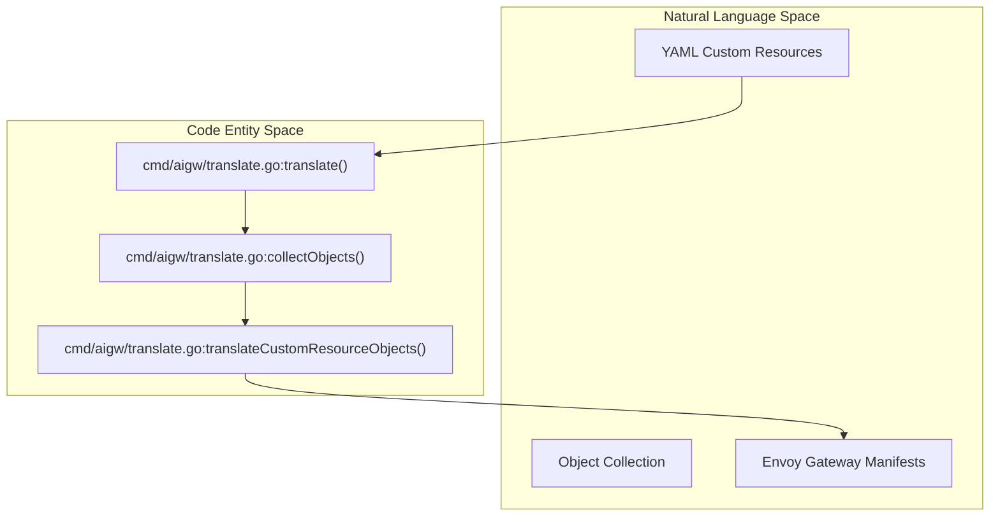

<!-- source: DeepWiki mcp.deepwiki.com · repo theagentrouter/agent-router · page 8.1 aigw run and translate · fetched 2026-10-21 -->

# aigw run and translate

<details>
<summary>Relevant source files</summary>

The following files were used as context for generating this wiki page:

- [cmd/aigw/README.md](cmd/aigw/README.md)
- [cmd/aigw/config_test.go](cmd/aigw/config_test.go)
- [cmd/aigw/docker-compose-otel.yaml](cmd/aigw/docker-compose-otel.yaml)
- [cmd/aigw/docker-compose.yaml](cmd/aigw/docker-compose.yaml)
- [cmd/aigw/healthcheck.go](cmd/aigw/healthcheck.go)
- [cmd/aigw/healthcheck_test.go](cmd/aigw/healthcheck_test.go)
- [cmd/aigw/main.go](cmd/aigw/main.go)
- [cmd/aigw/main_test.go](cmd/aigw/main_test.go)
- [cmd/aigw/run.go](cmd/aigw/run.go)
- [cmd/aigw/run_test.go](cmd/aigw/run_test.go)
- [cmd/aigw/translate_test.go](cmd/aigw/translate_test.go)
- [examples/README.md](examples/README.md)
- [examples/cache/cache_control.md](examples/cache/cache_control.md)
- [examples/goose/README.md](examples/goose/README.md)
- [examples/goose/kiwi_recipe.yaml](examples/goose/kiwi_recipe.yaml)
- [examples/mcp/README.md](examples/mcp/README.md)
- [internal/json/json.go](internal/json/json.go)
- [site/docs/cli/run.md](site/docs/cli/run.md)
- [tests/data-plane-mcp/publicmcp_test.go](tests/data-plane-mcp/publicmcp_test.go)
- [tests/e2e-aigw/aigw_test.go](tests/e2e-aigw/aigw_test.go)
- [tests/e2e-aigw/examples_mcp_test.go](tests/e2e-aigw/examples_mcp_test.go)
- [tests/e2e-aigw/llm_test.go](tests/e2e-aigw/llm_test.go)

</details>


## Purpose and Scope

This page documents the implementation of the `aigw` CLI run mode (`aigw run`), translation command (`aigw translate`), Docker Compose standalone setup, and the `stdio2http` proxying mechanism [cmd/aigw/run.go:91-169](), [cmd/aigw/docker-compose.yaml:33-63](), [site/docs/cli/run.md:11-13](). The `aigw run` command provides a standalone, local proxy environment combining Envoy, Envoy Gateway, and the external processor (`extproc`) without requiring a live Kubernetes cluster [site/docs/cli/run.md:11-13](). The `aigw translate` command performs offline static analysis and translation of Agent Router custom resources (CRs) into standard Envoy Gateway manifests and Kubernetes objects.

Sources: [cmd/aigw/run.go:91-169](), [cmd/aigw/docker-compose.yaml:33-63](), [site/docs/cli/run.md:11-13]()

---

## Architecture and Command Flow (`aigw run`)

The `aigw run` execution flow is managed by `run()` in `cmd/aigw/run.go:91` [cmd/aigw/run.go:91-169](). It prepares XDG state directories (storing configs, resources, logs in `$AIGW_STATE_HOME/runs/{runID}/` and ephemeral sockets in `$AIGW_RUNTIME_DIR/{runID}/`), generates self-signed certificates using `root.GetRootCommand(nil)` [cmd/aigw/run.go:96-103](), spawns the external processor binary via `extProcLauncher` [cmd/aigw/run.go:78](), and initiates local Envoy Gateway services.


Sources: [cmd/aigw/main.go:169-171](), [cmd/aigw/run.go:91-169](), [cmd/aigw/run_test.go:108-123]()

The following diagram maps high-level component responsibilities to internal Go types and functions during a local run invocation:


Sources: [cmd/aigw/run.go:91-155]()

Sources: [cmd/aigw/main.go:169-171](), [cmd/aigw/run.go:91-169](), [cmd/aigw/run_test.go:108-123]()

---

## CRD Translation Pipeline (`aigw translate`)

The `translate` command reads raw Agent Router custom resource declarations (CRDs) and translates them into standard Kubernetes and Envoy Gateway resource objects.

The translation pipeline consists of two primary stages defined in `cmd/aigw/translate.go`:
1. **Object Collection (`collectObjects`)**: Decodes input YAML streams using `yaml.NewYAMLOrJSONDecoder`, deduplicates objects, and classifies them into `AIGatewayRoute`, `MCPRoute`, `AIServiceBackend`, `BackendSecurityPolicy`, and `GatewayConfig` slices.
2. **Translation (`translateCustomResourceObjects`)**: Maps the collected custom resources into Envoy Gateway `HTTPRoute`, `ExtensionPolicy`, `Backend`, and `BackendTrafficPolicy` items.


Sources: [cmd/aigw/translate.go:39-189]()

---

## External Processor and Configuration Bundling

In `aigw run` mode, configuration is packaged into an index and partition bundle consumed by the external processor (`extproc`) [internal/filterapi/filterconfig.go:24-55](). The `runCmdContext.mustStartExtProc` method writes the configuration bundle to disk and initializes the processor with arguments pointing to the bundle path [cmd/aigw/run_test.go:108-135]().

The `filterapi.Config` struct houses the complete routing topology, global LLM request costs, backend definitions, and model lists [internal/filterapi/filterconfig.go:24-55]().

```go
// Config is the configuration for the Envoy AI Gateway filter.
type Config struct {
	Version string `json:"version,omitempty"`
	UUID string `json:"uuid,omitempty"`
	GlobalLLMRequestCosts []GlobalLLMRequestCost `json:"globalLLMRequestCosts,omitempty"`
	LLMRequestCosts []LLMRequestCost `json:"llmRequestCosts,omitempty"`
	Backends []Backend `json:"backends,omitempty"`
	Models []Model `json:"models,omitempty"`
	ModelsByHost map[string][]Model `json:"modelsByHost,omitempty"`
	UnscopedModels []Model `json:"unscopedModels,omitempty"`
	MCPConfig *MCPConfig `json:"mcpConfig,omitempty"`
}
```
Sources: [cmd/aigw/run_test.go:108-135](), [internal/filterapi/filterconfig.go:24-55]()

---

## Stdio-to-HTTP MCP Proxying (`stdio2http`)

When running Model Context Protocol (MCP) servers configured via `stdio`, `aigw run` invokes `proxyStdioMCPServers()` prior to route translation [cmd/aigw/run.go:153-155](). This helper translates standard input/output streams of local MCP server binaries into streamable HTTP endpoints (`stdio2http`), allowing the MCP proxy layer to aggregate tools and prompts uniformly across local and remote providers [cmd/aigw/run.go:153-155](), [site/docs/cli/run.md:144-147]().

Sources: [cmd/aigw/run.go:153-155](), [site/docs/cli/run.md:144-147]()

---

## Docker Compose Standalone Mode

The repository provides reference Docker Compose configurations (`cmd/aigw/docker-compose.yaml` and `cmd/aigw/docker-compose-otel.yaml`) to run `aigw` in containerized standalone environments [cmd/aigw/docker-compose.yaml:33-63](), [cmd/aigw/docker-compose-otel.yaml:58-88](). These setups configure the `aigw` CLI container to expose OpenAI-compatible endpoints on port `1975` and an admin server on port `1064` (serving `/metrics` and `/health` endpoints) [cmd/aigw/docker-compose.yaml:57-59]().

The `docker-compose.yaml` example demonstrates running `aigw` with Ollama for OpenAI chat completion requests [cmd/aigw/README.md:5-6](). It includes services for `ollama-pull` to pre-pull models, the `aigw` CLI itself, and various test clients (`chat-completion`, `completion`, `embeddings`, `mcp`) to send requests to the AI Gateway [cmd/aigw/docker-compose.yaml:21-160](). The `aigw` service is configured to use environment variables like `OPENAI_BASE_URL` and `OPENAI_API_KEY` for auto-configuration, and mounts an MCP configuration file [cmd/aigw/docker-compose.yaml:48-56]().

The `docker-compose-otel.yaml` extends this by integrating OpenTelemetry for metrics and tracing, allowing users to observe LLM traffic with tools like Arize Phoenix or `otel-tui` [cmd/aigw/README.md:76-78](), [cmd/aigw/docker-compose-otel.yaml:20-42]().

Sources: [cmd/aigw/docker-compose.yaml:33-63](), [cmd/aigw/docker-compose-otel.yaml:58-88](), [cmd/aigw/README.md:1-8](), [cmd/aigw/README.md:5-6](), [cmd/aigw/docker-compose.yaml:21-160](), [cmd/aigw/docker-compose.yaml:48-56](), [cmd/aigw/README.md:76-78](), [cmd/aigw/docker-compose-otel.yaml:20-42]()

---

