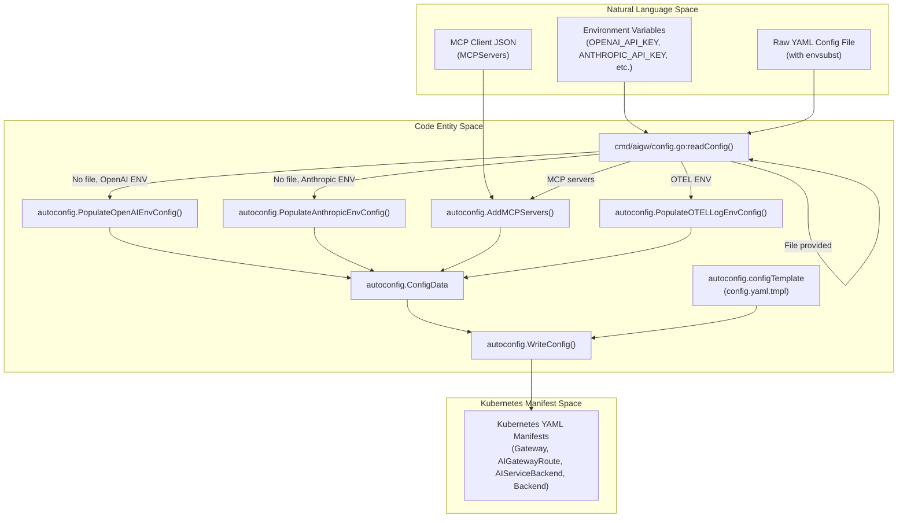

<!-- source: DeepWiki mcp.deepwiki.com · repo theagentrouter/agent-router · page 8.2 Autoconfiguration · fetched 2026-10-21 -->

# Autoconfiguration

<details>
<summary>Relevant source files</summary>

The following files were used as context for generating this wiki page:

- [cmd/aigw/config.go](cmd/aigw/config.go)
- [cmd/aigw/stdio2http.go](cmd/aigw/stdio2http.go)
- [cmd/aigw/stdio2http_test.go](cmd/aigw/stdio2http_test.go)
- [examples/aigw/ollama.yaml](examples/aigw/ollama.yaml)
- [internal/autoconfig/anthropic.go](internal/autoconfig/anthropic.go)
- [internal/autoconfig/anthropic_test.go](internal/autoconfig/anthropic_test.go)
- [internal/autoconfig/config.go](internal/autoconfig/config.go)
- [internal/autoconfig/config.yaml.tmpl](internal/autoconfig/config.yaml.tmpl)
- [internal/autoconfig/config_test.go](internal/autoconfig/config_test.go)
- [internal/autoconfig/mcp.go](internal/autoconfig/mcp.go)
- [internal/autoconfig/mcp_test.go](internal/autoconfig/mcp_test.go)
- [internal/autoconfig/openai.go](internal/autoconfig/openai.go)
- [internal/autoconfig/openai_test.go](internal/autoconfig/openai_test.go)
- [internal/autoconfig/otel.go](internal/autoconfig/otel.go)
- [internal/autoconfig/otel_test.go](internal/autoconfig/otel_test.go)
- [internal/autoconfig/testdata/anthropic-prefix.yaml](internal/autoconfig/testdata/anthropic-prefix.yaml)
- [internal/autoconfig/testdata/azure-openai-with-org-and-project.yaml](internal/autoconfig/testdata/azure-openai-with-org-and-project.yaml)
- [internal/autoconfig/testdata/azure-openai.yaml](internal/autoconfig/testdata/azure-openai.yaml)
- [internal/autoconfig/testdata/debug.yaml](internal/autoconfig/testdata/debug.yaml)
- [internal/autoconfig/testdata/kiwi.yaml](internal/autoconfig/testdata/kiwi.yaml)
- [internal/autoconfig/testdata/llamastack.yaml](internal/autoconfig/testdata/llamastack.yaml)
- [internal/autoconfig/testdata/openai-ip.yaml](internal/autoconfig/testdata/openai-ip.yaml)
- [internal/autoconfig/testdata/openai-otel-ip.yaml](internal/autoconfig/testdata/openai-otel-ip.yaml)
- [internal/autoconfig/testdata/openai-otel.yaml](internal/autoconfig/testdata/openai-otel.yaml)
- [internal/autoconfig/testdata/openai-with-org-and-project.yaml](internal/autoconfig/testdata/openai-with-org-and-project.yaml)
- [internal/autoconfig/testdata/openai-with-org.yaml](internal/autoconfig/testdata/openai-with-org.yaml)
- [internal/autoconfig/testdata/openai-with-project.yaml](internal/autoconfig/testdata/openai-with-project.yaml)
- [internal/autoconfig/testdata/openrouter.yaml](internal/autoconfig/testdata/openrouter.yaml)

</details>


This page details the autoconfiguration subsystem (`internal/autoconfig`) [internal/autoconfig/config.go:1-158]() and its orchestration via the `aigw` CLI (`cmd/aigw/config.go`) [cmd/aigw/config.go:1-99](). The autoconfiguration engine transforms environment variables, MCP client configurations, and provider endpoint inputs into fully realized Kubernetes Gateway API and Envoy AI Gateway Custom Resource definitions (`GatewayClass`, `Gateway`, `EnvoyProxy`, `AIGatewayRoute`, `AIServiceBackend`, and `Backend`).

---

## 1. Subsystem Architecture and Data Flow

The autoconfiguration module bridges high-level user configuration sources (such as environment variables or MCP client JSON files) with the template-driven generation of Kubernetes manifests required by `aigw run`.


Sources: `[cmd/aigw/config.go:24-73](), [internal/autoconfig/config.go:61-87](), [internal/autoconfig/mcp.go:80-168]()`

---

## 2. Core Data Structures and Template Rendering

The core data structure driving configuration generation is `ConfigData` defined in `internal/autoconfig/config.go` [internal/autoconfig/config.go:61-71](). It aggregates endpoint backends, provider-specific configurations, MCP mappings, and OpenTelemetry settings.

```mermaid
graph TD
    subgraph "Code Entity Space: internal/autoconfig"
        CD[ConfigData] --> BE[Backends []Backend]
        CD --> OA[OpenAI *OpenAIConfig]
        CD --> AN[Anthropic *AnthropicConfig]
        CD --> MCP[MCPBackendRefs []MCPBackendRef]
        CD --> OTEL[OTELLog *otelLogConfig]
        CD --> Debug[Debug bool]
        CD --> EnvoyVersion[EnvoyVersion string]
        
        BE --> BFields["Name, Hostname, IP, Port, NeedsTLS, IsTelemetry"]
        OA --> OAFields["BackendName, SchemaName, Version, OrganizationID, ProjectID"]
        AN --> ANFields["BackendName, SchemaName, Version"]
        MCP --> MCPFields["BackendName, Path, IncludeTools, APIKey, Headers"]
        OTEL --> OTELFields["Exporter, BackendName, Headers, Resources"]
        
        CD --> WC["WriteConfig(data *ConfigData)"]
        WC --> TMPL["config.yaml.tmpl"]
    end
```
Sources: `[internal/autoconfig/config.go:24-71](), [internal/autoconfig/config.yaml.tmpl:1-48]()`

### Key Types and Fields

| Struct Name | File Path | Field Name | Description |
| :--- | :--- | :--- | :--- |
| `Backend` | `internal/autoconfig/config.go:24-31` | `Name`, `Hostname`, `IP`, `Port`, `NeedsTLS`, `IsTelemetry` | Represents a network endpoint rendered as a Kubernetes `Backend` resource. |
| `OpenAIConfig` | `internal/autoconfig/config.go:35-41` | `BackendName`, `SchemaName`, `Version`, `OrganizationID`, `ProjectID` | Holds OpenAI or Azure OpenAI specific parameters for `AIServiceBackend`. |
| `AnthropicConfig` | `internal/autoconfig/config.go:43-49` | `BackendName`, `SchemaName`, `Version` | Holds Anthropic specific parameters. |
| `MCPBackendRef` | `internal/autoconfig/config.go:53-59` | `BackendName`, `Path`, `IncludeTools`, `APIKey`, `Headers` | References an MCP server backend with route path and tool filtering. |
| `otelLogConfig` | `internal/autoconfig/otel.go:19-24` | `Exporter`, `BackendName`, `Headers`, `Resources` | Configuration for OpenTelemetry access logging. |
| `ConfigData` | `internal/autoconfig/config.go:61-71` | `Backends`, `OpenAI`, `Anthropic`, `MCPBackendRefs`, `Debug`, `EnvoyVersion`, `OTELLog` | Top-level container passed into Go text templates. |

Sources: `[internal/autoconfig/config.go:24-71](), [internal/autoconfig/otel.go:19-24]()`

---

## 3. Provider and Protocol Parsers

### OpenAI Configuration
The `PopulateOpenAIEnvConfig` function [internal/autoconfig/openai.go:20-94]() populates the `OpenAIConfig` struct within `ConfigData` based on environment variables. It prioritizes Azure OpenAI configuration if `AZURE_OPENAI_API_KEY` is set, requiring `AZURE_OPENAI_ENDPOINT` and `OPENAI_API_VERSION`. Otherwise, it uses standard OpenAI environment variables like `OPENAI_API_KEY` and `OPENAI_BASE_URL`. It also supports `OPENAI_ORG_ID` and `OPENAI_PROJECT_ID` for setting respective headers.

```go
// PopulateOpenAIEnvConfig populates OpenAI configuration from environment variables.
func PopulateOpenAIEnvConfig(data *ConfigData) error { ... }
```
Sources: `[internal/autoconfig/openai.go:20-94]()`

### Anthropic Configuration
Similarly, `PopulateAnthropicEnvConfig` [internal/autoconfig/anthropic.go:19-60]() populates the `AnthropicConfig` struct from `ANTHROPIC_API_KEY` and `ANTHROPIC_BASE_URL` environment variables.

```go
// PopulateAnthropicEnvConfig populates Anthropic configuration from environment variables.
func PopulateAnthropicEnvConfig(data *ConfigData) error { ... }
```
Sources: `[internal/autoconfig/anthropic.go:19-60]()`

### MCP Server Parsing
The `AddMCPServers` function in `internal/autoconfig/mcp.go` parses canonical MCP client configuration files (compatible with Claude Desktop, Cursor, and Gemini CLI) [internal/autoconfig/mcp.go:80-168](). 

It performs intelligent header parsing:
* Extracts `Authorization: Bearer <token>` into `APIKey`, preserving `${VAR}` envsubst syntax for runtime resolution [internal/autoconfig/mcp.go:133-141]().
* Retains other non-auth headers in the `Headers` map for header mutation [internal/autoconfig/mcp.go:137-140]().
* Validates supported MCP server types (`http`, `streamable-http`, `streamable_http`, `streamableHttp`) [internal/autoconfig/mcp.go:171-181]().

```go
// AddMCPServers parses MCP server input and populates Backends and MCPBackendRefs.
func AddMCPServers(data *ConfigData, input *MCPServers) error { ... }
```
Sources: `[internal/autoconfig/mcp.go:75-181]()`

### OpenTelemetry Configuration
The `PopulateOTELLogEnvConfig` function [internal/autoconfig/otel.go:26-79]() configures OpenTelemetry access logging based on environment variables. It supports `OTEL_EXPORTER_OTLP_ENDPOINT` for OTLP export, `OTEL_EXPORTER_OTLP_HEADERS` for custom headers, and `OTEL_RESOURCE_ATTRIBUTES` for resource attributes. If no OTLP endpoint is specified, it defaults to console logging.

```go
// PopulateOTELLogEnvConfig populates OpenTelemetry access log configuration from environment variables.
func PopulateOTELLogEnvConfig(data *ConfigData) error { ... }
```
Sources: `[internal/autoconfig/otel.go:26-79]()`

---

## 4. Testdata-Driven Config Generation and Testing

The `internal/autoconfig` package relies heavily on golden files embedded via `go:embed` to ensure template outputs remain stable across edits [internal/autoconfig/config_test.go:34-81]().

### Test Suite Structure
The test runner in `internal/autoconfig/config_test.go` exercises `WriteConfig` against various concrete input scenarios:
* Default OpenAI configuration [internal/autoconfig/testdata/openai.yaml]() [internal/autoconfig/config_test.go:34-108]()
* OpenAI with OpenTelemetry access logging [internal/autoconfig/testdata/openai-otel.yaml]() [internal/autoconfig/config_test.go:76-146]()
* OpenAI with IP address for backend and OTEL [internal/autoconfig/testdata/openai-otel-ip.yaml]() [internal/autoconfig/config_test.go:79-176]()
* Azure OpenAI with organization/project headers [internal/autoconfig/testdata/azure-openai.yaml]() [internal/autoconfig/config_test.go:46-196]()
* Ollama (localhost with port) [examples/aigw/ollama.yaml]() [internal/autoconfig/config_test.go:198-216]()
* Tetrate Agent Router Service (TARS) [internal/autoconfig/testdata/tars.yaml]() [internal/autoconfig/config_test.go:38-236]()
* OpenRouter and LlamaStack prefix routing [internal/autoconfig/testdata/openrouter.yaml]() [internal/autoconfig/config_test.go:40-276]()
* OpenAI with organization ID [internal/autoconfig/testdata/openai-with-org.yaml]() [internal/autoconfig/config_test.go:49-300]()
* OpenAI with project ID [internal/autoconfig/testdata/openai-with-project.yaml]() [internal/autoconfig/config_test.go:52-320]()
* OpenAI with organization and project ID [internal/autoconfig/testdata/openai-with-org-and-project.yaml]() [internal/autoconfig/config_test.go:55-340]()
* Azure OpenAI with organization and project ID [internal/autoconfig/testdata/azure-openai-with-org-and-project.yaml]() [internal/autoconfig/config_test.go:58-360]()
* Debug logging enabled [internal/autoconfig/testdata/debug.yaml]() [internal/autoconfig/config_test.go:61-378]()
* Anthropic default [internal/autoconfig/testdata/anthropic.yaml]() [internal/autoconfig/config_test.go:70-400]()
* Anthropic with prefix [internal/autoconfig/testdata/anthropic-prefix.yaml]() [internal/autoconfig/config_test.go:73-422]()

The `TestAddMCPServersConfig` function [internal/autoconfig/mcp_test.go:14-249]() verifies the correct parsing of `MCPServers` input into `Backend` and `MCPBackendRef` structs, including handling of authorization headers, custom headers, and unsupported server types.

Sources: `[internal/autoconfig/config_test.go:33-282](), [internal/autoconfig/mcp_test.go:14-249]()`

---

