# Page: Overview

# Overview

<details>
<summary>Relevant source files</summary>

The following files were used as context for generating this wiki page:

- [LICENSE](LICENSE)
- [README.md](README.md)
- [site/docs/concepts/architecture/control-plane.md](site/docs/concepts/architecture/control-plane.md)
- [site/docs/concepts/architecture/data-plane.md](site/docs/concepts/architecture/data-plane.md)
- [site/docs/concepts/architecture/index.md](site/docs/concepts/architecture/index.md)
- [site/docs/concepts/architecture/system-architecture.md](site/docs/concepts/architecture/system-architecture.md)
- [site/docs/index.md](site/docs/index.md)
- [site/static/img/providers/anthropic.svg](site/static/img/providers/anthropic.svg)
- [site/static/img/providers/tars.svg](site/static/img/providers/tars.svg)
- [site/versioned_docs/version-0.1/index.md](site/versioned_docs/version-0.1/index.md)
- [site/versioned_docs/version-0.2/index.md](site/versioned_docs/version-0.2/index.md)
- [site/versioned_docs/version-0.3/index.md](site/versioned_docs/version-0.3/index.md)
- [site/versioned_docs/version-0.4/index.md](site/versioned_docs/version-0.4/index.md)

</details>


## Purpose and Scope

Agent Router (formerly known as *Envoy AI Gateway*) is an open-source control plane for AI and agent traffic powered by [Envoy](https://envoyproxy.io) and [Envoy Gateway](https://gateway.envoyproxy.io) [`README.md:11-13`(), `README.md:29-31`()]. It provides a consistent, OpenAI-compatible API for hosted LLMs, self-hosted inference backends, and Model Context Protocol (MCP) servers, allowing platform teams to manage credentials, routing, rate limiting, quotas, and failover centrally [`README.md:25`()]. 

This page provides a high-level overview of Agent Router's top-level architecture—covering the control plane controllers, the `extproc` data plane, the MCP proxy, the `aigw` CLI, and the documentation site—and links to its child pages for detailed technical deep-dives.

Sources: [`README.md:11-37`]()

---

## Top-Level Architecture

Agent Router operates in two primary deployment modes: as a Kubernetes control plane integrating with Envoy Gateway, and as a standalone local proxy via the `aigw` CLI [`README.md:43-50`(), `site/docs/concepts/architecture/control-plane.md:36-71`()]. 

```mermaid
graph TB
    subgraph NaturalLanguageSpace["Control and Data Plane Components"]
        CLI["\"aigw CLI Binary (cmd/aigw)\""]
        ControlPlane["\"Kubernetes Controller Manager (internal/controllers)\""]
        ExtServer["\"Envoy Gateway Extension Server (internal/extapi)\""]
        DataPlane["\"External Processor ExtProc (internal/extproc)\""]
        MCPProxy["\"MCP Gateway Proxy (internal/mcp)\""]
    end
    
    CLI --> DataPlane
    ControlPlane --> ExtServer
    ExtServer --> DataPlane
    DataPlane --> MCPProxy
```
*Figure 1: High-level architectural mapping of Agent Router subsystem components to codebase directories.*

Sources: [`go.mod:1-79`]()

---

### Control Plane Controllers
The Kubernetes control plane watches custom resources in the `aigateway.envoyproxy.io` API group (`AIGatewayRoute`, `AIServiceBackend`, `BackendSecurityPolicy`, `QuotaPolicy`) [`README.md:33`()]. It translates these high-level AI policies into Envoy Gateway resources (`HTTPRoute`, `HTTPRouteFilter`) and operates an extension server that fine-tunes xDS configurations [`site/docs/concepts/architecture/control-plane.md:61-68`(), `site/docs/concepts/architecture/control-plane.md:117-119`()].

Sources: [`site/docs/concepts/architecture/control-plane.md:36-108`]()

---

### ExtProc Data Plane
The data plane relies on Envoy Proxy paired with the AI Gateway External Processor (`extproc`) running as a sidecar container inside the Envoy Proxy Pod [`site/docs/concepts/architecture/control-plane.md:46-50`(), `site/docs/concepts/architecture/control-plane.md:123-123`()]. Communication between Envoy and the `extproc` sidecar occurs over a local Unix Domain Socket (UDS) for minimal latency [`site/docs/concepts/architecture/control-plane.md:123-123`()]. The processor executes a two-phase pipeline (Router-level and Upstream-level) handling model routing, provider authentication injection (such as AWS SigV4 or API keys), request/response transformation, and token usage extraction [`site/docs/concepts/architecture/data-plane.md:15-42`(), `site/docs/concepts/architecture/data-plane.md:121-124`()].

Sources: [`site/docs/concepts/architecture/data-plane.md:15-118`(), `site/docs/concepts/architecture/control-plane.md:122-124`]()

---

### MCP Proxy
Agent Router provides native support for the Model Context Protocol (MCP), enabling secure multiplexing of MCP servers, Server-Sent Events (SSE) streaming, tool/prompt merging, and claim-to-header authorization [`go.mod:32`()].

Sources: [`go.mod:32`]()

---

### CLI (`aigw`)
The `aigw` binary serves as the standalone runtime and developer interface [`README.md:46-49`()]. It allows operators to run Agent Router locally on Linux and macOS using `aigw run`, translate custom resources into Envoy Gateway manifests with `aigw translate`, and auto-configure providers from environment variables [`site/docs/getting-started/installation.md:18-19`(), `site/docs/getting-started/index.md:29-32`()].

Sources: [`site/docs/getting-started/installation.md:18-19`(), `site/docs/getting-started/index.md:29-32`]()

---

### Documentation Site
The documentation site is built with Docusaurus and resides in the `site/` directory [`site/docs/getting-started/installation.md:10`()]. It hosts user guides, concept explanations, API reference documentation generated via `make apidoc`, and versioned snapshots [`Makefile:113-123`()].

Sources: [`Makefile:113-123`(), `site/docs/getting-started/installation.md:10`]()

---

```mermaid
graph TB
    subgraph CodeEntitySpace["System Modules and Entities"]
        API["\"API Definitions (api/v1alpha1 & api/v1beta1)\""]
        Ctrl["\"Controller Manager (internal/controllers)\""]
        ExtProc["\"Data Plane ExtProc (internal/extproc)\""]
        CLIMod["\"CLI Runner (cmd/aigw)\""]
    end

    API --> Ctrl
    Ctrl --> ExtProc
    CLIMod --> ExtProc
```
*Figure 2: Component dependency flow linking API schemas, controllers, and the data plane processor.*

Sources: [`Makefile:103-110`(), `go.mod:1-79`]()

---

## Child Pages

For further details on specific topics, refer to the following child pages:

- **1.1. Getting Started and Installation** — Prerequisites, Helm install, basic usage, connecting providers, and examples directory walkthrough. For details, see [Getting Started and Installation](#1.1).
- **1.2. Repository Layout and Contributing** — Directory map, Makefile targets, codegen, contributing workflow, releases, and proposals. For details, see [Repository Layout and Contributing](#1.2).

Sources: [`CONTRIBUTING.md:1-135`(), `site/docs/getting-started/installation.md:1-81`]()

---

# Page: Getting Started and Installation

# Getting Started and Installation

<details>
<summary>Relevant source files</summary>

The following files were used as context for generating this wiki page:

- [examples/basic/azure_openai.yaml](examples/basic/azure_openai.yaml)
- [examples/basic/basic.yaml](examples/basic/basic.yaml)
- [examples/basic/gcp_vertex.yaml](examples/basic/gcp_vertex.yaml)
- [examples/basic/openai.yaml](examples/basic/openai.yaml)
- [examples/basic/tars.yaml](examples/basic/tars.yaml)
- [examples/inference-pool/aigwroute.yaml](examples/inference-pool/aigwroute.yaml)
- [examples/mcp/mcp_example.yaml](examples/mcp/mcp_example.yaml)
- [examples/mcp/mcp_oauth_example.yaml](examples/mcp/mcp_oauth_example.yaml)
- [examples/mcp/mcp_oauth_keycloak.yaml](examples/mcp/mcp_oauth_keycloak.yaml)
- [examples/mcp/openai-github.yaml](examples/mcp/openai-github.yaml)
- [site/docs/_vars.json](site/docs/_vars.json)
- [site/docs/getting-started/basic-usage.md](site/docs/getting-started/basic-usage.md)
- [site/docs/getting-started/connect-providers/anthropic.md](site/docs/getting-started/connect-providers/anthropic.md)
- [site/docs/getting-started/connect-providers/aws-bedrock.md](site/docs/getting-started/connect-providers/aws-bedrock.md)
- [site/docs/getting-started/connect-providers/azure-openai.md](site/docs/getting-started/connect-providers/azure-openai.md)
- [site/docs/getting-started/connect-providers/index.md](site/docs/getting-started/connect-providers/index.md)
- [site/docs/getting-started/connect-providers/openai.md](site/docs/getting-started/connect-providers/openai.md)
- [site/docs/getting-started/connect-providers/tars.md](site/docs/getting-started/connect-providers/tars.md)
- [site/docs/getting-started/index.md](site/docs/getting-started/index.md)
- [site/docs/getting-started/installation.md](site/docs/getting-started/installation.md)
- [site/docs/getting-started/prerequisites.md](site/docs/getting-started/prerequisites.md)
- [site/versioned_docs/version-0.3/getting-started/index.md](site/versioned_docs/version-0.3/getting-started/index.md)

</details>


This page provides a technical overview and deep-dive installation guide for Agent Router. It outlines system prerequisites, Helm chart bootstrap sequences, client traffic tuning, production provider integrations (OpenAI and AWS Bedrock), and maps high-level user workflows (Natural Language Space) to concrete Kubernetes CRDs and internal execution paths (Code Entity Space).

---

## 1. Prerequisites and Environment Setup

Agent Router requires a running Kubernetes cluster (`v1.32+`) with Envoy Gateway (`v1.8.1+`) installed as the underlying proxy foundation [site/docs/getting-started/prerequisites.md:46-152]().

### Required Tools and Cluster Validation

Deployments require `kubectl`, `helm`, and `curl` [site/docs/getting-started/prerequisites.md:15-22](). When installing Envoy Gateway, you must apply the Agent Router custom values bundle via the `-f` flag to properly configure proxy extensions [site/docs/getting-started/prerequisites.md:156-171](). Additional features such as token rate limiting or inference pools require supplementary addon value files [site/docs/getting-started/prerequisites.md:173-196]().

```mermaid
graph TD
    subgraph "NaturalLanguageSpace"
        NL_Install[""Install and Validate Cluster Environment"" ___]
    end

    subgraph "CodeEntitySpace"
        K8s[""Kubernetes Cluster v1.32+"" ___]
        EG[""Envoy Gateway v1.8.1+ (gateway-helm)"" ___]
        Values[""manifests/envoy-gateway-values.yaml"" ___]
    end

    NL_Install -.-> K8s
    K8s --> EG
    EG --> Values
```
*Figure 1: Mapping environment provisioning intent to cluster components and values files.*

Sources: `site/docs/getting-started/prerequisites.md:1-197`, `site/docs/_vars.json:5-6`

---

## 2. Helm Installation and Cluster Bootstrap

Agent Router is distributed via two Helm charts: the Custom Resource Definition chart (`ai-gateway-crds-helm`) and the controller/operator chart (`ai-gateway-helm`) [site/docs/getting-started/installation.md:20-42]().

```mermaid
graph TB
    subgraph "NaturalLanguageSpace"
        NL_Bootstrap[""Deploy AI Gateway Control Plane via Helm"" ___]
    end

    subgraph "CodeEntitySpace"
        CRDChart[""ai-gateway-crds-helm (OCI Registry)"" ___]
        MainChart[""ai-gateway-helm (OCI Registry)"" ___]
        Namespace[""envoy-ai-gateway-system Namespace"" ___]
        CRDs[""CustomResourceDefinitions (AIGatewayRoute, AIServiceBackend)"" ___]
        Controller[""deployment/ai-gateway-controller"" ___]
    end

    NL_Bootstrap -.-> CRDChart
    NL_Bootstrap -.-> MainChart
    CRDChart -.->|helm upgrade -i| Namespace
    MainChart -.->|helm upgrade -i| Namespace
    Namespace -.-> CRDs
    Namespace -.-> Controller
```
*Figure 2: Mapping control plane bootstrap commands to Helm registry charts and Kubernetes controllers.*

### Installation Commands

1. **Install CRDs**:
   ```shell
   helm upgrade -i aieg-crd oci://docker.io/envoyproxy/ai-gateway-crds-helm \
       --version v${vars.aigwVersion} \
       --namespace envoy-ai-gateway-system \
       --create-namespace
   ```
   [site/docs/getting-started/installation.md:25-29]()

2. **Install Gateway Controller**:
   ```shell
   helm upgrade -i aieg oci://docker.io/envoyproxy/ai-gateway-helm \
       --version v${vars.aigwVersion} \
       --namespace envoy-ai-gateway-system \
       --create-namespace

   kubectl wait --timeout=2m -n envoy-ai-gateway-system deployment/ai-gateway-controller --for=condition=Available
   ```
   [site/docs/getting-started/installation.md:36-41]()

Sources: `site/docs/getting-started/installation.md:1-74`, `site/docs/_vars.json:2`

---

## 3. Basic Usage and Mock Upstream Configuration

The basic usage example (`examples/basic/basic.yaml`) demonstrates how to configure an `AIGatewayRoute`, an `AIServiceBackend`, a `ClientTrafficPolicy`, and a mock test upstream service (`testupstream`) [examples/basic/basic.yaml:6-152]().

### Client Traffic and Buffer Limits

Because GenAI payload responses frequently exceed standard proxy buffer defaults, a `ClientTrafficPolicy` must adjust the connection `bufferLimit` (e.g., `50Mi`) and HTTP/2 stream window sizes (`initialStreamWindowSize` and `initialConnectionWindowSize`) to prevent `413 request_payload_too_large` errors [site/docs/getting-started/basic-usage.md:37-71]().

```yaml
apiVersion: gateway.envoyproxy.io/v1alpha1
kind: ClientTrafficPolicy
metadata:
  name: client-buffer-limit
  namespace: default
spec:
  targetRefs:
    - group: gateway.networking.k8s.io
      kind: Gateway
      name: envoy-ai-gateway-basic
  connection:
    bufferLimit: 50Mi
  http2:
    initialStreamWindowSize: 16Mi
    initialConnectionWindowSize: 24Mi
```
[site/docs/getting-started/basic-usage.md:48-63]()

Sources: `examples/basic/basic.yaml:1-153`, `site/docs/getting-started/basic-usage.md:1-227`

---

## 4. Connecting Production Providers and Security Policies

Agent Router supports multiple production backends including OpenAI, AWS Bedrock, Azure OpenAI, and GCP Vertex AI [site/docs/getting-started/connect-providers/index.md:11-21]().

### OpenAI Integration

To configure OpenAI, deploy the template located in `examples/basic/openai.yaml` after inserting your `OPENAI_API_KEY` into the associated Kubernetes secret [site/docs/getting-started/connect-providers/openai.md:28-44](). Routing is driven by header matches (`x-ai-eg-model`) evaluated by the `AIGatewayRoute` rules [site/docs/getting-started/connect-providers/openai.md:133-156]().

### AWS Bedrock Integration

AWS Bedrock integration can be established via EKS Pod Identity (`examples/basic/aws-pod-identity.yaml`), IRSA (`examples/basic/aws-irsa.yaml`), or static credentials (`examples/basic/aws.yaml`) [site/docs/getting-started/connect-providers/aws-bedrock.md:23-138](). The `BackendSecurityPolicy` resource links the `AIServiceBackend` to specific authentication provider types (e.g., `AWSCredentials`) [site/docs/getting-started/connect-providers/aws-bedrock.md:45-60]().

Sources: `site/docs/getting-started/connect-providers/openai.md:1-167`, `site/docs/getting-started/connect-providers/aws-bedrock.md:1-214`, `examples/basic/aws-pod-identity.yaml:1-168`

---

## 5. Examples Directory Walkthrough and Code Entity Mapping

The `examples/` directory contains structured configurations that map high-level user intents (Natural Language Space) to concrete Kubernetes CRDs and internal execution paths (Code Entity Space).

```mermaid
graph TD
    subgraph "NaturalLanguageSpace"
        NL_Chat[""Send OpenAI Chat Request"" ___]
        NL_Bedrock[""Invoke AWS Bedrock Llama model"" ___]
        NL_MCP[""Connect to MCP Server"" ___]
    end

    subgraph "CodeEntitySpace"
        RouteCRD[""AIGatewayRoute (aigateway.envoyproxy.io/v1beta1)"" ___]
        MCPRouteCRD[""MCPRoute (aigateway.envoyproxy.io/v1beta1)"" ___]
        BackendCRD[""AIServiceBackend (schema: OpenAI / AWSBedrock)"" ___]
        BackendCRD_MCP[""Backend (gateway.envoyproxy.io/v1alpha1)"" ___]
        PolicyCRD[""BackendSecurityPolicy (AWSCredentials / APIKey)"" ___]
        MCPPolicyCRD[""MCPRoute SecurityPolicy (OAuth / APIKey)"" ___]
        ExtProc[""internal/extproc Processor Pipeline"" ___]
    end

    NL_Chat -.-> RouteCRD
    NL_Bedrock -.-> RouteCRD
    NL_MCP -.-> MCPRouteCRD

    RouteCRD --> BackendCRD
    BackendCRD --> PolicyCRD
    PolicyCRD --> ExtProc

    MCPRouteCRD --> BackendCRD_MCP
    MCPRouteCRD --> MCPPolicyCRD
    MCPPolicyCRD --> ExtProc
```
*Figure 3: Mapping natural-language routing requirements to underlying CRDs and control plane code entities.*

### Key Example Manifests

| Manifest Path | Purpose / Description | Primary CRDs Used |
| :--- | :--- | :--- |
| `examples/basic/basic.yaml` | Local mock testing with `testupstream` deployment [examples/basic/basic.yaml:6-152]() | `GatewayClass`, `Gateway`, `ClientTrafficPolicy`, `AIGatewayRoute`, `AIServiceBackend`, `Backend` |
| `examples/basic/openai.yaml` | Production routing to OpenAI API endpoints [site/docs/getting-started/connect-providers/openai.md:31-156]() | `AIGatewayRoute`, `AIServiceBackend`, `BackendSecurityPolicy` |
| `examples/basic/aws-pod-identity.yaml` | AWS Bedrock integration using EKS Pod Identity [site/docs/getting-started/connect-providers/aws-bedrock.md:69-75]() | `EnvoyProxy`, `Gateway`, `AIGatewayRoute`, `AIServiceBackend`, `BackendSecurityPolicy`, `BackendTLSPolicy` |
| `examples/basic/azure_openai.yaml` | Azure OpenAI integration [examples/basic/azure_openai.yaml:1-92]() | `AIGatewayRoute`, `AIServiceBackend`, `BackendSecurityPolicy` |
| `examples/basic/gcp_vertex.yaml` | GCP Vertex AI integration [examples/basic/gcp_vertex.yaml:1-100]() | `AIGatewayRoute`, `AIServiceBackend`, `BackendSecurityPolicy` |
| `examples/basic/tars.yaml` | Tetrate Agent Router Service (TARS) integration [examples/basic/tars.yaml:1-88]() | `AIGatewayRoute`, `AIServiceBackend`, `BackendSecurityPolicy` |
| `examples/mcp/mcp_example.yaml` | Model Context Protocol (MCP) routing with tool selection [examples/mcp/mcp_example.yaml:8-218]() | `MCPRoute`, `Backend`, `BackendTLSPolicy`, `GatewayClass`, `Gateway`, `EnvoyProxy` |
| `examples/mcp/mcp_oauth_example.yaml` | MCP routing with OAuth authentication using local JWKS [examples/mcp/mcp_oauth_example.yaml:9-182]() | `MCPRoute`, `ConfigMap`, `Backend`, `BackendTLSPolicy`, `GatewayClass`, `Gateway`, `EnvoyProxy` |
| `examples/mcp/mcp_oauth_keycloak.yaml` | MCP routing with OAuth authentication using remote JWKS (Keycloak) [examples/mcp/mcp_oauth_keycloak.yaml:8-158]() | `MCPRoute`, `Backend`, `BackendTLSPolicy`, `GatewayClass`, `Gateway`, `EnvoyProxy` |
| `examples/mcp/openai-github.yaml` | OpenAI and GitHub MCP integration [examples/mcp/openai-github.yaml:1-100]() | `AIGatewayRoute`, `MCPRoute`, `AIServiceBackend`, `Backend`, `BackendSecurityPolicy` |
| `examples/inference-pool/aigwroute.yaml` | InferencePool configuration for model selection [examples/inference-pool/aigwroute.yaml:1-70]() | `AIGatewayRoute`, `InferencePool` |

Sources: `examples/basic/basic.yaml:1-153`, `examples/basic/aws-pod-identity.yaml:1-168`, `examples/basic/azure_openai.yaml:1-100`, `examples/basic/gcp_vertex.yaml:1-100`, `examples/basic/tars.yaml:1-100`, `examples/mcp/mcp_example.yaml:1-227`, `examples/mcp/mcp_oauth_example.yaml:1-183`, `examples/mcp/mcp_oauth_keycloak.yaml:1-159`, `examples/mcp/openai-github.yaml:1-100`, `examples/inference-pool/aigwroute.yaml:1-100`, `site/docs/getting-started/connect-providers/openai.md:1-167`, `site/docs/getting-started/connect-providers/aws-bedrock.md:1-214`

---

# Page: Repository Layout and Contributing

# Repository Layout and Contributing

<details>
<summary>Relevant source files</summary>

The following files were used as context for generating this wiki page:

- [.github/dependabot.yml](.github/dependabot.yml)
- [.golangci.yml](.golangci.yml)
- [.licenserc.yaml](.licenserc.yaml)
- [CONTRIBUTING.md](CONTRIBUTING.md)
- [MAINTAINERS.md](MAINTAINERS.md)
- [Makefile](Makefile)
- [docs/proposals/008-gemini-context-caching/context-caching-architecture.svg](docs/proposals/008-gemini-context-caching/context-caching-architecture.svg)
- [docs/proposals/008-gemini-context-caching/context-caching-flow1-single-region.svg](docs/proposals/008-gemini-context-caching/context-caching-flow1-single-region.svg)
- [docs/proposals/008-gemini-context-caching/context-caching-flow2-multi-region.svg](docs/proposals/008-gemini-context-caching/context-caching-flow2-multi-region.svg)
- [docs/proposals/008-gemini-context-caching/context-caching-flow3-explicit.svg](docs/proposals/008-gemini-context-caching/context-caching-flow3-explicit.svg)
- [docs/proposals/008-gemini-context-caching/proposal.md](docs/proposals/008-gemini-context-caching/proposal.md)
- [docs/proposals/009-quota-aware-routing/proposal.md](docs/proposals/009-quota-aware-routing/proposal.md)
- [go.mod](go.mod)
- [go.sum](go.sum)
- [internal/controller/rotators/aws_common.go](internal/controller/rotators/aws_common.go)
- [internal/filterapi/filterconfig_test.go](internal/filterapi/filterconfig_test.go)
- [internal/filterapi/watcher.go](internal/filterapi/watcher.go)
- [internal/filterapi/watcher_test.go](internal/filterapi/watcher_test.go)
- [pre-commit.sh](pre-commit.sh)
- [tests/e2e-inference-extension/inference_pool_test.go](tests/e2e-inference-extension/inference_pool_test.go)
- [tests/e2e-upgrade/upgrade_test.go](tests/e2e-upgrade/upgrade_test.go)
- [tests/internal/e2elib/e2elib.go](tests/internal/e2elib/e2elib.go)
- [tests/internal/e2elib/forwarder_test.go](tests/internal/e2elib/forwarder_test.go)
- [tests/internal/testopenai/openai.go](tests/internal/testopenai/openai.go)
- [tools/go.mod](tools/go.mod)
- [tools/go.sum](tools/go.sum)

</details>


## Purpose and Scope

This page documents the structural layout, build automation, code generation pipelines, contribution workflows, and release lifecycle of the Agent Router codebase [`CONTRIBUTING.md:1-5`](). It is targeted at developers, maintainers, and contributors seeking a comprehensive map of the repository organization, tooling modules (`tools/go.mod`), and engineering standards [`go.mod:1-5`]().

Sources: `CONTRIBUTING.md:1-5`, `go.mod:1-5`

---

## Repository Directory Map and `tools/` Module

The repository is organized into distinct functional domains separating API definitions, control plane logic, data plane filters, CLI components, documentation, and tooling. 

| Directory | Architectural Role & Contents |
| :--- | :--- |
| `api/` | Kubernetes Custom Resource Definitions (CRDs) grouped by version (`v1alpha1`, `v1beta1`), deepcopy functions, type definitions, and generated client sets [`Makefile:103-109`]() |
| `cmd/` | Binary entrypoints for the control plane controller manager, CLI (`aigw`), and auxiliary components |
| `internal/` | Core implementation packages containing controllers, xDS translation logic, the `extproc` gRPC data plane, provider schema handlers, and credential rotators [`Makefile:15-16`]() |
| `manifests/` | Helm charts (`ai-gateway-helm`, `ai-gateway-crds-helm`) and static manifests for cluster deployment [`Makefile:109`]() |
| `site/` | Docusaurus documentation source code, blog posts, static assets, and CRD reference documentation templates [`Makefile:116-122`]() |
| `tools/` | Isolated tooling module (`tools/go.mod`) hosting pinned versions of dependencies like `controller-gen`, `client-gen`, `golangci-lint`, and `crd-ref-docs` [`Makefile:11`]() |
| `tests/` | Comprehensive test suites including end-to-end (`test-e2e`), data-plane VCR suites, and mock upstream servers [`CONTRIBUTING.md:43-51`]() |
| `docs/proposals/` | Architecture design proposals (ADRs) guiding major features (e.g., quota-aware routing and model virtualization) [`docs/proposals/009-quota-aware-routing/proposal.md:1-13`]() |

The `tools/` module isolates development dependencies from the main application module (`go.mod`), ensuring that tool versions remain reproducible across developer environments and CI pipelines without polluting runtime dependency trees [`tools/go.mod:1-35`]() [`go.mod:1-79`]().

Sources: `Makefile:11-122`, `tools/go.mod:1-35`, `CONTRIBUTING.md:43-51`, `go.mod:1-79`, `docs/proposals/009-quota-aware-routing/proposal.md:1-13`

---

## Makefile Targets and Build System

Build, lint, and test validation workflows are orchestrated entirely via `make`. The `Makefile` exposes standardized targets that wrap tool invocations via `go tool -modfile=tools/go.mod` [`Makefile:11`]().

Diagram: Build Automation and Code Generation Tooling
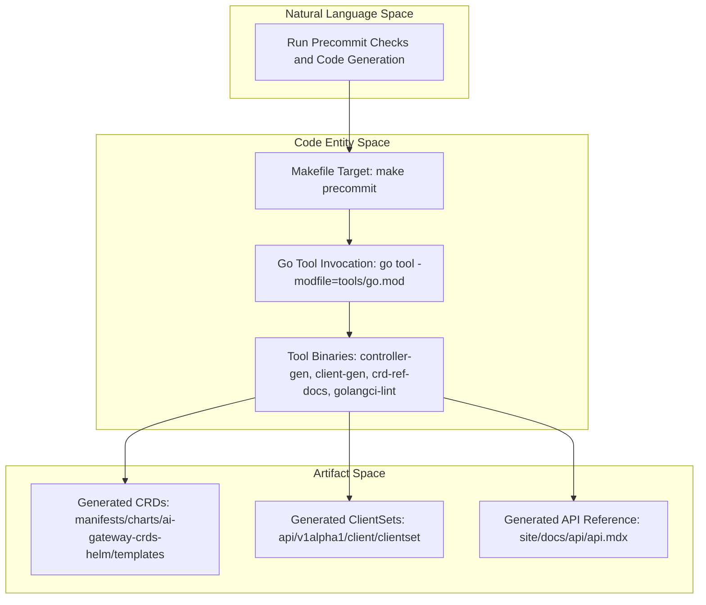
Sources: `Makefile:11-148`, `tools/go.mod:17-34`

### Key Makefile Targets

- `make precommit`: Executes the complete validation pipeline including `tidy`, `spellcheck`, `apigen`, `codegen`, `apidoc`, `format`, `lint`, `editorconfig`, and `helm-test` [`Makefile:45-46`]().
- `make apigen`: Invokes `controller-gen` to generate Kubernetes deepcopy methods (`zz_generated.deepcopy.go`) for `v1alpha1` and `v1beta1`, and compiles combined CRD manifests into the Helm chart templates [`Makefile:103-110`]().
- `make codegen`: Generates Kubernetes typed clientsets (`versioned`), listers, and informers for custom resources [`Makefile:126-148`]().
- `make apidoc`: Uses `crd-ref-docs` to parse API structs and compile Markdown documentation at `site/docs/api/api.mdx` [`Makefile:113-123`]().
- `make lint`: Runs `golangci-lint` with specific build tags (`test_crdcel`, `test_controller`, `test_extproc`, `test_e2e`) and `actionlint` [`Makefile:48-53`]().

Sources: `Makefile:11-148`

---

## Code Generation Architecture and Pipelines

Code generation guarantees strict consistency between Kubernetes CRD specifications, Go type definitions, and client SDKs. The generation pipeline bridges higher-level Go struct definitions to Kubernetes-native APIs and documentation artifacts.

Diagram: Schema-to-Code Translation Pipeline
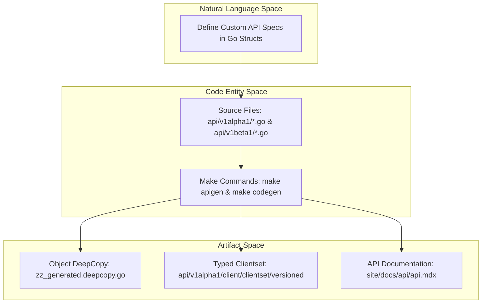
Sources: `Makefile:103-148`

### Client Generation Parameters

The `codegen` target constructs Kubernetes-native clients for custom APIs such as `BackendSecurityPolicy` [`Makefile:126-137`]():
- `--clientset-name="versioned"`: Establishes the top-level versioned clientset package [`Makefile:131`].
- `--input="github.com/envoyproxy/ai-gateway/api/v1alpha1"`: Specifies the target API input package [`Makefile:133`].
- `--plural-exceptions="BackendSecurityPolicy:BackendSecurityPolicies"`: Corrects irregular pluralization rules for Kubernetes resource names [`Makefile:137`].

Sources: `Makefile:126-148`

---

## Contributing Workflow and Governance

Contributing to Agent Router requires adherence to strict quality gates, licensing requirements, DCO sign-offs, and review conventions [`CONTRIBUTING.md:1-134`]().

Diagram: Contribution and Validation Lifecycle
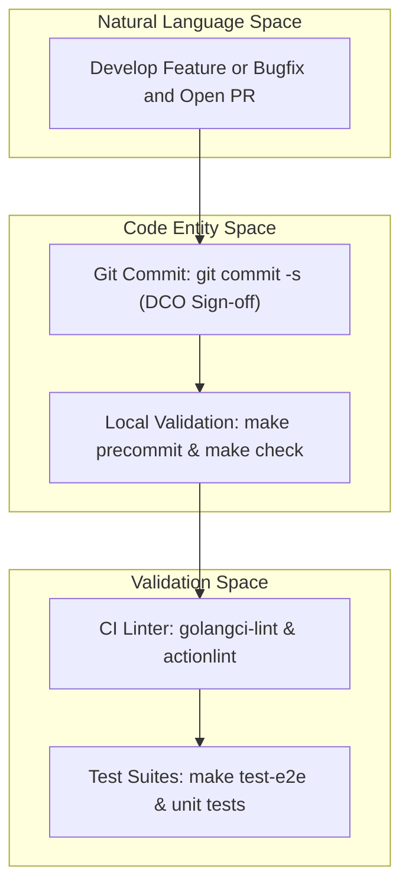
Sources: `CONTRIBUTING.md:7-134`, `Makefile:45-92`

### Workflow Requirements

1. **Prerequisites**: Contributors require the latest Go toolchain, `make`, and `docker` [`CONTRIBUTING.md:7-13`]().
2. **Pre-commit Checks**: Prior to pushing, developers must execute `make precommit` and ensure zero code or status differences exist (`make check`) [`CONTRIBUTING.md:28-30`(), `Makefile:85-92`()].
3. **Developer Certificate of Origin (DCO)**: Every commit must include a `Signed-off-by` trailer via `git commit -s`, certifying adherence to `developercertificate.org` [`CONTRIBUTING.md:101-114`]().
4. **Review Protocol**: During code reviews, developers must avoid force-pushing, rebasing, or squashing incremental commits, allowing reviewers to track incremental changes. Maintainers squash commits upon final merge [`CONTRIBUTING.md:121-133`]().
5. **Generative AI Policy**: Generative AI assistance is permitted provided the submitter fully understands, takes ownership of, and can defend all submitted code and responses [`CONTRIBUTING.md:61-84`]().

Sources: `CONTRIBUTING.md:7-134`, `Makefile:85-92`

---

## Release Engineering and Compatibility Lifecycle

Release cycles align closely with Envoy Gateway releases, targeting a cadence of approximately every 2-3 months, supplemented by frequent updates reflecting the fast-moving AI ecosystem.

### Versioning and Compatibility
- **Alpha vs. Beta**: `v1beta1` represents the committed stable control-plane API covered by backward-compatibility guarantees. `v1alpha1` remains served but deprecated. `QuotaPolicy` is currently `v1alpha1`-only.
- **Upgrade Guarantees**: Upgrading the controller across consecutive minor versions is fully supported when migration paths and CRD storage version transitions are followed [tests/e2e-upgrade/upgrade_test.go:110-125]().

### Release Process
1. **Release Candidate (RC) Phase**: The main branch is frozen for feature additions. An RC tag (`vX.Y.Z-rc1`) is cut from `origin/main`, triggering automated container image and Helm chart builds.
2. **Release Notes Automation**: Release notes are compiled using automated tools analyzing commit deltas since the prior tag, generating JSON data and MDX documentation pages.
3. **General Availability**: Stable tags are published once RC validation concludes successfully.

Sources: `Makefile:22-26`, `tests/e2e-upgrade/upgrade_test.go:110-125`

---

## Architectural Proposals and Design Evolution

Major architectural additions originate as design proposals inside `docs/proposals/`. For example, `docs/proposals/009-quota-aware-routing/proposal.md` establishes the blueprint for transitioning from reactive post-response quota metering (`QuotaPolicy`) to proactive capacity-aware routing between Provisioned Throughput (PT) and On-Demand backend pools [`docs/proposals/009-quota-aware-routing/proposal.md:1-13`]. Proposals define architectural drivers, multi-path request flows, and Envoy filter configurations before implementation in `internal/` packages.

Sources: `docs/proposals/009-quota-aware-routing/proposal.md:1-13`

---

# Page: Kubernetes API and CRDs

# Kubernetes API and CRDs

<details>
<summary>Relevant source files</summary>

The following files were used as context for generating this wiki page:

- [api/v1alpha1/mcp_route.go](api/v1alpha1/mcp_route.go)
- [api/v1alpha1/zz_generated.deepcopy.go](api/v1alpha1/zz_generated.deepcopy.go)
- [api/v1beta1/mcp_route.go](api/v1beta1/mcp_route.go)
- [api/v1beta1/zz_generated.deepcopy.go](api/v1beta1/zz_generated.deepcopy.go)
- [internal/controller/mcp_route.go](internal/controller/mcp_route.go)
- [internal/controller/mcp_route_test.go](internal/controller/mcp_route_test.go)
- [manifests/charts/ai-gateway-crds-helm/templates/aigateway.envoyproxy.io_mcproutes.yaml](manifests/charts/ai-gateway-crds-helm/templates/aigateway.envoyproxy.io_mcproutes.yaml)
- [site/docs/api/api.mdx](site/docs/api/api.mdx)
- [site/docs/capabilities/mcp/index.md](site/docs/capabilities/mcp/index.md)
- [tests/crdcel/main_test.go](tests/crdcel/main_test.go)
- [tests/e2e/mcp_route_test.go](tests/e2e/mcp_route_test.go)

</details>


## Purpose and Scope

The Envoy AI Gateway defines a dedicated Kubernetes API under the `aigateway.envoyproxy.io` API group [site/docs/api/api.mdx:8-10](). This API bridges standard Kubernetes Gateway API constructs (`Gateway`, `HTTPRoute`) with generative AI operational requirements, such as model-aware routing, provider schema translation, token-based quota enforcement, and Model Context Protocol (MCP) proxying. 

The API supports dual versions: `v1alpha1` [site/docs/api/api.mdx:13-16]() (retained for backward compatibility with deprecation warnings) and `v1beta1` [site/docs/api/api.mdx:10](), which serves as the designated storage version [api/v1beta1/mcp_route.go:48-49](). All CustomResourceDefinitions (CRDs) are packaged via Helm [manifests/charts/ai-gateway-crds-helm/templates/aigateway.envoyproxy.io_aigatewayroutes.yaml:7-14]() and validated using Common Expression Language (CEL) rules executed during `envtest` suites [tests/crdcel/main_test.go:23-26]().

As this is a parent page, this document provides a high-level overview. For deep technical details, schemas, field validations, and implementation code, consult the linked child sections.

### Diagram: API Group Architecture and Code Entities

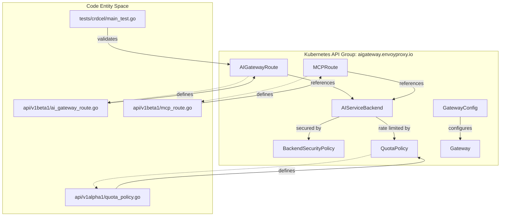
Sources: [site/docs/api/api.mdx:8-10](), [api/v1beta1/ai_gateway_route.go:1-20](), [api/v1beta1/mcp_route.go:38-56](), [tests/crdcel/main_test.go:23-26]()

---

## 2.1 Routing Resources: AIGatewayRoute and MCPRoute

Routing custom resources act as the primary entry points for incoming GenAI client traffic. `AIGatewayRoute` [manifests/charts/ai-gateway-crds-helm/templates/aigateway.envoyproxy.io_aigatewayroutes.yaml:33-37]() aggregates multiple `AIServiceBackend` targets and maps them onto Gateway API `HTTPRoute` objects [api/v1alpha1/ai_gateway_route.go:18-21](). It supports rule-based matching on model headers, cost calculations via `llmRequestCosts` [api/v1alpha1/ai_gateway_route.go:100-103](), and strict CEL rules ensuring unique rule names [api/v1alpha1/ai_gateway_route.go:96-97]().

`MCPRoute` [manifests/charts/ai-gateway-crds-helm/templates/aigateway.envoyproxy.io_mcproutes.yaml:33-36]() configures proxying for Model Context Protocol servers over Streamable HTTP transports [api/v1alpha1/mcp_route.go:56-63](). It manages tool/prompt name prefixing modes and handles backend service multiplexing through dedicated internal headers [internal/controller/mcp_route.go:113-116]().

### Diagram: Routing Controller Mapping to Code Entities

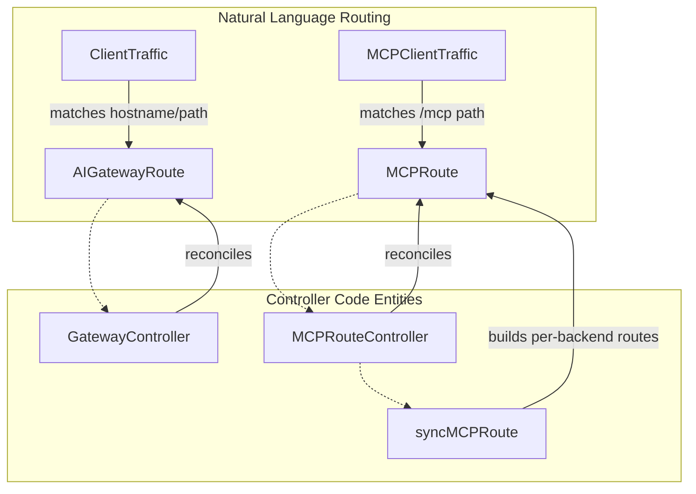
Sources: [internal/controller/gateway.go:74-86](), [internal/controller/mcp_route.go:42-48](), [internal/controller/mcp_route.go:86-93]()

For detailed schemas, field validations, helpers, and CEL rule implementations, see [Routing Resources: AIGatewayRoute and MCPRoute](#2.1).

Sources: [api/v1alpha1/ai_gateway_route.go:13-44](), [api/v1alpha1/mcp_route.go:14-32](), [api/v1beta1/mcp_route.go:14-36](), [internal/controller/mcp_route.go:113-116]()

---

## 2.2 Backends, Security and Quota Policies

To configure upstream AI providers and secure proxy traffic, the control plane relies on `AIServiceBackend`, `BackendSecurityPolicy`, `QuotaPolicy`, and `GatewayConfig` [site/docs/api/api.mdx:24-32](). `AIServiceBackend` links Kubernetes Services or Envoy Gateway `Backend` objects to specific provider schemas like `OpenAI`, `Anthropic`, or `AWSBedrock` [tests/crdcel/main_test.go:96-104]().

`BackendSecurityPolicy` manages credentials such as API keys, AWS SigV4, and Azure OIDC token exchanges [tests/crdcel/main_test.go:171-195](). `QuotaPolicy` enforces model-specific token quotas and bucket rules, while `GatewayConfig` sets global cluster defaults like namespace forwarding scopes [tests/crdcel/main_test.go:139-143]().

For detailed CRD schemas, configuration examples, and CEL test suites, see [Backends, Security and Quota Policies](#2.2).

Sources: [tests/crdcel/main_test.go:96-161](), [internal/filterapi/filterconfig.go:24-55]()

---

## 2.3 API Reference Docs Generation

The `aigateway.envoyproxy.io` API definitions are maintained as Go structs under `api/v1alpha1/` and `api/v1beta1/`. Deepcopy functions (`zz_generated.deepcopy.go`) are automatically generated via `controller-gen` [api/v1alpha1/zz_generated.deepcopy.go:8-10](), enabling runtime object cloning and deep comparisons during controller reconciliation.

API reference documentation is automatically compiled from struct doc comments using specialized code generation Makefiles and `crd-ref-docs` configurations, producing user-facing markdown indexes such as `site/docs/api/api.mdx` [site/docs/api/api.mdx:1-16]().

For detailed information on Makefile flows, custom doc templates, and generated clientsets, see [API Reference Docs Generation](#2.3).

Sources: [site/docs/api/api.mdx:1-16](), [api/v1alpha1/zz_generated.deepcopy.go:8-10](), [api/v1beta1/zz_generated.deepcopy.go:8-10]()

---

# Page: Routing Resources: AIGatewayRoute and MCPRoute

# Routing Resources: AIGatewayRoute and MCPRoute

<details>
<summary>Relevant source files</summary>

The following files were used as context for generating this wiki page:

- [api/v1alpha1/ai_gateway_route.go](api/v1alpha1/ai_gateway_route.go)
- [api/v1alpha1/ai_gateway_route_helper.go](api/v1alpha1/ai_gateway_route_helper.go)
- [api/v1alpha1/ai_gateway_route_helper_test.go](api/v1alpha1/ai_gateway_route_helper_test.go)
- [api/v1alpha1/mcp_route.go](api/v1alpha1/mcp_route.go)
- [api/v1alpha1/zz_generated.deepcopy.go](api/v1alpha1/zz_generated.deepcopy.go)
- [api/v1beta1/ai_gateway_route.go](api/v1beta1/ai_gateway_route.go)
- [api/v1beta1/mcp_route.go](api/v1beta1/mcp_route.go)
- [api/v1beta1/zz_generated.deepcopy.go](api/v1beta1/zz_generated.deepcopy.go)
- [internal/controller/mcp_route.go](internal/controller/mcp_route.go)
- [internal/controller/mcp_route_test.go](internal/controller/mcp_route_test.go)
- [manifests/charts/ai-gateway-crds-helm/templates/aigateway.envoyproxy.io_aigatewayroutes.yaml](manifests/charts/ai-gateway-crds-helm/templates/aigateway.envoyproxy.io_aigatewayroutes.yaml)
- [manifests/charts/ai-gateway-crds-helm/templates/aigateway.envoyproxy.io_mcproutes.yaml](manifests/charts/ai-gateway-crds-helm/templates/aigateway.envoyproxy.io_mcproutes.yaml)
- [site/docs/api/api.mdx](site/docs/api/api.mdx)
- [site/docs/capabilities/mcp/index.md](site/docs/capabilities/mcp/index.md)
- [tests/crdcel/main_test.go](tests/crdcel/main_test.go)
- [tests/e2e/mcp_route_test.go](tests/e2e/mcp_route_test.go)

</details>


## Purpose and Scope

This page provides full technical documentation for the routing Custom Resource Definitions (CRDs) in the Envoy AI Gateway (`agent-router`) codebase: `AIGatewayRoute` and `MCPRoute`. It details their OpenAPI schemas, core fields, CEL (Common Expression Language) validation rules, deepcopy code generation, and how controllers translate these resources into Gateway API `HTTPRoute` primitives and Envoy configurations.

Sources:
- `site/docs/api/api.mdx:1-11` [site/docs/api/api.mdx]()
- `api/v1alpha1/ai_gateway_route.go:1-44` [api/v1alpha1/ai_gateway_route.go]()
- `api/v1alpha1/mcp_route.go:1-32` [api/v1alpha1/mcp_route.go]()

---

## 1. AIGatewayRoute Schema and Fields

`AIGatewayRoute` (`aigateway.envoyproxy.io/v1alpha1` and `v1beta1`) defined in `api/v1alpha1/ai_gateway_route.go` [api/v1alpha1/ai_gateway_route.go:37-44]() combines multiple `AIServiceBackend` resources and attaches them to Gateway resources. The AI Gateway controller translates an `AIGatewayRoute` into a top-level Gateway API `HTTPRoute` and an `HTTPRouteFilter` for automatic hostname rewriting.

Title: AIGatewayRoute Translation Architecture
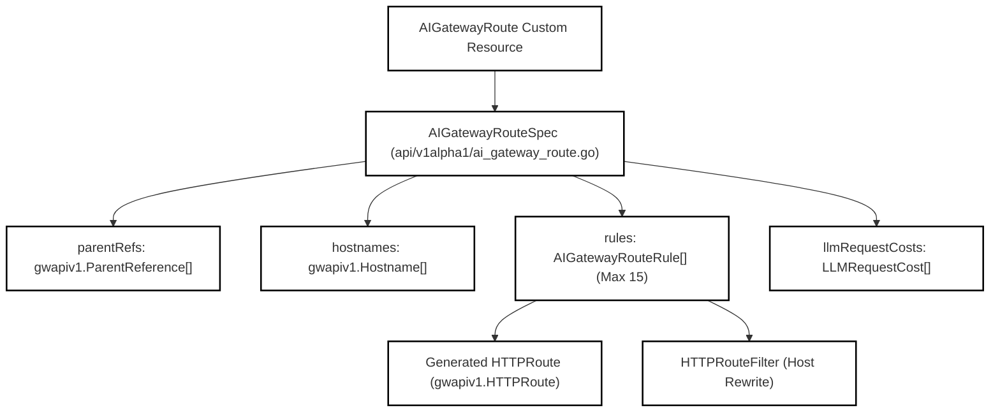
*Figure 1: AIGatewayRoute Translation Architecture mapping CRD specifications to Gateway API resources.*

Sources:
- `api/v1alpha1/ai_gateway_route.go:37-98` [api/v1alpha1/ai_gateway_route.go]()
- `manifests/charts/ai-gateway-crds-helm/templates/aigateway.envoyproxy.io_aigatewayroutes.yaml:31-100` [manifests/charts/ai-gateway-crds-helm/templates/aigateway.envoyproxy.io_aigatewayroutes.yaml]()

### Key Fields in `AIGatewayRouteSpec`

- `parentRefs`: A list of Gateway references (`gwapiv1.ParentReference`) to attach the route to. Limited to a maximum of 16 items [api/v1alpha1/ai_gateway_route.go:58-65]().
- `hostnames`: A list of fully-qualified or wildcard domain names matched against the HTTP `Host` header, mirroring standard Gateway API `HTTPRouteSpec.Hostnames` [api/v1alpha1/ai_gateway_route.go:67-75]().
- `rules`: A list of `AIGatewayRouteRule` entries (maximum of 15 per route). Each rule defines match conditions, backend references, mutations, and timeouts [api/v1alpha1/ai_gateway_route.go:77-98]().
- `llmRequestCosts`: Configuration specifying how to capture token usage (`InputToken`, `OutputToken`, `TotalToken`, etc.) and store it in Envoy dynamic metadata under the `io.envoy.ai_gateway` namespace key [api/v1alpha1/ai_gateway_route.go:100-108]().

Sources:
- `api/v1alpha1/ai_gateway_route.go:57-108` [api/v1alpha1/ai_gateway_route.go]()

---

## 2. MCPRoute Schema and Fields

`MCPRoute` defined in `api/v1beta1/mcp_route.go` [api/v1beta1/mcp_route.go:38-56]() details how Model Context Protocol (MCP) requests are routed to backend MCP servers, aggregating multiple servers behind a unified endpoint (default path `/mcp`).

Title: MCPRoute Reconciliation and Proxy Routing Flow
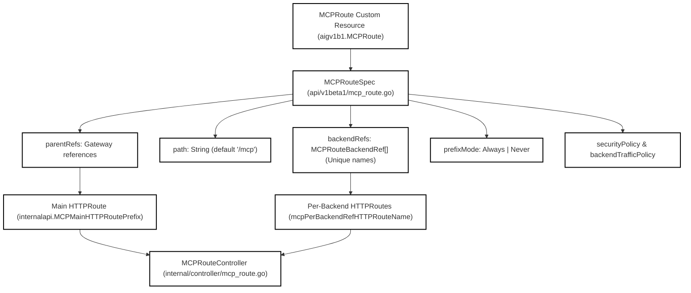
*Figure 2: MCPRoute Reconciliation and Proxy Routing Flow linking route definitions to controller operations.*

Sources:
- `api/v1beta1/mcp_route.go:14-151` [api/v1beta1/mcp_route.go]()
- `internal/controller/mcp_route.go:113-156` [internal/controller/mcp_route.go]()

### Key Fields in `MCPRouteSpec`

- `path`: The HTTP endpoint path serving MCP requests over Streamable HTTP transport (defaults to `/mcp`) [api/v1beta1/mcp_route.go:80-87]().
- `backendRefs`: A list of backend references to MCP servers. Names must be unique within the list, and cross-namespace references are disallowed [api/v1beta1/mcp_route.go:109-122]().
- `prefixMode`: Controls how tool and prompt names are prefixed (`Always` prefixes with `<backendName>__`, `Never` exposes unprefixed names) [api/v1beta1/mcp_route.go:14-36,146-150]().
- `securityPolicy`: Configures authentication and security wrappers (e.g., OAuth) for the route [api/v1beta1/mcp_route.go:124-128]().

Sources:
- `api/v1beta1/mcp_route.go:14-156` [api/v1beta1/mcp_route.go]()
- `manifests/charts/ai-gateway-crds-helm/templates/aigateway.envoyproxy.io_mcproutes.yaml:32-100` [manifests/charts/ai-gateway-crds-helm/templates/aigateway.envoyproxy.io_mcproutes.yaml]()

---

## 3. CEL Validation Rules

Kubernetes CustomResourceDefinitions for routing enforce strict CEL validation rules tested in `tests/crdcel/main_test.go` [tests/crdcel/main_test.go:23-86]() to prevent misconfigurations at admission time.

### AIGatewayRoute CEL Rules
- **Parent Reference Validation**: All `parentRefs` must reference a `Gateway` kind [api/v1alpha1/ai_gateway_route.go:58-62]():
  ```cel
  self.all(match, match.kind == 'Gateway')
  ```
- **Unique Rule Names**: Optional rule names must be unique across the route [api/v1alpha1/ai_gateway_route.go:97]():
  ```cel
  self.all(r1, !has(r1.name) || self.exists_one(r2, has(r2.name) && r1.name == r2.name))
  ```
- **Rule Count Limit**: Maximum of 15 rules per route [api/v1alpha1/ai_gateway_route.go:96]().

### MCPRoute CEL Rules
- **Backend Uniqueness**: All names in `backendRefs` must be unique [api/v1beta1/mcp_route.go:121]():
  ```cel
  self.all(i, self.exists_one(j, j.name == i.name))
  ```

Sources:
- `api/v1alpha1/ai_gateway_route.go:58-98` [api/v1alpha1/ai_gateway_route.go]()
- `api/v1beta1/mcp_route.go:77-122` [api/v1beta1/mcp_route.go]()
- `tests/crdcel/main_test.go:27-68` [tests/crdcel/main_test.go]()

---

## 4. Helpers and DeepCopy Implementation

Routing CRDs utilize auto-generated deepcopy functions and dedicated helper modules to manipulate structures during reconciliation.

- **DeepCopy Methods**: Autogenerated in `api/v1alpha1/zz_generated.deepcopy.go` [api/v1alpha1/zz_generated.deepcopy.go:20-170]() and `api/v1beta1/zz_generated.deepcopy.go` [api/v1beta1/zz_generated.deepcopy.go:20-170]() for all route specs, rules, and backend references.
- **MCP Route Controller Helpers**: `MCPRouteController` defined in `internal/controller/mcp_route.go` [internal/controller/mcp_route.go:42-48]() manages shared per-namespace proxies (`ensureMCPProxyBackend`), constructs main HTTP routes (`newMainHTTPRoute`), and creates per-backend HTTP routing entries (`newPerBackendRefHTTPRoute`) using internal header selectors (`internalapi.MCPBackendHeader`) [internal/controller/mcp_route.go:103-156]().

Sources:
- `api/v1alpha1/zz_generated.deepcopy.go:20-170` [api/v1alpha1/zz_generated.deepcopy.go]()
- `api/v1beta1/zz_generated.deepcopy.go:20-170` [api/v1beta1/zz_generated.deepcopy.go]()
- `internal/controller/mcp_route.go:42-61` [internal/controller/mcp_route.go]()

---

# Page: Backends, Security and Quota Policies

# Backends, Security and Quota Policies

<details>
<summary>Relevant source files</summary>

The following files were used as context for generating this wiki page:

- [api/v1alpha1/gateway_config.go](api/v1alpha1/gateway_config.go)
- [api/v1alpha1/quota_policy.go](api/v1alpha1/quota_policy.go)
- [api/v1alpha1/shared_types.go](api/v1alpha1/shared_types.go)
- [api/v1beta1/gateway_config.go](api/v1beta1/gateway_config.go)
- [api/v1beta1/shared_types.go](api/v1beta1/shared_types.go)
- [cmd/aigw/translate.go](cmd/aigw/translate.go)
- [internal/controller/gateway.go](internal/controller/gateway.go)
- [internal/controller/gateway_test.go](internal/controller/gateway_test.go)
- [internal/extensionserver/forward_proxy.go](internal/extensionserver/forward_proxy.go)
- [internal/extensionserver/forward_proxy_test.go](internal/extensionserver/forward_proxy_test.go)
- [internal/filterapi/filterconfig.go](internal/filterapi/filterconfig.go)
- [manifests/charts/ai-gateway-crds-helm/templates/aigateway.envoyproxy.io_aiservicebackends.yaml](manifests/charts/ai-gateway-crds-helm/templates/aigateway.envoyproxy.io_aiservicebackends.yaml)
- [manifests/charts/ai-gateway-crds-helm/templates/aigateway.envoyproxy.io_gatewayconfigs.yaml](manifests/charts/ai-gateway-crds-helm/templates/aigateway.envoyproxy.io_gatewayconfigs.yaml)
- [manifests/charts/ai-gateway-crds-helm/templates/aigateway.envoyproxy.io_quotapolicies.yaml](manifests/charts/ai-gateway-crds-helm/templates/aigateway.envoyproxy.io_quotapolicies.yaml)
- [site/docs/capabilities/a2a/index.md](site/docs/capabilities/a2a/index.md)
- [site/docs/capabilities/gateway-config.md](site/docs/capabilities/gateway-config.md)
- [site/docs/capabilities/index.md](site/docs/capabilities/index.md)
- [site/docs/capabilities/llm-integrations/index.md](site/docs/capabilities/llm-integrations/index.md)
- [site/docs/capabilities/llm-integrations/prompt-caching.md](site/docs/capabilities/llm-integrations/prompt-caching.md)
- [site/docs/capabilities/scaling.md](site/docs/capabilities/scaling.md)
- [site/docs/capabilities/traffic/header-body-mutations.md](site/docs/capabilities/traffic/header-body-mutations.md)
- [site/docs/capabilities/traffic/index.md](site/docs/capabilities/traffic/index.md)
- [site/docs/capabilities/traffic/quota-policy.md](site/docs/capabilities/traffic/quota-policy.md)
- [tests/crdcel/testdata/aiservicebackends/aws-openai-schema.yaml](tests/crdcel/testdata/aiservicebackends/aws-openai-schema.yaml)

</details>


## Purpose and Scope

This document details the CRD schemas, validation logic, and runtime translation mechanisms for backend services, security policies, token quotas, and gateway-level configurations within the Envoy AI Gateway. It focuses on four primary Custom Resource Definitions (CRDs) under the `aigateway.envoyproxy.io` API group: `AIServiceBackend`, `BackendSecurityPolicy`, `QuotaPolicy`, and `GatewayConfig`, along with their associated CEL test data and structures defined in `internal/filterapi`, `api/v1alpha1`, and `internal/controller`.

Sources: `[manifests/charts/ai-gateway-crds-helm/templates/aigateway.envoyproxy.io_aiservicebackends.yaml:1-41]`, `[api/v1alpha1/quota_policy.go:14-32]`, `[manifests/charts/ai-gateway-crds-helm/templates/aigateway.envoyproxy.io_gatewayconfigs.yaml:33-54]()`

---

## 1. AIServiceBackend Schema and Target Resolution

`AIServiceBackend` represents a concrete LLM provider endpoint or inference target, bridging standard Gateway API `Backend` resources with AI-specific API schemas and body mutation rules.

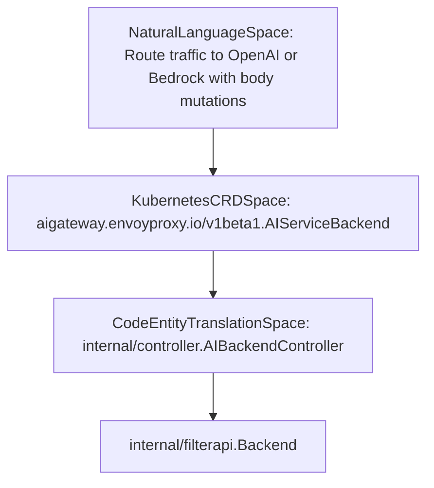
*Figure 1: AIServiceBackend Natural Language to Code Entity Mapping*

Sources: `[manifests/charts/ai-gateway-crds-helm/templates/aigateway.envoyproxy.io_aiservicebackends.yaml:32-41]`, `[api/v1alpha1/shared_types.go:15-48]`

### Key Schema Attributes

- **`backendRef`**: References an Envoy Gateway `Backend` resource (`gateway.envoyproxy.io` group, `Backend` kind). Core Kubernetes `Service` references require explicit port specifications.
- **`schema`**: Specifies the target vendor protocol via `VersionedAPISchema`, supporting schemas such as `OpenAI`, `AWSBedrock`, `AzureOpenAI`, `GCPVertexAI`, `Anthropic`, and `AWSAnthropic`.
- **`bodyMutation`**: Defines JSON body modifications applied prior to dispatching requests to the upstream provider.

Sources: `[manifests/charts/ai-gateway-crds-helm/templates/aigateway.envoyproxy.io_aiservicebackends.yaml:62-147]`, `[api/v1alpha1/shared_types.go:15-48]`

---

## 2. BackendSecurityPolicy and Credential Management

`BackendSecurityPolicy` handles upstream authentication, credential injection, and automatic token rotation for AI providers.

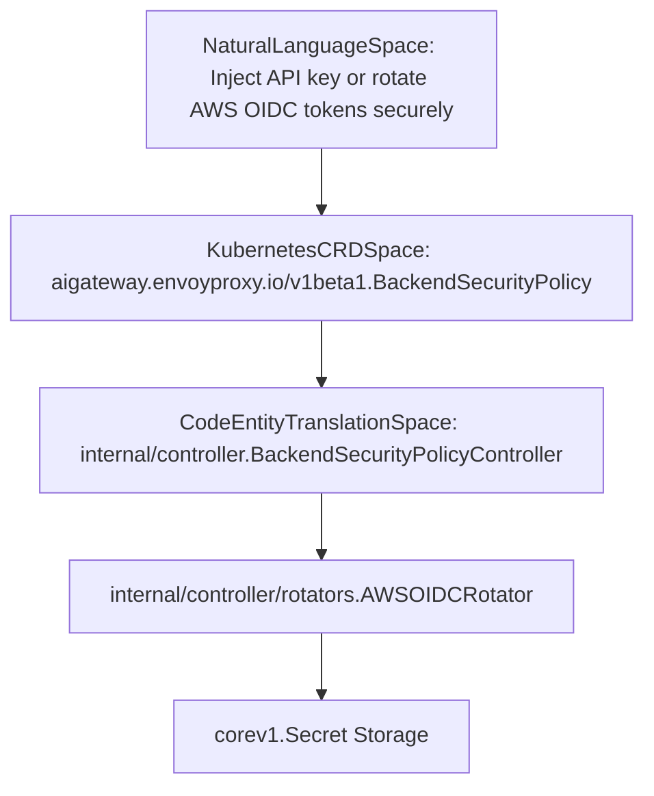
*Figure 2: BackendSecurityPolicy Natural Language to Code Entity Mapping*

Sources: `[api/v1alpha1/shared_types.go:15-48]`, `[internal/controller/gateway.go:38-43]`, `[internal/controller/gateway_test.go:41-45]`

### Authentication Mechanisms and Rotators

- **API Keys**: Configured via secret references or literals, scrubbed using custom formatters to prevent leakage in controller logs.
- **AWS SigV4 & OIDC**: Managed via `AWSOIDCRotator` which coordinates token exchanges with AWS STS using cluster or external OIDC providers.
- **GCP & Azure**: Manages OAuth2 tokens and service account credentials for Vertex AI and Azure OpenAI endpoints via dedicated token provider packages.

Sources: `[internal/controller/gateway.go:38-43]`, `[internal/controller/gateway_test.go:41-45]`

---

## 3. QuotaPolicy and Token-Based Rate Limiting

`QuotaPolicy` enforces consumption limits based on token metrics derived from LLM request and response bodies.

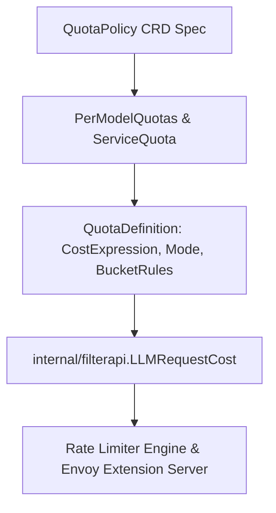
*Figure 3: QuotaPolicy Translation Model*

Sources: `[api/v1alpha1/quota_policy.go:34-124]`, `[manifests/charts/ai-gateway-crds-helm/templates/aigateway.envoyproxy.io_quotapolicies.yaml:30-76]`

### Cost Calculation and CEL Expressions

`QuotaPolicy` rules utilize Common Expression Language (CEL) to compute request costs dynamically. Supported variables include `input_tokens`, `output_tokens`, `cached_input_tokens`, `cache_creation_input_tokens`, `total_tokens`, `reasoning_tokens`, `model`, and `backend`.

Sources: `[api/v1alpha1/quota_policy.go:62-101]`, `[manifests/charts/ai-gateway-crds-helm/templates/aigateway.envoyproxy.io_quotapolicies.yaml:77-105]`

---

## 4. GatewayConfig CRD and ExtProc Settings

`GatewayConfig` supplies gateway-level configuration for the external processor (`extproc`) sidecar container.

Sources: `[manifests/charts/ai-gateway-crds-helm/templates/aigateway.envoyproxy.io_gatewayconfigs.yaml:33-54]()`

### Environment Variable Precedence

When merging container environment variables, the following precedence order applies (from highest to lowest):
1. `GatewayConfig.Spec.ExtProc.Kubernetes.Env`
2. Global controller flags (`extProcExtraEnvVars`)

Sources: `[manifests/charts/ai-gateway-crds-helm/templates/aigateway.envoyproxy.io_gatewayconfigs.yaml:47-54]`

---

## 5. CEL Test Data and Validation Suites

CEL validation rules defined on CRDs are verified using test manifests located under `tests/crdcel/testdata/`. These test assets validate correctness for schemas, security policies, and quotas before cluster admission.

Sources: `[tests/crdcel/testdata/aiservicebackends/aws-openai-schema.yaml:1-5]`, `[internal/controller/gateway_test.go:117-177]()`

---

# Page: API Reference Docs Generation

# API Reference Docs Generation

<details>
<summary>Relevant source files</summary>

The following files were used as context for generating this wiki page:

- [.github/dependabot.yml](.github/dependabot.yml)
- [Makefile](Makefile)
- [go.mod](go.mod)
- [go.sum](go.sum)
- [site/crd-ref-docs/config-core.yaml](site/crd-ref-docs/config-core.yaml)
- [site/crd-ref-docs/templates/gv_details.tpl](site/crd-ref-docs/templates/gv_details.tpl)
- [site/crd-ref-docs/templates/gv_list.tpl](site/crd-ref-docs/templates/gv_list.tpl)
- [site/crd-ref-docs/templates/type.tpl](site/crd-ref-docs/templates/type.tpl)
- [site/crd-ref-docs/templates/type_members.tpl](site/crd-ref-docs/templates/type_members.tpl)
- [tests/e2e-inference-extension/inference_pool_test.go](tests/e2e-inference-extension/inference_pool_test.go)
- [tests/e2e-upgrade/upgrade_test.go](tests/e2e-upgrade/upgrade_test.go)
- [tests/internal/e2elib/e2elib.go](tests/internal/e2elib/e2elib.go)

</details>


The API Reference Docs Generation subsystem automates the maintenance of Kubernetes Custom Resource Definitions (CRDs), deepcopy methods, typed Kubernetes clientsets, informers, listers, and the public API reference documentation site (`api.mdx`). These artifacts are driven by `controller-gen`, Kubernetes code-generator utilities, and `crd-ref-docs`, all orchestrated via standardized targets in the repository `Makefile` [Makefile:102-148]().

---

## Makefile Flow and Codegen Architecture

The generation lifecycle is partitioned into three core `Makefile` targets: `apigen`, `codegen`, and `apidoc`. These targets inspect the Go struct definitions and Go doc comments under `api/v1alpha1/` and `api/v1beta1/` to produce manifests, runtime deepcopy logic, typed clients, and documentation.

Diagram: "Natural Language Space to Code Entity Space for API Generation"
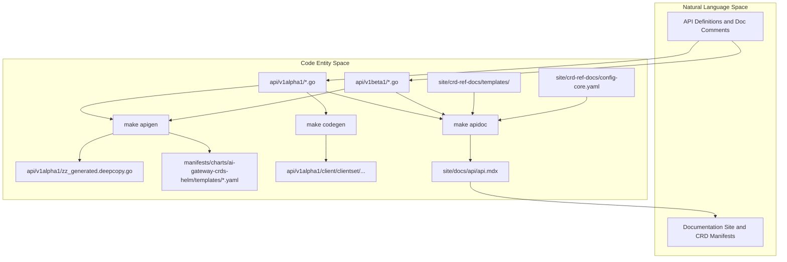
Sources: [Makefile:102-148](), [api/v1alpha1/zz_generated.deepcopy.go:1-46](), [site/docs/api/api.mdx:1-36]()

### Target Descriptions

- **`apigen`**: Executes `controller-gen object` to build Go runtime deepcopy methods (`zz_generated.deepcopy.go`) for both `v1alpha1` and `v1beta1` packages [Makefile:104-107](). It also invokes `controller-gen crd` to compile schema definitions into Helm chart CRD templates (`manifests/charts/ai-gateway-crds-helm/templates/`) [Makefile:108-110]().
- **`codegen`**: Invokes Kubernetes code-generator tools (`client-gen`, `lister-gen`, `informer-gen`) targeting `api/v1alpha1` to generate typed Kubernetes API interaction primitives [Makefile:125-148](). Plural exceptions like `BackendSecurityPolicy:BackendSecurityPolicies` are explicitly registered [Makefile:137]().
- **`apidoc`**: Executes `crd-ref-docs` referencing source paths, configuration (`site/crd-ref-docs/config-core.yaml`), and custom templates (`site/crd-ref-docs/templates/`) to output markdown/MDX documentation at `site/docs/api/api.mdx` [Makefile:113-123]().

Sources: [Makefile:102-148](), [api/v1alpha1/zz_generated.deepcopy.go:1-46]()

---

## Deepcopy and Typed Clientset Generation

Runtime objects in Kubernetes require deepcopy implementations to satisfy the `runtime.Object` interface and enable safe in-memory caching and mutation by controllers.

### Object Deepcopy Generation

Controller markers such as `+k8s:deepcopy-gen:interfaces=k8s.io/apimachinery/pkg/runtime.Object` and `+kubebuilder:object:root=true` instruct `controller-gen` to generate methods like `DeepCopy()`, `DeepCopyInto()`, and `DeepCopyObject()` [api/v1alpha1/mcp_route.go:20-22](), [api/v1alpha1/zz_generated.deepcopy.go:20-45]().

Sources: [api/v1alpha1/mcp_route.go:19-32](), [api/v1alpha1/zz_generated.deepcopy.go:20-46]()

### Typed Clients (`client-gen`)

The `codegen` target constructs a complete `clientset/versioned` package enabling type-safe interaction with custom resources such as `AIGatewayRoute`, `AIServiceBackend`, `MCPRoute`, and `BackendSecurityPolicy` [Makefile:125-137]().

Sources: [Makefile:125-137](), [api/v1alpha1/zz_generated.deepcopy.go:20-46]()

---

## `crd-ref-docs` Configuration and Templates

API reference documentation is automatically generated from Go struct comments and struct tags via the `crd-ref-docs` tool [Makefile:113-123](). 

Diagram: "Natural Language Space to Code Entity Space for Documentation Pipeline"
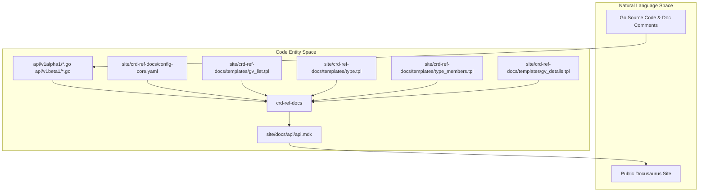
Sources: [Makefile:113-123](), [site/crd-ref-docs/config-core.yaml:1-76](), [site/crd-ref-docs/templates/type.tpl:1-66]()

### Template Structure and Integration

The rendering templates customize how kinds, fields, descriptions, and validations are presented in the Docusaurus-compatible MDX file:
- **`gv_list.tpl`**: Iterates through registered API group-versions (`aigateway.envoyproxy.io/v1alpha1`, `aigateway.envoyproxy.io/v1beta1`) [site/crd-ref-docs/templates/gv_list.tpl:1-21]().
- **`type.tpl` & `type_members.tpl`**: Formats individual resource fields into `<ApiField>` React components containing types, requirements, and godoc descriptions [site/crd-ref-docs/templates/type.tpl:1-66](), [site/crd-ref-docs/templates/type_members.tpl:1-8]().
- **`gv_details.tpl`**: Aggregates resource lists and kind definitions into structured sections [site/crd-ref-docs/templates/gv_details.tpl:1-55]().

Sources: [Makefile:113-123](), [site/crd-ref-docs/config-core.yaml:1-76](), [site/crd-ref-docs/templates/type.tpl:1-66](), [site/crd-ref-docs/templates/gv_list.tpl:1-21](), [site/crd-ref-docs/templates/type_members.tpl:1-8](), [site/crd-ref-docs/templates/gv_details.tpl:1-55]()

---

# Page: Control Plane

# Control Plane

<details>
<summary>Relevant source files</summary>

The following files were used as context for generating this wiki page:

- [cmd/aigw/testdata/translate_basic.out.yaml](cmd/aigw/testdata/translate_basic.out.yaml)
- [internal/controller/ai_gateway_route.go](internal/controller/ai_gateway_route.go)
- [internal/controller/ai_gateway_route_test.go](internal/controller/ai_gateway_route_test.go)
- [internal/controller/ai_service_backend.go](internal/controller/ai_service_backend.go)
- [internal/controller/ai_service_backend_test.go](internal/controller/ai_service_backend_test.go)
- [internal/controller/controller.go](internal/controller/controller.go)
- [internal/controller/controller_test.go](internal/controller/controller_test.go)
- [tests/controller/controller_test.go](tests/controller/controller_test.go)

</details>


## Purpose and Scope

The control plane of Envoy AI Gateway manages custom resource definitions (`AIGatewayRoute`, `AIServiceBackend`, `MCPRoute`, `BackendSecurityPolicy`, `GatewayConfig`) and translates them into Envoy Gateway resources (`HTTPRoute`, `Backend`, `HTTPRouteFilter`, `BackendTLSPolicy`) and filter configurations for the external processor (`extproc`) data plane. 

This page provides a high-level overview of the controller manager, core reconcilers, mutating webhooks, credential rotation subsystems, and the Envoy Gateway extension server. For detailed implementation mechanics, refer to the child pages linked below.

Sources: [`internal/controller/controller.go:120-140`](), [`internal/controller/ai_gateway_route.go:53-107`]()

---

```mermaid
graph TD
    sub5 ["Code Entity Space"]
    sub5 --> StartControllers["controller.StartControllers()"]
    StartControllers --> GatewayC["controller.GatewayController"]
    StartControllers --> AIRouteC["controller.AIGatewayRouteController"]
    StartControllers --> BackendC["controller.AIBackendController"]
    
    GatewayC --> FilterSec["controller.reconcileFilterConfigSecret()"]
    FilterSec --> FilterConfig["filterapi.Config"]
    
    AIRouteC --> HTTPRoute["gwapiv1.HTTPRoute"]
    AIRouteC --> RouteFilters["controller.generateHTTPRouteFilters()"]

    sub4 ["Natural Language Space"]
    sub4 -.->|"Reconciles Gateway CRs"| GatewayC
    sub4 -.->|"Reconciles AI Routes"| AIRouteC
    sub4 -.->|"Manages Secret Bundles"| FilterConfig
```
*Figure 1: Control Plane architecture bridging natural language concepts to controller and translation entities.*

Sources: [`internal/controller/controller.go:116-140`](), [`internal/controller/ai_gateway_route.go:53-157`]()

---

## 3.1 Controllers and Reconciliation

The controller manager initializes all controllers via `controller.StartControllers` [`internal/controller/controller.go:120-140`](). It registers field indexers to optimize lookup performance across dependent resources [`internal/controller/controller.go:122-125`](). Reconcilers such as `AIGatewayRouteController` [`internal/controller/ai_gateway_route.go:53-68`]() and `AIBackendController` [`internal/controller/ai_service_backend.go:27-32`]() manage state transitions, applying finalizers for cleanup and validating cross-namespace references through `ReferenceGrant`.

For detailed implementation, indexing strategies, status updates, and finalizer mechanics, see [Controllers and Reconciliation](#3.1).

Sources: [`internal/controller/controller.go:120-140`](), [`internal/controller/ai_gateway_route.go:53-107`](), [`internal/controller/ai_service_backend.go:27-63`]()

---

## 3.2 Filter Config Generation and Pod Mutation

`GatewayController` aggregates active route and backend definitions into structured bundles stored as Kubernetes Secrets. The underlying schema is defined by `filterapi.Config` [`cmd/aigw/testdata/translate_basic.out.yaml:189-207`](). A mutating admission webhook (`gatewayMutator`) intercepts `Gateway` creation and updates, automatically injecting the `extproc` container sidecar with the correct configuration hashes and environment variables.

For detailed schema definitions, watcher logic, and container builder mechanics, see [Filter Config Generation and Pod Mutation](#3.2).

Sources: [`internal/controller/controller.go:120-140`](), [`cmd/aigw/testdata/translate_basic.out.yaml:189-207`]()

---

```mermaid
graph TD
    sub3 ["Code Entity Space"]
    sub3 --> GwReconcile["GatewayController.Reconcile()"]
    GwReconcile --> FetchCfg["GatewayController.fetchGatewayConfig()"]
    GwReconcile --> RecSec["GatewayController.reconcileFilterConfigSecret()"]
    RecSec --> AnnotatePods["GatewayController.annotateGatewayPods()"]
    AnnotatePods --> ExtProc["extProcBuilder"]

    sub2 ["Natural Language Space"]
    sub2 -.->|"Watch Gateway Event"| GwReconcile
    sub2 -.->|"Build Config Secret"| RecSec
    sub2 -.->|"Inject Sidecar"| AnnotatePods
```
*Figure 2: Gateway reconciliation pipeline and filter config bundle generation flow.*

Sources: [`internal/controller/controller.go:120-140`]()

---

## 3.3 Credential Management and Token Rotators

The `BackendSecurityPolicy` controller monitors backend authentication requirements and integrates with cloud provider token providers (AWS, GCP, Azure) [internal/controller/controller_test.go:73-191](). It manages secure lifecycle handling, automated token rotation, and dynamic secret mounting to ensure secure communication between the data plane and upstream LLM providers.

For details on secret handling, error retry semantics, and token rotators, see [Credential Management and Token Rotators](#3.3).

Sources: [`internal/controller/controller_test.go:73-191`]()

---

## 3.4 Envoy Gateway Extension Server

The Envoy Gateway Extension Server intercepts Envoy Gateway translation phases via xDS hooks (`PostTranslateModify`, `PostRouteModify`, `PostClusterModify`). It dynamically injects UNIX Domain Socket (UDS) clusters for `extproc`, manages `InferencePool` and `MCP` routing extensions, and configures forward proxy capabilities.

For information on xDS extension hook wiring and proxy translation logic, see [Envoy Gateway Extension Server](#3.4).

Sources: [`internal/controller/controller.go:120-140`]()

---

# Page: Controllers and Reconciliation

# Controllers and Reconciliation

<details>
<summary>Relevant source files</summary>

The following files were used as context for generating this wiki page:

- [api/v1alpha1/mcp_route.go](api/v1alpha1/mcp_route.go)
- [api/v1alpha1/zz_generated.deepcopy.go](api/v1alpha1/zz_generated.deepcopy.go)
- [api/v1beta1/mcp_route.go](api/v1beta1/mcp_route.go)
- [api/v1beta1/zz_generated.deepcopy.go](api/v1beta1/zz_generated.deepcopy.go)
- [cmd/aigw/testdata/translate_basic.out.yaml](cmd/aigw/testdata/translate_basic.out.yaml)
- [internal/controller/ai_gateway_route.go](internal/controller/ai_gateway_route.go)
- [internal/controller/ai_gateway_route_test.go](internal/controller/ai_gateway_route_test.go)
- [internal/controller/ai_service_backend.go](internal/controller/ai_service_backend.go)
- [internal/controller/ai_service_backend_test.go](internal/controller/ai_service_backend_test.go)
- [internal/controller/controller.go](internal/controller/controller.go)
- [internal/controller/controller_test.go](internal/controller/controller_test.go)
- [internal/controller/mcp_route.go](internal/controller/mcp_route.go)
- [internal/controller/mcp_route_test.go](internal/controller/mcp_route_test.go)
- [internal/controller/secret.go](internal/controller/secret.go)
- [internal/controller/secret_test.go](internal/controller/secret_test.go)
- [manifests/charts/ai-gateway-crds-helm/templates/aigateway.envoyproxy.io_mcproutes.yaml](manifests/charts/ai-gateway-crds-helm/templates/aigateway.envoyproxy.io_mcproutes.yaml)
- [site/docs/api/api.mdx](site/docs/api/api.mdx)
- [site/docs/capabilities/mcp/index.md](site/docs/capabilities/mcp/index.md)
- [tests/controller/controller_test.go](tests/controller/controller_test.go)
- [tests/crdcel/main_test.go](tests/crdcel/main_test.go)
- [tests/e2e/mcp_route_test.go](tests/e2e/mcp_route_test.go)

</details>


## Purpose and Scope
This page details the control plane reconciliation architecture of Envoy AI Gateway (`agent-router`). It covers controller manager initialization (`StartControllers`), field indexing, the reconciliation loops for `AIGatewayRoute`, `AIServiceBackend`, `MCPRoute`, and `InferencePool` resources, finalizer management, and cross-namespace `ReferenceGrant` validation.

---

## 1. Controller Manager Initialization and Indexing

The controller manager entrypoint is managed by `StartControllers`, which registers controllers, configures field indexers, and discovers server versions (`[internal/controller/controller.go:116-139]()`).

### Diagram: Controller Initialization and Indexing Flow
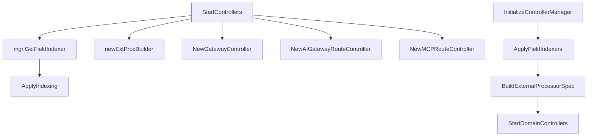
*Diagram 1: Controller Initialization and Indexing Flow*

Sources: `[internal/controller/controller.go:116-139]()`

---

## 2. AIGatewayRoute and AIServiceBackend Reconcilers

The `AIGatewayRouteController` implements `reconcile.TypedReconciler` to manage `AIGatewayRoute` custom resources (`[internal/controller/ai_gateway_route.go:53-84]()`). 

### Reconciliation Data Flow
When an `AIGatewayRoute` is created or updated, `Reconcile` invokes `syncAIGatewayRoute` (`[internal/controller/ai_gateway_route.go:86-107]()`). The sync process performs:
1. Finalizer checks via `handleFinalizer` (`[internal/controller/ai_gateway_route.go:161-164]()`).
2. Verification of static default `HTTPRouteFilters` (`generateHTTPRouteFilters`, `[internal/controller/ai_gateway_route.go:117-157]()`), which injects hostname rewrite filters and 404 direct response filters for unrouted models (`[cmd/aigw/testdata/translate_basic.out.yaml:166-187]()`).
3. Resolution of `AIServiceBackend` and `InferencePool` backend references.

### Diagram: AIGatewayRoute Reconciliation Lifecycle
```mermaid
graph TD
    Reconcile["AIGatewayRouteController.Reconcile"] --> syncAIGatewayRoute["syncAIGatewayRoute"]
    syncAIGatewayRoute --> handleFinalizer["handleFinalizer"]
    syncAIGatewayRoute --> generateHTTPRouteFilters["generateHTTPRouteFilters"]
    syncAIGatewayRoute --> syncGateways["syncGateways"]
    Reconcile --> updateAIGatewayRouteStatus["updateAIGatewayRouteStatus"]

    ReceiveReconcileRequest["ReceiveReconcileRequest"] --> CheckDeletionAndFinalizer["CheckDeletionAndFinalizer"]
    CheckDeletionAndFinalizer --> GenerateURLRewriteAnd404Filters["GenerateURLRewriteAnd404Filters"]
    GenerateURLRewriteAnd404Filters --> ReconcileGatewayHTTPRoutes["ReconcileGatewayHTTPRoutes"]
    ReconcileGatewayHTTPRoutes --> UpdateResourceStatusConditions["UpdateResourceStatusConditions"]
```
*Diagram 2: AIGatewayRoute Reconciliation Lifecycle*

Sources: `[internal/controller/ai_gateway_route.go:53-164]()`, `[cmd/aigw/testdata/translate_basic.out.yaml:166-187]()`

---

## 3. MCPRoute Controller and Security Policy Reconciliation

The `MCPRouteController` manages Model Context Protocol routing resources (`[internal/controller/mcp_route.go:37-48]()`). 

### MCPRoute Sync Sequence
1. Validates `prefixMode` configurations per backend (`[internal/controller/mcp_route.go:98-100]()`).
2. Ensures a shared per-namespace MCP proxy `Backend` exists (`ensureMCPProxyBackend`, `[internal/controller/mcp_route.go:102-106]()`).
3. Constructs and updates the main proxy `HTTPRoute` (`[internal/controller/mcp_route.go:113-127]()`).
4. Generates per-backend `HTTPRoutes` to bypass the rule limit per `HTTPRoute` (`[internal/controller/mcp_route.go:129-156]()`).
5. Reconciles associated security policies via `syncMCPRouteSecurityPolicy`, which provisions Envoy Gateway `SecurityPolicy` and JWT provider metadata (`[internal/controller/mcp_route.go:163-165]()`).

Sources: `[internal/controller/mcp_route.go:37-165]()`

---

## 4. InferencePool and Gateway-API Integration

Envoy AI Gateway integrates with the Gateway API Inference Extension (`sigs.k8s.io/gateway-api-inference-extension/api/v1`) to support native LLM inference pools (`[internal/controller/controller.go:37-57]()`).

* **Validation Rules (CEL)**: CRD validation enforces that:
  * An `InferencePool` cannot be mixed with regular `AIServiceBackend` references within the same rule (`[tests/crdcel/main_test.go:50-52]()`).
  * Only a single `InferencePool` reference is permitted per rule (`[tests/crdcel/main_test.go:54-56]()`).
  * The group must strictly match `inference.networking.k8s.io` (`[tests/crdcel/main_test.go:62-64]()`).

Sources: `[internal/controller/controller.go:37-57](), [tests/crdcel/main_test.go:48-64]()`

---

## 5. Finalizers and ReferenceGrant Validation

### Finalizers
Controllers utilize custom finalizers (e.g., `aiGatewayControllerFinalizer`) to coordinate cascading garbage collection and status updates. When an object metadata deletion timestamp is detected, `handleFinalizer` invokes cleanup callbacks (such as propagating deletions up to parent `Gateways` or releasing shared backends) before removing the finalizer string (`[internal/controller/ai_gateway_route.go:161-164]()`).

### ReferenceGrant Cross-Namespace Validation
Cross-namespace references between routing CRDs (`AIGatewayRoute`, `MCPRoute`, `AIServiceBackend`) and target backends or services are validated by the `referenceGrantValidator` (`[internal/controller/referencegrant.go:21-29]()`). The validator queries Kubernetes `ReferenceGrant` resources in the target namespace via `validateReference` (`[internal/controller/referencegrant.go:73-80]()`) to confirm that cross-namespace traffic permissions are explicitly granted (`[internal/controller/referencegrant.go:96-109]()`).

Sources: `[internal/controller/ai_gateway_route.go:161-164](), [internal/controller/referencegrant.go:21-180]()`

---

# Page: Filter Config Generation and Pod Mutation

# Filter Config Generation and Pod Mutation

<details>
<summary>Relevant source files</summary>

The following files were used as context for generating this wiki page:

- [api/v1alpha1/shared_types.go](api/v1alpha1/shared_types.go)
- [api/v1beta1/shared_types.go](api/v1beta1/shared_types.go)
- [cmd/aigw/translate.go](cmd/aigw/translate.go)
- [cmd/controller/main.go](cmd/controller/main.go)
- [cmd/controller/main_test.go](cmd/controller/main_test.go)
- [cmd/extproc/mainlib/main.go](cmd/extproc/mainlib/main.go)
- [cmd/extproc/mainlib/main_test.go](cmd/extproc/mainlib/main_test.go)
- [internal/controller/extproc_builder.go](internal/controller/extproc_builder.go)
- [internal/controller/extproc_builder_test.go](internal/controller/extproc_builder_test.go)
- [internal/controller/gateway.go](internal/controller/gateway.go)
- [internal/controller/gateway_mutator.go](internal/controller/gateway_mutator.go)
- [internal/controller/gateway_mutator_test.go](internal/controller/gateway_mutator_test.go)
- [internal/controller/gateway_test.go](internal/controller/gateway_test.go)
- [internal/filterapi/filterconfig.go](internal/filterapi/filterconfig.go)
- [manifests/charts/ai-gateway-crds-helm/templates/aigateway.envoyproxy.io_aiservicebackends.yaml](manifests/charts/ai-gateway-crds-helm/templates/aigateway.envoyproxy.io_aiservicebackends.yaml)
- [manifests/charts/ai-gateway-helm/templates/deployment.yaml](manifests/charts/ai-gateway-helm/templates/deployment.yaml)
- [manifests/charts/ai-gateway-helm/values.yaml](manifests/charts/ai-gateway-helm/values.yaml)
- [tests/crdcel/testdata/aiservicebackends/aws-openai-schema.yaml](tests/crdcel/testdata/aiservicebackends/aws-openai-schema.yaml)

</details>


## Purpose and Scope

This page details the implementation of the control plane components responsible for generating runtime configuration bundles for the external processor (`extproc`) and injecting the `extproc` sidecar container into Envoy Gateway-managed Gateway pods. Specifically, it covers the `GatewayController` reconciliation loop [internal/controller/gateway.go:75-86](), the `filterapi.Config` schema [internal/filterapi/filterconfig.go:24-55](), configuration secret bundling, the `gatewayMutator` admission webhook [internal/controller/gateway_mutator.go:28-42](), and the shared `extProcBuilder`.

Sources: `internal/controller/gateway.go`, `internal/controller/gateway_mutator.go`, `internal/filterapi/filterconfig.go`

---

## 1. Filter Configuration Schema (`filterapi.Config`)

The external processor relies on a decoupled, non-Kubernetes configuration schema defined in the `filterapi` package [internal/filterapi/filterconfig.go:6-22](). This decoupling allows the data plane proxy filter to be tested and run independently of a Kubernetes cluster.

The core structure `filterapi.Config` contains fields governing routing, version compatibility, LLM request costs, backend definitions, model registries, and Model Context Protocol (MCP) settings [internal/filterapi/filterconfig.go:24-55]():

| Field | Type | Description |
| :--- | :--- | :--- |
| `Version` | `string` | Version of AI Gateway (e.g., derived from `internal/version`) ensuring compatibility between the control plane and data plane binaries [internal/filterapi/filterconfig.go:32](). |
| `UUID` | `string` | Unique identifier assigned by the controller upon configuration updates [internal/filterapi/filterconfig.go:34](). |
| `GlobalLLMRequestCosts` | `[]GlobalLLMRequestCost` | Gateway-level default request cost rules applied across all routes [internal/filterapi/filterconfig.go:37](). |
| `LLMRequestCosts` | `[]LLMRequestCost` | Route-specific or backend/model-scoped rules used to compute request costs (input, output, cached tokens) for rate limiting and quotas [internal/filterapi/filterconfig.go:40](). |
| `Backends` | `[]Backend` | List of backend destinations that the filter can route traffic to [internal/filterapi/filterconfig.go:41](). |
| `Models` | `[]Model` | Global model definitions used to populate OpenAI-compatible `/models` endpoints [internal/filterapi/filterconfig.go:43](). |
| `ModelsByHost` | `map[string][]Model` | Hostname-scoped model registries for multi-tenant virtual hosting [internal/filterapi/filterconfig.go:48](). |
| `UnscopedModels` | `[]Model` | Fallback models contributed by routes lacking explicit hostnames [internal/filterapi/filterconfig.go:52](). |
| `MCPConfig` | `*MCPConfig` | Configuration parameters for MCPRoute multiplexing and proxying [internal/filterapi/filterconfig.go:54](). |

Sources: `internal/filterapi/filterconfig.go`

---

## 2. Gateway Controller Reconciliation and Secret Bundling

The `GatewayController` implements `reconcile.TypedReconciler` for `gwapiv1.Gateway` resources [internal/controller/gateway.go:74-86](). When a Gateway is created or modified, the controller coordinates route discovery, configuration building, secret sharding, and pod annotation.

### Gateway Reconciliation Control Flow

Diagram: Gateway Controller Reconciliation Code Flow
```mermaid
graph TD
    GatewayResource["gwapiv1.Gateway"] --> ReconcileFunc["GatewayController.Reconcile(ctx, req)"]
    ReconcileFunc --> ListRoutes["listAIGatewayRoutesForGateway"]
    ReconcileFunc --> ListMCP["listMCPRoutesForGateway"]
    ReconcileFunc --> FetchCfg["GatewayController.fetchGatewayConfig"]
    FetchCfg --> StampHash["GatewayController.stampGatewayConfigHash"]
    StampHash --> ReconcileSecret["GatewayController.reconcileFilterConfigSecret"]
    ReconcileSecret --> AnnotatePods["GatewayController.annotateGatewayPods"]
```

Sources: `internal/controller/gateway.go`

### Secret Bundling and Sharding
Because Envoy Gateway proxy pods consume configuration via Kubernetes Secrets, and configuration sizes can exceed single-secret limits or change dynamically, large configurations are sharded into secret bundles (`internal/controller/secret.go`). 
- `GatewayController.Reconcile()` generates a unique `uuid` [internal/controller/gateway.go:129]() and invokes `reconcileFilterConfigSecret` [internal/controller/gateway.go:154]().
- The configuration is serialized, sharded into numbered parts, and stored across an index secret (`FilterConfigBundleIndexSecretName`) and part secrets.
- The `extproc` sidecar reads these sharded secrets via a projected volume mount defined by the container builder.

Sources: `internal/controller/gateway.go`, `internal/controller/gateway_test.go`, `internal/controller/secret.go`

---

## 3. Extproc Container Builder and Pod Mutation

To ensure data plane pods contain the correct `extproc` sidecar with matching command-line arguments, environment variables, and volume mounts, the controller and mutating webhook share a single source of truth: `extProcBuilder` [internal/controller/gateway_mutator.go:38-42]().

### Webhook and Controller Integration

Diagram: Pod Mutation and Extproc Container Building Code Entities
```mermaid
graph TD
    PodAdmission["admission.CustomDefaulter"] --> MutatorDefault["gatewayMutator.Default(ctx, obj)"]
    MutatorDefault --> MutatePod["gatewayMutator.mutatePod"]
    ControllerReconcile["GatewayController.Reconcile"] --> AnnotatePods["GatewayController.annotateGatewayPods"]
    MutatePod --> BuildContainer["extProcBuilder.buildExtProcContainer"]
    AnnotatePods --> BuildContainer
    BuildContainer --> ExtProcContainer["corev1.Container (extProcContainerName)"]
    MutatePod --> ParseEnv["ParseExtraEnvVars / ParseImagePullSecrets"]
```

Sources: `internal/controller/gateway.go`, `internal/controller/gateway_mutator.go`, `internal/controller/extproc_builder.go`

### Pod Mutation Details
1. **Pod Interception**: The `gatewayMutator` implements `admission.CustomDefaulter` and intercepts `corev1.Pod` objects created by Envoy Gateway [internal/controller/gateway_mutator.go:28-58]().
2. **Label Matching**: It extracts `egOwningGatewayNameLabel` and `egOwningGatewayNamespaceLabel` from the pod metadata [internal/controller/gateway_mutator.go:63-64]() to locate associated `AIGatewayRoute` and `MCPRoute` resources [internal/controller/gateway_mutator.go:142-148]().
3. **Sidecar Injection**: It injects the `ai-gateway-extproc` container (`extProcContainerName`) [internal/controller/gateway_mutator.go:78]() with:
   - Config bundle volume mounts (projected secrets containing the index and sharded parts) [internal/controller/gateway_mutator.go:99-116]().
   - Command-line flags parsed from controller arguments, such as `-configBundlePath`, `-extProcAddr`, `-rootPrefix`, and MCP options when `needMCP` is true [internal/controller/gateway_mutator.go:124-147]().
   - Extra environment variables parsed via `ParseExtraEnvVars` [internal/controller/gateway_mutator.go:85-115]() and image pull secrets parsed via `ParseImagePullSecrets` [internal/controller/gateway_mutator.go:120-140]().

Sources: `internal/controller/gateway_mutator.go`, `internal/controller/gateway_mutator_test.go`

---

## 4. Configuration Watcher and Dynamic Loading

The external processor container runs a configuration watcher (`internal/filterapi/watcher.go`) that monitors the sharded secret bundle directory on disk [cmd/extproc/mainlib/main.go:91-95](). 
- When the control plane updates the configuration secret bundle via `GatewayController`, Kubernetes updates the projected volume mount inside the `extproc` pod.
- The watcher detects file system updates (atomic symlink updates typical of Kubernetes secret mounts), validates the new index and parts, unmarshals `filterapi.Config`, and atomically swaps the active configuration used by the `extproc` gRPC handlers without restarting the container or dropping connections.

Sources: `internal/filterapi/watcher.go`, `cmd/extproc/mainlib/main.go`

---

# Page: Credential Management and Token Rotators

# Credential Management and Token Rotators

<details>
<summary>Relevant source files</summary>

The following files were used as context for generating this wiki page:

- [internal/controller/backend_security_policy.go](internal/controller/backend_security_policy.go)
- [internal/controller/backend_security_policy_test.go](internal/controller/backend_security_policy_test.go)
- [internal/controller/referencegrant.go](internal/controller/referencegrant.go)
- [internal/controller/referencegrant_test.go](internal/controller/referencegrant_test.go)
- [internal/controller/rotators/aws_oidc_rotator.go](internal/controller/rotators/aws_oidc_rotator.go)
- [internal/controller/rotators/aws_oidc_rotator_test.go](internal/controller/rotators/aws_oidc_rotator_test.go)
- [internal/controller/rotators/common.go](internal/controller/rotators/common.go)
- [internal/controller/rotators/gcp_oidc_token_rotator.go](internal/controller/rotators/gcp_oidc_token_rotator.go)
- [internal/controller/rotators/gcp_oidc_token_rotator_test.go](internal/controller/rotators/gcp_oidc_token_rotator_test.go)
- [internal/controller/tokenprovider/azure_client_secret_token_provider.go](internal/controller/tokenprovider/azure_client_secret_token_provider.go)
- [internal/controller/tokenprovider/azure_client_secret_token_provider_test.go](internal/controller/tokenprovider/azure_client_secret_token_provider_test.go)
- [internal/controller/tokenprovider/azure_token_provider.go](internal/controller/tokenprovider/azure_token_provider.go)
- [internal/controller/tokenprovider/azure_token_provider_test.go](internal/controller/tokenprovider/azure_token_provider_test.go)
- [internal/controller/tokenprovider/oidc_token_provider.go](internal/controller/tokenprovider/oidc_token_provider.go)
- [internal/controller/tokenprovider/oidc_token_provider_test.go](internal/controller/tokenprovider/oidc_token_provider_test.go)
- [manifests/charts/ai-gateway-crds-helm/templates/aigateway.envoyproxy.io_backendsecuritypolicies.yaml](manifests/charts/ai-gateway-crds-helm/templates/aigateway.envoyproxy.io_backendsecuritypolicies.yaml)

</details>


## Purpose and Scope
This document details the credential management subsystem in Envoy AI Gateway, specifically focusing on the `BackendSecurityPolicyController` custom resource controller (`[internal/controller/backend_security_policy.go:54-63]()`), token providers for AWS, GCP, Azure, and OIDC (`[internal/controller/tokenprovider/azure_token_provider.go:19-24]()`, `[internal/controller/tokenprovider/oidc_token_provider.go:27-37]()`), dynamic credential rotators (`[internal/controller/rotators/aws_oidc_rotator.go:32-55]()`, `[internal/controller/rotators/gcp_oidc_token_rotator.go:67-89]()`), reference grant validation (`[internal/controller/referencegrant.go:28-30]()`), and Kubernetes secret lifecycle management (`[internal/controller/rotators/common.go:21-46]()`).

---

## 1. BackendSecurityPolicy Controller & Reconciliation Flow

The `BackendSecurityPolicyController` (`[internal/controller/backend_security_policy.go:54-63]()`) coordinates authentication and authorization rules for traffic exiting the gateway toward backend providers. It evaluates policy specifications inside its `Reconcile` method (`[internal/controller/backend_security_policy.go:80-100]()`), extracts rotation logic via `reconcile` (`[internal/controller/backend_security_policy.go:103-132]()`), and dispatches to concrete credential rotators when OIDC or token-exchange authentication is enabled (`[internal/controller/backend_security_policy.go:135-163]()`). Cross-namespace secret references are verified against `ReferenceGrant` objects using `referenceGrantValidator` (`[internal/controller/referencegrant.go:28-30]()`).

### Diagram: Controller Reconciliation Architecture
```mermaid
graph TD
    Req["ctrl.Request"] -->|Calls| BSPCtrl["BackendSecurityPolicyController.Reconcile"]
    BSPCtrl -->|Gets| BSP["aigv1b1.BackendSecurityPolicy"]
    BSP -->|Evaluates Spec Type| Check{"requiresRotation?"}
    Check -->|APIKey / Static| Sync["BackendSecurityPolicyController.syncBackendSecurityPolicy"]
    Check -->|AWS/GCP/Azure OIDC| Rotate["BackendSecurityPolicyController.rotateCredential"]
    Rotate -->|AWSCredentials| AWSRot["rotators.AWSOIDCRotator.Rotate"]
    Rotate -->|GCPCredentials| GCPRot["rotators.gcpOIDCTokenRotator.Rotate"]
    AWSRot --> Upsert["corev1.Secret Upsert"]
    GCPRot --> Upsert
    Upsert --> Sync
```
*Diagram 1: Code entity execution path for `BackendSecurityPolicyController` reconciliation and credential rotation.*

Sources: `[internal/controller/backend_security_policy.go:54-163]()`, `[internal/controller/backend_security_policy_test.go:43-130]()`, `[internal/controller/referencegrant.go:28-106]()`

---

## 2. Token Providers and Authentication Chains

Token providers abstract the acquisition of short-lived access tokens from cloud identity providers or generic OIDC issuers, exposing a consistent `TokenProvider` interface implemented across cloud environments.

* **OIDC Token Provider**: `oidcTokenProvider` (`[internal/controller/tokenprovider/oidc_token_provider.go:27-37]()`) implements client credentials flows using discovered issuer endpoints and client secrets fetched via `NewOidcTokenProvider` (`[internal/controller/tokenprovider/oidc_token_provider.go:39-94]()`). It consults `SecretReferenceValidator` callbacks to authorize cross-namespace reads (`[internal/controller/tokenprovider/oidc_token_provider.go:97-111]()`).
* **Azure Token Providers**: Azure authentication is implemented via `azureTokenProvider` and `azureClientSecretTokenProvider` (`[internal/controller/tokenprovider/azure_token_provider.go:19-24]()`). The client assertion credential provider wraps a base `TokenProvider` to mint Azure tokens using OIDC federation, inspecting environment variables such as `AI_GATEWAY_AZURE_PROXY_URL` to route requests through custom HTTP transports (`[internal/controller/tokenprovider/azure_token_provider.go:42-64]()`).

Sources: `[internal/controller/tokenprovider/oidc_token_provider.go:27-140]()`, `[internal/controller/tokenprovider/azure_token_provider.go:1-64]()`, `[internal/controller/tokenprovider/azure_client_secret_token_provider.go:1-58]()`

---

## 3. Credential Rotators

The `rotators` package defines the `Rotator` interface (`[internal/controller/rotators/common.go:24-31]()`) which manages background rotation cycles for cloud backend credentials.

### Diagram: Rotator Interface and Implementations
```mermaid
graph TD
    RotatorIntf["rotators.Rotator"] -->|Method IsExpired| IsExp["rotators.IsBufferedTimeExpired"]
    RotatorIntf -->|Method GetPreRotationTime| GetPre["rotators.LookupSecret & GetExpirationSecretAnnotation"]
    RotatorIntf -->|Method Rotate| RotateImpl["Credential Exchange"]
    
    RotateImpl --> AWSImpl["rotators.AWSOIDCRotator"]
    RotateImpl --> GCPImpl["rotators.gcpOIDCTokenRotator"]
```
*Diagram 2: Mapping natural language rotator concepts to `rotators.Rotator` interface methods and concrete structs.*

### AWS OIDC Rotator
`AWSOIDCRotator` manages temporary AWS credentials obtained via OIDC token exchange with AWS STS (`[internal/controller/rotators/aws_oidc_rotator.go:32-55]()`).
* `NewAWSOIDCRotator` initializes the AWS SDK configuration, supports custom proxies via `AI_GATEWAY_STS_PROXY_URL` (`[internal/controller/rotators/aws_oidc_rotator.go:59-86]()`), and configures the `STSClient`.
* `Rotate` retrieves an OIDC token via `tokenprovider.NewOidcTokenProvider` (`[internal/controller/rotators/aws_oidc_rotator.go:146-162]()`), executes `AssumeRoleWithWebIdentity` (`[internal/controller/rotators/aws_oidc_rotator.go:163-170]()`), and writes credentials into a Kubernetes secret (`[internal/controller/rotators/aws_oidc_rotator.go:173-175]()`).

### GCP OIDC Token Rotator
`gcpOIDCTokenRotator` implements Workload Identity Federation for GCP (`[internal/controller/rotators/gcp_oidc_token_rotator.go:67-89]()`).
* Initialized through `NewGCPOIDCTokenRotator` with shared GCP transport configuration (`[internal/controller/rotators/gcp_oidc_token_rotator.go:93-135]()`).
* Exchanges an OIDC JWT for a GCP STS token using `stsTokenGenerator` (`[internal/controller/rotators/gcp_oidc_token_rotator.go:58-65]()`).
* Impersonates a GCP service account using `serviceAccountTokenGenerator` (`[internal/controller/rotators/gcp_oidc_token_rotator.go:50-56]()`) to acquire a short-lived OAuth access token.

Sources: `[internal/controller/rotators/common.go:24-31]()`, `[internal/controller/rotators/aws_oidc_rotator.go:32-175]()`, `[internal/controller/rotators/gcp_oidc_token_rotator.go:50-135]()`

---

## 4. Secret Handling, Expiration, and Annotation Management

Rotators store generated credentials inside Kubernetes `corev1.Secret` objects prefixed by `rotators.rotatorSecretNamePrefix` (`ai-eg-bsp`) (`[internal/controller/rotators/common.go:21-46]()`).

* **Secret Lookup**: `LookupSecret` queries secrets using controller-runtime clients (`[internal/controller/rotators/common.go:34-46]()`).
* **Expiration Tracking**: Token expiration times are recorded using `ExpirationTimeAnnotationKey` (`rotators/expiration-time`) (`[internal/controller/rotators/common.go:19-22]()`).
* **Buffer Checking**: `IsBufferedTimeExpired` evaluates whether the current time has passed the expiration time minus the pre-rotation window (`[internal/controller/rotators/common.go:70-73]()`).
* **Secret Naming**: `GetBSPSecretName` constructs standard secret identifiers from policy names (`[internal/controller/rotators/common.go:74-77]()`).

Sources: `[internal/controller/rotators/common.go:1-77]()`

---

# Page: Envoy Gateway Extension Server

# Envoy Gateway Extension Server

<details>
<summary>Relevant source files</summary>

The following files were used as context for generating this wiki page:

- [examples/inference-pool/with-annotations.yaml](examples/inference-pool/with-annotations.yaml)
- [internal/controller/inference_pool.go](internal/controller/inference_pool.go)
- [internal/controller/inference_pool_test.go](internal/controller/inference_pool_test.go)
- [internal/extensionserver/extensionserver_test.go](internal/extensionserver/extensionserver_test.go)
- [internal/extensionserver/header_to_metadata.go](internal/extensionserver/header_to_metadata.go)
- [internal/extensionserver/header_to_metadata_test.go](internal/extensionserver/header_to_metadata_test.go)
- [internal/extensionserver/inferencepool.go](internal/extensionserver/inferencepool.go)
- [internal/extensionserver/post_cluster_modify.go](internal/extensionserver/post_cluster_modify.go)
- [internal/extensionserver/post_route_modify.go](internal/extensionserver/post_route_modify.go)
- [internal/extensionserver/post_translate_modify.go](internal/extensionserver/post_translate_modify.go)
- [internal/extensionserver/post_translate_modify_test.go](internal/extensionserver/post_translate_modify_test.go)
- [internal/extensionserver/quota_ratelimit.go](internal/extensionserver/quota_ratelimit.go)
- [internal/extensionserver/quota_ratelimit_test.go](internal/extensionserver/quota_ratelimit_test.go)
- [tests/e2e-inference-extension/conformance_test.go](tests/e2e-inference-extension/conformance_test.go)

</details>


## Purpose and Scope

The Envoy Gateway Extension Server (`internal/extensionserver/`) acts as a gRPC extension server implementing the `egextension.EnvoyGatewayExtensionServer` interface defined by Envoy Gateway [internal/extensionserver/extensionserver.go:27-29](). It intercepts Envoy Gateway's xDS translation pipeline to dynamically modify generated resources. Its core responsibilities include handling `PostTranslateModify`, `PostRouteModify`, and `PostClusterModify` hooks [internal/extensionserver/post_translate_modify.go:104-113](), injecting the external processor (extproc) Unix Domain Socket (UDS) cluster (`ai-gateway-extproc-uds`) [internal/extensionserver/post_translate_modify.go:45](), orchestrating Gateway API Inference Extension `InferencePool` and Endpoint Picker Protocol (EPP) wiring [internal/extensionserver/inferencepool.go:55-86](), and managing Model Context Protocol (MCP) routing headers and service configurations [internal/internalapi/internalapi.go:40-48]().

Sources:
- `internal/extensionserver/extensionserver.go:27-29`
- `internal/extensionserver/post_translate_modify.go:45`, `104-113`
- `internal/extensionserver/inferencepool.go:55-86`
- `internal/internalapi/internalapi.go:40-48`

---

## 1. Extension Server Initialization and Architecture

The extension server is initialized via `extensionserver.New(...)`, which configures the Kubernetes client, structured logging via `logr.Logger`, standalone mode flags, request header attribute mapping, and rate limit service parameters [internal/extensionserver/extensionserver_test.go:76-78](). It exposes standard gRPC health check endpoints (`Check`, `List`) and implements the extension server protocol [internal/extensionserver/extensionserver_test.go:113-126]().

```mermaid
title "Natural Language to Code Entity Space: Extension Server Components"
graph TD
    A["Extension Server Bootstrap"] --> B["extensionserver.New"]
    B --> C["extensionserver.Server"]
    C --> D["egextension.UnimplementedEnvoyGatewayExtensionServer"]
    C --> E["extensionserver.Server.PostTranslateModify"]
    C --> F["extensionserver.Server.PostRouteModify"]
    C --> G["extensionserver.Server.PostClusterModify"]
    
    sub5["Code Paths"]
    C -.->|Implemented in| H["internal/extensionserver/extensionserver.go"]
    E -.->|Implemented in| I["internal/extensionserver/post_translate_modify.go"]
    F -.->|Implemented in| J["internal/extensionserver/post_route_modify.go"]
    G -.->|Implemented in| K["internal/extensionserver/post_cluster_modify.go"]
```

Sources:
- `internal/extensionserver/extensionserver_test.go:76-78`, `113-126`

---

## 2. xDS Translation Hooks: PostTranslateModify, PostRouteModify, and PostClusterModify

The extension server hooks into Envoy Gateway's translation output via three primary gRPC methods: `PostTranslateModify`, `PostRouteModify`, and `PostClusterModify` [internal/extensionserver/post_translate_modify.go:113](). 

`PostTranslateModify` processes a snapshot of generated xDS resources (`egextension.PostTranslateModifyRequest`), performing the following operations:
1. Resolves metadata forwarding namespaces across `AIGatewayRoute` resources [internal/extensionserver/post_translate_modify.go:116-123]().
2. Iterates through existing clusters via `maybeModifyCluster` to attach dynamic routing and authentication metadata [internal/extensionserver/post_translate_modify.go:125-131]().
3. Injects custom `STRICT_DNS` clusters connecting to Gateway API Inference Extension endpoint pickers (`buildClustersForInferencePoolEndpointPickers`) [internal/extensionserver/post_translate_modify.go:133-139]().
4. Modifies listeners and routes to align with `InferencePool` rules [internal/extensionserver/post_translate_modify.go:141-144]().
5. Ensures the AI Gateway external processor UDS cluster (`ai-gateway-extproc-uds`) is present in the cluster list [internal/extensionserver/post_translate_modify.go:151-160]().

```mermaid
title "Data Flow: PostTranslateModify Hook Pipeline"
graph TD
    A["egextension.PostTranslateModifyRequest"] --> B["extensionserver.Server.PostTranslateModify"]
    B --> C["metadataForwardingNamespacesForSnapshot"]
    B --> D["maybeModifyCluster"]
    B --> E["buildClustersForInferencePoolEndpointPickers"]
    B --> F["maybeModifyListenerAndRoutes"]
    B --> G["applyStreamIdleTimeouts"]
    B --> H["Ensure ai-gateway-extproc-uds Cluster"]
    H --> I["egextension.PostTranslateModifyResponse"]
```

Cluster names generated for `AIGatewayRoute` rules are parsed using `parseAIGatewayClusterName`, which validates the route naming convention (`httproute/<namespace>/<routeName>/rule/<ruleIndex>[/backend/<backendRefIndex>]`) [internal/extensionserver/post_translate_modify.go:56-95]().

`PostRouteModify` is responsible for modifying individual routes. If an `AIGatewayRoute` references an `InferencePool`, this method configures the route with per-route `ext_proc` settings. It disables auto host rewrite to allow the endpoint picker to set the destination via the `x-gateway-destination-endpoint` header [internal/extensionserver/post_route_modify.go:56-62](). It also attaches InferencePool metadata to the route [internal/extensionserver/post_route_modify.go:66]().

`PostClusterModify` modifies individual clusters. For `InferencePool` backends, it configures the cluster with `ORIGINAL_DST` type and header-based load balancing. This allows the endpoint picker service to dynamically determine the destination endpoint for each request by setting the `x-gateway-destination-endpoint` header [internal/extensionserver/post_cluster_modify.go:78-95](). It also sets the connection timeout and configures the upstream HTTP protocol based on the `InferencePool`'s `appProtocol` [internal/extensionserver/post_cluster_modify.go:86-112]().

Sources:
- `internal/extensionserver/post_translate_modify.go:56-95`, `113-160`
- `internal/extensionserver/post_route_modify.go:56-62`, `66`
- `internal/extensionserver/post_cluster_modify.go:78-95`, `86-112`

---

## 3. External Processor UDS Cluster Injection

To enable low-latency communication between Envoy and the AI Gateway external processor (`extproc`), the extension server ensures that the UDS cluster `ai-gateway-extproc-uds` [internal/extensionserver/post_translate_modify.go:45]() exists in every translation snapshot. If not found, it constructs a cluster using HTTP/2 protocol options and a Unix Domain Socket endpoint pointing to the configured socket path [internal/extensionserver/post_translate_modify.go:151-175]().

```mermaid
title "Natural Language to Code Entity Space: Extproc UDS Cluster Injection"
graph TD
    A["Extproc UDS Cluster Request"] --> B["extensionserver.Server.PostTranslateModify"]
    B --> C["extProcUDSClusterName"]
    C -.->|Defined in| D["internal/extensionserver/post_translate_modify.go:45"]
    B --> E["clusterv3.Cluster"]
    E --> F["httpv3.HttpProtocolOptions"]
    E --> G["endpointv3.ClusterLoadAssignment"]
    
    sub1["Extproc Server Boundary"]
    H["extproc.Server"] -.->|Consumes UDS| D
    H -.->|Implemented in| I["internal/extproc/server.go"]
```

Sources:
- `internal/extensionserver/post_translate_modify.go:45`, `151-175`

---

## 4. Gateway API Inference Extension & InferencePool Integration

The extension server supports Gateway API Inference Extensions via the `InferencePool` CRD [internal/extensionserver/inferencepool.go:55-86](). When an `AIGatewayRoute` references an `InferencePool`, the extension server parses unstructured backend extension resources (`constructInferencePoolsFrom`) and attaches EPP (Endpoint Picker Protocol) metadata to Envoy clusters and routes [internal/extensionserver/inferencepool.go:89-160]().

The `InferencePoolController` [internal/controller/inference_pool.go:33]() reconciles `InferencePool` resources, validating the `EndpointPickerRef` service existence [internal/controller/inference_pool.go:137-165]() and updating the `InferencePool`'s status [internal/controller/inference_pool.go:73-83]().

| Metadata Key | Description | Code Constant / Source |
| :--- | :--- | :--- |
| `per_route_rule_inference_pool` | Stores serialized InferencePool config on route/cluster metadata | `internalMetadataInferencePoolKey` [internal/extensionserver/inferencepool.go:41]() |
| `aigateway.envoy.io` | Internal dynamic metadata namespace for routing attributes | `internalapi.InternalEndpointMetadataNamespace` [internal/internalapi/internalapi.go:27]() |
| `aigateway.envoyproxy.io/processing-body-mode` | Configures whether body inspection is enabled for inference pools. Values: "duplex" (default) or "buffered" [examples/inference-pool/with-annotations.yaml:63-65]() | `processingBodyModeAnnotation` [internal/extensionserver/inferencepool.go:49]() |
| `aigateway.envoyproxy.io/allow-mode-override` | Configures the `AllowModeOverride` field in Envoy's ExternalProcessor. Values: "false" (default) or "true" [examples/inference-pool/with-annotations.yaml:68-69]() | `allowModeOverrideAnnotation` [internal/extensionserver/inferencepool.go:51]()

```mermaid
title "InferencePool Integration Data Flow"
graph TD
    A[InferencePool CRD] --> B{AIGatewayRoute references InferencePool?}
    B -- Yes --> C[extensionserver.Server.constructInferencePoolsFrom]
    C --> D[InferencePool Object]
    D --> E[buildEPPMetadataForCluster]
    D --> F[buildEPPMetadataForRoute]
    E --> G[Envoy Cluster Metadata]
    F --> H[Envoy Route Metadata]
    G & H --> I[Envoy Data Plane]
    
    subgraph "Controller Plane"
        J[InferencePoolController] --> K{Validate EndpointPickerRef Service?}
        K -- Yes --> L[Update InferencePool Status]
        K -- No --> M[Error: EndpointPickerRef Missing]
    end

    A -.-> J
```

Sources:
- `internal/extensionserver/inferencepool.go:38-160`
- `internal/internalapi/internalapi.go:27-30`
- `internal/controller/inference_pool.go:33`, `73-83`, `137-165`
- `examples/inference-pool/with-annotations.yaml:63-65`, `68-69`

---

## 5. Model Context Protocol (MCP) Route Handling

For Model Context Protocol (MCP) workloads, the extension server collaborates with the controller to establish dedicated proxies and backend routes [internal/internalapi/internalapi.go:40-56](). It injects routing headers (`x-ai-eg-mcp-backend`, `x-ai-eg-mcp-route`, `x-ai-eg-mcp-subject`) to track sessions, authenticate subjects via JWT claim-to-header mappings, and route MCP JSON-RPC requests across backend pools [internal/internalapi/internalapi.go:40-48]().

The extension server also manages the `header_to_metadata` filter [internal/extensionserver/header_to_metadata.go:20-22]() to extract specific request headers and store them as dynamic metadata. This metadata is then available for use by other Envoy filters, such as the rate limit filter, for advanced policy enforcement [internal/extensionserver/header_to_metadata.go:20-22](). The `buildHeaderToMetadataFilter` function constructs this filter, and `insertHeaderToMetadataFilter` places it correctly in the HTTP filter chain [internal/extensionserver/header_to_metadata_test.go:27-44]().

Sources:
- `internal/internalapi/internalapi.go:40-56`
- `internal/extensionserver/header_to_metadata.go:20-22`
- `internal/extensionserver/header_to_metadata_test.go:27-44`

---

## 6. Forward Proxy and Quota Rate Limiting

The extension server configures Envoy to act as a forward proxy for certain traffic, particularly for quota rate limiting. It injects a `quotaRateLimitFilter` into the HTTP connection manager filter chain [internal/extensionserver/quota_ratelimit.go:100-102](). This filter communicates with a dedicated rate limit service cluster (`quotaRateLimitClusterName`) [internal/extensionserver/quota_ratelimit.go:40]() to enforce usage-based quotas. The `buildQuotaRateLimitFilter` function creates the Envoy rate limit filter configuration, specifying the domain, service cluster, timeout, and failure mode [internal/extensionserver/quota_ratelimit_test.go:38-59](). The `buildQuotaRateLimitCluster` function defines the `STRICT_DNS` cluster for the rate limit service [internal/extensionserver/quota_ratelimit_test.go:61-89]().

```mermaid
title "Quota Rate Limiting Data Flow"
graph TD
    A[Incoming Request] --> B[Envoy Listener]
    B --> C[HTTP Connection Manager]
    C --> D[quotaRateLimitFilter]
    D --> E[Quota Rate Limit Service Cluster]
    E --> F[Rate Limit Service]
    F -- Decision (OK/DENY) --> D
    D -- OK --> G[Other HTTP Filters]
    D -- DENY --> H[Error Response]
    G --> I[Upstream Backend]

    subgraph "Extension Server Actions"
        J[extensionserver.Server.PostTranslateModify] --> K[injectQuotaRateLimitFilterIntoListener]
        K --> L[buildQuotaRateLimitFilter]
        K --> M[buildQuotaRateLimitCluster]
        L & M --> D & E
    end
```

Sources:
- `internal/extensionserver/quota_ratelimit.go:40`, `100-102`
- `internal/extensionserver/quota_ratelimit_test.go:38-59`, `61-89`

---

# Page: Data Plane: External Processor

# Data Plane: External Processor

<details>
<summary>Relevant source files</summary>

The following files were used as context for generating this wiki page:

- [cmd/extproc/main.go](cmd/extproc/main.go)
- [internal/extproc/mocks_test.go](internal/extproc/mocks_test.go)
- [internal/extproc/processor.go](internal/extproc/processor.go)
- [internal/extproc/processor_test.go](internal/extproc/processor_test.go)
- [internal/extproc/server.go](internal/extproc/server.go)
- [internal/extproc/server_test.go](internal/extproc/server_test.go)
- [internal/internalapi/internalapi.go](internal/internalapi/internalapi.go)
- [internal/pprof/pprof.go](internal/pprof/pprof.go)
- [internal/pprof/pprof_test.go](internal/pprof/pprof_test.go)

</details>


## Purpose and Scope

The data plane external processor (`extproc`) functions as the core gRPC server [internal/extproc/server.go:55-64]() for Envoy AI Gateway. It intercepts GenAI HTTP traffic via Envoy’s `ext_proc` filter, executing request and response transformations, schema translations, payload redaction, and auxiliary traffic controls. 

As a parent overview, this page introduces the primary architectural components of the external processor. For granular details, consult the child pages:
- Processor Pipeline [Processor Pipeline](#4.1)
- Backend Authentication and Credential Injection [Backend Authentication and Credential Injection](#4.2)
- Rate Limiting and Quotas [Rate Limiting and Quotas](#4.3)

```mermaid
graph TD
    EnvoyGateway["egv1a1.Gateway"] -->|"gRPC Stream"| Server["extproc.Server\n[internal/extproc/server.go:55-64]()"]
    Server -->|"Registers"| Factory["extproc.ProcessorFactory\n[internal/extproc/processor.go:18-19]()"]
```
*Figure 1: ExtProc Server Architecture and Core Types.*

Sources: `[internal/extproc/server.go:55-64]()`, `[internal/extproc/processor.go:18-19]()`

---

## Processor Pipeline

The processor pipeline governs the sequential processing of HTTP request headers, request bodies, response headers, and response bodies over bidirectional gRPC streams. The `Server` type manages connection lifecycles [internal/extproc/server.go:128-176]() and delegates per-request handling to registered `Processor` instances [internal/extproc/processor.go:25-40]().

Within the pipeline, requests are parsed, validated, mapped against model endpoints, and subjected to body or header mutators and redaction rules. Upstream processors handle backend-specific token usage tracking, tracing span completion, and response stream chunk folding.

For details, see [Processor Pipeline](#4.1).

```mermaid
graph TD
    HTTPRequest["HTTP Request"] --> Proc["extproc.Server.Process()\n[internal/extproc/server.go:128-176]()"]
    Proc --> Intf["extproc.Processor\n[internal/extproc/processor.go:25-40]()"]
```
*Figure 2: Request Lifecycle Through Processor Pipeline.*

Sources: `[internal/extproc/server.go:128-176]()`, `[internal/extproc/processor.go:25-40]()`

---

## Backend Authentication and Credential Injection

The backend authentication subsystem secures communication between the gateway and upstream AI providers (such as OpenAI, Anthropic, AWS Bedrock, and GCP Vertex AI). Handled primarily via `[internal/backendauth]()` components, the gateway dynamically injects authentication tokens, API keys, or cloud-native credentials on a per-request basis.

This subsystem integrates with token rotators and signature generators (such as AWS SigV4) to sign payloads using upstream host metadata (`[internal/internalapi/internalapi.go:31-33]()`), allowing secure multi-tenant credential overrides without exposing secrets to downstream clients.

For details, see [Backend Authentication and Credential Injection](#4.2).

Sources: `[internal/backendauth]()`, `[internal/internalapi/internalapi.go:31-33]()`

---

## Rate Limiting and Quotas

The rate limiting and quota subsystem provides usage-based traffic control across LLM routes. Implemented under `[internal/ratelimit]()`, it synchronizes configuration via xDS translators and runners to enforce rate thresholds based on token consumption, request counts, or custom cost models.

Evaluation relies on Common Expression Language (CEL) expressions (`[internal/llmcostcel]()`) to dynamically calculate request costs—such as counting combined input and output tokens—and throttle traffic before it reaches upstream providers.

For details, see [Rate Limiting and Quotas](#4.3).

Sources: `[internal/ratelimit]()`, `[internal/llmcostcel]()`

---

# Page: Processor Pipeline

# Processor Pipeline

<details>
<summary>Relevant source files</summary>

The following files were used as context for generating this wiki page:

- [examples/basic/anthropic-openai-local.yaml](examples/basic/anthropic-openai-local.yaml)
- [internal/bodymutator/body_mutator.go](internal/bodymutator/body_mutator.go)
- [internal/bodymutator/body_mutator_test.go](internal/bodymutator/body_mutator_test.go)
- [internal/extproc/processor_impl.go](internal/extproc/processor_impl.go)
- [internal/extproc/processor_impl_test.go](internal/extproc/processor_impl_test.go)
- [internal/extproc/util.go](internal/extproc/util.go)
- [internal/extproc/util_test.go](internal/extproc/util_test.go)
- [internal/redaction/redaction.go](internal/redaction/redaction.go)
- [internal/redaction/redaction_test.go](internal/redaction/redaction_test.go)
- [internal/translator/anthropic_openai.go](internal/translator/anthropic_openai.go)
- [internal/translator/anthropic_openai_test.go](internal/translator/anthropic_openai_test.go)
- [internal/translator/openai_azureopenai.go](internal/translator/openai_azureopenai.go)
- [internal/translator/openai_azureopenai_test.go](internal/translator/openai_azureopenai_test.go)
- [internal/translator/openai_helper.go](internal/translator/openai_helper.go)
- [internal/translator/openai_helper_test.go](internal/translator/openai_helper_test.go)
- [tests/data-plane/testupstream_test.go](tests/data-plane/testupstream_test.go)

</details>


The processor pipeline serves as the core data-plane execution engine of Envoy AI Gateway, implemented as a gRPC External Processor (`extproc`) server. It intercepts, validates, mutates, and translates AI API requests and responses passing through Envoy proxies.

---

## 1. Processor Factory and Dual-Filter Architecture

The gateway uses a factory pattern via `NewFactory` to instantiate protocol-specific processors depending on whether the filter is executing in the downstream router phase or the upstream-bound phase [internal/extproc/processor_impl.go:44-71]().

### Key Structures and Functions

* `NewFactory`: A generic factory function parameterized by request (`ReqT`), response (`RespT`), streaming chunk (`RespChunkT`), and endpoint spec (`EndpointSpecT`) types [internal/extproc/processor_impl.go:59-63]().
* `routerProcessor`: Implements the `Processor` interface for the downstream router filter, intercepting initial request headers/bodies, handling request parsing failures with immediate HTTP 400 responses, and injecting metadata headers [internal/extproc/processor_impl.go:73-111]().
* `upstreamProcessor`: Implements the `Processor` interface for the upstream filter, handling vendor translation, credential injection, token usage extraction, and response streaming [internal/extproc/processor_impl.go:115-135]().

```mermaid
graph TD
    ClientRequest["Client HTTP Request"] -->|EnvoyExtProc| RouterFilter["routerProcessor.ProcessRequestBody"]
    RouterFilter -->|Parse JSON / Validate| FactoryInst["NewFactory()"]
    FactoryInst -->|Selects| RouterProc["routerProcessor"]
    RouterProc -->|Forward Upstream| UpstreamProc["upstreamProcessor"]
```
Sources: [internal/extproc/processor_impl.go:44-135](), [internal/extproc/processor_impl_test.go:43-74]()

---

## 2. Request and Response Header/Body Processing

When `ProcessRequestBody` executes, incoming JSON payloads are unmarshaled against endpoint schemas. Malformed requests trigger immediate `ImmediateResponse` errors (HTTP 400) containing structured JSON error payloads [internal/extproc/processor_impl_test.go:100-120]().

### Content Decoding and Decompression

Upstream responses often arrive compressed with gzip or Brotli encoding. The `decodeContentIfNeeded` utility inspects the `content-encoding` header and provides a decompressed stream reader while handling empty body edge cases to prevent `io.EOF` errors [internal/extproc/util.go:32-68]().

```mermaid
graph TD
    UpstreamResp["Upstream HTTP Response"] --> DecodeCheck["decodeContentIfNeeded()"]
    DecodeCheck -->|gzip or br| Decompressor["gzip.NewReader / brotli.NewReader"]
    DecodeCheck -->|identity or empty| PassThrough["bytes.NewReader"]
    Decompressor --> BodyMutator["applyBodyMutation()"]
    PassThrough --> BodyMutator
```
Sources: [internal/extproc/util.go:32-68](), [internal/extproc/util_test.go:28-108]()

---

## 3. Mutators and Translation Integration

Dynamic modifications to request/response bodies and headers are orchestrated using mutators and translation result mappers [internal/extproc/util.go:98-144]().

* `applyBodyMutation`: Applies `bodymutator.BodyMutator` rules to original or mutated request bodies, ensuring correct fallback behavior on retries [internal/extproc/util.go:119-144]().
* `mutationsFromTranslationResult`: Converts translated internal headers and output bodies into Envoy `HeaderMutation` and `BodyMutation` gRPC messages [internal/extproc/util.go:98-116]().
* `removeContentEncodingIfNeeded`: Strips the `content-encoding` header if a compressed upstream response was decompressed and modified by body mutators [internal/extproc/util.go:70-85]().

Sources: [internal/extproc/util.go:70-144](), [internal/extproc/util_test.go:176-223]()

---

## 4. Redaction Subsystem

To ensure safe debug logging without exposing sensitive data (such as API keys, prompts, or personal identifying information), the `redaction` package provides tree-walking and hashing utilities [internal/redaction/redaction.go:6-94]().

* `ComputeContentHash`: Generates a 16-character SHA-256 cryptographic content hash for uniqueness tracking and cache correlation [internal/redaction/redaction.go:29-32]().
* `RedactString`: Replaces sensitive strings with structured placeholders containing length and hash attributes [internal/redaction/redaction.go:41-47]().
* `RedactJSONTree`: Recursively walks JSON-compatible `any` trees (maps, slices, strings) and redacts string leaves while explicitly preserving `"type"` JSON-union discriminator keys so that redacted structures successfully round-trip through custom unmarshalers [internal/redaction/redaction.go:48-94]().

Sources: [internal/redaction/redaction.go:6-94](), [internal/redaction/redaction_test.go:22-74]()

---

## 5. Models Endpoint and Utility Functions

The processor pipeline handles auxiliary control endpoints such as `/v1/models` by intercepting the request and returning a synthesized `ModelList` constructed from configured gateway backends [tests/data-plane/testupstream_test.go:99-106](). Additional status check utilities like `isGoodStatusCode` verify successful HTTP response ranges [internal/extproc/util.go:87-92]().

Sources: [internal/extproc/util.go:87-92](), [tests/data-plane/testupstream_test.go:86-106]()

---

# Page: Backend Authentication and Credential Injection

# Backend Authentication and Credential Injection

<details>
<summary>Relevant source files</summary>

The following files were used as context for generating this wiki page:

- [api/v1beta1/backendsecurity_policy.go](api/v1beta1/backendsecurity_policy.go)
- [examples/access-log/README.md](examples/access-log/README.md)
- [examples/access-log/basic.yaml](examples/access-log/basic.yaml)
- [internal/backendauth/auth.go](internal/backendauth/auth.go)
- [internal/backendauth/aws.go](internal/backendauth/aws.go)
- [internal/backendauth/aws_test.go](internal/backendauth/aws_test.go)
- [internal/backendauth/credential_override.go](internal/backendauth/credential_override.go)
- [internal/backendauth/credential_override_test.go](internal/backendauth/credential_override_test.go)
- [site/docs/capabilities/observability/accesslogs.md](site/docs/capabilities/observability/accesslogs.md)
- [site/docs/capabilities/observability/index.md](site/docs/capabilities/observability/index.md)
- [site/docs/capabilities/security/index.md](site/docs/capabilities/security/index.md)
- [site/docs/capabilities/security/upstream-auth.mdx](site/docs/capabilities/security/upstream-auth.mdx)

</details>


## 1. Purpose and Scope

This page documents the internal architecture of backend authentication and per-request credential injection provided by the `internal/backendauth` package and defined by the `BackendSecurityPolicy` Kubernetes API resource (`api/v1beta1/backendsecurity_policy.go`). 

The subsystem is responsible for authenticating outbound traffic from the Envoy AI Gateway to AI model providers (such as AWS Bedrock, GCP Vertex AI, OpenAI, Azure, and Anthropic). It supports static credentials, cloud provider default credential chains, and dynamic per-request credential overrides sourced from request headers or Envoy dynamic metadata.

Sources: [api/v1beta1/backendsecurity_policy.go:16-110](), [internal/backendauth/auth.go:1-67]()

---

## 2. Policy Schema and Handler Factory

Authentication policies are declared in Kubernetes via `BackendSecurityPolicy` and translated into runtime handlers by `internal/backendauth`.

### CRD Validation and Types
The `BackendSecurityPolicySpec` uses Common Expression Language (CEL) validation rules to ensure that only one authentication mechanism is configured per policy type [api/v1beta1/backendsecurity_policy.go:49-55]. Supported policy types include `APIKey`, `AWSCredentials`, `AzureAPIKey`, `AzureCredentials`, `GCPCredentials`, and `AnthropicAPIKey` [api/v1beta1/backendsecurity_policy.go:18-25].

### Handler Instantiation
The factory function `NewHandler` inspects the `filterapi.BackendAuth` configuration structure and returns a concrete implementation of `filterapi.BackendAuthHandler` [internal/backendauth/auth.go:18-67]. If `CredentialOverride` is configured, it wraps the inner handler with a `credentialOverrideHandler` or `awsCredentialOverrideHandler` [internal/backendauth/auth.go:35,60-64].

```mermaid
graph TD
  BackendSecurityPolicySpec["BackendSecurityPolicySpec"] -->|Translation| filterapiBackendAuth["filterapi.BackendAuth"]
  filterapiBackendAuth -->|NewHandler| AuthTypeSwitch["AuthTypeSwitch"]
  AuthTypeSwitch -->|AWSAuth| newAWSHandler["newAWSHandler()"]
  AuthTypeSwitch -->|APIKey| newAPIKeyHandler["newAPIKeyHandler()"]
  AuthTypeSwitch -->|GCPAuth| newGCPHandler["newGCPHandler()"]
  AuthTypeSwitch -->|AnthropicAPIKey| newAnthropicAPIKeyHandler["newAnthropicAPIKeyHandler()"]
  newAWSHandler --> BackendAuthHandler["BackendAuthHandler"]
  newAPIKeyHandler --> BackendAuthHandler
  newGCPHandler --> BackendAuthHandler
  newAnthropicAPIKeyHandler --> BackendAuthHandler
  filterapiBackendAuth -->|CredentialOverride != nil| credentialOverrideHandler["credentialOverrideHandler"]
  credentialOverrideHandler --> BackendAuthHandler
```

Sources: [api/v1beta1/backendsecurity_policy.go:16-70](), [internal/backendauth/auth.go:18-67]()

---

## 3. AWS SigV4 Authentication (`awsHandler`)

AWS Bedrock integration requires AWS Signature Version 4 (SigV4) signing for HTTP requests.

### Configuration and Credential Loading
The `awsHandler` struct manages AWS credentials and signing state [internal/backendauth/aws.go:28-32]. The constructor `newAWSHandler` loads credentials either from an explicit literal credential file or by falling back to the AWS SDK default credential chain (supporting IRSA, EKS Pod Identity, instance roles, and environment variables) [internal/backendauth/aws.go:35-75].

### Request Signing Flow
When `Do()` is invoked, `awsHandler` retrieves active credentials and delegates to `signWith()` [internal/backendauth/aws.go:86-92]:
1. **Host Resolution**: `signingHost()` checks `internalapi.UpstreamHostHeader` (forwarded by the ext_proc filter from configuration translation) to correctly target VPC endpoints (`.vpce.amazonaws.com`), falling back to the regional default bedrock runtime host [internal/backendauth/aws.go:154-159].
2. **Region Correction**: Derives the SigV4 signing region from the resolved host using `internalapi.AWSBedrockRegionFromHost()` to prevent region mismatches [internal/backendauth/aws.go:106-108].
3. **Content-Length Handling**: Sets `req.ContentLength = -1` to omit `Content-Length` from the signature, allowing Envoy to use chunked transfer encoding via `ext_proc` [internal/backendauth/aws.go:123-130].
4. **SigV4 Signing**: Uses `v4.NewSigner().SignHTTP()` to generate the `Authorization` and `X-Amz-*` headers [internal/backendauth/aws.go:132-136].

```mermaid
graph TD
  awsHandlerDo["awsHandler.Do"] -->|Retrieve Credentials| CredentialsProvider["aws.CredentialsProvider"]
  CredentialsProvider -->|Credentials| awsHandlerSignWith["awsHandler.signWith"]
  awsHandlerSignWith -->|Resolve Host| signingHost["signingHost"]
  signingHost -->|Upstream Host Header| BedrockEndpoint["BedrockEndpoint / VPCE"]
  awsHandlerSignWith -->|Compute SHA256| PayloadHash["PayloadHash"]
  awsHandlerSignWith -->|SignHTTP| Signer["v4.Signer"]
  Signer -->|Inject Headers| Headers["Authorization & X-Amz-* Headers"]
```

Sources: [internal/backendauth/aws.go:28-159]()

---

## 4. GCP Vertex AI Authentication (`gcpHandler`)

GCP authentication handles communicating with Vertex AI and Gemini APIs.

### Initialization and Path Prefixing
`newGCPHandler` configures a `gcpHandler` using either a static access token or GCP Application Default Credentials (ADC) [internal/backendauth/auth.go:45-47]. During requests, `makeGCPApplyFn` constructs the project and location path hierarchy (`/v1/projects/{projectName}/locations/{region}`) and prepends it to the incoming `:path` header while injecting a Bearer token [internal/backendauth/credential_override.go:74-87].

Sources: [internal/backendauth/auth.go:45-47](), [internal/backendauth/credential_override.go:74-87]()

---

## 5. Per-Request Credential Overrides

The gateway supports overriding static backend credentials on a per-request basis using client-supplied headers or dynamic metadata produced by upstream filters (e.g., `ext_authz`).

### Credential Override Handler
`credentialOverrideHandler` wraps a static `BackendAuthHandler` and implements conditional override logic [internal/backendauth/credential_override.go:89-97]:
1. `resolveCredential()` reads the credential from either a configured header name (`HeaderName`) or Envoy dynamic metadata namespace and key (`DynamicMetadataNamespace`, `DynamicMetadataKey`) [internal/backendauth/credential_override.go:113-122].
2. Envoy metadata is threaded into the request context via `WithEnvoyMetadata()` and retrieved via `envoyMetadataFromContext()` [internal/backendauth/credential_override.go:34-45].
3. If the credential is absent, the handler checks `FallbackToConfigured` [internal/backendauth/credential_override.go:101-107]:
   - If `true`, it delegates to the inner static handler.
   - If `false`, it returns `ErrCredentialMissing`, which translates to an HTTP `401 Unauthorized` immediate response [internal/backendauth/credential_override.go:22-25,103-106].
4. If present, it applies the credential using provider-specific helper functions (`applyBearerCredential`, `applyAnthropicCredential`, `applyAzureAPIKeyCredential`, or `makeGCPApplyFn`) [internal/backendauth/credential_override.go:51-87,108].

```mermaid
graph TD
  credentialOverrideHandlerDo["credentialOverrideHandler.Do"] -->|resolveCredential| SourceTypeSwitch["SourceTypeSwitch"]
  SourceTypeSwitch -->|HeaderName| ReadFromRequestHeaders["ReadFromRequestHeaders"]
  SourceTypeSwitch -->|DynamicMetadataNamespace| ReadFromEnvoyMetadataContext["ReadFromEnvoyMetadataContext"]
  ReadFromRequestHeaders --> CredentialFoundCheck["CredentialFoundCheck"]
  ReadFromEnvoyMetadataContext --> CredentialFoundCheck
  CredentialFoundCheck -->|Yes| ApplyViaApplyCredentialFn["ApplyViaApplyCredentialFn"]
  CredentialFoundCheck -->|No| FallbackToConfiguredCheck["FallbackToConfiguredCheck"]
  FallbackToConfiguredCheck -->|True| CallInnerDoStaticAuth["CallInnerDoStaticAuth"]
  FallbackToConfiguredCheck -->|False| ReturnErrCredentialMissing401["ReturnErrCredentialMissing401"]
```

Sources: [internal/backendauth/credential_override.go:22-140]()

---

# Page: Rate Limiting and Quotas

# Rate Limiting and Quotas

<details>
<summary>Relevant source files</summary>

The following files were used as context for generating this wiki page:

- [internal/ratelimit/runner/runner.go](internal/ratelimit/runner/runner.go)
- [internal/ratelimit/runner/runner_test.go](internal/ratelimit/runner/runner_test.go)
- [site/docs/capabilities/traffic/usage-based-ratelimiting.md](site/docs/capabilities/traffic/usage-based-ratelimiting.md)
- [tests/e2e/dynamic_metadata_ratelimit_test.go](tests/e2e/dynamic_metadata_ratelimit_test.go)
- [tests/e2e/testdata/dynamic_metadata_ratelimit.yaml](tests/e2e/testdata/dynamic_metadata_ratelimit.yaml)
- [tests/internal/testextauth/testextauth.go](tests/internal/testextauth/testextauth.go)
- [tests/internal/testextauth/testextauthserver/main.go](tests/internal/testextauth/testextauthserver/main.go)

</details>


This page covers the technical implementation of rate limiting and quotas in Agent Router (Envoy AI Gateway), focusing on the `internal/ratelimit` xDS runner and translator subsystems, usage-based rate limiting, `QuotaPolicy` custom resource definitions, and LLM request cost evaluation via Common Expression Language (CEL) expressions.

---

## 1. Architecture and Data Flow

Agent Router integrates with Envoy Gateway's Global Rate Limit API to enforce token-aware rate limiting and consumption quotas for Large Language Model (LLM) workloads. Because LLM request costs depend heavily on prompt and completion token counts—which are only known *after* the upstream model generates a response—rate limiting relies on asynchronous token extraction and reporting.

The following diagram illustrates the lifecycle of a rate-limited LLM request across the data plane, control plane, and the global rate limit service:

```mermaid
graph TD
    Client["ClientRequest"] -->|"v1/chat/completions"| EnvoyProxy["EnvoyProxy"]
    EnvoyProxy -->|"CheckRateLimit"| RLS["GlobalRateLimitService"]
    RLS -->|"RedisLookup"| Redis["RedisBackend"]
    Redis -->|"AllowOrDeny429"| RLS
    RLS -->|"Decision"| EnvoyProxy
    EnvoyProxy -->|"ForwardRequest"| ExtProc["AIgatewayExtproc"]
    ExtProc -->|"UpstreamLLMCall"| AIServiceBackend["AIServiceBackend"]
    AIServiceBackend -->|"StreamResponsePlusUsage"| ExtProc
    ExtProc -->|"ExtractTokensAndCELCost"| EnvoyProxy
    EnvoyProxy -->|"PostResponseCharge"| RLS
    RLS -->|"UpdateTokenBucket"| Redis
```

Sources:
- `site/docs/capabilities/traffic/usage-based-ratelimiting.md` [site/docs/capabilities/traffic/usage-based-ratelimiting.md:1-78]()
- `tests/e2e/testdata/dynamic_metadata_ratelimit.yaml` [tests/e2e/testdata/dynamic_metadata_ratelimit.yaml:1-122]()

---

## 2. xDS Rate Limit Config Runner (`internal/ratelimit/runner`)

The control plane includes an xDS gRPC server runner located in `internal/ratelimit/runner`. This runner manages dynamic rate limit configuration distribution to Envoy's rate limit service using the xDS protocol (`RateLimitConfig` resources).

### Key Classes and Functions

- `runner.Runner`: Manages the gRPC server lifecycle, snapshot cache, and versioning for rate-limiting configurations [internal/ratelimit/runner/runner.go:39-46]().
- `runner.New`: Initializes a new xDS config server runner, defaulting to port `18002` via `DefaultPort` [internal/ratelimit/runner/runner.go:33-57]().
- `runner.Runner.Start`: Sets up an in-memory snapshot cache (`cachev3.NewSnapshotCache`), registers the aggregated discovery service server, and starts serving TCP connections [internal/ratelimit/runner/runner.go:60-88]().
- `runner.Runner.UpdateConfigs`: Updates the xDS snapshot cache with new rate limit configurations under `NodeID` (`envoy-ai-gateway-ratelimit`), incrementing the snapshot version safely with wraparound handling at `math.MaxInt64` [internal/ratelimit/runner/runner.go:30-34](), [internal/ratelimit/runner/runner.go:93-132]().

The following diagram bridges the control plane reconciliation loop to the xDS runner code entities:

```mermaid
graph TD
    QuotaPolicyReconciler["QuotaPolicyReconciler"] -->|"TranslatesCRs"| RateLimitConfigs["RateLimitConfigSlice"]
    RateLimitConfigs -->|"CallsUpdateConfigs"| RunnerCode["runner.Runner"]
    RunnerCode -->|"StoresInSnapshotCache"| SnapshotCache["cachev3.SnapshotCache"]
    SnapshotCache -->|"StreamsViagRPCxDS"| RateLimitService["EnvoyRateLimitService"]
```

Sources:
- `internal/ratelimit/runner/runner.go` [internal/ratelimit/runner/runner.go:1-132]()
- `internal/ratelimit/runner/runner_test.go` [internal/ratelimit/runner/runner_test.go:1-193]()

---

## 3. QuotaPolicy CRD and Token Quotas

The `QuotaPolicy` custom resource (`aigateway.envoyproxy.io/v1alpha1`) specifies token quota configurations, rate limit rules, and cost calculation expressions for inference services [manifests/charts/ai-gateway-crds-helm/templates/aigateway.envoyproxy.io_quotapolicies.yaml:31-35]().

### Go API Structures

The Go representation defines policies, service quotas, per-model quotas, and rule selectors:

- `v1alpha1.QuotaPolicy`: Root CRD structure with `ObjectMeta`, `Spec`, and `Status` [api/v1alpha1/quota_policy.go:26-32]().
- `v1alpha1.QuotaPolicySpec`: Contains `TargetRefs`, `ServiceQuota`, and `PerModelQuotas` [api/v1alpha1/quota_policy.go:34-60]().
- `v1alpha1.QuotaDefinition`: Specifies `CostExpression`, `Mode` (`QuotaBucketModeShared`), `DefaultBucket`, and `BucketRules` [api/v1alpha1/quota_policy.go:92-124]().
- `v1alpha1.QuotaRule`: Associates `ClientSelectors` with specific `Quota` limits and `ShadowMode` flags [api/v1alpha1/quota_policy.go:136-160]().

```yaml
apiVersion: aigateway.envoyproxy.io/v1alpha1
kind: QuotaPolicy
metadata:
  name: sample-quota-policy
spec:
  targetRefs:
    - group: aigateway.envoyproxy.io
      kind: AIServiceBackend
      name: my-ai-backend
  perModelQuotas:
    - modelName: "gpt-4"
      quota:
        costExpression: "input_tokens + (output_tokens * 2)"
        mode: Shared
        defaultBucket:
          requests: 1000
          unit: Hour
```

Sources:
- `manifests/charts/ai-gateway-crds-helm/templates/aigateway.envoyproxy.io_quotapolicies.yaml` [manifests/charts/ai-gateway-crds-helm/templates/aigateway.envoyproxy.io_quotapolicies.yaml:1-130]()
- `api/v1alpha1/quota_policy.go` [api/v1alpha1/quota_policy.go:1-160]()

---

## 4. LLM Request Cost CEL Expressions and Token Tracking

To support advanced usage-based rate limiting, AI Gateway extracts token usage from LLM responses adhering to the OpenAI schema format (`prompt_tokens`, `completion_tokens`, `total_tokens`) and exposes them under metadata namespaces [site/docs/capabilities/traffic/usage-based-ratelimiting.md:25-30]().

### Token Types and Cost Calculation

1. **InputToken**: Counts prompt tokens.
2. **CachedInputToken**: Counts cached prompt tokens.
3. **OutputToken**: Counts completion tokens.
4. **TotalToken**: Combined prompt and completion tokens.
5. **CEL**: Custom expression evaluation for weighting tokens (e.g., discounting cached tokens or penalizing output tokens) [site/docs/capabilities/traffic/usage-based-ratelimiting.md:36-47]().

### Example: Configurable Request Costs in GatewayConfig

Gateway-scoped configurations define global LLM request costs emitted on the response path [tests/e2e/testdata/dynamic_metadata_ratelimit.yaml:63-78]():

```yaml
apiVersion: aigateway.envoyproxy.io/v1beta1
kind: GatewayConfig
metadata:
  name: envoy-ai-gateway-dynamic-ratelimit
  namespace: default
spec:
  globalLLMRequestCosts:
    - metadataKey: llm_input_token
      type: InputToken
    - metadataKey: llm_output_token
      type: OutputToken
    - metadataKey: llm_total_token
      type: TotalToken
```

When integrated with Envoy Gateway's `BackendTrafficPolicy`, token costs are evaluated against dynamic metadata or static limits [tests/e2e/testdata/dynamic_metadata_ratelimit.yaml:147-198](). Streaming responses are permitted to complete even if they exceed token thresholds during generation; post-stream charges are recorded to enforce limits on subsequent requests [site/docs/capabilities/traffic/usage-based-ratelimiting.md:56-62]().

Sources:
- `site/docs/capabilities/traffic/usage-based-ratelimiting.md` [site/docs/capabilities/traffic/usage-based-ratelimiting.md:1-333]()
- `tests/e2e/testdata/dynamic_metadata_ratelimit.yaml` [tests/e2e/testdata/dynamic_metadata_ratelimit.yaml:1-202]()
- `tests/e2e/dynamic_metadata_ratelimit_test.go` [tests/e2e/dynamic_metadata_ratelimit_test.go:1-147]()

---

# Page: API Schemas and Translation

# API Schemas and Translation

<details>
<summary>Relevant source files</summary>

The following files were used as context for generating this wiki page:

- [internal/endpointspec/endpointspec.go](internal/endpointspec/endpointspec.go)
- [internal/endpointspec/endpointspec_test.go](internal/endpointspec/endpointspec_test.go)
- [internal/tracing/span.go](internal/tracing/span.go)
- [internal/tracing/tracer.go](internal/tracing/tracer.go)
- [internal/tracing/tracing.go](internal/tracing/tracing.go)
- [internal/tracing/tracingapi/api.go](internal/tracing/tracingapi/api.go)
- [internal/translator/translator.go](internal/translator/translator.go)
- [site/docs/capabilities/llm-integrations/supported-endpoints.md](site/docs/capabilities/llm-integrations/supported-endpoints.md)
- [site/docs/capabilities/llm-integrations/supported-providers.md](site/docs/capabilities/llm-integrations/supported-providers.md)

</details>


The API Schemas and Translation layer serves as the core mapping engine for the Envoy AI Gateway (`agent-router`). It ingests standard AI API requests—primarily OpenAI-compatible and Anthropic-compatible schemas—parses and validates them through typed endpoint specifications, and translates them on-the-fly into native vendor backend formats (such as AWS Bedrock Converse, GCP Vertex AI Gemini, and Azure OpenAI) [internal/apischema/openai/openai.go:6-9](), [internal/endpointspec/endpointspec.go:6-46](), [internal/translator/openai_gcpvertexai.go:74-76]().

This is a **PARENT page**. Below is a high-level overview of the schema and translator subsystems. For deep technical implementation details, consult the child pages:
- [OpenAI Schema and Endpoint Specs](#5.1)
- [AWS Bedrock and Anthropic Translators](#5.2)
- [GCP Vertex AI, Azure and Other Providers](#5.3)

---

### Request Processing and Translator Routing Pipeline

The following diagram bridges the abstract request space to concrete code entities in the `endpointspec` and `apischema` packages during request ingestion and parsing:

```mermaid
title "API Request Translation Pipeline"
graph TD
    ClientRequest[""Incoming HTTP Request /v1/chat/completions""] --> SpecRouter[""endpointspec.ChatCompletionsEndpointSpec""]
    SpecRouter --> ParseCall[""ParseBody(body []byte, costConfigured bool)""]
    ParseCall --> UnmarshalOpenAI[""json.Unmarshal(body, &openai.ChatCompletionRequest)""]
    UnmarshalOpenAI --> StreamMutate[""Stream Options Mutation (IncludeUsage=true)""]
    StreamMutate --> GetTrans[""GetTranslator(schema filterapi.VersionedAPISchema, override string)""]
    GetTrans --> TranslatorInst[""translator.Translator[ReqT, Span]""]

    subschk[""internal/endpointspec/endpointspec.go:36-142""]
```
Sources: [internal/endpointspec/endpointspec.go:36-142](), [internal/apischema/openai/openai.go:6-9]()

---

## 5.1 OpenAI Schema and Endpoint Specs

The gateway manages OpenAI-compatible structures manually via native Go structs [internal/apischema/openai/openai.go:6-9]() rather than heavy OpenAPI code generators. Union unmarshaling logic handles complex polymorphic fields like chat message content parts (`ChatCompletionContentPartUserUnionParam`), response formats (`ChatCompletionResponseFormatUnion`), and tool calls [internal/apischema/openai/openai_test.go:23-196]().

The `endpointspec.Spec` interface defines methods for request parsing, multipart handling, sensitive info redaction, and translator selection [internal/endpointspec/endpointspec.go:36-97](). Specific endpoint handlers like `ChatCompletionsEndpointSpec`, `EmbeddingsEndpointSpec`, and `CompletionsEndpointSpec` implement these rules and inject mandatory parameters (e.g., forcing `stream_options.include_usage = true` when cost tracking is active) [internal/endpointspec/endpointspec.go:98-142]().

For details, see [OpenAI Schema and Endpoint Specs](#5.1).

Sources: [internal/apischema/openai/openai.go:6-9](), [internal/endpointspec/endpointspec.go:36-142](), [internal/apischema/openai/openai_test.go:23-196]()

---

## 5.2 AWS Bedrock and Anthropic Translators

To target non-OpenAI vendor backends, the translator layer maps `openai.ChatCompletionRequest` structures directly into vendor APIs. The AWS Bedrock translator (`openAIToAWSBedrockTranslatorV1ChatCompletion`) converts chat parameters into the AWS Bedrock Converse API (`/model/{modelId}/converse` or `/model/{modelId}/converse-stream`) [internal/translator/openai_awsbedrock.go:36-44](), [internal/translator/openai_awsbedrock.go:103-121]().

It handles system message aggregation, reasoning/thinking configurations, tool definitions, and event stream folding for chunked SSE responses [internal/translator/openai_awsbedrock.go:57-169](). Similar translation paths exist for native Anthropic Messages APIs on AWS and GCP.

For details, see [AWS Bedrock and Anthropic Translators](#5.2).

---

### Vendor Translator Routing Architecture

The following diagram maps high-level provider targets to specific translator implementations within the `internal/translator` package:

```mermaid
title "Provider Translator Selection and Routing"
graph TD
    Selector[""EndpointSpec.GetTranslator()""] --> CheckSchema{""VersionedAPISchema.Name""}
    CheckSchema -->|APISchemaAWSBedrock| BedrockTrans[""translator.NewChatCompletionOpenAIToAWSBedrockTranslator()""]
    CheckSchema -->|APISchemaGCPVertexAI| GeminiTrans[""translator.NewChatCompletionOpenAIToGCPVertexAITranslator()""]
    CheckSchema -->|APISchemaAzureOpenAI| AzureTrans[""translator.NewChatCompletionOpenAIToAzureOpenAITranslator()""]
    CheckSchema -->|APISchemaOpenAI| DefaultTrans[""translator.NewChatCompletionOpenAIToOpenAITranslator()""]

    BedrockTrans --> BedrockImpl[""openAIToAWSBedrockTranslatorV1ChatCompletion""]
    GeminiTrans --> GeminiImpl[""openAIToGCPVertexAITranslatorV1ChatCompletion""]

    subschk[""internal/translator/openai_awsbedrock.go:31-40"", ""internal/translator/openai_gcpvertexai.go:68-76""]
```
Sources: [internal/translator/openai_awsbedrock.go:31-40](), [internal/translator/openai_gcpvertexai.go:68-76](), [internal/endpointspec/endpointspec.go:62-72]()

---

## 5.3 GCP Vertex AI, Azure and Other Providers

Google Cloud Vertex AI Gemini endpoints are supported through `openAIToGCPVertexAITranslatorV1ChatCompletion` [internal/translator/openai_gcpvertexai.go:70-76](). This translator converts OpenAI message chains, tool declarations, safety settings, and generation configs into native Google GenAI content structures (`genai.Content`, `genai.Part`) [internal/translator/gemini_helper.go:56-127](), [internal/translator/openai_gcpvertexai.go:119-123]().

Other supported capabilities include Azure OpenAI API version routing, Cohere rerank specifications, embedding transformations, image generations (`/v1/images/generations`), audio speech/transcription endpoints, and tokenization utilities [internal/endpointspec/endpointspec.go:102-124]().

For details, see [GCP Vertex AI, Azure and Other Providers](#5.3).

Sources: [internal/translator/openai_gcpvertexai.go:70-126](), [internal/translator/gemini_helper.go:56-127](), [internal/endpointspec/endpointspec.go:102-124]()

---

# Page: OpenAI Schema and Endpoint Specs

# OpenAI Schema and Endpoint Specs

<details>
<summary>Relevant source files</summary>

The following files were used as context for generating this wiki page:

- [internal/apischema/openai/openai.go](internal/apischema/openai/openai.go)
- [internal/apischema/openai/openai_test.go](internal/apischema/openai/openai_test.go)
- [internal/apischema/openai/union_test.go](internal/apischema/openai/union_test.go)
- [internal/tracing/openinference/openai/request_attrs.go](internal/tracing/openinference/openai/request_attrs.go)
- [internal/tracing/openinference/openai/request_attrs_test.go](internal/tracing/openinference/openai/request_attrs_test.go)
- [internal/translator/gemini_helper.go](internal/translator/gemini_helper.go)
- [internal/translator/gemini_helper_test.go](internal/translator/gemini_helper_test.go)
- [internal/translator/openai_completions.go](internal/translator/openai_completions.go)
- [internal/translator/openai_gcpvertexai.go](internal/translator/openai_gcpvertexai.go)
- [internal/translator/openai_gcpvertexai_test.go](internal/translator/openai_gcpvertexai_test.go)
- [internal/translator/openai_openai.go](internal/translator/openai_openai.go)
- [internal/translator/openai_openai_test.go](internal/translator/openai_openai_test.go)
- [internal/translator/openai_responses.go](internal/translator/openai_responses.go)
- [internal/translator/openai_responses_test.go](internal/translator/openai_responses_test.go)
- [internal/translator/openai_speech.go](internal/translator/openai_speech.go)
- [internal/translator/openai_speech_test.go](internal/translator/openai_speech_test.go)
- [internal/translator/openai_transcription.go](internal/translator/openai_transcription.go)
- [internal/translator/util.go](internal/translator/util.go)
- [internal/translator/util_test.go](internal/translator/util_test.go)
- [tests/internal/testopenai/chat_requests.go](tests/internal/testopenai/chat_requests.go)

</details>


## Purpose and Scope
This page details the implementation of OpenAI API schemas, polymorphic union unmarshaling, and the `EndpointSpec` routing layer within the Agent Router data plane. It covers the request/response data structures defined in the `openai` package [internal/apischema/openai/openai.go](), the custom JSON unmarshaling strategies for multi-type fields [internal/apischema/openai/openai_test.go](), and how incoming HTTP paths map to provider-agnostic endpoint specifications (`endpointspec.Spec`) [internal/endpointspec/endpointspec.go]().

---

## 1. OpenAI API Request and Response Structs

The Agent Router maintains an internal Go representation of the OpenAI API specification [internal/apischema/openai/openai.go]() rather than relying on automatic code generation tools. This design choice accommodates inconsistencies in vendor-supplied OpenAPI definitions and allows fine-grained control over parsing, serialization, and translation.

### Core Message Roles and Content Types
The schema defines standard chat message roles and content part types:
- **Roles**: `ChatMessageRoleSystem` (`system`), `ChatMessageRoleDeveloper` (`developer`), `ChatMessageRoleUser` (`user`), `ChatMessageRoleAssistant` (`assistant`), `ChatMessageRoleTool` (`tool`) [internal/apischema/openai/openai.go:29-37]().
- **Content Part Types**: Text (`text`), Refusal (`refusal`), Input Audio (`input_audio`), Image URL (`image_url`), Audio URL (`audio_url`), Video URL (`video_url`), and File (`file`) [internal/apischema/openai/openai.go:88-96]().

### Key Request Structures
- `ChatCompletionRequest`: Represents payloads sent to `/v1/chat/completions`, including `Model`, `Messages`, `Tools`, `ToolChoice`, `Temperature`, `TopP`, `Stream`, and `StreamOptions` [internal/apischema/openai/openai.go]().
- `ChatCompletionContentPartTextParam`, `ChatCompletionContentPartImageParam`, and `ChatCompletionContentPartInputAudioParam`: Structs encapsulating multi-modal input parameters [internal/apischema/openai/openai.go:98-154]().

Sources:
- `internal/apischema/openai/openai.go`

---

## 2. Union Unmarshaling and Polymorphic Types

Because OpenAI API fields often accept multiple primitive or structured types (e.g., message content can be a plain string or an array of content parts, and response formats can be text, json_object, or json_schema), the schema implements custom unmarshaling logic.

### Polymorphic Unmarshaling Implementation
The unmarshaler inspects the JSON payload (specifically checking for discriminator fields like `"type"` or structural attributes) and routes the bytes into the appropriate concrete struct fields [internal/apischema/openai/openai_test.go:23-128]().

Tests in `internal/apischema/openai/openai_test.go` and `internal/apischema/openai/union_test.go` validate union unmarshaling for:
1. `ChatCompletionContentPartUserUnionParam` (handling text, image_url, audio_url, video_url, input_audio) [internal/apischema/openai/openai_test.go:23-128]().
2. `ChatCompletionResponseFormatUnion` (handling `text`, `json_object`, and `json_schema`) [internal/apischema/openai/openai_test.go:131-196]().
3. `ChatCompletionMessageParamUnion` (handling system, developer, user, tool, and assistant message permutations) [internal/apischema/openai/openai_test.go:198-226]().
4. Nested unions such as completion prompts and embedding inputs [internal/apischema/openai/union_test.go:18-79]().

Sources:
- `internal/apischema/openai/openai.go`
- `internal/apischema/openai/openai_test.go`
- `internal/apischema/openai/union_test.go`

---

## 3. Supported Endpoints and EndpointSpec Routing

The `internal/endpointspec` package defines the generic `Spec[ReqT, RespT, RespChunkT]` interface, which bundles request parsing, translator selection, and request redaction for distinct AI API routes [internal/endpointspec/endpointspec.go:35-97]().

### The `Spec` Interface
```go
type Spec[ReqT, RespT, RespChunkT any] interface {
    ParseBody(body []byte, costConfigured bool) (originalModel internalapi.OriginalModel, req *ReqT, stream bool, mutatedBody []byte, err error)
    GetTranslator(schema filterapi.VersionedAPISchema, modelNameOverride string) (translator.Translator[ReqT, tracingapi.Span[RespT, RespChunkT]], error)
    RedactSensitiveInfoFromRequest(req *ReqT) (redactedReq *ReqT, err error)
    ParseMultipartBody(body []byte, contentType string, costConfigured bool) (originalModel internalapi.OriginalModel, req *ReqT, stream bool, mutatedBody []byte, err error)
}
```
[internal/endpointspec/endpointspec.go:47-97]()

### Concrete Endpoint Specs
The codebase implements concrete specification structs for each supported route:

| Endpoint Path | Struct Name | Description |
| :--- | :--- | :--- |
| `POST /v1/chat/completions` | `ChatCompletionsEndpointSpec` | Multi-turn chat completions [internal/endpointspec/endpointspec.go:98-99]() |
| `POST /v1/completions` | `CompletionsEndpointSpec` | Legacy text completions [internal/endpointspec/endpointspec.go:100-101]() |
| `POST /v1/embeddings` | `EmbeddingsEndpointSpec` | Vector embeddings [internal/endpointspec/endpointspec.go:102-103]() |
| `POST /v1/images/generations` | `ImageGenerationEndpointSpec` | Image synthesis [internal/endpointspec/endpointspec.go:104-105]() |
| `POST /v1/responses` | `ResponsesEndpointSpec` | Advanced reasoning/responses API [internal/endpointspec/endpointspec.go:106-107]() |
| `POST /anthropic/v1/messages` | `MessagesEndpointSpec` | Anthropic-compatible messages [internal/endpointspec/endpointspec.go:108-109]() |
| `POST /v1/audio/speech` | `SpeechEndpointSpec` | Text-to-speech audio generation [internal/endpointspec/endpointspec.go:115-116]() |
| `POST /v1/audio/transcriptions` | `TranscriptionEndpointSpec` | Audio transcription [internal/endpointspec/endpointspec.go:116-117]() |
| `POST /tokenize` | `TokenizeEndpointSpec` | Token counting and tokenization [internal/endpointspec/endpointspec.go:121-122]() |

### Request Parsing and Stream Option Mutation
When `ChatCompletionsEndpointSpec.ParseBody` executes, if streaming (`req.Stream == true`) is enabled and cost metrics are configured without explicit `stream_options.include_usage`, the spec automatically injects `StreamOptions = &openai.StreamOptions{IncludeUsage: true}` and generates a `mutatedBody` byte slice to ensure downstream token accounting functions correctly [internal/endpointspec/endpointspec.go:132-144]().

Sources:
- `internal/endpointspec/endpointspec.go`
- `internal/endpointspec/endpointspec_test.go`
- `site/docs/capabilities/llm-integrations/supported-endpoints.md`

---

## 4. Architectural Mapping Diagrams

### Diagram 1: Natural Language Space to Code Entity Space — Endpoint Routing & Parsing Flow
This diagram bridges user-facing HTTP endpoints and natural language requests to the concrete `endpointspec.Spec` implementations and parsing functions in the codebase.

```mermaid
graph TD
    subgraph NaturalLanguageSpace ["Natural Language Space (API Requests)"]
        A1["Chat Request POST /v1/chat/completions"]
        A2["Legacy Completion POST /v1/completions"]
        A3["Embedding POST /v1/embeddings"]
        A4["Audio Transcription POST /v1/audio/transcriptions"]
    end

    subgraph CodeEntitySpace ["Code Entity Space (Internal Packages)"]
        B1["endpointspec.ChatCompletionsEndpointSpec"] --> C1["ParseBody() / GetTranslator()"]
        B2["endpointspec.CompletionsEndpointSpec"] --> C2["ParseBody() / GetTranslator()"]
        B3["endpointspec.EmbeddingsEndpointSpec"] --> C3["ParseBody() / GetTranslator()"]
        B4["endpointspec.TranscriptionEndpointSpec"] --> C4["ParseBody() / GetTranslator()"]
        
        C1 --> D["openai.ChatCompletionRequest Struct"]
        C2 --> E["openai.CompletionRequest Struct"]
        C3 --> F["openai.EmbeddingRequest Struct"]
    end

    A1 --> B1
    A2 --> B2
    A3 --> B3
    A4 --> B4
```
Sources:
- `internal/endpointspec/endpointspec.go`
- `site/docs/capabilities/llm-integrations/supported-endpoints.md`

### Diagram 2: Natural Language Space to Code Entity Space — Union Unmarshaling Architecture
This diagram connects multi-modal user input formats (text, images, audio payloads) to the polymorphic union unmarshaling structs and functions in the `openai` schema package.

```mermaid
graph TD
    subgraph NaturalLanguageSpace ["Natural Language / Multi-Modal Payload Space"]
        N1["User Text Prompt"]
        N2["Vision Image URL / Base64"]
        N3["Audio Input Parameters"]
        N4["Response Format JSON Schema"]
    end

    subgraph CodeEntitySpace ["Code Entity Space (apischema/openai)"]
        U1["ChatCompletionContentPartUserUnionParam Unmarshaler"] --> S1["ChatCompletionContentPartTextParam"]
        U1 --> S2["ChatCompletionContentPartImageParam"]
        U1 --> S3["ChatCompletionContentPartInputAudioParam"]
        
        U2["ChatCompletionResponseFormatUnion Unmarshaler"] --> S4["ChatCompletionResponseFormatJSONSchema"]
        
        U3["ChatCompletionMessageParamUnion Unmarshaler"] --> S5["ChatCompletionSystemMessageParam"]
        U3 --> S6["ChatCompletionUserMessageParam"]
        U3 --> S7["ChatCompletionAssistantMessageParam"]
    end

    N1 --> U1
    N2 --> U1
    N3 --> U1
    N4 --> U2
    N1 --> U3
```
Sources:
- `internal/apischema/openai/openai.go`
- `internal/apischema/openai/openai_test.go`
- `internal/apischema/openai/union_test.go`

---

# Page: AWS Bedrock and Anthropic Translators

# AWS Bedrock and Anthropic Translators

<details>
<summary>Relevant source files</summary>

The following files were used as context for generating this wiki page:

- [internal/apischema/anthropic/anthropic.go](internal/apischema/anthropic/anthropic.go)
- [internal/apischema/anthropic/anthropic_test.go](internal/apischema/anthropic/anthropic_test.go)
- [internal/apischema/anthropic/stream_fold.go](internal/apischema/anthropic/stream_fold.go)
- [internal/apischema/anthropic/stream_fold_bench_test.go](internal/apischema/anthropic/stream_fold_bench_test.go)
- [internal/apischema/anthropic/stream_fold_buffers_test.go](internal/apischema/anthropic/stream_fold_buffers_test.go)
- [internal/apischema/anthropic/stream_fold_test.go](internal/apischema/anthropic/stream_fold_test.go)
- [internal/apischema/awsbedrock/awsbedrock.go](internal/apischema/awsbedrock/awsbedrock.go)
- [internal/apischema/openai/vendor_fields_test.go](internal/apischema/openai/vendor_fields_test.go)
- [internal/extproc/models_processor.go](internal/extproc/models_processor.go)
- [internal/extproc/models_processor_test.go](internal/extproc/models_processor_test.go)
- [internal/testing/testotel/assertions.go](internal/testing/testotel/assertions.go)
- [internal/translator/anthropic_anthropic.go](internal/translator/anthropic_anthropic.go)
- [internal/translator/anthropic_anthropic_test.go](internal/translator/anthropic_anthropic_test.go)
- [internal/translator/anthropic_gcpanthropic_test.go](internal/translator/anthropic_gcpanthropic_test.go)
- [internal/translator/anthropic_helper.go](internal/translator/anthropic_helper.go)
- [internal/translator/anthropic_helper_test.go](internal/translator/anthropic_helper_test.go)
- [internal/translator/converse_helper.go](internal/translator/converse_helper.go)
- [internal/translator/converse_helper_test.go](internal/translator/converse_helper_test.go)
- [internal/translator/openai_awsanthropic.go](internal/translator/openai_awsanthropic.go)
- [internal/translator/openai_awsanthropic_test.go](internal/translator/openai_awsanthropic_test.go)
- [internal/translator/openai_awsbedrock.go](internal/translator/openai_awsbedrock.go)
- [internal/translator/openai_awsbedrock_test.go](internal/translator/openai_awsbedrock_test.go)
- [internal/translator/openai_gcpanthropic.go](internal/translator/openai_gcpanthropic.go)
- [internal/translator/openai_gcpanthropic_test.go](internal/translator/openai_gcpanthropic_test.go)
- [internal/translator/tokenize_awsbedrock.go](internal/translator/tokenize_awsbedrock.go)
- [internal/translator/tokenize_awsbedrock_test.go](internal/translator/tokenize_awsbedrock_test.go)
- [site/docs/capabilities/llm-integrations/vendor-specific-fields.md](site/docs/capabilities/llm-integrations/vendor-specific-fields.md)

</details>


## Purpose and Scope
This page details the translation engine responsible for processing Anthropic Messages API and OpenAI Chat Completion requests and routing them across vendor backends, including native Anthropic, AWS Bedrock (via the Converse API), and GCP Vertex AI (via `rawPredict`). It covers request/response translation, tool and tool-choice mapping, system prompt promotion, error handling, and server-sent events (SSE) stream folding.

Sources: `internal/translator/anthropic_helper.go:1-170()`, `internal/translator/openai_awsbedrock.go:1-190()`, `internal/translator/openai_gcpanthropic.go:1-157()`

---

## 1. Anthropic Messages API Schema and Helpers
The core schema for Anthropic requests is defined in `internal/apischema/anthropic/anthropic.go:26-89()`. The `MessagesRequest` struct defines fields such as `Model`, `Messages`, `MaxTokens`, `System`, `Tools`, `ToolChoice`, and `Stream`.

Helper functions in `internal/translator/anthropic_helper.go:50-83()` convert OpenAI tool definitions into Anthropic's `ToolInputSchemaParam` format by mapping `type`, `properties`, and `required` fields while preserving extra parameters. Tool choice parameters are translated via `translateAnthropicToolChoice` (`internal/translator/anthropic_helper.go:115-155()`).

Title: Anthropic Request and Tool Translation Flow
```mermaid
graph TD
    A["MessagesRequest"] --> B["promoteAnthropicSystemMessagesToParam"]
    A --> C["openAIToolParamsToAnthropicInputSchema"]
    A --> D["translateAnthropicToolChoice"]
    B --> E["awsbedrock.ConverseInput"]
    C --> E
    D --> E
```
Sources: `internal/apischema/anthropic/anthropic.go:26-89()`, `internal/translator/anthropic_helper.go:50-155()`

---

## 2. AWS Bedrock Converse API Translator
The AWS Bedrock translators convert Anthropic or OpenAI Messages API payloads into the AWS Bedrock Converse API schema (`awsbedrock.ConverseInput`).

### Key Types and Functions
- `NewChatCompletionOpenAIToAWSBedrockTranslator`: Constructs an `OpenAIChatCompletionTranslator` implementation using `openAIToAWSBedrockTranslatorV1ChatCompletion` (`internal/translator/openai_awsbedrock.go:31-33()`).
- `RequestBody`: Implements request transformation, model name overriding, URL path escaping for model IDs/ARNs, and route selection between `/model/{model}/converse` and `/model/{model}/converse-stream` (`internal/translator/openai_awsbedrock.go:103-179()`).
- `openAIMessageToBedrockMessage`: Converts OpenAI chat completion messages to AWS Bedrock messages (`internal/translator/openai_awsbedrock.go:183-190()`).

Title: AWS Bedrock Natural Language to Code Entity Space Translation
```mermaid
graph TD
    subgraph "NaturalLanguageSpace"
        A["AnthropicOrOpenAIChatRequest"]
    end
    subgraph "CodeEntitySpace"
        B["NewChatCompletionOpenAIToAWSBedrockTranslator"] --> C["openAIToAWSBedrockTranslatorV1ChatCompletion.RequestBody"]
        C --> D["openAIMessageToBedrockMessage"]
        D --> E["awsbedrock.ConverseInput"]
    end
    A --> B
```
Sources: `internal/translator/openai_awsbedrock.go:31-190()`, `internal/apischema/awsbedrock/awsbedrock.go:126-144()`

---

## 3. GCP Vertex AI and Anthropic Translators
The GCP Anthropic translator converts requests into the GCP Vertex AI format using the `rawPredict` and `streamRawPredict` endpoints (`internal/translator/openai_gcpanthropic.go:33-54()`).

### Implementation Details
- `NewChatCompletionOpenAIToGCPAnthropicTranslator`: Returns an `openAIToGCPAnthropicTranslatorV1ChatCompletion` instance (`internal/translator/openai_gcpanthropic.go:35-40()`).
- `RequestBody`: Constructs the GCP path suffix, injects the `anthropic_version` key (`anthropicVertex.DefaultVersion`), and sets the `stream` flag if requested (`internal/translator/openai_gcpanthropic.go:57-101()`).
- `ResponseError`: Translates GCP error responses into standard OpenAI-compatible error payloads (`internal/translator/openai_gcpanthropic.go:104-154()`).

Title: GCP Vertex AI Natural Language to Code Entity Space Translation
```mermaid
graph TD
    subgraph "NaturalLanguageSpace"
        A["OpenAIChatCompletionRequest"]
    end
    subgraph "CodeEntitySpace"
        B["NewChatCompletionOpenAIToGCPAnthropicTranslator"] --> C["openAIToGCPAnthropicTranslatorV1ChatCompletion.RequestBody"]
        C --> D["buildAnthropicParams"]
        C --> E["VertexAIRawPredictPath"]
    end
    A --> B
```
Sources: `internal/translator/openai_gcpanthropic.go:33-154()`

---

## 4. Native Anthropic Passthrough and Stream Folding
The native Anthropic translator (`anthropicToAnthropicTranslator`) handles passthrough traffic for Anthropic-compatible endpoints (`internal/translator/anthropic_anthropic.go:32-51()`).

### Streaming & Token Extraction
- `RequestBody`: Updates the model name if an override is provided and sets the target path to `/v1/messages` (`internal/translator/anthropic_anthropic.go:53-77()`).
- `ResponseBody`: Buffers and processes Server-Sent Events (SSE) streams when `body.Stream` is true, extracting usage statistics and recording chunks via `extractUsageFromBufferEvent` and `reflectStreamingEvent` (`internal/translator/anthropic_anthropic.go:87-183()`).

Title: Native Anthropic Streaming and Stream Folding Pipeline
```mermaid
graph TD
    A["MessagesRequest"] --> B["NewAnthropicToAnthropicTranslator"]
    B --> C["anthropicToAnthropicTranslator.RequestBody"]
    C --> D{"StreamEnabled"}
    D -- Yes --> E["extractUsageFromBufferEvent"]
    D -- No --> F["UnmarshalMessagesResponse"]
    E --> G["RecordTokenUsageAndMetrics"]
    F --> G
```
Sources: `internal/translator/anthropic_anthropic.go:32-183()`

---

# Page: GCP Vertex AI, Azure and Other Providers

# GCP Vertex AI, Azure and Other Providers

<details>
<summary>Relevant source files</summary>

The following files were used as context for generating this wiki page:

- [internal/apischema/gcp/gcp.go](internal/apischema/gcp/gcp.go)
- [internal/apischema/openai/openai.go](internal/apischema/openai/openai.go)
- [internal/apischema/openai/openai_test.go](internal/apischema/openai/openai_test.go)
- [internal/tracing/openinference/openai/embeddings_test.go](internal/tracing/openinference/openai/embeddings_test.go)
- [internal/translator/cohere_rerank_v2.go](internal/translator/cohere_rerank_v2.go)
- [internal/translator/cohere_rerank_v2_test.go](internal/translator/cohere_rerank_v2_test.go)
- [internal/translator/gemini_helper.go](internal/translator/gemini_helper.go)
- [internal/translator/gemini_helper_test.go](internal/translator/gemini_helper_test.go)
- [internal/translator/imagegeneration_openai_openai.go](internal/translator/imagegeneration_openai_openai.go)
- [internal/translator/imagegeneration_openai_openai_test.go](internal/translator/imagegeneration_openai_openai_test.go)
- [internal/translator/openai_awsbedrock_embeddings.go](internal/translator/openai_awsbedrock_embeddings.go)
- [internal/translator/openai_awsbedrock_embeddings_test.go](internal/translator/openai_awsbedrock_embeddings_test.go)
- [internal/translator/openai_azureopenai_embeddings_test.go](internal/translator/openai_azureopenai_embeddings_test.go)
- [internal/translator/openai_embeddings.go](internal/translator/openai_embeddings.go)
- [internal/translator/openai_embeddings_test.go](internal/translator/openai_embeddings_test.go)
- [internal/translator/openai_gcpvertexai.go](internal/translator/openai_gcpvertexai.go)
- [internal/translator/openai_gcpvertexai_embeddings.go](internal/translator/openai_gcpvertexai_embeddings.go)
- [internal/translator/openai_gcpvertexai_embeddings_test.go](internal/translator/openai_gcpvertexai_embeddings_test.go)
- [internal/translator/openai_gcpvertexai_test.go](internal/translator/openai_gcpvertexai_test.go)
- [internal/translator/tokenize_gcpvertexai.go](internal/translator/tokenize_gcpvertexai.go)
- [internal/translator/tokenize_gcpvertexai_test.go](internal/translator/tokenize_gcpvertexai_test.go)
- [tests/internal/testopenai/embeddings_requests.go](tests/internal/testopenai/embeddings_requests.go)
- [tests/internal/testopenai/openai_test.go](tests/internal/testopenai/openai_test.go)

</details>


## Purpose and Scope

This section covers the translator subsystem implementations for non-OpenAI and specialized vendor APIs within the Envoy AI Gateway data plane. Specifically, it details the native Gemini API translation for GCP Vertex AI, Azure OpenAI routing configurations, Cohere reranking, embedding translations across providers, image generation, speech/transcription handling, and tokenization endpoints.

The translator layer converts unified OpenAI-format request payloads received by the external processor into provider-specific schemas, and inversely maps provider response payloads back into standard OpenAI structures or unified internal metrics/tracing telemetry.

---

## GCP Vertex AI and Gemini Native Translation

Unlike providers offering an OpenAI-compatible interface, GCP Vertex AI requires translation to the native Gemini API (`generateContent` and `streamGenerateContent`). The translator manages endpoint path construction, multimodal message parts, system instructions, and streaming chunk conversions.

### Implementation and Data Flow

The translation logic for Gemini is anchored in `internal/translator/openai_gcpvertexai.go` and `internal/translator/gemini_helper.go`. 

1. **Request Translation (`RequestBody`)**: The `openAIToGCPVertexAITranslatorV1ChatCompletion` struct implements `OpenAIChatCompletionTranslator` `[internal/translator/openai_gcpvertexai.go:77-132]()`. It maps incoming `openai.ChatCompletionRequest` objects into `genai.GenerateContentConfig` and contents via `openAIMessagesToGeminiContents` `[internal/translator/gemini_helper.go:56-127]()`.
2. **Path Construction**: Depending on whether streaming is enabled (`openAIReq.Stream`), it appends either `streamGenerateContent` with `alt=sse` or `generateContent` to the GCP model path suffix `[internal/translator/openai_gcpvertexai.go:111-118]()`.
3. **Response Streaming & Parsing**: Streaming responses arrive in Server-Sent Events (SSE) format using a JSON line structure, processed by `handleStreamingResponse` which handles safety ratings, tool calls, and usage metadata.

Title: "GCP Vertex AI Translation Data Flow"
```mermaid
graph TD
    A["openai.ChatCompletionRequest"] --> B["openAIToGCPVertexAITranslatorV1ChatCompletion.RequestBody"]
    B --> C["openAIMessagesToGeminiContents"]
    C --> D["genai.GenerateContentRequest"]
    D --> E["GCPVertexAIEndpointPredict"]
    E --> F["handleStreamingResponse"]
    F --> G["metrics.TokenUsage"]

    subgraph CodeSpace ["Code Entity Space"]
        B
        C
        F
    end

    Sources: internal/translator/openai_gcpvertexai.go:77-132, internal/translator/gemini_helper.go:56-127
```

Sources: `internal/translator/openai_gcpvertexai.go:77-132`, `internal/translator/gemini_helper.go:56-127`

---

## Azure OpenAI and OpenAI-Compatible Passthrough

Azure OpenAI utilizes an OpenAI-compatible schema structure with customized URL patterns, authentication headers, and deployment naming conventions. 

### Implementation and Routing

Passthrough translation for OpenAI-compatible services (including Azure and AWS OpenAI-compatible endpoints) is managed by `openAIToOpenAITranslatorV1ChatCompletion` and `openAIToOpenAITranslatorV1Responses` `[internal/translator/openai_openai.go:44-66](), [internal/translator/openai_responses.go:46-60]()`.

* **Model Virtualization**: The translator permits model name substitution via `modelNameOverride`, altering the `model` field in the request JSON bytes using `sjson` before forwarding `[internal/translator/openai_openai.go:77-85]()`.
* **Force Request Body Mutation**: For backends requiring signed requests (such as Azure or AWS SigV4), `forceRequestBodyMutation` ensures the mutator always emits the explicit request body payload even if no transformation occurred `[internal/translator/openai_openai.go:48-52]()`.

Sources: `internal/translator/openai_openai.go:44-96`, `internal/translator/openai_responses.go:46-89`

---

## Auxiliary Capabilities: Embeddings, Rerank, Tokenization, and Media

Beyond chat completions, the gateway supports auxiliary AI workloads including embeddings, reranking, audio speech/transcription, image generation, and tokenization.

### Embeddings, Image Generation, and Cohere Rerank

* **Embeddings**: Embedding requests map OpenAI embedding inputs (`/v1/embeddings`) to vendor-specific equivalents across AWS Bedrock, GCP Vertex AI (`internal/apischema/gcp/gcp.go`), and OpenAI-compatible endpoints via `openAIToOpenAITranslatorV1Embedding` `[internal/translator/openai_embeddings.go:28-59]()`.
* **Image Generation**: Image generation is handled by `openAIToOpenAIImageGenerationTranslator` via `NewImageGenerationOpenAIToOpenAITranslator` `[internal/translator/imagegeneration_openai_openai.go:24-61]()`.
* **Cohere Rerank**: Cohere rerank operations are translated using `cohereToCohereTranslatorV2Rerank` inside `internal/translator/cohere_rerank_v2.go` `[internal/translator/cohere_rerank_v2.go:25-66]().`

### Tokenization and Media (Speech/Transcription)

* **Tokenize**: Tokenization requests target GCP Vertex AI's `countTokens` method via `tokenize_gcpvertexai.go` `[internal/translator/tokenize_gcpvertexai.go:1-50]()`.
* **Speech**: Audio speech synthesis uses `openAIToOpenAITranslatorV1Speech` via `NewSpeechOpenAIToOpenAITranslator` `[internal/translator/openai_speech.go:25-74]()`.
* **Transcription**: Audio transcription uses `openAIToOpenAITranslatorV1Transcription` via `NewTranscriptionOpenAIToOpenAITranslator` `[internal/translator/openai_transcription.go:25-76]()`.

Title: "Auxiliary Translators Routing"
```mermaid
graph TD
    A["ClientAPIRequest"] --> B{"RequestPath"}
    B -->|"/v1/embeddings"| C["openAIToOpenAITranslatorV1Embedding\ninternal/translator/openai_embeddings.go"]
    B -->|"/v2/rerank"| D["cohereToCohereTranslatorV2Rerank\ninternal/translator/cohere_rerank_v2.go"]
    B -->|"/v1/audio/speech"| E["openAIToOpenAITranslatorV1Speech\ninternal/translator/openai_speech.go"]
    B -->|"/v1/images/generations"| F["openAIToOpenAIImageGenerationTranslator\ninternal/translator/imagegeneration_openai_openai.go"]
    
    C --> G["UpstreamProvider"]
    D --> G
    E --> G
    F --> G

    subgraph CodeSpace ["Code Entity Space"]
        C
        D
        E
        F
    end

    Sources: internal/translator/openai_embeddings.go:28-59, internal/translator/cohere_rerank_v2.go:25-66, internal/translator/openai_speech.go:25-74, internal/translator/imagegeneration_openai_openai.go:24-61
```

Sources: `internal/translator/openai_embeddings.go:28-59`, `internal/translator/cohere_rerank_v2.go:25-66`, `internal/translator/openai_speech.go:25-74`, `internal/translator/imagegeneration_openai_openai.go:24-61`, `internal/translator/openai_transcription.go:25-76`, `internal/translator/tokenize_gcpvertexai.go:1-50`, `internal/apischema/gcp/gcp.go:1-139`

---

# Page: MCP Gateway

# MCP Gateway

<details>
<summary>Relevant source files</summary>

The following files were used as context for generating this wiki page:

- [internal/filterapi/mcpconfig.go](internal/filterapi/mcpconfig.go)
- [internal/mcpproxy/config.go](internal/mcpproxy/config.go)
- [internal/mcpproxy/config_test.go](internal/mcpproxy/config_test.go)
- [internal/mcpproxy/fanout_subset_test.go](internal/mcpproxy/fanout_subset_test.go)
- [internal/mcpproxy/handlers.go](internal/mcpproxy/handlers.go)
- [internal/mcpproxy/handlers_test.go](internal/mcpproxy/handlers_test.go)
- [internal/mcpproxy/legacy.go](internal/mcpproxy/legacy.go)
- [internal/mcpproxy/legacy_test.go](internal/mcpproxy/legacy_test.go)
- [internal/mcpproxy/mcpproxy.go](internal/mcpproxy/mcpproxy.go)
- [internal/mcpproxy/mcpproxy_test.go](internal/mcpproxy/mcpproxy_test.go)
- [internal/mcpproxy/modern.go](internal/mcpproxy/modern.go)
- [internal/mcpproxy/modern_test.go](internal/mcpproxy/modern_test.go)
- [internal/mcpproxy/session.go](internal/mcpproxy/session.go)
- [internal/mcpproxy/session_test.go](internal/mcpproxy/session_test.go)
- [site/blog/2025/2025-12-08-mcp-routing.md](site/blog/2025/2025-12-08-mcp-routing.md)
- [tests/data-plane-mcp/bench/aigw.yaml](tests/data-plane-mcp/bench/aigw.yaml)
- [tests/data-plane-mcp/bench/bench_test.go](tests/data-plane-mcp/bench/bench_test.go)
- [tests/internal/testmcp/server.go](tests/internal/testmcp/server.go)

</details>


The Model Context Protocol (MCP) Gateway in Agent Router provides enterprise-grade proxying, multiplexing, security, and observability for Model Context Protocol servers. It bridges AI agents with backend MCP capabilities (tools, prompts, and resources) via the `MCPRoute` custom resource and a robust data plane proxy layer [internal/filterapi/mcpconfig.go:37-60]().

For full technical details, consult the child pages:
- [MCP Proxy Internals](#6.1) — Sessions, composite session IDs and encryption, SSE streaming, tool/prompt merging and selectors, config loading, legacy and era handling.
- [MCP Security and Authorization](#6.2) — OAuth flows, claim-to-header mapping, MCPRoute security policy controller and extension server wiring.
- [MCP Testing and Examples](#6.3) — testmcp servers, data-plane-mcp tests, benchmarks, MCP example manifests and agent scripts.

---

## Architecture and Multiplexing Overview

The MCP Gateway operates by exposing a unified endpoint that accepts MCP over HTTP and Server-Sent Events (SSE) / JSON-RPC [internal/mcpproxy/mcpproxy.go:67-105](). Incoming requests are handled by `NewMCPProxy`, which initializes request-scoped contexts (`mcpRequestContext`) carrying route headers mapped from Envoy routing rules [internal/mcpproxy/mcpproxy.go:36-50](). These direct traffic to backend configurations managed within `ProxyConfig` and `mcpProxyConfigRoute` [internal/mcpproxy/config.go:24-70]().

The proxy maintains state across sessions using composite session IDs encrypted via `SessionCrypto` [internal/mcpproxy/config.go:24-35](). When a client initializes a session, the gateway fans out initialization to all configured backends for that route, merging tool and prompt catalogs while enforcing prefixing modes (`PrefixModeAlways` or `PrefixModeNever`), tool selectors, and authorization rules [internal/mcpproxy/config.go:42-70](), [internal/mcpproxy/handlers_test.go:93-106]().

Title: MCP Gateway Multiplexing Architecture
```mermaid
graph TD
    ClientReq[""ClientHTTPRequest""] -->|"Calls Handler"| NewProxy[""NewMCPProxy internal/mcpproxy/mcpproxy.go:67""]
    NewProxy -->|"Instantiates"| ReqCtx[""mcpRequestContext internal/mcpproxy/mcpproxy.go:36""]
    ReqCtx -->|"Accesses Config"| ProxyCfg[""ProxyConfig internal/mcpproxy/config.go:24""]
    ProxyCfg -->|"Resolves Route"| RouteCfg[""mcpProxyConfigRoute internal/mcpproxy/config.go:42""]
```
Sources: `internal/mcpproxy/mcpproxy.go:36-105`, `internal/mcpproxy/config.go:24-70`

For deep dives into session management, composite session IDs, encryption, SSE event parsing, and tool/prompt selector compilation, see [MCP Proxy Internals](#6.1).

---

## Security and Authorization

MCP Gateway integrates natively with upstream OAuth flows, claim-to-header mapping [internal/mcpproxy/session.go:51-67](), and fine-grained authorization policies [internal/mcpproxy/handlers_test.go:93-106](). The `BackendSecurityPolicy` and `MCPRoute` controllers coordinate with extension servers to secure connections to backend MCP servers.

Client requests undergo JWT verification, scope checking, and CEL-based authorization rules evaluated by `selectAuthorizedBackends` before any tools or prompts are exposed or invoked [internal/mcpproxy/mcpproxy.go:166-189](). Header forwarding rules ensure tenant identity and claims are safely propagated to internal backend servers while session states are tracked via the `session` struct [internal/mcpproxy/session.go:51-67]().

Title: MCP Security and Authorization Flow
```mermaid
graph TD
    IncomingReq[""IncomingHTTPRequest""] -->|"Inspects Headers"| SelectBackends[""selectAuthorizedBackends internal/mcpproxy/mcpproxy.go:166""]
    SelectBackends -->|"Evaluates Rules"| SessionCreate[""session internal/mcpproxy/session.go:51""]
    SessionCreate -->|"Session Crypto"| Crypto[""SessionCrypto internal/mcpproxy/config.go:30""]
```
Sources: `internal/mcpproxy/mcpproxy.go:166-189`, `internal/mcpproxy/session.go:51-67`, `internal/mcpproxy/config.go:24-35`

For comprehensive documentation on OAuth flows, claim-to-header mapping, security policy controllers, and extension wiring, see [MCP Security and Authorization](#6.2).

---

## Testing, Examples, and Verification

The repository provides extensive test harnesses, mock MCP servers (`testmcp`), and end-to-end data plane validation suites to guarantee protocol compliance [tests/internal/testmcp/server.go:41-166](). The `testmcp` package implements standard demo tools (`echo`, `sum`, errors, prompts, and resources) supporting HTTP JSON and SSE streaming responses [tests/internal/testmcp/server.go:41-166]().

Title: MCP Testing Harness Architecture
```mermaid
graph TD
    TestHarness[""DataPlaneMCPTests""] -->|"Spins up"| TestServer[""testmcp.NewServer tests/internal/testmcp/server.go:41""]
    TestServer -->|"Simulates Backends"| ProxyLayer[""NewMCPProxy internal/mcpproxy/mcpproxy.go:67""]
    ProxyLayer -->|"Validates Behavior"| Assertions[""GoTestAssertions""]
```
Sources: `tests/internal/testmcp/server.go:41-166`, `internal/mcpproxy/mcpproxy.go:67-105`

For details on test servers, data plane tests, benchmarks, and agent script examples, see [MCP Testing and Examples](#6.3).

---

# Page: MCP Proxy Internals

# MCP Proxy Internals

<details>
<summary>Relevant source files</summary>

The following files were used as context for generating this wiki page:

- [internal/filterapi/mcpconfig.go](internal/filterapi/mcpconfig.go)
- [internal/lang/maps.go](internal/lang/maps.go)
- [internal/lang/maps_test.go](internal/lang/maps_test.go)
- [internal/mcpproxy/config.go](internal/mcpproxy/config.go)
- [internal/mcpproxy/config_test.go](internal/mcpproxy/config_test.go)
- [internal/mcpproxy/fanout_subset_test.go](internal/mcpproxy/fanout_subset_test.go)
- [internal/mcpproxy/handlers.go](internal/mcpproxy/handlers.go)
- [internal/mcpproxy/handlers_test.go](internal/mcpproxy/handlers_test.go)
- [internal/mcpproxy/legacy.go](internal/mcpproxy/legacy.go)
- [internal/mcpproxy/legacy_test.go](internal/mcpproxy/legacy_test.go)
- [internal/mcpproxy/mcpproxy.go](internal/mcpproxy/mcpproxy.go)
- [internal/mcpproxy/mcpproxy_test.go](internal/mcpproxy/mcpproxy_test.go)
- [internal/mcpproxy/modern.go](internal/mcpproxy/modern.go)
- [internal/mcpproxy/modern_test.go](internal/mcpproxy/modern_test.go)
- [internal/mcpproxy/session.go](internal/mcpproxy/session.go)
- [internal/mcpproxy/session_test.go](internal/mcpproxy/session_test.go)
- [internal/mcpproxy/sse.go](internal/mcpproxy/sse.go)
- [internal/mcpproxy/sse_test.go](internal/mcpproxy/sse_test.go)
- [internal/metrics/mcp_metrics.go](internal/metrics/mcp_metrics.go)
- [internal/metrics/mcp_metrics_test.go](internal/metrics/mcp_metrics_test.go)
- [internal/tracing/mcp.go](internal/tracing/mcp.go)
- [internal/tracing/mcp_test.go](internal/tracing/mcp_test.go)
- [internal/tracing/tracingapi/mcp.go](internal/tracing/tracingapi/mcp.go)
- [tests/internal/testmcp/server.go](tests/internal/testmcp/server.go)

</details>


## Purpose and Scope
This page details the implementation of Model Context Protocol (MCP) support within the `internal/mcpproxy` package and its configuration definitions in `internal/filterapi`. It covers multiplexed sessions, composite session identifier encryption, server-sent events (SSE) parsing and streaming, tool and prompt name merging under different `PrefixMode` strategies, dynamic configuration loading, and legacy/era dispatch handling.

Sources:
- `internal/mcpproxy/mcpproxy.go`()
- `internal/mcpproxy/session.go`()
- `internal/filterapi/mcpconfig.go`()

---

## Architecture & Request Flow

Incoming HTTP traffic targeting MCP endpoints is intercepted by `NewMCPProxy` defined in `internal/mcpproxy/mcpproxy.go:67-105`(). The request multiplexer dispatches requests to an active `mcpRequestContext` (`internal/mcpproxy/mcpproxy.go:36-50`)(), which evaluates HTTP methods (`GET`, `POST`, `DELETE`) and manages connection routing.

```mermaid
graph TD
    subcode["Code Entity Space"]
    A["NewMCPProxy()"] --> B["ServeMux_HTTPRoute"]
    B --> C["mcpRequestContext"]
    C --> D["servePOST()"]
    D --> E["serveLegacyPOST()"]
    
    subnl["Natural Language Space"]
    NL1["Client HTTP Request"] -.->|Mapped to| A
    NL2["Multiplexed MCP Route Lookup"] -.->|Managed by| C
    NL3["Backend Fan-Out Initialization"] -.->|Handled by| E
```
*Figure 1: MCP Proxy Request Lifecycle mapping conceptual routes to code components.*

Sources:
- `internal/mcpproxy/mcpproxy.go:36-105`()
- `internal/mcpproxy/handlers.go:65-110`()

---

## Session Management and Composite Session IDs

The proxy coordinates client sessions via the `session` struct (`internal/mcpproxy/session.go:51-67`)(). Because a single client session can span multiple backend MCP servers, the proxy maintains a map of per-backend sessions (`perBackendSessions`).

### Session Lifecycle and Cleanup
- **Initialization**: `newSession` multiplexes initialize requests across selected backends based on route definitions and `backendSelector` rules (`internal/mcpproxy/mcpproxy.go:191`)().
- **Termination**: Calling `Close()` (`internal/mcpproxy/session.go:69-112`)() iterates over all active `perBackendSessions`, generating `DELETE` HTTP requests with appropriate headers (`sessionIDHeader`) to tear down upstream sessions.
- **Capabilities**: Client and server capabilities are encoded into and decoded from bitflags using `encodeCapabilityFlags` and `decodeCapabilityFlags` (`internal/mcpproxy/session_test.go:52-147`)(), respectively.
- **Last Event ID tracking**: Managed via `lastEventID()` (`internal/mcpproxy/session.go:144-166`)(), encrypting concatenated state when `sessionCrypto` is configured.

Sources:
- `internal/mcpproxy/session.go:51-166`()
- `internal/mcpproxy/session_test.go:52-147`()
- `internal/mcpproxy/mcpproxy.go:191`()

---

## SSE Streaming and Event Parsing

Upstream MCP servers communicate via Server-Sent Events (SSE). The `sseEventParser` struct (`internal/mcpproxy/sse.go:42-48`)(), reads from an `io.Reader` and robustly handles line terminations (`CR`, `LF`, `CRLF`).

```mermaid
graph TD
    subcode["Code Entity Space"]
    A["sseEventParser.next()"] --> B["extractEvent()"]
    B --> C["normalizeNewlines()"]
    C --> D["parseEvent()"]
    D --> E["tryDecodeJSONRPCMessage()"]
    E --> F["sseEvent.writeAndMaybeFlush()"]
    
    subnl["Natural Language Space"]
    NL1["Raw Upstream Stream"] -.->|Read by| A
    NL2["JSON-RPC Message Unmarshaling"] -.->|Executed in| E
    NL3["Immediate Downstream Flushing"] -.->|Triggered by| F
```
*Figure 2: SSE parsing pipeline and message delivery.*

Key parsing functions:
- `tryDecodeJSONRPCMessage` (`internal/mcpproxy/sse.go:57-65`)(_): Strips leading UTF-8 Byte Order Marks (`utf8BOM`) and leading whitespace prior to JSON-RPC decoding.
- `normalizeNewlines` (`internal/mcpproxy/sse.go:146-151`)(_): Normalizes mixed or legacy newlines (`\r\n`, `\r`) into standard `\n`.
- `sseEvent` (`internal/mcpproxy/sse.go:153-159`)(_): Encapsulates parsed event fields (`event`, `id`, `messages`, `backend`) and flushes output via `writeAndMaybeFlush` (`internal/mcpproxy/sse.go:161-184`)(_).

Sources:
- `internal/mcpproxy/sse.go:42-184`()

---

## Tool/Prompt Merging and Selectors

Routes define how tools and prompts from multiple backends are filtered and presented to downstream clients.

### Selectors and Prefix Modes
- **`toolSelector`**: Filters tools using exact match maps and RE2 regular expressions (`internal/mcpproxy/config.go:72-80`)(_). Deny rules take precedence over include rules.
- **`PrefixMode`**: Governed by `PrefixMode` (`internal/filterapi/mcpconfig.go:22-34`)(_):
  - `PrefixModeAlways`: Prefixes tool and prompt names with `<backend>__` using `downstreamResourceName` (`internal/mcpproxy/handlers.go:180-184`)(_).
  - `PrefixModeNever`: Exposes tools and prompts unprefixed, relying on `neverModeToolIndex` and `neverModePromptIndex` computed during configuration load (`internal/mcpproxy/config.go:55-70`)(_).
- **Resource name translation**: `upstreamResourceName` (`internal/mcpproxy/handlers.go:191-192`)(_) splits compound downstream names back into backend names and raw resource identifiers.

Sources:
- `internal/mcpproxy/config.go:42-80`()
- `internal/filterapi/mcpconfig.go:22-34`()
- `internal/mcpproxy/handlers.go:180-192`()

---

## Config Loading and Change Signaling

The proxy implements dynamic configuration updates through `ProxyConfig`, which embeds `mcpProxyConfig` and fulfills the configuration receiver contract (`internal/mcpproxy/config.go:23-41`)(_).

- **Change Signaling**: `changeSignaler` and `multiWatcherSignaler` (`internal/mcpproxy/config.go:83-96`)(_) broadcast notifications when tools or routes change.
- **Diffing**: `sameTools` (`internal/mcpproxy/config.go:98-144`)(_) compares backends, authorization policies, selectors, and prefix indexes between configuration reloads to avoid redundant watcher notifications.
- **Selector Building**: `buildSelector` (`internal/mcpproxy/config.go:155-174`)(_) compiles inclusion and exclusion lists into optimized lookup structures.

Sources:
- `internal/mcpproxy/config.go:23-174`()

---

## Legacy and Era Handling

To maintain backwards compatibility while adopting modern stateless and streamable MCP specifications, the proxy handles requests via era-neutral dispatchers.

- `servePOST` (`internal/mcpproxy/handlers.go:65-110`)(_) reads and decodes the JSON-RPC message body once up to `maxRequestBodySize` (`internal/mcpproxy/mcpproxy.go:58-65`)(_).
- It extracts completion metrics, handles request body limits (`http.MaxBytesError`), and routes requests via `recordPOSTCompletion` (`internal/mcpproxy/handlers.go:116-163`)(_).
- Legacy fallback behaviors are isolated, ensuring that future removal of legacy MCP specifications will not destabilize the modern stateless execution path.

Sources:
- `internal/mcpproxy/handlers.go:52-163`()
- `internal/mcpproxy/mcpproxy.go:58-65`()

---

# Page: MCP Security and Authorization

# MCP Security and Authorization

<details>
<summary>Relevant source files</summary>

The following files were used as context for generating this wiki page:

- [internal/controller/mcp_route_security_policy.go](internal/controller/mcp_route_security_policy.go)
- [internal/controller/mcp_route_security_policy_test.go](internal/controller/mcp_route_security_policy_test.go)
- [internal/extensionserver/mcproute.go](internal/extensionserver/mcproute.go)
- [internal/extensionserver/mcproute_test.go](internal/extensionserver/mcproute_test.go)
- [internal/mcpproxy/authorization.go](internal/mcpproxy/authorization.go)
- [internal/mcpproxy/authorization_test.go](internal/mcpproxy/authorization_test.go)
- [tests/e2e/mcp_route_authorization_test.go](tests/e2e/mcp_route_authorization_test.go)
- [tests/e2e/mcp_route_oauth_test.go](tests/e2e/mcp_route_oauth_test.go)
- [tests/e2e/testdata/mcp_route_authorization.yaml](tests/e2e/testdata/mcp_route_authorization.yaml)

</details>


## Purpose and Scope

This page details the security and authorization architecture for Model Context Protocol (MCP) routing in Agent Router (`agent-router`). It covers the reconciliation of `MCPRouteSecurityPolicy` and OAuth resources by the control plane controller [internal/controller/mcp_route_security_policy.go:45-83](), the integration of Envoy Gateway's `SecurityPolicy` and JWT filter configuration [internal/controller/mcp_route_security_policy.go:85-162](), claim-to-header mapping [internal/controller/mcp_route_security_policy.go:148-161](), backend extension server wiring [internal/extensionserver/mcproute.go:39-69](), and fine-grained request authorization using Common Expression Language (CEL) in the MCP proxy [internal/mcpproxy/authorization.go:71-115]().

---

## 1. MCPRoute Security Policy Controller & OAuth Integration

The `MCPRouteController` manages security policies defined in `MCPRoute` resources. When an `MCPRoute` specifies a `SecurityPolicy` containing `OAuth`, `APIKeyAuth`, or `ExtAuth`, the controller invokes `syncMCPRouteSecurityPolicy` [internal/controller/mcp_route_security_policy.go:45-83]().

```mermaid
graph TD
    A["MCPRouteController"] -->|syncMCPRouteSecurityPolicy()| B["ensureSecurityPolicy()"]
    B -->|hasOAuth| C["ensureOAuthResources()"]
    B -->|noAuth| D["cleanupSecurityPolicyResources()"]
    C -->|Discover JWKS URI| E["discoverJWKSURI()"]
    E -->|Fetch JWKS| F["SecurityPolicy CR"]
```

Sources: [internal/controller/mcp_route_security_policy.go:45-146]().

The `ensureSecurityPolicy` function checks for or creates a corresponding Envoy Gateway `SecurityPolicy` custom resource named via `internalapi.MCPGeneratedResourceCommonPrefix + mcpRoute.Name` [internal/controller/mcp_route_security_policy.go:86-106](). If OAuth is enabled, it builds a JWT provider configuration (`egv1a1.JWTProvider`) [internal/controller/mcp_route_security_policy.go:111-146]().

If an explicit remote JWKS URI is omitted, the controller auto-discovers the JWKS URI by querying the OAuth authorization server metadata endpoint (`/.well-known/oauth-authorization-server` or `/.well-known/openid-configuration`) [internal/controller/mcp_route_security_policy.go:125-136](). If the discovered JWKS URI uses HTTPS, it attempts to find an associated `BackendTLSPolicy` to configure Envoy backend references correctly [internal/controller/mcp_route_security_policy.go:138-145]().

Sources: [internal/controller/mcp_route_security_policy.go:45-146]().

---

## 2. Claim-to-Header Mapping and Envoy Extension Wiring

To avoid re-parsing bearer tokens on every internal operation, the gateway projects verified claims (such as the subject `sub`) into trusted request headers using Envoy's JWT filter (`envoy.filters.http.jwt_authn`) [internal/controller/mcp_route_security_policy.go:148-161]().

```mermaid
graph TD
    A["Incoming Client Request"] -->|Bearer Token| B["envoy.filters.http.jwt_authn"]
    B -->|ClaimToHeader: "sub" -> "x-envoy-mcp-subject"| C["HeaderToMetadataFilter"]
    C -->|Extract to Metadata| D["AIGatewayFilterMetadataNamespace"]
    C -->|Forward to| E["MCP Backend Listener"]
```

Sources: [internal/controller/mcp_route_security_policy.go:148-161](), [internal/extensionserver/mcproute.go:99-130]().

The Envoy Gateway extension server wireup (`maybeGenerateResourcesForMCPGateway`) ensures that backend listeners receive appropriate HTTP filters, including the header-to-metadata filter (`envoy.filters.http.header_to_metadata`) [internal/extensionserver/mcproute.go:39-69](). This filter iterates over internal header mappings (`internalapi.MCPInternalHeadersToMetadata`), populates Envoy filter metadata for access logging, and sanitizes internal metadata headers before forwarding requests upstream [internal/extensionserver/mcproute.go:103-129]().

Sources: [internal/extensionserver/mcproute.go:39-130]().

---

## 3. Authorization, CEL, and Scopes

Once requests pass the Envoy gateway perimeter, the MCP proxy (`mcpRequestContext`) evaluates fine-grained authorization policies compiled from `filterapi.MCPRouteAuthorization` [internal/mcpproxy/authorization.go:71-115]().

```mermaid
graph TD
    A["filterapi.MCPRouteAuthorization"] -->|compileAuthorization()| B["compiledAuthorization"]
    B -->|Rules| C["compiledAuthorizationRule"]
    C -->|celExpression| D["cel.Program"]
    E["authorizationRequest"] -->|newAuthzContext()| F["authzContext"]
    F -->|activationFor()| G["CEL Activation"]
    D & G -->|Evaluate| H["Authorization Decision (Allow/Deny)"]
```

Sources: [internal/mcpproxy/authorization.go:71-183]().

### Key Data Structures and Functions

- `compileAuthorization`: Parses rules, extracts tool targets, and compiles CEL expressions into optimized `cel.Program` instances with a strict cost limit [internal/mcpproxy/authorization.go:71-115]().
- `authzContext`: Caches parsed JWT claims and scope sets to prevent redundant token parsing across multiple target backends [internal/mcpproxy/authorization.go:117-154]().
- `activationFor`: Dynamically patches `request.mcp.*` variables in the CEL activation context for efficient per-tool evaluation [internal/mcpproxy/authorization.go:156-168]().
- `authorizeRequest`: Evaluates rules against incoming methods, headers, and tool arguments, falling back to `DefaultAction` if no rules match or if rules are empty [internal/mcpproxy/authorization.go:170-183]().

Sources: [internal/mcpproxy/authorization.go:27-183]().

---

## 4. End-to-End Security Verification

Integration tests validate both OAuth token authentication and CEL-based tool authorization policies in real Kubernetes environments using `testmcp` servers and test harnesses [tests/e2e/mcp_route_oauth_test.go:38-157](), [tests/e2e/mcp_route_authorization_test.go:48-208]().

- **OAuth Authentication E2E**: Validates that requests with valid signed JWT tokens successfully connect to the MCP server, while unauthenticated requests are rejected [tests/e2e/mcp_route_oauth_test.go:56-173](). It also verifies that claims configured via `claimToHeaders` are successfully extracted and forwarded to backend tool middleware [tests/e2e/mcp_route_oauth_test.go:100-157]().
- **Authorization and Scopes E2E**: Tests multi-rule CEL evaluation, checking scope matching, claims validation (e.g. `tenant` and `org.departments`), and header checks (`x-tenant-id`) [tests/e2e/mcp_route_authorization_test.go:63-197]().

Sources: [tests/e2e/mcp_route_oauth_test.go:38-173](), [tests/e2e/mcp_route_authorization_test.go:48-208]().

---

# Page: MCP Testing and Examples

# MCP Testing and Examples

<details>
<summary>Relevant source files</summary>

The following files were used as context for generating this wiki page:

- [cmd/aigw/.env.otel.console](cmd/aigw/.env.otel.console)
- [cmd/aigw/.env.otel.host](cmd/aigw/.env.otel.host)
- [cmd/aigw/.env.otel.otel-tui](cmd/aigw/.env.otel.otel-tui)
- [cmd/aigw/.env.otel.phoenix](cmd/aigw/.env.otel.phoenix)
- [examples/basic/azure_openai.yaml](examples/basic/azure_openai.yaml)
- [examples/basic/gcp_vertex.yaml](examples/basic/gcp_vertex.yaml)
- [examples/basic/openai.yaml](examples/basic/openai.yaml)
- [examples/basic/tars.yaml](examples/basic/tars.yaml)
- [examples/mcp/agent.py](examples/mcp/agent.py)
- [examples/mcp/mcp_example.yaml](examples/mcp/mcp_example.yaml)
- [examples/mcp/mcp_oauth_example.yaml](examples/mcp/mcp_oauth_example.yaml)
- [examples/mcp/mcp_oauth_keycloak.yaml](examples/mcp/mcp_oauth_keycloak.yaml)
- [examples/mcp/openai-github.yaml](examples/mcp/openai-github.yaml)
- [internal/testing/testotel/collector.go](internal/testing/testotel/collector.go)
- [tests/data-plane-mcp/envoy.yaml](tests/data-plane-mcp/envoy.yaml)
- [tests/data-plane-mcp/mcp_test.go](tests/data-plane-mcp/mcp_test.go)
- [tests/internal/testmcp/resources.go](tests/internal/testmcp/resources.go)
- [tests/internal/testmcp/tools.go](tests/internal/testmcp/tools.go)
- [tests/internal/testopeninference/Dockerfile.openai_client](tests/internal/testopeninference/Dockerfile.openai_client)

</details>


## Purpose and Scope

This page covers the testing infrastructure, benchmarks, example manifests, and agent scripts dedicated to Model Context Protocol (MCP) support in Envoy AI Gateway. It details the mock Model Context Protocol servers in `tests/internal/testmcp`, the integration test suite in `tests/data-plane-mcp`, performance benchmarking utilities, and client agent implementations such as `examples/mcp/agent.py`.

Sources: `tests/data-plane-mcp/mcp_test.go:1-187()`, `examples/mcp/agent.py:1-84()`

---

## 1. Mock MCP Servers (`testmcp`)

The testing framework includes an embedded mock Model Context Protocol server implementation inside `tests/internal/testmcp/` that registers standard tools (e.g., `ToolEcho`, `ToolCountDown`, `ToolSum`), resources, and prompts to validate client-gateway-upstream interactions without hitting external third-party services.

```mermaid
graph TD
    subgraph "NaturalLanguageSpace"
      A["MockMCPTestServer"] --> B["EchoToolHandler"]
      A --> C["CountDownToolHandler"]
      A --> D["ResourceHandler"]
    end
    subgraph "CodeEntitySpace"
      E["tests/internal/testmcp/tools.go"] --> F["ToolEcho"]
      E --> G["ToolCountDown"]
      H["tests/internal/testmcp/resources.go"] --> I["DummyResource"]
    end
    A -.-> E
    A -.-> H
```
*Diagram 1: Mapping Natural Language test constructs to `testmcp` code entities.*

Sources: `tests/internal/testmcp/tools.go:1-187()`, `tests/internal/testmcp/resources.go:1-50()`

---

## 2. Data Plane MCP Test Suite (`data-plane-mcp`)

The `tests/data-plane-mcp` package runs comprehensive functional, routing, and access-logging verification against the proxy data plane. `TestMCP` iterates through a table of test functions `[tests/data-plane-mcp/mcp_test.go:70-99]()` checking tool listing, tool invocation, error cases, change notifications, prompts, resources, and sampling.

```mermaid
graph TD
    subgraph "NaturalLanguageSpace"
      TC["TestMCP Suite"] --> T1["TestListTools"]
      TC --> T2["TestToolCall"]
      TC --> T3["TestMCPAccessLogMetadata"]
    end
    subgraph "CodeEntitySpace"
      ED["tests/data-plane-mcp/mcp_test.go:101-108()"] --> TE["TestMCP"]
      AL["tests/data-plane-mcp/mcp_test.go:35-43()"] --> ALSTRUCT["accessLogLine"]
      AM["tests/data-plane-mcp/mcp_test.go:129-160()"] --> ALTEST["TestMCPAccessLogMetadata"]
    end
    TC -.-> ED
    T3 -.-> AM
```
*Diagram 2: Data Plane test suite execution flow mapping to `mcp_test.go` functions.*

Key validation aspects tested in `[tests/data-plane-mcp/mcp_test.go:129-187]()` include:
* Verifying JSON-RPC request IDs in access logs (`accessLogLine`).
* Ensuring `mcp.session.id`, `mcp.provider.name`, and `mcp.method.name` are accurately written to dynamic metadata and access logs.
* Ensuring client-provided metadata headers (e.g., `agent-session-id`) propagate properly.

Sources: `tests/data-plane-mcp/mcp_test.go:35-187()`

---

## 3. Performance Benchmarks

Performance evaluations for stateful Model Context Protocol session encryption and routing overhead are located in `[tests/data-plane-mcp/bench/bench_test.go]`. These benchmarks measure the performance impact of Key Derivation Functions (KDF) and session tokens against direct invocation.

Sources: `tests/data-plane-mcp/bench/bench_test.go:1-50()`, `tests/data-plane-mcp/bench/aigw.yaml:1-50()`

---

## 4. MCP Example Manifests and Authentication

Envoy AI Gateway provides reference manifests for deploying `MCPRoute` resources alongside `Backend` and `Secret` configurations.

### Basic Manifest (`mcp_example.yaml`)
`[examples/mcp/mcp_example.yaml:7-47]()` defines an `MCPRoute` routing requests to upstream GitHub Copilot and Kiwi endpoints, demonstrating path prefixes, regex tool selectors, and environment variable substitution for API keys.

Sources: `examples/mcp/mcp_example.yaml:7-60()`

### OAuth and Keycloak Policy Manifests
`[examples/mcp/mcp_oauth_example.yaml:9-40]()` and `[examples/mcp/mcp_oauth_keycloak.yaml:7-46]()` illustrate securing an `MCPRoute` using OAuth validation, JWKS configuration maps, and protected resource metadata.

Sources: `examples/mcp/mcp_oauth_example.yaml:9-40()`, `examples/mcp/mcp_oauth_keycloak.yaml:7-46()`

---

## 5. Agent Client Scripts and E2E Suites

### Python Agent Script (`agent.py`)
`[examples/mcp/agent.py:36-83]()` provides a reference implementation using the OpenAI agents framework and `MCPServerStreamableHttp` to connect an agent to Envoy AI Gateway's MCP proxy endpoint.

Sources: `examples/mcp/agent.py:36-84()`

### End-to-End Tests (`mcp_route_test.go`)
`[tests/e2e/mcp_route_test.go]()` exercises `MCPRoute` specifications in a Kubernetes cluster using `e2elib`. It verifies default routes, tenant route headers, invalid routes, multi-backend fan-out, and JWT-backed backend selectors.

Sources: `tests/e2e/mcp_route_test.go:54-140()`

---

# Page: Observability

# Observability

<details>
<summary>Relevant source files</summary>

The following files were used as context for generating this wiki page:

- [internal/internalapi/internalapi_test.go](internal/internalapi/internalapi_test.go)
- [internal/metrics/genai.go](internal/metrics/genai.go)
- [internal/metrics/metrics_impl.go](internal/metrics/metrics_impl.go)
- [internal/metrics/metrics_impl_test.go](internal/metrics/metrics_impl_test.go)
- [site/docs/capabilities/observability/metrics.md](site/docs/capabilities/observability/metrics.md)
- [tests/data-plane/vcr/azure_otel_chat_completions_metrics_test.go](tests/data-plane/vcr/azure_otel_chat_completions_metrics_test.go)
- [tests/data-plane/vcr/otel_chat_completions_metrics_test.go](tests/data-plane/vcr/otel_chat_completions_metrics_test.go)
- [tests/data-plane/vcr/otel_completions_metrics_test.go](tests/data-plane/vcr/otel_completions_metrics_test.go)
- [tests/data-plane/vcr/otel_embeddings_metrics_test.go](tests/data-plane/vcr/otel_embeddings_metrics_test.go)
- [tests/data-plane/vcr/otel_test.go](tests/data-plane/vcr/otel_test.go)
- [tests/data-plane/vcr/prometheus_metrics_test.go](tests/data-plane/vcr/prometheus_metrics_test.go)
- [tests/e2e-aigw/otel_test.go](tests/e2e-aigw/otel_test.go)

</details>


## Purpose and Scope

The **Observability** subsystem of Agent Router provides comprehensive telemetry for GenAI and Model Context Protocol (MCP) traffic. By intercepting AI gateway traffic at the data plane via the external processor (`internal/metrics/metrics_impl.go`), Agent Router collects standardized metrics (`internal/metrics/genai.go`), records distributed traces mapped to semantic conventions, and injects LLM metadata into Envoy access logs.

As a parent page, this document outlines the high-level architecture of metrics, tracing, and access logs. For detailed configurations, exporters, and code structures, refer to the child pages:
- [Metrics](#7.1) — GenAI metrics, MCP metrics, exporters, Prometheus/Grafana monitoring example.
- [Tracing and OpenInference](#7.2) — Tracer/span abstractions, OpenInference attribute mapping for chat, responses, embeddings, image generation; SSE converter; otelgenai semconv.

---

## 7.1 Metrics

Agent Router collects AI-specific metrics and exposes them in OpenTelemetry format, compatible with Prometheus and Grafana [site/docs/capabilities/observability/metrics.md:10-16](). Metrics track token consumption, request durations, time-to-first-token (TTFT), and time-per-output-token across supported endpoints such as `/v1/chat/completions`, `/v1/completions`, `/v1/embeddings`, `/cohere/v2/rerank`, and `/anthropic/v1/messages` [site/docs/capabilities/observability/metrics.md:21-34]().

Metrics collection is coordinated by `metricsImplFactory` and recorded via `metricsImpl` using OpenTelemetry meters initialized in `newGenAI` [internal/metrics/metrics_impl.go:19-38](), [internal/metrics/genai.go:94-121]().

For details on supported GenAI metrics, MCP metrics, exporters, and Prometheus/Grafana monitoring examples, see [Metrics](#7.1).

GenAI Metrics Pipeline

```mermaid
graph TD
    subgraph "Natural Language Space"
        Req["LLM Chat Request"] --> Gateway["Agent Router Gateway"]
    end
    subgraph "Code Entity Space"
        Gateway --> ExtProc["ExtProc gRPC Server\ninternal/metrics/metrics_impl.go"]
        ExtProc --> OTELMetrics["newGenAI / gen_ai.client.token.usage\ninternal/metrics/genai.go"]
    end
    
    classDef default stroke:#333,stroke-width:2px;
```
Sources: [internal/metrics/genai.go:10-121](), [internal/metrics/metrics_impl.go:19-38](), [site/docs/capabilities/observability/metrics.md:10-34]()

---

## 7.2 Tracing and OpenInference

Agent Router records distributed traces when configured with an OpenTelemetry collector endpoint [site/docs/capabilities/observability/tracing.md:10-11](). Spans capture complete request/response lifetimes, token counts, and invocation parameters using either **OpenInference** semantic conventions (default) or **OpenTelemetry GenAI** conventions [site/docs/capabilities/observability/tracing.md:107-119](). Tracing configuration is managed via environment variables and tracer factory structures [internal/tracing/tracing.go:129-160]() to control request metrics and span context propagation [internal/tracing/tracer.go:68-85]().

For details on tracer and span abstractions, OpenInference attribute mappings, SSE converters, and environment overrides, see [Tracing and OpenInference](#7.2).

Tracing and OpenInference Pipeline

```mermaid
graph TD
    subgraph "Natural Language Space"
        Prompt["User LLM Prompt"] --> Tracer["Request Tracer"]
    end
    subgraph "Code Entity Space"
        Tracer --> Span["chatCompletionSpan\ninternal/tracing/span.go"]
        Span --> Recorder["ChatCompletionRecorder\ninternal/tracing/tracer.go"]
    end
    
    classDef default stroke:#333,stroke-width:2px;
```
Sources: [internal/tracing/tracing.go:129-160](), [internal/tracing/tracer.go:68-85](), [internal/tracing/span.go:57-73](), [site/docs/capabilities/observability/tracing.md:10-25]()

---

## 7.3 Access Logs with AI Metadata

Envoy access logs can be configured to capture fine-grained LLM and MCP metadata produced during request processing. Agent Router populates filter dynamic metadata under the `io.envoy.ai_gateway` namespace, including model names, prompt/completion token counts, and backend identifiers.

### Configuration Flow

To expose LLM metadata in access logs, two components must be configured:
1. **`AIGatewayRoute`**: Specifies `llmRequestCosts` mapping token types (such as `InputToken`, `OutputToken`, `TotalToken`, and `ReasoningToken`) to dynamic metadata keys [examples/access-log/basic.yaml:91-100]().
2. **`EnvoyProxy`**: Defines access log sinks and extracts the dynamic metadata variables (e.g., `%DYNAMIC_METADATA(io.envoy.ai_gateway:llm_input_token)%`) into structured JSON logs [examples/access-log/basic.yaml:32-79]().

Access Logs Dynamic Metadata Flow

```mermaid
graph TD
    subgraph "Natural Language Space"
        AIReq["AI Prompt Request"] --> AIGWRoute["AIGatewayRoute\nexamples/access-log/basic.yaml"]
    end
    subgraph "Code Entity Space"
        AIGWRoute --> Metadata["Filter Dynamic Metadata\nio.envoy.ai_gateway:*"]
        Metadata --> EnvoyProxy["EnvoyProxy AccessLog Sink\n%DYNAMIC_METADATA%"]
    end

    classDef default stroke:#333,stroke-width:2px;
```
Sources: [site/docs/capabilities/observability/accesslogs.md:15-77](), [examples/access-log/basic.yaml:32-100]()

---

# Page: Metrics

# Metrics

<details>
<summary>Relevant source files</summary>

The following files were used as context for generating this wiki page:

- [examples/monitoring/README.md](examples/monitoring/README.md)
- [examples/monitoring/grafana-dashboard.json](examples/monitoring/grafana-dashboard.json)
- [examples/monitoring/monitoring.yaml](examples/monitoring/monitoring.yaml)
- [internal/internalapi/internalapi_test.go](internal/internalapi/internalapi_test.go)
- [internal/metrics/genai.go](internal/metrics/genai.go)
- [internal/metrics/metrics.go](internal/metrics/metrics.go)
- [internal/metrics/metrics_impl.go](internal/metrics/metrics_impl.go)
- [internal/metrics/metrics_impl_test.go](internal/metrics/metrics_impl_test.go)
- [internal/metrics/metrics_test.go](internal/metrics/metrics_test.go)
- [internal/metrics/nonempty_exporter_test.go](internal/metrics/nonempty_exporter_test.go)
- [internal/tracing/openinference/anthropic/messages.go](internal/tracing/openinference/anthropic/messages.go)
- [internal/tracing/openinference/anthropic/messages_test.go](internal/tracing/openinference/anthropic/messages_test.go)
- [internal/translator/anthropic_usage.go](internal/translator/anthropic_usage.go)
- [internal/translator/anthropic_usage_test.go](internal/translator/anthropic_usage_test.go)
- [site/docs/capabilities/observability/metrics.md](site/docs/capabilities/observability/metrics.md)
- [tests/data-plane/vcr/azure_otel_chat_completions_metrics_test.go](tests/data-plane/vcr/azure_otel_chat_completions_metrics_test.go)
- [tests/data-plane/vcr/otel_chat_completions_metrics_test.go](tests/data-plane/vcr/otel_chat_completions_metrics_test.go)
- [tests/data-plane/vcr/otel_completions_metrics_test.go](tests/data-plane/vcr/otel_completions_metrics_test.go)
- [tests/data-plane/vcr/otel_embeddings_metrics_test.go](tests/data-plane/vcr/otel_embeddings_metrics_test.go)
- [tests/data-plane/vcr/otel_test.go](tests/data-plane/vcr/otel_test.go)
- [tests/data-plane/vcr/prometheus_metrics_test.go](tests/data-plane/vcr/prometheus_metrics_test.go)
- [tests/e2e-aigw/otel_test.go](tests/e2e-aigw/otel_test.go)

</details>


This page covers the observability metrics architecture of the Envoy AI Gateway (`agent-router`), detailing Generative AI (GenAI) metrics, Model Context Protocol (MCP) metrics, Prometheus/Grafana integration, and runtime exporters.

---

## GenAI Metrics Architecture and Implementation

The GenAI metrics subsystem tracks runtime performance, token consumption, and latency percentiles conforming to OpenTelemetry GenAI semantic conventions. The core types are defined in `internal/metrics/metrics_impl.go` [internal/metrics/metrics_impl.go:1-61]().

### Key Structures and Functions

- `metricsImplFactory`: Implements metrics factory initialization, holding references to the underlying OpenTelemetry meter and request header-to-attribute mappings [internal/metrics/metrics_impl.go:19-24]().
- `NewMetrics()`: Instantiates a per-request `metricsImpl` tracker initialized with default model names (`unknown`) and configured header maps [internal/metrics/metrics_impl.go:26-37]().
- `metricsImpl`: Tracks request lifecycles, streaming latency metrics (Time-to-First-Token, inter-token latency), and token usage aggregates [internal/metrics/metrics_impl.go:39-61]().
- `SetBackend()`: Maps internal versioned API schemas (such as OpenAI, Azure OpenAI, AWS Bedrock, GCP Vertex AI, and Anthropic) to standardized provider strings [internal/metrics/metrics_impl.go:84-107]().
- `RecordTokenUsage()`: Records histogram metrics for input tokens, cached input tokens, cache creation input tokens, and output tokens [internal/metrics/metrics_impl.go:148-163]().

### GenAI Metrics Recording Pipeline

```mermaid
graph TD
    IncomingRequest["\"Incoming HTTP Request / OpenAI Schema\""] -->|Parsed by extproc pipeline| StartRequest["\"metricsImpl.StartRequest() [internal/metrics/metrics_impl.go:64]\""]
    StartRequest --> SetModels["\"metricsImpl.SetOriginalModel() / SetRequestModel() [internal/metrics/metrics_impl.go:70-76]\""]
    SetModels --> SetBackend["\"metricsImpl.SetBackend() [internal/metrics/metrics_impl.go:86]\""]
    SetBackend --> StreamMetrics["\"metricsImpl.RecordTokenLatency() / RecordTokenUsage() [internal/metrics/metrics_impl.go:148]\""]
    StreamMetrics --> RecordCompletion["\"metricsImpl.RecordRequestCompletion() [internal/metrics/metrics_impl.go:131]\""]
    RecordCompletion --> OtelMeter["\"OpenTelemetry Meter / Histogram & Counter\""]

    classDef default stroke:#000,fill:none;
```
*Diagram 1: GenAI metrics recording pipeline connecting request execution phases to OpenTelemetry metric instruments.*

Sources: `internal/metrics/metrics_impl.go` [internal/metrics/metrics_impl.go:1-163]()

---

## Model Context Protocol (MCP) Metrics

Model Context Protocol traffic is observed via dedicated metric instruments implemented in `internal/metrics/mcp_metrics.go` [internal/metrics/mcp_metrics.go:1-151]().

### MCP Metric Instruments

- `mcpRequestDuration`: Histogram measuring overall JSON-RPC method request latency, dimensioned by `error.type` [internal/metrics/mcp_metrics.go:23-28]().
- `mcpMethodCount`: Counter tracking total MCP method invocations, dimensioned by `mcp.method.name` and `status` (`success`, `failed`, `error`) [internal/metrics/mcp_metrics.go:29-34]().
- `mcpInitializationDuration`: Histogram recording session initialization phase latencies [internal/metrics/mcp_metrics.go:35-36]().
- `mcpCapabilitiesNegotiated`: Counter tracking client and server capability exchanges across types like `tools`, `resources`, `prompts`, and `sampling` [internal/metrics/mcp_metrics.go:37-42]().

`MCPMetrics` interface methods allow injecting request attributes and upstream backend tags into child scopes:

```go
type MCPMetrics interface {
	WithRequestAttributes(req *http.Request) MCPMetrics
	WithBackend(backend string) MCPMetrics
	RecordRequestDuration(ctx context.Context, startAt time.Time, meta mcpsdk.Params)
	RecordRequestErrorDuration(ctx context.Context, startAt time.Time, errType MCPErrorType, meta mcpsdk.Params)
	RecordMethodCount(ctx context.Context, methodName string, meta mcpsdk.Params)
	RecordMethodErrorCount(ctx context.Context, methodName string, meta mcpsdk.Params, status MCPStatusType)
	RecordInitializationDuration(ctx context.Context, startAt time.Time, meta mcpsdk.Params)
	RecordClientCapabilities(ctx context.Context, capabilities *mcpsdk.ClientCapabilities, meta mcpsdk.Params)
	RecordServerCapabilities(ctx context.Context, capabilities *mcpsdk.ServerCapabilities, meta mcpsdk.Params)
	RecordProgress(ctx context.Context, meta mcpsdk.Params)
}
```
*(Reference: `internal/metrics/mcp_metrics.go` [internal/metrics/mcp_metrics.go:112-134]())*

Sources: `internal/metrics/mcp_metrics.go` [internal/metrics/mcp_metrics.go:1-151]()

---

## Monitoring Infrastructure: Prometheus and Grafana

The gateway exposes Prometheus metrics endpoints on both Envoy Gateway proxy pods and standalone `aigw` admin listeners [examples/monitoring/README.md:1-40]().

### Kubernetes Prometheus Scraping Configuration

The Kubernetes monitoring deployment manifest (`examples/monitoring/monitoring.yaml`) configures Prometheus to discover and scrape proxy pods using the `metrics` and `aigw-admin` port names [examples/monitoring/monitoring.yaml:18-59]().

```yaml
scrape_configs:
  - job_name: 'envoy-gateway-pods'
    kubernetes_sd_configs:
      - role: pod
    relabel_configs:
      - source_labels: [__meta_kubernetes_pod_container_port_name]
        regex: "metrics|aigw-admin"
        action: keep
      - source_labels: [__meta_kubernetes_pod_container_port_name]
        regex: metrics
        replacement: /stats/prometheus
        target_label: __metrics_path__
      - source_labels: [__meta_kubernetes_pod_container_port_name]
        regex: aigw-admin
        replacement: /metrics
        target_label: __metrics_path__
```
*(Reference: `examples/monitoring/monitoring.yaml` [examples/monitoring/monitoring.yaml:20-59]())*

### Grafana Dashboard Integration

The importable dashboard configuration (`examples/monitoring/grafana-dashboard.json`) defines standard panels covering:
- Total requests via `sum(gen_ai_server_request_duration_seconds_count)` [examples/monitoring/grafana-dashboard.json:32-41]()
- Token usage totals broken down by `gen_ai_token_type` (input, output, cached input, reasoning) [examples/monitoring/README.md:11-13]()
- P95 Time-to-First-Token (`gen_ai_server_time_to_first_token_seconds_bucket`) [examples/monitoring/grafana-dashboard.json:111-120]()
- Request duration percentiles (P50, P95, P99) over time [examples/monitoring/grafana-dashboard.json:223-241]()

### End-to-End Monitoring Data Flow

```mermaid
graph TD
    EnvoyProxy["\"Envoy Proxy /stats/prometheus [examples/monitoring/monitoring.yaml:52]\""] -->|Scrape /stats/prometheus| PrometheusServer["\"Prometheus Server [examples/monitoring/monitoring.yaml:118]\""]
    AIGateway["\"aigw run /metrics [examples/monitoring/README.md:37]\""] -->|Scrape /metrics| PrometheusServer
    PrometheusServer -->|PromQL Queries| GrafanaDashboard["\"Grafana Dashboard [examples/monitoring/grafana-dashboard.json:1]\""]
    GrafanaDashboard --> PanelTokens["\"Token Usage Panels [examples/monitoring/grafana-dashboard.json:193]\""]
    GrafanaDashboard --> PanelTTFT["\"P95 TTFT Panels [examples/monitoring/grafana-dashboard.json:118]\""]

    classDef default stroke:#000,fill:none;
```
*Diagram 2: End-to-end monitoring data flow from data-plane endpoints to Prometheus and Grafana dashboards.*

Sources: `examples/monitoring/monitoring.yaml` [examples/monitoring/monitoring.yaml:1-148](), `examples/monitoring/README.md` [examples/monitoring/README.md:1-67](), `examples/monitoring/grafana-dashboard.json` [examples/monitoring/grafana-dashboard.json:1-267]()

---

# Page: Tracing and OpenInference

# Tracing and OpenInference

<details>
<summary>Relevant source files</summary>

The following files were used as context for generating this wiki page:

- [internal/apischema/openai/tokenize/tokenize.go](internal/apischema/openai/tokenize/tokenize.go)
- [internal/apischema/openai/tokenize/tokenize_test.go](internal/apischema/openai/tokenize/tokenize_test.go)
- [internal/testing/testotel/mem.go](internal/testing/testotel/mem.go)
- [internal/tracing/openinference/config.go](internal/tracing/openinference/config.go)
- [internal/tracing/openinference/config_test.go](internal/tracing/openinference/config_test.go)
- [internal/tracing/openinference/openai/chat_completion_config_test.go](internal/tracing/openinference/openai/chat_completion_config_test.go)
- [internal/tracing/openinference/openai/chat_completion_test.go](internal/tracing/openinference/openai/chat_completion_test.go)
- [internal/tracing/openinference/openai/image_generation.go](internal/tracing/openinference/openai/image_generation.go)
- [internal/tracing/openinference/openai/image_generation_config_test.go](internal/tracing/openinference/openai/image_generation_config_test.go)
- [internal/tracing/openinference/openai/image_generation_test.go](internal/tracing/openinference/openai/image_generation_test.go)
- [internal/tracing/openinference/openai/response_attrs.go](internal/tracing/openinference/openai/response_attrs.go)
- [internal/tracing/openinference/openai/response_attrs_test.go](internal/tracing/openinference/openai/response_attrs_test.go)
- [internal/tracing/openinference/openai/responses_test.go](internal/tracing/openinference/openai/responses_test.go)
- [internal/tracing/openinference/openai/sse_converter.go](internal/tracing/openinference/openai/sse_converter.go)
- [internal/tracing/openinference/openai/sse_converter_test.go](internal/tracing/openinference/openai/sse_converter_test.go)
- [internal/tracing/openinference/openai/tokenize.go](internal/tracing/openinference/openai/tokenize.go)
- [internal/tracing/openinference/openai/tokenize_test.go](internal/tracing/openinference/openai/tokenize_test.go)
- [internal/tracing/openinference/openinference.go](internal/tracing/openinference/openinference.go)
- [internal/tracing/openinference/test_helpers.go](internal/tracing/openinference/test_helpers.go)
- [internal/tracing/otelgenai/endpoints.go](internal/tracing/otelgenai/endpoints.go)
- [internal/tracing/otelgenai/params_test.go](internal/tracing/otelgenai/params_test.go)
- [internal/tracing/span_test.go](internal/tracing/span_test.go)
- [internal/tracing/tracer_test.go](internal/tracing/tracer_test.go)
- [internal/tracing/tracing_test.go](internal/tracing/tracing_test.go)
- [site/docs/capabilities/observability/tracing.md](site/docs/capabilities/observability/tracing.md)

</details>


## Purpose and Scope

This page documents the tracing architecture and OpenInference semantic convention mapping implemented in the `agent-router` codebase (`github.com/envoyproxy/ai-gateway`). It details tracer and span abstractions via `tracingapi` and `otelgenai`, OpenInference attribute mapping for chat completions, text completions, embeddings, and image generation, configuration and redaction controls via `TraceConfig`, specialized recorders like `TokenizeRecorder` and `ImageGenerationRecorder`, and the `otelgenai` semantic convention layer.

Sources: [internal/tracing/openinference/openinference.go:1-174](), [internal/tracing/openinference/config.go:1-135](), [internal/tracing/otelgenai/endpoints.go:1-44]()

---

## Tracer and Span Abstractions

The tracing subsystem builds upon the OpenTelemetry Go SDK, offering environment-driven initialization and domain-specific tracer wrappers via `tracingapi` and `otelgenai`. Span abstractions define operations such as chat completions, completions, embeddings, image generation, and tokenization.

```mermaid
graph TD
    A["TracingInit"] --> B["tracingapi.Tracing"]
    B --> C["tracingapi.ChatCompletionRecorder"]
    B --> D["tracingapi.CompletionRecorder"]
    B --> E["tracingapi.EmbeddingsRecorder"]
    B --> F["tracingapi.ImageGenerationRecorder"]
    B --> G["tracingapi.TokenizeRecorder"]

    subgraph "Code Entities"
    C -.-> C1["internal/tracing/otelgenai/endpoints.go:30-44"]
    D -.-> D1["internal/tracing/otelgenai/endpoints.go:178-198"]
    E -.-> E1["internal/tracing/openinference/openai/response_attrs.go:86-122"]
    F -.-> F1["internal/tracing/openinference/openai/image_generation.go:21-47"]
    G -.-> G1["internal/tracing/openinference/openai/tokenize.go:23-49"]
    end
```

Sources: [internal/tracing/otelgenai/endpoints.go:30-198](), [internal/tracing/openinference/openai/tokenize.go:23-49](), [internal/tracing/openinference/openai/image_generation.go:21-47](), [internal/tracing/openinference/openai/response_attrs.go:86-122]()

---

## OpenInference Attribute Mapping

OpenInference semantic conventions standardize how LLM operations, prompts, tools, and token metrics are exposed in OpenTelemetry traces.

### Core Constants and Semantic Conventions
The `openinference` package defines keys and span kinds following the OpenInference specification:
* Span kinds: `openinference.SpanKind` (`"openinference.span.kind"`), `SpanKindLLM` (`"LLM"`), `SpanKindEmbedding` (`"EMBEDDING"`), `SpanKindTokenCounter` (`"TOKEN_COUNTER"`).
* Systems: `LLMSystemOpenAI` (`"openai"`), `LLMSystemCohere` (`"cohere"`), `LLMSystemAnthropic` (`"anthropic"`).

```mermaid
graph TD
    A["OpenInferenceSpec"] --> B["openinference.SpanKind"]
    A --> C["openinference.LLMSystem"]
    A --> D["openinference.LLMModelName"]
    A --> E["openinference.InputValue"]
    A --> F["openinference.OutputValue"]
    
    subgraph "Code Entities"
    B -.-> B1["internal/tracing/openinference/openinference.go:16-28"]
    C -.-> C1["internal/tracing/openinference/openinference.go:36-56"]
    D -.-> D1["internal/tracing/openinference/openinference.go:40"]
    E -.-> E1["internal/tracing/openinference/openinference.go:64"]
    F -.-> F1["internal/tracing/openinference/openinference.go:70"]
    end
```

Sources: [internal/tracing/openinference/openinference.go:12-119]()

### Configuration and Redaction (`TraceConfig`)
Privacy and observability levels are controlled via `TraceConfig`, which maps to OpenInference environment variables such as `OPENINFERENCE_HIDE_INPUTS`, `OPENINFERENCE_HIDE_OUTPUTS`, `OPENINFERENCE_HIDE_LLM_INVOCATION_PARAMETERS`, and `OPENINFERENCE_BASE64_IMAGE_MAX_LENGTH`. When content is hidden, `openinference.RedactedValue` (`"__REDACTED__"`) is substituted.

```go
// TraceConfig controls redaction and size limits for traces.
type TraceConfig struct {
	HideLLMInvocationParameters bool
	HideInputs                  bool
	HideOutputs                 bool
	HideInputMessages           bool
	HideOutputMessages          bool
	HideInputImages             bool
	HideInputText               bool
	HideOutputText              bool
	HideEmbeddingsText          bool
	HideEmbeddingsVectors       bool
	Base64ImageMaxLength        int
	HidePrompts                 bool
	HideChoices                 bool
}
```

Sources: [internal/tracing/openinference/config.go:16-123]()

---

## Specialized Recorders: Tokenize and Image Generation

### TokenizeRecorder
`TokenizeRecorder` implements token-counting spans (`SpanKindTokenCounter`) for tokenization endpoints. It processes requests containing either chat or completion unions via `buildTokenizeRequestAttributes` and `buildTokenizeResponseAttributes`.

```go
type TokenizeRecorder struct {
	traceConfig                            *openinference.TraceConfig
	tracingapi.NoopChunkRecorder[struct{}] 
}
```

Sources: [internal/tracing/openinference/openai/tokenize.go:23-82]()

### ImageGenerationRecorder
`ImageGenerationRecorder` tracks image generation requests (`openai.ImageGenerationRequest`), creating spans with `SpanKindLLM` and capturing invocation parameters and output MIME/value structures.

```go
type ImageGenerationRecorder struct {
	tracingapi.NoopChunkRecorder[struct{}]
	traceConfig *openinference.TraceConfig
}
```

Sources: [internal/tracing/openinference/openai/image_generation.go:21-47]()

---

## SSE Converter and `otelgenai` Semconv

To compute accurate OpenInference metrics and record request/response attributes for Server-Sent Events (SSE) streaming chat completions, chunks are folded into unified messages and responses using helper recorders like `chatCompletionChunkMessages` and `chatCompletionChunkAttrs`. The `convertSSEToJSON` function [internal/tracing/openinference/openai/sse_converter.go:27-144]() is responsible for converting a stream of `openai.ChatCompletionResponseChunk` into a single `openai.ChatCompletionResponse` for tracing purposes. This involves accumulating content, roles, annotations, usage, and finish reasons from individual chunks.

```mermaid
graph TD
    A["StreamChunks"] --> B["otelgenai.NewChatCompletionRecorder"]
    B --> C["chatCompletionChunkAttrs"]
    B --> D["chatCompletionChunkMessages"]
    C --> E["attribute.KeyValue"]
    D --> F["messageAccumulator"]

    subgraph "Code Entities"
    B -.-> B1["internal/tracing/otelgenai/endpoints.go:31-44"]
    C -.-> C1["internal/tracing/otelgenai/endpoints.go:67-101"]
    D -.-> D1["internal/tracing/otelgenai/endpoints.go:105-176"]
    end
```

Sources: [internal/tracing/otelgenai/endpoints.go:31-176](), [internal/tracing/openinference/openai/sse_converter.go:27-144]()

---

# Page: aigw CLI and Standalone Mode

# aigw CLI and Standalone Mode

<details>
<summary>Relevant source files</summary>

The following files were used as context for generating this wiki page:

- [Dockerfile](Dockerfile)
- [cmd/aigw/config_test.go](cmd/aigw/config_test.go)
- [cmd/aigw/main.go](cmd/aigw/main.go)
- [cmd/aigw/main_test.go](cmd/aigw/main_test.go)
- [cmd/aigw/run.go](cmd/aigw/run.go)
- [cmd/aigw/run_test.go](cmd/aigw/run_test.go)
- [cmd/aigw/translate_test.go](cmd/aigw/translate_test.go)
- [site/docs/cli/index.md](site/docs/cli/index.md)
- [site/docs/cli/installation.md](site/docs/cli/installation.md)
- [site/docs/cli/run.md](site/docs/cli/run.md)

</details>


## Purpose and Scope

The `aigw` binary serves as the official command-line interface (CLI) for the Agent Router (Envoy AI Gateway) project. It provides developer tooling to execute the gateway locally as a standalone proxy—combining Envoy Gateway, Envoy Proxy, and the external processor (`extproc`) into a single unified process without requiring a Kubernetes cluster or Docker dependencies [site/docs/cli/run.md:11-12]().

This parent page provides a high-level architectural overview of the CLI structure, command execution flows, XDG directory conventions, and containerized deployment patterns.

For detailed technical implementations, refer to the child pages:
- For local run mechanics, manifest translation, and `stdio2http` proxying, see [aigw run and translate](#8.1).
- For `internal/autoconfig` templates and environment-based configuration generation, see [Autoconfiguration](#8.2).

```mermaid
graph TD
    sub5["Natural Language Space"] --> |"CLI Execution"| sub6["Code Entity Space"]

    sub6 --> A["cmd/aigw/main.go:cmd"]
    sub6 --> B["cmd/aigw/run.go:run"]
    sub6 --> C["internal/autoconfig"]
    sub6 --> D["cmd/extproc/mainlib"]

    A -->|"Parses Kong CLI"| B
    B -->|"Reads Config / Env"| C
    B -->|"Launches Extproc"| D
```
Sources: [cmd/aigw/main.go:27-65](), [cmd/aigw/run.go:91-169](), [site/docs/cli/run.md:11-12]()

---

## CLI Structure and XDG Base Directories

The CLI is implemented using the Kong parser library [cmd/aigw/main.go:16](). It organizes functionality into global XDG-compliant configuration flags and distinct subcommands (`run`, `healthcheck`, `download-envoy`, and `version`) [cmd/aigw/main.go:28-43]().

### XDG Directory Compliance
`aigw` adheres strictly to the XDG Base Directory Specification to manage state, configuration, runtime sockets, and downloaded binaries independently [site/docs/cli/installation.md:78-85]():
- **Config Home (`--config-home` / `AIGW_CONFIG_HOME`)**: Defaults to `~/.config/aigw` [cmd/aigw/main.go:30]().
- **Data Home (`--data-home` / `AIGW_DATA_HOME`)**: Defaults to `~/.local/share/aigw`, holding downloaded Envoy binaries [cmd/aigw/main.go:31]() [Dockerfile:45]().
- **State Home (`--state-home` / `AIGW_STATE_HOME`)**: Defaults to `~/.local/state/aigw`, storing run logs and temporary configuration bundles [cmd/aigw/main.go:32]() [Dockerfile:46]().
- **Runtime Dir (`--runtime-dir` / `AIGW_RUNTIME_DIR`)**: Defaults to `/tmp/aigw-${UID}`, housing ephemeral domain sockets (`uds.sock`) [cmd/aigw/main.go:33]() [Dockerfile:48]().

Sources: [cmd/aigw/main.go:26-102](), [site/docs/cli/installation.md:76-94]()

---

## `aigw run` and Manifest Translation Overview

The `aigw run` command initializes a local control plane and data plane pipeline. It reads user-supplied custom resource YAML or auto-configures defaults from standard environment variables (e.g., `OPENAI_API_KEY`, `ANTHROPIC_API_KEY`, `AZURE_OPENAI_API_KEY`) [cmd/aigw/main.go:45-58]() [site/docs/cli/run.md:21-38]().

```mermaid
graph TD
    sub2["Natural Language Space"] --> |"Command Entry"| sub7["Code Entity Space"]

    sub7 --> E["cmd/aigw/run.go:run"]
    sub7 --> F["root.GetRootCommand"]
    sub7 --> G["runCmdContext.writeEnvoyResourcesAndRunExtProc"]
    sub7 --> H["internal/extensionserver"]

    E -->|"Generates Certs"| F
    E -->|"Translates Configs"| G
    G -->|"Injects UDS Cluster"| H
```
Sources: [cmd/aigw/run.go:91-160](), [cmd/aigw/run.go:190-250](), [site/docs/cli/run.md:11-40]()

For details on local Envoy bootstrapping via `func-e`, translating Custom Resources (`AIGatewayRoute`, `AIServiceBackend`) into Envoy Gateway manifests, and bridging stdio MCP servers via `stdio2http`, see [aigw run and translate](#8.1).

Sources: [cmd/aigw/run.go:1-169](), [site/docs/cli/run.md:1-158]()

---

## Autoconfiguration and Environment Mapping

When a user invokes `aigw run` without an explicit configuration file path, the gateway automatically inspects active environment variables to synthesize a functional configuration bundle [cmd/aigw/main.go:47]() [cmd/aigw/config_test.go:31-100]().

The autoconfiguration module (`internal/autoconfig`) maps provider-specific environment variables (such as OpenAI, Anthropic, and local Ollama endpoints) into canonical `AIServiceBackend` and `AIGatewayRoute` definitions [site/docs/cli/run.md:21-38](). It also wires Model Context Protocol (MCP) servers and OpenTelemetry (OTEL) access logging exporters if corresponding flags or environment variables are detected [cmd/aigw/config_test.go:41-99]().

For details on template generation, provider mappings, and testdata-driven config evaluation, see [Autoconfiguration](#8.2).

Sources: [cmd/aigw/config_test.go:28-132](), [site/docs/cli/run.md:50-79]()

---

## Containerized Usage and Docker Compose

The `aigw` binary is packaged into official container images using a multi-stage `Dockerfile` based on distroless Debian images [Dockerfile:1-59]().

During the container build phase, the `download-envoy` subcommand pre-downloads the required Envoy binary into `AIGW_DATA_HOME` (`/home/nonroot/.local/share/aigw`) [Dockerfile:25-27](). When running inside containers or Kubernetes environments, setting `AIGW_RUN_ID=0` enforces predictable, static paths for logs, runtime Unix domain sockets, and state files [Dockerfile:42-49]().

A health check mechanism is built directly into the container lifecycle by invoking the `healthcheck` subcommand, which performs an HTTP `GET` request against the local admin server health endpoint [Dockerfile:51-54]() (defaulting to port `1064`) [cmd/aigw/main.go:48]().

Sources: [Dockerfile:1-59](), [site/docs/cli/installation.md:13-27]()

---

# Page: aigw run and translate

# aigw run and translate

<details>
<summary>Relevant source files</summary>

The following files were used as context for generating this wiki page:

- [cmd/aigw/README.md](cmd/aigw/README.md)
- [cmd/aigw/config_test.go](cmd/aigw/config_test.go)
- [cmd/aigw/docker-compose-otel.yaml](cmd/aigw/docker-compose-otel.yaml)
- [cmd/aigw/docker-compose.yaml](cmd/aigw/docker-compose.yaml)
- [cmd/aigw/healthcheck.go](cmd/aigw/healthcheck.go)
- [cmd/aigw/healthcheck_test.go](cmd/aigw/healthcheck_test.go)
- [cmd/aigw/main.go](cmd/aigw/main.go)
- [cmd/aigw/main_test.go](cmd/aigw/main_test.go)
- [cmd/aigw/run.go](cmd/aigw/run.go)
- [cmd/aigw/run_test.go](cmd/aigw/run_test.go)
- [cmd/aigw/translate_test.go](cmd/aigw/translate_test.go)
- [examples/README.md](examples/README.md)
- [examples/cache/cache_control.md](examples/cache/cache_control.md)
- [examples/goose/README.md](examples/goose/README.md)
- [examples/goose/kiwi_recipe.yaml](examples/goose/kiwi_recipe.yaml)
- [examples/mcp/README.md](examples/mcp/README.md)
- [internal/json/json.go](internal/json/json.go)
- [site/docs/cli/run.md](site/docs/cli/run.md)
- [tests/data-plane-mcp/publicmcp_test.go](tests/data-plane-mcp/publicmcp_test.go)
- [tests/e2e-aigw/aigw_test.go](tests/e2e-aigw/aigw_test.go)
- [tests/e2e-aigw/examples_mcp_test.go](tests/e2e-aigw/examples_mcp_test.go)
- [tests/e2e-aigw/llm_test.go](tests/e2e-aigw/llm_test.go)

</details>


## Purpose and Scope

This page documents the implementation of the `aigw` CLI run mode (`aigw run`), translation command (`aigw translate`), Docker Compose standalone setup, and the `stdio2http` proxying mechanism [cmd/aigw/run.go:91-169](), [cmd/aigw/docker-compose.yaml:33-63](), [site/docs/cli/run.md:11-13](). The `aigw run` command provides a standalone, local proxy environment combining Envoy, Envoy Gateway, and the external processor (`extproc`) without requiring a live Kubernetes cluster [site/docs/cli/run.md:11-13](). The `aigw translate` command performs offline static analysis and translation of Agent Router custom resources (CRs) into standard Envoy Gateway manifests and Kubernetes objects.

Sources: [cmd/aigw/run.go:91-169](), [cmd/aigw/docker-compose.yaml:33-63](), [site/docs/cli/run.md:11-13]()

---

## Architecture and Command Flow (`aigw run`)

The `aigw run` execution flow is managed by `run()` in `cmd/aigw/run.go:91` [cmd/aigw/run.go:91-169](). It prepares XDG state directories (storing configs, resources, logs in `$AIGW_STATE_HOME/runs/{runID}/` and ephemeral sockets in `$AIGW_RUNTIME_DIR/{runID}/`), generates self-signed certificates using `root.GetRootCommand(nil)` [cmd/aigw/run.go:96-103](), spawns the external processor binary via `extProcLauncher` [cmd/aigw/run.go:78](), and initiates local Envoy Gateway services.

```mermaid
graph TD
    sub5["Natural Language Space"]
    sub6["Code Entity Space"]

    sub5_1["CLI Command Execution"] --> sub6_1["cmd/aigw/main.go:main()"]
    sub5_2["Local Run Mode"] --> sub6_2["cmd/aigw/run.go:run()"]
    sub5_3["Extproc Launcher"] --> sub6_3["cmd/aigw/run.go:runCmdContext.mustStartExtProc()"]
    sub5_4["Cert Generation"] --> sub6_4["github.com/envoyproxy/gateway/cmd/envoy-gateway/root"]

    sub6_1 --> sub6_2
    sub6_2 --> sub6_4
    sub6_2 --> sub6_3
```
Sources: [cmd/aigw/main.go:169-171](), [cmd/aigw/run.go:91-169](), [cmd/aigw/run_test.go:108-123]()

The following diagram maps high-level component responsibilities to internal Go types and functions during a local run invocation:

```mermaid
graph TD
    subgraph NaturalLanguage["Natural Language Space"]
        NL_Run["Standalone Local Proxy"]
        NL_Cert["Self-Signed Certs"]
        NL_ExtProc["External Processor"]
    end

    subgraph CodeSpace["Code Entity Space"]
        CE_Run["cmd/aigw/run.go:run()"]
        CE_Cert["root.GetRootCommand().ExecuteContext()"]
        CE_ExtProc["cmd/aigw/run.go:runCmdContext"]
        CE_Proxy["cmd/aigw/run.go:proxyStdioMCPServers()"]
    end

    NL_Run --> CE_Run
    NL_Cert --> CE_Cert
    NL_ExtProc --> CE_ExtProc
    CE_Run --> CE_Proxy
```
Sources: [cmd/aigw/run.go:91-155]()

Sources: [cmd/aigw/main.go:169-171](), [cmd/aigw/run.go:91-169](), [cmd/aigw/run_test.go:108-123]()

---

## CRD Translation Pipeline (`aigw translate`)

The `translate` command reads raw Agent Router custom resource declarations (CRDs) and translates them into standard Kubernetes and Envoy Gateway resource objects.

The translation pipeline consists of two primary stages defined in `cmd/aigw/translate.go`:
1. **Object Collection (`collectObjects`)**: Decodes input YAML streams using `yaml.NewYAMLOrJSONDecoder`, deduplicates objects, and classifies them into `AIGatewayRoute`, `MCPRoute`, `AIServiceBackend`, `BackendSecurityPolicy`, and `GatewayConfig` slices.
2. **Translation (`translateCustomResourceObjects`)**: Maps the collected custom resources into Envoy Gateway `HTTPRoute`, `ExtensionPolicy`, `Backend`, and `BackendTrafficPolicy` items.

```mermaid
graph TD
    subgraph NL["Natural Language Space"]
        NL_Input["YAML Custom Resources"]
        NL_Collect["Object Collection"]
        NL_Emit["Envoy Gateway Manifests"]
    end

    subgraph Code["Code Entity Space"]
        CE_Translate["cmd/aigw/translate.go:translate()"]
        CE_Collect["cmd/aigw/translate.go:collectObjects()"]
        CE_Emit["cmd/aigw/translate.go:translateCustomResourceObjects()"]
    end

    NL_Input --> CE_Translate
    CE_Translate --> CE_Collect
    CE_Collect --> CE_Emit
    CE_Emit --> NL_Emit
```
Sources: [cmd/aigw/translate.go:39-189]()

---

## External Processor and Configuration Bundling

In `aigw run` mode, configuration is packaged into an index and partition bundle consumed by the external processor (`extproc`) [internal/filterapi/filterconfig.go:24-55](). The `runCmdContext.mustStartExtProc` method writes the configuration bundle to disk and initializes the processor with arguments pointing to the bundle path [cmd/aigw/run_test.go:108-135]().

The `filterapi.Config` struct houses the complete routing topology, global LLM request costs, backend definitions, and model lists [internal/filterapi/filterconfig.go:24-55]().

```go
// Config is the configuration for the Envoy AI Gateway filter.
type Config struct {
	Version string `json:"version,omitempty"`
	UUID string `json:"uuid,omitempty"`
	GlobalLLMRequestCosts []GlobalLLMRequestCost `json:"globalLLMRequestCosts,omitempty"`
	LLMRequestCosts []LLMRequestCost `json:"llmRequestCosts,omitempty"`
	Backends []Backend `json:"backends,omitempty"`
	Models []Model `json:"models,omitempty"`
	ModelsByHost map[string][]Model `json:"modelsByHost,omitempty"`
	UnscopedModels []Model `json:"unscopedModels,omitempty"`
	MCPConfig *MCPConfig `json:"mcpConfig,omitempty"`
}
```
Sources: [cmd/aigw/run_test.go:108-135](), [internal/filterapi/filterconfig.go:24-55]()

---

## Stdio-to-HTTP MCP Proxying (`stdio2http`)

When running Model Context Protocol (MCP) servers configured via `stdio`, `aigw run` invokes `proxyStdioMCPServers()` prior to route translation [cmd/aigw/run.go:153-155](). This helper translates standard input/output streams of local MCP server binaries into streamable HTTP endpoints (`stdio2http`), allowing the MCP proxy layer to aggregate tools and prompts uniformly across local and remote providers [cmd/aigw/run.go:153-155](), [site/docs/cli/run.md:144-147]().

Sources: [cmd/aigw/run.go:153-155](), [site/docs/cli/run.md:144-147]()

---

## Docker Compose Standalone Mode

The repository provides reference Docker Compose configurations (`cmd/aigw/docker-compose.yaml` and `cmd/aigw/docker-compose-otel.yaml`) to run `aigw` in containerized standalone environments [cmd/aigw/docker-compose.yaml:33-63](), [cmd/aigw/docker-compose-otel.yaml:58-88](). These setups configure the `aigw` CLI container to expose OpenAI-compatible endpoints on port `1975` and an admin server on port `1064` (serving `/metrics` and `/health` endpoints) [cmd/aigw/docker-compose.yaml:57-59]().

The `docker-compose.yaml` example demonstrates running `aigw` with Ollama for OpenAI chat completion requests [cmd/aigw/README.md:5-6](). It includes services for `ollama-pull` to pre-pull models, the `aigw` CLI itself, and various test clients (`chat-completion`, `completion`, `embeddings`, `mcp`) to send requests to the AI Gateway [cmd/aigw/docker-compose.yaml:21-160](). The `aigw` service is configured to use environment variables like `OPENAI_BASE_URL` and `OPENAI_API_KEY` for auto-configuration, and mounts an MCP configuration file [cmd/aigw/docker-compose.yaml:48-56]().

The `docker-compose-otel.yaml` extends this by integrating OpenTelemetry for metrics and tracing, allowing users to observe LLM traffic with tools like Arize Phoenix or `otel-tui` [cmd/aigw/README.md:76-78](), [cmd/aigw/docker-compose-otel.yaml:20-42]().

Sources: [cmd/aigw/docker-compose.yaml:33-63](), [cmd/aigw/docker-compose-otel.yaml:58-88](), [cmd/aigw/README.md:1-8](), [cmd/aigw/README.md:5-6](), [cmd/aigw/docker-compose.yaml:21-160](), [cmd/aigw/docker-compose.yaml:48-56](), [cmd/aigw/README.md:76-78](), [cmd/aigw/docker-compose-otel.yaml:20-42]()

---

# Page: Autoconfiguration

# Autoconfiguration

<details>
<summary>Relevant source files</summary>

The following files were used as context for generating this wiki page:

- [cmd/aigw/config.go](cmd/aigw/config.go)
- [cmd/aigw/stdio2http.go](cmd/aigw/stdio2http.go)
- [cmd/aigw/stdio2http_test.go](cmd/aigw/stdio2http_test.go)
- [examples/aigw/ollama.yaml](examples/aigw/ollama.yaml)
- [internal/autoconfig/anthropic.go](internal/autoconfig/anthropic.go)
- [internal/autoconfig/anthropic_test.go](internal/autoconfig/anthropic_test.go)
- [internal/autoconfig/config.go](internal/autoconfig/config.go)
- [internal/autoconfig/config.yaml.tmpl](internal/autoconfig/config.yaml.tmpl)
- [internal/autoconfig/config_test.go](internal/autoconfig/config_test.go)
- [internal/autoconfig/mcp.go](internal/autoconfig/mcp.go)
- [internal/autoconfig/mcp_test.go](internal/autoconfig/mcp_test.go)
- [internal/autoconfig/openai.go](internal/autoconfig/openai.go)
- [internal/autoconfig/openai_test.go](internal/autoconfig/openai_test.go)
- [internal/autoconfig/otel.go](internal/autoconfig/otel.go)
- [internal/autoconfig/otel_test.go](internal/autoconfig/otel_test.go)
- [internal/autoconfig/testdata/anthropic-prefix.yaml](internal/autoconfig/testdata/anthropic-prefix.yaml)
- [internal/autoconfig/testdata/azure-openai-with-org-and-project.yaml](internal/autoconfig/testdata/azure-openai-with-org-and-project.yaml)
- [internal/autoconfig/testdata/azure-openai.yaml](internal/autoconfig/testdata/azure-openai.yaml)
- [internal/autoconfig/testdata/debug.yaml](internal/autoconfig/testdata/debug.yaml)
- [internal/autoconfig/testdata/kiwi.yaml](internal/autoconfig/testdata/kiwi.yaml)
- [internal/autoconfig/testdata/llamastack.yaml](internal/autoconfig/testdata/llamastack.yaml)
- [internal/autoconfig/testdata/openai-ip.yaml](internal/autoconfig/testdata/openai-ip.yaml)
- [internal/autoconfig/testdata/openai-otel-ip.yaml](internal/autoconfig/testdata/openai-otel-ip.yaml)
- [internal/autoconfig/testdata/openai-otel.yaml](internal/autoconfig/testdata/openai-otel.yaml)
- [internal/autoconfig/testdata/openai-with-org-and-project.yaml](internal/autoconfig/testdata/openai-with-org-and-project.yaml)
- [internal/autoconfig/testdata/openai-with-org.yaml](internal/autoconfig/testdata/openai-with-org.yaml)
- [internal/autoconfig/testdata/openai-with-project.yaml](internal/autoconfig/testdata/openai-with-project.yaml)
- [internal/autoconfig/testdata/openrouter.yaml](internal/autoconfig/testdata/openrouter.yaml)

</details>


This page details the autoconfiguration subsystem (`internal/autoconfig`) [internal/autoconfig/config.go:1-158]() and its orchestration via the `aigw` CLI (`cmd/aigw/config.go`) [cmd/aigw/config.go:1-99](). The autoconfiguration engine transforms environment variables, MCP client configurations, and provider endpoint inputs into fully realized Kubernetes Gateway API and Envoy AI Gateway Custom Resource definitions (`GatewayClass`, `Gateway`, `EnvoyProxy`, `AIGatewayRoute`, `AIServiceBackend`, and `Backend`).

---

## 1. Subsystem Architecture and Data Flow

The autoconfiguration module bridges high-level user configuration sources (such as environment variables or MCP client JSON files) with the template-driven generation of Kubernetes manifests required by `aigw run`.

```mermaid
graph TD
    subgraph "Natural Language Space"
        Env["Environment Variables\n(OPENAI_API_KEY, ANTHROPIC_API_KEY, etc.)"]
        MCPJson["MCP Client JSON\n(MCPServers)"]
        YamlFile["Raw YAML Config File\n(with envsubst)"]
    end

    subgraph "Code Entity Space"
        ReadConfig["cmd/aigw/config.go:readConfig()"]
        PopOpenAI["autoconfig.PopulateOpenAIEnvConfig()"]
        PopAnthropic["autoconfig.PopulateAnthropicEnvConfig()"]
        PopOTELLog["autoconfig.PopulateOTELLogEnvConfig()"]
        AddMCP["autoconfig.AddMCPServers()"]
        ConfigStruct["autoconfig.ConfigData"]
        WriteConfig["autoconfig.WriteConfig()"]
        Template["autoconfig.configTemplate\n(config.yaml.tmpl)"]
    end

    subgraph "Kubernetes Manifest Space"
        Manifests["Kubernetes YAML Manifests\n(Gateway, AIGatewayRoute, AIServiceBackend, Backend)"]
    end

    Env --> ReadConfig
    MCPJson --> AddMCP
    YamlFile --> ReadConfig
    
    ReadConfig -->|File provided| ReadConfig
    ReadConfig -->|No file, OpenAI ENV| PopOpenAI
    ReadConfig -->|No file, Anthropic ENV| PopAnthropic
    ReadConfig -->|MCP servers| AddMCP
    ReadConfig -->|OTEL ENV| PopOTELLog
    
    PopOpenAI --> ConfigStruct
    PopAnthropic --> ConfigStruct
    AddMCP --> ConfigStruct
    PopOTELLog --> ConfigStruct
    
    ConfigStruct --> WriteConfig
    Template --> WriteConfig
    WriteConfig --> Manifests
```
Sources: `[cmd/aigw/config.go:24-73](), [internal/autoconfig/config.go:61-87](), [internal/autoconfig/mcp.go:80-168]()`

---

## 2. Core Data Structures and Template Rendering

The core data structure driving configuration generation is `ConfigData` defined in `internal/autoconfig/config.go` [internal/autoconfig/config.go:61-71](). It aggregates endpoint backends, provider-specific configurations, MCP mappings, and OpenTelemetry settings.

```mermaid
graph TD
    subgraph "Code Entity Space: internal/autoconfig"
        CD[ConfigData] --> BE[Backends []Backend]
        CD --> OA[OpenAI *OpenAIConfig]
        CD --> AN[Anthropic *AnthropicConfig]
        CD --> MCP[MCPBackendRefs []MCPBackendRef]
        CD --> OTEL[OTELLog *otelLogConfig]
        CD --> Debug[Debug bool]
        CD --> EnvoyVersion[EnvoyVersion string]
        
        BE --> BFields["Name, Hostname, IP, Port, NeedsTLS, IsTelemetry"]
        OA --> OAFields["BackendName, SchemaName, Version, OrganizationID, ProjectID"]
        AN --> ANFields["BackendName, SchemaName, Version"]
        MCP --> MCPFields["BackendName, Path, IncludeTools, APIKey, Headers"]
        OTEL --> OTELFields["Exporter, BackendName, Headers, Resources"]
        
        CD --> WC["WriteConfig(data *ConfigData)"]
        WC --> TMPL["config.yaml.tmpl"]
    end
```
Sources: `[internal/autoconfig/config.go:24-71](), [internal/autoconfig/config.yaml.tmpl:1-48]()`

### Key Types and Fields

| Struct Name | File Path | Field Name | Description |
| :--- | :--- | :--- | :--- |
| `Backend` | `internal/autoconfig/config.go:24-31` | `Name`, `Hostname`, `IP`, `Port`, `NeedsTLS`, `IsTelemetry` | Represents a network endpoint rendered as a Kubernetes `Backend` resource. |
| `OpenAIConfig` | `internal/autoconfig/config.go:35-41` | `BackendName`, `SchemaName`, `Version`, `OrganizationID`, `ProjectID` | Holds OpenAI or Azure OpenAI specific parameters for `AIServiceBackend`. |
| `AnthropicConfig` | `internal/autoconfig/config.go:43-49` | `BackendName`, `SchemaName`, `Version` | Holds Anthropic specific parameters. |
| `MCPBackendRef` | `internal/autoconfig/config.go:53-59` | `BackendName`, `Path`, `IncludeTools`, `APIKey`, `Headers` | References an MCP server backend with route path and tool filtering. |
| `otelLogConfig` | `internal/autoconfig/otel.go:19-24` | `Exporter`, `BackendName`, `Headers`, `Resources` | Configuration for OpenTelemetry access logging. |
| `ConfigData` | `internal/autoconfig/config.go:61-71` | `Backends`, `OpenAI`, `Anthropic`, `MCPBackendRefs`, `Debug`, `EnvoyVersion`, `OTELLog` | Top-level container passed into Go text templates. |

Sources: `[internal/autoconfig/config.go:24-71](), [internal/autoconfig/otel.go:19-24]()`

---

## 3. Provider and Protocol Parsers

### OpenAI Configuration
The `PopulateOpenAIEnvConfig` function [internal/autoconfig/openai.go:20-94]() populates the `OpenAIConfig` struct within `ConfigData` based on environment variables. It prioritizes Azure OpenAI configuration if `AZURE_OPENAI_API_KEY` is set, requiring `AZURE_OPENAI_ENDPOINT` and `OPENAI_API_VERSION`. Otherwise, it uses standard OpenAI environment variables like `OPENAI_API_KEY` and `OPENAI_BASE_URL`. It also supports `OPENAI_ORG_ID` and `OPENAI_PROJECT_ID` for setting respective headers.

```go
// PopulateOpenAIEnvConfig populates OpenAI configuration from environment variables.
func PopulateOpenAIEnvConfig(data *ConfigData) error { ... }
```
Sources: `[internal/autoconfig/openai.go:20-94]()`

### Anthropic Configuration
Similarly, `PopulateAnthropicEnvConfig` [internal/autoconfig/anthropic.go:19-60]() populates the `AnthropicConfig` struct from `ANTHROPIC_API_KEY` and `ANTHROPIC_BASE_URL` environment variables.

```go
// PopulateAnthropicEnvConfig populates Anthropic configuration from environment variables.
func PopulateAnthropicEnvConfig(data *ConfigData) error { ... }
```
Sources: `[internal/autoconfig/anthropic.go:19-60]()`

### MCP Server Parsing
The `AddMCPServers` function in `internal/autoconfig/mcp.go` parses canonical MCP client configuration files (compatible with Claude Desktop, Cursor, and Gemini CLI) [internal/autoconfig/mcp.go:80-168](). 

It performs intelligent header parsing:
* Extracts `Authorization: Bearer <token>` into `APIKey`, preserving `${VAR}` envsubst syntax for runtime resolution [internal/autoconfig/mcp.go:133-141]().
* Retains other non-auth headers in the `Headers` map for header mutation [internal/autoconfig/mcp.go:137-140]().
* Validates supported MCP server types (`http`, `streamable-http`, `streamable_http`, `streamableHttp`) [internal/autoconfig/mcp.go:171-181]().

```go
// AddMCPServers parses MCP server input and populates Backends and MCPBackendRefs.
func AddMCPServers(data *ConfigData, input *MCPServers) error { ... }
```
Sources: `[internal/autoconfig/mcp.go:75-181]()`

### OpenTelemetry Configuration
The `PopulateOTELLogEnvConfig` function [internal/autoconfig/otel.go:26-79]() configures OpenTelemetry access logging based on environment variables. It supports `OTEL_EXPORTER_OTLP_ENDPOINT` for OTLP export, `OTEL_EXPORTER_OTLP_HEADERS` for custom headers, and `OTEL_RESOURCE_ATTRIBUTES` for resource attributes. If no OTLP endpoint is specified, it defaults to console logging.

```go
// PopulateOTELLogEnvConfig populates OpenTelemetry access log configuration from environment variables.
func PopulateOTELLogEnvConfig(data *ConfigData) error { ... }
```
Sources: `[internal/autoconfig/otel.go:26-79]()`

---

## 4. Testdata-Driven Config Generation and Testing

The `internal/autoconfig` package relies heavily on golden files embedded via `go:embed` to ensure template outputs remain stable across edits [internal/autoconfig/config_test.go:34-81]().

### Test Suite Structure
The test runner in `internal/autoconfig/config_test.go` exercises `WriteConfig` against various concrete input scenarios:
* Default OpenAI configuration [internal/autoconfig/testdata/openai.yaml]() [internal/autoconfig/config_test.go:34-108]()
* OpenAI with OpenTelemetry access logging [internal/autoconfig/testdata/openai-otel.yaml]() [internal/autoconfig/config_test.go:76-146]()
* OpenAI with IP address for backend and OTEL [internal/autoconfig/testdata/openai-otel-ip.yaml]() [internal/autoconfig/config_test.go:79-176]()
* Azure OpenAI with organization/project headers [internal/autoconfig/testdata/azure-openai.yaml]() [internal/autoconfig/config_test.go:46-196]()
* Ollama (localhost with port) [examples/aigw/ollama.yaml]() [internal/autoconfig/config_test.go:198-216]()
* Tetrate Agent Router Service (TARS) [internal/autoconfig/testdata/tars.yaml]() [internal/autoconfig/config_test.go:38-236]()
* OpenRouter and LlamaStack prefix routing [internal/autoconfig/testdata/openrouter.yaml]() [internal/autoconfig/config_test.go:40-276]()
* OpenAI with organization ID [internal/autoconfig/testdata/openai-with-org.yaml]() [internal/autoconfig/config_test.go:49-300]()
* OpenAI with project ID [internal/autoconfig/testdata/openai-with-project.yaml]() [internal/autoconfig/config_test.go:52-320]()
* OpenAI with organization and project ID [internal/autoconfig/testdata/openai-with-org-and-project.yaml]() [internal/autoconfig/config_test.go:55-340]()
* Azure OpenAI with organization and project ID [internal/autoconfig/testdata/azure-openai-with-org-and-project.yaml]() [internal/autoconfig/config_test.go:58-360]()
* Debug logging enabled [internal/autoconfig/testdata/debug.yaml]() [internal/autoconfig/config_test.go:61-378]()
* Anthropic default [internal/autoconfig/testdata/anthropic.yaml]() [internal/autoconfig/config_test.go:70-400]()
* Anthropic with prefix [internal/autoconfig/testdata/anthropic-prefix.yaml]() [internal/autoconfig/config_test.go:73-422]()

The `TestAddMCPServersConfig` function [internal/autoconfig/mcp_test.go:14-249]() verifies the correct parsing of `MCPServers` input into `Backend` and `MCPBackendRef` structs, including handling of authorization headers, custom headers, and unsupported server types.

Sources: `[internal/autoconfig/config_test.go:33-282](), [internal/autoconfig/mcp_test.go:14-249]()`

---

# Page: Deployment and Operations

# Deployment and Operations

<details>
<summary>Relevant source files</summary>

The following files were used as context for generating this wiki page:

- [manifests/charts/ai-gateway-helm/.helmignore](manifests/charts/ai-gateway-helm/.helmignore)
- [manifests/charts/ai-gateway-helm/Chart.yaml](manifests/charts/ai-gateway-helm/Chart.yaml)
- [manifests/charts/ai-gateway-helm/templates/NOTES.txt](manifests/charts/ai-gateway-helm/templates/NOTES.txt)
- [manifests/charts/ai-gateway-helm/templates/_helpers.tpl](manifests/charts/ai-gateway-helm/templates/_helpers.tpl)
- [manifests/charts/ai-gateway-helm/templates/admission_webhook.yaml](manifests/charts/ai-gateway-helm/templates/admission_webhook.yaml)
- [manifests/charts/ai-gateway-helm/templates/envoy_gateway_cluster_role_for_inference_pool.yaml](manifests/charts/ai-gateway-helm/templates/envoy_gateway_cluster_role_for_inference_pool.yaml)
- [manifests/charts/ai-gateway-helm/templates/mcp_session_encryption_secret.yaml](manifests/charts/ai-gateway-helm/templates/mcp_session_encryption_secret.yaml)
- [manifests/charts/ai-gateway-helm/templates/service.yaml](manifests/charts/ai-gateway-helm/templates/service.yaml)
- [manifests/charts/ai-gateway-helm/templates/serviceaccount.yaml](manifests/charts/ai-gateway-helm/templates/serviceaccount.yaml)
- [tests/e2e-namespaced/namespaced_test.go](tests/e2e-namespaced/namespaced_test.go)

</details>


The **Deployment and Operations** section provides a high-level overview of packaging, helm charts, runtime container configurations, and the CI/CD pipeline used to test, build, and release Agent Router. Agent Router is packaged using Helm charts for Kubernetes deployment and automated via GitHub Actions workflows for multi-platform container builds and semantic releases.

For deep technical details, see the child pages:
- [Helm Charts and Runtime Binaries](#9.1) — Covers `ai-gateway-helm` chart templates, values, RBAC configurations, controller and external processor entrypoint flags, and container build configurations.
- [CI/CD and Release Engineering](#9.2) — Covers GitHub Actions workflows, matrix test builds, coverage collection, GitVersion integration, and automated GitHub release pipelines.

---

## 9.1 Helm Charts and Runtime Binaries

Agent Router provides Helm charts under `manifests/charts/` to deploy the control plane controllers, mutating admission webhooks, and configure Kubernetes RBAC and ServiceAccounts [manifests/charts/ai-gateway-helm/Chart.yaml:6-18](), [manifests/charts/ai-gateway-helm/templates/serviceaccount.yaml:6-115](). The `ai-gateway-helm` chart defines the application's metadata, versioning, and maintainers [manifests/charts/ai-gateway-helm/Chart.yaml:6-36]().

The core deployment artifacts include:
- **`ai-gateway-helm`**: The primary application chart managing the controller manager deployment, ServiceAccount, ClusterRoles, and mutating webhook configurations [manifests/charts/ai-gateway-helm/templates/admission_webhook.yaml:7-124](). It also includes helper templates for naming conventions and secret management, such as for MCP session encryption [manifests/charts/ai-gateway-helm/templates/_helpers.tpl:8-144](), [manifests/charts/ai-gateway-helm/templates/mcp_session_encryption_secret.yaml:6-28]().
- **Runtime Binaries and Docker Images**: Multi-arch container builds for the controller, external processor (`extproc`), command-line interface (`aigw`), and test utilities. The `extProc` container's environment variables and image pull secrets can be configured via Helm values [manifests/charts/ai-gateway-helm/templates/_helpers.tpl:115-133]().
- **RBAC for InferencePools**: Specific ClusterRoles and ClusterRoleBindings are defined to allow Envoy Gateway to read `InferencePool` resources [manifests/charts/ai-gateway-helm/templates/envoy_gateway_cluster_role_for_inference_pool.yaml:10-38]().

```mermaid
graph TD
  sub5[""Helm Charts and Runtime Binaries""]
  sub5 --> nodeChart[""ai-gateway-helm Chart (manifests/charts/ai-gateway-helm/Chart.yaml)""]
  sub5 --> nodeWebhook[""Admission Webhook (manifests/charts/ai-gateway-helm/templates/admission_webhook.yaml)""]
  sub5 --> nodeRBAC[""RBAC & ServiceAccount (manifests/charts/ai-gateway-helm/templates/serviceaccount.yaml)""]
  sub5 --> nodeHelpers[""Chart Helpers (manifests/charts/ai-gateway-helm/templates/_helpers.tpl)""]
  sub5 --> nodeMCPSec[""MCP Session Encryption Secret (manifests/charts/ai-gateway-helm/templates/mcp_session_encryption_secret.yaml)""]
  sub5 --> nodeEGInfPool[""Envoy Gateway InferencePool RBAC (manifests/charts/ai-gateway-helm/templates/envoy_gateway_cluster_role_for_inference_pool.yaml)""]

  classDef default stroke:#000,fill:none;
```
*Figure 1: Helm and Runtime Artifact Topology.*

Sources: `manifests/charts/ai-gateway-helm/Chart.yaml`, `manifests/charts/ai-gateway-helm/templates/serviceaccount.yaml`, `manifests/charts/ai-gateway-helm/templates/admission_webhook.yaml`, `manifests/charts/ai-gateway-helm/templates/_helpers.tpl`, `manifests/charts/ai-gateway-helm/templates/mcp_session_encryption_secret.yaml`, `manifests/charts/ai-gateway-helm/templates/envoy_gateway_cluster_role_for_inference_pool.yaml`.

For comprehensive details on chart configuration, helm values, container build args, and binary entrypoints, see [Helm Charts and Runtime Binaries](#9.1).

---

## 9.2 CI/CD and Release Engineering

The development and release life cycle of Agent Router is fully automated through GitHub Actions workflows. The CI framework validates code quality, executes unit, controller, CRD CEL, and data plane test suites across multiple operating systems, and uploads code coverage metrics `[.github/workflows/build_and_test.yaml:1-192]()`. E2E tests, such as `TestNamespaced`, verify deployment configurations like namespace watching and endpoint prefixes [tests/e2e-namespaced/namespaced_test.go:38-132]().

Key pipelines include:
- **Build and Test (`build_and_test.yaml`)**: Runs path-filtered code checks, unit test matrices, CRD CEL validation, and downstream integration tests `[.github/workflows/build_and_test.yaml:29-192]()`.
- **Docker Build Job (`docker_build_job.yaml`)**: Handles multi-platform (`amd64`, `arm64`) image compilation and pushing for controllers, extproc, and the `aigw` CLI `[.github/workflows/docker_build_job.yaml:11-79]()`.
- **Release Pipeline (`release.yaml`)**: Triggered on semantic version tags (`v*`), packaging Helm charts, pushing images, and compiling static binaries for supported operating systems `[.github/workflows/release.yaml:1-65]()`.

```mermaid
graph TD
  subCI[""CI/CD and Release Engineering""]
  subCI --> nodeBuildTest[""Build & Test Workflow (.github/workflows/build_and_test.yaml)""]
  nodeBuildTest --> e2eTest[""E2E Namespaced Test (tests/e2e-namespaced/namespaced_test.go)""]
  subCI --> nodeDockerBuild[""Docker Build Job (.github/workflows/docker_build_job.yaml)""]
  subCI --> nodeRelease[""Release Pipeline (.github/workflows/release.yaml)""]

  classDef default stroke:#000,fill:none;
```
*Figure 2: CI/CD Pipeline Architecture.*

Sources: `.github/workflows/build_and_test.yaml`, `.github/workflows/docker_build_job.yaml`, `.github/workflows/release.yaml`, `tests/e2e-namespaced/namespaced_test.go`.

For complete workflows, build matrix definitions, and release note automation details, see [CI/CD and Release Engineering](#9.2).

---

# Page: Helm Charts and Runtime Binaries

# Helm Charts and Runtime Binaries

<details>
<summary>Relevant source files</summary>

The following files were used as context for generating this wiki page:

- [Dockerfile](Dockerfile)
- [cmd/controller/main.go](cmd/controller/main.go)
- [cmd/controller/main_test.go](cmd/controller/main_test.go)
- [cmd/extproc/mainlib/main.go](cmd/extproc/mainlib/main.go)
- [cmd/extproc/mainlib/main_test.go](cmd/extproc/mainlib/main_test.go)
- [internal/controller/gateway_mutator.go](internal/controller/gateway_mutator.go)
- [internal/controller/gateway_mutator_test.go](internal/controller/gateway_mutator_test.go)
- [manifests/charts/ai-gateway-helm/.helmignore](manifests/charts/ai-gateway-helm/.helmignore)
- [manifests/charts/ai-gateway-helm/Chart.yaml](manifests/charts/ai-gateway-helm/Chart.yaml)
- [manifests/charts/ai-gateway-helm/templates/NOTES.txt](manifests/charts/ai-gateway-helm/templates/NOTES.txt)
- [manifests/charts/ai-gateway-helm/templates/_helpers.tpl](manifests/charts/ai-gateway-helm/templates/_helpers.tpl)
- [manifests/charts/ai-gateway-helm/templates/admission_webhook.yaml](manifests/charts/ai-gateway-helm/templates/admission_webhook.yaml)
- [manifests/charts/ai-gateway-helm/templates/deployment.yaml](manifests/charts/ai-gateway-helm/templates/deployment.yaml)
- [manifests/charts/ai-gateway-helm/templates/envoy_gateway_cluster_role_for_inference_pool.yaml](manifests/charts/ai-gateway-helm/templates/envoy_gateway_cluster_role_for_inference_pool.yaml)
- [manifests/charts/ai-gateway-helm/templates/mcp_session_encryption_secret.yaml](manifests/charts/ai-gateway-helm/templates/mcp_session_encryption_secret.yaml)
- [manifests/charts/ai-gateway-helm/templates/service.yaml](manifests/charts/ai-gateway-helm/templates/service.yaml)
- [manifests/charts/ai-gateway-helm/templates/serviceaccount.yaml](manifests/charts/ai-gateway-helm/templates/serviceaccount.yaml)
- [manifests/charts/ai-gateway-helm/values.yaml](manifests/charts/ai-gateway-helm/values.yaml)
- [site/docs/cli/index.md](site/docs/cli/index.md)
- [site/docs/cli/installation.md](site/docs/cli/installation.md)
- [tests/e2e-namespaced/namespaced_test.go](tests/e2e-namespaced/namespaced_test.go)

</details>


## Purpose and Scope
This page details the deployment packaging, Helm chart definitions, runtime container images, and entrypoint binary flag configurations for the Envoy AI Gateway (`agent-router`). It covers the `ai-gateway-helm` chart structure, global and component-specific `values.yaml` configurations, admission webhook mechanics, controller and external processor (`extproc`) entrypoint arguments, and the multi-stage `Dockerfile` compilation pipeline.

---

## 1. Helm Chart Architecture (`ai-gateway-helm`)
The `ai-gateway-helm` chart packages the control plane controller, mutating admission webhooks, RBAC rules, service accounts, and default configurations for runtime operation [manifests/charts/ai-gateway-helm/values.yaml:1-158](), [manifests/charts/ai-gateway-helm/templates/deployment.yaml:1-142](), [manifests/charts/ai-gateway-helm/templates/admission_webhook.yaml:1-124]().

Global values are shared across charts, allowing umbrella charts to inject image pull secrets or endpoint routing prefixes [manifests/charts/ai-gateway-helm/values.yaml:8-38](). The `endpointConfig` block defines gateway root prefixes and explicit provider routing segments (`openai`, `cohere`, `anthropic`) [manifests/charts/ai-gateway-helm/values.yaml:20-38](), which are rendered into controller arguments [manifests/charts/ai-gateway-helm/templates/deployment.yaml:80-95]().

Sources: [manifests/charts/ai-gateway-helm/values.yaml:1-158](), [manifests/charts/ai-gateway-helm/templates/deployment.yaml:1-142]()

---

## 2. Controller and ExtProc Entrypoint Flags
The AI Gateway control plane controller and data plane external processor (`extproc`) rely on explicit command-line flags for initialization. Helm charts dynamically map `values.yaml` parameters to container arguments in deployment templates [manifests/charts/ai-gateway-helm/templates/deployment.yaml:54-120]().

### Controller Flags (`cmd/controller/main.go`)
The controller manager initializes its Kubernetes client, leader election, webhook server, and extension server based on flags parsed in `parseAndValidateFlags` [cmd/controller/main.go:132-280]():
- `--envoyGatewayNamespace`: Defines the namespace where Envoy Gateway is deployed (default: `envoy-gateway-system`) [cmd/controller/main.go:135-139]().
- `--port`: Sets the gRPC port for the `extensionserver` [cmd/controller/main.go:181-185]().
- `--webhookPort` and `--tlsCertDir`: Configure the mutating admission webhook server [cmd/controller/main.go:186-194]().
- Header mapping flags like `--requestHeaderAttributes`, `--spanRequestHeaderAttributes`, `--metricsRequestHeaderAttributes`, and `--logRequestHeaderAttributes` bind HTTP request headers to OpenTelemetry attributes [cmd/controller/main.go:210-221]().
- MCP session encryption flags (`--mcpSessionEncryptionSeed`, `--mcpSessionEncryptionIterations`, `--mcpFallbackSessionEncryptionSeed`, `--mcpFallbackSessionEncryptionIterations`) are used for securing MCP sessions [cmd/controller/main.go:250-261]().

### External Processor Flags (`cmd/extproc/mainlib/main.go`)
The `extproc` binary parses its runtime configuration via `parseAndValidateFlags` [cmd/extproc/mainlib/main.go:93-144]():
- `-configBundlePath`: Specifies the path to the sharded configuration bundle directory containing `index.yaml` and part files [cmd/extproc/mainlib/main.go:100-104]().
- `-extProcAddr`: Sets the gRPC listening address, supporting TCP ports or Unix domain sockets (e.g., `:1063` or `unix:///tmp/ext_proc.sock`) [cmd/extproc/mainlib/main.go:105-109]().
- `-adminPort`: Specifies the HTTP port serving Prometheus metrics and `/health` endpoints [cmd/extproc/mainlib/main.go:122-122]().
- MCP Proxy settings (`-mcpAddr`, `-mcpSessionEncryptionSeed`, `-mcpSessionEncryptionIterations`) configure the Model Context Protocol proxy subsystem [cmd/extproc/mainlib/main.go:61-65]().
- Log level and format flags (`-logLevel`, `-logFormat`, `-enableRedaction`) control the logging behavior [cmd/extproc/mainlib/main.go:110-121]().

```mermaid
title "Helm Deployment Flag Translation Architecture"
graph TD
    subgraph "Natural Language Space"
        V["Helm values.yaml"] -->|Template Rendering| T["deployment.yaml args"]
    end
    
    subgraph "Code Entity Space"
        T -->|"--webhookPort=9443"| CM["cmd/controller/main.go parseAndValidateFlags"]
        T -->|"--extProcAddr=:1063"| EM["cmd/extproc/mainlib/main.go parseAndValidateFlags"]
        CM -->|Configures| WS["internal/controller/gateway_mutator.go newGatewayMutator"]
        EM -->|Configures| ES["internal/extproc Processor Pipeline"]
    end
```
Sources: [manifests/charts/ai-gateway-helm/templates/deployment.yaml:54-120](), [cmd/controller/main.go:132-280](), [cmd/extproc/mainlib/main.go:93-144]()

---

## 3. Admission Webhook and Pod Mutation
The `ai-gateway-helm` chart deploys a `MutatingWebhookConfiguration` to intercept pod creation requests and inject the `extproc` sidecar container [manifests/charts/ai-gateway-helm/templates/admission_webhook.yaml:1-124]().

### Certificate Management
If `cert-manager` is enabled, webhooks rely on `cert-manager.io` annotations and a self-signing issuer [manifests/charts/ai-gateway-helm/templates/admission_webhook.yaml:6-59](). When `cert-manager` is disabled, the chart uses Helm template functions (`genCA`, `genSignedCert`) to generate TLS keypairs, storing them in a Kubernetes `Secret` while preserving existing secrets on upgrades to prevent key rotation drops [manifests/charts/ai-gateway-helm/templates/admission_webhook.yaml:60-93]().

### Mutator Implementation (`gateway_mutator.go`)
The controller implements `admission.CustomDefaulter` via `gatewayMutator` [internal/controller/gateway_mutator.go:28-42]() to intercept pods matching Envoy Gateway labels (`egOwningGatewayNameLabel`) [internal/controller/gateway_mutator.go:63-68]():
- `Default(ctx, obj)` validates object types, extracts owning gateway metadata, and invokes `mutatePod` [internal/controller/gateway_mutator.go:58-74]().
- Projected volumes inject the filter configuration bundle slots into the pod specification [internal/controller/gateway_mutator_test.go:98-116]().
- `ParseExtraEnvVars` [internal/controller/gateway_mutator.go:85-115]() and `ParseImagePullSecrets` [internal/controller/gateway_mutator.go:119-140]() are utility functions used to parse environment variables and image pull secrets from string formats passed as arguments.

```mermaid
title "Mutating Webhook Pod Injection Data Flow and Code Mapping"
graph TD
    subgraph "Natural Language Space"
        A["Kubernetes API Server Create Pod Request"] -->|Admission Review| B["MutatingWebhookConfiguration"]
    end

    subgraph "Code Entity Space"
        B -->|Invokes Webhook Server| C["internal/controller/gateway_mutator.go gatewayMutator.Default"]
        C -->|Calls mutatePod| D["internal/controller/extProcBuilder Container Injector"]
        D -->|Injects Sidecar & Projected Volumes| E["corev1.Pod Spec"]
    end
```
Sources: [manifests/charts/ai-gateway-helm/templates/admission_webhook.yaml:1-124](), [internal/controller/gateway_mutator.go:28-74](), [internal/controller/gateway_mutator_test.go:98-116](), [internal/controller/gateway_mutator.go:85-115](), [internal/controller/gateway_mutator.go:119-140]()

---

## 4. Multi-Stage Dockerfile and Binary Packaging
The repository provides a unified `Dockerfile` capable of building runtime images for the controller, external processor, and the standalone CLI (`aigw`) [Dockerfile:1-59]().

### Build Variant Strategies
- **`VARIANT` Argument**: Defaults to `static`, but the `aigw` target switches to `base-nossl` to include `glibc` dependencies required for running external Envoy binaries [Dockerfile:6-14]().
- **Envoy Pre-Downloading**: For the `aigw` command, the build stage copies the binary to `/app` and executes `download-envoy` via `func-e` into `AIGW_DATA_HOME` (`/home/nonroot/.local/share/aigw`), avoiding root volume permissions issues in Docker Compose [Dockerfile:15-30]().
- **Runtime User and Security**: Containers run under the unprivileged `nonroot:nonroot` UID (`65532`) with `AIGW_RUN_ID=0` for predictable run directory structures under XDG paths [Dockerfile:31-50]().
- **Healthchecks**: Built-in healthchecks invoke `/app healthcheck` against `localhost:1064/health` [Dockerfile:51-54]().

```mermaid
title "Docker Multi-Stage Build and Runtime Execution"
graph TD
    subgraph "Build Stage"
        BS["golang:1.26 base image"] -->|Copies out/ binary| WD["WORKDIR /home/nonroot"]
        WD -->|Runs download-envoy if aigw| FE["func-e binary downloader"]
    end
    
    subgraph "Runtime Stage"
        FE -->|Copies /home/nonroot & /app| RS["gcr.io/distroless/debian12:nonroot"]
        RS -->|EXEC entrypoint| EP["/app binary"]
    end
```
Sources: [Dockerfile:1-59](), [site/docs/cli/installation.md:13-26]()

---

# Page: CI/CD and Release Engineering

# CI/CD and Release Engineering

<details>
<summary>Relevant source files</summary>

The following files were used as context for generating this wiki page:

- [.claude/commands/release-notes](.claude/commands/release-notes)
- [.envoy-version](.envoy-version)
- [.github/workflows/build_and_test.yaml](.github/workflows/build_and_test.yaml)
- [.github/workflows/codeql.yaml](.github/workflows/codeql.yaml)
- [.github/workflows/docker_build_job.yaml](.github/workflows/docker_build_job.yaml)
- [.github/workflows/pr_style_check.yaml](.github/workflows/pr_style_check.yaml)
- [.github/workflows/precommit_check.yaml](.github/workflows/precommit_check.yaml)
- [.github/workflows/release.yaml](.github/workflows/release.yaml)
- [.github/workflows/retest.yaml](.github/workflows/retest.yaml)
- [GitVersion.yaml](GitVersion.yaml)
- [RELEASES.md](RELEASES.md)
- [docs/proposals/003-epp-integration-proposal/proposal.md](docs/proposals/003-epp-integration-proposal/proposal.md)
- [tests/data-plane/vcr/envoy.yaml](tests/data-plane/vcr/envoy.yaml)

</details>


## Purpose and Scope

This page details the continuous integration, continuous delivery (CI/CD), code quality gating, test coverage enforcement, versioning, and release engineering pipelines for Envoy AI Gateway. The infrastructure is orchestrated through GitHub Actions workflows, reusable jobs, container build matrices, static analysis configurations, and automated release scripts.

Sources:
- [.github/workflows/build_and_test.yaml:1-190]()
- [RELEASES.md:1-67]()

---

## 1. GitHub Actions Workflows and Quality Gates

The codebase utilizes modular GitHub Actions workflows to validate pull requests and automate pushes to `main` and `release/**` branches [.github/workflows/build_and_test.yaml:1-17, .github/workflows/precommit_check.yaml:1-14]().

```mermaid
graph TD
    sub:PR["Pull Request / Push Event"] --> WF1["build_and_test.yaml"]
    sub:PR --> WF2["precommit_check.yaml"]
    sub:PR --> WF3["pr_style_check.yaml"]
    sub:PR --> WF4["codeql.yaml"]

    WF1 --> JobChanges["changes (dorny/paths-filter)"]
    JobChanges --> JobUnit["unittest (make test-coverage)"]
    JobChanges --> JobCel["test_crdcel (make test-crdcel)"]
    JobChanges --> JobCtrl["test_controller (make test-controller)"]
    JobChanges --> JobData["test_data_plane (make test-data-plane)"]
    JobChanges --> JobMCP["test_data_plane_mcp (make test-data-plane-mcp)"]

    WF2 --> JobCheck["style (make check / precommit)"]
    WF3 --> JobStyle["title & description checks"]
    WF4 --> JobCodeQL["CodeQL Analysis"]

    Sources: [.github/workflows/build_and_test.yaml:1-190](), [.github/workflows/precommit_check.yaml:1-48](), [.github/workflows/pr_style_check.yaml:1-94](), [.github/workflows/codeql.yaml:1-50]()
```

### Workflow Specifications

- **`build_and_test.yaml`**: Evaluates path filters via `dorny/paths-filter` to skip expensive code tests on documentation-only changes [.github/workflows/build_and_test.yaml:29-46](). Runs matrix unit tests (`unittest`), CRD CEL validation (`test_crdcel`), controller tests (`test_controller`), data plane tests (`test_data_plane`), and MCP data plane tests (`test_data_plane_mcp`) across `ubuntu-latest` and `macos-latest` [.github/workflows/build_and_test.yaml:47-190]().
- **`precommit_check.yaml`**: Runs `make check` independently to enforce formatting, linting, and pre-commit hooks [.github/workflows/precommit_check.yaml:1-48]().
- **`pr_style_check.yaml`**: Enforces semantic PR titles via `amannn/action-semantic-pull-request` and validates PR descriptions against comment templates and link formatting rules [.github/workflows/pr_style_check.yaml:1-94]().
- **`codeql.yaml`**: Performs scheduled and push-based static security analysis on Go source files using GitHub CodeQL [.github/workflows/codeql.yaml:1-50]().
- **`retest.yaml`**: Allows maintainers to re-trigger CI workflows on pull requests by commenting `/retest` [.github/workflows/retest.yaml:1-26]().

Sources:
- [.github/workflows/build_and_test.yaml:1-190]()
- [.github/workflows/precommit_check.yaml:1-48]()
- [.github/workflows/pr_style_check.yaml:1-94]()
- [.github/workflows/codeql.yaml:1-50]()
- [.github/workflows/retest.yaml:1-26]()

---

## 2. Docker Build Matrix and Multi-Platform Publishing

Container images for components are built and pushed using a reusable workflow `.github/workflows/docker_build_job.yaml` called by release and push pipelines [.github/workflows/docker_build_job.yaml:1-11, .github/workflows/release.yaml:8-11]().

```mermaid
graph TD
    subgraph docker_build_job.yaml
        Matrix["docker_builds matrix"] --> CmdCtrl["command_name: controller"]
        Matrix --> CmdExt["command_name: extproc"]
        Matrix --> CmdAigw["command_name: aigw"]
        Matrix --> CmdTest["command_name: testupstream"]
        
        CmdCtrl --> BuildX["docker/setup-buildx-action"]
        CmdExt --> BuildX
        CmdAigw --> BuildX
        CmdTest --> BuildX

        BuildX --> QEMU["docker/setup-qemu-action (amd64, arm64)"]
        QEMU --> Push["make docker-build.* --push"]
    end

    Sources: [.github/workflows/docker_build_job.yaml:1-79]()
```

### Matrix Configuration

The `docker_builds` job executes a build matrix covering four binary entrypoints:
1. `controller` (`cmd_path_prefix: cmd`) [.github/workflows/docker_build_job.yaml:18-19]()
2. `extproc` (`cmd_path_prefix: cmd`) [.github/workflows/docker_build_job.yaml:20-21]()
3. `aigw` (`cmd_path_prefix: cmd`) [.github/workflows/docker_build_job.yaml:22-23]()
4. `testupstream` (`cmd_path_prefix: tests/internal/testupstreamlib`) [.github/workflows/docker_build_job.yaml:24-25]()

The jobs configure QEMU and Docker Buildx to cross-compile multi-arch images (`amd64` and `arm64`), tagging outputs with commit SHAs, git tags, or computed `-dev` versions [.github/workflows/docker_build_job.yaml:41-79]().

Sources:
- [.github/workflows/docker_build_job.yaml:1-79]()

---

## 3. Test Coverage Configuration

Test coverage is measured via `vladopajic/go-test-coverage` and governed by thresholds defined in `.testcoverage.yml` [.github/workflows/build_and_test.yaml:71-80]().

```mermaid
graph TD
    TestRun["make test-coverage"] --> GenOut["./out/go-test-coverage.out"]
    GenOut --> CoverageConfig[".testcoverage.yml"]
    
    CoverageConfig --> ThreshFile["file threshold: 70%"]
    CoverageConfig --> ThreshPkg["package threshold: 81%"]
    CoverageConfig --> ThreshTotal["total threshold: 86%"]

    CoverageConfig --> ExcludePaths["Exclude paths: examples/, cmd/, zz_generated.*, clients, tests/internal/"]

    Sources: [.github/workflows/build_and_test.yaml:71-80]()
```

### Coverage Thresholds and Exclusions

- **Thresholds**: Total codebase coverage must meet or exceed `86%`, individual packages must reach `81%`, and individual files must maintain at least `70%` [REDACTED]().
- **Exclusions**: Paths excluded from coverage metrics include `examples/`, `cmd/` (main entrypoints tested via integration suites), generated deepcopy files (`zz_generated.deepcopy.go`), generated Kubernetes clients (`api/v1alpha1/client/`, `api/v1beta1/client/`), and test-only helper libraries (`tests/internal/`, `internal/testing/`) [REDACTED]().

Sources:
- [.github/workflows/build_and_test.yaml:71-80]()

---

## 4. Versioning Strategy and Release Pipeline

Releases are tagged using semantic versioning (`v[0-9]+.[0-9]+.[0-9]+**`) and processed via `.github/workflows/release.yaml` [.github/workflows/release.yaml:1-6, RELEASES.md:11-17](). The `main` branch increments the minor version by default, as configured in `GitVersion.yaml` [.GitVersion.yaml:8-9]().

```mermaid
graph TD
    TagPush["git tag vX.Y.Z"] --> ReleaseWorkflow["release.yaml"]
    
    ReleaseWorkflow --> DockerPush["docker_push job (docker_build_job.yaml)"]
    DockerPush --> ReleaseJob["release job"]

    ReleaseJob --> HelmPush["make helm-push (ai-gateway-helm & crds)"]
    ReleaseJob --> CLIBuild["make build.aigw (linux/darwin amd64/arm64)"]
    
    CLIBuild --> RCBranch{"Contains -rc?"}
    RCBranch -- Yes --> CreateRC["gh release create --prerelease"]
    RCBranch -- No --> CreateStable["gh release create --draft"]

    Sources: [.github/workflows/release.yaml:1-65](), [RELEASES.md:67-104](), [.GitVersion.yaml:1-10]()
```

### Release Phases

1. **Release Candidate (RC) Phase**:
   - Cut from `main` when frozen (e.g., `v0.50.0-rc1`) [RELEASES.md:73-88]().
   - Triggers automated container builds and Helm chart pushes to DockerHub.
   - Creates GitHub pre-releases containing compiled CRD charts, Helm charts, and `aigw` CLI binaries [.github/workflows/release.yaml:47-55]().
2. **Stable Release Phase**:
   - Cut after RC stabilization [RELEASES.md:102-104]().
   - Generates GitHub draft releases with attached release artifacts awaiting manual release notes publication [.github/workflows/release.yaml:57-65]().

Sources:
- [.github/workflows/release.yaml:1-65]()
- [RELEASES.md:1-104]()
- [.GitVersion.yaml:1-10]()

---

## 5. Release Notes Pipeline

Release notes generation is automated via Claude Code commands located at `.claude/commands/release-notes` [RELEASES.md:92-96]().

### Pipeline Steps

1. **Commit Analysis**: Inspects all git commits since the previous release tag.
2. **Feature Verification**: Cross-references features against implementation files in the repository.
3. **Artifact Generation**: Produces structured release notes JSON data files, MDX pages for the documentation site, plain-markdown text copies, and navigation sidebar updates [RELEASES.md:92-96]().

Sources:
- [RELEASES.md:90-97]()

---

# Page: Testing Infrastructure

# Testing Infrastructure

<details>
<summary>Relevant source files</summary>

The following files were used as context for generating this wiki page:

- [.github/codecov.yml](.github/codecov.yml)
- [.testcoverage.yml](.testcoverage.yml)
- [tests/e2e-inference-extension/e2e_inference_extension_test.go](tests/e2e-inference-extension/e2e_inference_extension_test.go)
- [tests/e2e-inference-extension/testdata/inference-extension-conformance.yaml](tests/e2e-inference-extension/testdata/inference-extension-conformance.yaml)
- [tests/e2e-upgrade/testdata/manifest.yaml](tests/e2e-upgrade/testdata/manifest.yaml)
- [tests/internal/envtest.go](tests/internal/envtest.go)

</details>


The testing infrastructure for the Envoy AI Gateway codebase provides a comprehensive verification mechanism spanning unit tests, CRD CEL validation, controller `envtest` suites, data-plane external processor tests, and Kubernetes-based end-to-end (e2e) test suites.

For detailed information on specific test suites, refer to the child pages:
- For Envoy-based data plane tests, VCR cassettes, testupstream servers, and real provider integration, see [Data Plane and VCR Tests](#10.1).
- For Kind-based e2e suites, upgrade tests, namespaced routing, inference-extension conformance, and `crdcel`/`envtest` helpers, see [E2E and Envtest Suites](#10.2).

---

## 1. The Test Pyramid Architecture

The testing strategy is organized into a test pyramid that balances fast feedback loops during local development with high-fidelity validation of Kubernetes controllers and data-plane proxy interactions.

```mermaid
graph TD
    sub5["E2E Suites (Kind, Helm, Gateway API)"]
    sub4["Controller Envtest Suites (controller-runtime)"]
    sub3["Data Plane and Integration Tests (dataplaneenv)"]
    sub2["CRD CEL Validation Tests"]
    sub1["Unit Tests (Go testing framework)"]

    sub5 --> sub4
    sub4 --> sub3
    sub3 --> sub2
    sub2 --> sub1

    classDef default fill:#fff,stroke:#333,stroke-width:1px;
```
*Figure 1: Test Pyramid Architecture from unit tests to full Kubernetes E2E suites.*

The end-to-end suites initialize test environments using `e2elib.TestMain` [tests/e2e-inference-extension/e2e_inference_extension_test.go:14-16](), applying manifests and running port-forwarded requests against Envoy gateways. Similarly, data-plane integration tests utilize `dataplaneenv.TestEnvironment` to orchestrate local instances of Envoy, the `extproc` binary, and mock upstreams.

Code coverage is tracked using `.testcoverage.yml` [.testcoverage.yml:1-10]() and `.github/codecov.yml` [.github/codecov.yml:1-14](), with specific paths excluded from coverage calculations, such as generated code and test-only libraries [.testcoverage.yml:11-26](), [.github/codecov.yml:15-22]().

Sources:
- `tests/e2e-inference-extension/e2e_inference_extension_test.go:14-16` []()
- `.testcoverage.yml:1-10` []()
- `.testcoverage.yml:11-27` []()
- `.github/codecov.yml:1-14` []()
- `.github/codecov.yml:15-22` []()

---

## 2. Data Plane and Upstream Testing

Data plane testing validates the behavior of the external processor (`extproc`) gRPC service when paired with an Envoy proxy instance. These tests simulate real-world AI traffic, checking header transformations, token cost tracking, rate-limiting budgets, and provider payload translation without requiring an active Kubernetes control plane.

```mermaid
graph LR
    Client["Test Client"] -->|"HTTP /v1/chat/completions"| Envoy["Envoy Proxy (envoy.yaml)"]
    Envoy -->|"gRPC extproc"| ExtProc["extproc (cmd/extproc)"]
    Envoy -->|"Upstream Request"| Upstream["testupstreamlib.Server"]

    classDef default fill:#fff,stroke:#333,stroke-width:1px;
```
*Figure 2: Data Plane Local Test Topology.*

The test harness uses `testupstreamlib.Server` to mock upstream Large Language Model (LLM) endpoints, verifying expected HTTP headers, paths, and request bodies. Additionally, performance benchmarks measure chat completion throughput across multiple payload sizes.

For deeper details on VCR cassettes, provider harnesses, and mock upstream behavior, see [Data Plane and VCR Tests](#10.1).

Sources:
- `tests/e2e-upgrade/testdata/manifest.yaml:104-147` []()

---

## 3. Controller, Envtest and E2E Suites

Controller reconciliation logic and Custom Resource Definitions (CRDs) are validated using `controller-runtime`'s `envtest` environment (implemented via `NewEnvTest` in [tests/internal/envtest.go:28-61]()) along with Kind-based end-to-end testing against real cluster deployments. Third-party CRDs such as Gateway API definitions are fetched dynamically via `requireThirdPartyCRDDownloaded` [tests/internal/envtest.go:65-85]().

Examples of integration tests include token rate-limiting verification, provider fallback behavior under upstream failure, and traffic splitting across multiple backends. The `e2e-upgrade` test suite uses a `manifest.yaml` [tests/e2e-upgrade/testdata/manifest.yaml:1-147]() to define `GatewayClass`, `Gateway`, `EnvoyProxy`, `AIGatewayRoute`, `MCPRoute`, `AIServiceBackend`, and `Backend` resources, along with a `testupstream` deployment and service. The `e2e-inference-extension` suite includes conformance tests for the inference extension [tests/e2e-inference-extension/testdata/inference-extension-conformance.yaml:1-11]().

```mermaid
graph TD
    TestMain["e2elib.TestMain"] --> ApplyManifests["SetupAll & InstallOrUpgradeAIGateway"]
    ApplyManifests --> WaitReady["RequireWaitForGatewayPodReady"]
    WaitReady --> PortForward["RequireNewHTTPPortForwarder"]
    PortForward --> Assertions["HTTP Assertions & Metrics/Tracing Validation"]

    classDef default fill:#fff,stroke:#333,stroke-width:1px;
```
*Figure 3: E2E Test Execution Workflow.*

For complete coverage of Kind cluster bootstrapping, upgrade testing, CRD CEL rule validation helpers, and inference-extension conformance tests, see [E2E and Envtest Suites](#10.2).

Sources:
- `tests/internal/envtest.go:28-61` []()
- `tests/internal/envtest.go:65-85` []()
- `tests/e2e-upgrade/testdata/manifest.yaml:1-147` []()
- `tests/e2e-inference-extension/testdata/inference-extension-conformance.yaml:1-12` []()

---

# Page: Data Plane and VCR Tests

# Data Plane and VCR Tests

<details>
<summary>Relevant source files</summary>

The following files were used as context for generating this wiki page:

- [internal/extensionserver/extensionserver.go](internal/extensionserver/extensionserver.go)
- [internal/testing/credentials_context.go](internal/testing/credentials_context.go)
- [internal/testing/real_provider_models.go](internal/testing/real_provider_models.go)
- [tests/data-plane/bench_test.go](tests/data-plane/bench_test.go)
- [tests/data-plane/envoy.yaml](tests/data-plane/envoy.yaml)
- [tests/data-plane/extproc_test.go](tests/data-plane/extproc_test.go)
- [tests/data-plane/real_providers_test.go](tests/data-plane/real_providers_test.go)
- [tests/internal/dataplaneenv/dataplaneenv.go](tests/internal/dataplaneenv/dataplaneenv.go)
- [tests/internal/testopenai/README.md](tests/internal/testopenai/README.md)
- [tests/internal/testopenai/cassettes.go](tests/internal/testopenai/cassettes.go)
- [tests/internal/testopenai/cassettes_test.go](tests/internal/testopenai/cassettes_test.go)
- [tests/internal/testopenai/handler.go](tests/internal/testopenai/handler.go)
- [tests/internal/testopenai/handler_test.go](tests/internal/testopenai/handler_test.go)
- [tests/internal/testopenai/vcr.go](tests/internal/testopenai/vcr.go)
- [tests/internal/testopenai/vcr_test.go](tests/internal/testopenai/vcr_test.go)
- [tests/internal/testopeninference/assertions.go](tests/internal/testopeninference/assertions.go)
- [tests/internal/testopeninference/assertions_test.go](tests/internal/testopeninference/assertions_test.go)
- [tests/internal/testopeninference/openai_proxy.py](tests/internal/testopeninference/openai_proxy.py)
- [tests/internal/testopeninference/recorder.go](tests/internal/testopeninference/recorder.go)
- [tests/internal/testopeninference/recorder_test.go](tests/internal/testopeninference/recorder_test.go)
- [tests/internal/testopeninference/server_test.go](tests/internal/testopeninference/server_test.go)
- [tests/internal/testupstreamlib/server.go](tests/internal/testupstreamlib/server.go)
- [tests/internal/testupstreamlib/server_test.go](tests/internal/testupstreamlib/server_test.go)
- [tests/internal/testupstreamlib/testupstream.go](tests/internal/testupstreamlib/testupstream.go)
- [tests/internal/testupstreamlib/testupstream/main.go](tests/internal/testupstreamlib/testupstream/main.go)

</details>


## Purpose and Scope
This page covers the data plane testing infrastructure for Agent Router. It documents the Envoy-based data plane test suites, real provider integration tests, the mock `testupstream` server framework, the VCR cassette subsystem, the `testopenai` test harness, and data plane benchmarking.

Sources: [tests/data-plane/envoy.yaml:1-153](), [tests/internal/dataplaneenv/dataplaneenv.go:1-181]()

---

## 1. Data Plane Test Environment Architecture (`dataplaneenv`)

Data plane tests run against a fully integrated local environment consisting of an Envoy proxy process, the compiled external processor (`extproc`) binary, and an upstream test server. The test helper `dataplaneenv.StartTestEnvironment` orchestrates the lifecycle of these components, assigning ephemeral ports and managing output capturing and failure logging.

```mermaid
graph TD
    subgraph "NaturalLanguageSpace"
      A["TestEnvironmentLauncher"]
      B["EnvoyIngressProxy"]
      C["ExternalProcessorExtProc"]
      D["MockTestUpstreamServer"]
    end

    subgraph "CodeEntitySpace"
      E["dataplaneenv.StartTestEnvironment[tests/internal/dataplaneenv/dataplaneenv.go:76-181]"]
      F["requireEnvoy[tests/internal/dataplaneenv/dataplaneenv.go:155-165]"]
      G["requireExtProc[tests/internal/dataplaneenv/dataplaneenv.go:142-152]"]
      H["testupstreamlib.Server[tests/internal/testupstreamlib/server.go:31-63]"]
    end

    A --> E
    B --> F
    C --> G
    D --> H
```
*Diagram 1: Mapping test infrastructure concepts to package code entities.*

Sources: [tests/internal/dataplaneenv/dataplaneenv.go:76-181](), [tests/internal/testupstreamlib/server.go:31-63](), [tests/data-plane/envoy.yaml:1-153]()

---

## 2. Real Provider Tests and Model Configurations

The `TestWithRealProviders` suite verifies that the `extproc` proxy and translation layers communicate successfully with live provider endpoints (such as OpenAI, Anthropic, AWS Bedrock, Google Gemini, and Groq).

```mermaid
graph TD
    subgraph "NaturalLanguageSpace"
      A["RealProviderTestSuite"]
      B["CentralizedModelConstants"]
      C["CredentialManagementContext"]
    end

    subgraph "CodeEntitySpace"
      D["TestWithRealProviders[tests/data-plane/real_providers_test.go:39-149]"]
      E["internaltesting.ModelNames[internal/testing/real_provider_models.go:19-62]"]
      F["internaltesting.RequireNewCredentialsContext[tests/internal/testing/credentials_context.go:123-124]"]
    end

    A --> D
    B --> E
    C --> F
```
*Diagram 2: Real provider test suite interaction with model constants and credentials.*

### Centralized Model Constants
To prevent broken tests when cloud providers deprecate specific model versions, test model strings are centralized in `internal/testing/real_provider_models.go`.

| Constant Name | Provider | Target Model ID |
| :--- | :--- | :--- |
| `OpenAIModelName` | OpenAI | `gpt-5-nano` [internal/testing/real_provider_models.go:23-23]() |
| `AWSBedrockModelName` | AWS Bedrock | `us.amazon.nova-micro-v1:0` [internal/testing/real_provider_models.go:25-25]() |
| `AzureOpenAIModelName` | Azure OpenAI | `o1` [internal/testing/real_provider_models.go:27-27]() |
| `GeminiModelName` | Google Gemini | `gemini-3.1-flash-lite` [internal/testing/real_provider_models.go:29-29]() |
| `AnthropicModelName` | Anthropic | `claude-sonnet-4-5` [internal/testing/real_provider_models.go:55-55]() |

Sources: [tests/data-plane/real_providers_test.go:39-149](), [internal/testing/real_provider_models.go:19-62]()

---

## 3. TestUpstream Server

The `testupstreamlib.Server` implementation ([tests/internal/testupstreamlib/server.go:31-63]()) simulates model provider backends for end-to-end routing validation. It checks incoming HTTP headers, expected paths, and request bodies, returning deterministic mock responses or error status codes based on control headers defined in [tests/internal/testupstreamlib/testupstream.go:8-54]():

* `x-response-type`: Specifies response streaming formatting (`sse`, `aws-event-stream`, or standard JSON).
* `x-expected-headers`: Base64-encoded key-value pairs required in the incoming request.
* `x-fake-response`: Triggers pre-cached response bodies (`small`, `medium`, `large`) useful for performance benchmarks.

```go
// Example request assertion handled by testupstreamlib.Server
if v := r.Header.Get(ExpectedHostKey); v != "" {
    if r.Host != v {
        s.logAndSendError(w, http.StatusBadRequest, "unexpected host: got %q, expected %q", r.Host, v)
        return
    }
}
```

End-to-end tests deploy this upstream alongside Kubernetes manifests to ensure that routing rules, header mutations, and schema translations work correctly without relying on external API credentials.

Sources: [tests/internal/testupstreamlib/server.go:31-188](), [tests/internal/testupstreamlib/testupstream.go:8-54](), [tests/internal/testupstreamlib/testupstream/main.go:24-43]()

---

## 4. VCR Cassettes and TestOpenAI Harness

Agent Router includes a VCR-style testing subsystem located under `tests/internal/testopenai/` and `tests/data-plane/vcr/`. 
* **VCR Recorders**: Capture live HTTP exchanges between the gateway and LLM providers into YAML/JSON cassette files via `cassetteHandler` ([tests/internal/testopenai/handler.go:31-42]()).
* **Harness Replay**: Replays recorded payloads during unit and integration test runs, enabling deterministic evaluation of streaming responses, token extraction, and translation logic without incurring external API costs or network flakiness. Requests are matched via `X-Cassette-Name` headers ([tests/internal/testopenai/handler.go:28-29]()).

Sources: [tests/internal/testopenai/handler.go:31-124](), [tests/internal/testopenai/handler_test.go:81-145](), `tests/data-plane/vcr/`

---

## 5. Benchmarking Data Plane Performance

Performance benchmarks are implemented in `tests/data-plane/bench_test.go` to measure proxy throughput and latency overhead under concurrent loads.

* `BenchmarkChatCompletions` ([tests/data-plane/bench_test.go:34-108]()) measures request processing performance across various prompt sizes and backends (`openai`, `aws-bedrock`, `gcp-vertexai`, `gcp-anthropicai`).
* `BenchmarkEmbeddings` ([tests/data-plane/bench_test.go:136-189]()) benchmarks vector embedding payload handling.

Tests use Go's `b.RunParallel` to simulate high concurrency against local Envoy listeners backed by `testupstream`.

Sources: [tests/data-plane/bench_test.go:34-189]()

---

# Page: E2E and Envtest Suites

# E2E and Envtest Suites

<details>
<summary>Relevant source files</summary>

The following files were used as context for generating this wiki page:

- [.github/dependabot.yml](.github/dependabot.yml)
- [Makefile](Makefile)
- [examples/basic/README.md](examples/basic/README.md)
- [examples/token_ratelimit/token_ratelimit.yaml](examples/token_ratelimit/token_ratelimit.yaml)
- [go.mod](go.mod)
- [go.sum](go.sum)
- [internal/translator/anthropic_awsanthropic.go](internal/translator/anthropic_awsanthropic.go)
- [internal/translator/anthropic_awsanthropic_test.go](internal/translator/anthropic_awsanthropic_test.go)
- [tests/e2e-inference-extension/inference_pool_test.go](tests/e2e-inference-extension/inference_pool_test.go)
- [tests/e2e-upgrade/upgrade_test.go](tests/e2e-upgrade/upgrade_test.go)
- [tests/e2e/basic_test.go](tests/e2e/basic_test.go)
- [tests/e2e/cross_namespace_test.go](tests/e2e/cross_namespace_test.go)
- [tests/e2e/e2e_test.go](tests/e2e/e2e_test.go)
- [tests/e2e/provider_fallback_test.go](tests/e2e/provider_fallback_test.go)
- [tests/e2e/testdata/cross_namespace_mcproute.yaml](tests/e2e/testdata/cross_namespace_mcproute.yaml)
- [tests/e2e/testdata/otel_tracing_console.yaml](tests/e2e/testdata/otel_tracing_console.yaml)
- [tests/e2e/testdata/testupstream.yaml](tests/e2e/testdata/testupstream.yaml)
- [tests/e2e/testdata/traffic_splitting_fallback.yaml](tests/e2e/testdata/traffic_splitting_fallback.yaml)
- [tests/e2e/testupstream_test.go](tests/e2e/testupstream_test.go)
- [tests/e2e/token_ratelimit_test.go](tests/e2e/token_ratelimit_test.go)
- [tests/e2e/traffic_splitting_fallback_test.go](tests/e2e/traffic_splitting_fallback_test.go)
- [tests/internal/e2elib/e2elib.go](tests/internal/e2elib/e2elib.go)

</details>


## Purpose and Scope
This page details the testing infrastructure and validation suites for the Envoy AI Gateway codebase, focusing on Kind-based end-to-end (E2E) tests, upgrade verification, namespaced test topologies and cross-namespace references, Gateway API Inference Extension conformance suites, traffic splitting and fallback tests, and `controller-runtime` `envtest` helpers.

---

## 1. Kind-Based End-to-End (E2E) Infrastructure & Suites

The E2E testing framework bootstraps real Kubernetes clusters using Kind (Kubernetes in Docker), installs Envoy Gateway and the AI Gateway control/data planes, configures network load balancing via MetalLB, and executes live black-box and grey-box assertions against deployed gateways.

The test orchestrator is initialized via `TestMain` in `tests/e2e/e2e_test.go`, which configures tenant headers for spans, access logs, and metrics before delegating to `e2elib.TestMain` [tests/e2e/e2e_test.go:14-24]().

```mermaid
graph TD
    subgraph "NaturalLanguageSpace"
        A["TestMain Entrypoint"] --> B["Kind Cluster Bootstrap"]
        B --> C["MetalLB & Envoy Gateway Install"]
        C --> D["AI Gateway Helm Deployment"]
        D --> E["HTTP Port-Forwarder & Assertions"]
    end

    subgraph "CodeEntitySpace"
        F["e2e.TestMain"] --> G["e2elib.TestMain"]
        G --> H["e2elib.SetupAll"]
        H --> I["e2elib.initKindCluster"]
        I --> J["e2elib.InstallOrUpgradeAIGateway"]
        J --> K["e2elib.RequireNewHTTPPortForwarder"]
    end

    A --- F
    B --- G
    C --- H
    D --- I
    E --- J
    E --- K

    style A fill:#fff,stroke:#000,stroke-width:1px
    style B fill:#fff,stroke:#000,stroke-width:1px
    style C fill:#fff,stroke:#000,stroke-width:1px
    style D fill:#fff,stroke:#000,stroke-width:1px
    style E fill:#fff,stroke:#000,stroke-width:1px
    style F fill:#fff,stroke:#000,stroke-width:1px
    style G fill:#fff,stroke:#000,stroke-width:1px
    style H fill:#fff,stroke:#000,stroke-width:1px
    style I fill:#fff,stroke:#000,stroke-width:1px
    style J fill:#fff,stroke:#000,stroke-width:1px
    style K fill:#fff,stroke:#000,stroke-width:1px
```
*Diagram 1: Bridging E2E harness initialization concepts to `e2elib` code functions.*

Sources: `tests/e2e/e2e_test.go:14-24()`, `tests/internal/e2elib/e2elib.go:87-133()`

---

## 2. Token Rate Limiting, Metrics, and Advanced Feature E2E Suites

Token-based rate limiting and telemetry tests validate that language model token counts (prompt tokens, completion tokens, cached input tokens, and CEL-evaluated cost expressions) are correctly intercepted by the `extproc` filter, recorded into metadata namespaces, and enforced via `BackendTrafficPolicy` global rate limit rules.

The suite `Test_Examples_TokenRateLimit` applies token rate limit manifests, restarts the Redis and rate limit pods, issues simulated chat completion requests with custom response headers specifying usage tokens, and scrapes Prometheus metrics to verify attribute propagation [tests/e2e/token_ratelimit_test.go:38-157](). Additional suites validate traffic splitting and fallback behavior (`TestTrafficSplittingFallback`) as well as cross-namespace reference grants (`TestCrossNamespace` and `TestCrossNamespaceMCPRoute`) [tests/e2e/traffic_splitting_fallback_test.go:24-135](), [tests/e2e/cross_namespace_test.go:29-107]().

| Test Target / Feature | Manifest Path | Key Validation Metric / Behavior |
| :--- | :--- | :--- |
| **Token Rate Limit** | `examples/token_ratelimit/token_ratelimit.yaml` | Enforces prompt/completion/cached token limits per unique `x-tenant-id` header [tests/e2e/token_ratelimit_test.go:110-152]() |
| **Basic Provider Routing** | `examples/basic/basic.yaml` | Validates OpenAI, Anthropic, Bedrock, and Cohere SDK routing through the gateway [tests/e2e/basic_test.go:35-91]() |
| **Provider Fallback & Splitting** | `tests/e2e/testdata/traffic_splitting_fallback.yaml` | Verifies priority and weight-based fallback when primary backends fail, and 50/50 traffic distribution [tests/e2e/traffic_splitting_fallback_test.go:24-135]() |
| **Cross-Namespace References** | `tests/e2e/testdata/cross_namespace.yaml` | Validates gateways, routes, and backends across namespaces using `ReferenceGrant` [tests/e2e/cross_namespace_test.go:29-73]() |

Sources: `tests/e2e/token_ratelimit_test.go:38-157()`, `examples/token_ratelimit/token_ratelimit.yaml:30-130()`, `tests/e2e/basic_test.go:35-91()`, `tests/e2e/traffic_splitting_fallback_test.go:24-135()`, `tests/e2e/cross_namespace_test.go:29-107()`

---

## 3. Upgrade and Lifecycle Testing Suites

Upgrade suites verify zero-downtime rolling updates of data plane proxies (Envoy pods) and control-plane upgrades across gateway versions. Defined in `tests/e2e-upgrade/upgrade_test.go`, the test framework simulates two distinct upgrade paths [tests/e2e-upgrade/upgrade_test.go:74-126]():

1. **Rolling Out Pods**: Forces a rolling update of Envoy proxy deployments via JSON patching of deployment annotations while continuously bombarding the gateway with HTTP requests to assert zero dropped packets [tests/e2e-upgrade/upgrade_test.go:84-108]().
2. **Control-Plane Upgrade**: Installs a previous stable release (`v0.5.0`), streams continuous traffic, and upgrades the Helm chart to the latest main build, subsequently verifying CRD storage version migrations [tests/e2e-upgrade/upgrade_test.go:109-125]().

Sources: `tests/e2e-upgrade/upgrade_test.go:74-126()`

---

## 4. Gateway API Inference Extension Conformance and Inference Pool Suites

The gateway integrates with the Gateway API Inference Extension (`gateway-api-inference-extension`). The conformance suite executes upstream Kubernetes Gateway API inference conformance tests against the gateway implementation [tests/e2e-inference-extension/e2e_inference_extension_test.go]().

Controller-level reconciliation for inference pools is handled by `InferencePoolController`, which validates endpoint picker references and synchronizes backend pool endpoints [internal/controller/inference_pool.go:28-84](). The extension server parses unstructured `InferencePool` resources and injects EPP metadata clusters [internal/extensionserver/inferencepool.go:55-86]().

```mermaid
graph TD
    subgraph "NaturalLanguageSpace"
        L["Inference Pool CRD"] --> M["Endpoint Picker Validation"]
        M --> N["Extension Server Metadata Builder"]
        N --> O["Envoy Cluster & Route EPP Injection"]
    end

    subgraph "CodeEntitySpace"
        P["gwaiev1.InferencePool"] --> Q["InferencePoolController.Reconcile"]
        Q --> R["InferencePoolController.validateExtensionReference"]
        R --> S["Server.constructInferencePoolsFrom"]
        S --> T["buildEPPMetadataForCluster"]
    end

    L --- P
    M --- Q
    M --- R
    N --- S
    O --- T

    style L fill:#fff,stroke:#000,stroke-width:1px
    style M fill:#fff,stroke:#000,stroke-width:1px
    style N fill:#fff,stroke:#000,stroke-width:1px
    style O fill:#fff,stroke:#000,stroke-width:1px
    style P fill:#fff,stroke:#000,stroke-width:1px
    style Q fill:#fff,stroke:#000,stroke-width:1px
    style R fill:#fff,stroke:#000,stroke-width:1px
    style S fill:#fff,stroke:#000,stroke-width:1px
    style T fill:#fff,stroke:#000,stroke-width:1px
```
*Diagram 2: Mapping inference pool concepts to controller and extension server entities.*

Sources: `tests/e2e-inference-extension/e2e_inference_extension_test.go()`, `internal/controller/inference_pool.go:28-84()`, `internal/extensionserver/inferencepool.go:55-86()`

---

## 5. Envtest Helpers and Controller Unit/Integration Suites

For controller and webhook testing without requiring a full Kubernetes cluster, the codebase utilizes `controller-runtime`'s `envtest` framework.

The helper `NewEnvTest` configures local control plane binaries via `setup-envtest`, discovers AI Gateway CRDs from Helm chart templates, downloads third-party Envoy Gateway CRDs (`3rd_party_crds_for_tests.yaml`), and initializes a test client with the unified controller scheme [tests/internal/envtest.go:28-61]().

```go
// Example pattern used across internal controller unit tests
func NewEnvTest(t *testing.T) (c client.Client, cfg *rest.Config, k kubernetes.Interface)
```

Unit and integration tests for extensions and controllers (such as `TestInferencePoolController_Reconcile` and `TestServerPostTranslateModify`) leverage fake clients initialized with status subresources and indexers [internal/controller/inference_pool_test.go:27-39](), [internal/extensionserver/extensionserver_test.go:66-72]().

Sources: `tests/internal/envtest.go:28-61()`, `internal/controller/inference_pool_test.go:27-39()`, `internal/extensionserver/extensionserver_test.go:66-72()`

---

# Page: Documentation Site

# Documentation Site

<details>
<summary>Relevant source files</summary>

The following files were used as context for generating this wiki page:

- [site/.npmrc](site/.npmrc)
- [site/.nvmrc](site/.nvmrc)
- [site/blog/2025/diagram-sources/epp-blog-diagrams.drawio](site/blog/2025/diagram-sources/epp-blog-diagrams.drawio)
- [site/blog/tags.yml](site/blog/tags.yml)
- [site/package-lock.json](site/package-lock.json)
- [site/package.json](site/package.json)
- [site/src/components/Adopters/index.tsx](site/src/components/Adopters/index.tsx)
- [site/src/components/Adopters/styles.module.css](site/src/components/Adopters/styles.module.css)
- [site/src/data/adopters/README.md](site/src/data/adopters/README.md)
- [site/src/data/adopters/index.ts](site/src/data/adopters/index.ts)
- [site/src/data/talks.json](site/src/data/talks.json)
- [site/src/pages/talks.module.css](site/src/pages/talks.module.css)
- [site/src/pages/talks.tsx](site/src/pages/talks.tsx)
- [site/static/img/adopters/README.md](site/static/img/adopters/README.md)
- [site/tsconfig.json](site/tsconfig.json)

</details>


## Purpose and Scope

This page provides an architectural overview of the Agent Router documentation site, implemented using Docusaurus and housed within the `site/` directory (`[site/package.json:1-60]()`). The site serves as the central hub for technical documentation, capability guides, command-line interface references, blog posts, and community tools.

As a parent page, this section outlines the high-level organization of the documentation portal. For detailed implementation guides regarding Docusaurus configurations, custom React components, styling tokens, and deployment pipelines, see [Site Build and Components](#11.1). For specifics on Markdown content structures, versioned documentation snapshots, release notes, and blog integration, see [Docs Content, Versioning and Blog](#11.2).

Sources: `[site/package.json:1-60]()`

---

## Docusaurus Architecture and Site Infrastructure

The documentation site is powered by Docusaurus `3.x` with `@docusaurus/preset-classic` (`[site/package.json:20-21]()`). The core runtime is configured in `site/docusaurus.config.ts`, which sets site metadata, markdown hooks, plugin integrations like `latestBlogsPlugin.ts` and `llmsTxtPlugin.ts`, and internationalization settings.

Styling and structure rely on React components and static assets. For example, the homepage layout orchestrates components such as `Hero` (`[site/src/components/home/Hero/index.tsx:1-36]()`) whose data is defined in `site/src/data/home/index.ts` and styled via CSS modules (`[site/src/components/home/Hero/styles.module.css:1-23]()`).

### Diagram: Docusaurus Site Build and Configuration Pipeline

```mermaid
graph TD
  subConfig[""site/docusaurus.config.ts""] -->|"Loads Presets and Plugins"| subPkg[""site/package.json""]
  subPkg -->|"Executes npm build"| subBuild[""docusaurus build""]
  subHomeData[""site/src/data/home/index.ts""] -->|"Populates Hero"| subHero[""site/src/components/home/Hero/index.tsx""]
  subHero -->|"Renders UI"| subIndex[""site/src/pages/index.tsx""]

  classDef default stroke:#000,fill:none;
```

Sources: `[site/package.json:20-21]()`, `[site/src/components/home/Hero/index.tsx:1-36]()`, `[site/src/components/home/Hero/styles.module.css:1-23]()`, `[site/src/pages/index.tsx:1-37]()`

---

## Site Build, Styling, and Components

For details, see [Site Build and Components](#11.1).

The frontend leverages React `19.x` (`[site/package.json:30]()`), TypeScript (`[site/tsconfig.json:1-24]()`), and custom styling assets to maintain the Agent Router brand identity across landing pages, capability cards, terminal components (`[site/src/components/home/Hero/index.tsx:1-36]()`), and community portals. The `site/package.json` also defines various Docusaurus scripts like `start`, `build`, and `deploy` (`[site/package.json:5-14]()`).

The build pipeline compiles Markdown/MDX content, bundles custom React modules, and integrates third-party widgets such as the Kapa.ai documentation assistant prior to publishing. The site also includes dedicated pages for "Talks and Presentations" (`[site/src/pages/talks.tsx:1-109]()`) which dynamically load data from `site/src/data/talks.json` (`[site/src/pages/talks.tsx:5]()`). Adopters are managed via `site/src/components/Adopters/index.tsx` (`[site/src/components/Adopters/index.tsx:1-61]()`) which uses data from `site/src/data/adopters/index.ts` (`[site/src/data/adopters/index.ts:1-14]()`).

Sources: `[site/package.json:30]()`, `[site/tsconfig.json:1-24]()`, `[site/package.json:5-14]()`, `[site/src/pages/talks.tsx:1-109]()`, `[site/src/pages/talks.tsx:5]()`, `[site/src/components/Adopters/index.tsx:1-61]()`, `[site/src/data/adopters/index.ts:1-14]()`

---

## Content Organization, Versioning, and Blog

For details, see [Docs Content, Versioning and Blog](#11.2).

Documentation content is organized hierarchically and stored within the `docs/` tree, supplemented by version variables. Versioning is managed natively through Docusaurus version snapshots, enabling support for multiple active software releases alongside compatibility references and the unreleased `next` development channel.

The blog functionality is configured to use tags defined in `site/blog/tags.yml` (`[site/blog/tags.yml:1-28]()`), allowing for categorization of posts into "Announcements", "News", "Releases", "Features", "Reference", and "Adopters". Diagrams for blog posts, such as those for EPP, are stored in `site/blog/2025/diagram-sources/epp-blog-diagrams.drawio` (`[site/blog/2025/diagram-sources/epp-blog-diagrams.drawio:1-78]()`).

### Diagram: Content Hierarchy and Versioning Pipeline

```mermaid
graph TD
  subDocs[""site/docs/""] -->|"Contains Markdown/MDX"| subConfigVers[""site/docusaurus.config.ts""]
  subConfigVers -->|"Manages Version Snapshots"| subVersionedDocs[""site/versioned_docs/""]
  subBlog[""site/blog/""] -->|"Uses Tags"| subBlogTags[""site/blog/tags.yml""]
  subBlog -->|"Includes Diagrams"| subBlogDiagrams[""site/blog/2025/diagram-sources/epp-blog-diagrams.drawio""]

  classDef default stroke:#000,fill:none;
```

Sources: `[site/blog/tags.yml:1-28]()`, `[site/blog/2025/diagram-sources/epp-blog-diagrams.drawio:1-78]()`

---

# Page: Site Build and Components

# Site Build and Components

<details>
<summary>Relevant source files</summary>

The following files were used as context for generating this wiki page:

- [netlify.toml](netlify.toml)
- [site/AGENTS.md](site/AGENTS.md)
- [site/README.md](site/README.md)
- [site/docusaurus.config.ts](site/docusaurus.config.ts)
- [site/src/components/ApiField.tsx](site/src/components/ApiField.tsx)
- [site/src/components/Solutions/index.tsx](site/src/components/Solutions/index.tsx)
- [site/src/components/Solutions/styles.module.css](site/src/components/Solutions/styles.module.css)
- [site/src/components/home/Hero/index.tsx](site/src/components/home/Hero/index.tsx)
- [site/src/components/home/Hero/styles.module.css](site/src/components/home/Hero/styles.module.css)
- [site/src/components/home/Quickstart/index.tsx](site/src/components/home/Quickstart/index.tsx)
- [site/src/components/home/Quickstart/styles.module.css](site/src/components/home/Quickstart/styles.module.css)
- [site/src/css/custom.css](site/src/css/custom.css)
- [site/src/data/adopters/adopters.json](site/src/data/adopters/adopters.json)
- [site/src/data/home/index.ts](site/src/data/home/index.ts)
- [site/src/data/solutions/README.md](site/src/data/solutions/README.md)
- [site/src/data/solutions/solutions.json](site/src/data/solutions/solutions.json)
- [site/src/pages/index.tsx](site/src/pages/index.tsx)
- [site/src/plugins/llmsTxtPlugin.ts](site/src/plugins/llmsTxtPlugin.ts)
- [site/src/theme/MDXComponents.tsx](site/src/theme/MDXComponents.tsx)
- [site/static/img/adopters/2026_alan-rbg_320.png](site/static/img/adopters/2026_alan-rbg_320.png)
- [site/static/img/adopters/Simplifai.png](site/static/img/adopters/Simplifai.png)
- [site/static/img/adopters/bloomberg.png](site/static/img/adopters/bloomberg.png)
- [site/static/img/adopters/ly-corporation.png](site/static/img/adopters/ly-corporation.png)
- [site/static/img/adopters/nrp.png](site/static/img/adopters/nrp.png)
- [site/static/img/adopters/stacklok.png](site/static/img/adopters/stacklok.png)
- [site/static/img/adopters/unwrap-logo.svg](site/static/img/adopters/unwrap-logo.svg)
- [site/static/img/solutions/nutanix-agent-gateway.svg](site/static/img/solutions/nutanix-agent-gateway.svg)
- [site/static/robots.txt](site/static/robots.txt)

</details>


## Purpose and Scope
This page covers the technical architecture, configuration, styling systems, structured data, and deployment pipelines for the Agent Router documentation and marketing site, located in the `site/` directory [netlify.toml:6-8](). Built on Docusaurus v3 [site/docusaurus.config.ts:1-3](), the site integrates custom React components [site/src/pages/index.tsx:1-34](), CSS brand tokens [site/src/css/custom.css:1-51](), dynamic data feeds for enterprise adopters and conference talks [site/src/data/adopters/adopters.json:1-67](), and Netlify production infrastructure [netlify.toml:1-33]().

---

## 1. Docusaurus Configuration and Build Pipeline
The site build is orchestrated by Docusaurus configured in `site/docusaurus.config.ts` [site/docusaurus.config.ts:7-86](). It uses the `@docusaurus/preset-classic` preset, enabling multi-version documentation snapshots (supporting versions `next`, `1.1`, `1.0`, and earlier snapshots), integrated blogging, and client-side Mermaid rendering (`@docusaurus/theme-mermaid`) [site/docusaurus.config.ts:71-181]().

The configuration injects custom third-party widgets into the `<head>` and script tags, such as the Kapa.ai AI assistant widget configured with specific project metadata, search modes, and analytics fingerprints [site/docusaurus.config.ts:12-56](). Custom plugins like `./src/plugins/latestBlogsPlugin.ts` extend the build pipeline to ingest and surface recent blog posts on the landing page [site/docusaurus.config.ts:80-82]().

```mermaid
title "Docusaurus Configuration to Code Entity Mapping"
graph TD
    Config["docusaurus.config.ts"] -->|Defines Metadata| SiteMeta["siteConfig (title, tagline, url)"]
    Config -->|Loads Preset| PresetClassic["@docusaurus/preset-classic"]
    PresetClassic -->|Configures Docs| DocsPlugin["docs (sidebars.ts, versions 1.1 - next)"]
    PresetClassic -->|Configures Blog| BlogPlugin["blog (authors.yml, RSS/Atom)"]
    PresetClassic -->|Configures Theme| ThemePlugin["theme (tokens.css, custom.css)"]
    Config -->|Registers Plugins| LatestBlogsPlugin["site/src/plugins/latestBlogsPlugin.ts"]
    Config -->|Registers Plugins| LLMsTxtPlugin["site/src/plugins/llmsTxtPlugin.ts"]
    Config -->|Injects Scripts| KapaWidget["Kapa.ai AI Assistant Widget"]
```

Sources: `site/docusaurus.config.ts:1-197`, `site/README.md:1-22`, `site/src/plugins/llmsTxtPlugin.ts`

---

## 2. Styling and Brand Design System
The site styling combines Infima (Docusaurus's default CSS framework) with a custom brand token layer defined in `site/src/css/custom.css` [site/src/css/custom.css:1-12]().

The design system enforces strict colour accessibility rules:
- `--ar-marquee-500` (`#FF5500`) is restricted to display/mark usage and never used as background-for-text or plain text [site/src/css/custom.css:5-10]().
- Interactive buttons utilize `--ar-marquee-600` transitioning to `--ar-marquee-700` on hover with white text to maintain WCAG contrast compliance [site/src/css/custom.css:8-10](), [site/src/css/custom.css:136-161]().
- Dark mode overrides (`[data-theme='dark']`) re-point semantic color variables to the dark ink ramp (`--ar-ink-900`, `--ar-ink-800`), increasing text prominence against dark backgrounds [site/src/css/custom.css:87-123]().

Sources: `site/src/css/custom.css:1-170`, `site/docusaurus.config.ts:183-197`, `site/AGENTS.md:23-34`

---

## 3. React Pages and Components
The frontend layout is composed of modular React functional components and page wrappers [site/src/pages/index.tsx:18-37](). The homepage (`site/src/pages/index.tsx`) integrates independent section components in a warm minimal layout [site/src/pages/index.tsx:1-37]().

```mermaid
title "Frontend Component Tree to Code Entity Mapping"
graph TD
    Home["site/src/pages/index.tsx (Home)"] -->|Renders Layout| Layout["@theme/Layout"]
    Layout -->|Renders Section| Hero["site/src/components/home/Hero/index.tsx"]
    Layout -->|Renders Section| ProvidersStrip["ProvidersStrip Component"]
    Layout -->|Renders Section| Adopters["Adopters Component"]
    Layout -->|Renders Section| HowItFits["HowItFits Component"]
    Layout -->|Renders Section| Capabilities["Capabilities Component"]
    Layout -->|Renders Section| Quickstart["site/src/components/home/Quickstart/index.tsx"]
    Layout -->|Renders Section| Solutions["site/src/components/Solutions/index.tsx"]
    Layout -->|Renders Section| LatestBlogs["LatestBlogs Component"]
    Layout -->|Renders Section| Community["Community Component"]

    Hero -->|Uses Data| HeroData["site/src/data/home/index.ts::hero"]
    Quickstart -->|Uses Data| QuickstartData["site/src/data/home/index.ts::quickstart"]
    Solutions -->|Uses Data| SolutionsData["site/src/data/solutions/solutions.json"]
```

The homepage content, including the hero section, capabilities, and quickstart guides, is sourced from `src/data/home/index.ts` [site/src/data/home/index.ts:8-166](). This separation ensures that copy can be updated without modifying React components [site/AGENTS.md:47-50]().

Sources: `site/src/pages/index.tsx:1-37`, `site/src/components/home/Hero/index.tsx:1-36`, `site/src/data/home/index.ts:8-166`, `site/AGENTS.md:47-50`, `site/src/components/home/Quickstart/index.tsx`, `site/src/components/Solutions/index.tsx`

---

## 4. Adopters and Talks Data Architecture
Data-driven components decouple content from layout components by relying on raw JSON datasets stored under `site/src/data/`:
- **Adopters Data**: `site/src/data/adopters/adopters.json` stores enterprise adopters (e.g., Tencent Cloud, Tetrate, Nutanix, Bloomberg) with their metadata, logo SVG/PNG paths, and external references [site/src/data/adopters/adopters.json:1-67]().
- **Solutions Data**: `site/src/data/solutions/solutions.json` contains structured information about commercial packaging and hosted/self-managed offerings built on Agent Router [site/src/data/solutions/solutions.json:1-26]().

Sources: `site/src/data/adopters/adopters.json:1-67`, `site/src/data/solutions/solutions.json:1-26`, `site/src/data/solutions/README.md`

---

## 5. Netlify Deployment, Headers, and Domain Redirects
Production hosting is configured via `netlify.toml` at the repository root [netlify.toml:1-50](). The configuration defines build directives, custom HTTP security headers, caching layers, and domain-level redirection rules [netlify.toml:6-50]().

```ini
[build]
base = "site/"
publish = "build/"
command = "npm run build"
```

Key features of the Netlify configuration include:
- **Build Isolation**: Sets base execution directory to `site/` and output publish directory to `site/build/` [netlify.toml:6-8]().
- **Security and Caching Headers**: Enforces strict transport security (`Strict-Transport-Security`), prevents MIME-sniffing (`X-Content-Type-Options`), restricts ambient permissions (`Permissions-Policy`), and applies immutable caching (`Cache-Control: public, max-age=31536000, immutable`) to static font and asset endpoints [netlify.toml:16-50]().
- **Permanent Domain Migration**: Executes a permanent `301` redirect with `force = true` from the legacy domain `https://aigateway.envoyproxy.io/*` to the canonical domain `https://theagentrouter.ai/:splat`, ensuring Netlify deploy previews remain unaffected [netlify.toml:24-32]().

Sources: `netlify.toml:1-51`, `site/static/robots.txt`

---

# Page: Docs Content, Versioning and Blog

# Docs Content, Versioning and Blog

<details>
<summary>Relevant source files</summary>

The following files were used as context for generating this wiki page:

- [api/v1alpha1/quota_policy.go](api/v1alpha1/quota_policy.go)
- [manifests/charts/ai-gateway-crds-helm/templates/aigateway.envoyproxy.io_quotapolicies.yaml](manifests/charts/ai-gateway-crds-helm/templates/aigateway.envoyproxy.io_quotapolicies.yaml)
- [release-notes/v0.6.0.md](release-notes/v0.6.0.md)
- [site/blog/2024/2024-11-14-kubecon-end-user-keynote.md](site/blog/2024/2024-11-14-kubecon-end-user-keynote.md)
- [site/blog/2025/2025-02-25-first-ai-gw-release.md](site/blog/2025/2025-02-25-first-ai-gw-release.md)
- [site/blog/2025/2025-07-15-envoy-ai-gateway-reference-architecture.md](site/blog/2025/2025-07-15-envoy-ai-gateway-reference-architecture.md)
- [site/blog/2025/2025-07-30-epp-introduction.md](site/blog/2025/2025-07-30-epp-introduction.md)
- [site/blog/2025/2025-08-22-v0.3-release-announcement.md](site/blog/2025/2025-08-22-v0.3-release-announcement.md)
- [site/blog/2025/2025-08-25-openinference-for-ai-observability.md](site/blog/2025/2025-08-25-openinference-for-ai-observability.md)
- [site/blog/2025/2025-10-02-mcp-implementation.md](site/blog/2025/2025-10-02-mcp-implementation.md)
- [site/blog/2025/diagram-sources/Envoy AI gateway + Phoenix.drawio](site/blog/2025/diagram-sources/Envoy AI gateway + Phoenix.drawio)
- [site/blog/2026/2026-07-05-multi-user-mcp-header-forwarding.md](site/blog/2026/2026-07-05-multi-user-mcp-header-forwarding.md)
- [site/blog/2026/2026-09-09-agent-router-announcement.md](site/blog/2026/2026-09-09-agent-router-announcement.md)
- [site/blog/2026/diagram-sources/multi-user-mcp.drawio](site/blog/2026/diagram-sources/multi-user-mcp.drawio)
- [site/blog/authors.yml](site/blog/authors.yml)
- [site/docs/capabilities/a2a/index.md](site/docs/capabilities/a2a/index.md)
- [site/docs/capabilities/index.md](site/docs/capabilities/index.md)
- [site/docs/capabilities/llm-integrations/index.md](site/docs/capabilities/llm-integrations/index.md)
- [site/docs/capabilities/llm-integrations/prompt-caching.md](site/docs/capabilities/llm-integrations/prompt-caching.md)
- [site/docs/capabilities/scaling.md](site/docs/capabilities/scaling.md)
- [site/docs/capabilities/traffic/header-body-mutations.md](site/docs/capabilities/traffic/header-body-mutations.md)
- [site/docs/capabilities/traffic/index.md](site/docs/capabilities/traffic/index.md)
- [site/docs/capabilities/traffic/quota-policy.md](site/docs/capabilities/traffic/quota-policy.md)
- [site/src/components/home/Community/index.tsx](site/src/components/home/Community/index.tsx)
- [site/src/data/releases/index.json](site/src/data/releases/index.json)
- [site/src/data/releases/v0.2.json](site/src/data/releases/v0.2.json)
- [site/src/data/releases/v0.3.json](site/src/data/releases/v0.3.json)
- [site/src/data/releases/v0.4.json](site/src/data/releases/v0.4.json)
- [site/src/data/releases/v0.5.json](site/src/data/releases/v0.5.json)
- [site/src/data/releases/v0.6.json](site/src/data/releases/v0.6.json)
- [site/src/pages/release-notes/index.mdx](site/src/pages/release-notes/index.mdx)
- [site/src/pages/release-notes/v0.2.mdx](site/src/pages/release-notes/v0.2.mdx)
- [site/src/pages/release-notes/v0.3.mdx](site/src/pages/release-notes/v0.3.mdx)
- [site/src/pages/release-notes/v0.4.mdx](site/src/pages/release-notes/v0.4.mdx)
- [site/src/pages/release-notes/v0.6.mdx](site/src/pages/release-notes/v0.6.mdx)
- [site/static/img/blog/multi-user-mcp-decision.png](site/static/img/blog/multi-user-mcp-decision.png)
- [site/static/img/blog/multi-user-mcp-fanout.png](site/static/img/blog/multi-user-mcp-fanout.png)
- [site/static/img/og/blog/envoy-ai-gateway-is-now-agent-router.png](site/static/img/og/blog/envoy-ai-gateway-is-now-agent-router.png)
- [site/versioned_docs/version-0.1/getting-started/basic-usage.md](site/versioned_docs/version-0.1/getting-started/basic-usage.md)
- [site/versioned_docs/version-0.1/getting-started/connect-providers/index.md](site/versioned_docs/version-0.1/getting-started/connect-providers/index.md)
- [site/versioned_docs/version-0.1/getting-started/index.md](site/versioned_docs/version-0.1/getting-started/index.md)
- [site/versioned_docs/version-0.1/getting-started/installation.md](site/versioned_docs/version-0.1/getting-started/installation.md)
- [site/versioned_docs/version-0.1/getting-started/prerequisites.md](site/versioned_docs/version-0.1/getting-started/prerequisites.md)

</details>


## Purpose and Scope
This page details the technical architecture, content organization, snapshot versioning (`versioned_docs`), release notes pipelines, and blogging infrastructure for the Agent Router documentation site (`site/`). Built on Docusaurus, the documentation platform manages multi-version historical snapshots, structured JSON/MDX release notes, capability specifications, author metadata, and architectural diagram assets (`site/static/diagrams/`).

---

## 1. Capabilities Documentation and Guides

The documentation content is structured around getting started guides, core capabilities, API integrations, and reference manuals. Historical snapshots under `site/versioned_docs/` maintain version-locked instructions for deploying the Helm chart, configuring Envoy Gateway, and wiring backends.

For instance, initialization flows are captured in versioned getting-started manifests where users install the AI Gateway Helm chart (`oci://docker.io/envoyproxy/ai-gateway-helm`) and configure Envoy Gateway controllers [site/versioned_docs/version-0.1/getting-started/installation.md:17-23](). In addition, feature-specific guides such as Model Context Protocol (MCP) support [site/blog/2025/2025-10-02-mcp-implementation.md:34-43]() and OpenInference tracing [site/blog/2025/2025-08-25-openinference-for-ai-observability.md]() document operational workflows and architectural decisions.

The `site/docs/capabilities/` directory serves as the primary entry point for current capabilities documentation [site/docs/capabilities/index.md:1-66](). This includes sections on LLM Provider Integrations [site/docs/capabilities/llm-integrations/index.md:1-22](), Inference Optimization, Gateway Configuration, Traffic Management, Security, Model Context Protocol (MCP), Agent2Agent (A2A), and Observability. Each of these sections further branches into detailed markdown files, such as `site/docs/capabilities/traffic/quota-policy.md` for quota management [site/docs/capabilities/traffic/quota-policy.md]() and `site/docs/capabilities/traffic/header-body-mutations.md` for header and body manipulation [site/docs/capabilities/traffic/header-body-mutations.md]().

```mermaid
graph TD
  subgraph "DocumentationSourceSpace"
    GetStartedDoc["GetStartedDoc[site/versioned_docs/version-0.1/getting-started/index.md]"]
    InstallDoc["InstallationDoc[site/versioned_docs/version-0.1/getting-started/installation.md]"]
    McpBlog["McpBlog[site/blog/2025/2025-10-02-mcp-implementation.md]"]
    CapabilitiesIndex["CapabilitiesIndex[site/docs/capabilities/index.md]"]
    LLMIntegrations["LLMIntegrations[site/docs/capabilities/llm-integrations/index.md]"]
    QuotaPolicyDoc["QuotaPolicyDoc[site/docs/capabilities/traffic/quota-policy.md]"]
    HeaderBodyMutationsDoc["HeaderBodyMutationsDoc[site/docs/capabilities/traffic/header-body-mutations.md]"]
  end
  subgraph "SiteGenerationEngine"
    DocusaurusEngine["DocusaurusBuildEngine"]
  end
  GetStartedDoc --> DocusaurusEngine
  InstallDoc --> DocusaurusEngine
  McpBlog --> DocusaurusEngine
  CapabilitiesIndex --> DocusaurusEngine
  LLMIntegrations --> DocusaurusEngine
  QuotaPolicyDoc --> DocusaurusEngine
  HeaderBodyMutationsDoc --> DocusaurusEngine
```

Sources:
- `site/versioned_docs/version-0.1/getting-started/index.md:37-56`
- `site/versioned_docs/version-0.1/getting-started/installation.md:17-23`
- `site/blog/2025/2025-10-02-mcp-implementation.md:34-43`
- `site/blog/2025/2025-08-25-openinference-for-ai-observability.md`
- `site/docs/capabilities/index.md:1-67`
- `site/docs/capabilities/llm-integrations/index.md:1-23`
- `site/docs/capabilities/traffic/quota-policy.md`
- `site/docs/capabilities/traffic/header-body-mutations.md`

---

## 2. Documentation Versioning (`versioned_docs` and `versions.json`)

Docusaurus versioning isolates documentation snapshots per minor/major release series. Each version directory under `site/versioned_docs/` contains an independent copy of sidebar configurations, getting-started guides, and API specs matching that specific gateway release cycle [site/versioned_docs/version-0.1/getting-started/installation.md:1-23](). For example, `site/versioned_docs/version-0.1/getting-started/connect-providers/index.md` details how to connect providers for version 0.1 [site/versioned_docs/version-0.1/getting-started/connect-providers/index.md:1-55]().

The active version mappings and drop-down menu selectors are governed by site-level configuration files, allowing users to switch between the current stable release and legacy APIs.

```mermaid
graph TD
    subgraph "Docusaurus Site Structure"
        A[/"site/"\] --> B[/"site/docs/"\]
        A --> C[/"site/versioned_docs/"\]
        C --> C1[/"site/versioned_docs/version-0.1/"\]
        C1 --> C1a[/"site/versioned_docs/version-0.1/getting-started/"\]
        C1a --> C1b[/"site/versioned_docs/version-0.1/getting-started/installation.md"\]
        C1a --> C1c[/"site/versioned_docs/version-0.1/getting-started/connect-providers/index.md"\]
        C1a --> C1d[/"site/versioned_docs/version-0.1/getting-started/basic-usage.md"\]
        C1a --> C1e[/"site/versioned_docs/version-0.1/getting-started/prerequisites.md"\]
    end

    subgraph "Content Flow"
        C1b -- "Installation Guide" --> D[/"User Documentation (v0.1)"\]
        C1c -- "Connect Providers Guide" --> D
        C1d -- "Basic Usage Guide" --> D
        C1e -- "Prerequisites Guide" --> D
    end
```

Sources:
- `site/versioned_docs/version-0.1/getting-started/installation.md:1-23`
- `site/versioned_docs/version-0.1/getting-started/connect-providers/index.md:1-56`
- `site/versioned_docs/version-0.1/getting-started/basic-usage.md:1-154`
- `site/versioned_docs/version-0.1/getting-started/prerequisites.md`

---

## 3. Release Notes Pipeline: JSON Datasets and MDX Components

Release notes are decoupled from layout rendering by storing release metadata, tags, feature lists, and dependency versions in structured JSON data files (`site/src/data/releases/index.json`) [site/src/data/releases/index.json](). Individual version data, such as `v0.1.json` [site/src/data/releases/v0.1.json](), `v0.2.json` [site/src/data/releases/v0.2.json](), and `v0.3.json` [site/src/data/releases/v0.3.json](), are also stored in this directory.

These JSON datasets are imported into MDX pages such as `site/src/pages/release-notes/index.mdx`, which feed specialized React components for timeline generation and release card rendering [site/src/pages/release-notes/index.mdx:1-30](). The `ReleaseCard` component [site/src/pages/release-notes/index.mdx:48-154]() is used to display information for each release series, while the `allReleases` array [site/src/pages/release-notes/index.mdx:20-30]() aggregates data from all version-specific JSON files to construct the release timeline.

```mermaid
graph TD
  subgraph "DataAndContentSpace"
    IndexJsonData["index.json[site/src/data/releases/index.json]"]
    V01Data["v0.1.json[site/src/data/releases/v0.1.json]"]
    V02Data["v0.2.json[site/src/data/releases/v0.2.json]"]
    V03Data["v0.3.json[site/src/data/releases/v0.3.json]"]
    ReleaseNotesPage["ReleaseNotesPage[site/src/pages/release-notes/index.mdx]"]
  end
  subgraph "ComponentSpace"
    ReleaseCardComp["ReleaseCardComponent[site/src/components/ReleaseNotes]"]
  end
  IndexJsonData --> ReleaseNotesPage
  V01Data --> ReleaseNotesPage
  V02Data --> ReleaseNotesPage
  V03Data --> ReleaseNotesPage
  ReleaseNotesPage -- "Imports and processes" --> ReleaseCardComp
```

Sources:
- `site/src/pages/release-notes/index.mdx:1-30`
- `site/src/pages/release-notes/index.mdx:48-154`
- `site/src/data/releases/index.json`
- `site/src/data/releases/v0.1.json`
- `site/src/data/releases/v0.2.json`
- `site/src/data/releases/v0.3.json`

---

## 4. Blog Posts, Author Metadata and Diagram Assets

Major milestones, architectural overviews, and community announcements are authored as Markdown blog posts located under `site/blog/` [site/blog/2025/2025-07-15-envoy-ai-gateway-reference-architecture.md:1-12](). Examples include the Model Context Protocol support announcement [site/blog/2025/2025-10-02-mcp-implementation.md:1-8]() and the Agent Router announcement [site/blog/2026/2026-09-09-agent-router-announcement.md]().

### Author Metadata and Frontmatter Standards
Contributor profiles are centralized in `site/blog/authors.yml`, defining maintainer names, titles, organizational affiliations, URLs, and social links [site/blog/authors.yml:1-125](). Blog posts reference these keys within strict YAML frontmatter blocks containing `slug`, `title`, `authors`, `tags`, `image`, and `description`. For instance, the MCP implementation blog post lists `nacx` and `mathetake` as authors [site/blog/2025/2025-10-02-mcp-implementation.md:4](), whose details are defined in `authors.yml` [site/blog/authors.yml:46-54](), [site/blog/authors.yml:73-81]().

### Architectural Diagrams
Diagram sources are stored as Draw.io XML files in `site/blog/2026/diagram-sources/` and exported to PNG assets (`site/static/img/blog/`) to illustrate multi-tier proxy topologies, extproc filter chaining, and upstream provider authentication flows. For example, the reference architecture blog post uses `aigw-ref.drawio.png` [site/blog/2025/2025-07-15-envoy-ai-gateway-reference-architecture.md:58]() which is derived from a Draw.io source. Similarly, MCP-related diagrams like `multi-user-mcp-fanout.png` [site/static/img/blog/multi-user-mcp-fanout.png]() and `multi-user-mcp-decision.png` [site/static/img/blog/multi-user-mcp-decision.png]() are used in blog posts such as `2026-07-05-multi-user-mcp-header-forwarding.md` [site/blog/2026/2026-07-05-multi-user-mcp-header-forwarding.md](), with their sources in `site/blog/2026/diagram-sources/multi-user-mcp.drawio` [site/blog/2026/diagram-sources/multi-user-mcp.drawio]().

```mermaid
graph TD
  subgraph "BlogAndAuthorSpace"
    AuthorsYaml["AuthorsYaml[site/blog/authors.yml]"]
    RefArchBlog["RefArchBlog[site/blog/2025/2025-07-15-envoy-ai-gateway-reference-architecture.md]"]
    MCPBlog["MCPBlog[site/blog/2025/2025-10-02-mcp-implementation.md]"]
    AgentRouterAnnounce["AgentRouterAnnounce[site/blog/2026/2026-09-09-agent-router-announcement.md]"]
  end
  subgraph "DiagramAssetSpace"
    RefArchDrawio["RefArchDrawio[site/blog/2025/diagram-sources/Envoy AI gateway + Phoenix.drawio]"]
    RefArchPng["RefArchPng[site/static/img/og/blog/envoy-ai-gateway-reference-architecture.png]"]
    MCPDrawio["MCPDrawio[site/blog/2026/diagram-sources/multi-user-mcp.drawio]"]
    MCPFanoutPng["MCPFanoutPng[site/static/img/blog/multi-user-mcp-fanout.png]"]
    MCPDecisionPng["MCPDecisionPng[site/static/img/blog/multi-user-mcp-decision.png]"]
  end

  AuthorsYaml --> RefArchBlog
  AuthorsYaml --> MCPBlog
  RefArchDrawio --> RefArchPng
  RefArchBlog -- "References" --> RefArchPng
  MCPDrawio --> MCPFanoutPng
  MCPDrawio --> MCPDecisionPng
  MCPBlog -- "References" --> MCPFanoutPng
  MCPBlog -- "References" --> MCPDecisionPng
```

Sources:
- `site/blog/authors.yml:1-126`
- `site/blog/2025/2025-07-15-envoy-ai-gateway-reference-architecture.md:1-12`
- `site/blog/2025/2025-07-15-envoy-ai-gateway-reference-architecture.md:58`
- `site/blog/2025/2025-10-02-mcp-implementation.md:1-8`
- `site/blog/2025/2025-10-02-mcp-implementation.md:4`
- `site/blog/authors.yml:46-54`
- `site/blog/authors.yml:73-81`
- `site/blog/2026/2026-09-09-agent-router-announcement.md`
- `site/static/img/blog/multi-user-mcp-fanout.png`
- `site/static/img/blog/multi-user-mcp-decision.png`
- `site/blog/2026/2026-07-05-multi-user-mcp-header-forwarding.md`
- `site/blog/2026/diagram-sources/multi-user-mcp.drawio`

---

# Page: Traffic Management Capabilities

# Traffic Management Capabilities

<details>
<summary>Relevant source files</summary>

The following files were used as context for generating this wiki page:

- [api/v1alpha1/quota_policy.go](api/v1alpha1/quota_policy.go)
- [manifests/charts/ai-gateway-crds-helm/templates/aigateway.envoyproxy.io_quotapolicies.yaml](manifests/charts/ai-gateway-crds-helm/templates/aigateway.envoyproxy.io_quotapolicies.yaml)
- [site/docs/capabilities/a2a/index.md](site/docs/capabilities/a2a/index.md)
- [site/docs/capabilities/index.md](site/docs/capabilities/index.md)
- [site/docs/capabilities/llm-integrations/index.md](site/docs/capabilities/llm-integrations/index.md)
- [site/docs/capabilities/llm-integrations/prompt-caching.md](site/docs/capabilities/llm-integrations/prompt-caching.md)
- [site/docs/capabilities/scaling.md](site/docs/capabilities/scaling.md)
- [site/docs/capabilities/traffic/header-body-mutations.md](site/docs/capabilities/traffic/header-body-mutations.md)
- [site/docs/capabilities/traffic/index.md](site/docs/capabilities/traffic/index.md)
- [site/docs/capabilities/traffic/quota-policy.md](site/docs/capabilities/traffic/quota-policy.md)

</details>


This page provides an overview of the traffic management capabilities in Agent Router (Envoy AI Gateway). These features control how client inference requests are routed, transformed, virtualized across vendor models, and balanced across backends and inference pools.

For deep technical details, see the child pages:
- [Provider Fallback and Model Virtualization](#12.1) — Fallback priorities, model name overrides, connect-providers configuration.
- [InferencePool and Endpoint Picker Integration](#12.2) — Gateway API Inference Extension support, EPP wiring, inference-pool examples and docs.

Sources: [site/docs/capabilities/index.md:34-43](), [site/docs/capabilities/traffic/index.md:1-6]()

---

## 1. Provider Fallback and Model Virtualization

Agent Router supports robust provider fallback to guarantee high availability and reliability for mission-critical LLM workloads. When a primary upstream backend fails due to network partitions, connection timeouts, or HTTP `5xx` error codes, the data plane automatically shifts traffic to a prioritized fallback backend. Concurrently, model virtualization abstracts divergent vendor naming conventions into a unified downstream model interface using properties like `modelNameOverride`.

For details, see [Provider Fallback and Model Virtualization](#12.1).

```mermaid
graph TD
    sub-title["Virtualization and Fallback Routing Flow"]
    Client["Client App"] -->|"/v1/chat/completions"| Route["AIGatewayRoute"]
    Route -->|modelNameOverride| Mapper["Model Virtualization Layer"]
    Mapper -->|Primary BackendRef| Primary["AIServiceBackend (Priority 0)"]
    Primary -.->|"5xx / Timeout"| FallbackPolicy["BackendTrafficPolicy"]
    FallbackPolicy -->|Fallback BackendRef| Fallback["AIServiceBackend (Priority 1)"]

    classDef default stroke:#000,fill:none;
```
Sources: [site/docs/capabilities/traffic/index.md:1-6](), [site/docs/capabilities/traffic/header-body-mutations.md:1-18](), [api/v1alpha1/quota_policy.go:34-60]()

---

## 2. Header and Body Mutations

Agent Router allows operators to mutate HTTP headers and JSON request body fields before requests are dispatched to upstream backends. Mutations can be configured at either the `AIServiceBackend` level (applying globally to all traffic routed to that backend) or at the `AIGatewayRoute` backend reference level (applying specifically when traffic matches a given route rule) [site/docs/capabilities/traffic/header-body-mutations.md:18-27]().

Header mutations support adding, overwriting, or removing HTTP headers (such as custom organization IDs or API keys) [site/docs/capabilities/traffic/header-body-mutations.md:33-63](). Body mutations support modifying or removing top-level JSON fields in the request body (such as `service_tier`, `max_tokens`, or `temperature`) [site/docs/capabilities/traffic/header-body-mutations.md:64-112](). Route-level mutations take precedence over backend-level mutations for conflicting fields [site/docs/capabilities/traffic/header-body-mutations.md:25-27]().

```mermaid
graph TD
    sub-title["Mutation Pipeline Execution"]
    Req["Incoming HTTP Request"] --> RouteCheck["AIGatewayRoute Rule Check"]
    RouteCheck -->|Route-Level Mutations| RouteMutate["headerMutation / bodyMutation"]
    RouteMutate --> BackendCheck["AIServiceBackend Target"]
    BackendCheck -->|Backend-Level Mutations| BackendMutate["AIServiceBackend Mutation Config"]
    BackendMutate --> Upstream["Upstream AI Provider"]

    classDef default stroke:#000,fill:none;
```
Sources: [site/docs/capabilities/traffic/header-body-mutations.md:1-187]()

---

## 3. Quota Policy

`QuotaPolicy` enables token-based quota management for AI inference services. It allows defining token budgets for individual models, using CEL expressions to calculate request costs, and applying client-selector bucket rules for fine-grained control [site/docs/capabilities/traffic/quota-policy.md:9-28](). When a quota is exceeded, requests are rejected with a `429 Too Many Requests` status code [site/docs/capabilities/traffic/quota-policy.md:10-11](). This is distinct from rate limiting, focusing on total consumption budgets over time windows rather than request velocity [site/docs/capabilities/traffic/quota-policy.md:12-16]().

`QuotaPolicy` resources are attached to `AIServiceBackend` resources via `targetRefs` [site/docs/capabilities/traffic/quota-policy.md:30-31](). The system relies on a Redis instance for storing quota counters and requires Envoy Gateway to be configured for rate limiting [site/docs/capabilities/traffic/quota-policy.md:39-45]().

```mermaid
graph TD
    subgraph "Agent Router Control Plane"
        AIServiceBackendCRD["AIServiceBackend CRD"]
        QuotaPolicyCRD["QuotaPolicy CRD (aigateway.envoyproxy.io/v1alpha1.QuotaPolicy)"]
        QuotaPolicyCRD -- "targetRefs" --> AIServiceBackendCRD
    end

    subgraph "Agent Router Data Plane (extproc)"
        ClientRequest["Client Request"] --> AIGatewayRoute["AIGatewayRoute"]
        AIGatewayRoute --> BackendRef["BackendRef (modelNameOverride)"]
        BackendRef --> AIServiceBackendInstance["AIServiceBackend Instance"]
        AIServiceBackendInstance --> QuotaEnforcement["Quota Enforcement"]
        QuotaEnforcement -- "CostExpression (CEL)" --> TokenCostCalc["Token Cost Calculation"]
        TokenCostCalc -- "PerModelQuotas" --> QuotaBuckets["Quota Buckets (Redis)"]
        QuotaBuckets -- "Exceeded?" --> |"429 Too Many Requests"| ClientRequest
        QuotaBuckets -- "Available" --> UpstreamAIProvider["Upstream AI Provider"]
    end

    style QuotaPolicyCRD fill:#f9f,stroke:#333,stroke-width:2px
    style AIServiceBackendCRD fill:#f9f,stroke:#333,stroke-width:2px
    style QuotaEnforcement fill:#ccf,stroke:#333,stroke-width:2px
    style TokenCostCalc fill:#ccf,stroke:#333,stroke-width:2px
    style QuotaBuckets fill:#ccf,stroke:#333,stroke-width:2px
```
Sources: [manifests/charts/ai-gateway-crds-helm/templates/aigateway.envoyproxy.io_quotapolicies.yaml:1-130](), [api/v1alpha1/quota_policy.go:1-160](), [site/docs/capabilities/traffic/quota-policy.md:1-168]()

---

## 4. InferencePool and Endpoint Picker Integration

For self-hosted inference infrastructure (such as vLLM deployments), Agent Router integrates natively with the **Gateway API Inference Extension** via `InferencePool` and Endpoint Picker Provider (`EPP`) resources [site/docs/capabilities/index.md:21-28](). 

This architecture enables intelligent load balancing, dynamic endpoint selection based on real-time token metrics, and advanced model routing [site/docs/capabilities/index.md:21-28]().

For details, see [InferencePool and Endpoint Picker Integration](#12.2).

```mermaid
graph TD
    sub-title["Inference Extension Architecture Flow"]
    ClientReq["Client Inference Request"] --> GW["Gateway / AIGatewayRoute"]
    GW --> ExtProc["External Processor (extproc)"]
    ExtProc --> IP["InferencePool (inference.networking.k8s.io/v1)"]
    IP --> EPP["Endpoint Picker Provider (EPP)"]
    EPP --> Pod["vLLM Pod Backend"]

    classDef default stroke:#000,fill:none;
```
Sources: [site/docs/capabilities/index.md:21-28](), [api/v1alpha1/quota_policy.go:34-75]()

---

## Summary of Traffic Control Mechanisms

| Capability | Associated CRDs / Resources | Primary Purpose |
| :--- | :--- | :--- |
| **Provider Fallback** | `AIGatewayRoute`, `BackendTrafficPolicy`, `Backend` | Automatic failover to alternative upstream providers upon connection or `5xx` errors. |
| **Model Virtualization** | `AIGatewayRoute` (`modelNameOverride`) | Abstract divergent vendor model naming conventions into a unified downstream model interface. |
| **Header/Body Mutations** | `AIServiceBackend`, `AIGatewayRoute` | Customize HTTP headers and JSON request body parameters per backend or per route rule. |
| **Quota Policy** | `QuotaPolicy`, `AIServiceBackend` | Manage token-based consumption budgets for AI inference services. |
| **Inference Pools** | `InferencePool`, `AIGatewayRoute`, `HTTPRoute` | Intelligent load balancing and endpoint picker integration for self-hosted LLM clusters. |

Sources: [site/docs/capabilities/index.md:34-43](), [site/docs/capabilities/traffic/header-body-mutations.md:18-28](), [site/docs/capabilities/traffic/quota-policy.md:1-168]()

---

# Page: Provider Fallback and Model Virtualization

# Provider Fallback and Model Virtualization

<details>
<summary>Relevant source files</summary>

The following files were used as context for generating this wiki page:

- [cmd/aigw/testdata/translate_basic.in.yaml](cmd/aigw/testdata/translate_basic.in.yaml)
- [examples/basic/anthropic.yaml](examples/basic/anthropic.yaml)
- [examples/basic/aws-bedrock-openai-anthropic.yaml](examples/basic/aws-bedrock-openai-anthropic.yaml)
- [examples/basic/aws-irsa.yaml](examples/basic/aws-irsa.yaml)
- [examples/basic/aws-pod-identity.yaml](examples/basic/aws-pod-identity.yaml)
- [examples/basic/aws.yaml](examples/basic/aws.yaml)
- [examples/basic/cohere.yaml](examples/basic/cohere.yaml)
- [examples/provider_fallback/base.yaml](examples/provider_fallback/base.yaml)
- [examples/provider_fallback/fallback.yaml](examples/provider_fallback/fallback.yaml)
- [site/docs/capabilities/llm-integrations/connect-providers.md](site/docs/capabilities/llm-integrations/connect-providers.md)
- [site/docs/capabilities/traffic/model-virtualization.md](site/docs/capabilities/traffic/model-virtualization.md)
- [site/docs/capabilities/traffic/provider-fallback.md](site/docs/capabilities/traffic/provider-fallback.md)

</details>


## Purpose and Scope
This page details the implementation and configuration of provider fallback priorities, model name virtualization, and multi-provider connectivity (`connect-providers`) within Agent Router. It covers how Kubernetes Custom Resources (`AIGatewayRoute`, `AIServiceBackend`, `BackendTrafficPolicy`) coordinate with the data plane and translators to provide high availability, error failover, and model identifier abstraction.

---

## 1. Fallback Mechanics and Priorities

Agent Router supports high availability across multiple upstream AI providers by allowing a prioritized list of backends within an `AIGatewayRoute` [examples/provider_fallback/base.yaml:46-50](). When a primary backend fails due to network errors, connection timeouts, or retriable HTTP 5xx status codes, traffic shifts automatically to the next healthy backend in order of priority.

### Configuration Structure

Routing priority is defined using the `priority` integer field inside `backendRefs`, where lower numbers indicate higher priority [examples/provider_fallback/base.yaml:46-50](). Retry triggers and priority exhaustion parameters are governed by Envoy Gateway's `BackendTrafficPolicy` [examples/provider_fallback/fallback.yaml:8-30]().

### Diagram: Fallback Architecture & Execution Flow
```mermaid
graph TD
    subgraph "NaturalLanguageSpace"
        ClientReq["ClientLLMRequest"]
        PrimaryProvider["PrimaryFailingUpstream"]
        FallbackProvider["FallbackAWSBedrock"]
    end

    subgraph "CodeEntitySpace"
        Route["AIGatewayRoute (examples/provider_fallback/base.yaml)"]
        Policy["BackendTrafficPolicy (examples/provider_fallback/fallback.yaml)"]
        Extproc["ExternalProcessorPipeline (internal/extproc)"]
    end

    ClientReq --> Route
    Route -->|priority:0| PrimaryProvider
    Route -->|priority:1| FallbackProvider
    Policy -->|numAttemptsPerPriority:1| Extproc
    Policy -->|retryOn:connect-failure| Extproc
```

Sources: [examples/provider_fallback/base.yaml:46-50](), [examples/provider_fallback/fallback.yaml:8-30](), [site/docs/capabilities/traffic/provider-fallback.md:17-22]()

---

## 2. Model Name Virtualization and Overrides

Different AI providers utilize distinct naming conventions for identical or equivalent base models (e.g., AWS Bedrock vs. GCP Vertex AI vs. OpenAI) [site/docs/capabilities/traffic/model-virtualization.md:16-20](). Agent Router provides **Model Name Virtualization** to decouple downstream client applications from provider-specific version strings [site/docs/capabilities/traffic/model-virtualization.md:26-26]().

### `modelNameOverride` Implementation

Within the `AIGatewayRoute` rule specifications, backend references support a `modelNameOverride` property [cmd/aigw/testdata/translate_basic.in.yaml:45-54](). This rewrites the request model identifier before it is serialized and dispatched to the target vendor backend schema [site/docs/capabilities/traffic/model-virtualization.md:84-88]().

### Diagram: Model Name Virtualization Flow
```mermaid
graph TD
    subgraph "NaturalLanguageSpace"
        VirtualModelName["ClientVirtualModelName (llama3-2-1b-instruct-v1)"]
        VendorModelIdentifier["VendorSpecificModelID (us.meta.llama3-2-1b-instruct-v1:0)"]
    end

    subgraph "CodeEntitySpace"
        RouteSpec["AIGatewayRouteSpec (cmd/aigw/testdata/translate_basic.in.yaml)"]
        RouteBackendRef["AIGatewayRouteBackendRef (modelNameOverride)"]
        TranslatorLayer["TranslatorRegistry (internal/translator)"]
    end

    VirtualModelName --> RouteSpec
    RouteSpec --> RouteBackendRef
    RouteBackendRef -->|modelNameOverride| VendorModelIdentifier
    VendorModelIdentifier --> TranslatorLayer
```

Sources: [cmd/aigw/testdata/translate_basic.in.yaml:45-54](), [site/docs/capabilities/traffic/model-virtualization.md:16-26](), [site/docs/capabilities/traffic/model-virtualization.md:84-88]()

---

## 3. Connecting Providers Configuration (`connect-providers`)

Connecting to diverse AI providers follows a uniform Kubernetes-native configuration pattern [site/docs/capabilities/llm-integrations/connect-providers.md:7-19](). Establishing provider connectivity requires three interrelated resources:

1.  **`AIServiceBackend`**: Maps the target API schema (`OpenAI`, `AWSBedrock`, `AzureOpenAI`, `GCPVertexAI`, `Cohere`, etc.) to an Envoy Gateway `Backend` reference [site/docs/capabilities/llm-integrations/connect-providers.md:23-51]().
2.  **`BackendSecurityPolicy`**: Manages authentication tokens, API keys, or cloud credential chains (`APIKey`, `AWSCredentials`, `AzureCredentials`, `GCPCredentials`) [site/docs/capabilities/llm-integrations/connect-providers.md:69-100]().
    *   For AWS, this includes support for EKS Pod Identity [examples/basic/aws-pod-identity.yaml:106-145]() and IRSA [examples/basic/aws-irsa.yaml:126-145](), allowing automatic credential chain usage without explicit file references.
3.  **`AIGatewayRoute`**: Intercepts matching traffic based on headers or path criteria and directs it to the appropriate backend [site/docs/capabilities/llm-integrations/connect-providers.md:13-17]().

Sources: [site/docs/capabilities/llm-integrations/connect-providers.md:7-51](), [examples/basic/aws.yaml:6-85](), [examples/basic/aws-pod-identity.yaml:106-145](), [examples/basic/aws-irsa.yaml:126-145]()

---

# Page: InferencePool and Endpoint Picker Integration

# InferencePool and Endpoint Picker Integration

<details>
<summary>Relevant source files</summary>

The following files were used as context for generating this wiki page:

- [examples/inference-pool/README.md](examples/inference-pool/README.md)
- [examples/inference-pool/base.yaml](examples/inference-pool/base.yaml)
- [examples/inference-pool/envoy-gateway-config.yaml](examples/inference-pool/envoy-gateway-config.yaml)
- [examples/inference-pool/envoy-gateway-values-addon.yaml](examples/inference-pool/envoy-gateway-values-addon.yaml)
- [examples/inference-pool/with-annotations.yaml](examples/inference-pool/with-annotations.yaml)
- [examples/token_ratelimit/README.md](examples/token_ratelimit/README.md)
- [examples/token_ratelimit/envoy-gateway-values-addon.yaml](examples/token_ratelimit/envoy-gateway-values-addon.yaml)
- [examples/token_ratelimit/redis.yaml](examples/token_ratelimit/redis.yaml)
- [internal/controller/inference_pool.go](internal/controller/inference_pool.go)
- [internal/controller/inference_pool_test.go](internal/controller/inference_pool_test.go)
- [internal/extensionserver/extensionserver_test.go](internal/extensionserver/extensionserver_test.go)
- [internal/extensionserver/inferencepool.go](internal/extensionserver/inferencepool.go)
- [internal/extensionserver/post_cluster_modify.go](internal/extensionserver/post_cluster_modify.go)
- [internal/extensionserver/post_route_modify.go](internal/extensionserver/post_route_modify.go)
- [internal/extensionserver/post_translate_modify.go](internal/extensionserver/post_translate_modify.go)
- [internal/extensionserver/post_translate_modify_test.go](internal/extensionserver/post_translate_modify_test.go)
- [manifests/envoy-gateway-values.yaml](manifests/envoy-gateway-values.yaml)
- [site/docs/capabilities/inference/_setup.mdx](site/docs/capabilities/inference/_setup.mdx)
- [site/docs/capabilities/inference/aigatewayroute-inferencepool.md](site/docs/capabilities/inference/aigatewayroute-inferencepool.md)
- [site/docs/capabilities/inference/httproute-inferencepool.md](site/docs/capabilities/inference/httproute-inferencepool.md)
- [site/docs/capabilities/inference/inferencepool-support.md](site/docs/capabilities/inference/inferencepool-support.md)
- [site/docs/compatibility.md](site/docs/compatibility.md)
- [site/versioned_docs/version-0.7/_vars.json](site/versioned_docs/version-0.7/_vars.json)
- [site/versioned_docs/version-0.7/compatibility.md](site/versioned_docs/version-0.7/compatibility.md)
- [tests/e2e-inference-extension/conformance_test.go](tests/e2e-inference-extension/conformance_test.go)

</details>


## Purpose and Scope

This page documents the integration of the Gateway API Inference Extension (`inference.networking.k8s.io/v1`) within Agent Router (Envoy AI Gateway). It covers control-plane reconciliation via `controller.InferencePoolController`, data-plane translation via the Envoy Gateway extension server (`extensionserver.Server`), Endpoint Picker Protocol (EPP) routing mechanisms (`ORIGINAL_DST` clusters and header injection), configuration annotations, and conformance test suites.

---

## 1. Overview & Architecture

Agent Router natively supports the **Gateway API Inference Extension** (`inference.networking.k8s.io/v1`) to manage advanced LLM traffic, autoscaling pods, and dynamic endpoint selection via Endpoint Picker Protocols (EPP) [internal/controller/inference_pool.go:28-38](), [internal/extensionserver/inferencepool.go:43-53]().

When an `AIGatewayRoute` references an `InferencePool` via its `backendRefs`, the control-plane reconcilers and the Envoy Gateway extension server intercept the translation process. They configure the Envoy data plane to route traffic through an upstream Endpoint Picker service using `ORIGINAL_DST` clusters and dynamic HTTP headers [internal/extensionserver/post_cluster_modify.go:26-117](), [internal/extensionserver/post_route_modify.go:21-70]().

Sources:
- [internal/controller/inference_pool.go:28-84]()
- [internal/extensionserver/post_cluster_modify.go:26-66]()
- [internal/extensionserver/post_route_modify.go:21-70]()

---

## 2. Control Plane Reconciliation: `InferencePoolController`

The control plane runs `controller.InferencePoolController` [internal/controller/inference_pool.go:33-38](), which implements a Kubernetes reconciler for `gwaiev1.InferencePool` resources [internal/controller/inference_pool.go:28]().

### Key Responsibilities
- **Extension Reference Validation**: Ensures that the `spec.endpointPickerRef` points to a valid, existing Kubernetes `corev1.Service` acting as the Endpoint Picker [internal/controller/inference_pool.go:137-165](). If `endpointPickerRef` is missing, it reports `gwaiev1.InferencePoolReasonEndpointPickerRefMissing` [internal/controller/inference_pool.go:40-45](), [internal/controller/inference_pool.go:76-78]().
- **Gateway Discovery**: Scans cluster `Gateway` resources to locate parent gateways referencing the pool via `AIGatewayRoute` rules [internal/controller/inference_pool.go:115-135]().
- **Status Reporting**: Updates status subresources with acceptance conditions and error summaries [internal/controller/inference_pool.go:72-83]().

Title: "Control Plane Code Entity Flow"
```mermaid
graph TD
    subgraph "ControlPlaneCodeSpace"
        ipc["controller.InferencePoolController"] --> rec["Reconcile(ctx, req)"]
        rec --> sync["syncInferencePool()"]
        sync --> val["validateExtensionReference()"]
        val -->|Success| gw["getReferencedGateways()"]
        val -->|Missing Ref| err["errEndpointPickerRefMissing"]
    end
```
Sources:
- [internal/controller/inference_pool.go:28-165]()

---

## 3. Envoy Gateway Extension Server Wiring

Agent Router implements an Envoy Gateway extension server (`extensionserver.Server`) that hooks into xDS translation via `PostClusterModify` and `PostRouteModify` callbacks [internal/extensionserver/post_cluster_modify.go:26-66](), [internal/extensionserver/post_route_modify.go:21-70]().

### Cluster Modification (`PostClusterModify`)
When Envoy Gateway generates a cluster for an `InferencePool` backend, `PostClusterModify` [internal/extensionserver/post_cluster_modify.go:32-66]() intercepts the cluster and invokes `handleInferencePoolCluster` [internal/extensionserver/post_cluster_modify.go:77-117]():
1. **Cluster Discovery Type**: Sets `ClusterDiscoveryType` to `clusterv3.Cluster_ORIGINAL_DST` [internal/extensionserver/post_cluster_modify.go:80]().
2. **Load Balancing Policy**: Sets `LbPolicy` to `clusterv3.Cluster_CLUSTER_PROVIDED` [internal/extensionserver/post_cluster_modify.go:83]().
3. **Original Destination Config**: Configures `OriginalDstLbConfig` to use `UseHttpHeader: true` and sets `HttpHeaderName` to `internalapi.EndpointPickerHeaderKey` (`x-gateway-destination-endpoint`) [internal/extensionserver/post_cluster_modify.go:90-95]().
4. **Metadata Encoding**: Embeds EPP metadata into the cluster metadata using `buildEPPMetadataForCluster` [internal/extensionserver/post_cluster_modify.go:115](), [internal/extensionserver/inferencepool.go:134-140]().

### Route Modification (`PostRouteModify`)
`PostRouteModify` [internal/extensionserver/post_route_modify.go:21-70]() processes forwarding routes referencing an `InferencePool`:
1. **Host Rewrite Control**: Disables `AutoHostRewrite` (`AutoHostRewrite: wrapperspb.Bool(false)`) to prevent Envoy from stripping or altering the host header set by the endpoint picker [internal/extensionserver/post_route_modify.go:60-62]().
2. **Route Metadata**: Attaches EPP metadata via `buildEPPMetadataForRoute` [internal/extensionserver/post_route_modify.go:66](), [internal/extensionserver/inferencepool.go:143-149]().

Title: "Extension Server Code Entity Flow"
```mermaid
graph TD
    subgraph "ExtensionServerCodeSpace"
        srv["extensionserver.Server"] --> pcm["PostClusterModify()"]
        srv --> prm["PostRouteModify()"]
        pcm --> cparse["constructInferencePoolsFrom()"]
        cparse --> handle["handleInferencePoolCluster()"]
        handle --> orig["Cluster_ORIGINAL_DST"]
        handle --> meta["buildEPPMetadataForCluster()"]
        prm --> prmeth["PostRouteModify() body"]
        prmeth --> rmeta["buildEPPMetadataForRoute()"]
    end
```
Sources:
- [internal/extensionserver/post_cluster_modify.go:26-117]()
- [internal/extensionserver/post_route_modify.go:21-70]()
- [internal/extensionserver/inferencepool.go:132-150]()

---

## 4. Data Flow & Endpoint Picker Protocol (EPP) Integration

The runtime data flow relies on the Endpoint Picker service to intercept or advise the routing decision by specifying target backend pods dynamically via HTTP headers.

Title: "InferencePool Data Flow Sequence"
```mermaid
sequenceDiagram
    participant Client as "Client"
    participant Gateway as "Envoy Gateway (ORIGINAL_DST)"
    participant EPP as "Endpoint Picker Service (EPP)"
    participant Backend as "Selected Model Pod"

    Client->>Gateway: "POST /v1/chat/completions"
    Gateway->>EPP: "Query endpoint selection via EPP protocol"
    EPP--->Gateway: "Selects pod and sets x-gateway-destination-endpoint"
    Gateway->>Backend: "Forward request to destination endpoint"
    Backend--->Gateway: "LLM Stream Response"
    Gateway--->Client: "Response"
```
Sources:
- [internal/extensionserver/post_cluster_modify.go:77-117]()
- [site/docs/capabilities/inference/aigatewayroute-inferencepool.md:141-176]()

---

## 5. InferencePool Configuration Annotations

InferencePool resources support custom annotations recognized by the Envoy AI Gateway external processor and extension server [site/docs/capabilities/inference/aigatewayroute-inferencepool.md:177-241]():

| Annotation Key | Description | Supported Values |
| --- | --- | --- |
| `aigateway.envoyproxy.io/processing-body-mode` | Controls how request/response bodies are handled by the external processor | `"duplex"` (default, `FULL_DUPLEX_STREAMED`), `"buffered"` (`BUFFERED`) [site/docs/capabilities/inference/aigatewayroute-inferencepool.md:191-202]() |
| `aigateway.envoyproxy.io/allow-mode-override` | Configures whether the external processor can override processing modes | `"false"` (default), `"true"` [site/docs/capabilities/inference/aigatewayroute-inferencepool.md:212-223]() |

Sources:
- [internal/extensionserver/inferencepool.go:38-53]()
- [site/docs/capabilities/inference/aigatewayroute-inferencepool.md:177-241]()

---

## 6. Examples and Conformance Testing

### Example Manifests
Referenced InferencePool configurations and deployment examples are located under the `examples/inference-pool/` directory:
- `examples/inference-pool/base.yaml`: Basic InferencePool and AIGatewayRoute binding.
- `examples/inference-pool/with-annotations.yaml`: Advanced setup utilizing body processing and mode override annotations.

### Conformance Testing
Gateway API Inference Extension conformance suites are executed against the integration layer in `tests/e2e-inference-extension/conformance_test.go` [tests/e2e-inference-extension/conformance_test.go:27-71](), verifying gateway-layer profile compliance [tests/e2e-inference-extension/conformance_test.go:45]().

Sources:
- [tests/e2e-inference-extension/conformance_test.go:27-71]()
- `examples/inference-pool/base.yaml`
- `examples/inference-pool/with-annotations.yaml`

---

# Page: Glossary

# Glossary

<details>
<summary>Relevant source files</summary>

The following files were used as context for generating this wiki page:

- [api/v1alpha1/mcp_route.go](api/v1alpha1/mcp_route.go)
- [api/v1alpha1/zz_generated.deepcopy.go](api/v1alpha1/zz_generated.deepcopy.go)
- [api/v1beta1/mcp_route.go](api/v1beta1/mcp_route.go)
- [api/v1beta1/zz_generated.deepcopy.go](api/v1beta1/zz_generated.deepcopy.go)
- [internal/controller/mcp_route.go](internal/controller/mcp_route.go)
- [internal/controller/mcp_route_test.go](internal/controller/mcp_route_test.go)
- [internal/extproc/mocks_test.go](internal/extproc/mocks_test.go)
- [internal/extproc/processor.go](internal/extproc/processor.go)
- [internal/extproc/processor_test.go](internal/extproc/processor_test.go)
- [internal/extproc/server.go](internal/extproc/server.go)
- [internal/extproc/server_test.go](internal/extproc/server_test.go)
- [internal/filterapi/mcpconfig.go](internal/filterapi/mcpconfig.go)
- [internal/internalapi/internalapi.go](internal/internalapi/internalapi.go)
- [internal/mcpproxy/config.go](internal/mcpproxy/config.go)
- [internal/mcpproxy/config_test.go](internal/mcpproxy/config_test.go)
- [internal/mcpproxy/fanout_subset_test.go](internal/mcpproxy/fanout_subset_test.go)
- [internal/mcpproxy/handlers.go](internal/mcpproxy/handlers.go)
- [internal/mcpproxy/handlers_test.go](internal/mcpproxy/handlers_test.go)
- [internal/mcpproxy/legacy.go](internal/mcpproxy/legacy.go)
- [internal/mcpproxy/legacy_test.go](internal/mcpproxy/legacy_test.go)
- [internal/mcpproxy/mcpproxy.go](internal/mcpproxy/mcpproxy.go)
- [internal/mcpproxy/mcpproxy_test.go](internal/mcpproxy/mcpproxy_test.go)
- [internal/mcpproxy/modern.go](internal/mcpproxy/modern.go)
- [internal/mcpproxy/modern_test.go](internal/mcpproxy/modern_test.go)
- [internal/mcpproxy/session.go](internal/mcpproxy/session.go)
- [internal/mcpproxy/session_test.go](internal/mcpproxy/session_test.go)
- [manifests/charts/ai-gateway-crds-helm/templates/aigateway.envoyproxy.io_mcproutes.yaml](manifests/charts/ai-gateway-crds-helm/templates/aigateway.envoyproxy.io_mcproutes.yaml)
- [site/docs/api/api.mdx](site/docs/api/api.mdx)
- [site/docs/capabilities/mcp/index.md](site/docs/capabilities/mcp/index.md)
- [tests/crdcel/main_test.go](tests/crdcel/main_test.go)
- [tests/e2e/mcp_route_test.go](tests/e2e/mcp_route_test.go)
- [tests/internal/testmcp/server.go](tests/internal/testmcp/server.go)

</details>


## Purpose and Scope

This page provides formal technical definitions, implementation details, and code entity references for codebase-specific terminology used across the Agent Router (Envoy AI Gateway) project. It serves as an authoritative index linking natural language concepts and system architecture to their corresponding Go types, controllers, CRDs, and data-plane routines.

---

## 1. Core Architectural Terms

### extproc
- **Definition**: The Envoy External Processor (`extproc`) gRPC filter framework integration. In Agent Router, the data plane delegates HTTP request/response header and body inspection, prompt translation, token counting, and redaction to a dedicated `extproc` gRPC server.
- **Implementation**: The `Server` struct in `internal/extproc/server.go` [internal/extproc/server.go:55-64]() implements the `extprocv3.ExternalProcessorServer` interface. The core processing logic is handled by `Processor` implementations [internal/extproc/processor.go:29-40]().
- **Data Flow**: Intercepts downstream client traffic, coordinates with `EndpointSpec` and `Translator` components, mutates headers/bodies, and forwards traffic to upstream AI providers or downstream clients. The `Process` method [internal/extproc/server.go:128-176]() orchestrates the request processing pipeline.

### filterapi.Config
- **Definition**: The internal Go configuration schema representation shared between the control plane translation logic and the `extproc` server runtime. It defines routes, backends, authentication credentials, and policy mappings.
- **Implementation**: Defined by the `Config` struct in `internal/filterapi/config.go` [internal/filterapi/config.go:29-34](). The `extproc` server loads this configuration via `LoadConfig` [internal/extproc/server.go:81-88]().

### config bundle
- **Definition**: A packaged collection of secrets and filter parameters generated by the control plane controller and pushed into Envoy Gateway filter configurations as secrets or configuration secrets.
- **Implementation**: Managed by gateway controller components and applied via extension server xDS hooks (`internal/extensionserver/post_translate_modify.go`).

### UDS cluster
- **Definition**: A Unix Domain Socket (`UDS`) Envoy cluster (`ai-gateway-extproc-uds`) used for low-latency, secure local IPC communication between the Envoy proxy data plane and the `extproc` gRPC server container running within the gateway pod.
- **Implementation**: Injected during xDS translation in `internal/extensionserver/post_translate_modify.go`.

### aigw
- **Definition**: The standalone CLI binary and local orchestration mode for Agent Router. It allows running Envoy and the `extproc` locally via Docker Compose or standalone translation processes without Kubernetes.
- **Implementation**: Found in `cmd/aigw/` and supporting autoconfig routines (`internal/autoconfig`).

Sources:
- `internal/extproc/server.go` [internal/extproc/server.go:55-64], [internal/extproc/server.go:81-88], [internal/extproc/server.go:128-176]()
- `internal/extproc/processor.go` [internal/extproc/processor.go:29-40]()
- `internal/filterapi/config.go` [internal/filterapi/config.go:29-34]()

---

## 2. Kubernetes CRDs and API Resources

### AIGatewayRoute
- **Definition**: A top-level Custom Resource Definition (`aigateway.envoyproxy.io/v1alpha1` and `v1beta1`) that combines multiple `AIServiceBackend` targets and binds them to Gateway API `Gateway` resources, exposing a unified OpenAI/Anthropic-compatible endpoint.
- **Implementation**: Defined by the `AIGatewayRoute` struct in `api/v1alpha1/ai_gateway_route.go` [api/v1alpha1/ai_gateway_route.go:25-32]() and `api/v1beta1/ai_gateway_route.go`. Documented in `site/docs/api/api.mdx` [site/docs/api/api.mdx:36-60](). The `AIGatewayRouteSpec` [api/v1alpha1/zz_generated.deepcopy.go:205-225]() defines its configuration.
- **Validation**: CEL validation rules are applied, for example, to ensure unique rule names or correct backend references [tests/crdcel/main_test.go:35-69]().

### MCPRoute
- **Definition**: A Custom Resource Definition (`aigateway.envoyproxy.io/v1alpha1` and `v1beta1`) defining how to route Model Context Protocol (`MCP`) requests to upstream backend MCP servers, aggregating tools, prompts, and resources into a single downstream endpoint.
- **Implementation**: Defined by the `MCPRoute` struct in `api/v1alpha1/mcp_route.go` [api/v1alpha1/mcp_route.go:25-32]() and `api/v1beta1/mcp_route.go`. Its schema is detailed in `manifests/charts/ai-gateway-crds-helm/templates/aigateway.envoyproxy.io_mcproutes.yaml` [manifests/charts/ai-gateway-crds-helm/templates/aigateway.envoyproxy.io_mcproutes.yaml:33-37](). The `MCPRouteSpec` [api/v1alpha1/mcp_route.go:47-128]() includes fields for `ParentRefs`, `Path`, `Headers`, `Hostnames`, `BackendRefs`, `SecurityPolicy`, `BackendTrafficPolicy`, and `BackendSelector`.
- **Backend Selection**: The `BackendSelector` field [api/v1alpha1/mcp_route.go:117-128]() allows restricting which backends a request can fan out to, with CEL expressions potentially referencing JWT claims [api/v1alpha1/mcp_route.go:46-46]().

### BackendSecurityPolicy
- **Definition**: A CRD specifying credential management, API key rotation, AWS SigV4, GCP, or Azure authentication configurations for backend AI services.
- **Implementation**: Reconciled by the backend security policy controller (`internal/controller/`). CEL validation ensures correct configuration based on the `type` field [tests/crdcel/main_test.go:173-209]().

### QuotaPolicy
- **Definition**: A CRD establishing usage-based rate limiting, request cost criteria using Common Expression Language (CEL), and quota enforcement on routes or backends.
- **Implementation**: Mapped into rate limiting xDS runners and translators (`internal/ratelimit`).

### GatewayConfig
- **Definition**: A global configuration CRD supplying gateway-wide settings, telemetry collectors, and default timeouts for the Agent Router installation.
- **Implementation**: Processed by the controller manager startup sequences. CEL validation applies to fields like `metadataForwardingNamespaces` [tests/crdcel/main_test.go:139-143]().

### PrefixMode
- **Definition**: A routing prefix configuration style determining how path prefixes (e.g., `/v1`, `/anthropic/v1`) are stripped or rewritten when forwarding to upstream provider services.

Sources:
- `site/docs/api/api.mdx` [site/docs/api/api.mdx:36-60]()
- `manifests/charts/ai-gateway-crds-helm/templates/aigateway.envoyproxy.io_mcproutes.yaml` [manifests/charts/ai-gateway-crds-helm/templates/aigateway.envoyproxy.io_mcproutes.yaml:33-37]()
- `api/v1alpha1/ai_gateway_route.go` [api/v1alpha1/ai_gateway_route.go:25-32]()
- `api/v1alpha1/mcp_route.go` [api/v1alpha1/mcp_route.go:25-32], [api/v1alpha1/mcp_route.go:46-46], [api/v1alpha1/mcp_route.go:47-128]()
- `api/v1alpha1/zz_generated.deepcopy.go` [api/v1alpha1/zz_generated.deepcopy.go:205-225]()
- `tests/crdcel/main_test.go` [tests/crdcel/main_test.go:35-69], [tests/crdcel/main_test.go:139-143], [tests/crdcel/main_test.go:173-209]()

---

## 3. Advanced Inference, Routing, and Observability

### InferencePool
- **Definition**: Integration supporting the Gateway API Inference Extension specification, enabling dynamic pool-based load balancing across LLM inference engines.
- **Implementation**: Handled via `internal/extensionserver/post_translate_modify.go`. The `AIGatewayRoute` CRD supports referencing `InferencePool` backends [tests/crdcel/main_test.go:48-63]().

### EPP (Endpoint Picker)
- **Definition**: Endpoint Picker Service utilized alongside `InferencePool` to dynamically route requests to optimal inference pod instances based on model weights and queue depths.
- **Implementation**: Built via `buildClustersForInferencePoolEndpointPickers` in `internal/extensionserver/post_translate_modify.go`.

### Converse API
- **Definition**: An abstraction layer used to translate standard requests into AWS Bedrock and Anthropic Converse API structures, supporting unified multimodal message schemas.
- **Implementation**: Implemented across `internal/translator/`.

### OpenInference
- **Definition**: An open tracing specification for Generative AI applications. Agent Router maps chat completions, vector embeddings, image generation spans, and token metrics to OpenInference semantic conventions.
- **Implementation**: Implemented in `internal/tracing/tracer.go` and `internal/tracing/span.go`.

### rotators
- **Definition**: Token and credential provider mechanisms that automatically refresh short-lived cloud IAM tokens (AWS, GCP, Azure) for AI backends.
- **Implementation**: Found in credential management subsystems (`internal/controller/rotators`).

### endpointspec
- **Definition**: A generic interface bundle (`endpointspec.Spec`) mapping specific API endpoints (`/v1/chat/completions`, `/v1/embeddings`, `/anthropic/v1/messages`, etc.) to their respective request/response types, validation logic, body parsers, and translator selectors.
- **Implementation**: Defined in `internal/endpointspec/` with comprehensive tests.

### VCR cassettes
- **Definition**: Recorded HTTP interaction files used in data plane integration tests (`internal/testing`) to replay deterministic LLM responses without requiring live API keys. These are used in tests like `internal/extproc/server_test.go` [internal/extproc/server_test.go:1-179]() and `internal/mcpproxy/handlers_test.go` [internal/mcpproxy/handlers_test.go:1-208]().

Sources:
- `tests/crdcel/main_test.go` [tests/crdcel/main_test.go:48-63]()
- `internal/extproc/server_test.go` [internal/extproc/server_test.go:1-179]()
- `internal/mcpproxy/handlers_test.go` [internal/mcpproxy/handlers_test.go:1-208]()

---

## 4. Natural Language to Code Entity Mapping

To bridge natural language terminology with the physical codebase, the following diagrams associate core system concepts directly with their implementing Go structs, interfaces, and packages.

### Diagram: Routing & Extproc Architecture Mapping
```mermaid
graph TD
  NL1["AIGatewayRoute CRD"] --> CE1["api/v1alpha1.AIGatewayRoute"]
  NL2["External Processor Server"] --> CE2["internal/extproc.Server"]
  NL3["Endpoint Specification"] --> CE3["internal/endpointspec.Spec"]
  NL4["MCP Proxy Session"] --> CE4["internal/mcpproxy.session"]
```
*Sources: `api/v1alpha1/ai_gateway_route.go`, `internal/extproc/server.go`, `internal/endpointspec/`, `internal/mcpproxy/session.go`*

### Diagram: Control Plane & Data Plane Extension Mapping
```mermaid
graph TD
  NL5["Inference Pool and EPP"] --> CE5["internal/extensionserver.PostTranslateModify"]
  NL6["OpenInference Tracing"] --> CE6["internal/tracing.Tracer"]
  NL7["Filter Configuration API"] --> CE7["internal/filterapi.Config"]
  NL8["Credential Rotators"] --> CE8["internal/controller.BackendSecurityPolicyReconciler"]
```
*Sources: `internal/extensionserver/post_translate_modify.go`, `internal/tracing/tracer.go`, `internal/filterapi/`, `internal/controller/`*