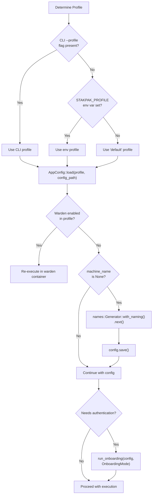
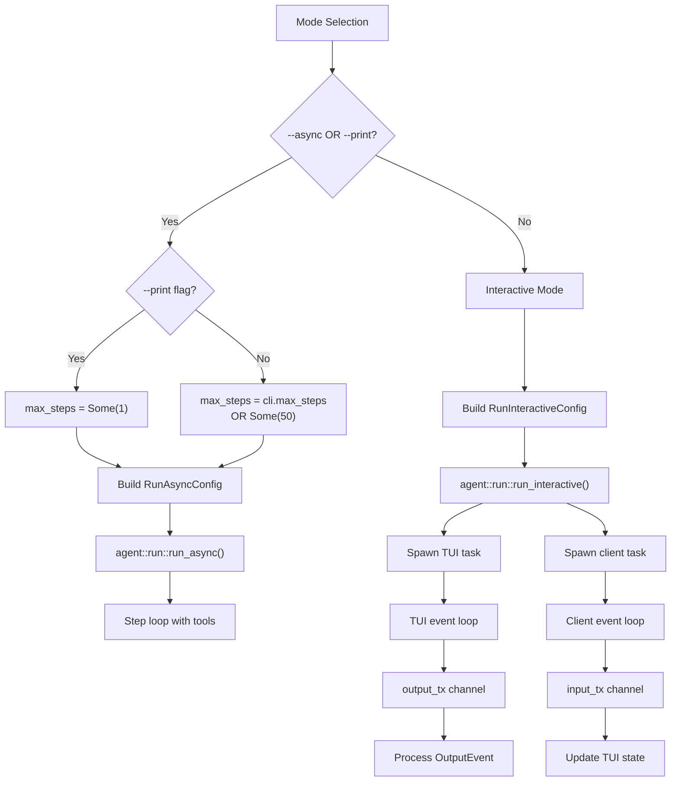
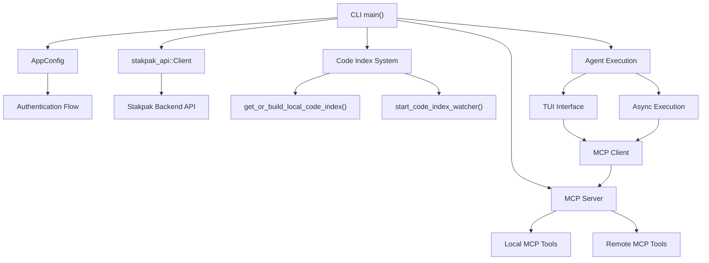
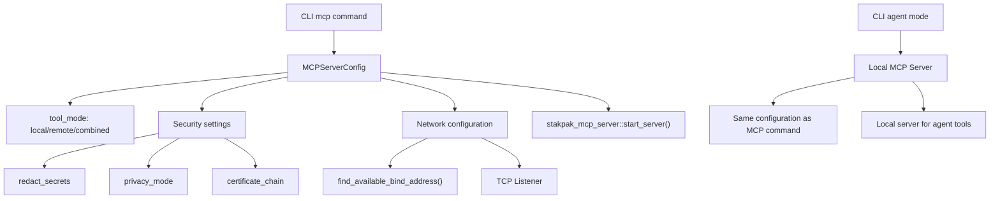
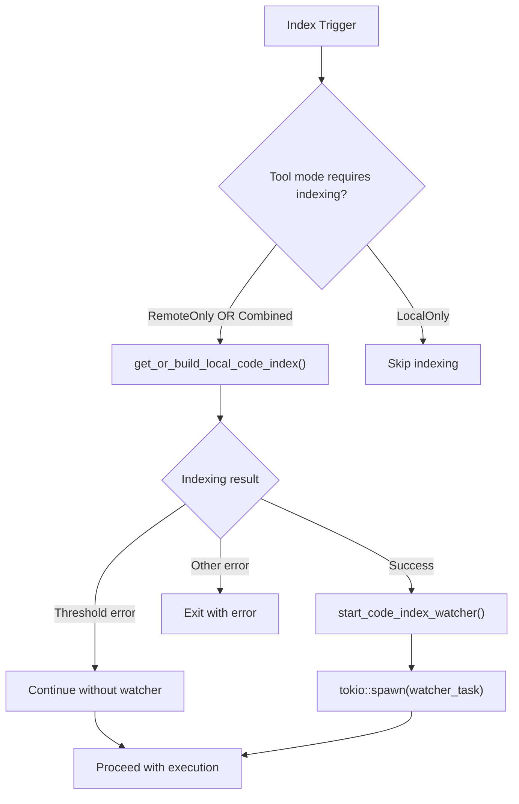

<!-- source: DeepWiki mcp.deepwiki.com · repo stakpak/agent · page 2 CLI Interface · fetched 2026-10-26 -->

# CLI Interface

Relevant source files

The following files were used as context for generating this wiki page:

- [README.md](README.md)
- [assets/stakpak-dark.png](assets/stakpak-dark.png)
- [assets/stakpak-light.png](assets/stakpak-light.png)
- [cli/src/commands/agent/run/helpers.rs](cli/src/commands/agent/run/helpers.rs)
- [cli/src/commands/agent/run/mode_async.rs](cli/src/commands/agent/run/mode_async.rs)
- [cli/src/commands/agent/run/mode_interactive.rs](cli/src/commands/agent/run/mode_interactive.rs)
- [cli/src/commands/mod.rs](cli/src/commands/mod.rs)
- [cli/src/main.rs](cli/src/main.rs)

This document covers the main command-line interface (`stakpak` CLI) that serves as the primary user entry point to the stakpak agent system. It handles argument parsing, authentication, configuration management, and dispatches to either specific subcommands or the main agent execution modes. For details about the TUI interactive interface, see [Terminal User Interface (TUI)](#3). For information about the MCP tool system integration, see [MCP (Model Context Protocol) System](#4).

## CLI Argument Structure

The CLI interface is built using the `clap` crate and defines a comprehensive set of options and flags through the `Cli` struct at [cli/src/main.rs:41-142](). The interface supports both direct agent execution and various utility subcommands.

### Main CLI Structure

**CLI Argument Structure**

```mermaid
graph TB
    CLI["Cli struct"] --> MainArgs["Main Arguments"]
    CLI --> SubCommands["Subcommands"]
    
    MainArgs --> ExecModes["Execution Modes"]
    MainArgs --> ConfigFlags["Configuration Flags"] 
    MainArgs --> SecurityFlags["Security Flags"]
    MainArgs --> ToolFlags["Tool Flags"]
    
    ExecModes --> print["-p --print<br/>Single step execution"]
    ExecModes --> async["-a --async<br/>Multi-step batch execution"]
    ExecModes --> max_steps["-m --max-steps<br/>Step limit (default: 50)"]
    ExecModes --> checkpoint["-c --checkpoint<br/>Resume from checkpoint"]
    ExecModes --> workdir["-w --workdir<br/>Set working directory"]
    
    ConfigFlags --> profile["--profile<br/>Configuration profile"]
    ConfigFlags --> config_path["--config<br/>Custom config file path"]
    ConfigFlags --> output_format["-o --output<br/>json/text format"]
    ConfigFlags --> model["--model<br/>smart/eco model selection"]
    ConfigFlags --> verbose["--verbose<br/>Verbose output"]
    ConfigFlags --> debug["--debug<br/>Debug logging"]
    
    SecurityFlags --> disable_secret_redaction["--disable-secret-redaction"]
    SecurityFlags --> privacy_mode["--privacy-mode"]
    SecurityFlags --> disable_mcp_mtls["--disable-mcp-mtls"]
    
    ToolFlags --> allowed_tools["-t --tool<br/>Filter allowed tools"]
    ToolFlags --> system_prompt_file["--system-prompt-file"]
    ToolFlags --> prompt_file["--prompt-file<br/>Read prompt from file"]
    ToolFlags --> enable_slack["--enable-slack-tools"]
    ToolFlags --> enable_subagents["--enable-subagents"]
    ToolFlags --> subagent_config["--subagent-config"]
    
    SubCommands --> Commands["Commands enum"]
```

The CLI defines mutually exclusive execution modes through boolean flags `print` and `async`. When neither flag is specified, the CLI launches in interactive mode (TUI). The optional `prompt` argument can be provided for all modes.

Sources: [cli/src/main.rs:41-142]()

### Subcommand Structure

The `Commands` enum at [cli/src/commands/mod.rs:102-167]() defines all available subcommands with their specific arguments and options:

| Subcommand | Purpose | Key Arguments | Requires Auth |
|------------|---------|---------------|---------------|
| `version` | Display CLI version | None | No |
| `login` | (Deprecated) Authenticate with API key | `--api-key` | No |
| `logout` | (Deprecated) Clear stored credentials | None | No |
| `acp` | Start Agent Client Protocol server for editor integration | `--system-prompt-file` | No |
| `set` | Update configuration values | `--machine-name`, `--auto-append-gitignore` | No |
| `config` | Configuration management | Subcommands: `list`, `show`, `sample`, `new` | No |
| `rulebooks` (alias `rb`) | Manage rulebooks | Subcommands: `get`, `apply`, `delete` | Yes |
| `account` | Get current account info | None | Yes |
| `mcp` | MCP server/proxy/client commands | Subcommands with various flags | Varies |
| `auth` | Provider authentication (OAuth, API keys) | Subcommands for different providers | No |
| `warden` | Security wrapper for agent execution | `--env`, `--volume`, subcommands | Yes |
| `update` | Update Stakpak Agent to latest version | None | No |

**ConfigCommands subcommands:**
- `list` (alias `ls`): List and select profiles interactively
- `show`: Show current configuration
- `sample`: Print a complete sample configuration file
- `new`: Create a new profile

**RulebookCommands subcommands:**
- `get [uri]`: Get specific rulebook or list all rulebooks
- `apply <file_path>`: Apply/create a rulebook from markdown file
- `delete <uri>`: Delete a rulebook

Sources: [cli/src/commands/mod.rs:70-167](), [cli/src/commands/mod.rs:206-218]()

## Execution Flow

The main execution flow follows a clear dispatch pattern based on whether subcommands are provided or the CLI should run in agent mode.

### Main Dispatch Logic

**Main Execution Flow from main()**

```mermaid
flowchart TD
    Start["main()"] --> InitCrypto["Initialize rustls crypto provider"]
    InitCrypto --> HandleConfigAlias["Handle 'stakpak config' → 'stakpak config list'"]
    HandleConfigAlias --> ParseCli["Cli::parse()"]
    ParseCli --> AutoUpdate{"Command is None<br/>AND not async/print?"}
    
    AutoUpdate -->|Yes| RunAutoUpdate["auto_update()"]
    AutoUpdate -->|No| SetWorkdir["Set workdir if specified"]
    RunAutoUpdate --> SetWorkdir
    
    SetWorkdir --> InitDebug{"cli.debug?"}
    InitDebug -->|Yes| SetupTracing["Setup tracing_subscriber"]
    InitDebug -->|No| DetermineProfile["Determine profile"]
    SetupTracing --> DetermineProfile
    
    DetermineProfile --> LoadConfig["AppConfig::load(profile, config_path)"]
    LoadConfig --> CheckWarden{"Warden enabled<br/>AND not STAKPAK_SKIP_WARDEN<br/>AND no subcommand?"}
    
    CheckWarden -->|Yes| RunWarden["commands::warden::run_stakpak_in_warden()"]
    CheckWarden -->|No| GenMachineName{"machine_name.is_none()?"}
    
    GenMachineName -->|Yes| GenerateName["Generate random machine name"]
    GenMachineName -->|No| CheckCommand{"command.is_some()?"}
    GenerateName --> SaveConfig["config.save()"]
    SaveConfig --> CheckCommand
    
    CheckCommand -->|Yes| CheckAuth{"command.requires_auth()?"}
    CheckCommand -->|No| AgentMode["Agent Mode Execution"]
    
    CheckAuth -->|Yes| HasApiKey{"config.get_stakpak_api_key().is_none()?"}
    CheckAuth -->|No| EnsureGitignore["Ensure .stakpak in .gitignore"]
    
    HasApiKey -->|Yes| RunOnboarding["run_onboarding()"]
    HasApiKey -->|No| EnsureGitignore
    RunOnboarding --> EnsureGitignore
    
    EnsureGitignore --> RunCommand["command.run(config)"]
    
    AgentMode --> CheckAuthAgent{"Provider is Remote<br/>AND no API key?"}
    CheckAuthAgent -->|Yes| RunOnboardingAgent["run_onboarding()"]
    CheckAuthAgent -->|No| AnalyzeContext["analyze_local_context()"]
    RunOnboardingAgent --> AnalyzeContext
    
    AnalyzeContext --> DiscoverAgentsMd["discover_agents_md()"]
    DiscoverAgentsMd --> CreateClient["Create AgentProvider<br/>(Remote or Local)"]
    
    CreateClient --> ParallelFetch["Parallel: get_my_account(),<br/>check_update(), list_rulebooks()"]
    ParallelFetch --> ValidateApi{"API validation<br/>successful?"}
    
    ValidateApi -->|No AND Remote| ExitError["Exit with error"]
    ValidateApi -->|Yes OR Local| LoadSubagents["Load subagent configs<br/>if --enable-subagents"]
    
    LoadSubagents --> ReadPrompts["Read system-prompt-file<br/>and prompt-file if specified"]
    ReadPrompts --> DetermineMode{"use_async_mode?<br/>(cli.async OR cli.print)"}
    
    DetermineMode -->|Yes| RunAsync["agent::run::run_async()"]
    DetermineMode -->|No| RunInteractive["agent::run::run_interactive()"]
```

The profile selection follows this priority chain:
1. CLI argument `--profile`
2. Environment variable `STAKPAK_PROFILE`
3. Default value `"default"`

The execution mode determination follows this logic:
- `use_async_mode = cli.async || cli.print`
- `max_steps = if cli.print { Some(1) } else { cli.max_steps }`

Sources: [cli/src/main.rs:146-512]()

### Configuration and Profile Management

The CLI manages configuration through the `AppConfig` system with support for multiple profiles:

**Profile Selection and Configuration Loading**

The configuration system supports:
- **Profile-based settings**: Multiple profiles stored in `~/.stakpak/config.toml`
- **Credential fallback chain**: Uses `auth.toml` for provider credentials
- **Warden integration**: Automatic container wrapping when `warden.enabled = true`
- **Machine identification**: Random name generation for device tracking

Sources: [cli/src/main.rs:191-230](), [cli/src/main.rs:198-216](), [cli/src/main.rs:218-229]()

## Agent Execution Modes  

The CLI supports two primary agent execution modes, each with distinct characteristics and use cases. The mode selection and configuration preparation happens in [cli/src/main.rs:426-506]().

### Mode Determination and Configuration

**Agent Mode Selection and Initialization**

### Execution Mode Characteristics

| Mode | Trigger | Max Steps | User Interaction | Output | Config Struct |
|------|---------|-----------|------------------|---------|---------------|
| Interactive | Default (no flags) | Unlimited | TUI-based real-time | Terminal interface | `RunInteractiveConfig` |
| Async (Multi-step) | `--async` | 50 (default) or user-specified | None | JSON/Text to stdout | `RunAsyncConfig` |
| Async (Single-step) | `--print` | 1 (forced) | None | JSON/Text to stdout | `RunAsyncConfig` |

### Configuration Structures

**RunAsyncConfig** ([cli/src/commands/agent/run/mode_async.rs:28-45]()):
- `prompt: String` - User prompt text
- `checkpoint_id: Option<String>` - Resume from checkpoint
- `local_context: Option<LocalContext>` - Local file context
- `verbose: bool` - Verbose output
- `redact_secrets: bool` - Secret redaction flag
- `privacy_mode: bool` - Privacy mode flag
- `rulebooks: Option<Vec<ListRuleBook>>` - Applied rulebooks
- `subagent_configs: Option<SubagentConfigs>` - Subagent configuration
- `max_steps: Option<usize>` - Maximum execution steps
- `output_format: OutputFormat` - JSON or Text
- `allowed_tools: Option<Vec<String>>` - Tool filter
- `enable_mtls: bool` - mTLS flag
- `system_prompt: Option<String>` - System prompt override
- `enabled_tools: EnabledToolsConfig` - Tool category enables
- `model: AgentModel` - Smart or Eco model
- `agents_md: Option<AgentsMdInfo>` - AGENTS.md metadata

**RunInteractiveConfig** ([cli/src/commands/agent/run/mode_interactive.rs:51-67]()):
- Similar fields as async, but no `prompt`, `verbose`, `max_steps`, or `output_format`
- Additional: `is_git_repo: bool`, `study_mode: bool`, `auto_approve: Option<Vec<String>>`

Sources: [cli/src/main.rs:426-506](), [cli/src/commands/agent/run/mode_async.rs:28-45](), [cli/src/commands/agent/run/mode_interactive.rs:51-67]()

## Integration Points

The CLI orchestrates integration with multiple system components through well-defined interfaces.

### System Component Integration

### MCP Server Integration

When running the `mcp` subcommand or agent modes, the CLI initializes the MCP server with specific configurations:

Sources: [cli/src/commands/mod.rs:175-254](), [cli/src/main.rs:170-192]()

### Code Index Management

The CLI manages local code indexing for enhanced context in agent operations:

The system handles large project thresholds gracefully, allowing users to override with the `--index-big-project` flag.

Sources: [cli/src/main.rs:170-192](), [cli/src/commands/mod.rs:185-212]()

---

