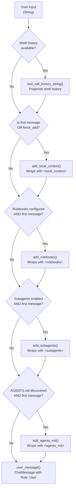
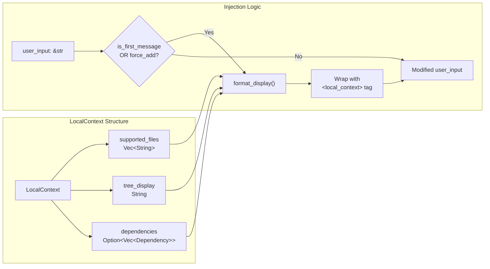
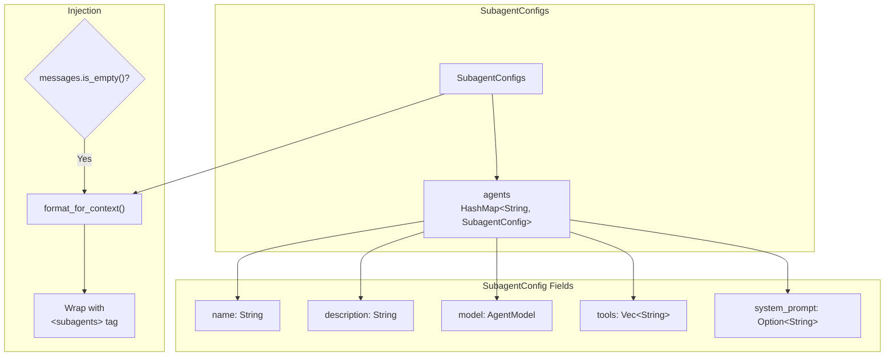
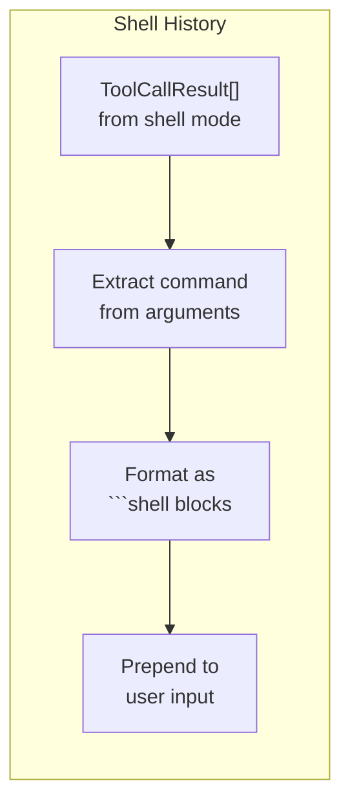
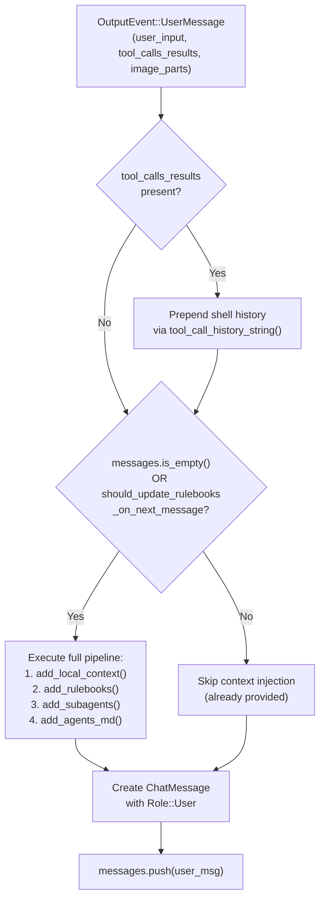
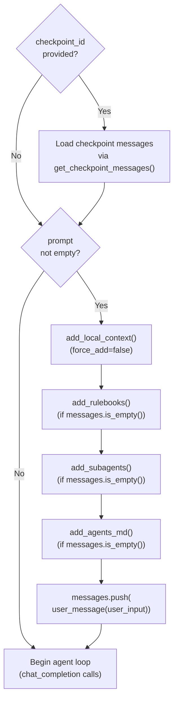

<!-- source: DeepWiki mcp.deepwiki.com · repo stakpak/agent · page 2.3 Context Injection Pipeline · fetched 2026-10-26 -->

# Context Injection Pipeline

<details>
<summary>Relevant source files</summary>

The following files were used as context for generating this wiki page:

- [cli/src/commands/agent/run/helpers.rs](cli/src/commands/agent/run/helpers.rs)
- [cli/src/commands/agent/run/mode_async.rs](cli/src/commands/agent/run/mode_async.rs)
- [cli/src/commands/agent/run/mode_interactive.rs](cli/src/commands/agent/run/mode_interactive.rs)
- [cli/src/commands/mod.rs](cli/src/commands/mod.rs)
- [cli/src/main.rs](cli/src/main.rs)

</details>


## Purpose and Scope

The Context Injection Pipeline is responsible for enriching user prompts with relevant contextual information before sending them to the LLM. This system prepares the initial conversation by injecting local project context, organizational policies (rulebooks), subagent configurations, and AGENTS.md files into user messages. The pipeline executes conditionally based on message history and configuration settings, ensuring context is provided when needed without unnecessary repetition.

For information about session management and checkpoints, see [Session and Profile Management](#2.4). For details on how tools are executed after the LLM responds, see [Tool Container and Execution Flow](#5.2).

## Pipeline Architecture

The context injection pipeline consists of five distinct components, each handled by a dedicated helper function. These functions wrap user input with XML-tagged context sections that guide the LLM's understanding of the operational environment.

### Pipeline Execution Flow



**Sources:** [cli/src/commands/agent/run/mode_interactive.rs:300-344](), [cli/src/commands/agent/run/mode_async.rs:150-176](), [cli/src/commands/agent/run/helpers.rs:71-188]()

## Context Components

### Local Context Component

The `LocalContext` structure provides filesystem and project metadata to the LLM. This component is managed by `add_local_context()` and only injects on the first message or when explicitly forced (e.g., after rulebook updates or session resume).



The `add_local_context()` function checks if the current message is the first non-system message in the conversation or if `force_add` is true. When triggered, it calls `local_context.format_display().await` to generate the context string and wraps it with `<local_context>` XML tags.

**Sources:** [cli/src/commands/agent/run/helpers.rs:71-98](), [cli/src/utils/local_context.rs]()

### Rulebooks Component

Rulebooks represent organizational policies and SOPs that guide agent behavior. The `add_rulebooks()` function formats a list of `ListRuleBook` objects into a human-readable list structure.

| Field | Type | Description |
|-------|------|-------------|
| `uri` | String | Unique identifier for the rulebook |
| `description` | String | Human-readable summary |
| `tags` | Vec\<String\> | Categorization tags |
| `content` | String | Full rulebook text |

The function formats rulebooks with indentation to improve readability:

```
<rulebooks>

# My Rule Books:

  - [URI] stakpak://domain.com/policy
    Description: Security best practices
    Tags: security, compliance
  
  - [URI] stakpak://domain.com/terraform
    Description: Terraform coding standards
    Tags: infrastructure, terraform

</rulebooks>
```

Rulebooks are only injected on the first message or after the user changes rulebook selections via the TUI switcher (controlled by `should_update_rulebooks_on_next_message` flag).

**Sources:** [cli/src/commands/agent/run/helpers.rs:100-130](), [cli/src/commands/agent/run/mode_interactive.rs:312-329]()

### Subagents Component

Subagent configurations enable delegating specialized tasks to other AI agents. The `add_subagents()` function injects `SubagentConfigs` on the first message only.



The formatted output includes each subagent's name, description, capabilities, and usage instructions. Subagents are loaded from either a custom `subagents.toml` file or the default embedded configuration.

**Sources:** [cli/src/commands/agent/run/helpers.rs:132-152](), [cli/src/main.rs:341-359](), [stakpak_shared/src/models/subagent.rs]()

### AGENTS.md Component

The `AGENTS.md` file is a special convention for documenting multi-agent systems. When discovered in the project directory hierarchy, it's injected on the first message via `add_agents_md()`.

The discovery process uses `discover_agents_md()` to search from the current working directory up through parent directories until an `AGENTS.md` file is found. The file is parsed to extract:

- Agent roles and responsibilities
- Communication patterns between agents
- Delegation guidelines

**Sources:** [cli/src/commands/agent/run/helpers.rs:184-188](), [cli/src/main.rs:259-265](), [cli/src/utils/agents_md.rs]()

### Shell History Component

When the TUI's shell mode has executed commands, their history is prepended to the user's next message via `tool_call_history_string()`. This provides continuity between interactive shell sessions and LLM conversations.



Each tool call result is formatted as a shell block containing the command and its output:

```shell
$ ls -la
total 48
drwxr-xr-x  6 user  staff   192 Dec 10 14:23 .
...

$ cat package.json
{
  "name": "my-project",
  ...
}
```

**Sources:** [cli/src/commands/agent/run/helpers.rs:154-182](), [cli/src/commands/agent/run/mode_interactive.rs:303-308]()

## Pipeline Implementation in Execution Modes

### Interactive Mode Pipeline

In interactive mode (`mode_interactive.rs`), the pipeline executes when handling `OutputEvent::UserMessage` events. The implementation tracks state to determine when to re-inject context:



The `should_update_rulebooks_on_next_message` flag is set to `true` when:
- A session is resumed from checkpoint ([mode_interactive.rs:558]())
- A user switches to a different session ([mode_interactive.rs:627]())
- A user updates rulebook selections via the TUI ([mode_interactive.rs:793]())

**Sources:** [cli/src/commands/agent/run/mode_interactive.rs:300-373](), [cli/src/commands/agent/run/mode_interactive.rs:557-558](), [cli/src/commands/agent/run/mode_interactive.rs:793]()

### Async Mode Pipeline

In async mode (`mode_async.rs`), the pipeline executes once during initialization before the agent loop begins. Since async mode is non-interactive, context is injected unconditionally if the message list is empty:



The conditional checks for `messages.is_empty()` within each helper function ensure context is only added if no checkpoint was loaded, since checkpoint messages already contain historical context.

**Sources:** [cli/src/commands/agent/run/mode_async.rs:149-177]()

## Helper Function Reference

### add_local_context

```rust
pub async fn add_local_context<'a>(
    messages: &'a [ChatMessage],
    user_input: &'a str,
    local_context: &'a Option<LocalContext>,
    force_add: bool,
) -> Result<(String, Option<&'a LocalContext>), Box<dyn std::error::Error>>
```

**Logic:**
1. Check if `local_context` is `Some`
2. Count non-system messages to determine if this is the first message
3. If first message OR `force_add` is true:
   - Call `local_context.format_display().await`
   - Wrap result in `<local_context>` tags
   - Return modified input
4. Otherwise, return original input unchanged

**Sources:** [cli/src/commands/agent/run/helpers.rs:71-98]()

### add_rulebooks

```rust
pub fn add_rulebooks(user_input: &str, rulebooks: &[ListRuleBook]) -> (String, Option<String>)
```

**Logic:**
1. Build formatted string from `rulebooks` slice
2. Each rulebook is indented with `  - ` for first line, `    ` for continuation
3. Wrap entire list in `<rulebooks>` tags
4. Return tuple of (modified_input, rulebooks_text)

**Sources:** [cli/src/commands/agent/run/helpers.rs:100-130]()

### add_subagents

```rust
pub fn add_subagents(
    messages: &[ChatMessage],
    user_input: &str,
    subagent_configs: &Option<SubagentConfigs>,
) -> (String, Option<String>)
```

**Logic:**
1. Check if `subagent_configs` is `Some`
2. Call `subagent_configs.format_for_context()` to generate text
3. If `messages.is_empty()`:
   - Wrap in `<subagents>` tags
   - Return modified input
4. Otherwise, return original input unchanged

**Sources:** [cli/src/commands/agent/run/helpers.rs:132-152]()

### add_agents_md

```rust
pub fn add_agents_md(user_input: &str, agents_md: &AgentsMdInfo) -> (String, String)
```

**Logic:**
1. Call `format_agents_md_for_context(agents_md)` to generate text
2. Wrap in `<agents_md>` tags
3. Return tuple of (modified_input, agents_text)

Unlike other helpers, this function has no conditional logic—the caller is responsible for checking `messages.is_empty()`.

**Sources:** [cli/src/commands/agent/run/helpers.rs:184-188]()

### tool_call_history_string

```rust
pub fn tool_call_history_string(tool_calls: &[ToolCallResult]) -> Option<String>
```

**Logic:**
1. Return `None` if `tool_calls` is empty
2. For each `ToolCallResult`:
   - Parse `function.arguments` JSON to extract `command` field
   - Format as shell code block with command and result
3. Join all blocks with newlines
4. Return `Some(formatted_history)`

**Sources:** [cli/src/commands/agent/run/helpers.rs:154-182]()

## Configuration and Initialization

Context components are initialized during CLI startup before entering execution mode:

| Component | Initialization | Location |
|-----------|----------------|----------|
| Local Context | `analyze_local_context(&config).await` | [main.rs:257]() |
| Rulebooks | `client.list_rulebooks().await` + filtering | [main.rs:307-319]() |
| Subagents | Load from file or default config | [main.rs:341-359]() |
| AGENTS.md | `discover_agents_md(&cwd)` | [main.rs:262-265]() |
| System Prompt | Load from file if `--system-prompt-file` | [main.rs:385-405]() |

These initialized values are passed to `RunInteractiveConfig` or `RunAsyncConfig` structures, which carry them through to the execution mode implementations.

**Sources:** [cli/src/main.rs:250-497]()

## XML Tag Convention

All context components use XML-style tags to clearly delineate boundaries for the LLM:

```
<local_context>
...filesystem tree and dependencies...
</local_context>

<rulebooks>
...organizational policies...
</rulebooks>

<subagents>
...delegatable agent definitions...
</subagents>

<agents_md>
...multi-agent system documentation...
</agents_md>
```

This convention ensures the LLM can reliably parse context sections and understand their semantic roles without confusion between different types of information.

**Sources:** [cli/src/commands/agent/run/helpers.rs:71-188]()

---

