<!-- source: DeepWiki mcp.deepwiki.com · repo stakpak/agent · page 2.4 Session and Profile Management · fetched 2026-10-26 -->

# Session and Profile Management

<details>
<summary>Relevant source files</summary>

The following files were used as context for generating this wiki page:

- [README.md](README.md)
- [assets/stakpak-dark.png](assets/stakpak-dark.png)
- [assets/stakpak-light.png](assets/stakpak-light.png)
- [cli/src/commands/agent/run/helpers.rs](cli/src/commands/agent/run/helpers.rs)
- [cli/src/commands/agent/run/mode_async.rs](cli/src/commands/agent/run/mode_async.rs)
- [cli/src/commands/agent/run/mode_interactive.rs](cli/src/commands/agent/run/mode_interactive.rs)
- [cli/src/commands/mod.rs](cli/src/commands/mod.rs)
- [cli/src/main.rs](cli/src/main.rs)

</details>


## Purpose and Scope

This page documents how Stakpak manages conversation sessions and configuration profiles. It covers the profile-based configuration system, session persistence and resumption, checkpoint mechanisms, and runtime profile switching. 

For information about CLI initialization and configuration loading, see [Main Entry Point and Configuration](#2.1). For details about how sessions are used within different execution modes, see [Agent Execution Modes](#2.2).

---

## Profile-Based Configuration System

Stakpak uses a profile-based configuration system that allows users to maintain multiple configurations for different environments, providers, or use cases. Profiles are defined in `~/.stakpak/config.toml` and can be selected at runtime.

### Profile Structure

Profiles are defined under the `[profiles]` section in the configuration file. Each profile contains:

| Field | Description | Example |
|-------|-------------|---------|
| `provider` | Backend provider type (`remote` or `local`) | `"remote"` |
| `api_key` | API key for remote provider | `"sk-..."` |
| `api_endpoint` | API endpoint URL | `"https://apiv2.stakpak.dev"` |
| `allowed_tools` | List of permitted tool names | `["view", "create"]` |
| `auto_approve` | Tools that don't require approval | `["view"]` |
| `smart_model` | Model for complex tasks | `"claude-sonnet-4-5"` |
| `eco_model` | Model for simple tasks | `"claude-haiku-4-5"` |
| `rulebooks` | Rulebook filtering configuration | See below |
| `warden` | Security container configuration | See [Warden Guardrails](#6.2) |

Sources: [cli/src/config.rs](), [README.md:143-209]()

### Special "all" Profile

The `all` profile serves as a base configuration that all other profiles inherit from. Settings in the `all` profile apply to every profile unless explicitly overridden.

```toml
[profiles.all]
api_endpoint = "https://apiv2.stakpak.dev"
allowed_tools = ["view", "search_docs", "read_rulebook"]
auto_approve = ["view", "search_docs"]

[profiles.default]
# Inherits settings from 'all' and can override
allowed_tools = ["view", "search_docs", "create", "str_replace"]
```

Sources: [cli/src/commands/mod.rs:499-611]()

### Profile Selection Priority

Profile selection follows this priority order:

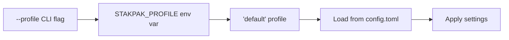

Sources: [cli/src/main.rs:191-196]()

### Profile Loading Flow

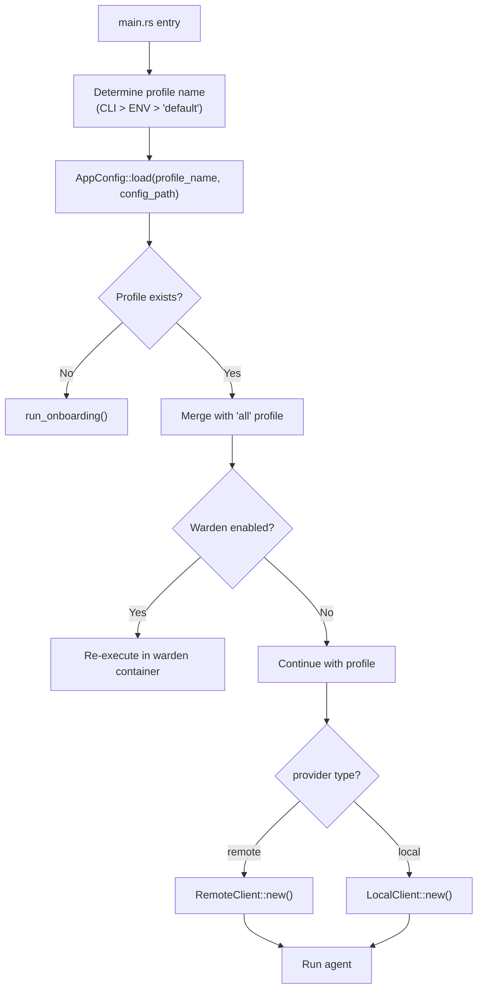

Sources: [cli/src/main.rs:192-297](), [cli/src/commands/agent/run/mode_interactive.rs:86-190]()

---

## Session Management

Sessions represent conversation threads with persistent message history and state. Sessions are the core unit of conversation continuity in Stakpak.

### Session Structure

Each session contains:

| Component | Description | Storage Location |
|-----------|-------------|------------------|
| Session ID | UUID identifier | Server (remote) or SQLite (local) |
| Messages | Chat message history | In-memory + persisted |
| Tool Calls | Pending and executed tools | In message history |
| Checkpoints | Resumption points | Server (remote) or SQLite (local) |
| Model | AI model used | In-memory |
| Token Usage | Cumulative token counts | In-memory |

Sources: [cli/src/commands/agent/run/mode_interactive.rs:164-190](), [stakpak_api model types]()

### Session Lifecycle in Interactive Mode

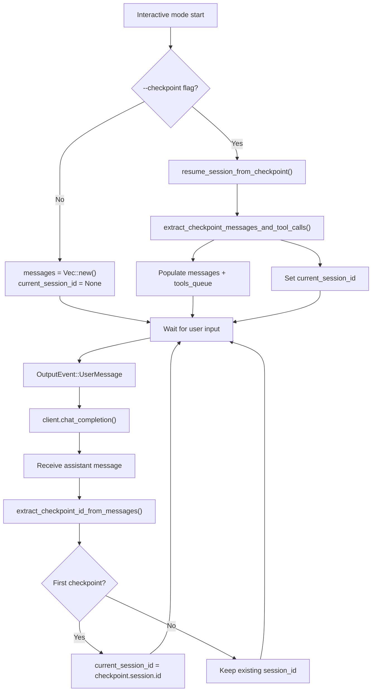

Sources: [cli/src/commands/agent/run/mode_interactive.rs:249-285](), [cli/src/commands/agent/run/mode_interactive.rs:234-243]()

### Session Operations

#### Creating a New Session

A new session is created implicitly when the first message is sent without a checkpoint:

```
OutputEvent::NewSession → clear messages → current_session_id = None
```

Sources: [cli/src/commands/agent/run/mode_interactive.rs:513-524]()

#### Resuming a Session

Sessions can be resumed via checkpoint or session picker:

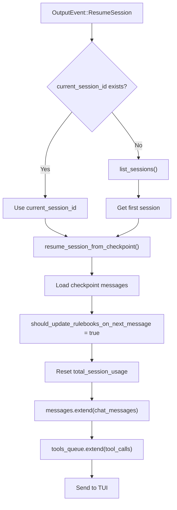

Sources: [cli/src/commands/agent/run/mode_interactive.rs:526-607]()

#### Switching Sessions

The TUI provides a session picker that allows switching between sessions:

```mermaid
graph LR
    PICKER["User opens session picker"] --> LIST["OutputEvent::ListSessions"]
    LIST --> FETCH["client.list_sessions()"]
    FETCH --> DISPLAY["Display in TUI popup"]
    DISPLAY --> SELECT["User selects session"]
    SELECT --> SWITCH["OutputEvent::SwitchToSession(id)"]
    SWITCH --> RESUME["resume_session_from_checkpoint()"]
```

Sources: [cli/src/commands/agent/run/mode_interactive.rs:486-511](), [cli/src/commands/agent/run/mode_interactive.rs:609-668]()

### Session Storage by Provider Type

| Provider | Storage Mechanism | Location | Persistence |
|----------|------------------|----------|-------------|
| `remote` | Stakpak API server | Server-side database | Permanent |
| `local` | SQLite database | `~/.stakpak/store/sessions.db` | Local only |

Sources: [libs/api/src/local/mod.rs](), [libs/api/src/remote/mod.rs]()

---

## Checkpoint System

Checkpoints are resumption points within a session that capture the conversation state at a specific moment. They enable conversation continuity across restarts and mode switches.

### Checkpoint Structure

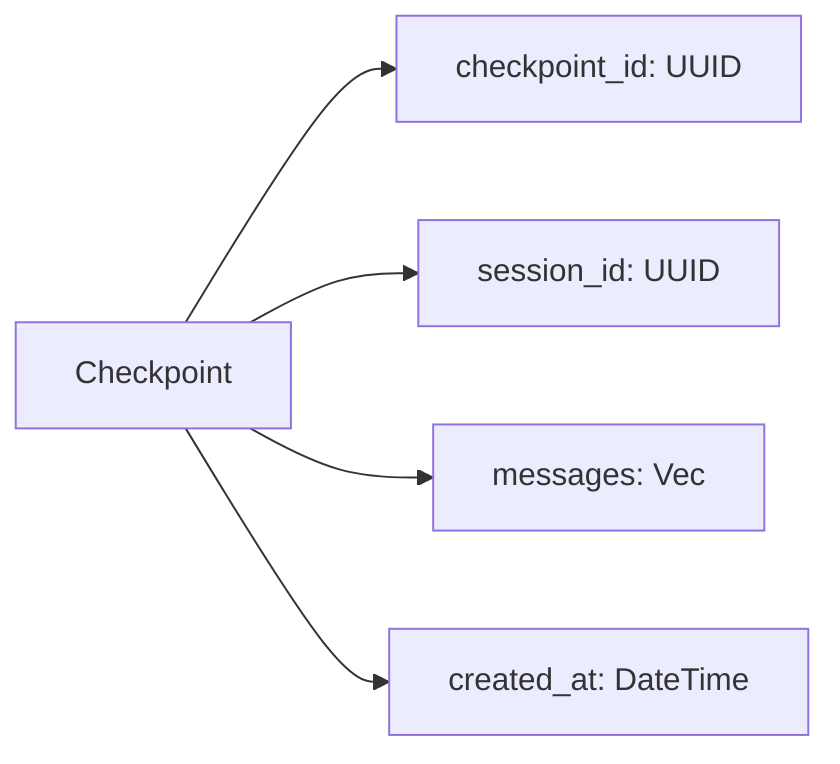

Sources: [stakpak_api model types](), [cli/src/commands/agent/run/checkpoint.rs]()

### Checkpoint ID Embedding

Checkpoint IDs are embedded in assistant messages using XML-style tags:

```
<checkpoint_id>550e8400-e29b-41d4-a716-446655440000</checkpoint_id>
```

This allows extraction from message history without separate metadata:

```rust
// Extract checkpoint ID from messages
fn extract_checkpoint_id_from_messages(messages: &[ChatMessage]) -> Option<String>

// Extract from individual message content
trait MessageContent {
    fn extract_checkpoint_id(&self) -> Option<String>
}
```

Sources: [cli/src/commands/agent/run/checkpoint.rs:1-30]()

### Checkpoint Creation and Retrieval Flow

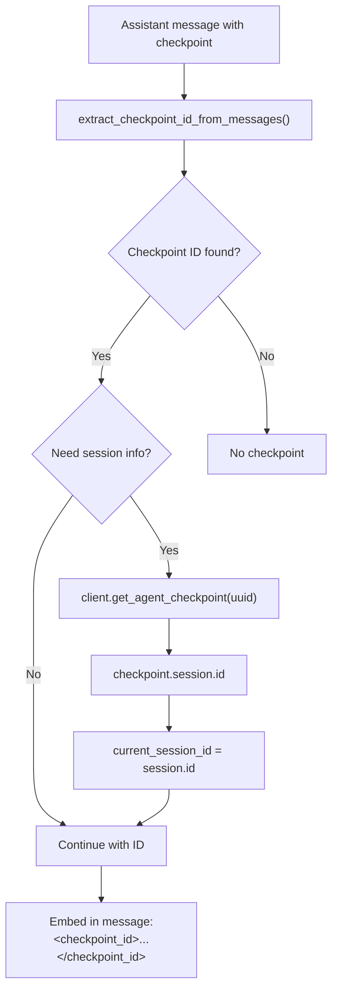

Sources: [cli/src/commands/agent/run/mode_interactive.rs:234-243](), [cli/src/commands/agent/run/checkpoint.rs:46-84]()

### Loading Checkpoint Messages

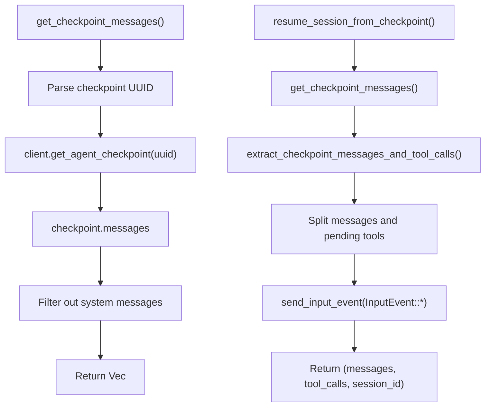

Sources: [cli/src/commands/agent/run/checkpoint.rs:86-177]()

### CLI Checkpoint Flag

The `--checkpoint` CLI flag allows resuming from a specific checkpoint:

```bash
stakpak --checkpoint 550e8400-e29b-41d4-a716-446655440000
```

This works in both interactive and async modes:

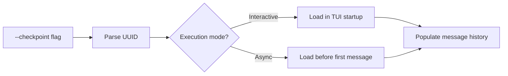

Sources: [cli/src/main.rs:58-59](), [cli/src/commands/agent/run/mode_interactive.rs:249-285](), [cli/src/commands/agent/run/mode_async.rs:113-142]()

---

## Runtime Profile Switching

The TUI supports switching profiles without restarting the application. This enables quick transitions between different configurations (e.g., from local to remote provider, or between different API keys).

### Profile Switch Flow

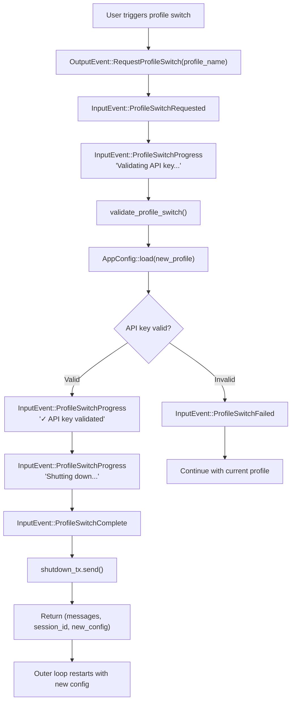

Sources: [cli/src/commands/agent/run/mode_interactive.rs:714-779](), [cli/src/commands/agent/run/profile_switch.rs]()

### Profile Switch Outer Loop

The interactive mode runs in an outer loop that enables profile switching:

```rust
'profile_switch_loop: loop {
    // Initialize with current config
    let mut messages: Vec<ChatMessage> = Vec::new();
    let mut current_session_id: Option<Uuid> = None;
    
    // ... run TUI and client tasks ...
    
    // If profile switch requested:
    return Ok((messages, current_session_id, Some(new_config), usage));
    
    // Outer loop receives new config and restarts
}
```

Sources: [cli/src/commands/agent/run/mode_interactive.rs:74-777]()

### Profile Validation

Before switching, the new profile is validated:

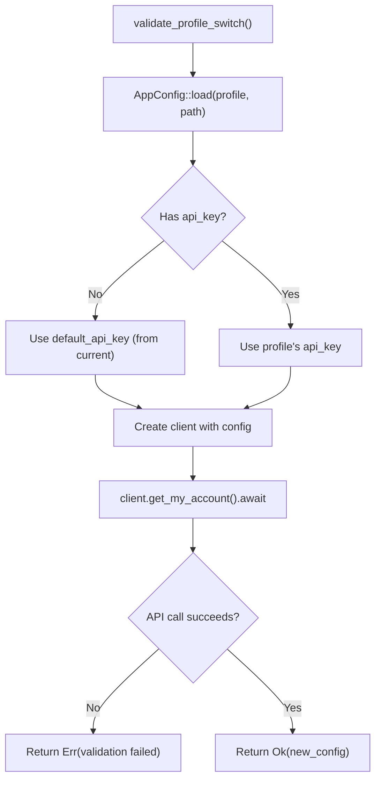

Sources: [cli/src/commands/agent/run/profile_switch.rs]()

### TUI Profile Display

The TUI displays the current profile and provides access to the profile switcher:

| UI Element | Location | Function |
|------------|----------|----------|
| Profile indicator | Top status bar | Shows `current_profile_name` |
| Profile switcher | Command palette | Lists available profiles |
| Switch confirmation | Progress messages | Shows validation steps |

Sources: [libs/tui/src/state.rs](), [libs/tui/src/widgets/popup.rs]()

---

## Session and Profile State Management

### State Variables in Interactive Mode

The `run_interactive` function maintains several state variables:

```rust
let mut messages: Vec<ChatMessage> = Vec::new();
let mut current_session_id: Option<Uuid> = None;
let mut should_update_rulebooks_on_next_message = false;
let mut total_session_usage = LLMTokenUsage::default();
```

| Variable | Purpose | Reset On |
|----------|---------|----------|
| `messages` | Conversation history | New session, profile switch |
| `current_session_id` | Active session UUID | New session |
| `should_update_rulebooks_on_next_message` | Flag to re-inject rulebooks | Session resume, rulebook update |
| `total_session_usage` | Token usage accumulator | New session, session resume |

Sources: [cli/src/commands/agent/run/mode_interactive.rs:76-84]()

### Rulebook Re-injection

When resuming a session or switching profiles, rulebooks need to be re-injected on the next user message:

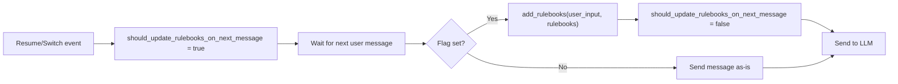

Sources: [cli/src/commands/agent/run/mode_interactive.rs:557-558](), [cli/src/commands/agent/run/mode_interactive.rs:312-329]()

### TUI Session State

The TUI maintains session-related state in `AppState`:

```rust
pub struct AppState {
    pub sessions: Vec<Session>,           // Available sessions list
    pub current_profile: String,          // Active profile name
    pub available_profiles: Vec<String>,  // All profiles in config
    // ... other fields
}
```

Sources: [libs/tui/src/state.rs]()

### Session List Loading

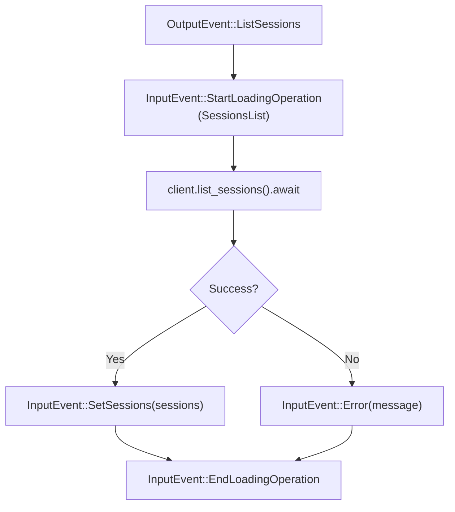

Sources: [cli/src/commands/agent/run/mode_interactive.rs:486-511]()

---

## Configuration Commands

Stakpak provides CLI commands for managing profiles and sessions:

### Profile Management Commands

```bash
# List and select profiles interactively
stakpak config list

# Show current configuration
stakpak config show

# Print sample configuration
stakpak config sample

# Create a new profile
stakpak config new
```

Sources: [cli/src/commands/mod.rs:69-80](), [cli/src/commands/mod.rs:283-358]()

### Profile List Interactive Menu

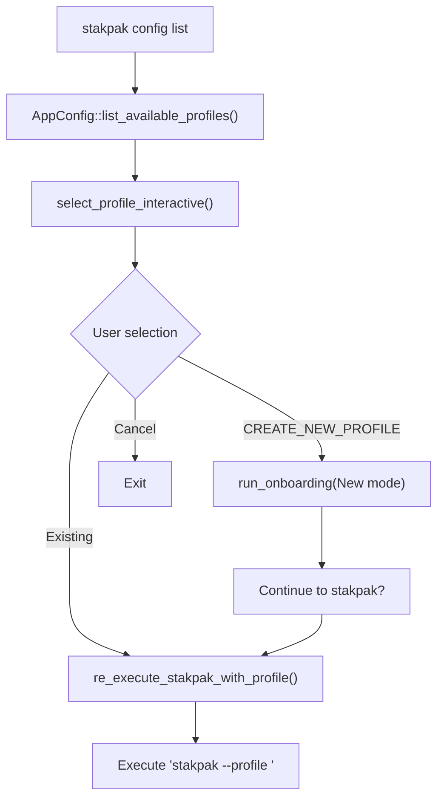

Sources: [cli/src/commands/mod.rs:285-318](), [cli/src/commands/mod.rs:614-660]()

### Session Storage Locations

| Provider Type | Sessions | Checkpoints | Messages |
|---------------|----------|-------------|----------|
| Remote | API server | API server | API server |
| Local | `~/.stakpak/store/sessions.db` | `~/.stakpak/store/sessions.db` | `.stakpak/session/messages.json` |

Sources: [libs/shared/src/local_store.rs](), [libs/api/src/local/mod.rs]()

---

## Integration with Context Injection

Sessions interact with the context injection pipeline (see [Context Injection Pipeline](#2.3)) in specific ways:

### First Message vs. Subsequent Messages

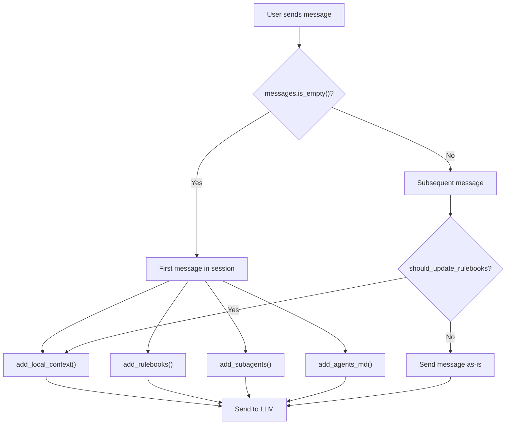

Sources: [cli/src/commands/agent/run/mode_interactive.rs:310-344]()

### Context Re-injection on Resume

When a session is resumed, context is re-injected on the next user message:

1. `resume_session_from_checkpoint()` sets `should_update_rulebooks_on_next_message = true`
2. Next user message triggers context injection
3. Flag is reset after injection

This ensures resumed sessions have up-to-date context (e.g., if rulebook settings changed).

Sources: [cli/src/commands/agent/run/mode_interactive.rs:557-558](), [cli/src/commands/agent/run/mode_interactive.rs:626-627]()

---

## Summary

Session and profile management in Stakpak provides:

1. **Profile System**: Multiple configurations with inheritance, runtime switching, and validation
2. **Session Persistence**: Conversation continuity through checkpoints and message history
3. **Checkpoint Mechanism**: Resume points embedded in messages with UUID-based identification
4. **Provider Flexibility**: Unified interface for remote (API) and local (SQLite) storage
5. **TUI Integration**: Interactive profile/session switching with progress feedback
6. **Context Coordination**: Smart re-injection of context when resuming or switching

The system enables seamless transitions between configurations and conversation threads, supporting workflows that require different tool access levels, providers, or security policies.

Sources: [cli/src/commands/agent/run/mode_interactive.rs](), [cli/src/commands/agent/run/checkpoint.rs](), [cli/src/commands/agent/run/profile_switch.rs](), [cli/src/config.rs](), [cli/src/main.rs]()

---

