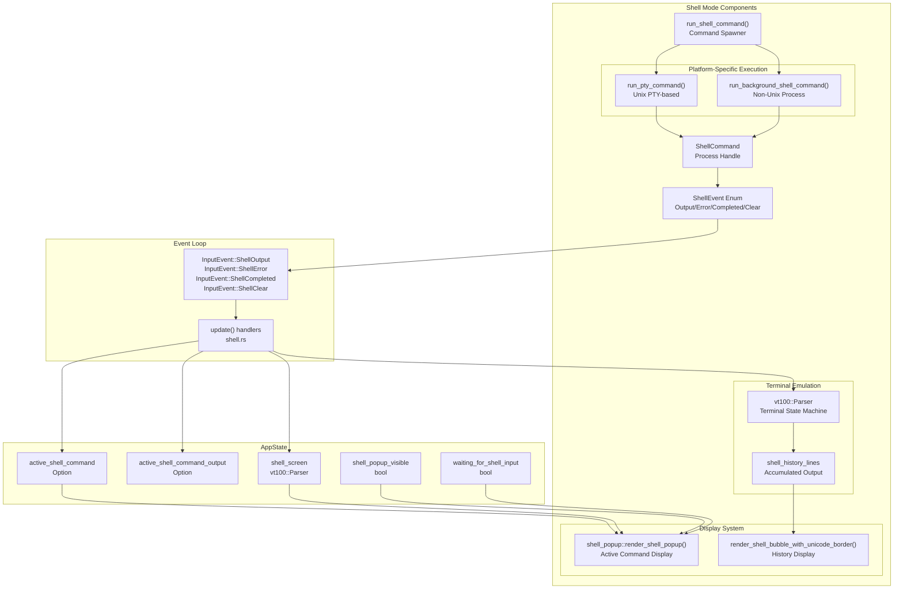
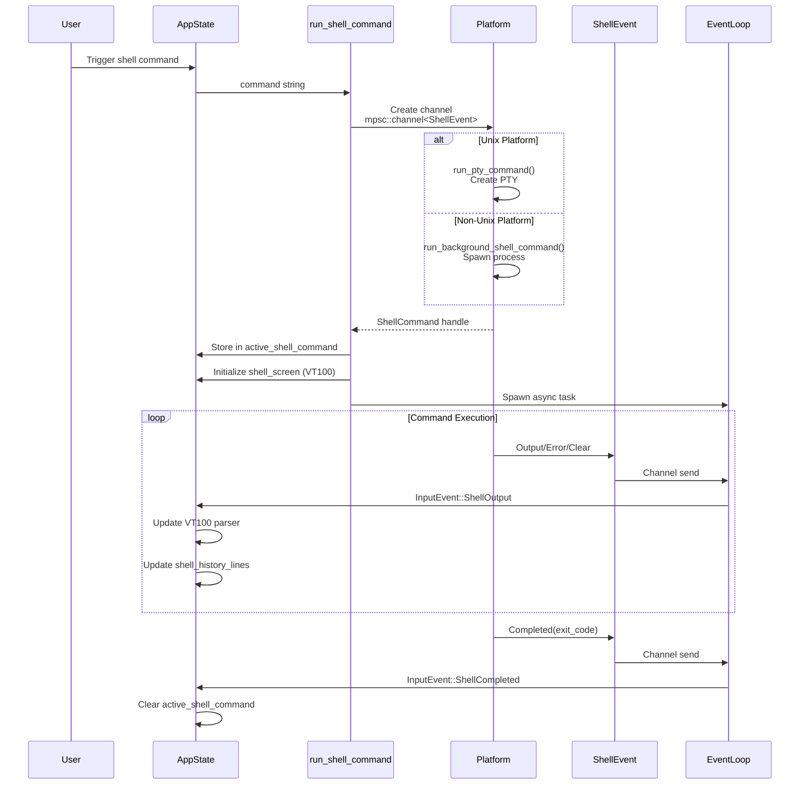
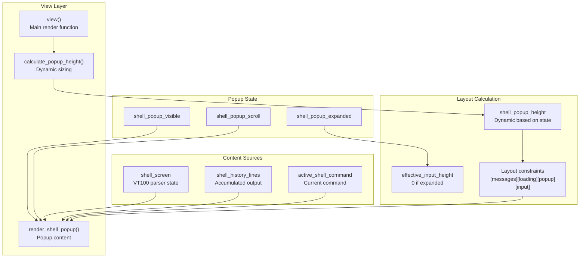
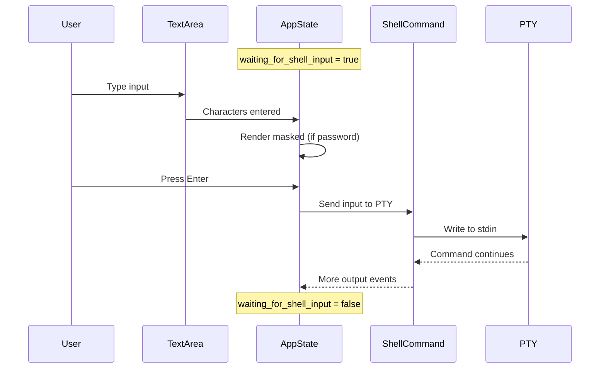

<!-- source: DeepWiki mcp.deepwiki.com · repo stakpak/agent · page 3.7 Shell Mode Integration · fetched 2026-10-26 -->

# Shell Mode Integration

<details>
<summary>Relevant source files</summary>

The following files were used as context for generating this wiki page:

- [tui/src/app.rs](tui/src/app.rs)
- [tui/src/lib.rs](tui/src/lib.rs)
- [tui/src/services/bash_block.rs](tui/src/services/bash_block.rs)
- [tui/src/services/detect_term.rs](tui/src/services/detect_term.rs)
- [tui/src/services/markdown_renderer.rs](tui/src/services/markdown_renderer.rs)
- [tui/src/services/message.rs](tui/src/services/message.rs)
- [tui/src/services/syntax_highlighter.rs](tui/src/services/syntax_highlighter.rs)
- [tui/src/services/update.rs](tui/src/services/update.rs)
- [tui/src/view.rs](tui/src/view.rs)

</details>


Shell Mode provides interactive terminal capabilities within the TUI, enabling users to execute shell commands and view their output with VT100 terminal emulation. This system supports both PTY-based execution on Unix systems and background process execution on other platforms, with real-time output streaming and interactive input handling.

For information about tool execution and MCP integration, see [Tool Container and Execution Flow](#5.2). For details on TUI event handling, see [Event Handling and User Input](#3.3).

---

## Overview and Purpose

Shell Mode serves two primary use cases:

1. **Interactive Shell Commands**: Executing commands triggered by the user (via `!` prefix) or by the agent (via tool calls) with real-time output display
2. **Shell History Display**: Rendering previously executed shell commands and their outputs in message bubbles with proper formatting

The system uses VT100 terminal emulation to accurately reproduce terminal output, including ANSI escape sequences, cursor movements, and control characters. On Unix systems, it leverages PTY (pseudo-terminal) devices for true interactive shell sessions.

Sources: [tui/src/app.rs:74-99](), [tui/src/services/message.rs:342-426]()

---

## Architecture Overview



**Diagram: Shell Mode System Architecture**

The architecture separates concerns into platform-specific execution, terminal emulation, and display layers. Commands flow through the event system, get parsed by the VT100 emulator, and are rendered either in the active shell popup or as message bubbles in history.

Sources: [tui/src/app.rs:502-560](), [tui/src/view.rs:86-171]()

---

## State Management

The TUI's `AppState` struct maintains comprehensive shell-related state across multiple subsystems:

| State Field | Type | Purpose |
|-------------|------|---------|
| `shell_popup_visible` | `bool` | Controls popup visibility |
| `shell_popup_expanded` | `bool` | Controls popup expansion state |
| `shell_popup_scroll` | `usize` | Vertical scroll position in popup |
| `shell_cursor_visible` | `bool` | Cursor visibility for blinking |
| `shell_cursor_blink_timer` | `u8` | Timer for cursor blink animation |
| `active_shell_command` | `Option<ShellCommand>` | Currently executing command handle |
| `active_shell_command_output` | `Option<String>` | Raw output buffer |
| `waiting_for_shell_input` | `bool` | Interactive input mode flag |
| `shell_screen` | `vt100::Parser` | VT100 terminal state machine |
| `shell_scroll` | `u16` | Terminal scroll position |
| `shell_history_lines` | `Vec<Line<'static>>` | Accumulated styled output lines |
| `interactive_shell_message_id` | `Option<Uuid>` | Message ID for interactive sessions |
| `shell_interaction_occurred` | `bool` | Tracks user interaction |

### Backward Compatibility State

Several fields exist for backward compatibility with older shell mode implementations:

```rust
pub show_shell_mode: bool,              // alias for shell_popup_visible && shell_popup_expanded
pub shell_mode_input: String,           // unused, kept for compatibility
pub is_tool_call_shell_command: bool,
pub ondemand_shell_mode: bool,
pub shell_pending_command: Option<String>,
```

Sources: [tui/src/app.rs:74-99](), [tui/src/app.rs:326-333]()

---

## Shell Command Execution

### Command Spawning Flow



**Diagram: Shell Command Execution Sequence**

### Implementation Details

The `run_shell_command` method in `AppState` orchestrates command execution:

```rust
pub fn run_shell_command(&mut self, command: String, input_tx: &mpsc::Sender<InputEvent>) {
    let (shell_tx, mut shell_rx) = mpsc::channel::<ShellEvent>(100);
    
    // Add spacing markers and styled prompt
    self.messages.push(Message::plain_text("SPACING_MARKER"));
    push_styled_message(self, &command, AdaptiveColors::text(), 
                       SHELL_PROMPT_PREFIX, AdaptiveColors::dark_magenta());
    self.messages.push(Message::plain_text("SPACING_MARKER"));
    
    // Get terminal dimensions
    let rows = if self.terminal_size.height > 0 { self.terminal_size.height } else { 24 };
    let cols = if self.terminal_size.width > 0 { self.terminal_size.width } else { 80 };
```

Platform-specific execution branches:

**Unix (PTY-based)**:
```rust
#[cfg(unix)]
let shell_cmd = match run_pty_command(command.clone(), None, shell_tx, rows, cols) {
    Ok(cmd) => cmd,
    Err(e) => {
        push_error_message(self, &format!("Failed to run command: {}", e), None);
        return;
    }
};
```

**Non-Unix (Background Process)**:
```rust
#[cfg(not(unix))]
let shell_cmd = run_background_shell_command(command.clone(), shell_tx);
```

The method then stores the command handle, initializes the VT100 parser, and spawns an async task to forward shell events to the event loop.

Sources: [tui/src/app.rs:502-560](), [tui/src/app.rs:16-20]()

---

## VT100 Terminal Emulation

### VT100 Parser Integration

Shell Mode uses the `vt100` crate to accurately parse and render terminal output, handling ANSI escape sequences, cursor positioning, and control characters:

```rust
self.shell_screen = vt100::Parser::new(rows, cols, 0);
```

The parser is initialized with terminal dimensions (rows, cols) and maintains internal state for:
- Cursor position
- Character attributes (colors, styles)
- Screen buffer
- Scrollback history

### Output Processing

When shell output arrives via `InputEvent::ShellOutput`, it's processed through the VT100 parser:

1. Raw output string is fed to `shell_screen.process(bytes)`
2. Parser updates internal screen state
3. Processed output is extracted and converted to styled `Line<'static>` objects
4. Lines are appended to `shell_history_lines` for display

This approach ensures that complex terminal applications (like `vim`, `htop`, or progress bars) render correctly within the TUI.

Sources: [tui/src/app.rs:382](), [tui/src/app.rs:538]()

---

## Shell Popup Display

### Popup Rendering System



**Diagram: Shell Popup Rendering Architecture**

### Layout Integration

The shell popup is positioned between the messages area and the input area, with dynamic height calculation:

```rust
// Calculate shell popup height (goes above input)
let shell_popup_height = shell_popup::calculate_popup_height(state, main_area.height);

// Hide input when shell popup is expanded (takes over input)
let effective_input_height = if state.shell_popup_visible && state.shell_popup_expanded {
    0 // Hide input when popup is expanded
} else {
    input_height
};
```

Layout constraints are arranged as:
1. Messages area (flexible)
2. Loading indicator (1 line)
3. Dialog margin/area
4. **Shell popup** (dynamic height, 0 if hidden)
5. **Input area** (hidden if popup expanded)
6. Helper dropdown
7. Hint area

When the shell popup is expanded, it effectively replaces the input area, providing a full-screen terminal experience.

### Rendering Implementation

The popup is rendered with padding in `view.rs`:

```rust
if state.shell_popup_visible && !state.show_sessions_dialog {
    let padded_shell_popup_area = Rect {
        x: shell_popup_area.x + 1,
        y: shell_popup_area.y,
        width: shell_popup_area.width.saturating_sub(2),
        height: shell_popup_area.height,
    };
    shell_popup::render_shell_popup(f, state, padded_shell_popup_area);
}
```

Sources: [tui/src/view.rs:86-171](), [tui/src/view.rs:21-46]()

---

## Event Flow and Processing

### Shell Event Types

Shell events are transmitted from the command execution layer to the TUI via `InputEvent` variants:

| Event Type | Purpose | Handling |
|------------|---------|----------|
| `InputEvent::ShellOutput(String)` | Normal output data | Feed to VT100 parser, append to history |
| `InputEvent::ShellError(String)` | Error output (stderr) | Feed to VT100 parser, append to history |
| `InputEvent::ShellCompleted(i32)` | Command finished | Clear active command, exit code |
| `InputEvent::ShellClear` | Clear screen request | Clear VT100 parser state, reset history |

### Event Forwarding Task

When a shell command is spawned, an async task forwards shell events:

```rust
let input_tx = input_tx.clone();
tokio::spawn(async move {
    while let Some(event) = shell_rx.recv().await {
        match event {
            ShellEvent::Output(line) => {
                let _ = input_tx.send(InputEvent::ShellOutput(line)).await;
            }
            ShellEvent::Error(line) => {
                let _ = input_tx.send(InputEvent::ShellError(line)).await;
            }
            ShellEvent::Completed(code) => {
                let _ = input_tx.send(InputEvent::ShellCompleted(code)).await;
                break;
            }
            ShellEvent::Clear => {
                let _ = input_tx.send(InputEvent::ShellClear).await;
            }
        }
    }
});
```

This task bridges the platform-specific shell execution layer with the TUI event loop.

Sources: [tui/src/app.rs:540-559]()

---

## Interactive Input Support

Shell Mode supports interactive commands that require user input (e.g., `sudo`, password prompts):

### Input Flow for Interactive Commands



**Diagram: Interactive Input Handling Sequence**

### Password Masking

When `waiting_for_shell_input` is true, the TUI can optionally mask password input:

```rust
if state.show_shell_mode && state.waiting_for_shell_input {
    state.text_area.render_with_state(
        content_area,
        f.buffer_mut(),
        &mut state.text_area_state,
        state.waiting_for_shell_input, // Enable masking
    );
}
```

This provides a secure way to enter sensitive information within shell sessions.

Sources: [tui/src/view.rs:410-419](), [tui/src/app.rs:82]()

---

## Shell History in Message Bubbles

### History Rendering

Previously executed shell commands and their outputs are rendered as styled message bubbles in the conversation history:

```rust
fn render_shell_bubble_with_unicode_border(
    command: &str,
    output_lines: &[String],
    width: usize,
) -> Vec<Line<'static>>
```

This function creates bordered bubbles with:
- **Top border**: `╭───...───╮` with magenta color
- **Command line**: Prefixed with `SHELL_PROMPT_PREFIX`, truncated to fit
- **Output lines**: Each wrapped and truncated to fit terminal width
- **Bottom border**: `╰───...───╯` with magenta color

### Shell Block Parsing

When resuming sessions or displaying shell history, the system parses markdown shell blocks:

```markdown
Here's my shell history:
```shell
→ ls -la
total 48
drwxr-xr-x  8 user  staff  256 Jan 1 12:00 .
→ pwd
/home/user/project
```
```

The parser (`get_wrapped_message_lines_internal`) extracts commands (lines with `SHELL_PROMPT_PREFIX`) and their outputs, then renders each command-output pair as a separate bubble.

Sources: [tui/src/services/message.rs:342-426](), [tui/src/services/message.rs:673-742]()

---

## Integration Points

### Message System Integration

Shell Mode integrates with the message system through several `MessageContent` variants:

- **`RenderRefreshedTerminal`**: Displays terminal state with VT100-rendered content
- **`PlainText`**: Used for SPACING_MARKER and separators
- Shell history bubbles are added as `Styled` or `StyledBlock` messages

When `shell_popup_visible` is true, `RenderRefreshedTerminal` messages are filtered out to avoid duplicate display:

```rust
let messages: Vec<Message> = if state.shell_popup_visible {
    state.messages.iter()
        .filter(|m| !matches!(&m.content, MessageContent::RenderRefreshedTerminal(..)))
        .cloned()
        .collect()
} else {
    state.messages.clone()
};
```

### Tool Call Integration

Shell Mode is triggered by tool calls (like `run_command`) and user commands (prefixed with `!`). The system tracks whether a shell command originated from a tool call via `is_tool_call_shell_command` flag, enabling different UI treatments.

Sources: [tui/src/services/message.rs:452-464](), [tui/src/app.rs:91]()

---

## Platform-Specific Considerations

### Unix PTY Support

On Unix systems, shell commands use PTY (pseudo-terminal) devices via `run_pty_command`, enabling:
- Full terminal emulation (cursor positioning, colors)
- Interactive command support (password prompts)
- Proper signal handling (Ctrl+C, Ctrl+Z)
- Raw mode terminal access

### Non-Unix Background Process

On non-Unix systems, `run_background_shell_command` spawns background processes with:
- Separate stdout/stderr pipes
- No PTY (limited terminal emulation)
- No interactive input support
- Simple line-based output

The VT100 parser provides a consistent rendering layer across both platforms, though interactive capabilities are limited on non-Unix systems.

Sources: [tui/src/app.rs:524-534](), [tui/src/app.rs:16-19]()

---

