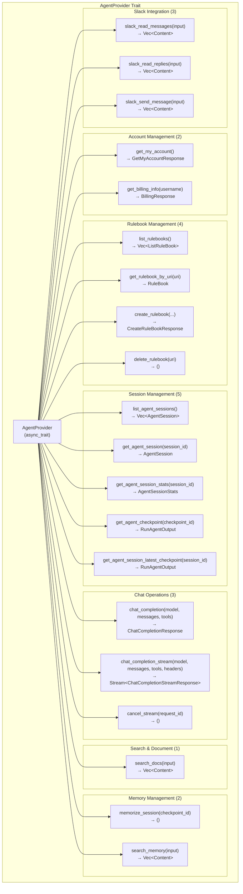
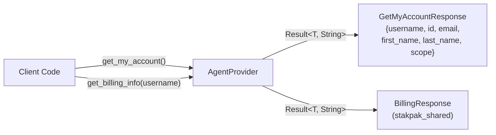
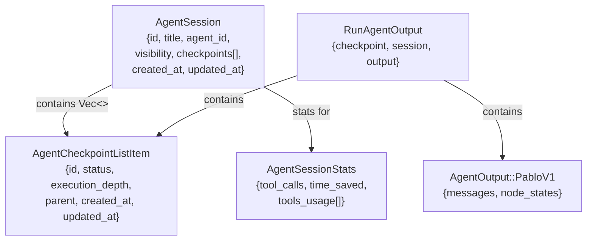
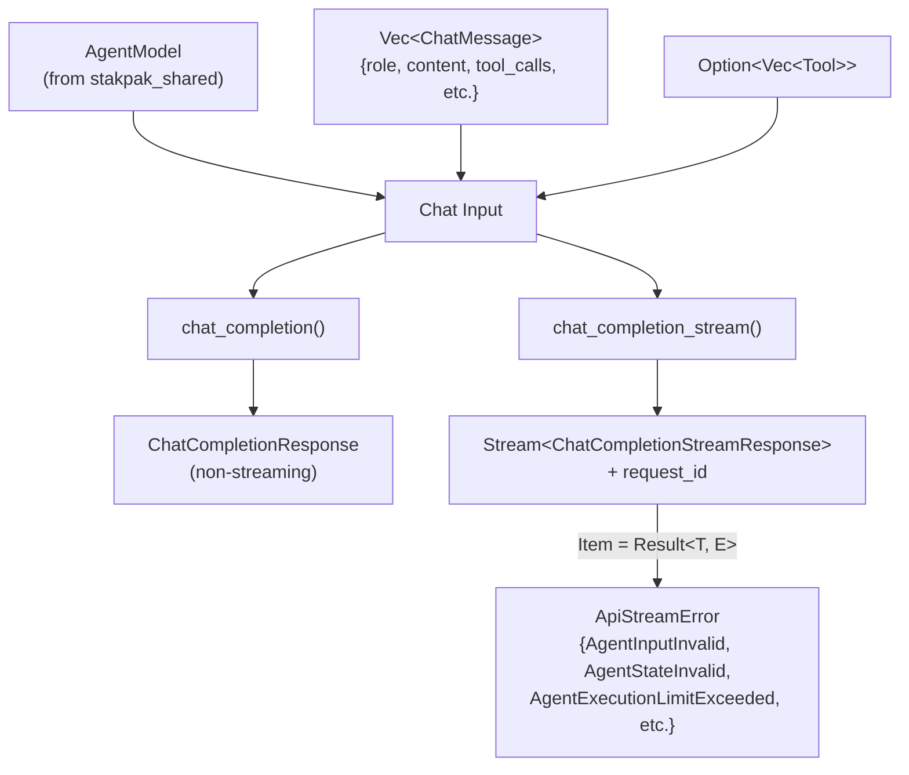
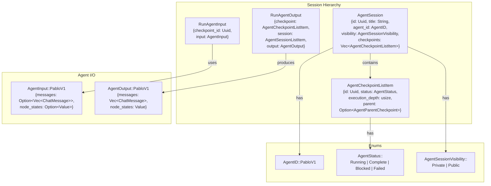
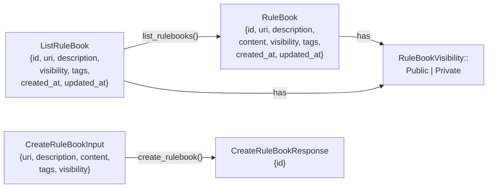
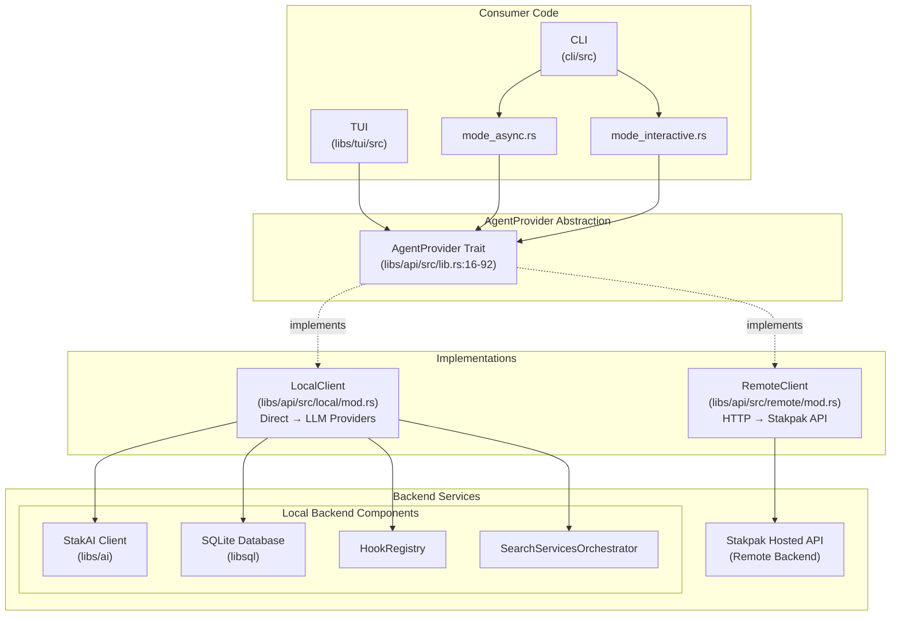

<!-- source: DeepWiki mcp.deepwiki.com · repo stakpak/agent · page 4.1 AgentProvider Trait · fetched 2026-10-26 -->

# AgentProvider Trait

<details>
<summary>Relevant source files</summary>

The following files were used as context for generating this wiki page:

- [libs/api/Cargo.toml](libs/api/Cargo.toml)
- [libs/api/src/lib.rs](libs/api/src/lib.rs)
- [libs/api/src/models.rs](libs/api/src/models.rs)
- [libs/mcp/server/README_SECRETS.md](libs/mcp/server/README_SECRETS.md)

</details>


## Purpose and Scope

The `AgentProvider` trait is the core abstraction in the `stakpak-api` library that defines a unified interface for interacting with AI agent capabilities. It provides 20 async methods organized into 6 functional categories, enabling both remote (hosted Stakpak API) and local (direct LLM) implementations without requiring client code changes.

This document covers the trait definition, method signatures, and data models. For details on the remote implementation, see [Remote Client Implementation](#4.2). For the local implementation, see [Local Client Implementation](#4.3). For data model details, see [Data Models and Types](#4.4).

**Sources:** [libs/api/src/lib.rs:1-93]()

## Trait Definition and Structure

The `AgentProvider` trait is defined with the `async_trait` macro to support asynchronous operations across both remote HTTP calls and local LLM interactions. It requires implementations to be `Send + Sync` for safe concurrent usage.

```rust
#[async_trait]
pub trait AgentProvider: Send + Sync {
    // 20 async methods grouped into 6 categories
}
```

### Trait Method Overview



**Sources:** [libs/api/src/lib.rs:16-92]()

## Method Categories

### Account Management

These methods provide access to account information and billing details.

| Method | Signature | Purpose |
|--------|-----------|---------|
| `get_my_account` | `async fn() -> Result<GetMyAccountResponse, String>` | Retrieves current user account details (username, email, name, scope) |
| `get_billing_info` | `async fn(account_username: &str) -> Result<BillingResponse, String>` | Retrieves billing information for a specific account |



**Sources:** [libs/api/src/lib.rs:18-23](), [libs/api/src/models.rs:538-554]()

### Rulebook Management

Rulebooks are reusable policy documents, SOPs, or context that can be injected into agent prompts. These methods manage their lifecycle.

| Method | Signature | Purpose |
|--------|-----------|---------|
| `list_rulebooks` | `async fn() -> Result<Vec<ListRuleBook>, String>` | Lists all available rulebooks with metadata |
| `get_rulebook_by_uri` | `async fn(uri: &str) -> Result<RuleBook, String>` | Retrieves full rulebook content by URI |
| `create_rulebook` | `async fn(uri, description, content, tags, visibility) -> Result<CreateRuleBookResponse, String>` | Creates a new rulebook |
| `delete_rulebook` | `async fn(uri: &str) -> Result<(), String>` | Deletes a rulebook by URI |

The `RuleBookVisibility` enum supports `Public` or `Private` visibility levels.

**Sources:** [libs/api/src/lib.rs:25-36](), [libs/api/src/models.rs:494-596]()

### Session Management

Agent sessions represent conversation contexts with checkpoints for state persistence. These methods manage session lifecycle and state retrieval.

| Method | Signature | Purpose |
|--------|-----------|---------|
| `list_agent_sessions` | `async fn() -> Result<Vec<AgentSession>, String>` | Lists all agent sessions for the user |
| `get_agent_session` | `async fn(session_id: Uuid) -> Result<AgentSession, String>` | Retrieves full session details including checkpoints |
| `get_agent_session_stats` | `async fn(session_id: Uuid) -> Result<AgentSessionStats, String>` | Retrieves statistics (tool usage, time saved, etc.) |
| `get_agent_checkpoint` | `async fn(checkpoint_id: Uuid) -> Result<RunAgentOutput, String>` | Retrieves a specific checkpoint state |
| `get_agent_session_latest_checkpoint` | `async fn(session_id: Uuid) -> Result<RunAgentOutput, String>` | Retrieves the most recent checkpoint for a session |



**Sources:** [libs/api/src/lib.rs:38-46](), [libs/api/src/models.rs:65-255](), [libs/api/src/models.rs:462-492]()

### Chat Operations

These methods provide direct access to LLM chat completion capabilities with support for tool calling and streaming responses.

| Method | Signature | Purpose |
|--------|-----------|---------|
| `chat_completion` | `async fn(model, messages, tools) -> Result<ChatCompletionResponse, String>` | Performs a single chat completion call |
| `chat_completion_stream` | `async fn(model, messages, tools, headers) -> Result<(Stream, Option<String>), String>` | Performs a streaming chat completion, returns stream and optional request_id |
| `cancel_stream` | `async fn(request_id: String) -> Result<(), String>` | Cancels an active streaming request |

The streaming method returns a `Pin<Box<dyn Stream<Item = Result<ChatCompletionStreamResponse, ApiStreamError>> + Send>>`, allowing for real-time token consumption.



**Sources:** [libs/api/src/lib.rs:48-70](), [libs/api/src/models.rs:15-63]()

### Search and Memory

These methods provide access to document search capabilities and conversation memory management.

| Method | Signature | Purpose |
|--------|-----------|---------|
| `search_docs` | `async fn(input: &SearchDocsRequest) -> Result<Vec<Content>, String>` | Searches documentation with keywords and filters |
| `memorize_session` | `async fn(checkpoint_id: Uuid) -> Result<(), String>` | Stores a checkpoint in long-term memory for later retrieval |
| `search_memory` | `async fn(input: &SearchMemoryRequest) -> Result<Vec<Content>, String>` | Searches previously memorized sessions by keywords and time range |

The `Content` type comes from the `rmcp` (Remote Model Context Protocol) crate and represents structured content blocks.

**Request Types:**

```rust
// SearchDocsRequest
{
    keywords: String,
    exclude_keywords: Option<String>,
    limit: Option<u32>,
}

// SearchMemoryRequest
{
    keywords: Vec<String>,
    start_time: Option<DateTime<Utc>>,
    end_time: Option<DateTime<Utc>>,
}
```

**Sources:** [libs/api/src/lib.rs:72-77](), [libs/api/src/models.rs:621-633]()

### Slack Integration

These methods enable interaction with Slack workspaces, allowing agents to read and send messages.

| Method | Signature | Purpose |
|--------|-----------|---------|
| `slack_read_messages` | `async fn(input: &SlackReadMessagesRequest) -> Result<Vec<Content>, String>` | Reads messages from a Slack channel |
| `slack_read_replies` | `async fn(input: &SlackReadRepliesRequest) -> Result<Vec<Content>, String>` | Reads reply thread for a specific message |
| `slack_send_message` | `async fn(input: &SlackSendMessageRequest) -> Result<Vec<Content>, String>` | Sends a message to a Slack channel or thread |

**Request Types:**

```rust
// SlackReadMessagesRequest
{
    channel: String,
    limit: Option<u32>,
}

// SlackReadRepliesRequest
{
    channel: String,
    ts: String,  // Timestamp identifier for thread
}

// SlackSendMessageRequest
{
    channel: String,
    mrkdwn_text: String,
    thread_ts: Option<String>,  // For replying in thread
}
```

**Sources:** [libs/api/src/lib.rs:79-91](), [libs/api/src/models.rs:635-652]()

## Key Data Models

### Core Session Types

The trait extensively uses these data structures defined in `models.rs`:



**Sources:** [libs/api/src/models.rs:65-255]()

### Rulebook Types



**Sources:** [libs/api/src/models.rs:494-596]()

### Block and Document Types

The `Block` type represents infrastructure code blocks (Terraform, Kubernetes, etc.) with dependency information:

| Field | Type | Description |
|-------|------|-------------|
| `id` | `Uuid` | Unique block identifier |
| `provisioner` | `ProvisionerType` | Terraform, Kubernetes, Dockerfile, GithubActions, or None |
| `language` | `String` | Programming/config language |
| `code` | `String` | Actual code content |
| `dependencies` | `Vec<Dependency>` | Block dependencies with selectors |
| `dependents` | `Vec<DependentBlock>` | Blocks depending on this one |
| `document_uri` | `String` | Source file path |
| `start_point` / `end_point` | `Point` | Location in file (row, column) |

**Sources:** [libs/api/src/models.rs:269-305](), [libs/api/src/models.rs:307-435]()

## Abstraction and Implementation Pattern

The trait enables a provider pattern where consuming code (CLI, TUI) works through the abstraction without knowledge of the underlying implementation.



**Sources:** [libs/api/src/lib.rs:11-14]() (module declarations)

## Error Handling

All trait methods return `Result<T, String>` for simplicity, though streaming methods use the specialized `ApiStreamError` enum for detailed error classification:

| Error Variant | Trigger Condition |
|---------------|-------------------|
| `AgentInputInvalid(String)` | Invalid input parameters |
| `AgentStateInvalid` | Session state corrupted or invalid |
| `AgentNotSupported` | Requested agent type not available |
| `AgentExecutionLimitExceeded` | Thinking/execution limit reached |
| `AgentInvalidResponseStream` | Malformed streaming response |
| `InvalidGeneratedCode` | Generated code failed validation |
| `CopilotError` | Backend overloaded |
| `SaveError` | Persistence failure |
| `Unknown(String)` | Unclassified error |

The `ApiStreamError` implements `From<&str>` and `From<String>` for automatic parsing of error messages from stream responses.

**Sources:** [libs/api/src/models.rs:15-63]()

## Dependencies

The `stakpak-api` crate depends on:

| Dependency | Purpose |
|------------|---------|
| `async-trait` | Enable async trait methods |
| `futures-util` | Stream utilities for chat_completion_stream |
| `reqwest` | HTTP client (RemoteClient) |
| `libsql` | SQLite interface (LocalClient) |
| `rmcp` | MCP protocol types (Content) |
| `stakpak-shared` | Shared models (AgentModel, ChatMessage, Tool, etc.) |
| `uuid` | Session and checkpoint identifiers |
| `chrono` | Timestamp handling |
| `serde` / `serde_json` | Serialization |
| `eventsource-stream` | SSE parsing for streams |

**Sources:** [libs/api/Cargo.toml:10-27]()

## Usage Pattern Example

While this document focuses on the trait definition, typical usage follows this pattern:

1. Obtain an implementation (RemoteClient or LocalClient) based on configuration
2. Call trait methods through the abstract interface
3. Handle `Result` types for error cases
4. For streaming, consume the returned `Stream` asynchronously

The trait's design ensures that switching between remote and local backends requires no changes to consuming code, only configuration changes.

**Sources:** [libs/api/src/lib.rs:16-92]()

---

