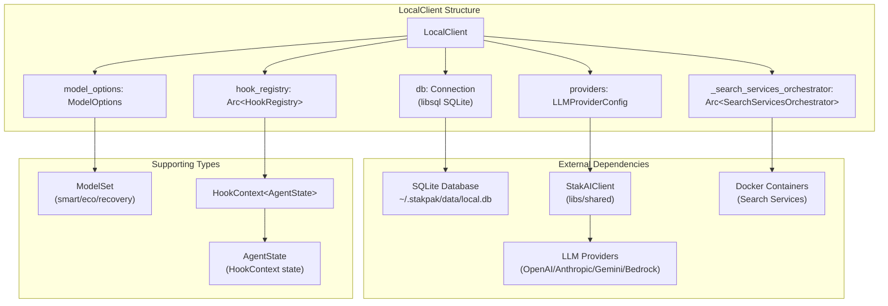
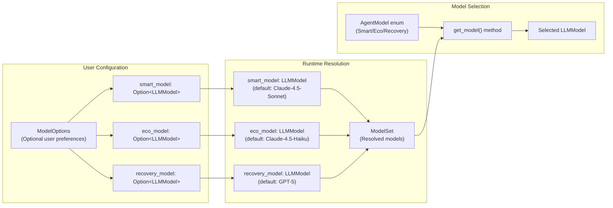
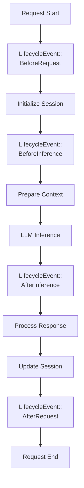
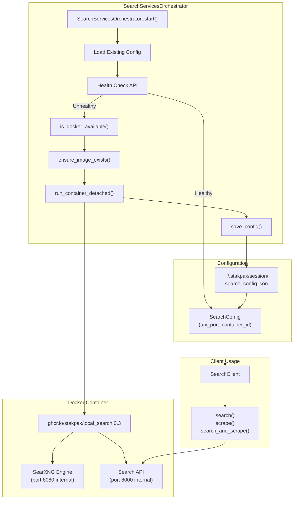
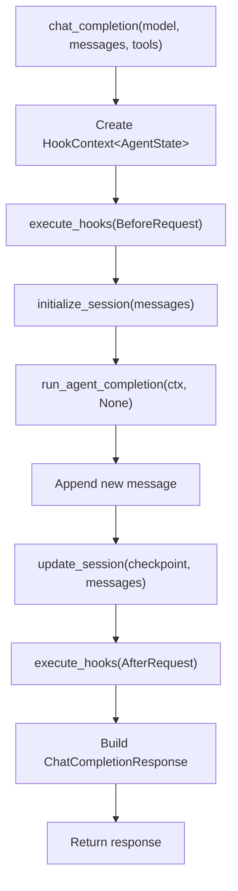
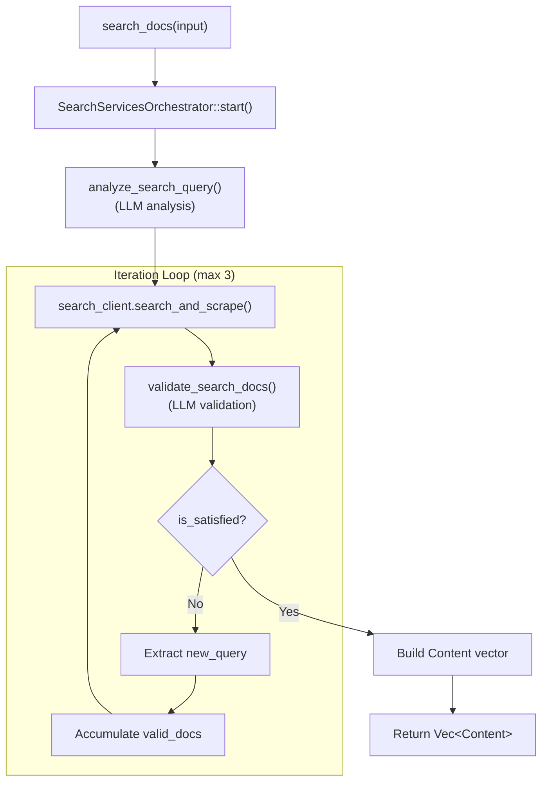
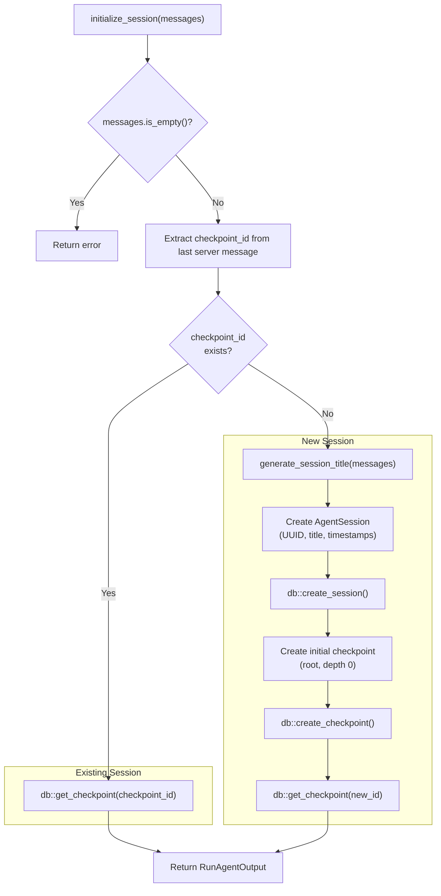

<!-- source: DeepWiki mcp.deepwiki.com · repo stakpak/agent · page 4.3 Local Client Implementation · fetched 2026-10-26 -->

# Local Client Implementation

<details>
<summary>Relevant source files</summary>

The following files were used as context for generating this wiki page:

- [libs/api/src/local/mod.rs](libs/api/src/local/mod.rs)
- [libs/shared/src/container.rs](libs/shared/src/container.rs)
- [libs/shared/src/models/integrations/mod.rs](libs/shared/src/models/integrations/mod.rs)
- [libs/shared/src/models/integrations/search_service.rs](libs/shared/src/models/integrations/search_service.rs)

</details>


## Purpose and Scope

The `LocalClient` is a local implementation of the `AgentProvider` trait that enables fully offline agent operation without requiring a Stakpak hosted API. It provides direct LLM integration, SQLite-based session persistence, and Docker-based search capabilities. This page documents the architecture, components, and implementation details of `LocalClient`.

For information about the `AgentProvider` trait interface, see [AgentProvider Trait](#4.1). For the alternative remote implementation, see [Remote Client Implementation](#4.2).

**Sources:** [libs/api/src/local/mod.rs:1-876]()

---

## Architecture Overview

**Component Architecture**



**Sources:** [libs/api/src/local/mod.rs:42-66](), [libs/api/src/local/mod.rs:100-108]()

---

## Core Components

### LocalClient Structure

The `LocalClient` struct contains the essential components for local agent operation:

| Field | Type | Purpose |
|-------|------|---------|
| `db` | `Connection` | SQLite database connection for session persistence |
| `stakpak_base_url` | `Option<String>` | Optional URL for fetching rulebooks from Stakpak API |
| `providers` | `LLMProviderConfig` | Configuration for all available LLM providers |
| `model_options` | `ModelOptions` | User-specified model preferences for smart/eco/recovery modes |
| `hook_registry` | `Option<Arc<HookRegistry<AgentState>>>` | Lifecycle hooks for inference customization |
| `_search_services_orchestrator` | `Option<Arc<SearchServicesOrchestrator>>` | Docker-based search service manager |

**Sources:** [libs/api/src/local/mod.rs:42-50]()

### Configuration and Initialization

The `LocalClientConfig` structure defines the parameters for creating a `LocalClient`:

```rust
pub struct LocalClientConfig {
    pub stakpak_base_url: Option<String>,
    pub store_path: Option<String>,
    pub providers: LLMProviderConfig,
    pub smart_model: Option<String>,
    pub eco_model: Option<String>,
    pub recovery_model: Option<String>,
    pub hook_registry: Option<HookRegistry<AgentState>>,
}
```

The initialization process:

1. **Database Setup**: Creates SQLite database at `store_path` (defaults to `~/.stakpak/data/local.db`)
2. **Schema Initialization**: Calls `db::init_schema()` to create required tables
3. **Model Configuration**: Converts string model names to `LLMModel` enums
4. **Hook Registration**: Registers `InlineScratchpadContextHook` for context management
5. **Search Orchestrator**: Initializes `SearchServicesOrchestrator` for Docker-based search

**Sources:** [libs/api/src/local/mod.rs:100-108](), [libs/api/src/local/mod.rs:119-188]()

### Model Selection System

**ModelOptions and ModelSet**



The model selection system uses two levels of abstraction:

- **ModelOptions**: User-facing configuration with optional preferences
- **ModelSet**: Runtime structure with resolved models (fills in defaults)
- **AgentModel enum**: Request-time model selector (Smart/Eco/Recovery)

The `get_model()` method maps `AgentModel` to the appropriate `LLMModel` at runtime.

**Sources:** [libs/api/src/local/mod.rs:52-76](), [libs/api/src/local/mod.rs:78-98]()

### SQLite Database Integration

The `LocalClient` uses a SQLite database for persistent storage of sessions and checkpoints. Database operations are abstracted through the `db` module:

**Key Database Operations:**

| Function | Purpose | Location |
|----------|---------|----------|
| `init_schema()` | Creates tables for sessions and checkpoints | [libs/api/src/local/db.rs]() |
| `create_session()` | Stores a new `AgentSession` | [libs/api/src/local/mod.rs:766]() |
| `list_sessions()` | Retrieves all sessions | [libs/api/src/local/mod.rs:294]() |
| `get_session()` | Fetches session by UUID | [libs/api/src/local/mod.rs:298]() |
| `create_checkpoint()` | Stores checkpoint with messages | [libs/api/src/local/mod.rs:782]() |
| `get_checkpoint()` | Retrieves checkpoint by ID | [libs/api/src/local/mod.rs:310]() |
| `get_latest_checkpoint()` | Gets most recent checkpoint for session | [libs/api/src/local/mod.rs:317]() |

The database path defaults to `~/.stakpak/data/local.db` and is automatically created if it doesn't exist.

**Sources:** [libs/api/src/local/mod.rs:116](), [libs/api/src/local/mod.rs:135-143](), [libs/api/src/local/mod.rs:293-318]()

### Hook Registry and Lifecycle Management

The `LocalClient` uses a hook registry to execute custom logic at specific lifecycle events:

**Registered Hooks:**

- **InlineScratchpadContextHook**: Registered for `LifecycleEvent::BeforeInference`
  - Manages message history truncation
  - Limits action messages to 100 characters
  - Keeps last action message and last 50 results
  - Injects context into the LLM input

**Lifecycle Events:**



Hooks can modify the `HookContext<AgentState>` at each stage, enabling customization of prompt construction, response processing, and session state.

**Sources:** [libs/api/src/local/mod.rs:4-6](), [libs/api/src/local/mod.rs:152-163](), [libs/api/src/local/mod.rs:326-334](), [libs/api/src/local/mod.rs:661-667]()

### Search Services Orchestrator

The `SearchServicesOrchestrator` manages Docker-based web search functionality using the SearXNG search engine.

**Architecture:**



**Container Configuration:**

| Environment Variable | Value | Purpose |
|---------------------|-------|---------|
| `INSTANCE_NAME` | "SearchPak" | Instance identifier |
| `SEARXNG_SECRET` | "stakpak-secret-key" | SearXNG secret key |
| `SEARXNG_PORT` | 8080 | Internal SearXNG port |
| `SEARXNG_BIND_ADDRESS` | "0.0.0.0" | Bind address |
| `PORT` | 8000 | Internal API port |

The orchestrator performs these steps:

1. **Load existing config** from `search_config.json`
2. **Health check** existing container if config found
3. **Docker availability check** if no healthy container
4. **Image existence check** (fails with actionable message if missing)
5. **Container launch** with dynamic port mapping (host port 0 → auto-assigned)
6. **Port discovery** using `get_container_host_port()`
7. **Config persistence** for future reuse

**Sources:** [libs/shared/src/models/integrations/search_service.rs:231-421](), [libs/api/src/local/mod.rs:49](), [libs/api/src/local/mod.rs:185]()

---

## AgentProvider Implementation

The `LocalClient` implements all 14 methods of the `AgentProvider` trait. This section details each implementation.

### Account Management

**get_my_account()**

Returns a static local account response:

```rust
GetMyAccountResponse {
    username: "local",
    id: "local",
    first_name: "local",
    last_name: "local",
    email: "local@stakpak.dev",
    scope: None,
}
```

**get_billing_info()**

Returns an error: "Billing info not supported in local mode"

**Sources:** [libs/api/src/local/mod.rs:192-208]()

### Rulebook Management

**list_rulebooks()**

Fetches rulebooks from the remote Stakpak API if `stakpak_base_url` is configured. Makes an HTTP GET request to `{base_url}/rules` and deserializes the response.

Returns empty list if `stakpak_base_url` is `None`.

**get_rulebook_by_uri()**

Fetches a specific rulebook by URI from `{base_url}/rules/{encoded_uri}`. URL-encodes the URI parameter before making the request.

**create_rulebook() / delete_rulebook()**

Not implemented. Return error: "Local provider does not support rulebooks yet"

**Sources:** [libs/api/src/local/mod.rs:210-291]()

### Session Management

**Session Lifecycle Flow:**

```mermaid
graph TB
    subgraph "list_agent_sessions()"
        LIST["db::list_sessions(&db)"]
        ALL_SESSIONS["Vec&lt;AgentSession&gt;"]
    end
    
    subgraph "get_agent_session()"
        GET_SESSION["db::get_session(&db, session_id)"]
        SESSION["AgentSession"]
    end
    
    subgraph "get_agent_checkpoint()"
        GET_CP["db::get_checkpoint(&db, checkpoint_id)"]
        CHECKPOINT["RunAgentOutput"]
    end
    
    subgraph "get_agent_session_latest_checkpoint()"
        GET_LATEST["db::get_latest_checkpoint(&db, session_id)"]
        LATEST_CP["RunAgentOutput"]
    end
    
    LIST --> ALL_SESSIONS
    GET_SESSION --> SESSION
    GET_CP --> CHECKPOINT
    GET_LATEST --> LATEST_CP
```



| Method | Implementation | Returns |
|--------|---------------|---------|
| `list_agent_sessions()` | `db::list_sessions()` | All sessions from database |
| `get_agent_session()` | `db::get_session()` | Single session by UUID |
| `get_agent_session_stats()` | Returns default stats | Not fully implemented |
| `get_agent_checkpoint()` | `db::get_checkpoint()` | Checkpoint by UUID |
| `get_agent_session_latest_checkpoint()` | `db::get_latest_checkpoint()` | Most recent checkpoint for session |

**Sources:** [libs/api/src/local/mod.rs:293-318]()

### Chat Completion Methods

**chat_completion()**

Synchronous chat completion flow:



**chat_completion_stream()**

Streaming chat completion with async channel:

1. Creates `HookContext` and executes `BeforeRequest` hooks
2. Initializes session and gets checkpoint ID
3. Emits initial checkpoint ID: `<checkpoint_id>{id}</checkpoint_id>`
4. Spawns async task for agent completion:
   - Calls `run_agent_completion()` with stream channel
   - Forwards `GenerationDelta` chunks to receiver
   - Updates session upon completion
   - Emits final checkpoint ID
5. Returns pinned stream that yields `ChatCompletionStreamResponse` items

The stream alternates between `Delta` messages (LLM output chunks) and `Ctx` messages (state updates).

**Sources:** [libs/api/src/local/mod.rs:320-503]()

### Search and Document Operations

**search_docs()**

Implements multi-iteration search with LLM-guided query refinement:



**Process:**

1. **Start Orchestrator**: Launches Docker container if needed
2. **Analyze Query**: LLM extracts required documentation types and reformulates query
3. **Iterative Search** (max 3 iterations):
   - Search and scrape top results
   - Validate results with LLM against requirements
   - Accumulate valid documents
   - If not satisfied and new query suggested, repeat
4. **Return Results**: Format as MCP `Content` items

**Key Functions:**

- `analyze_search_query()`: Uses LLM to identify documentation needs and optimize query
- `validate_search_docs()`: LLM evaluates result relevance and completeness
- `parse_analysis_xml()` / `parse_validation_xml()`: Extract structured data from LLM XML responses

**Sources:** [libs/api/src/local/mod.rs:509-614](), [libs/api/src/local/mod.rs:877-1225]()

### Unsupported Operations

The following methods return empty results or errors:

| Method | Status | Return Value |
|--------|--------|--------------|
| `search_memory()` | Not implemented | Empty vector |
| `slack_read_messages()` | Not implemented | Empty vector |
| `slack_read_replies()` | Not implemented | Empty vector |
| `slack_send_message()` | Not implemented | Empty vector |
| `memorize_session()` | Not implemented | `Ok(())` |
| `cancel_stream()` | No-op | `Ok(())` |

**Sources:** [libs/api/src/local/mod.rs:505-648]()

---

## Internal Implementation Details

### Agent Completion Flow

The `run_agent_completion()` method orchestrates the LLM inference process:

**Execution Flow:**

```mermaid
graph TB
    START["run_agent_completion(ctx, stream_tx)"]
    BEFORE_INF["execute_hooks(BeforeInference)"]
    CHECK_INPUT{"llm_input<br/>present?"}
    ERROR["Return error:<br/>context hook not registered"]
    CREATE_CLIENT["StakAIClient::new(llm_config)"]
    
    subgraph "Stream Mode"
        CREATE_CHANNEL["Create internal channel"]
        STREAM_INPUT["LLMStreamInput"]
        SPAWN["Spawn async task"]
        FORWARD["Forward GenerationDelta"]
    end
    
    subgraph "Non-Stream Mode"
        SYNC_INPUT["LLMInput"]
        CALL["stakai_client.chat()"]
    end
    
    SET_OUTPUT["ctx.state.set_llm_output()"]
    AFTER_INF["execute_hooks(AfterInference)"]
    EXTRACT["Extract ChatMessage from llm_output"]
    RETURN["Return ChatMessage"]
    
    START --> BEFORE_INF
    BEFORE_INF --> CHECK_INPUT
    CHECK_INPUT -->|No| ERROR
    CHECK_INPUT -->|Yes| CREATE_CLIENT
    CREATE_CLIENT -->|stream_tx.is_some()| CREATE_CHANNEL
    CREATE_CLIENT -->|stream_tx.is_none()| SYNC_INPUT
    CREATE_CHANNEL --> STREAM_INPUT
    STREAM_INPUT --> SPAWN
    SPAWN --> FORWARD
    FORWARD --> SET_OUTPUT
    SYNC_INPUT --> CALL
    CALL --> SET_OUTPUT
    SET_OUTPUT --> AFTER_INF
    AFTER_INF --> EXTRACT
    EXTRACT --> RETURN
```

**Key Points:**

- Requires `llm_input` to be set by a `BeforeInference` hook (typically `InlineScratchpadContextHook`)
- Supports both streaming and non-streaming modes
- Uses `StakAIClient` for LLM provider abstraction
- Stores result in `ctx.state.llm_output` for downstream hooks

**Sources:** [libs/api/src/local/mod.rs:656-733]()

### Session Initialization

The `initialize_session()` method handles session creation or continuation:

**Decision Logic:**



**Checkpoint ID Extraction:**

The method looks for `<checkpoint_id>{uuid}</checkpoint_id>` tags in the last server message's content to identify existing sessions. This enables seamless session continuation.

**Sources:** [libs/api/src/local/mod.rs:735-788]()

### Session Update

The `update_session()` method creates a new checkpoint after LLM inference:

**Checkpoint Creation:**

| Field | Value |
|-------|-------|
| `id` | New UUID |
| `status` | `AgentStatus::Complete` |
| `execution_depth` | `parent.execution_depth + 1` |
| `parent` | Reference to previous checkpoint |
| `created_at` / `updated_at` | Current timestamp |

The method clones the previous `AgentOutput`, updates its messages, and stores the new checkpoint in the database.

**Sources:** [libs/api/src/local/mod.rs:790-823]()

### Session Title Generation

The `generate_session_title()` method creates human-readable session titles using an LLM:

**Process:**

1. Select eco model (or fallback to available provider's smallest model)
2. Create prompt with system instructions and conversation history
3. Call LLM with max_tokens=100
4. Return generated title (typically 3-8 words)

The system prompt is loaded from `./prompts/session_title_generator.v1.txt`.

**Sources:** [libs/api/src/local/mod.rs:825-874](), [libs/api/src/local/mod.rs:117]()

### Search Query Analysis

The `analyze_search_query()` function uses an LLM to optimize search queries:

**LLM Prompt Structure:**

```
System: Expert search query analyzer
        - Identify required documentation types
        - Reformulate query for search engines
        
User:   <user_query>{original_query}</user_query>

Expected XML Response:
<analysis>
  <required_documentation>
    <item>documentation type</item>
  </required_documentation>
  <reformulated_query>optimized query</reformulated_query>
</analysis>
```

**Parsing:**

The `parse_analysis_xml()` function extracts:
- List of `<item>` tags (required documentation)
- Single `<reformulated_query>` tag (optimized search query)

**Sources:** [libs/api/src/local/mod.rs:877-993]()

### Search Results Validation

The `validate_search_docs()` function evaluates search results with LLM assistance:

**Validation Context:**

The LLM receives:
- Original query
- Required documentation types
- Previous queries (to avoid repetition)
- Accumulated needed URLs
- Current search results (up to 10 docs)

**Response Parsing:**

```
<validation>
  <is_satisfied>true/false</is_satisfied>
  <valid_docs>
    <doc><url>...</url></doc>
  </valid_docs>
  <needed_urls>
    <url>...</url>
  </needed_urls>
  <new_query>refined query if not satisfied</new_query>
  <reasoning>explanation</reasoning>
</validation>
```

The `parse_validation_xml()` function:
1. Extracts `is_satisfied` boolean
2. Filters valid URLs to those present in input docs
3. Identifies needed URLs not yet found
4. Extracts new query suggestion if not satisfied

**Sources:** [libs/api/src/local/mod.rs:995-1199]()

### Model Selection for Search

The `get_search_model()` function selects an appropriate model for search operations:

**Selection Logic:**

1. Prefer eco_model if specified
2. Fall back to smart_model if eco not available
3. Provider-specific defaults:
   - OpenAI → O4Mini
   - Anthropic → Claude-4.5-Haiku
   - Gemini → Gemini-3-Flash
4. Custom models passed through unchanged

This ensures search operations use cost-effective models suitable for structured extraction tasks.

**Sources:** [libs/api/src/local/mod.rs:1201-1225]()

---

## Summary

The `LocalClient` provides a complete local implementation of the `AgentProvider` interface with these key capabilities:

- **SQLite Persistence**: Session and checkpoint storage in `~/.stakpak/data/local.db`
- **Multi-Provider LLM Support**: Direct integration with OpenAI, Anthropic, Gemini, and Bedrock via `StakAIClient`
- **Hook System**: Extensible lifecycle management with `InlineScratchpadContextHook` for context optimization
- **Docker-Based Search**: Automatic SearXNG container orchestration for web search
- **LLM-Guided Search**: Iterative query refinement with validation for improved result quality
- **Streaming Support**: Async event channels for real-time LLM output
- **Session Continuity**: Checkpoint-based conversation threading

This implementation enables fully offline agent operation while maintaining compatibility with the broader Stakpak ecosystem.

---

