<!-- source: DeepWiki mcp.deepwiki.com · repo stakpak/agent · page 5.3 Local Tools Implementation · fetched 2026-10-26 -->

# Local Tools

Relevant source files

The following files were used as context for generating this wiki page:

- [cli/src/utils/local_context.rs](cli/src/utils/local_context.rs)
- [libs/mcp/server/src/local_tools.rs](libs/mcp/server/src/local_tools.rs)
- [libs/shared/src/local_store.rs](libs/shared/src/local_store.rs)
- [libs/shared/src/remote_connection.rs](libs/shared/src/remote_connection.rs)
- [libs/shared/src/task_manager.rs](libs/shared/src/task_manager.rs)
- [libs/shared/src/utils.rs](libs/shared/src/utils.rs)

This document covers the local tools implementation within the MCP (Model Context Protocol) system, focusing on file operations, shell command execution, and task management capabilities that run directly on the local system without requiring external API access.

For information about remote AI-powered tools, see [Remote Tools](#4.3). For the overall MCP server architecture and tool routing, see [Server Architecture](#4.1) and [Tool Container and Routing](#4.4).

## Architecture Overview

The local tools are implemented as methods on the `ToolContainer` struct and provide direct system access capabilities including file manipulation, shell command execution, and background task management. All local tools integrate with the secret management system for security.

```mermaid
graph TB
    subgraph "ToolContainer Structure"
        ToolContainer["ToolContainer"]
        SecretManager["SecretManager"]
        TaskManagerHandle["TaskManagerHandle"]
        ToolRouter["ToolRouter&lt;Self&gt;"]
        
        ToolContainer --> SecretManager
        ToolContainer --> TaskManagerHandle  
        ToolContainer --> ToolRouter
    end
    
    subgraph "Local Tool Categories"
        FileOps["File Operations"]
        ShellOps["Shell Operations"]
        TaskOps["Task Operations"]
        UtilOps["Utility Operations"]
    end
    
    subgraph "File Operations Tools"
        ViewTool["view()"]
        CreateTool["create()"]
        StrReplaceTool["str_replace()"]
        
        FileOps --> ViewTool
        FileOps --> CreateTool
        FileOps --> StrReplaceTool
    end
    
    subgraph "Shell Operations Tools"
        RunCommand["run_command()"]
        RunCommandAsync["run_command_async()"]
        
        ShellOps --> RunCommand
        ShellOps --> RunCommandAsync
    end
    
    subgraph "Task Operations Tools"
        GetAllTasks["get_all_tasks()"]
        GetTaskDetails["get_task_details()"]
        CancelAsyncTask["cancel_async_task()"]
        
        TaskOps --> GetAllTasks
        TaskOps --> GetTaskDetails
        TaskOps --> CancelAsyncTask
    end
    
    subgraph "Utility Operations Tools"
        GeneratePassword["generate_password()"]
        
        UtilOps --> GeneratePassword
    end
    
    ToolContainer --> FileOps
    ToolContainer --> ShellOps
    ToolContainer --> TaskOps
    ToolContainer --> UtilOps
    
    SecretManager --> ViewTool
    SecretManager --> CreateTool
    SecretManager --> StrReplaceTool
    SecretManager --> RunCommand
    SecretManager --> RunCommandAsync
    SecretManager --> GeneratePassword
    
    TaskManagerHandle --> RunCommandAsync
    TaskManagerHandle --> GetAllTasks
    TaskManagerHandle --> GetTaskDetails
    TaskManagerHandle --> CancelAsyncTask
```

Sources: [libs/mcp/server/src/local_tools.rs:1-942](), [libs/mcp/server/src/tool_container.rs:11-53]()

## File Operations Tools

The file operations provide comprehensive file system access with built-in secret redaction and line-number support for precise file manipulation.

### View Tool

The `view` tool reads file contents or lists directory contents with automatic secret redaction and line truncation for large files.

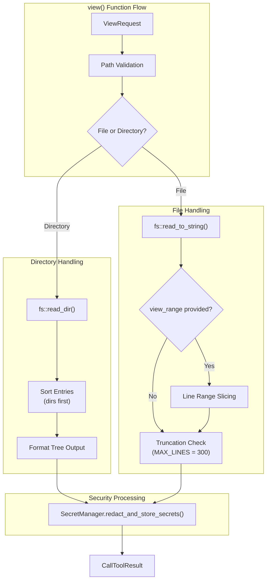

The `ViewRequest` struct supports optional line ranges with 1-indexed line numbers:

| Parameter | Type | Description |
|-----------|------|-------------|
| `path` | `String` | File or directory path |
| `view_range` | `Option<[i32; 2]>` | Optional `[start_line, end_line]` range |

Sources: [libs/mcp/server/src/local_tools.rs:48-56](), [libs/mcp/server/src/local_tools.rs:560-728]()

### Create Tool

The `create` tool creates new files with automatic parent directory creation and secret restoration in content.

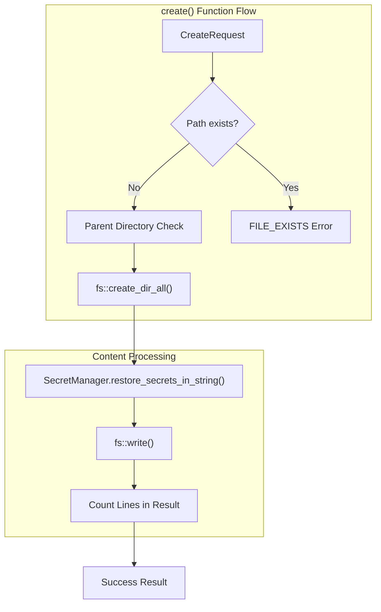

Sources: [libs/mcp/server/src/local_tools.rs:76-84](), [libs/mcp/server/src/local_tools.rs:829-874]()

### String Replace Tool

The `str_replace` tool performs exact string replacements with support for multiple occurrence handling and secret restoration.

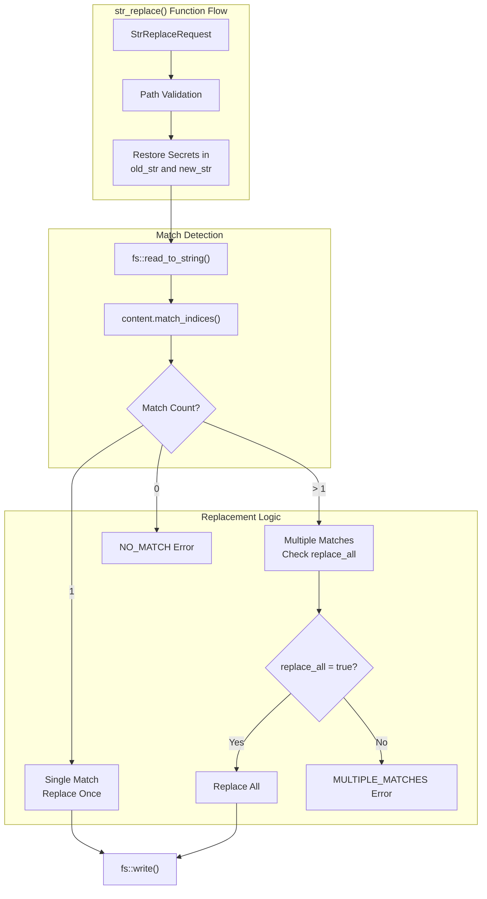

Sources: [libs/mcp/server/src/local_tools.rs:58-74](), [libs/mcp/server/src/local_tools.rs:740-824]()

## Shell Command Tools

The shell command tools provide both synchronous and asynchronous execution capabilities with real-time output streaming and comprehensive error handling.

### Synchronous Command Execution

The `run_command` tool executes shell commands with real-time output streaming and automatic secret handling.

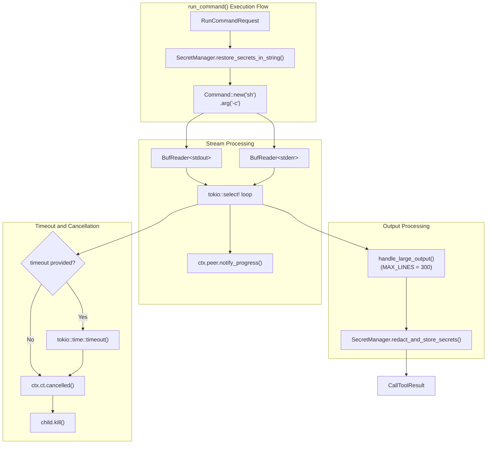

The `RunCommandRequest` supports command execution with optional timeout:

| Parameter | Type | Description |
|-----------|------|-------------|
| `command` | `String` | Shell command to execute |
| `description` | `Option<String>` | Optional command description |
| `timeout` | `Option<u64>` | Optional timeout in seconds |

Sources: [libs/mcp/server/src/local_tools.rs:20-28](), [libs/mcp/server/src/local_tools.rs:106-273]()

### Asynchronous Command Execution

The `run_command_async` tool starts background tasks through the `TaskManagerHandle` for long-running operations.

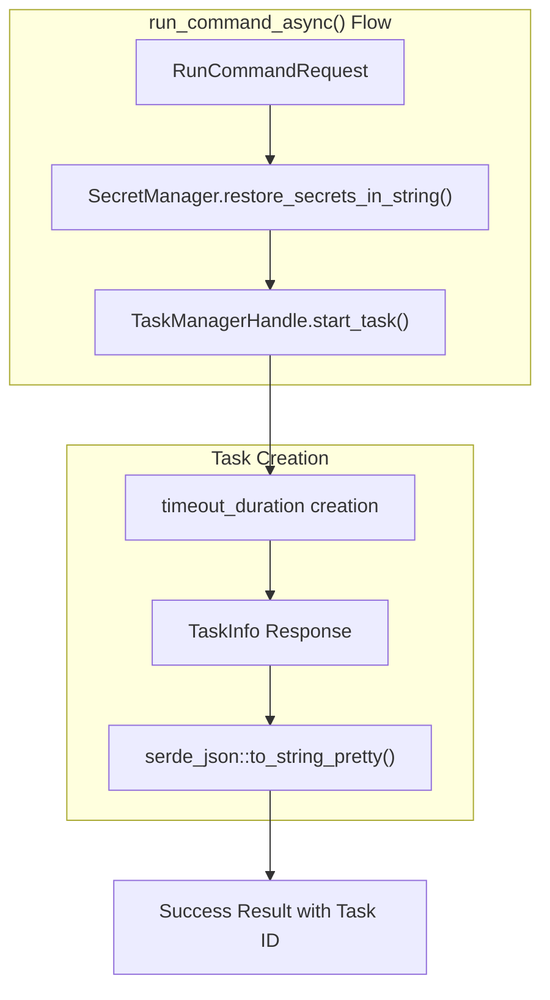

Sources: [libs/mcp/server/src/local_tools.rs:297-336]()

## Task Management Tools

The task management tools provide comprehensive monitoring and control of background tasks started with `run_command_async`.

### Task Listing

The `get_all_tasks` tool provides a markdown-formatted table of all background tasks with redacted output.

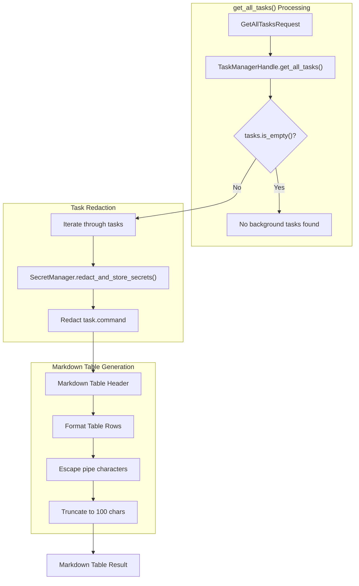

The generated table includes these columns:

| Column | Content |
|--------|---------|
| Task ID | Full unique identifier |
| Status | Running, Completed, Failed, Cancelled, TimedOut |
| Command | Truncated and redacted command (100 chars) |
| Start Time | RFC3339 formatted timestamp |
| Duration | Elapsed or total time in seconds |
| Output | Truncated and redacted output (100 chars) |

Sources: [libs/mcp/server/src/local_tools.rs:42-46](), [libs/mcp/server/src/local_tools.rs:352-439]()

### Task Details

The `get_task_details` tool provides comprehensive information about a specific task with full output.

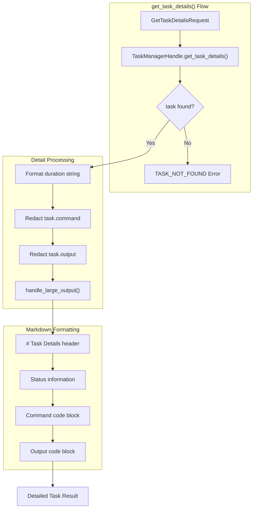

Sources: [libs/mcp/server/src/local_tools.rs:36-40](), [libs/mcp/server/src/local_tools.rs:490-548]()

### Task Cancellation

The `cancel_async_task` tool terminates running background tasks.

Sources: [libs/mcp/server/src/local_tools.rs:30-34](), [libs/mcp/server/src/local_tools.rs:450-474]()

## Password Generation Tool

The `generate_password` tool creates secure passwords with configurable constraints and automatic secret redaction.

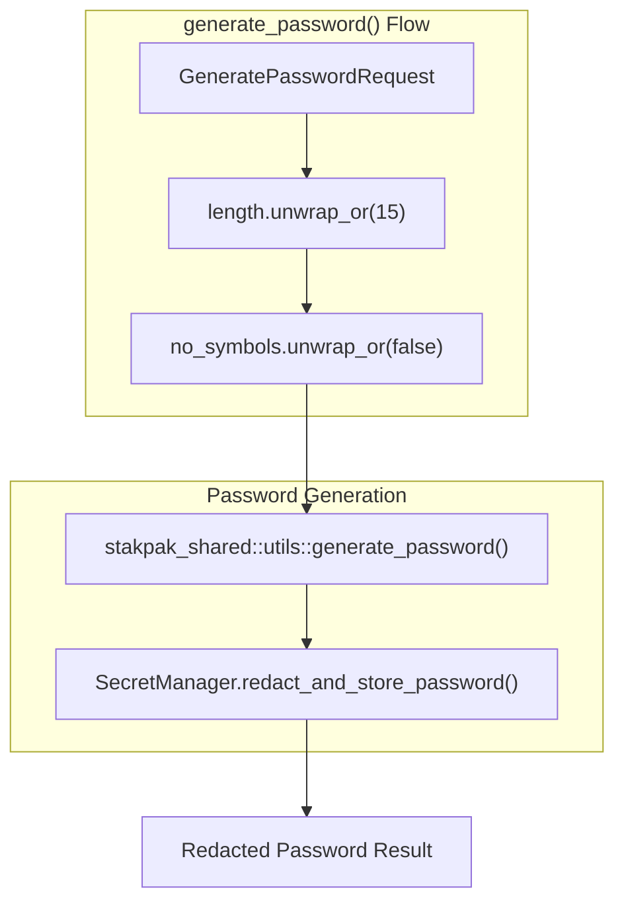

The `GeneratePasswordRequest` parameters:

| Parameter | Type | Default | Description |
|-----------|------|---------|-------------|
| `length` | `Option<usize>` | 15 | Password length |
| `no_symbols` | `Option<bool>` | false | Exclude symbols |

Sources: [libs/mcp/server/src/local_tools.rs:86-92](), [libs/mcp/server/src/local_tools.rs:882-901]()

## Secret Management Integration

All local tools integrate with the `SecretManager` for consistent secret handling across operations.

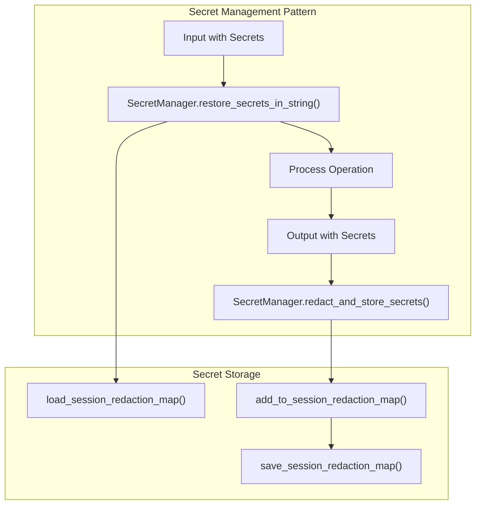

The secret management provides:
- **Input restoration**: Secret placeholders like `[REDACTED_SECRET:rule-id:hash]` are restored to actual values
- **Output redaction**: Sensitive data in results is replaced with placeholders
- **Session persistence**: Redaction mappings are stored in `secrets.json` via `LocalStore`

Sources: [libs/shared/src/secret_manager.rs:70-110](), [libs/mcp/server/src/local_tools.rs:117-120](), [libs/mcp/server/src/local_tools.rs:266-268]()

## Output Management

Large output handling is centralized through the `handle_large_output` function to prevent memory issues and improve usability.

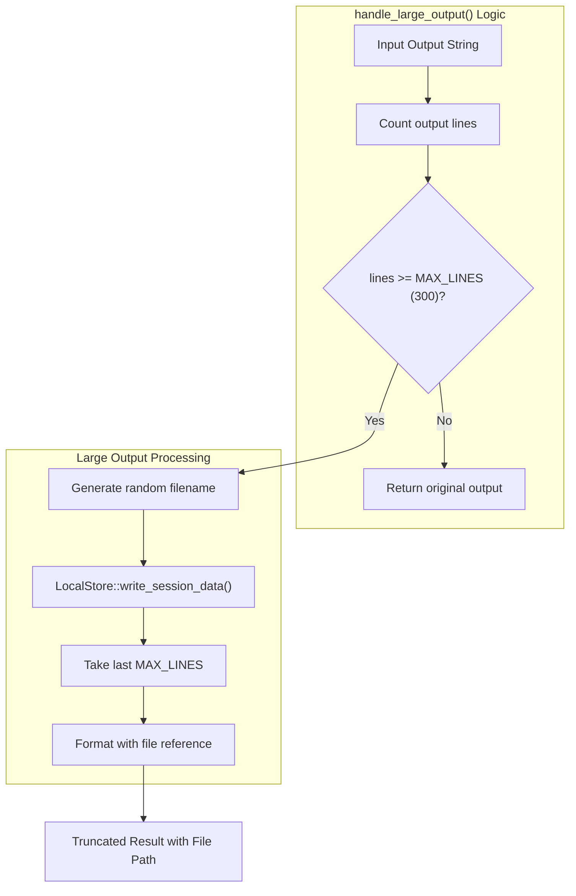

The output management:
- Truncates output exceeding 300 lines
- Saves full output to session files using `LocalStore`
- Provides file path reference in truncated output
- Uses random hex suffixes for unique filenames

Sources: [libs/mcp/server/src/local_tools.rs:904-941](), [libs/mcp/server/src/local_tools.rs:260-260](), [libs/mcp/server/src/local_tools.rs:512-517]()

---

