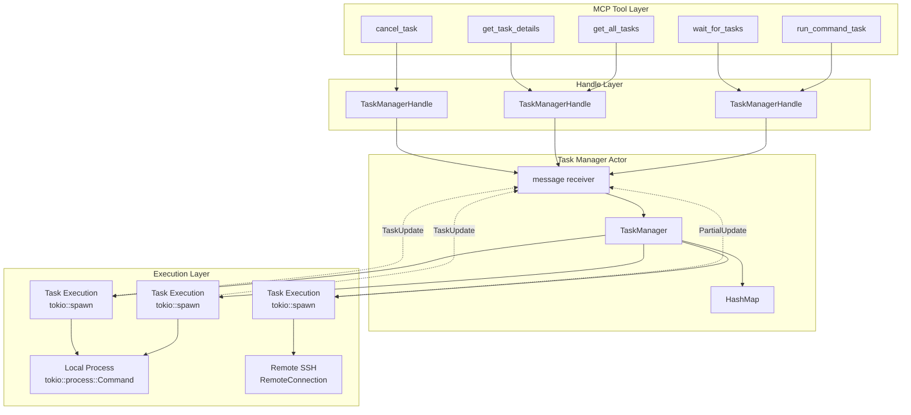
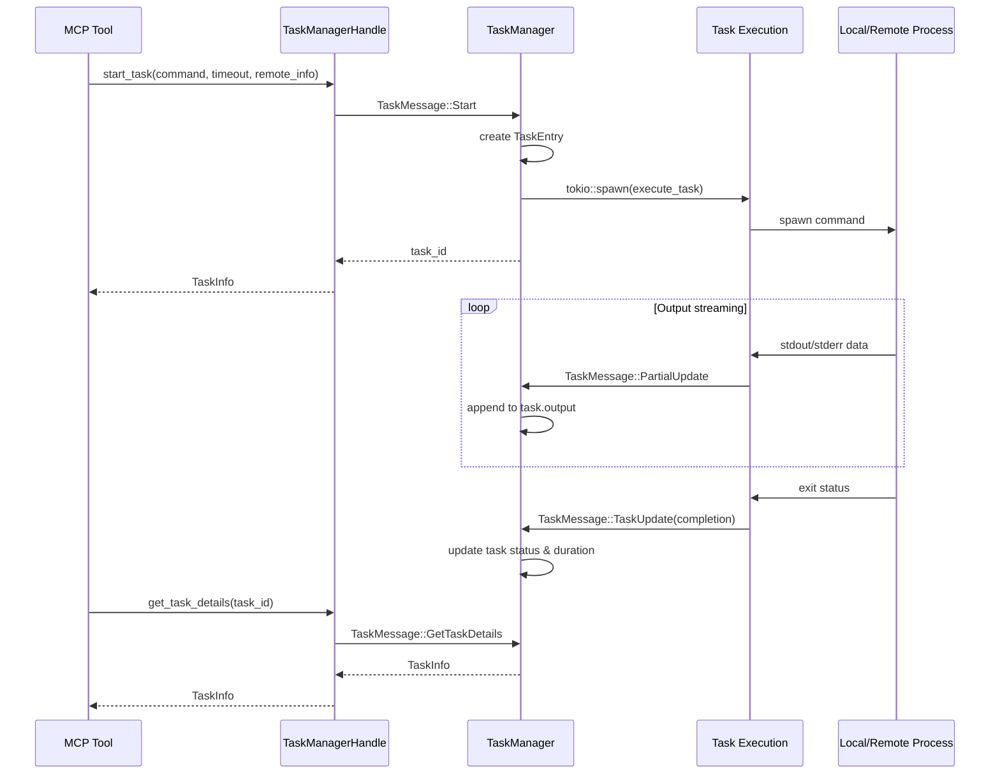
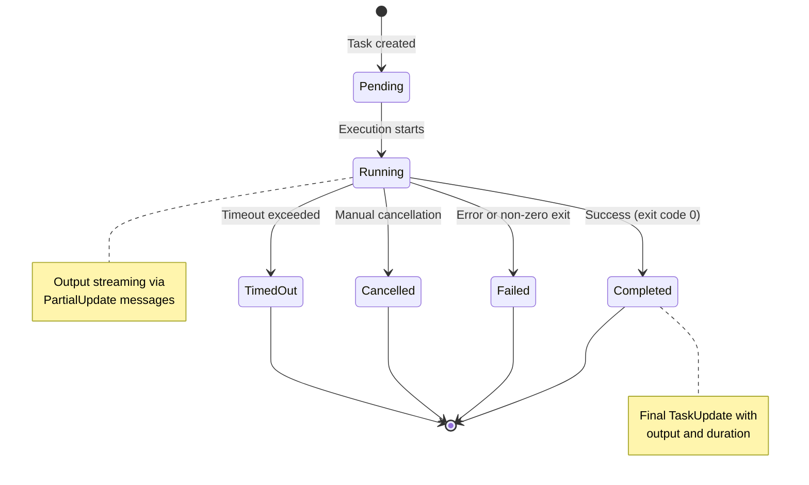
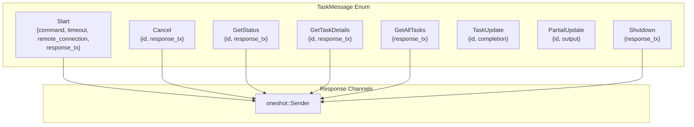
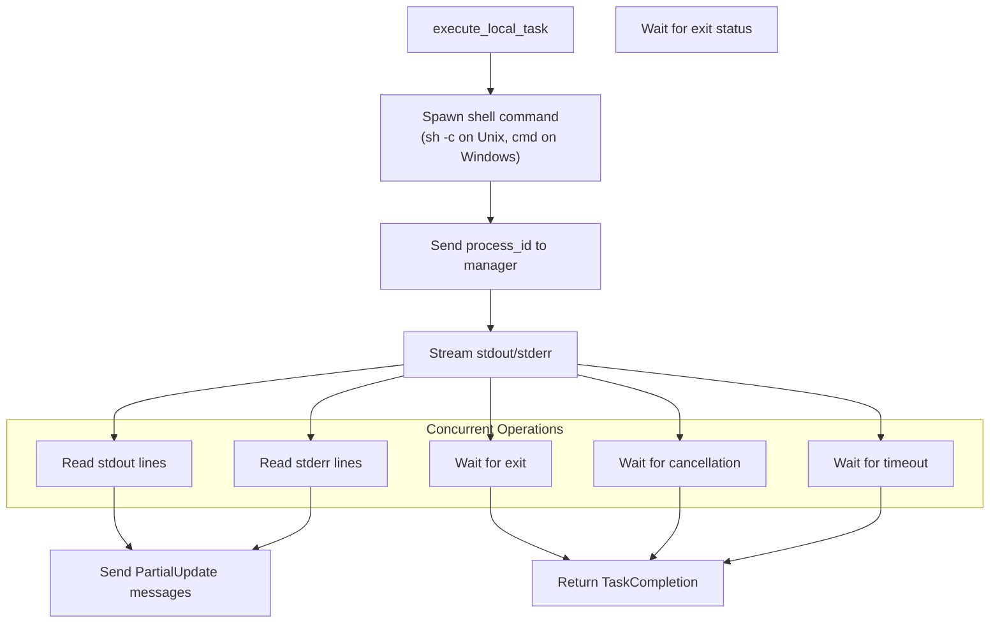
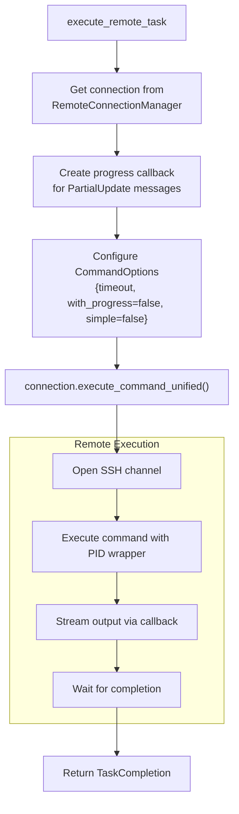
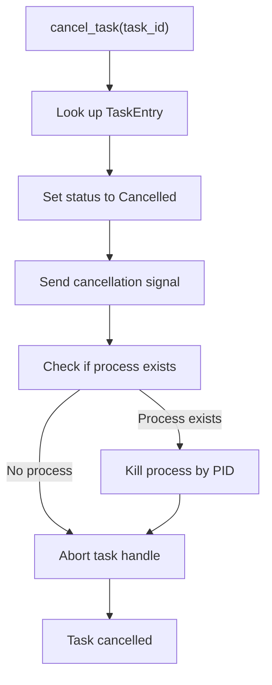
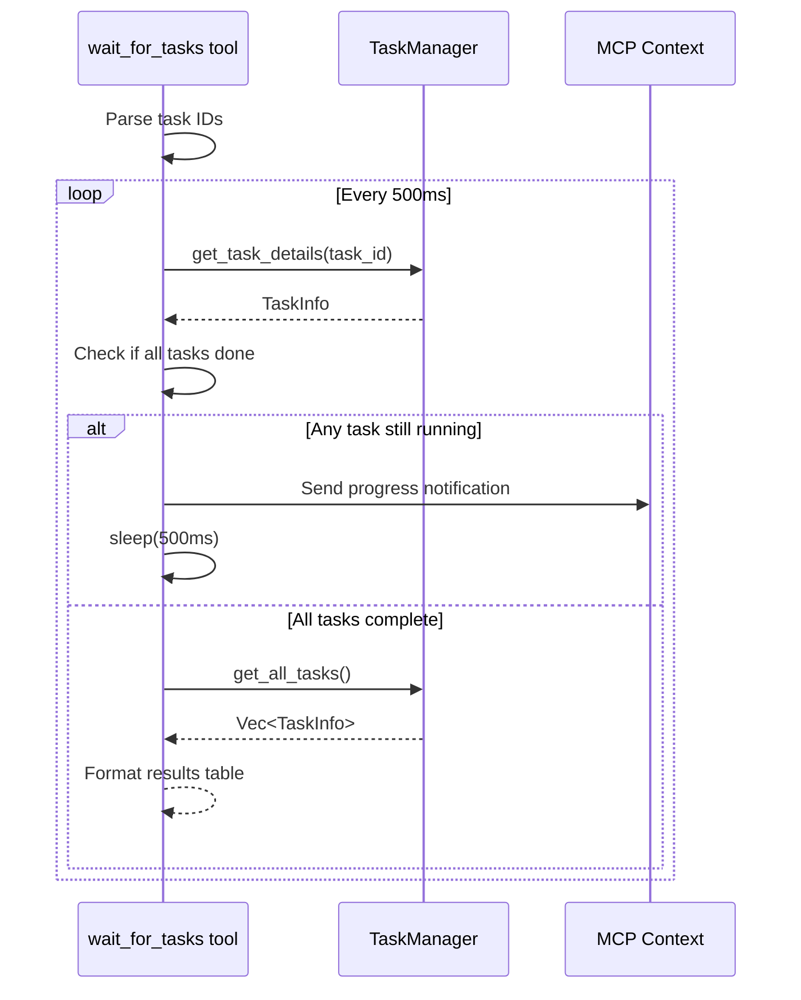

<!-- source: DeepWiki mcp.deepwiki.com · repo stakpak/agent · page 5.4 Task Management System · fetched 2026-10-26 -->

# Task Management System

<details>
<summary>Relevant source files</summary>

The following files were used as context for generating this wiki page:

- [cli/src/utils/local_context.rs](cli/src/utils/local_context.rs)
- [libs/mcp/server/src/local_tools.rs](libs/mcp/server/src/local_tools.rs)
- [libs/shared/src/local_store.rs](libs/shared/src/local_store.rs)
- [libs/shared/src/remote_connection.rs](libs/shared/src/remote_connection.rs)
- [libs/shared/src/task_manager.rs](libs/shared/src/task_manager.rs)
- [libs/shared/src/utils.rs](libs/shared/src/utils.rs)

</details>


The Task Management System provides asynchronous background task execution for long-running commands on both local and remote systems. It enables the MCP server to spawn commands as background tasks, track their status, stream their output, and manage their lifecycle (cancellation, timeout, etc.). This system is critical for operations like port forwarding, log tailing, server processes, and other long-running commands that should not block the main execution flow.

For information about the MCP tools that use this system, see [Local Tools Implementation](#5.3). For details about remote SSH connections used in remote task execution, see [Remote Operations and SSH](#5.5).

## System Architecture

The Task Management System uses an actor-based pattern where a central `TaskManager` maintains state and processes messages from multiple `TaskManagerHandle` instances. Tasks execute in separate Tokio tasks and communicate back to the manager via channels.

### High-Level Architecture



**Sources:** [libs/shared/src/task_manager.rs:1-866](), [libs/mcp/server/src/local_tools.rs:247-337]()

### Core Data Flow



**Sources:** [libs/shared/src/task_manager.rs:750-792](), [libs/shared/src/task_manager.rs:200-280]()

## Core Components

### TaskManager

The `TaskManager` is the central actor that maintains all task state and processes messages. It runs in its own Tokio task and handles concurrent requests from multiple handles.

| Component | Type | Purpose |
|-----------|------|---------|
| `tasks` | `HashMap<TaskId, TaskEntry>` | Map of active and completed tasks |
| `tx` | `mpsc::UnboundedSender<TaskMessage>` | Channel sender for message passing |
| `rx` | `mpsc::UnboundedReceiver<TaskMessage>` | Channel receiver for message processing |
| `shutdown_tx/rx` | `broadcast::Sender/Receiver<()>` | Broadcast channel for shutdown signaling |

**Sources:** [libs/shared/src/task_manager.rs:142-149]()

### TaskManagerHandle

The `TaskManagerHandle` is a lightweight handle that can be cloned and shared across threads. It provides the public API for interacting with the task manager.

```rust
pub struct TaskManagerHandle {
    tx: mpsc::UnboundedSender<TaskMessage>,
}
```

Available operations:
- `start_task()` - Start a new background task
- `cancel_task()` - Cancel a running task
- `get_task_status()` - Get current status of a task
- `get_task_details()` - Get detailed task information
- `get_all_tasks()` - List all tasks
- `shutdown()` - Shutdown the task manager

**Sources:** [libs/shared/src/task_manager.rs:745-865]()

### Task Data Structures

#### Task

Internal task representation with complete metadata:

| Field | Type | Description |
|-------|------|-------------|
| `id` | `TaskId (String)` | Unique task identifier |
| `status` | `TaskStatus` | Current task state |
| `command` | `String` | The command being executed |
| `remote_connection` | `Option<RemoteConnectionInfo>` | Remote SSH details if applicable |
| `output` | `Option<String>` | Accumulated command output |
| `error` | `Option<String>` | Error message if failed |
| `start_time` | `DateTime<Utc>` | When the task started |
| `duration` | `Option<Duration>` | How long the task took (or is taking) |
| `timeout` | `Option<Duration>` | Configured timeout |

**Sources:** [libs/shared/src/task_manager.rs:26-37]()

#### TaskEntry

Internal entry that includes the task and execution handle:

| Field | Type | Description |
|-------|------|-------------|
| `task` | `Task` | The task metadata |
| `handle` | `JoinHandle<()>` | Tokio task handle for aborting |
| `process_id` | `Option<u32>` | Local process ID for cleanup |
| `cancel_tx` | `Option<oneshot::Sender<()>>` | Cancellation signal sender |

**Sources:** [libs/shared/src/task_manager.rs:39-44]()

#### TaskInfo

Public-facing task information (serializable):

| Field | Type | Description |
|-------|------|-------------|
| `id` | `TaskId` | Task identifier |
| `status` | `TaskStatus` | Current status |
| `command` | `String` | Command being executed |
| `output` | `Option<String>` | Command output (redacted) |
| `start_time` | `DateTime<Utc>` | Start time |
| `duration` | `Option<Duration>` | Elapsed/total duration |

**Sources:** [libs/shared/src/task_manager.rs:46-54]()

## Task Lifecycle and State Machine

### Task States



**Sources:** [libs/shared/src/task_manager.rs:16-24]()

### State Transitions

| From | To | Trigger | Actions |
|------|----|---------|---------| 
| N/A | `Pending` | Task spawned but not started | Create `TaskEntry` |
| `Pending` | `Running` | Process spawned successfully | Send process ID, start streaming |
| `Running` | `Completed` | Process exits with code 0 | Record duration, store final output |
| `Running` | `Failed` | Process exits with non-zero code | Record error, duration |
| `Running` | `Cancelled` | `cancel_task()` called | Kill process, abort task |
| `Running` | `TimedOut` | Timeout duration exceeded | Kill process, set timeout error |

**Sources:** [libs/shared/src/task_manager.rs:241-280]()

## Message Passing Architecture

The system uses an actor pattern with message-based communication. All operations are sent as `TaskMessage` variants to the manager's message queue.

### TaskMessage Variants



**Sources:** [libs/shared/src/task_manager.rs:106-140]()

### Message Handler Flow

The `handle_message` function processes each message type:

| Message | Handler Logic | Updates State |
|---------|---------------|---------------|
| `Start` | Create task entry, spawn execution task | Inserts into `tasks` HashMap |
| `Cancel` | Send cancel signal, kill process, abort handle | Removes from `tasks` |
| `GetStatus` | Read current status from task | Read-only |
| `GetTaskDetails` | Convert `Task` to `TaskInfo` | Read-only |
| `GetAllTasks` | Collect all tasks, sort by start time | Read-only |
| `TaskUpdate` | Update status, output, error, duration | Updates existing entry |
| `PartialUpdate` | Append output chunk | Appends to `task.output` |
| `Shutdown` | Cancel all tasks, exit message loop | Drains `tasks` |

**Sources:** [libs/shared/src/task_manager.rs:200-280]()

## Task Execution

### Local Task Execution

Local tasks execute commands using `tokio::process::Command` with proper process group handling for cleanup.



**Sources:** [libs/shared/src/task_manager.rs:449-607]()

Key features:
- **Process Groups:** Creates new process group on Unix (`process_group(0)`) and Windows (`CREATE_NEW_PROCESS_GROUP`) for proper cleanup
- **Non-interactive:** Sets `DEBIAN_FRONTEND=noninteractive` and `SUDO_ASKPASS=/bin/false`
- **Output Streaming:** Uses `tokio::io::AsyncBufReadExt` to stream lines as they arrive
- **Cancellation:** Monitors cancel channel via `tokio::select!`
- **Timeout:** Uses `tokio::time::timeout` if timeout specified
- **Process Cleanup:** Uses `kill -9` on Unix and `taskkill /F` on Windows

**Sources:** [libs/shared/src/task_manager.rs:449-607]()

### Remote Task Execution

Remote tasks execute commands over SSH using `RemoteConnection` with streaming support.



**Sources:** [libs/shared/src/task_manager.rs:609-683]()

Remote execution differences:
- **Connection Pooling:** Reuses connections via `RemoteConnectionManager`
- **No Local Process ID:** Remote tasks don't have local process IDs
- **PID Extraction:** Wraps command to capture remote PID for cancellation
- **Progress Callback:** Converts streaming output to `PartialUpdate` messages
- **Error Mapping:** Maps SSH errors to `TaskStatus` (TimedOut, Cancelled, Failed)

**Sources:** [libs/shared/src/task_manager.rs:609-683](), [libs/shared/src/remote_connection.rs:421-597]()

## Task Operations

### Starting Tasks

The `start_task` operation creates and spawns a new background task:

1. Generate unique task ID (6-character alphanumeric)
2. Create `Task` with `Running` status
3. Create cancellation channel
4. Spawn execution task (local or remote)
5. Store `TaskEntry` in manager
6. Wait briefly for task to start (300ms)
7. Return `TaskInfo` or error if task failed to start

**Sources:** [libs/shared/src/task_manager.rs:750-792]()

Special handling:
- **Instant Failure Detection:** If task fails within the 300ms startup window, returns `TaskFailedOnStart` error
- **Remote vs Local:** Automatically routes to appropriate execution path based on `remote_connection` parameter
- **Process ID Tracking:** For local tasks, waits for process ID before returning (skipped for remote tasks)

**Sources:** [libs/shared/src/task_manager.rs:282-343]()

### Cancelling Tasks

The `cancel_task` operation terminates a running task:



**Sources:** [libs/shared/src/task_manager.rs:345-407]()

Platform-specific cleanup:
- **Unix:** Uses `kill -0` to check existence, then `kill -9` to terminate
- **Windows:** Uses `tasklist` to check existence, then `taskkill /F` to terminate
- **Safety:** Always checks if process exists before killing to avoid errors

**Sources:** [libs/shared/src/task_manager.rs:345-407]()

### Waiting for Tasks

The `wait_for_tasks` operation blocks until specified tasks reach final states. This is implemented in the MCP tool layer with streaming progress updates.

**Implementation in local_tools.rs:**



**Sources:** [libs/mcp/server/src/local_tools.rs:482-518](), [libs/mcp/server/src/tool_container.rs:1-200]()

The helper function `wait_for_tasks_with_streaming` provides:
- **Polling Loop:** Checks task status every 500ms
- **Timeout Support:** Optional overall timeout for waiting
- **Progress Notifications:** Sends MCP progress updates during wait
- **Final Status:** Returns all task details once complete

**Sources:** [libs/mcp/server/src/tool_container.rs:90-167]()

### Listing All Tasks

The `get_all_tasks` operation returns information about all tasks, sorted by start time (newest first):

| Field Displayed | Source | Format |
|-----------------|--------|--------|
| Task ID | `task.id` | Full UUID string |
| Status | `task.status` | Debug format (`Running`, `Completed`, etc.) |
| Command | `task.command` | Truncated to 100 chars, pipe chars escaped |
| Start Time | `task.start_time` | RFC3339 format |
| Duration | `task.duration` | Seconds with 2 decimal places, or "N/A" |
| Output | `task.output` | Truncated to 100 chars, redacted, pipe chars escaped |

The output is formatted as a markdown table for easy reading.

**Sources:** [libs/mcp/server/src/local_tools.rs:353-424]()

## Integration with MCP Tools

The Task Management System is primarily accessed through five MCP tools:

### Tool: run_command_task

Starts a command as a background task and returns immediately.

**Parameters:**
- `command` - Shell command to execute
- `timeout` - Optional timeout in seconds
- `remote` - Optional remote connection string
- `password` - Optional SSH password
- `private_key_path` - Optional SSH key path

**Returns:** `TaskInfo` with task ID and initial status

**Sources:** [libs/mcp/server/src/local_tools.rs:247-337]()

### Tool: get_all_tasks

Lists all background tasks in a markdown table format.

**Parameters:**
- `view` - Required parameter (value ignored, for compatibility)

**Returns:** Markdown table with all tasks

**Sources:** [libs/mcp/server/src/local_tools.rs:353-424]()

### Tool: cancel_task

Cancels a running background task.

**Parameters:**
- `task_id` - Task identifier to cancel

**Returns:** Updated `TaskInfo` with `Cancelled` status

**Sources:** [libs/mcp/server/src/local_tools.rs:435-459]()

### Tool: wait_for_tasks

Waits for one or more tasks to complete, with streaming progress updates.

**Parameters:**
- `task_ids` - Space-separated list of task IDs
- `timeout` - Optional timeout in seconds

**Returns:** Markdown table with final task statuses

**Sources:** [libs/mcp/server/src/local_tools.rs:482-518]()

### Tool: get_task_details

Gets detailed information about a specific task.

**Parameters:**
- `task_id` - Task identifier

**Returns:** Formatted markdown with complete task details including full output

**Sources:** [libs/mcp/server/src/local_tools.rs:534-591]()

## Streaming and Progress Updates

### Partial Updates

During task execution, output is streamed via `PartialUpdate` messages:

1. Task execution reads stdout/stderr line by line
2. Each line is sent as a `TaskMessage::PartialUpdate`
3. Manager appends the line to `task.output`
4. This allows real-time monitoring of task progress

**Sources:** [libs/shared/src/task_manager.rs:261-273](), [libs/shared/src/task_manager.rs:513-535]()

### MCP Progress Notifications

For tools that wait on tasks, progress is communicated via MCP progress notifications:

```rust
ctx.peer.notify_progress(ProgressNotificationParam {
    progress_token: ProgressToken(NumberOrString::Number(0)),
    progress: 50.0,
    total: Some(100.0),
    message: Some(/* serialized progress info */),
}).await;
```

This allows AI agents and other MCP clients to display progress to users.

**Sources:** [libs/shared/src/remote_connection.rs:498-510]()

## Task Cleanup and Shutdown

### Graceful Shutdown

The `shutdown` operation cleanly terminates all tasks:

1. Drain the `tasks` HashMap
2. For each task:
   - Send cancellation signal
   - Check if process still exists
   - Kill process if running
   - Abort task handle
3. Exit message loop

**Sources:** [libs/shared/src/task_manager.rs:685-742]()

### Memory Management

Completed tasks are kept in memory for querying via `get_all_tasks` and `get_task_details`. The code includes a TODO comment about implementing cleanup for old completed tasks, but currently all tasks persist until shutdown.

**Sources:** [libs/shared/src/task_manager.rs:254-258]()

### Error Handling

Task errors are captured in the `TaskCompletion` structure and stored in the task's `error` field:

| Error Type | Status | Error Message |
|------------|--------|---------------|
| Spawn failure | `Failed` | "Failed to spawn command: ..." |
| Non-zero exit | `Failed` | Command output + "Command failed with exit code: X" |
| Timeout | `TimedOut` | "Task timed out" |
| Cancellation | `Cancelled` | "Tool call was cancelled and don't try to run it again" |
| Remote connection failure | `Failed` | "Failed to establish remote connection: ..." |

**Sources:** [libs/shared/src/task_manager.rs:82-104](), [libs/shared/src/task_manager.rs:477-603]()

---

