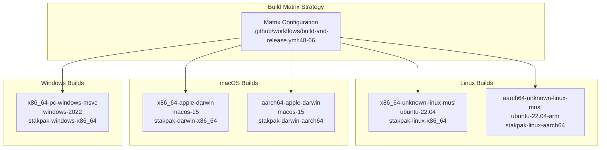
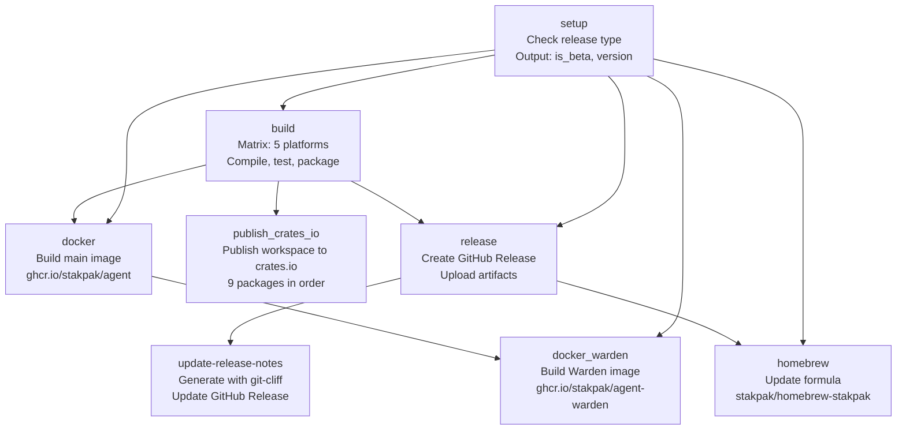
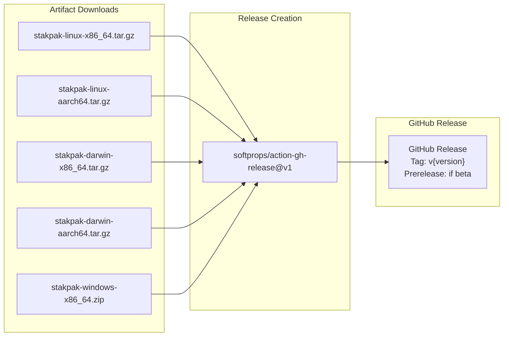
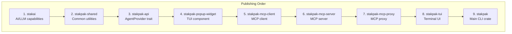
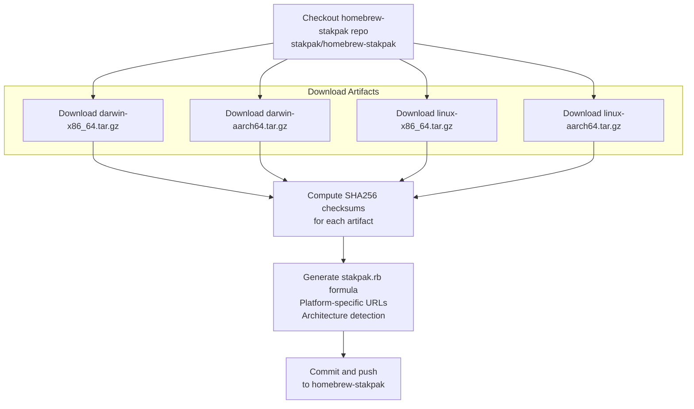

<!-- source: DeepWiki mcp.deepwiki.com · repo stakpak/agent · page 7.1 CI/CD Pipeline · fetched 2026-10-26 -->

# CI/CD Pipeline

<details>
<summary>Relevant source files</summary>

The following files were used as context for generating this wiki page:

- [.github/workflows/build-and-release.yml](.github/workflows/build-and-release.yml)
- [cliff.toml](cliff.toml)
- [libs/popup-widget/Cargo.toml](libs/popup-widget/Cargo.toml)
- [libs/popup-widget/README.md](libs/popup-widget/README.md)
- [release.sh](release.sh)

</details>


## Purpose and Scope

This document describes the Continuous Integration and Continuous Deployment (CI/CD) pipeline implemented through GitHub Actions for the Stakpak project. The pipeline handles multi-platform builds, automated testing, artifact creation, and distribution across multiple channels including GitHub Releases, crates.io, Docker registries, and Homebrew.

For information about the manual release process and version management, see [Release Management](#7.2). For details on distribution channels and package formats, see [Distribution Channels](#7.3).

**Sources:** [.github/workflows/build-and-release.yml:1-393]()

---

## Workflow Triggers and Execution Modes

The CI/CD pipeline operates in two distinct modes based on the trigger type: **build-only mode** for branch pushes and **full release mode** for version tags.

### Trigger Conditions

| Trigger Type | Pattern | Execution Mode | Jobs Executed |
|-------------|---------|----------------|---------------|
| Branch Push | `main` | Build Only | `setup`, `build` |
| Branch Push | `beta` | Build Only | `setup`, `build` |
| Tag Push | `v1.2.3` | Full Release (Stable) | All jobs |
| Tag Push | `v1.2.3-beta.1` | Full Release (Beta) | All jobs |

The workflow uses `startsWith(github.ref, 'refs/tags/')` to differentiate between branch pushes and tag pushes. Beta releases are identified by the presence of `-beta` in the tag name.

**Sources:** [.github/workflows/build-and-release.yml:3-14](), [.github/workflows/build-and-release.yml:34-45]()

---

## Build Matrix and Platform Support

### Multi-Platform Build Architecture

The build system compiles native binaries for five platform/architecture combinations using a GitHub Actions matrix strategy:



**Diagram: Build Matrix Strategy and Platform Targets**

### Build Process Steps

Each platform build executes the following sequence:

1. **Toolchain Setup** - Installs Rust 1.89.0 with target-specific toolchain ([.github/workflows/build-and-release.yml:73-76]())
2. **Caching** - Uses `Swatinem/rust-cache@v2` with per-target cache keys ([.github/workflows/build-and-release.yml:78-81]())
3. **Platform-Specific Dependencies** - Linux MUSL builds install `musl-tools` ([.github/workflows/build-and-release.yml:83-85]())
4. **Compilation** - Executes `cargo build --release --target $TARGET` ([.github/workflows/build-and-release.yml:87-90]())
5. **Testing** - Runs `cargo test --target $TARGET` ([.github/workflows/build-and-release.yml:92-93]())
6. **Artifact Packaging** - Creates `.tar.gz` (Unix) or `.zip` (Windows) archives ([.github/workflows/build-and-release.yml:95-104]())
7. **Upload** - Stores artifacts for downstream jobs ([.github/workflows/build-and-release.yml:106-112]())

### Linux Static Linking

Linux builds use MUSL targets (`x86_64-unknown-linux-musl`, `aarch64-unknown-linux-musl`) to produce statically-linked binaries that run on any Linux distribution without external dependencies. The ARM64 build runs on GitHub's ARM runners (`ubuntu-22.04-arm`) for native compilation.

**Sources:** [.github/workflows/build-and-release.yml:48-112]()

---

## Job Dependency Graph and Execution Flow



**Diagram: Job Dependency Graph for Release Pipeline**

### Job Descriptions

| Job Name | Depends On | Condition | Purpose |
|----------|-----------|-----------|---------|
| `setup` | None | Always | Extracts version from tag, determines if beta release |
| `build` | None | Always | Compiles binaries for all platforms, runs tests |
| `release` | `setup`, `build` | Tag push only | Creates GitHub Release, uploads binary artifacts |
| `publish_crates_io` | `build` | Tag push only | Publishes workspace packages to crates.io |
| `docker` | `setup`, `build` | Tag push only | Builds main Docker image |
| `docker_warden` | `setup`, `docker` | Tag push only | Builds Warden security container |
| `update-release-notes` | `release` | Tag push only | Generates changelog with git-cliff, updates release |
| `homebrew` | `setup`, `release` | Tag push, not beta | Updates Homebrew tap formula |

**Sources:** [.github/workflows/build-and-release.yml:27-45](), [.github/workflows/build-and-release.yml:114-392]()

---

## Release Creation and Artifact Distribution

### GitHub Release Job

The `release` job aggregates artifacts from all platform builds and creates a unified GitHub Release:



**Diagram: GitHub Release Artifact Aggregation**

The release is marked as prerelease if `is_beta == 'true'`, and GitHub automatically generates release notes from commit history ([.github/workflows/build-and-release.yml:124-136]()).

### Release Notes Enhancement

After the initial release, the `update-release-notes` job enhances the release notes using `git-cliff`:

1. **Install git-cliff** - Installs the changelog generator ([.github/workflows/build-and-release.yml:283-284]())
2. **Generate Changelog** - Runs `git-cliff $PREV_TAG..$VERSION --strip all` ([.github/workflows/build-and-release.yml:286-306]())
3. **Update Release** - Uses `gh release edit` to update notes ([.github/workflows/build-and-release.yml:308-327]())

The `cliff.toml` configuration groups commits by conventional commit type (feat, fix, docs, etc.) and formats them into categorized sections ([cliff.toml:31-46]()).

**Sources:** [.github/workflows/build-and-release.yml:114-136](), [.github/workflows/build-and-release.yml:274-327](), [cliff.toml:1-62]()

---

## Crates.io Publishing Pipeline

### Workspace Publishing Strategy

The `publish_crates_io` job publishes all workspace members to crates.io in dependency order to ensure each package's dependencies are available before publication:



**Diagram: Crates.io Publishing Dependency Order**

### Publishing Logic

The `publish_package` function handles each package publication with error handling:

- **Success Case**: Package publishes, waits 15 seconds for index propagation ([.github/workflows/build-and-release.yml:190-192]())
- **Already Published**: Detects "already uploaded" error, skips gracefully ([.github/workflows/build-and-release.yml:193-194]())
- **Failure**: Reports error and exits ([.github/workflows/build-and-release.yml:195-199]())

The job includes version verification to ensure the tag version matches `Cargo.toml`, updating it if necessary ([.github/workflows/build-and-release.yml:148-165]()).

**Sources:** [.github/workflows/build-and-release.yml:138-217]()

---

## Docker Image Build Pipeline

### Main Docker Image

The `docker` job builds the primary Stakpak Docker image:

- **Build Context**: Repository root directory
- **Platform**: `linux/amd64`
- **Registry**: GitHub Container Registry (`ghcr.io`)
- **Tags**: 
  - Version-specific: `ghcr.io/stakpak/agent:v{version}`
  - Latest (stable only): `ghcr.io/stakpak/agent:latest` ([.github/workflows/build-and-release.yml:242-244]())

The image uses Docker Buildx for efficient multi-stage builds ([.github/workflows/build-and-release.yml:226-227]()).

### Warden Security Container

The `docker_warden` job builds a specialized security-enhanced container:

- **Build Context**: `.warden` directory
- **Base Image**: Uses version-tagged main image as base via `BASE_IMAGE_TAG` build arg ([.github/workflows/build-and-release.yml:268-269]())
- **Tags**:
  - `ghcr.io/stakpak/agent-warden:v{version}`
  - `ghcr.io/stakpak/agent-warden:latest` (stable only)

This job depends on the `docker` job completing, ensuring the base image exists before building the Warden variant.

**Sources:** [.github/workflows/build-and-release.yml:219-272]()

---

## Homebrew Formula Updates

The `homebrew` job automatically updates the Homebrew tap for macOS and Linux installations. It only runs for **stable releases** (not beta) ([.github/workflows/build-and-release.yml:332]()).

### Update Process



**Diagram: Homebrew Formula Update Process**

The generated `stakpak.rb` formula includes:

- Platform detection (`on_macos`, `on_linux`)
- Architecture detection (`Hardware::CPU.arm?`)
- Platform-specific download URLs
- SHA256 checksums for verification
- Installation instructions ([.github/workflows/build-and-release.yml:356-386]())

**Sources:** [.github/workflows/build-and-release.yml:329-392]()

---

## Testing and Quality Assurance

### Automated Testing

Each platform build includes a test execution step that runs the full test suite for the target platform:

```bash
cargo test --target ${{ matrix.target }}
```

Tests run after compilation but before artifact packaging, ensuring only passing builds are released ([.github/workflows/build-and-release.yml:92-93]()).

### Version Verification

The crates.io publishing job includes version verification logic:

1. **Extract Tag Version**: Parses version from `GITHUB_REF` (e.g., `refs/tags/v1.2.3` → `1.2.3`)
2. **Extract Cargo Version**: Reads version from root `Cargo.toml`
3. **Compare**: If mismatch detected, updates `Cargo.toml` to match tag version
4. **Log Warning**: Reports discrepancy in job logs ([.github/workflows/build-and-release.yml:148-165]())

This ensures consistency between git tags and published package versions.

### Rust Cache Optimization

Build jobs use `Swatinem/rust-cache@v2` with target-specific shared keys to optimize compilation times across workflow runs. The cache stores:

- Compiled dependencies
- Incremental compilation artifacts
- Target-specific build outputs

Cache keys are scoped per target (`shared-key: ${{ matrix.target }}`) to prevent cross-contamination between different architectures ([.github/workflows/build-and-release.yml:78-81]()).

**Sources:** [.github/workflows/build-and-release.yml:78-81](), [.github/workflows/build-and-release.yml:92-93](), [.github/workflows/build-and-release.yml:148-165]()

---

## Permissions and Security

The workflow requires specific GitHub token permissions:

| Permission | Level | Purpose |
|-----------|-------|---------|
| `contents` | `write` | Create releases, push tags |
| `discussions` | `write` | Generate release discussions |
| `pull-requests` | `read` | Read PR information for release notes |
| `packages` | `write` | Push Docker images to GHCR |

Secrets used:
- `CRATES_IO_TOKEN` - Authentication for crates.io publishing
- `HOMEBREW_TAP_GITHUB_TOKEN` - Authentication for homebrew-stakpak repository updates

**Sources:** [.github/workflows/build-and-release.yml:16-20]()

---

## Environment Configuration

The workflow defines global environment variables:

- `CARGO_TERM_COLOR: always` - Enables colored Cargo output in CI logs
- `BINARY_NAME: stakpak` - Defines the executable name used in artifact packaging

**Sources:** [.github/workflows/build-and-release.yml:22-24]()

---

