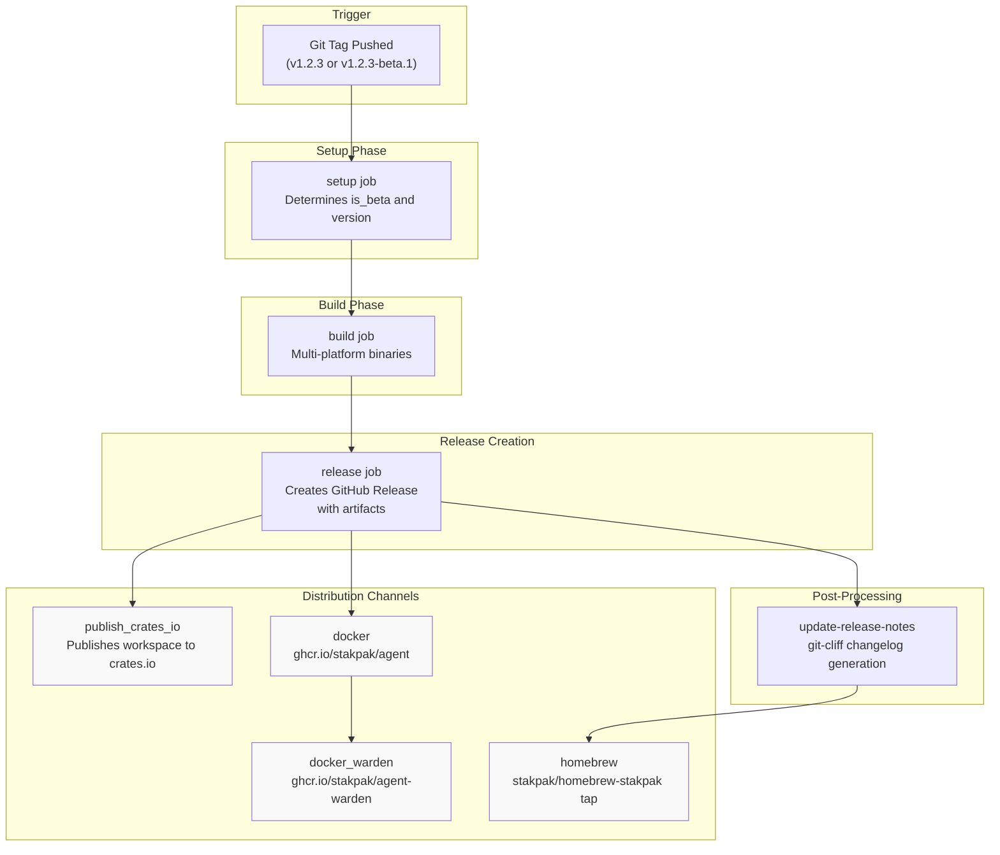
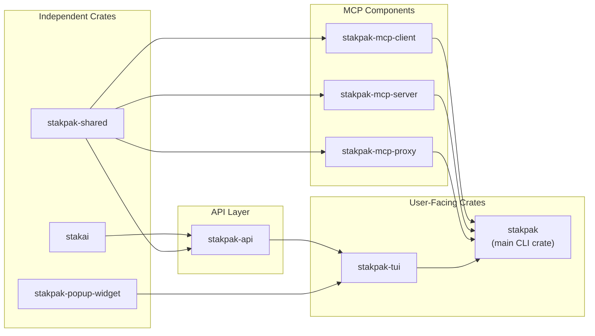
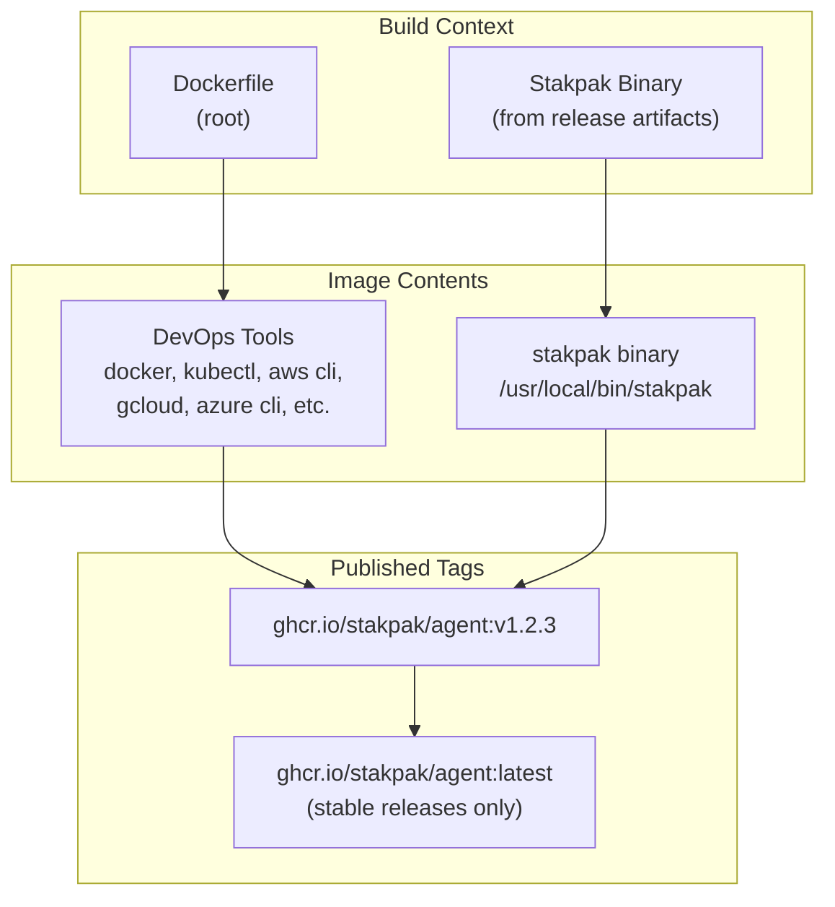
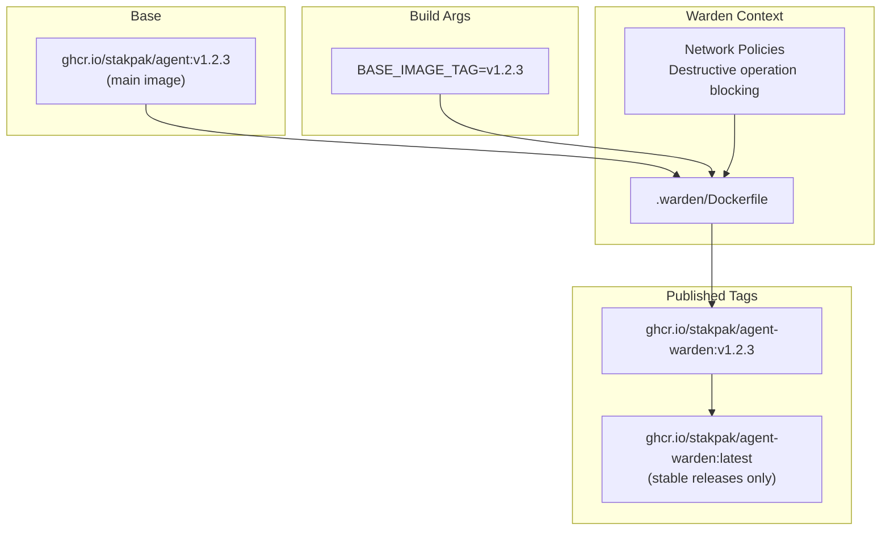
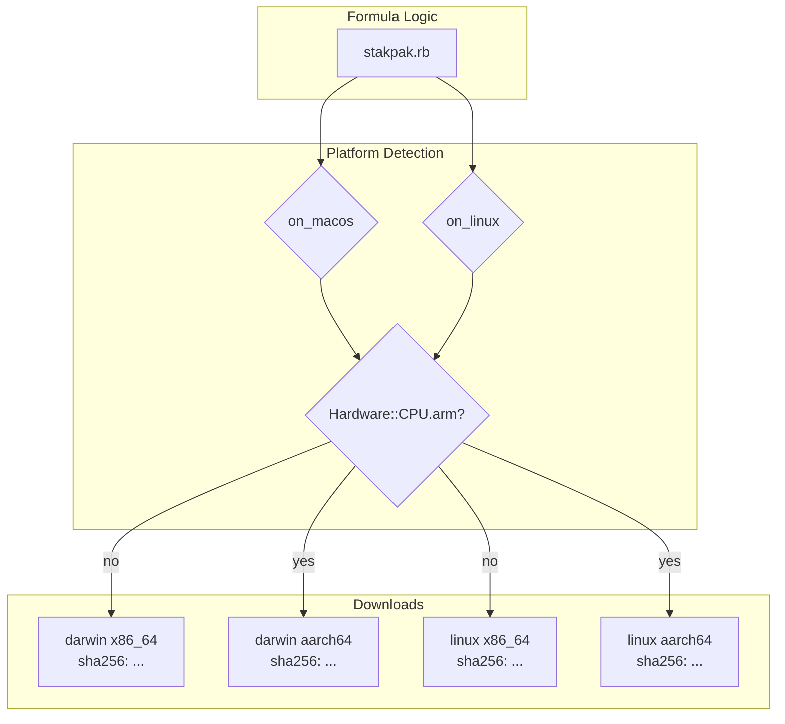

<!-- source: DeepWiki mcp.deepwiki.com · repo stakpak/agent · page 7.3 Distribution Channels · fetched 2026-10-26 -->

# Distribution Channels

<details>
<summary>Relevant source files</summary>

The following files were used as context for generating this wiki page:

- [.github/workflows/build-and-release.yml](.github/workflows/build-and-release.yml)
- [README.md](README.md)
- [assets/stakpak-dark.png](assets/stakpak-dark.png)
- [assets/stakpak-light.png](assets/stakpak-light.png)
- [cliff.toml](cliff.toml)
- [libs/popup-widget/Cargo.toml](libs/popup-widget/Cargo.toml)
- [libs/popup-widget/README.md](libs/popup-widget/README.md)
- [release.sh](release.sh)

</details>


This document describes the three primary distribution channels for Stakpak: crates.io registry publishing, Docker image builds, and Homebrew formula updates. These channels are automated through GitHub Actions and triggered by git tags. For information about the release workflow that creates these tags, see [Release Management](#7.2). For the broader CI/CD pipeline, see [CI/CD Pipeline](#7.1).

---

## Overview

Stakpak is distributed through three channels, each serving different use cases:

| Channel | Use Case | Trigger | Platforms |
|---------|----------|---------|-----------|
| **crates.io** | Rust developers, source builds | Git tags (`v*`) | Platform-agnostic |
| **Docker** | Containerized deployments | Git tags (`v*`) | linux/amd64 |
| **Homebrew** | macOS/Linux users | Git tags (`v*`, stable only) | darwin/linux x86_64/aarch64 |

All distribution channels are managed by the `build-and-release.yml` GitHub Actions workflow and execute only when a version tag (e.g., `v0.1.100` or `v0.1.101-beta.1`) is pushed.

**Sources:** [.github/workflows/build-and-release.yml:1-393]()

---

## Distribution Workflow Sequence



**Diagram: Complete Distribution Pipeline Flow**

This diagram shows the progression from tag creation through all distribution channels. The `setup` job determines whether the release is beta, which affects which channels are used. Beta releases skip Homebrew updates.

**Sources:** [.github/workflows/build-and-release.yml:27-392]()

---

## Crates.io Publishing

### Workspace Publishing Order

Stakpak uses a Cargo workspace with multiple crates that have interdependencies. Publishing must occur in dependency order to ensure each crate's dependencies are available on crates.io before it is published.



**Diagram: Crate Dependency Graph and Publishing Order**

Publishing proceeds from left to right. Independent crates are published first, followed by crates that depend on them. The main `stakpak` CLI crate is published last.

**Sources:** [.github/workflows/build-and-release.yml:172-216]()

### Publishing Process

The `publish_crates_io` job handles crate publishing with the following features:

1. **Version Verification**: Extracts version from git tag and verifies it matches `Cargo.toml`:

```
VERSION=${GITHUB_REF#refs/tags/}
VERSION=${VERSION#v}
CARGO_VERSION=$(grep -m1 '^version = ' Cargo.toml | sed 's/version = "\(.*\)"/\1/')
if [ "$VERSION" != "$CARGO_VERSION" ]; then
  sed -i "s/^version = \".*\"/version = \"$VERSION\"/" Cargo.toml
fi
```

2. **Ordered Publishing**: Publishes crates using the `publish_package()` function:

| Order | Package | Notes |
|-------|---------|-------|
| 1 | `stakai` | AI/LLM library, no internal deps |
| 2 | `stakpak-shared` | Common types, no internal deps |
| 3 | `stakpak-api` | Depends on stakai, shared |
| 4 | `stakpak-popup-widget` | Independent TUI widget |
| 5 | `stakpak-mcp-client` | Depends on shared |
| 6 | `stakpak-mcp-server` | Depends on shared |
| 7 | `stakpak-mcp-proxy` | Depends on shared |
| 8 | `stakpak-tui` | Depends on API, popup-widget |
| 9 | `stakpak` | Main CLI, depends on all |

3. **Error Handling**: Skips already-published versions instead of failing:

```bash
if echo "$OUTPUT" | grep -q "already uploaded"; then
  echo "$pkg version $VERSION already published, skipping"
else
  echo "Error publishing $pkg:"
  exit 1
fi
```

4. **Index Propagation**: Waits 15 seconds between publishes to allow crates.io index to update.

**Sources:** [.github/workflows/build-and-release.yml:138-218]()

### Authentication

Publishing uses the `CRATES_IO_TOKEN` secret, which must be configured in the repository settings. The token is passed to `cargo login` before publishing begins.

**Sources:** [.github/workflows/build-and-release.yml:167-170]()

---

## Docker Images

Stakpak provides two Docker images, both published to GitHub Container Registry (ghcr.io):

### Main Image: ghcr.io/stakpak/agent

The main image is built from the repository root and includes popular DevOps CLI tools:



**Diagram: Main Docker Image Build and Tagging**

The main image is designed for everyday DevOps tasks and includes commonly needed tools alongside the Stakpak binary.

**Sources:** [.github/workflows/build-and-release.yml:219-245](), [README.md:101-107]()

### Warden Image: ghcr.io/stakpak/agent-warden

The Warden image extends the main image with network-level security policies:



**Diagram: Warden Docker Image Build Chain**

The Warden image depends on the main image being built first, as it uses it as a base. This is enforced by job dependencies in the workflow.

**Sources:** [.github/workflows/build-and-release.yml:246-273]()

### Docker Build Configuration

Both Docker jobs use:

- **Platform**: `linux/amd64` only
- **Registry**: GitHub Container Registry (`ghcr.io`)
- **Authentication**: `GITHUB_TOKEN` (automatically provided)
- **Push condition**: Only on git tags (skips branch pushes)

Tagging strategy:

```yaml
tags: |
  ghcr.io/${{ github.repository }}:v${{ needs.setup.outputs.version }}
  ${{ needs.setup.outputs.is_beta != 'true' && format('ghcr.io/{0}:latest', github.repository) || '' }}
```

The `latest` tag is only applied to stable releases. Beta releases receive only version-specific tags.

**Sources:** [.github/workflows/build-and-release.yml:236-244](), [.github/workflows/build-and-release.yml:268-272]()

---

## Homebrew Formula

Homebrew provides package management for macOS and Linux. Stakpak maintains a tap (custom repository) at `stakpak/homebrew-stakpak`.

### Formula Generation Process

The `homebrew` job performs the following steps:

1. **Artifact Download**: Downloads pre-built binaries for all supported platforms:

| Platform | Artifact Name |
|----------|---------------|
| macOS x86_64 | `stakpak-darwin-x86_64.tar.gz` |
| macOS ARM64 | `stakpak-darwin-aarch64.tar.gz` |
| Linux x86_64 | `stakpak-linux-x86_64.tar.gz` |
| Linux ARM64 | `stakpak-linux-aarch64.tar.gz` |

2. **Checksum Generation**: Computes SHA256 checksums for each artifact

3. **Formula Creation**: Generates a Ruby formula file (`stakpak.rb`)

4. **Git Push**: Commits and pushes the formula to the tap repository

**Sources:** [.github/workflows/build-and-release.yml:329-392]()

### Formula Structure

The generated formula uses Homebrew's platform detection to provide the correct binary:



**Diagram: Homebrew Formula Platform Selection**

The formula dynamically selects the appropriate binary based on the user's operating system and CPU architecture.

**Sources:** [.github/workflows/build-and-release.yml:356-386]()

### Formula Template

The workflow generates the formula using a shell HERE document:

```ruby
class Stakpak < Formula
  desc "Stakpak CLI tool"
  homepage "https://github.com/stakpak/stakpak"
  version "${VERSION}"
  
  on_macos do
    if Hardware::CPU.arm?
      url "https://github.com/stakpak/agent/releases/download/v${VERSION}/stakpak-darwin-aarch64.tar.gz"
      sha256 "${SHA256_DARWIN_ARM}"
    else
      url "https://github.com/stakpak/agent/releases/download/v${VERSION}/stakpak-darwin-x86_64.tar.gz"
      sha256 "${SHA256_DARWIN_X64}"
    end
  end
  
  on_linux do
    if Hardware::CPU.arm?
      url "https://github.com/stakpak/agent/releases/download/v${VERSION}/stakpak-linux-aarch64.tar.gz"
      sha256 "${SHA256_LINUX_ARM}"
    else
      url "https://github.com/stakpak/agent/releases/download/v${VERSION}/stakpak-linux-x86_64.tar.gz"
      sha256 "${SHA256_LINUX_X64}"
    end
  end
  
  def install
    bin.install "stakpak"
  end
end
```

The variables `${VERSION}`, `${SHA256_*}` are substituted during the workflow execution.

**Sources:** [.github/workflows/build-and-release.yml:356-386]()

### Beta Release Handling

The Homebrew job includes a condition that prevents it from running for beta releases:

```yaml
if: startsWith(github.ref, 'refs/tags/') && needs.setup.outputs.is_beta == 'false'
```

Beta releases are distributed only through:
- GitHub Releases (binary downloads)
- Docker images (version-tagged, no `latest` tag)

This ensures the Homebrew tap only contains stable releases.

**Sources:** [.github/workflows/build-and-release.yml:332]()

### Authentication

The Homebrew job uses a separate token (`HOMEBREW_TAP_GITHUB_TOKEN`) with write access to the tap repository. This is necessary because the workflow needs to push to a different repository than the main agent repository.

**Sources:** [.github/workflows/build-and-release.yml:338]()

---

## Distribution Channel Comparison

| Feature | crates.io | Docker | Homebrew |
|---------|-----------|--------|----------|
| **Update Method** | `cargo install` | `docker pull` | `brew upgrade` |
| **Build From Source** | Yes | No (pre-built) | No (pre-built) |
| **Platform Support** | All Rust platforms | linux/amd64 | macOS/Linux x64/arm64 |
| **Beta Support** | Yes | Yes (tagged) | No |
| **Latest Tag** | N/A | Stable only | Always latest stable |
| **Prerequisites** | Rust toolchain | Docker | Homebrew |
| **Size** | Compile-time | ~200MB (with tools) | Binary only (~50MB) |

**Sources:** [.github/workflows/build-and-release.yml:1-393](), [README.md:77-95]()

---

## Distribution Triggers and Conditions

All distribution jobs share common trigger conditions defined at the workflow level:

```yaml
on:
  push:
    branches: [main, beta]  # Build only, no distribution
    tags: ["v*"]            # Full distribution workflow
```

The `setup` job determines release characteristics:

```yaml
outputs:
  is_beta: ${{ steps.check.outputs.is_beta }}
  version: ${{ steps.check.outputs.version }}
```

These outputs control:
- Whether `latest` tags are applied (stable only)
- Whether Homebrew updates occur (stable only)
- Release notes generation

**Sources:** [.github/workflows/build-and-release.yml:4-45]()

---

## Installation Instructions Reference

Each distribution channel has corresponding installation instructions in the README:

| Channel | Command | Documentation |
|---------|---------|---------------|
| Homebrew | `brew install stakpak/stakpak/stakpak` | [README.md:83-95]() |
| Binary | Manual download from GitHub Releases | [README.md:97-99]() |
| Docker | `docker pull ghcr.io/stakpak/agent:latest` | [README.md:101-107]() |
| crates.io | `cargo install stakpak` | Referenced in docs |

**Sources:** [README.md:77-107]()