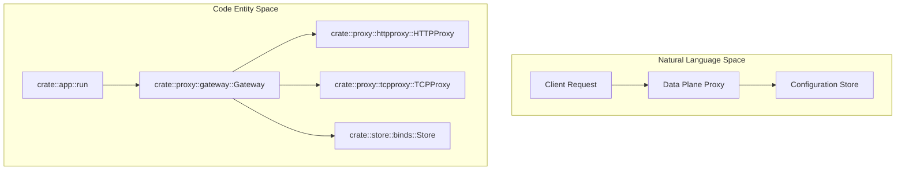
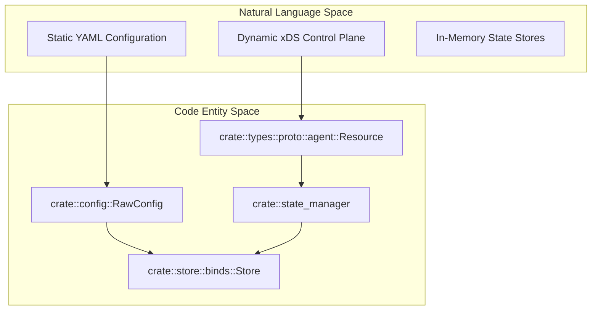

<!-- source: DeepWiki mcp.deepwiki.com · repo agentgateway/agentgateway · page 1 Overview · fetched 2026-10-21 -->

# Overview

Relevant source files

The following files were used as context for generating this wiki page:

- [CODE_OF_CONDUCT.md](CODE_OF_CONDUCT.md)
- [README.md](README.md)
- [api/resource.pb.go](api/resource.pb.go)
- [controller/api/v1alpha1/agentgateway/agentgateway_policy_types.go](controller/api/v1alpha1/agentgateway/agentgateway_policy_types.go)
- [controller/api/v1alpha1/agentgateway/zz_generated.deepcopy.go](controller/api/v1alpha1/agentgateway/zz_generated.deepcopy.go)
- [controller/install/helm/agentgateway-crds/templates/agentgateway.dev_agentgatewaybackends.yaml](controller/install/helm/agentgateway-crds/templates/agentgateway.dev_agentgatewaybackends.yaml)
- [controller/install/helm/agentgateway-crds/templates/agentgateway.dev_agentgatewaypolicies.yaml](controller/install/helm/agentgateway-crds/templates/agentgateway.dev_agentgatewaypolicies.yaml)
- [controller/pkg/agentgateway/plugins/backend_policies.go](controller/pkg/agentgateway/plugins/backend_policies.go)
- [controller/pkg/agentgateway/plugins/traffic_plugin.go](controller/pkg/agentgateway/plugins/traffic_plugin.go)
- [crates/agentgateway/src/proxy/httpproxy.rs](crates/agentgateway/src/proxy/httpproxy.rs)
- [crates/agentgateway/src/store/binds.rs](crates/agentgateway/src/store/binds.rs)
- [crates/agentgateway/src/types/agent.rs](crates/agentgateway/src/types/agent.rs)
- [crates/agentgateway/src/types/agent_xds.rs](crates/agentgateway/src/types/agent_xds.rs)
- [crates/agentgateway/src/types/local.rs](crates/agentgateway/src/types/local.rs)
- [crates/agentgateway/src/types/local_tests.rs](crates/agentgateway/src/types/local_tests.rs)
- [crates/protos/proto/resource.proto](crates/protos/proto/resource.proto)
- [img/UI-homepage.png](img/UI-homepage.png)
- [img/architecture.svg](img/architecture.svg)
- [img/blacksmith-light.svg](img/blacksmith-light.svg)
- [img/blacksmith.svg](img/blacksmith.svg)
- [img/lf-stacked-color.png](img/lf-stacked-color.png)
- [schema/config.json](schema/config.json)
- [schema/config.md](schema/config.md)

This page provides a high-level introduction to Agentgateway, detailing its purpose as a high-performance data plane for Agentic AI connectivity [README.md:26-32](), its system architecture, and core capabilities. 

As a parent page, this document keeps descriptions concise and links to specialized child pages for deep dives:
- For installation, examples, and running a first request, see [Getting Started](#1.1).
- For data plane and control plane architecture, see [Architecture Overview](#1.2).
- For fundamental concepts like Binds, Listeners, Routes, Backends, Policies, and XDS, see [Key Concepts](#1.3).

Sources: [README.md:26-32]()

## What is Agentgateway

**Agentgateway** is an open-source, high-performance data plane written primarily in Rust (`crates/agentgateway`) that provides native connectivity, security, and governance for agentic AI systems [README.md:26-32](). It acts as a unified gateway supporting several specialized protocol engines and processing pipelines:

- **LLM Gateway**: Routes and transforms traffic to major large language model providers (OpenAI, Anthropic, Gemini, AWS Bedrock, etc.) through a unified OpenAI-compatible API [README.md:52-53]().
- **MCP Gateway**: Connects LLMs to external tools and data sources using the Model Context Protocol (MCP), supporting multiple transports and tool federation [README.md:55-56]().
- **A2A Gateway**: Facilitates secure agent-to-agent communication via the Agent-to-Agent (A2A) protocol [README.md:58-59]().
- **Inference Routing**: Provides intelligent routing for self-hosted inference models via Kubernetes Inference Gateway extensions [README.md:61-62]().

Sources: [README.md:26-68]()

## System Architecture

The data plane architecture maps natural language system concepts directly to Rust code entities in the codebase. The diagram below illustrates how client requests enter the runtime via `crate::app` and are dispatched through `crate::proxy::gateway::Gateway` to protocol-specific handlers.

For detailed architectural diagrams and subsystem breakdowns, see [Architecture Overview](#1.2).

Sources: [crates/agentgateway/src/app.rs:14-43](), [crates/agentgateway/src/proxy/gateway.rs:133-174](), [crates/agentgateway/src/store/binds.rs:110-132]()

## Core Subsystems and Configuration

Agentgateway integrates configuration loading, state management, and policy enforcement into a cohesive request processing loop. The configuration subsystem handles static YAML files and dynamic XDS resources, translating them into in-memory runtime stores.

- **Configuration Loading**: Parses local configuration files (defined by `schema/config.json`) or connects to an xDS control plane via `crate::config` [schema/config.json:1-24]().
- **State Management**: `crate::store::binds::Store` maintains fast lookups for binds, listeners, routes, backends, and policies [crates/agentgateway/src/store/binds.rs:110-132]().
- **Policy Enforcement**: Evaluates Common Expression Language (CEL) expressions for authentication, authorization, and rate limiting.

For foundational definitions of Binds, Listeners, Routes, Backends, Policies, and XDS, refer to [Key Concepts](#1.3).

Sources: [schema/config.json:1-24](), [crates/agentgateway/src/store/binds.rs:110-132](), [crates/agentgateway/src/config.rs:33-158]()

## Deployment Modes

Agentgateway supports multiple deployment options depending on the operating environment:

| Deployment Mode | Configuration Source | Target Environment |
|-----------------|---------------------|--------------------|
| **Standalone** | Local YAML/JSON files (`schema/config.json`) | Local development, bare metal, virtual machines [README.md:80]() |
| **Kubernetes** | Gateway API CRDs (`AgentgatewayPolicy`, `AgentgatewayBackend`) | Kubernetes clusters with the agentgateway controller [README.md:81]() |
| **xDS Dynamic** | gRPC ADS streaming from control plane | Cloud-native service meshes and managed control planes [README.md:71-82]() |

For installation and deployment instructions, see [Getting Started](#1.1).

Sources: [README.md:71-82](), [schema/config.json:1-24]()

---

