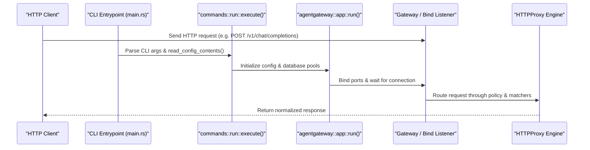
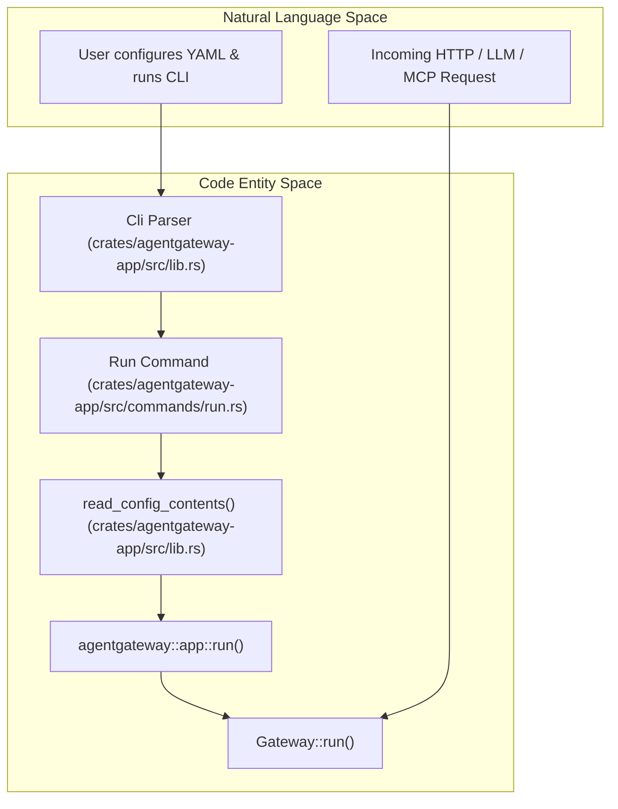
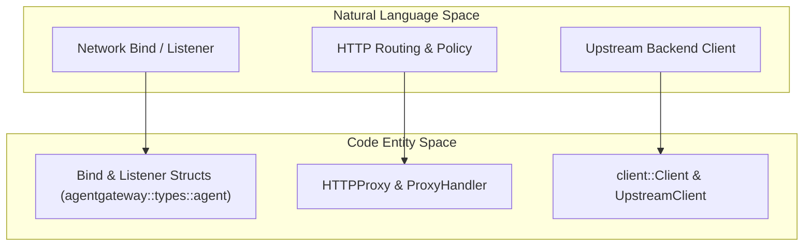

<!-- source: DeepWiki mcp.deepwiki.com · repo agentgateway/agentgateway · page 1.1 Getting Started · fetched 2026-10-21 -->

# Getting Started

<details>
<summary>Relevant source files</summary>

The following files were used as context for generating this wiki page:

- [crates/agentgateway-app/Cargo.toml](crates/agentgateway-app/Cargo.toml)
- [crates/agentgateway-app/src/commands/mod.rs](crates/agentgateway-app/src/commands/mod.rs)
- [crates/agentgateway-app/src/commands/oneshot.rs](crates/agentgateway-app/src/commands/oneshot.rs)
- [crates/agentgateway-app/src/commands/run.rs](crates/agentgateway-app/src/commands/run.rs)
- [crates/agentgateway-app/src/lib.rs](crates/agentgateway-app/src/lib.rs)
- [crates/agentgateway/tests/common/gateway.rs](crates/agentgateway/tests/common/gateway.rs)
- [crates/agentgateway/tests/common/mod.rs](crates/agentgateway/tests/common/mod.rs)
- [crates/agentgateway/tests/integration.rs](crates/agentgateway/tests/integration.rs)
- [crates/agentgateway/tests/tests/auto_protocol.rs](crates/agentgateway/tests/tests/auto_protocol.rs)
- [crates/agentgateway/tests/tests/connect.rs](crates/agentgateway/tests/tests/connect.rs)
- [crates/agentgateway/tests/tests/dfp.rs](crates/agentgateway/tests/tests/dfp.rs)
- [crates/core/src/readiness.rs](crates/core/src/readiness.rs)
- [examples/README.md](examples/README.md)

</details>


This page provides a quick start guide covering installation, basic configuration, and sending your first request to `agentgateway`. It explains standalone binary usage, CLI arguments, and references the comprehensive `examples/` directory for Model Context Protocol (MCP), LLM proxying, and traffic management scenarios [examples/README.md:1-65](), [crates/agentgateway-app/src/lib.rs:50-116]().

---

## Overview and Scope

`agentgateway` is a high-performance data plane designed for Agentic AI connectivity, providing unified routing, policy enforcement, protocol translation (such as OpenAI-compatible LLM APIs and MCP tool federation), and telemetry. This guide walks through the prerequisites, installation via standalone binary or Kubernetes/Tilt, basic configuration loading, and executing a sample request.

Sources: [examples/README.md:1-65](), [crates/agentgateway-app/src/lib.rs:50-116]()

---

## Prerequisites

Before installing or running `agentgateway`, verify your environment meets the necessary system and tool requirements:

| Requirement         | Standalone / Docker                     | Kubernetes Development                 |
|---------------------|---------------------------------------|--------------------------------------|
| **Rust toolchain**   | Version 1.86+                          | Required for builds                  |
| **Node.js**          | Version 24.17.0                       | Version 24.17.0                      |
| **Go**               | Not required                          | Version 1.22+ (for Kubernetes controller) |
| **Docker**           | Required for container images         | Required for Kind/Tilt development    |

Sources: [crates/agentgateway-app/Cargo.toml:1-56]()

---

## Installation Methods

### Standalone Binary Usage

`agentgateway` can be built and run as a standalone Rust binary (`agentgateway`), which packages the core data plane with an optional embedded React/TypeScript UI asset bundle [crates/agentgateway-app/Cargo.toml:8-30](), [crates/agentgateway-app/src/lib.rs:14-16]().

#### Building the Web UI and Binary

```bash
cd ui
corepack enable
pnpm install --frozen-lockfile
pnpm build
cd ..
cargo build --release --features ui
```

#### Running the Binary

The binary is driven by CLI arguments parsed via `Cli` and handled through `commands::run::execute` [crates/agentgateway-app/src/lib.rs:129-163](), [crates/agentgateway-app/src/commands/run.rs:12-109]().

```bash
./target/release/agentgateway --file config.yaml
```

- Configuration can be supplied explicitly via `--config` (raw bytes/string) or `--file` (path to a YAML/JSON configuration file) [crates/agentgateway-app/src/lib.rs:50-59](), [crates/agentgateway-app/src/lib.rs:165-205]().
- If no configuration source is explicitly provided, `read_config_contents()` searches for a default configuration directory or falls back appropriately [crates/agentgateway-app/src/lib.rs:189-204]().

Sources: [crates/agentgateway-app/Cargo.toml:8-30](), [crates/agentgateway-app/src/lib.rs:50-205](), [crates/agentgateway-app/src/commands/run.rs:12-109]()

---

## Basic Configuration and Example Gallery

The repository provides a rich set of runnable examples under the `examples/` directory, categorized by type (`mcp`, `llm`, `traffic`, and `integrations`) [examples/README.md:1-60]().

| Example Category | Example Name | Description |
|------------------|--------------|-------------|
| **LLM**          | `llm-basic`  | Proxy LLM requests to OpenAI and Anthropic with provider-specific model prefixes [examples/README.md:33-34]() |
| **MCP**          | `mcp-basic`  | Exposing a single Model Context Protocol server over Stdio [examples/README.md:21-21]() |
| **Traffic**      | `traffic-http` | Using agentgateway as a standard HTTP proxy with routes and policies [examples/README.md:45-45]() |

To run an example locally:
```bash
cd examples/llm-basic
cargo run -- -f config.yaml
```

Sources: [examples/README.md:1-60]()

---

## First Request and Request Processing Data Flow

When `agentgateway` starts up, `commands::run::execute()` initializes telemetry logging, parses configuration via `agentgateway::config::parse_config()`, sets up database pools if configured, and starts the proxy server via `proxy()` [crates/agentgateway-app/src/commands/run.rs:37-108]().

### Request Lifecycle Data Flow



Sources: [crates/agentgateway-app/src/lib.rs:140-163](), [crates/agentgateway-app/src/commands/run.rs:12-109]()

---

## System to Code Entity Mapping (Architecture Bridge)

This section maps user-facing concepts and operations to concrete code entities in the repository codebase.

### Diagram: Conceptual to Code Mapping for Startup & Proxying



Sources: [crates/agentgateway-app/src/lib.rs:50-205](), [crates/agentgateway-app/src/commands/run.rs:12-109]()

### Diagram: Data Plane Component Mapping



Sources: [crates/agentgateway/tests/common/gateway.rs:34-182](), [crates/agentgateway/tests/tests/auto_protocol.rs:1-17]()

---

## Summary

You are now equipped to install `agentgateway`, navigate the `examples/` directory, run standalone binaries using CLI configurations, and understand the core startup and request flow. Consult the subsequent architectural and configuration guides for deep technical dives into individual subsystems.

Sources: [examples/README.md:1-65](), [crates/agentgateway-app/src/commands/run.rs:12-109]()

---

