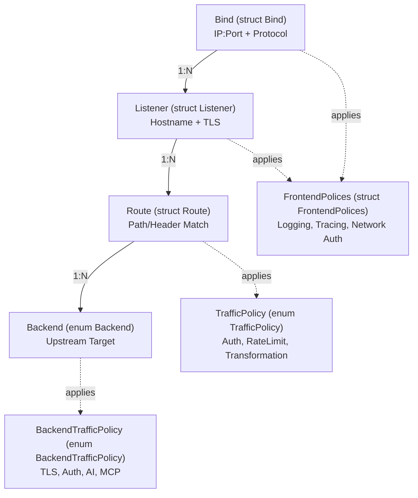
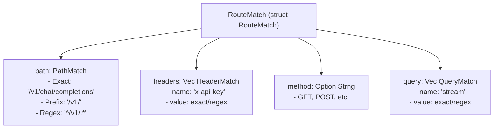
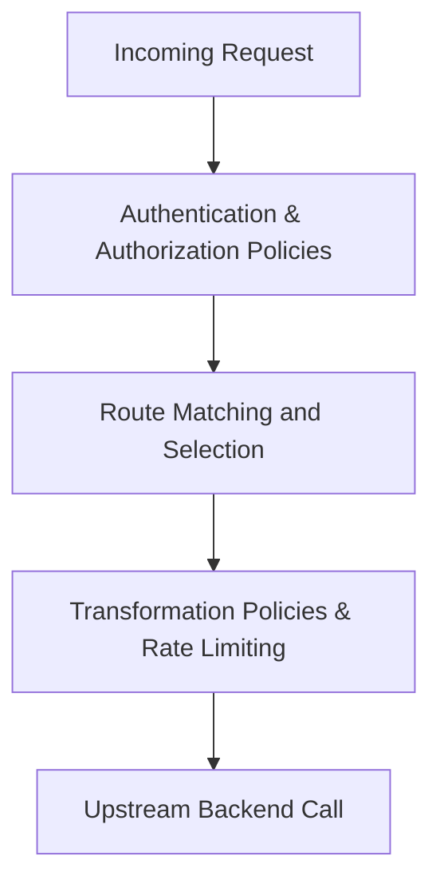

<!-- source: DeepWiki mcp.deepwiki.com · repo agentgateway/agentgateway · page 1.3 Key Concepts · fetched 2026-10-21 -->

# Key Concepts

<details>
<summary>Relevant source files</summary>

The following files were used as context for generating this wiki page:

- [api/resource.pb.go](api/resource.pb.go)
- [controller/api/v1alpha1/agentgateway/agentgateway_policy_types.go](controller/api/v1alpha1/agentgateway/agentgateway_policy_types.go)
- [controller/api/v1alpha1/agentgateway/zz_generated.deepcopy.go](controller/api/v1alpha1/agentgateway/zz_generated.deepcopy.go)
- [controller/install/helm/agentgateway-crds/templates/agentgateway.dev_agentgatewaybackends.yaml](controller/install/helm/agentgateway-crds/templates/agentgateway.dev_agentgatewaybackends.yaml)
- [controller/install/helm/agentgateway-crds/templates/agentgateway.dev_agentgatewaypolicies.yaml](controller/install/helm/agentgateway-crds/templates/agentgateway.dev_agentgatewaypolicies.yaml)
- [controller/pkg/agentgateway/plugins/backend_policies.go](controller/pkg/agentgateway/plugins/backend_policies.go)
- [controller/pkg/agentgateway/plugins/traffic_plugin.go](controller/pkg/agentgateway/plugins/traffic_plugin.go)
- [crates/agentgateway/src/proxy/httpproxy.rs](crates/agentgateway/src/proxy/httpproxy.rs)
- [crates/agentgateway/src/store/binds.rs](crates/agentgateway/src/store/binds.rs)
- [crates/agentgateway/src/types/agent.rs](crates/agentgateway/src/types/agent.rs)
- [crates/agentgateway/src/types/agent_xds.rs](crates/agentgateway/src/types/agent_xds.rs)
- [crates/agentgateway/src/types/frontend.rs](crates/agentgateway/src/types/frontend.rs)
- [crates/agentgateway/src/types/local.rs](crates/agentgateway/src/types/local.rs)
- [crates/agentgateway/src/types/local_tests.rs](crates/agentgateway/src/types/local_tests.rs)
- [crates/protos/proto/resource.proto](crates/protos/proto/resource.proto)
- [schema/config.json](schema/config.json)
- [schema/config.md](schema/config.md)

</details>


This document explains the fundamental configuration primitives that compose AgentGateway's data plane: **Binds**, **Listeners**, **Routes**, **Backends**, **Policies**, and the **XDS** protocol. These concepts form the core abstraction layer for routing requests and applying traffic policies. This page serves as a conceptual reference before diving into the detailed technical subsystems.

---

## Resource Hierarchy

AgentGateway organizes configuration into a hierarchical model, where each layer adds specificity to request routing and policy application. This hierarchy is reflected in the internal representation (IR) used by the proxy at runtime. Unlike Envoy, which often flattens configuration, AgentGateway maintains a hierarchy where resources point to parents, minimizing the "fan-out" impact of configuration changes.

### Conceptual to Code Entity Mapping

| System Concept | Code Entity (Rust) | Implementation File |
| :- | :- | :- |
| **Bind** | `struct Bind` | [crates/agentgateway/src/types/agent.rs:48-57]() |
| **Listener** | `struct Listener` | [crates/agentgateway/src/types/agent.rs:118-127]() |
| **Route** | `struct Route` | [crates/agentgateway/src/types/agent.rs:33]() |
| **Backend** | `enum Backend` | [crates/agentgateway/src/types/agent.rs:26]() |
| **Policy** | `struct TargetedPolicy` and policy enums | [crates/agentgateway/src/store/binds.rs:26-101]() |
| **XDS** | `agent_xds` translation and diagnostics | [crates/agentgateway/src/types/agent_xds.rs:1-68]() |

### Data Flow and Entity Relationship

#### Configuration Entity Relationship


**Policy Precedence:** Policies can be attached at different levels with hierarchical merging. More specific policies override less specific ones. Internal data structures map `PolicyTarget` to sets of policies, enabling lookup based on request context.

Sources: [crates/agentgateway/src/types/agent.rs:26-135](), [crates/agentgateway/src/types/local.rs:78-104](), [crates/agentgateway/src/store/binds.rs:26-101]()

---

## Binds

A **Bind** defines a socket address (IP and port) where the gateway accepts connections. Each bind specifies a protocol family that determines how incoming connections are processed and optionally a tunnel protocol wrapper.

### Bind Structure

| Field | Type | Description |
|-------|------|-------------|
| `key` | `BindKey` (alias for `Strng`) | Unique identifier (e.g., `"bind/8080"`) |
| `address` | `SocketAddr` | IP address and port to listen (e.g., `0.0.0.0:8080`) |
| `protocol` | `BindProtocol` enum | Protocol family: `HTTP`, `TCP`, `TLS` |
| `tunnel_protocol` | `TunnelProtocol` enum | Tunnel wrapper: `Direct`, `Proxy`, `HBONE_WAYPOINT`, `HBONE_GATEWAY`, `Connect` |
| `mode` | `BindMode` enum | Socket binding behavior: `Standard` (opens OS socket) or `Internal` (routing-only) |

The `Bind` struct orchestrates connection acceptance and processing setup, controlling traffic entry points [crates/agentgateway/src/types/agent.rs:48-57]().

### Internal and Wildcard Binds

- **Internal Binds** (`BindMode::Internal`) do not open OS sockets; used for in-process routing (e.g., CONNECT re-entry).
- A bind with port `0` in internal mode acts as a *wildcard fallback*, handling any unmatched destination port for dynamic port re-routing [crates/agentgateway/src/types/agent.rs:60-65]().

At runtime, the `Gateway` component manages active binds, asynchronously accepting connections and managing lifecycle on config changes [crates/agentgateway/src/proxy/gateway.rs:133-236]().

Sources: [crates/agentgateway/src/types/agent.rs:48-113](), [crates/agentgateway/src/proxy/gateway.rs:133-236]()

---

## Listeners

A **Listener** is attached to a bind and provides hostname-based routing and protocol-specific configuration. Multiple listeners on the same bind enable virtual hosting and protocol discriminations such as TLS termination.

### Listener Structure

| Field | Type | Description |
|-------|------|-------------|
| `key` | `ListenerKey` (`Strng`) | Internal identifier for quick lookup |
| `name` | `ListenerName` | User metadata (includes gateway and namespace) |
| `hostname` | `Strng` | Hostname pattern to match (supports exact and wildcard `*.`) |
| `protocol` | `ListenerProtocol` enum | Protocol handled: HTTP, HTTPS, TCP, TLS |

### Hostname Matching Logic

Listeners match hostnames via exact match, empty hostnames (wildcard), or wildcard suffix matches:

```rust
pub fn matches(&self, hostname: &str) -> bool {
    self.hostname == hostname
        || self.hostname.is_empty()
        || (self.hostname.starts_with("*") && hostname.ends_with(&self.hostname[1..]))
}
```

This enables layered routing and virtual hosting [crates/agentgateway/src/types/agent.rs:118-135]().

Sources: [crates/agentgateway/src/types/agent.rs:118-135](), [crates/agentgateway/src/store/binds.rs:107]()

---

## Routes

A **Route** defines matching criteria that identify requests and map them to one or more backends. It is the principal mechanism for directing traffic to specific upstream services including AI and MCP backends.

### Route Matching Components

Routes match using a combination of:

- Hostnames
- HTTP path match (exact, prefix, regex)
- Header match (name and exact/regex value)
- HTTP method match (optional)
- Query parameter match (name and exact/regex value)

#### Route Matching Logic Components


### Route Delegation

Routes may delegate matching to other route groups via `RouteGroup`. The `select_route_chain` function in the HTTP proxy performs iterative lookups through route groups resolving a final backend, guarding against cycles:

```rust
fn select_route_chain(
	inputs: &ProxyInputs,
	target_address: SocketAddr,
	listener: &Listener,
	req: &Request,
) -> Result<SelectedRouteChain, ProxyError>
```

This ensures modular route composition [crates/agentgateway/src/proxy/httpproxy.rs:111-152]().

Sources: [crates/agentgateway/src/types/agent.rs:33](), [crates/agentgateway/src/proxy/httpproxy.rs:111-152](), [schema/config.json:75-81]()

---

## Backends

A **Backend** represents an upstream destination for proxied requests, including traditional services and specialized AI/MCP backends.

### Backend Types

| Backend Kind | Enum Variant / Struct | Description |
| :- | :- | :- |
| Static Backend | `SimpleBackend` | Fixed or DNS-resolved HTTP/TCP endpoints |
| AI Backend | `AIBackend` | LLM providers (OpenAI, Anthropic, Bedrock, Gemini, etc) |
| MCP Backend | `McpBackend` | Model Context Protocol resource servers for tool/stateful access |
| Internal Backend | `InternalBackend` | Built-in services (e.g. model catalog) |

This abstraction allows layered policies and transport configuration.

### AI/LLM Integration

AI backends support proxying LLM requests across multiple providers. The `AIProvider` enum handles provider-specific models, request formats, and overrides. The function `override_ai_provider_model` supports model name substitution for routing:

```rust
fn override_ai_provider_model(provider: &mut AIProvider, model: &str)
```

This enables unified AI gateway capabilities with multiple providers [crates/agentgateway/src/types/agent_xds.rs:127-139]().

### MCP Integration

MCP backends support the Model Context Protocol for tools and sessions via JSON-RPC or SSE transports. The gateway embeds MCP metadata, manages authorization, and ensures session affinity:

- `McpBackend` struct
- Authorization sets and guardrails

[crates/agentgateway/src/types/agent.rs:31-36]()

Sources: [crates/agentgateway/src/types/agent.rs:26-55](), [crates/agentgateway/src/types/agent_xds.rs:127-139](), [schema/config.json:89-110]()

---

## Policies

Policies enforce security and behavioral rules at multiple levels across traffic flows.

### Policy Categories

AgentGateway uses CEL-based dynamic evaluation with hierarchical merging of policies:

| Policy Category | Scope | Controls |
| --- | --- | --- |
| FrontendPolicies | Gateway, Bind, Listener | Logging, tracing, network auth, proxy, connect |
| TrafficPolicies | Routes | JWT auth, rate-limiting, CORS, retries, request/response transforms |
| BackendPolicies | Backends | TLS settings, backend auth, AI prompt guards, MCP authorization |

Policies are represented by structs/enums like `FrontendPolices`, `TrafficPolicy`, `BackendTrafficPolicy` and are merged according to specificity and inheritance rules [crates/agentgateway/src/store/binds.rs:145-224]().

### Policy Application Flow (Simplified)



Request processing performs layered policy application with CEL evaluation, access control enforcement, rate limiting, then proceeds upstream [crates/agentgateway/src/proxy/httpproxy.rs:200-211]().

Sources: [crates/agentgateway/src/store/binds.rs:145-224](), [crates/agentgateway/src/proxy/httpproxy.rs:200-211](), [crates/agentgateway/src/types/agent.rs:32]()

---

## XDS: Dynamic Configuration Protocol

AgentGateway supports runtime configuration updates via the **xDS protocol**. The `agent_xds` module translates xDS protobuf resources into internal data structures safely.

### Translation and Diagnostics

- Differentiates between *errors* that block resource application (e.g., invalid enum values) and *warnings* that allow partial application but flag issues (e.g., malformed CEL expressions).
- Applies partial config with warnings to avoid service disruption.
- Uses a `Diagnostics` struct to track warnings and errors for control plane reporting [crates/agentgateway/src/types/agent_xds.rs:1-68]().

This approach ensures robust, safe incremental config updates without downtime.

Sources: [crates/agentgateway/src/types/agent_xds.rs:1-68](), [crates/agentgateway/src/store/binds.rs:34-40]()

---

# Summary Diagram: Natural Language Concepts to Code Entities

```mermaid
graph LR
    Binds["Binds"]
    Binds --> BindStruct["`struct Bind`"]
    BindStruct --> BindRustFile["[types/agent.rs:48-57]()"]

    Listeners["Listeners"]
    Listeners --> ListenerStruct["`struct Listener`"]
    ListenerStruct --> ListenerRustFile["[types/agent.rs:118-127]()"]

    Routes["Routes"]
    Routes --> RouteStruct["`struct Route`"]
    RouteStruct --> RouteRustFile["[types/agent.rs:33]()"]

    Backends["Backends"]
    Backends --> BackendEnum["`enum Backend`"]
    BackendEnum --> BackendRustFile["[types/agent.rs:26]()"]

    Policies["Policies"]
    Policies --> PolicyStruct["`struct TargetedPolicy` + enums"]
    PolicyStruct --> PolicyRustFile["[store/binds.rs:26-101]()"]

    XDS["XDS Protocol"]
    XDS --> AgentXDSModule["`agent_xds` Translation Module"]
    AgentXDSModule --> AgentXDSRustFile["[types/agent_xds.rs:1-68]()"]
```

Sources: [crates/agentgateway/src/types/agent.rs:26-135](), [crates/agentgateway/src/store/binds.rs:26-101](), [crates/agentgateway/src/types/agent_xds.rs:1-68]()  

---

This foundational conceptual framework enables understanding of how AgentGateway processes network traffic, applies policies intelligently, and routes to suitable backends dynamically and securely.

# References

- [crates/agentgateway/src/types/agent.rs:26-135]()
- [crates/agentgateway/src/proxy/httpproxy.rs:59-154]()
- [crates/agentgateway/src/store/binds.rs:26-203]()
- [crates/agentgateway/src/proxy/gateway.rs:133-236]()
- [crates/agentgateway/src/types/agent_xds.rs:1-68]()
- [schema/config.json:1-122]()

---

