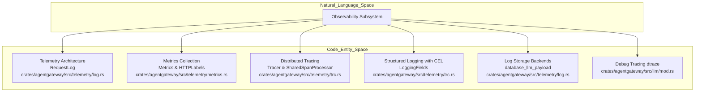
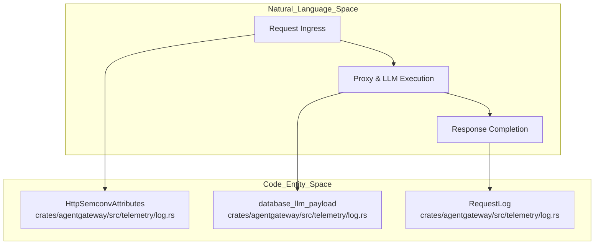
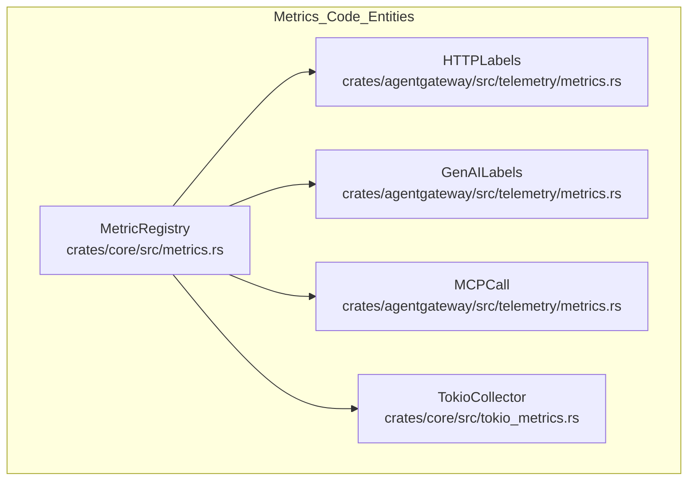
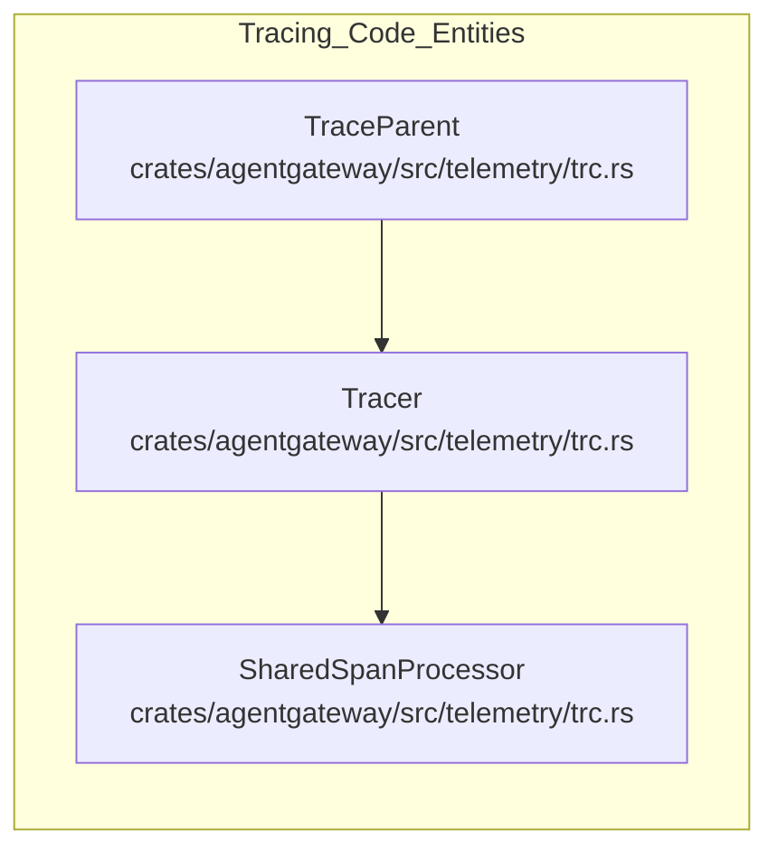
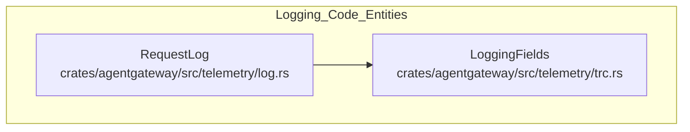
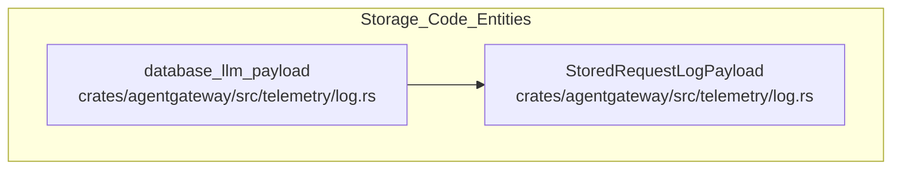
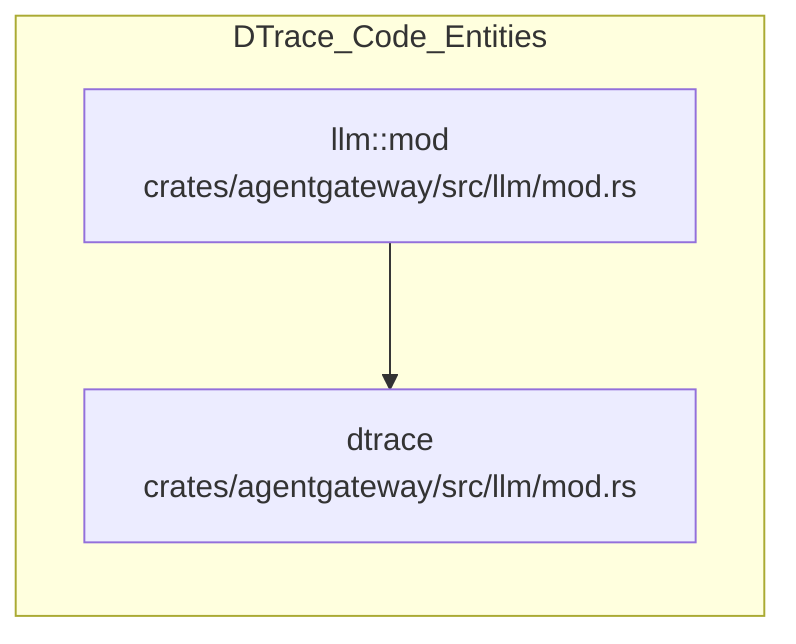

<!-- source: DeepWiki mcp.deepwiki.com · repo agentgateway/agentgateway · page 10 Observability · fetched 2026-10-21 -->

# Observability

Relevant source files

The following files were used as context for generating this wiki page:

- [crates/agentgateway/src/llm/mod.rs](crates/agentgateway/src/llm/mod.rs)
- [crates/agentgateway/src/llm/tests.rs](crates/agentgateway/src/llm/tests.rs)
- [crates/agentgateway/src/telemetry/log.rs](crates/agentgateway/src/telemetry/log.rs)
- [crates/agentgateway/src/telemetry/metrics.rs](crates/agentgateway/src/telemetry/metrics.rs)
- [crates/agentgateway/src/telemetry/trc.rs](crates/agentgateway/src/telemetry/trc.rs)
- [crates/agentgateway/tests/tests/llm.rs](crates/agentgateway/tests/tests/llm.rs)
- [crates/core/src/lib.rs](crates/core/src/lib.rs)
- [crates/core/src/metrics.rs](crates/core/src/metrics.rs)
- [crates/core/src/tokio_metrics.rs](crates/core/src/tokio_metrics.rs)

Agentgateway provides comprehensive observability through metrics, distributed tracing, and structured logging. The telemetry system is designed to capture detailed information about request processing, LLM interactions, MCP operations, and TCP connections, with CEL-based customization for fields and filtering. This page serves as a high-level parent guide to the observability subsystem; for detailed technical specifications, refer to the child pages linked below.

---

## Observability Subsystems Overview

The observability architecture is divided into specialized subsystems handling real-time telemetry lifecycles, Prometheus metrics via `prometheus_client` integration [crates/agentgateway/src/telemetry/metrics.rs:25-45](), OpenTelemetry distributed tracing via `Tracer` [crates/agentgateway/src/telemetry/trc.rs:22-29](), CEL-expressed structured logs, persistent log storage backends [crates/agentgateway/src/telemetry/log.rs:144-207](), and runtime per-request debug tracing (`dtrace`).

Title: "Observability Subsystem Architecture"

**Sources:** [crates/agentgateway/src/telemetry/log.rs:1-205](), [crates/agentgateway/src/telemetry/trc.rs:22-44](), [crates/agentgateway/src/telemetry/metrics.rs:25-45]()

---

## 10.1 Telemetry Architecture

The telemetry architecture centers on the `RequestLog` structure, which accumulates data throughout request processing and emits it upon completion [crates/agentgateway/src/telemetry/log.rs:29](). The system uses RAII wrapper types and asynchronous log handlers to manage payloads (such as LLM token usage or response bodies) that arrive after the primary request path completes [crates/agentgateway/src/telemetry/log.rs:144-207]().

This design enables capturing rich, detailed telemetry in a request lifecycle including TCP connection details, HTTP semantics (via `HttpSemconvAttributes` [crates/agentgateway/src/telemetry/log.rs:69-141]()), and payload capture for AI/LLM interactions. The RAII pattern ensures logs are finalized reliably on request completion or drop scenarios.

For detailed information on the request log lifecycle and drop patterns, see [Telemetry Architecture](#10.1).

Title: "Telemetry Lifecycle & RAII Mapping"

**Sources:** [crates/agentgateway/src/telemetry/log.rs:68-141](), [crates/agentgateway/src/telemetry/log.rs:144-207](), [crates/agentgateway/src/telemetry/log.rs:29]()

---

## 10.2 Metrics Collection

Agentgateway exports Prometheus metrics covering HTTP requests, LLM token usage, MCP operations, and TCP connections using metric families managed via filtered registries. Metrics use strongly-typed label sets like `HTTPLabels` [crates/agentgateway/src/telemetry/metrics.rs:94-107](), `GenAILabels` [crates/agentgateway/src/telemetry/metrics.rs:110-121](), and `MCPCall` [crates/agentgateway/src/telemetry/metrics.rs:170-182](), alongside Tokio runtime integration through the `TokioCollector` [crates/core/src/tokio_metrics.rs:9-20]() trait.

This design supports flexible, extensible metrics instrumentation supporting detailed breakdowns by route, backend, and request attributes. Metrics are exposed for scraping by Prometheus and visualized via Grafana dashboards.

For detailed metric definitions, label evaluation, and Grafana dashboard configurations, see [Metrics Collection](#10.2).

Title: "Metrics Collection Entity Mapping"

**Sources:** [crates/agentgateway/src/telemetry/metrics.rs:94-182](), [crates/core/src/metrics.rs:20-30](), [crates/core/src/tokio_metrics.rs:9-20]()

---

## 10.3 Distributed Tracing

Distributed tracing integrates with OpenTelemetry using the `Tracer` type which encapsulates the tracer provider and span processing logic [crates/agentgateway/src/telemetry/trc.rs:22-28](). Span export is managed via a `SharedSpanProcessor` [crates/agentgateway/src/telemetry/trc.rs:41-44]() wrapper around OpenTelemetry span processors. The system supports trace context propagation with `TraceParent` [crates/agentgateway/src/telemetry/trc.rs:16]() identifiers.

Trace export filtering is performed with CEL expressions via `should_export_span()` [crates/agentgateway/src/telemetry/trc.rs:34-39](), allowing selective tracing of requests based on dynamic request attributes or sampling.

For configuration, OTLP exporter setup, and example usage (including Datadog), see [Distributed Tracing](#10.3).

Title: "Tracing Execution Flow"

**Sources:** [crates/agentgateway/src/telemetry/trc.rs:16-44]()

---

## 10.4 Structured Logging with CEL

Structured logging leverages CEL (Common Expression Language) to filter and enrich logs with dynamic expressions and custom fields. Logs embed a rich context from request and proxy data, accessible as CEL variables such as `request`, `response`, `proxy`, and `llm` contexts. This context enables precise log filtering and formatting decisions.

The logging subsystem uses `LoggingFields` [crates/agentgateway/src/telemetry/trc.rs:26]() and `CelLoggingExecutor` [crates/agentgateway/src/telemetry/log.rs:19]() to evaluate log expressions and serialize output in structured formats. Custom field extraction and CEL-based evaluations are integral for log control and observability insight.

For CEL log filtering rules, expression schemas, and log output customization, see [Structured Logging with CEL](#10.4).

Title: "Structured Logging Flow"

**Sources:** [crates/agentgateway/src/telemetry/trc.rs:26](), [crates/agentgateway/src/telemetry/log.rs:19](), [crates/agentgateway/src/telemetry/log.rs:29]()

---

## 10.5 Log Storage Backends

Agentgateway supports persisting request logs to SQLite or Postgres databases, enabling a historical and queryable log store used by the Web UI log viewer and audit tooling. The persistence subsystem implements conversion routines like `database_llm_payload` [crates/agentgateway/src/telemetry/log.rs:144-207]() that transform in-memory LLM data to storable JSON payloads.

These backends provide migration support and schema synchronization for reliable log storage and retrieval, facilitating long-term observability pipelines.

For backend configuration, schema details, and storage options, see [Log Storage Backends](#10.5).

Title: "Log Storage Architecture"

**Sources:** [crates/agentgateway/src/telemetry/log.rs:144-207]()

---

## 10.6 Debug Tracing (dtrace)

For advanced operational debugging, agentgateway provides runtime per-request debug tracing (`dtrace`). This facility integrates with LLM and proxy components to collect detailed execution flows and event streams for diagnostic purposes [crates/agentgateway/src/llm/mod.rs:48](). Traces can be streamed over Server-Sent Events (SSE) and controlled via the `agctl` CLI.

This approach empowers interactive, fine-grained observability and fault analysis during development and production support.

For usage instructions and CLI references, see [Debug Tracing (dtrace)](#10.6).

Title: "Debug Tracing Flow"

**Sources:** [crates/agentgateway/src/llm/mod.rs:48]()

---

